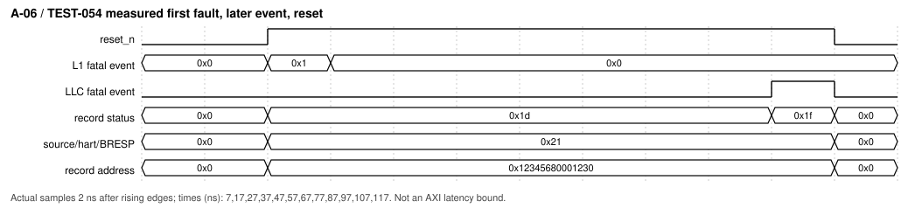

# Measured waveform / Waveform đo từ mô phỏng

The trace comes from the four-hart record unit's actual VCD, sampled 2 ns after rising edges at 7, 17, …, 117 ns. It demonstrates first-event capture, unchanged payload when another fatal event sets multiple, and clearing at reset. The trace is a unit-level register check, not an AXI timing diagram or CPU latency bound. Source [VCD](../../../verification/non_coherence_cluster/reports/fault_record_a06/unit/service_4h_error0.vcd), [WaveJSON](../../../verification/non_coherence_cluster/reports/fault_record_a06/waveforms/first_fault_4h.json).

Hình lấy từ VCD thực của unit record bốn hart, sau cạnh clock 2 ns tại 7, 17, …, 117 ns. Hình kiểm tra capture lỗi đầu, giữ payload khi lỗi sau đặt multiple và xóa khi reset. Đây là kiểm tra thanh ghi ở cấp unit, không quy định latency AXI hoặc CPU.

Independent CPU tests verify address/hart/BRESP against the injected AXI transaction. Ten A-06 CPU cases include both SLVERR and DECERR, L1/LLC origin, reset recovery, and cross-ID response ordering where hart 1 (two harts) or hart 3 (four harts) fails first. [Native logs and full regression](validation.md). Each A-06 CPU case requires 20 native AXI, 20 external AXI and 20 AXI4-Lite checks to activate and pass.

Test CPU độc lập đối chiếu địa chỉ/hart/BRESP với transaction AXI được tiêm lỗi. Mười ca A-06 gồm hai mã lỗi, hai nguồn, reset recovery và đảo thứ tự response giữa ID để hart 1 hoặc hart 3 lỗi trước. Mỗi ca bắt buộc kích hoạt và PASS 20 kiểm tra ở từng giao diện native AXI, AXI ngoài và AXI4-Lite. Chưa đo code coverage.
