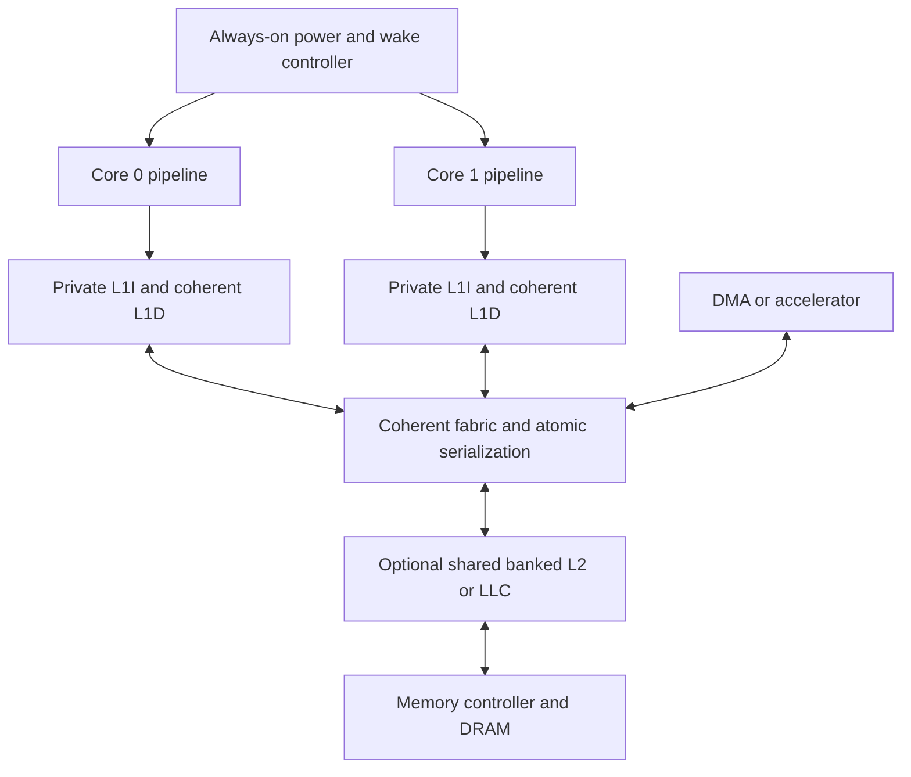
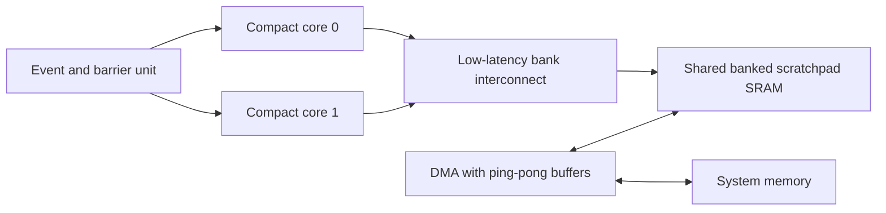

# Open-source RISC-V dual-core architectures: performance and power
# Kiến trúc RISC-V dual-core mã nguồn mở: hiệu năng và điện năng

Research date / Ngày nghiên cứu: **2026-11-06 (Asia/Saigon)**.

Scope / Phạm vi: architecture and published-source review for an ASIC-oriented dual-core system. No repositories were cloned, RTL configurations elaborated, simulations executed, or PPA measured for this report. Repository links are discovery references, not pinned, reproducible implementation baselines.

## English

### 1. Recommendation and decision criteria

There is no defensible universal winner for both highest performance and lowest power. Select by completed application work per joule under a latency deadline, an area limit, and a sustained power budget. GHz, IPC, CoreMark/MHz, and core count alone cannot establish the winner.

For Linux/shared-memory applications, prioritize a coherent two-core CVA6S+/HPDCache cluster using Culsans-style coherence, and compare it against a two-Rocket configuration. Include two BOOM cores when single-thread latency is important enough to justify a larger speculative execution engine. These are evaluation candidates, not a measured ranking.

For predictable DSP or block processing, evaluate two compact cores with banked shared scratchpad SRAM and DMA. The PULP cluster is an architectural reference; its published top-level platform uses eight cluster cores, so a two-core reduction requires elaboration and verification. For FPGA exploration, VexiiRiscv is another candidate; FPGA logic utilization is not evidence of ASIC energy efficiency.

**Corrections to overly broad claims:** snooping does not always outperform a directory; a shared L2 is not mandatory for every efficient dual-core system; an in-order core does not necessarily consume less energy per task than an OoO core; Chisel/SpinalHDL sources require generation tooling, but the resulting RTL can enter standard EDA flows. None of these distinctions alone establishes production readiness.

### 2. Terms and architecture choices

| Term | Meaning | Design implication |
|---|---|---|
| Core / hart | Core is a physical processor implementation; hart is an architectural hardware execution context | Two independent cores typically provide two harts; SMT is a different design |
| Dual-issue | One core can issue up to two instructions per cycle | Two dual-issue cores still need executable parallelism and memory bandwidth |
| SMP | One OS manages peer processors sharing memory | Coherent caches, atomics, interrupts and firmware must work together |
| AMP | Software assigns processors separate roles, often separate OS instances | Shared buffers need explicit ownership and visibility rules |
| OoO | Instructions can be scheduled around older stalled instructions | Can hide latency; adds queues, renaming and speculative state |
| Coherence / consistency | Coherence manages cached copies of a location; consistency constrains memory ordering across operations | A coherence protocol alone does not prove RVWMO compliance |
| MSHR | Tracks an outstanding cache miss | More entries can improve memory parallelism but consume area/power |
| Scratchpad / TCDM | Software-managed local SRAM, often split into banks | Predictable placement; software/DMA must manage data movement |
| ICG / DVFS | Integrated clock gating / dynamic voltage and frequency scaling | Require library and system support, not just RTL enables |
| Lockstep | Redundant cores execute the same computation for fault detection | Evaluate as a safety mechanism, not two independent compute workers |

The RISC-V ISA does not prescribe one coherence protocol. Platform memory attributes and ordering rules must match the implemented system. A plain AXI interconnect does not automatically make private caches coherent. Stand-alone CVA6 delegates coherence and atomicity to its integration. [S13, S14]

### 3. Open-source candidates and evidence

“Configurable” below means an architecture can be configured or adapted toward two cores; it does not claim a particular two-core netlist was built during this review.

| Candidate and source | Available building blocks | Dual-core evidence/status | Performance opportunity | Power/ASIC concern |
|---|---|---|---|---|
| **Culsans + CVA6 family** [S1–S3] | SystemVerilog coherent cluster, ACE interfaces, snoop-based MOESI | Published dual-core evaluation; repository targets small clusters | Short coherence paths and direct cache-line exchange | Keep snoop service alive while pipelines sleep; confirm the exact coherent cache revision |
| **Rocket Chip / Chipyard** [S5, S6] | Chisel generator, Rocket tiles, coherent TileLink system integration | Multicore generator; two-tile configuration must be pinned and built | Moderate core complexity, configurable memory hierarchy | Measure complete tile/cache/fabric power; confirm selected clock gating and SRAM mappings |
| **BOOM / Chipyard** [S6, S7] | OoO RV64 core generator and Rocket Chip integration | Multicore/heterogeneous composition documented; exact two-core design remains to be built | Renaming, instruction scheduling and concurrent misses can reduce stalls | Larger structures and speculative activity; tune width and queues rather than choosing the largest configuration |
| **BlackParrot / BedRock** [S8] | SystemVerilog in-order cores, coherent private caches, directory-based memory system | Native multicore architecture; exact two-core build not established here | Useful reference for modular coherent memory and accelerator integration | Directory storage, network latency and SRAM organization need comparison at two cores |
| **OpenPiton + Ariane/CVA6** [S9] | Tiled coherent platform with L1.5 and distributed memory hierarchy | Public multicore integration and published two-core comparison [S2] | Scalable infrastructure and shared-memory research platform | Extra hierarchy/routing may cost latency and energy for a small cluster; not a universal disadvantage |
| **VexiiRiscv / VexRiscv SMP** [S10] | SpinalHDL-generated RV32/RV64 core options and coherent integration references | VexiiRiscv multicore Linux demonstration; predecessor SMP protocol documented | Configurable issue width and compact FPGA exploration | Different projects/generations: do not assume predecessor interfaces match VexiiRiscv; no comparable ASIC power result established here |
| **PULP cluster / CV32E40P** [S11] | SystemVerilog cluster, shared banked TCDM, DMA and event mechanisms | Public eight-core platform and configurable cluster; two-core adaptation requires checks | Low-latency software-managed data and DMA overlap for regular kernels | Bank conflicts and software data management; not a drop-in Linux SMP replacement |
| **OpenC910 as a core candidate** [S12] | Open-source OoO core RTL | This review does not establish a ready-to-use two-core coherent integration | Stronger single-thread scheduling and memory parallelism | Interface adaptation and whole-system validation are substantial; core openness is not proof of complete cluster openness |

Source licenses, generated RTL notices, submodules, firmware and SRAM/PDK dependencies must be recorded separately when selecting a baseline. No per-file license audit was performed. Public RTL does not imply an open SRAM compiler, complete physical implementation kit, or verified power-domain implementation.

### 4. Published numbers: useful evidence, not a cross-project league table

| Study | Reported result | What can be concluded |
|---|---|---|
| Culsans 2024 [S2] | Dual-core SPLASH-3: up to 32.87% and average 15.8% faster than the compared OpenPiton design; CCU 1.6% of system area in GF22 FDSOI synthesis | A small snoop-based cluster can reduce overhead in that setup. Cache implementations differ, so this does not isolate coherence topology alone |
| CVA6S+/HPDCache cluster, Summit 2026 [S3] | SPLASH-3 geometric mean 1.75× versus single-core, 1.21× versus prior scalar-CVA6/cache cluster; CCU about 35 kGE / 1.5% of cluster in GF12 synthesis | Direct evidence for a compact coherent cluster; conference abstract, not a reproduced local result or a measured power claim |
| CVA6S+ 2025 [S4] | 43.5% improvement over scalar configuration; 9.30% total area overhead; HPDCache bandwidth gain 74.1% over legacy subsystem | Pipeline and cache changes can help together; results depend on the study's workloads/configurations |
| Controlled core comparison 2025 [S12] | Same 22 nm methodology: CVA6S+ +34.4% IPC / +6% area versus scalar CVA6; modified C910 +119.5% IPC / +75% area | Core complexity can improve energy efficiency as well as performance; this is a core comparison, not dual-core scaling data |

The 43.5% and 34.4% CVA6S+ values come from different studies/configurations; do not average them or treat either as a universal gain. CCU area percentage is not its power percentage. No supported common-basis dual-core power ranking was found among these candidates.

### 5. Architecture A: coherent SMP for general-purpose performance

Proposed starting topology, not an exact reproduction of every cited implementation:



For two cores, evaluate a short snoop path before a distributed directory/mesh. Also compare a simple directory or snoop filter if snoop traffic is expensive. Topology selection depends on traffic, physical placement, cache organization and timing, not only the number two.

Prioritize non-blocking data caches where the core can exploit concurrent requests, enough miss/refill/writeback capacity, and a fabric with independent progress for requests and responses. A cache with many MSHRs provides little benefit if an upstream load unit serializes every request.

A shared L2 is a design option: it can reduce DRAM traffic and cache duplication, but adds lookup latency and leakage. Sweep its capacity, banks and bypass behavior; also evaluate the same cores without it. A wider fabric raises peak bandwidth but can increase wire/clock power. Size it from observed traffic.

Suggested exploration points, **not legal-configuration claims for all repositories**: private L1 capacity 16/32 KiB, shared L2 disabled/256/512 KiB, two versus four banks, and several supported miss-queue sizes. Use actual supported configurations and SRAM macros before selecting values.

DMA must either join a supported coherent domain or follow explicit clean/invalidate and ownership rules. CPU-to-CPU coherence alone does not establish I/O coherence. Instruction-cache visibility and remote FENCE.I handling also require an explicit software/platform contract.

### 6. Architecture B: scratchpad and DMA for low energy per block



This is attractive for regular DSP, packet processing, encryption and tiled kernels with known working sets. DMA can load block k+1 while the cores compute block k. Distribute buffers across SRAM banks; independent addresses do not guarantee independent banks. Use events/barriers instead of active polling where supported. The public PULP cluster and its CV32E40P sleep integration are concrete references. [S11]

Benefits are workload-dependent: DMA copies, padding, synchronization and software overhead must count in energy and time. Irregular pointer chasing, large shared data structures and general-purpose OS workloads may favor coherent caches. Two cores need not be the best accelerator for a fixed algorithm; compare against a vector unit or dedicated engine where the workload justifies it.

### 7. High-performance techniques and their costs

| Technique | Intended benefit | Cost and decision condition |
|---|---|---|
| Dual issue, forwarding, better prediction | More useful instructions per cycle | Additional ports, muxes and switching; measure useful IPC and branch misses |
| OoO issue and memory parallelism | Execute around dependency/cache stalls | Queue/CAM/register energy; evaluate completed work per joule |
| Non-blocking caches and miss merging | Hide memory latency, avoid duplicate fills | Buffers/control power; prove actual concurrent issue capability |
| Cache-to-cache dirty-line forwarding | Avoid unnecessary memory round trips | Snoop/data paths and race handling |
| Banked SRAM/cache and independent queues | Reduce structural contention | Routing, arbitration and bank conflicts |
| Adaptive prefetch | Reduce demand misses | Disable/throttle on poor accuracy or bandwidth saturation |
| Per-core data ownership and batching | Reduce false sharing and locks | Software restructuring; include end-to-end latency |
| Accelerator/vector offload | Increase work per fetched instruction | Transfer/setup overhead; evaluate complete workload |

False sharing means cores modify different variables located in one coherence line. It can create repeated ownership transfers even though the variables are logically independent. Separate hot per-core counters/queues by the implemented cache-line size.

### 8. Low-power techniques and implementation requirements

The following are engineering recommendations; they are not claims that every candidate implements them.

| Technique | Expected mechanism | Required engineering |
|---|---|---|
| Fine-grain clock gating | Reduce switching in idle pipeline/FPU/queue blocks | Library ICG cells, test enable, clock-gating STA and activity-based measurement |
| Operand isolation | Stop inactive arithmetic input toggles | Avoid introducing critical-path muxes or extra always-active logic |
| Event-driven core sleep | Reduce idle clock activity | Drain outstanding operations; preserve debug/interrupt wake and coherence service |
| Core power gating | Reduce leakage during sufficiently long idle periods | Isolation, retention or state loss contract, cache handling, power intent and power-aware validation |
| DVFS | Reduce voltage/frequency when slack exists | Supported operating points, regulator/PLL, transition sequencing, CDC and voltage-corner timing |
| SRAM enables and cache sizing | Reduce accessed capacitance and leakage | Macro-specific behavior; smaller caches can increase expensive DRAM accesses |
| Core parking and task consolidation | Put one core into a deeper idle state | Scheduler policy, migration overhead, latency and thermal constraints |
| Batching and wake coalescing | Amortize wake/transition energy | Respect deadline and maximum interrupt latency |

**Coherence-aware sleep is essential.** Gating a whole tile while it owns dirty cache lines can prevent probes from completing. Keep the necessary snoop/cache controller clocked, or add a wake-on-probe path with bounded response, or clean/evict the cache and remove the tile from the coherent domain before deeper sleep. The exact sequence must match the protocol.

Likewise, a clock-gated core is not necessarily safe to reset or power off. Power-down requires a defined quiescent state, completed or cancelled transactions, appropriate clean/invalidate operations, and retained reservation/directory behavior. WFI alone does not prove this system state.

Start with both cores in one clock/voltage domain and independent supported clock enables. Add separate DVFS/power domains only if measured benefit pays for crossings, isolation, extra verification and wake cost. Shared-domain DVFS is often simpler; separate domains can help asymmetric duty cycles.

### 9. Quantitative reasoning

Use these equations as models; all example values below are hypothetical.

```text
Task time T = cycles / frequency
Approximate dynamic power Pdyn = activity × effective capacitance × V² × f
Task energy E = integral(Psystem(t), dt)
Approximate constant-power task energy = Pavg × T
Energy-delay product EDP = E × T
Ideal two-core speedup = 1 / ((1-p) + p/2)
```

Here p is the parallel fraction of the original execution time. At p=0.90 the ideal speedup is 1.818× before synchronization and contention. A memory-capacity change can also alter cache behavior, so Amdahl's simple fixed-work assumptions must be checked.

Example: one core takes 10 ms at 100 mW: E1=1.0 mJ. Two cores take 6 ms at 160 mW: E2=0.96 mJ, 1.67× faster and 4% less task energy despite greater active power. At 190 mW for the same time, E2=1.14 mJ, which is faster but consumes 14% more energy.

For a deeper sleep state, an approximate break-even idle time is:

```text
Tbreak_even = incremental transition energy / (shallow-idle power - deep-idle power)
```

Include lost time, cache refill and re-execution energy in transition cost. For dynamic power alone, reducing voltage to 0.8 of baseline and frequency to 0.75 gives an approximate power ratio 0.8²×0.75=0.48. This is not a 52% total-system power claim: leakage, SRAM, DRAM and regulator losses differ. Race-to-idle and DVFS must be compared under the same deadline.

### 10. Evaluation plan before choosing a winner

1. Freeze repository commits, generated configuration, ISA/ABI, compiler flags, firmware and OS. Record source and dependency licenses.
2. Define workload inputs and deadlines. Measure single-core and dual-core completion time with identical work and validated results.
3. Include integer/branch-heavy, floating-point if relevant, sequential/irregular memory, producer-consumer, false-sharing, atomics, and DMA workloads. Add idle, bursty and low-duty-cycle traces.
4. Collect IPC, useful dual-issue fraction, branch misses, cache misses, outstanding misses, DRAM bytes/task, bank conflicts, snoops, lock/barrier time and per-core active/sleep residency.
5. Implement comparable candidates using the same PDK, voltage, PVT corner, SRAM assumptions, SDC and physical methodology. Report native-optimal and resource-matched cache configurations separately.
6. Use representative VCD/SAIF activity for post-synthesis or post-layout power. Include clocks, caches, coherent fabric, memory controller and the stated external-memory power boundary. Report confidence/limitations of each estimate.
7. Validate coherence races, atomics/LR-SC, RVWMO outcomes, forward progress, DMA visibility, debug wake and sleep/reset/power transitions. Functional code coverage alone cannot prove these properties.
8. Compare energy/task, deadline pass rate, sustained throughput, area and peak power. Select from the Pareto frontier: retain candidates that are not worse in every chosen metric.

### 11. Shortlist for this project

| Intended product | First candidate | Alternative / reason to change |
|---|---|---|
| RV64 Linux MPU; maintainable SystemVerilog integration | CVA6S+/HPDCache coherent cluster, pin compatible Culsans/coherent-cache revisions | Two Rocket tiles for a generator-based coherent baseline |
| Strict single-thread deadline with high computation latency | Two appropriately sized BOOM cores as an evaluation design | Modified C910 if interface and validation resources are available |
| Low-energy block DSP/crypto/control workload | Two compact cores + banked scratchpad + DMA/event sleep | Coherent in-order cluster when data sharing becomes irregular |
| FPGA prototype to explore cache/core configurations | VexiiRiscv multicore design | Rocket/BOOM in Chipyard if that ecosystem fits the team |

Availability of a 2026 CVA6S+ cluster presentation does not establish that the current public Culsans default branch contains the identical HPDCache/coherent RTL and firmware. Confirm matching commits before integration. No absolute low-power winner is asserted because comparable whole-system measurements are missing.

## Tiếng Việt

### 12. Kết quả và hướng lựa chọn

Không có cơ sở để khẳng định một kiến trúc đồng thời có hiệu năng cao nhất và điện năng thấp nhất cho mọi ứng dụng. Tiêu chí phù hợp là **năng lượng để hoàn thành một tác vụ**, trong giới hạn latency, diện tích và công suất duy trì.

Báo cáo khảo sát tám nhóm: Culsans/CVA6, Rocket Chip, BOOM, BlackParrot/BedRock, OpenPiton, VexiiRiscv/VexRiscv SMP, PULP cluster và OpenC910. Bảng ở mục 3 phân biệt thiết kế có bằng chứng dual-core với nền tảng mới chỉ có khả năng cấu hình hoặc cần tích hợp thêm.

Với Linux và bộ nhớ chia sẻ, ưu tiên đánh giá **hai CVA6S+ + HPDCache + coherence unit**, đồng thời dùng hai Rocket làm cấu hình đối chiếu. Khi latency đơn luồng là ràng buộc chính, thêm hai BOOM vào nghiên cứu. Với xử lý theo khối, nên so sánh với **hai core nhỏ + SRAM scratchpad nhiều bank + DMA**.

Đây là danh sách ứng viên. Báo cáo chưa tải RTL, build cấu hình hai core, chạy mô phỏng hoặc đo PPA tại workspace. Số liệu công bố thuộc cấu hình của tác giả; không phải kết quả kiểm chứng của dự án này.

### 13. Những điểm cần hiểu đúng

- Dual-core là hai core; dual-issue là khả năng phát hành hai lệnh trong một chu kỳ của một core. Hai khái niệm độc lập.
- SMP cho phép một OS quản lý các core ngang hàng. AMP giao vai trò riêng cho từng core. Lockstep chạy lặp cùng phép tính để phát hiện lỗi.
- Coherence giữ các bản sao cache đúng với nhau; memory consistency quy định thứ tự mà các truy cập được phép quan sát. Cần kiểm chứng cả hai.
- Chisel và SpinalHDL là ngôn ngữ sinh phần cứng. RTL đã sinh vẫn có thể dùng trong flow EDA; cần khóa phiên bản tool sinh và cấu hình.
- Có RTL mở không đồng nghĩa có sẵn SRAM compiler, PDK, flow power-domain hoặc chứng cứ signoff cho cấu hình muốn dùng.

### 14. Kỹ thuật tăng hiệu năng có giá trị

**Tối ưu core và memory system cùng nhau.** Dual-issue và branch predictor tốt giúp tăng số lệnh hữu ích mỗi chu kỳ. Cache non-blocking, MSHR, refill queue và writeback queue giúp che latency bộ nhớ, nhưng chỉ hiệu quả nếu load/store unit có thể phát đủ yêu cầu đồng thời.

**Giảm di chuyển dữ liệu.** Cache-to-cache forwarding có thể tránh vòng đi tới DRAM. SRAM nhiều bank giúp tăng số truy cập song song khi địa chỉ phân bố phù hợp. Shared L2 có thể giảm traffic DRAM, nhưng cũng thêm latency và leakage; cần đo cả cấu hình có và không có L2.

**Giảm false sharing và tranh chấp khóa.** Hai core ghi hai biến khác nhau nhưng cùng cache line vẫn có thể liên tục giành ownership. Tách dữ liệu ghi thường xuyên theo core, căn chỉnh theo cache-line thực tế và gom công việc thành batch khi đáp ứng deadline.

**Không mặc định snoop luôn tốt hơn directory.** Với hai core, snoop CCU là điểm bắt đầu hợp lý. Hiệu quả cuối phụ thuộc độ dài dây, traffic, kiểu cache, outstanding transactions và placement. Tương tự, prefetch mạnh có thể tăng công suất và làm nghẽn bandwidth khi dự đoán sai.

### 15. Kỹ thuật low-power cần ưu tiên

1. Dùng clock gating theo hoạt động thực, operand isolation và SRAM enable để giảm switching ở phần không làm việc.
2. Dùng event/interrupt để đánh thức core; hạn chế vòng polling khi có cơ chế ngủ phù hợp. CV32E40P có tài liệu rõ về sleep unit và clock gate; điều kiện WFI khác với chế độ cluster dùng `cv.elw`. [S11]
3. Giảm hoạt động của core không cần thiết bằng scheduler/core parking. Tính cả năng lượng migrate task, refill cache và wake-up.
4. Chỉ thêm power gating khi thời gian idle đủ dài để bù chi phí chuyển trạng thái. Phải xử lý dirty line, outstanding transactions, isolation, retention và wake-up.
5. Dùng DVFS theo deadline và operating point được thư viện/công nghệ hỗ trợ. Giảm tần số đơn thuần không bảo đảm giảm joule/tác vụ.

**Ngủ phải phối hợp với coherence.** Một core dừng pipeline vẫn có thể đang sở hữu dirty cache line mà core kia cần. Cache/snoop controller phải tiếp tục phản hồi, có đường wake-on-probe, hoặc hoàn thành clean/evict và rời coherent domain trước khi ngủ sâu. Không thể suy ra quyền tắt toàn bộ tile chỉ từ việc core đã thực hiện WFI.

Đề xuất bắt đầu với hai core chung miền clock/voltage, có clock enable riêng theo khả năng của RTL. Chỉ tách DVFS/power domain khi phép đo cho thấy lợi ích đủ lớn so với chi phí CDC, isolation, transition và verification. Các kỹ thuật này là đề xuất tích hợp; không giả định mọi repository đều có sẵn.

### 16. Đọc số liệu và công thức

Cluster CVA6S+/HPDCache được trình bày năm 2026 đạt geometric-mean speedup 1.75× trên SPLASH-3 so với single-core; CCU khoảng 35 kGE, tương đương 1.5% cluster trong synthesis GF12. Đây là bằng chứng đáng xem xét, chưa chứng minh công suất thấp nhất. [S3]

Nghiên cứu so sánh cùng công nghệ năm 2025 cho thấy core OoO C910 có thể cạnh tranh về hiệu quả năng lượng, còn CVA6S+ tốt về hiệu quả diện tích trong điều kiện đo của nghiên cứu. Vì vậy không nên loại OoO chỉ vì logic lớn hơn. Kết quả này là so sánh core, không phải phép đo scaling dual-core. [S12]

```text
Thời gian = số chu kỳ / tần số
Năng lượng tác vụ = tích phân công suất hệ thống theo thời gian
Nếu công suất gần cố định: E = P_trung_bình × T
Speedup lý tưởng hai core = 1 / ((1-p) + p/2)
```

Với 90% thời gian của chương trình có thể song song, speedup lý tưởng là 1.818× trước overhead. Ví dụ giả định: một core dùng 100 mW trong 10 ms tiêu thụ 1 mJ; hai core dùng 160 mW trong 6 ms tiêu thụ 0.96 mJ. Công suất tăng nhưng năng lượng giảm 4%. Nếu cùng 6 ms mà công suất là 190 mW, năng lượng thành 1.14 mJ, tăng 14%.

Đối với ngủ sâu, thời gian hòa vốn gần đúng bằng năng lượng chuyển trạng thái tăng thêm chia cho chênh lệch công suất giữa idle nông và idle sâu. Phải cộng chi phí refill cache và thời gian mất khi chuyển trạng thái. Không lấy phần trăm diện tích CCU làm phần trăm điện năng CCU.

### 17. Đề xuất bước đánh giá thực tế

Khóa commit và cấu hình của hai ứng viên theo cùng workload. Chạy single-core và dual-core với cùng lượng công việc, compiler và dữ liệu đầu vào. Thu IPC, cache miss, outstanding requests, DRAM bytes/tác vụ, thời gian tranh chấp khóa và residency active/sleep. Đo cả tải liên tục và tải theo đợt.

So sánh PPA tại cùng PDK, voltage, corner, SRAM macro và phương pháp physical implementation. Dùng activity thực tế cho power analysis, ghi rõ có tính DRAM ngoài chip hay không. Chọn kiến trúc theo joule/tác vụ, deadline, sustained throughput và diện tích; không cộng các phần trăm tăng tốc từ các bài báo khác nhau.

Các phép kiểm chứng quan trọng gồm coherence race, AMO/LR-SC, RVWMO, deadlock/livelock, DMA visibility và chuyển trạng thái sleep/reset/power. Code coverage đạt cao không thay thế các kiểm chứng này. Kế hoạch benchmark và kiểm chứng ở mục 10 là đề xuất cho giai đoạn tiếp theo, chưa được thực thi trong báo cáo.

## Primary references / Nguồn gốc

All links were consulted for this research on 2026-11-06. Repository default branches and online documentation can change; pin revisions before implementation.

- **S1 — Culsans public implementation:** [pulp-platform/culsans](https://github.com/pulp-platform/culsans).
- **S2 — Culsans evaluation, 2024:** [Culsans: An Efficient Snoop-based Coherency Unit](https://arxiv.org/abs/2407.19895).
- **S3 — CVA6S+ coherent cluster, Summit 2026:** [Official conference abstract and presentation link](https://cfp.riscv-europe.org/eu-summit-2026/talk/R7MK7D/).
- **S4 — CVA6S+ pipeline/cache study, 2025:** [CVA6S+: A Superscalar RISC-V Core with High-Throughput Memory Architecture](https://arxiv.org/abs/2505.03762).
- **S5 — Rocket generator and memory hierarchy:** [Rocket Chip repository](https://github.com/chipsalliance/rocket-chip), [Chipyard Rocket Chip documentation](https://chipyard.readthedocs.io/en/stable/generators/rocket-chip/).
- **S6 — SoC composition:** [Chipyard heterogeneous SoCs](https://chipyard.readthedocs.io/en/stable/customization/heterogeneous-socs/), [TileLink documentation](https://chipyard.readthedocs.io/en/stable/TileLink-Diplomacy-Reference/index.html).
- **S7 — OoO core:** [BOOM implementation and integration instructions](https://github.com/riscv-boom/riscv-boom), [BOOM architecture](https://github.com/riscv-boom/riscv-boom/blob/master/docs/sections/intro-overview/boom.rst).
- **S8 — SystemVerilog coherent multicore:** [BlackParrot microarchitecture](https://github.com/black-parrot/black-parrot/blob/master/docs/microarchitecture_guide.md), [BedRock coherence guide](https://github.com/black-parrot/black-parrot/blob/master/docs/bedrock_guide.md).
- **S9 — Tiled CVA6 integration:** [OpenPiton public implementation and Ariane integration](https://github.com/PrincetonUniversity/openpiton/blob/openpiton/README.md).
- **S10 — Generated core/coherent integration:** [VexiiRiscv](https://github.com/SpinalHDL/VexiiRiscv), [LiteX SoC source](https://github.com/SpinalHDL/VexiiRiscv/blob/dev/src/main/scala/vexiiriscv/soc/litex/Soc.scala), [VexRiscv predecessor SMP protocol](https://github.com/SpinalHDL/VexRiscv/blob/master/doc/smp/smp.md).
- **S11 — Scratchpad cluster and documented sleep implementation:** [PULP platform](https://github.com/pulp-platform/pulp), [PULP cluster](https://github.com/pulp-platform/pulp_cluster), [cluster RTL](https://github.com/pulp-platform/pulp_cluster/blob/master/rtl/pulp_cluster.sv), [CV32E40P Sleep Unit](https://docs.openhwgroup.org/projects/cv32e40p-user-manual/en/latest/sleep.html).
- **S12 — Controlled performance/energy comparison:** [Ramping Up Open-Source RISC-V Cores, 2025](https://arxiv.org/abs/2505.24363), [OpenC910 source](https://github.com/XUANTIE-RV/openc910).
- **S13 — Integration limits:** [CVA6 physical memory attributes](https://cva6.readthedocs.io/en/stable/01_cva6_user/PMA.html).
- **S14 — Memory semantics:** [RISC-V ISA manual](https://riscv.github.io/riscv-isa-manual/snapshot/spec/), [official RVWMO explanatory material](https://docs.riscv.org/reference/isa/unpriv/mm-eplan.html).
