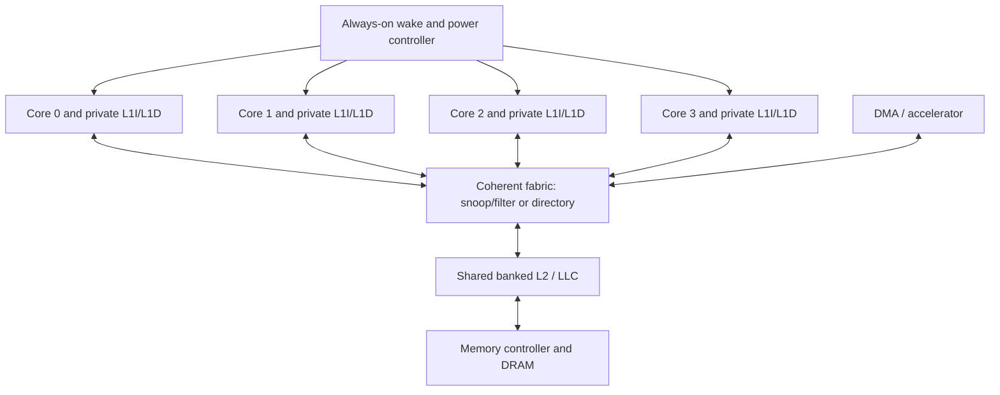
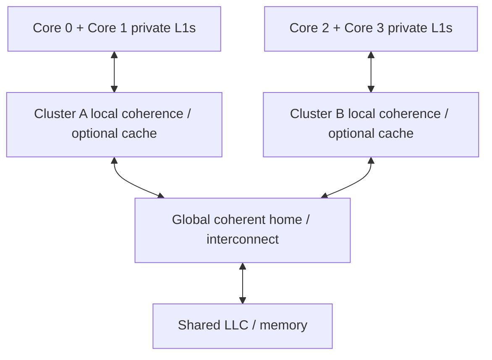
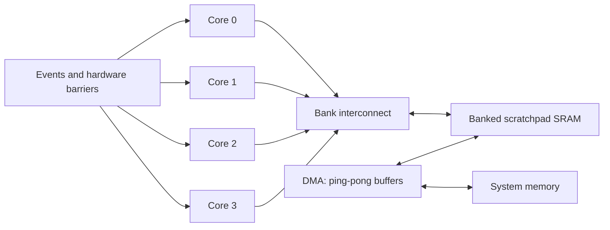

# Open-source RISC-V quad-core architectures: performance and power
# Kiến trúc RISC-V quad-core mã nguồn mở: hiệu năng và điện năng

Research date / Ngày nghiên cứu: **2026-11-06 (Asia/Saigon)**.

Companion / Báo cáo liên quan: [Dual-core analysis](RISC_V_Dual_Core_High_Performance_Low_Power_Analysis.md).

Scope / Phạm vi: source-based architecture research for an ASIC-oriented four-core system. No RTL was downloaded, elaborated, simulated, synthesized or measured for this report. Published results, implementation evidence and proposed architectures are distinguished below. Online repository references are not pinned implementation baselines.

## English

### 1. Recommendation and selection criteria

For an RV64 Linux/shared-memory system, evaluate a compact four-core coherent cluster with private L1 caches and a banked shared last-level cache. Start with a pinned **QuadRocketConfig** as a concrete generator baseline, and compare it with a compatible **four-core CVA6/CVA6S+ and Culsans** configuration. BlackParrot is a valuable SystemVerilog alternative with reported quad-core silicon experience. These choices prioritize inspectable integration evidence rather than asserting a universal performance winner. [Q1–Q5]

Use four BOOM cores as a performance-oriented evaluation candidate when single-thread latency and irregular memory accesses dominate. For regular DSP, crypto or streaming kernels, also evaluate four compact cores using banked scratchpad SRAM, DMA and event-driven sleep. VexiiRiscv offers direct quad-core FPGA/Linux demonstration evidence, which is useful for prototyping but does not establish ASIC power efficiency. [Q6–Q8]

Select by **joules per completed application task under a deadline, area limit and sustained power budget**. Four cores are not automatically twice as fast as two; they can consume more energy when synchronization or memory bandwidth limits useful parallel work. Clock frequency and core count alone cannot identify the best architecture.

### 2. Terminology

| Term | Meaning | Quad-core implication |
|---|---|---|
| Core / hart | Physical processor / architectural hardware execution context | Four independent single-hart cores normally expose four harts |
| Quad-core / four-issue | Four processors / one processor issuing up to four instructions per cycle | Different architectural choices; neither implies the other |
| SMP | Peer processors managed by one OS with shared memory | Requires consistent platform memory, atomic and interrupt contracts |
| AMP | Cores assigned distinct roles or OS instances | Explicit shared-buffer ownership and visibility rules |
| OoO | Scheduling instructions around earlier stalls | More latency hiding and speculative state |
| Coherence / consistency | Managing cached copies / constraining observed memory ordering | Both require verification; neither is implied by a plain AXI crossbar |
| Snoop filter / directory | Structures tracking possible or exact cache sharers/ownership | Can avoid unnecessary probes; cost storage and lookup energy |
| MSHR | State tracking an outstanding cache miss | Aggregate demand rises with active cores, stressing downstream queues |
| LLC / TCDM | Last-level cache / tightly coupled data memory, usually banked SRAM | Hardware-managed versus software-managed working data |
| Core parking / power gating | Stop scheduling a core / remove its supply | Parking does not prove that its caches or supply can be switched off |
| NUMA | Memory access cost depends on location | Relevant if a 2+2 hierarchy introduces unequal latency |

RISC-V defines architectural memory rules, not a mandatory physical coherence protocol. A four-core system must implement its declared coherence/atomicity attributes and RVWMO behavior. Stand-alone CVA6 does not supply a complete coherent multicore system through its ordinary memory interface. [Q12]

### 3. Evidence for open-source quad-core candidates

Evidence levels: **A** = explicit four-core configuration or public FPGA demonstration; **B** = authors report quad-core silicon; **C** = configurable multicore/platform adaptation requiring a selected build; **D** = core candidate without an established complete four-core integration in this review. These categories describe evidence type, not a quality or verification ranking.

| Candidate | Source and RTL form | Four-core evidence | Performance opportunity | Power/integration concern |
|---|---|---|---|---|
| **Rocket Chip / Chipyard** | Chisel generator; coherent TileLink infrastructure [Q1] | **A:** source explicitly defines `QuadRocketConfig` with four Rocket tiles | Practical in-order coherent baseline; memory hierarchy is configurable | Measure tile, cache, fabric and clock power; generator configuration is not a power/signoff result |
| **CVA6 family + Culsans** | SystemVerilog ACE/MOESI coherent cluster [Q2] | **C:** repository explicitly targets 2–4 CPUs; exact four-core compatible cache build not reproduced here | Compact coherent integration; CVA6S+ can improve core throughput | Public Culsans default branch is not proven identical to the 2026 CVA6S+/HPDCache presentation |
| **BlackParrot / BedRock** | SystemVerilog cores and directory-based coherent memory [Q3, Q4] | **B:** primary repository reports GF12 quad-core tapeout and running quad-core silicon | Existing physical integration experience and modular coherent memory | Historical silicon is not proof that the current checkout is signoff-ready; README lists debug support limitations |
| **BOOM / Chipyard** | Chisel OoO generator [Q5] | **C**, plus historical quad-LargeBOOM design documentation [Q6]; current four-tile build still needs elaboration | Scheduling and memory parallelism can improve serial/irregular workloads | Four large speculative engines can exceed area/power budgets; measure supported moderate configurations too |
| **VexiiRiscv** | SpinalHDL generator with coherent SoC integration [Q7] | **A:** primary README links a quad-core Debian FPGA demonstration | Direct multicore software prototype path; configurable issue width | FPGA success does not establish ASIC joules/task, clock gating or power-domain completeness |
| **PULP cluster / CV32E40P** | SystemVerilog cluster, TCDM, DMA and events [Q8] | **C:** configurable cluster; documented top-level platform uses eight cluster cores | Adaptation to four cores for predictable block processing | Validate four-core interconnect, bank count, event masks, software runtime and DMA arbitration |
| **OpenPiton + Ariane/CVA6** | Tiled coherent platform and L1.5 hierarchy [Q9] | **C:** public multicore integration; exact selected 2×2 topology not built here | Natural reference for directory/distributed memory and expansion | Extra routers/levels may raise latency and power for four cores; quantify rather than dismiss |
| **OpenC910** | Open-source OoO core RTL [Q10] | **D:** a complete compatible four-core open integration is not established by this review | Stronger per-thread execution is worth evaluating | Standard interface adaptation and coherent cluster validation remain separate work |

Generated RTL from Chisel/SpinalHDL can enter normal EDA flows. These projects add generator/toolchain reproducibility requirements; they are not automatically unsuitable for ASIC synthesis. Record licenses for RTL, dependencies and firmware separately. SRAM compilers, PDKs and physical collateral may have different availability and terms.

### 4. Published evidence and limits

| Evidence | What it supports | What it does not establish |
|---|---|---|
| BlackParrot repository reports GF12 quad-core tapeout in July 2019 and operating quad-core silicon since April 2020 [Q3] | Physical quad-core implementation history | Present-release PPA, complete debug functionality or superiority to other cores |
| VexiiRiscv README links four-core Debian on FPGA [Q7] | Multicore Linux software/hardware demonstration | Equivalent ASIC power or whole-system verification closure |
| `QuadRocketConfig` instantiates four Rocket tiles [Q1] | An explicit public four-core configuration | Successful build or timing/power results in this workspace |
| Culsans 2024 reports dual-core SPLASH-3 results and 1.6% CCU area [Q2] | Evidence motivating a small coherent cluster | Four-core speedup, CCU area percentage or power scaling |
| CVA6S+/HPDCache 2026 cluster abstract reports 1.75× versus single-core and 35 kGE CCU in a dual-core study [Q11] | A newer coherent cluster research direction | A four-core result; no multiplication of this number is valid |
| Controlled 22 nm core comparison: CVA6S+ area efficiency and competitive C910 energy efficiency [Q10] | Core complexity alone does not determine energy/task | A cross-project four-core energy ranking |

No common-basis quad-core power ranking was established. Public silicon history and reproducible source availability are useful evidence, but must be combined with exact configuration, workload and physical implementation data.

### 5. What changes from two to four cores

| Resource | Two-core case | Four-core consequence |
|---|---|---|
| Potential undirected core pairs | 1 | 6; more sharing interactions to exercise, not a prediction of six times runtime traffic |
| Broadcast probe destinations per request | Up to one other CPU cache endpoint | Up to three other CPU endpoints, depending on filter/protocol; separate I/D caches may add endpoints |
| Aggregate independent miss traffic | Two request streams | Four streams can saturate refill queues, LLC banks or DRAM |
| Locks and shared writable data | Two contenders | More ownership migration, retries and barrier waiting |
| Shared cache capacity | Capacity divided between two working sets | Four working sets may cause more capacity misses and interference |
| Idle control | Simple one/two-core operating states | Need practical one/two/four-core policies and measurement of intermediate residency |
| Physical design | Shorter/fewer core-to-fabric links | More clock load, wire capacitance, floorplan/IR-drop and hot-spot constraints |
| Verification | Fewer concurrent actors | Owner, sharer, requester and evictor can all be different cores |

If each core issues r coherent requests/second and all are broadcast to other CPU endpoints, logical probe deliveries scale as N×r×(N−1): 2r for two cores and 12r for four. This illustrative unfiltered case assumes constant per-core request rate; it is not a measured traffic ratio. Local hits, sharing, merging, throttling and filters change actual traffic.

### 6. Architecture A: one coherent four-core cluster

Proposed evaluation structure, not an exact claim about every repository:



This is the first candidate for ordinary SMP applications. Use private L1s to serve local hits, shared cache banks to absorb misses, and enough independent request/response progress to avoid global serialization. Evaluate the LLC against a bypass/no-LLC variant when the system permits it.

Compare two coherence options at four cores: a compact broadcast snoop CCU, optionally filtered, versus a directory-based fabric. A directory may reduce unnecessary fanout, but its tag lookup, storage and miss latency can cost more than broadcasting at this size. Conversely, a serial snoop controller can become a bottleneck. Measure completed coherent transactions and line-transfer latency under contention.

Bank count, transaction queue depth, number of MSHRs and interconnect width should follow measured demand. Proposed exploration points are 16/32 KiB private caches, 256/512/1024 KiB shared cache, and two/four/eight cache banks where supported. These are study variables, not legal configurations or selected parameters for every source project.

Choose inclusion/exclusion and directory behavior together: an inclusive cache may force L1 back-invalidations on eviction; a non-inclusive LLC needs a coherent ownership-tracking solution. A snoop filter that permits false negatives can violate correctness; a conservative false positive primarily costs unnecessary traffic.

### 7. Architecture B: two clusters of two cores



This topology is worth exploring when tasks communicate mainly within pairs, physical placement favors two islands, or two-core power-domain granularity matches duty cycles. Keep common communication local through scheduler affinity and data placement.

It adds another coherence/lookup boundary and may worsen cross-pair sharing. Two independent coherent dual-core clusters connected by plain AXI do not form one coherent SMP quad-core. A global ownership protocol must handle dirty data, probes, atomics and ordering across both clusters. If that interface is unavailable, treat the design as AMP with explicit buffer ownership instead of assuming transparent SMP.

Using one large and one small core type per pair, or two large plus two small cores, is a separate heterogeneous proposal. Common ISA support, interrupt/firmware behavior and scheduler capabilities must be checked. Do not assume a mixed-core generator demonstration establishes automatic energy-aware task migration.

### 8. Architecture C: four compact cores and scratchpad SRAM



Use this candidate for regular DSP, encryption, packet processing and tiled kernels with explicit data movement. PULP provides architectural building blocks; its documented eight-core top-level must be adapted and checked for four cores. [Q8]

Four cores do not imply four SRAM banks are sufficient. For a simplified single-cycle model with four uniformly independent accesses over B single-access banks, the expected number of distinct banks is B×(1−(1−1/B)^4): approximately 2.73 for B=4, 3.31 for B=8, and 3.64 for B=16. This estimates same-cycle service opportunities, not full application IPC. Real bank mapping, repeated addresses, multicast, port structure, DMA and arbitration alter the result.

Distribute per-core data, pad problematic strides, and overlap DMA for block k+1 with computation of block k. Count transfer setup, synchronization, bank conflicts and the memory controller in energy/task. A private scratchpad per core can avoid conflicts but increase duplication and explicit transfers.

### 9. Techniques for high performance

| Technique | Intended improvement | Four-core decision criterion |
|---|---|---|
| Dual issue / OoO / better prediction | More useful work per core | Measure compute speed and single-thread deadline before multiplying core complexity by four |
| Miss concurrency and writeback buffering | Hide latency | Match upstream issue and downstream memory capacity; avoid queue blocking |
| Cache-to-cache transfer | Reduce dirty-line access latency | Measure shared-data workloads and coherence data bandwidth |
| Banked cache or scratchpad | Parallel accesses | Test bank mapping with actual strides and concurrent DMA |
| Snoop filter or directory | Reduce broadcast work | Compare lookup/storage energy against saved probes |
| Adaptive prefetch | Reduce demand misses | Throttle when four prefetchers compete or waste DRAM bandwidth |
| Distributed work queues / batched ownership | Reduce lock contention and false sharing | Record synchronization time and tail latency |
| Task and data affinity | Preserve local cache state | Avoid migration/cache-refill cost and balance load |
| Vector or accelerator offload | Improve algorithm-specific work per joule | Include setup/transfers; compare with CPU-only four-core execution |

The best core configuration for two cores need not remain best at four. Smaller cores may deliver the same sustained bandwidth once memory is saturated; a stronger core may still win if it completes serial work earlier and lets the cluster sleep.

### 10. Low-power architecture and control

Start with supported per-core clock enables in a shared clock/voltage domain. Evaluate finer clock gating for idle arithmetic, queues and SRAM ports. Do not assume a register enable maps to an ICG cell without checking the synthesis/library flow.

Provide useful operating modes: one core active, two active, and four active. Include migration, wake and cache-refill cost when choosing thresholds. Three-active operation may also be useful if supported and measured; no fixed state count is required.

For deep sleep, separate pipeline inactivity from coherence inactivity. A sleeping pipeline may own dirty lines or be a directory sharer. Keep snoop/cache service available, add a bounded wake-on-probe path, or clean/evict and remove the core from the coherent domain before deeper sleep. Preserve interrupt/debug wake and define when LR/SC reservations are cleared. [Q12, Q13]

For power-off: stop new work, reach a defined quiescent condition, drain transactions, handle dirty state, update coherence membership, then apply the specified isolation/retention/power sequence. Reverse the process safely on wake. This is a proposed integration protocol, not a claim that all candidates provide power gating.

Evaluate shared-domain DVFS first. Per-pair domains can help bursty pair-local workloads; four independent domains add level shifting, CDC, power intent and firmware complexity. Check fabric/cache voltages as well as pipeline voltage. DVFS is constrained by supported SRAM and library operating points.

Track energy of the always-on controller, LLC, directory, clock tree and memory controller while cores are parked. Parking three cores cannot eliminate these shared costs. Cache way/bank shutdown also requires correct tag/directory and dirty-line handling, not just disabling SRAM enables.

CV32E40P has documented sleep/clock-gating behavior; its cluster sleep uses integration-specific events rather than assuming ordinary WFI behavior. Use that source as an implementation reference, not proof of identical semantics in CVA6, Rocket or BOOM. [Q13]

### 11. Quantitative models and hypothetical examples

```text
Ttask = executed cycles / clock frequency
Etask = integral of whole-system power over task time
Ideal speedup S(N) = 1 / ((1-p) + p/N)
Parallel efficiency = S(N) / N
Approximate dynamic power = activity × capacitance × V² × f
```

| Parallel fraction p | Ideal S(2) | Ideal S(4) | S(4)/S(2) | Four-core efficiency |
|---|---:|---:|---:|---:|
| 0.70 | 1.54× | 2.11× | 1.37× | 52.6% |
| 0.90 | 1.82× | 3.08× | 1.69× | 76.9% |
| 0.95 | 1.90× | 3.48× | 1.83× | 87.0% |

These ideal values exclude scheduling, synchronization and contention and assume fixed-work behavior. Additional aggregate cache capacity may change that behavior; compare cache-capacity-matched and native configurations separately.

Hypothetical energy example: two cores at 160 mW for 6 ms consume 0.96 mJ. Four cores at 270 mW for 3.8 ms consume 1.026 mJ: execution is 1.58× faster, but energy rises 6.875%. Four-core operation is justified by a tighter deadline or throughput need, not by an automatic energy saving.

Bandwidth example: four cores each requiring 2 GB/s of off-chip payload require 8 GB/s sustained useful bandwidth. If payload efficiency is 70%, provision approximately 11.43 GB/s raw transfer capacity for that target. A 128-bit interface at 500 MHz transfers at most 8 GB/s per relevant data channel before overhead, so it cannot meet that requirement. Distinguish read and write channels, duplex capability, total DRAM bandwidth and on-chip coherence traffic; one interface-width calculation does not describe all of them.

Approximate deep-sleep break-even time is incremental transition energy divided by shallow-idle minus deep-idle power. Include lost work, cache refill and state restoration. Race-to-idle versus DVFS must meet the same deadline and count shared-domain energy.

### 12. Evaluation and verification plan

1. Pin source commits, core count, ISA/ABI, generated RTL, cache configuration, software and tool versions; record dependency licenses.
2. Build one/two/four-core configurations. Compare both fixed total cache capacity and fixed per-core capacity. Preserve identical useful work and check outputs.
3. Run compute, branch, floating-point if needed, sequential/random memory, producer-consumer, false-sharing, atomics, lock/barrier and DMA workloads. Include 1–4 runnable threads and bursty/idle traces.
4. Collect IPC, branch misses, miss concurrency, LLC bank conflicts, DRAM bytes/task, snoop fanout, ownership transfers, atomic retries, barrier time and active/sleep residency.
5. Implement candidates with consistent PDK, PVT, SRAM macros, SDC and physical methodology. Measure clock/fabric wire effects, congestion and thermal/power limits.
6. Estimate or measure representative whole-system power using appropriate activity; state whether external DRAM is counted. Report energy/task, throughput, p95/p99 latency, area and peak/sustained power.
7. Validate four-party coherence races, dirty-owner intervention, shared eviction, stale directory/filter entries, concurrent DMA, AMO/LR-SC and RVWMO outcomes. Prove forward progress under legal backpressure.
8. Exercise core parking, wake-on-probe, reset of one core, power transitions and interrupts/debug for all four harts. Include simultaneous sleeping owners and active requesters.
9. Retain Pareto-efficient designs: a candidate dominated in latency, energy and area is not a winner. Choose the final operating policy for the real duty cycle.

High code coverage does not establish coherence correctness or low energy. Verification and PPA steps above are proposed follow-up work, not results of this document.

### 13. Shortlist and unresolved integration inputs

| Goal | First evaluation | Alternative |
|---|---|---|
| Reproducible coherent four-core Linux baseline | Chipyard `QuadRocketConfig` [Q1] | BlackParrot, accounting for exact debug/platform requirements |
| CVA6-based RV64 MPU with SystemVerilog source | Compatible four-core Culsans/CVA6(S+) build [Q2] | Directory-based coherent baseline for comparison |
| High single-thread capability and parallel general workloads | Four moderate BOOM tiles [Q5, Q6] | Fewer stronger cores or modified C910 if workload/PPA support the choice |
| Low-energy block processing | Four compact cores + banked TCDM + DMA/events [Q8] | Two cores or accelerator when parallel efficiency is low |
| Fast FPGA software prototype | Quad-core VexiiRiscv [Q7] | Rocket/Chipyard platform supported by the team's tooling |

Unresolved inputs are application mix, Linux/RTOS/bare-metal scope, ISA/FPU/vector requirements, memory type/bandwidth, deadline, power duty cycle, PDK/SRAM, area and debug/security requirements. No frequency target or final cache size is invented here.

## Tiếng Việt

### 14. Hướng lựa chọn

Với quad-core chạy Linux, nên đánh giá một cụm bốn core có private L1 và shared cache nhiều bank. **QuadRocketConfig** là cấu hình công khai cụ thể để làm baseline. **BlackParrot** có bằng chứng chip quad-core đã được chế tạo; **Culsans/CVA6(S+)** phù hợp để nghiên cứu hướng CVA6/SystemVerilog nhưng phải khóa đúng phiên bản coherent cache và CCU. [Q1–Q4]

Với xử lý DSP, mã hóa hoặc dữ liệu theo khối, cần so sánh với **bốn core nhỏ + scratchpad SRAM nhiều bank + DMA**. Khi một luồng có deadline gắt hoặc truy cập bộ nhớ khó đoán, đưa BOOM vào đánh giá. VexiiRiscv có demo quad-core Debian trên FPGA; điều đó chứng minh khả năng prototype, chưa chứng minh hiệu quả năng lượng ASIC. [Q5–Q8]

Báo cáo phân biệt cấu hình có sẵn, demo FPGA, lịch sử silicon và thiết kế mới chỉ có khả năng cấu hình. Chưa tải/build RTL, mô phỏng hay đo PPA tại workspace. Đặc biệt, không nhân đôi số liệu dual-core để tạo số liệu quad-core.

### 15. Vì sao bốn core không chỉ là nhân đôi hai core

Số cặp core có thể chia sẻ dữ liệu tăng từ một lên sáu. Một yêu cầu broadcast có thể cần tới ba CPU endpoint khác phản hồi. Bốn dòng cache miss cạnh tranh refill queue, LLC bank và DRAM; các biến/khóa chia sẻ có thể liên tục chuyển ownership. Các yếu tố này có thể giới hạn throughput trước khi cả bốn core dùng hết năng lực tính toán.

Topology cần được so sánh tại chính bốn core. Snoop CCU gọn có thể cho latency thấp; directory hoặc snoop filter có thể tiết kiệm probe và switching. Không có quy tắc rằng số core bằng bốn thì bắt buộc phải chọn một trong hai. Độ dài dây, SRAM macro, traffic và implementation quyết định kết quả.

Bộ nhớ cần đánh giá theo hai cách công bằng: giữ tổng cache cố định, và giữ cache mỗi core cố định. Nếu chuyển từ hai lên bốn core đồng thời tăng gấp đôi cache, phần tăng tốc quan sát được không chỉ đến từ số core.

### 16. Ba phương án kiến trúc

| Phương án | Lợi ích cần đo | Chi phí cần kiểm tra |
|---|---|---|
| Một coherent cluster bốn core | Chia sẻ dữ liệu trực tiếp, SMP đơn giản hơn ở mức topology | Contention, broadcast, bank conflict và timing của fabric |
| Hai cluster, mỗi cluster hai core | Giữ giao tiếp cục bộ, thuận tiện thử power-domain theo cặp | Thêm coherence toàn cục, latency khác nhau và chi phí giao tiếp chéo cặp |
| Bốn core + scratchpad + DMA | Truy cập SRAM chủ động, phù hợp kernel theo khối | Software quản lý dữ liệu, conflict giữa core/DMA và overhead đồng bộ |

Hai cluster dual-core coherent nối bằng AXI thông thường chưa trở thành một quad-core SMP coherent. Cần cơ chế ownership, probe, atomics và memory ordering xuyên cả hai cluster. Nếu không có cơ chế này, phải thiết kế theo AMP và quy định ownership của shared buffer.

Các sơ đồ ở mục 6–8 là kiến trúc đề xuất để đánh giá, không phải khẳng định mọi repository có sẵn cùng cấu trúc. Hướng 2+2 heterogeneous cũng cần kiểm tra ISA chung, firmware và scheduler; không mặc định task tự động migrate hiệu quả giữa các core khác nhau.

### 17. High-performance và low-power

**Tăng hiệu năng:** phối hợp issue width, branch predictor và memory parallelism; không chỉ nâng GHz. MSHR/cache queue phải phù hợp với load/store unit và khả năng phục vụ của memory controller. Banked SRAM, cache-to-cache transfer, task affinity và giảm false sharing giúp giữ bandwidth cho công việc hữu ích.

**Giảm điện năng:** dùng clock gating, operand isolation, SRAM enables, event-driven sleep và core parking. Đo các chế độ một/hai/bốn core hoạt động. Có thể thêm ba-core nếu workload và RTL hỗ trợ; không mặc định bốn core đều phải chạy ở tải thấp.

**Ngủ phải phối hợp coherence:** pipeline đã idle vẫn có thể sở hữu dirty cache line. Cần giữ snoop/cache controller hoạt động, có wake-on-probe được định nghĩa, hoặc clean/evict và rời coherent domain trước khi ngủ sâu. WFI không tự chứng minh rằng toàn bộ tile được phép tắt nguồn.

**Power gating cần flow đầy đủ:** quiesce, drain transaction, xử lý dirty state và directory membership, isolation/retention, trình tự cấp nguồn và kiểm chứng power-aware. Không giả định repository CPU có sẵn mọi phần này. Shared LLC, directory và controller luôn bật vẫn tiêu thụ điện khi các core đã park.

**DVFS:** bắt đầu từ một miền clock/voltage với clock enable riêng, rồi đánh giá miền theo cặp nếu duty cycle cho thấy lợi ích. Bốn miền DVFS riêng tăng chi phí CDC, level shifter, điều khiển và kiểm chứng. Core OoO lớn hơn vẫn có thể dùng ít joule/tác vụ nếu hoàn thành đủ nhanh; cần đo theo deadline chung.

### 18. Các ví dụ tính toán

```text
Speedup lý tưởng = 1 / ((1-p) + p/N)
Hiệu suất song song = Speedup / N
Năng lượng = tích phân công suất hệ thống theo thời gian
```

Với p=90%, hai core có speedup lý tưởng 1.82× và bốn core 3.08×, tức tăng khoảng 1.69× khi chuyển hai lên bốn. Đây là giới hạn theo mô hình công việc cố định, chưa tính contention và synchronization.

Ví dụ giả định: hai core dùng 160 mW trong 6 ms tiêu thụ 0.96 mJ; bốn core dùng 270 mW trong 3.8 ms tiêu thụ 1.026 mJ. Thời gian giảm nhưng năng lượng tăng 6.875%. Chọn bốn core khi deadline/throughput cần mức cải thiện đó, không mặc định là lựa chọn tiết kiệm pin hơn.

Nếu mỗi core cần 2 GB/s payload từ DRAM, bốn core cần tổng 8 GB/s hữu ích. Khi hiệu suất truyền payload là 70%, bandwidth raw cần khoảng 11.43 GB/s. Một data channel 128 bit ở 500 MHz chỉ có trần lý thuyết 8 GB/s trước overhead. Phải xét riêng read/write, khả năng duplex, giới hạn DRAM và coherence traffic.

Với scratchpad, bốn bank không bảo đảm bốn core luôn truy cập đồng thời không conflict. Mô hình bốn truy cập ngẫu nhiên độc lập cho khoảng 2.73 bank phân biệt khi có bốn bank, 3.31 khi có tám bank và 3.64 khi có 16 bank. Đây là minh họa theo mô hình ở mục 8; cần đo mapping địa chỉ và traffic thật.

### 19. Bằng chứng và kế hoạch thực hiện

Nguồn hiện tại xác nhận `QuadRocketConfig`, demo quad-core Debian của VexiiRiscv và lịch sử silicon quad-core BlackParrot. Culsans nêu phạm vi 2–4 core. Các kết quả Culsans/CVA6S+ dual-core công bố trước đó chỉ là tham khảo hướng thiết kế; chưa đủ để kết luận speedup hay power cho bốn core. [Q1–Q3, Q7, Q11]

Bước đánh giá tiếp theo là khóa commit/cấu hình, build bản một/hai/bốn core, chạy cùng workload và đo IPC, cache miss, bank conflict, DRAM bytes/tác vụ, snoop traffic, thời gian khóa/barrier và active/sleep residency. So sánh PPA tại cùng PDK/PVT/SRAM/SDC; ghi rõ có tính công suất DRAM ngoài chip hay không.

Kiểm chứng phải có race giữa bốn vai trò khác nhau: requester, dirty owner, sharer và evictor; thêm AMO/LR-SC, DMA, RVWMO, deadlock/livelock và sleep/reset của từng hart. Code coverage cao không thay thế các thuộc tính này. Quy trình đánh giá được mô tả ở mục 12; chưa thực thi trong báo cáo.

## Primary references / Nguồn gốc

Consulted on 2026-11-06. Pin compatible revisions before implementation. Links identify primary code, author publications or official project documentation.

- **Q1 — Explicit four-Rocket configuration:** [Chipyard RocketConfigs.scala](https://github.com/ucb-bar/chipyard/blob/main/generators/chipyard/src/main/scala/config/RocketConfigs.scala), [Rocket Chip source](https://github.com/chipsalliance/rocket-chip).
- **Q2 — Culsans scope and implementation:** [Culsans repository: 2–4 CPUs](https://github.com/pulp-platform/culsans), [Culsans paper, 2024](https://arxiv.org/abs/2407.19895).
- **Q3 — Quad-core silicon history and current limitations:** [BlackParrot primary repository](https://github.com/black-parrot/black-parrot).
- **Q4 — Coherent memory implementation:** [BlackParrot microarchitecture guide](https://github.com/black-parrot/black-parrot/blob/master/docs/microarchitecture_guide.md), [BedRock guide](https://github.com/black-parrot/black-parrot/blob/master/docs/bedrock_guide.md).
- **Q5 — OoO cores and configuration source:** [BOOM](https://github.com/riscv-boom/riscv-boom), [Chipyard BoomConfigs.scala](https://github.com/ucb-bar/chipyard/blob/main/generators/chipyard/src/main/scala/config/BoomConfigs.scala), [heterogeneous composition](https://chipyard.readthedocs.io/en/stable/customization/heterogeneous-socs/).
- **Q6 — Historical quad-LargeBOOM documentation:** [Berkeley technical report EECS-2022-24](https://www2.eecs.berkeley.edu/Pubs/TechRpts/2022/EECS-2022-24.pdf), [FireSim target configurations](https://github.com/firesim/firesim/blob/main/docs/Advanced-Usage/Generating-Different-Targets.rst).
- **Q7 — Quad-core FPGA/Linux demonstration and integration:** [VexiiRiscv primary README](https://github.com/SpinalHDL/VexiiRiscv/blob/dev/README.md), [LiteX integration documentation](https://github.com/SpinalHDL/VexiiRiscv-RTD/blob/master/source/VexiiRiscv/Soc/litex.rst).
- **Q8 — Scratchpad/DMA cluster references:** [PULP top-level](https://github.com/pulp-platform/pulp), [PULP cluster](https://github.com/pulp-platform/pulp_cluster), [cluster RTL](https://github.com/pulp-platform/pulp_cluster/blob/master/rtl/pulp_cluster.sv).
- **Q9 — Tiled coherent architecture:** [OpenPiton and Ariane integration](https://github.com/PrincetonUniversity/openpiton/blob/openpiton/README.md).
- **Q10 — Core performance/energy context:** [OpenC910](https://github.com/XUANTIE-RV/openc910), [controlled core comparison, 2025](https://arxiv.org/abs/2505.24363).
- **Q11 — Dual-core context only:** [CVA6S+/HPDCache cluster conference abstract, 2026](https://cfp.riscv-europe.org/eu-summit-2026/talk/R7MK7D/), [CVA6S+ study, 2025](https://arxiv.org/abs/2505.03762).
- **Q12 — Architectural memory requirements:** [RISC-V ISA manual](https://riscv.github.io/riscv-isa-manual/snapshot/spec/), [RVWMO explanatory material](https://docs.riscv.org/reference/isa/unpriv/mm-eplan.html), [CVA6 PMA integration limits](https://cva6.readthedocs.io/en/stable/01_cva6_user/PMA.html).
- **Q13 — Documented sleep integration:** [CV32E40P Sleep Unit](https://docs.openhwgroup.org/projects/cv32e40p-user-manual/en/latest/sleep.html).
