# Tensor Coprocessor Design Specification

> **Purpose:** Normative design contract for architecture, RTL, verification, DFT, and physical integration of this IP.
>
> Requirement terms: **shall** = mandatory and testable; **should** = recommended; **may** = optional. Give every mandatory requirement a stable REQ-<AREA>-<NNN> identifier and a verification method.

## Document map

1. [Purpose, scope, and product context](#1-purpose-scope-and-product-context)
2. [Normative references and precedence](#2-normative-references-and-precedence)
3. [Requirements and traceability](#3-requirements-and-traceability)
4. [Features and configurations](#4-features-and-configurations)
5. [Architecture](#5-architecture)
6. [External interfaces and ports](#6-external-interfaces-and-ports)
7. [Clock, reset, and power](#7-clock-reset-and-power)
8. [Parameters and elaboration configurations](#8-parameters-and-elaboration-configurations)
9. [Data representation and arithmetic](#9-data-representation-and-arithmetic)
10. [Detailed functional behavior](#10-detailed-functional-behavior)
11. [Register and programming model (CSR from workbook)](#11-register-and-programming-model)
12. [Error handling and recovery](#12-error-handling-and-recovery)
13. [Performance, power, and area](#13-performance-power-and-area)
14. [RTL implementation contract](#14-rtl-implementation-contract)
15. [Verification specification](#15-verification-specification)
16. [DFT and testability](#16-dft-and-testability)
17. [Physical design and timing integration](#17-physical-design-and-timing-integration)
18. [Security, safety, and reliability](#18-security-safety-and-reliability)
19. [Requirement-to-verification traceability](#19-requirement-to-verification-traceability)
20. [Assumptions, dependencies, and decisions](#20-assumptions-dependencies-and-decisions)
21. [Glossary](#21-glossary)
22. [References used to shape this template](#22-references-used-to-shape-this-template)

## 1. Purpose, scope, and product context

### 1.1 Purpose and scope

This IP is a parameterized tensor coprocessor for high-throughput, low-latency transformer inference. It accelerates dense tiled general matrix-matrix multiplication (GEMM), exact and approximate/linear attention, stable softmax and layer normalization, fused residual/bias/activation epilogues, structured sparse GEMM, and a low-latency vector/decode path. It attaches to a CVA6 RISC-V core through the OpenHW Core-V eXtension Interface (CV-X-IF). Compile-time parameters select the hardware capability mask and individual pipeline-register boundaries; each accepted command selects its compute mode at runtime, and a following command may use a different mode while the prior command executes when queue space is available, except that OP-003 asserts a global all-hart issue fence from acceptance through its scalar result handshake. A zero result holds that fence until software checks the CSR and acknowledges. Pipeline placement remains fixed for each synthesized build.

**Included:** CV-X-IF issue/register/commit/result sub-interfaces; a systolic-array multiply-accumulate (MAC) datapath; per-command operation/algorithm selection; optional exact and approximate attention, normalization, epilogue, structured-sparse, and vector/decode capabilities; independently configurable elaboration-time pipeline cuts; the selected non-coherent AXI4 burst DMA plus banked local SRAM path (detailed port sizing remains open); an optional APB4 control and status register (CSR) block; clock and reset handling for the core domain and optional asynchronous APB domain.

**Excluded:** The host RISC-V core (CVA6) and its pipeline; the L1/L2 cache and coherence fabric (Culsans ACE); DRAM controller and PHY; instruction decode of standard RISC-V instructions; the software compiler and runtime that generate the custom tensor instructions; the OS scheduler and memory allocator. This IP executes offloaded operations only; it does not fetch or decode instructions on its own.

### 1.2 Deployment assumptions

| Item | Specification |
|---|---|
| Target SoC / product class | Edge inference SoC for on-device LLM and vision transformer (see 1.4) |
| Technology / library assumptions | Synthesizable SystemVerilog, IEEE 1800-2017; technology-independent RTL with SRAM/macro wrappers |
| Operating modes and workload | Host runtime dispatches prefill/decode tensor commands with different per-command modes; batch = 1 to small batch inference; target shapes and accuracy/latency envelope remain open |
| Security / privilege context | Tensor instructions may be issued only in S-mode or M-mode. The selected CVA6 host shall enforce this at instruction decode/dispatch before driving CV-X-IF; U-mode tensor instructions raise an illegal-instruction exception in the issuing hart and never reach the coprocessor (DEC-027/REQ-SEC-001). CV-X-IF issue contains no privilege, address-space ID, or process ID (REF-001 §5.5.6), so this gate does not authorize DMA addresses. The selected SoC AXI firewall aperture and privileged driver remain necessary under DEC-025; S-mode processes are not isolated from each other by this policy. |
| External dependencies | CVA6 core with CV-X-IF; clock/reset controller; optional APB manager; memory system per selected access path |

### 1.3 Feature summary

| Feature ID | Feature | Required / optional | Configuration condition | Requirements |
|---|---|---|---|---|
| FEAT-001 | GEMM offload via CV-X-IF custom instructions | Required | Always present | REQ-FUNC-001, REQ-IF-001 |
| FEAT-002 | Parameterized systolic-array MAC datapath | Required | Always present | REQ-FUNC-002, REQ-PARAM-001 |
| FEAT-003 | Configurable precision (INT8 only, or INT8 + BF16/FP16) | Optional | PARA_DATA_PREC | REQ-FUNC-003, REQ-PARAM-002 |
| FEAT-004 | Element-wise and epilogue operations (residual, bias, scale, activation) | Optional | `PARA_ALGORITHM_MASK[3]` | REQ-FUNC-004, REQ-PARAM-003 |
| FEAT-005 | Stable softmax and layer normalization | Optional | `PARA_ALGORITHM_MASK[2]` | REQ-FUNC-005, REQ-PARAM-003 |
| FEAT-006 | Non-coherent AXI4 burst DMA feeding banked local SRAM | Required for release-1 descriptor, operand and tensor-result access | PARA_MEM_PATH | REQ-FUNC-006, REQ-PARAM-004 |
| FEAT-007 | Optional APB CSR block (version/control/status/config) | Optional | PARA_CTRL_MODE | REQ-REG-001, REQ-IF-002 |
| FEAT-008 | Elaboration-time selection of datapath pipeline boundaries | Required capability; selected cuts are configurable | Pipeline configuration in §8 | REQ-PARAM-005, REQ-PERF-002 |
| FEAT-009 | Runtime selection among dense GEMM, exact and approximate/linear attention, normalization, epilogues, structured sparse GEMM, and low-latency vector/decode modes, including greedy-token `ARGMAX` | Required capability; each family is independently enabled at elaboration | `PARA_ALGORITHM_MASK`; per-command mode selection; `PARA_ARGMAX_IMPL` selects its elaborated implementation | REQ-FUNC-007..012, REQ-FUNC-014, REQ-PARAM-003, REQ-PARAM-006, REQ-PARAM-010 |

### 1.4 Real-world applications of the features

| Feature ID | Real-world application (named system, example product) | What the application needs from the feature | Typical values | Consequence if missing or wrong | Requirements | Source |
|---|---|---|---|---|---|---|
| FEAT-001 | On-device LLM decode loop, e.g. a Llama-1B/3B chat assistant on an edge accelerator | Attention and MLP projections are matrix multiplies; offloading them keeps the in-order CVA6 free | GEMM of (seq × hidden) with hidden = 2048–4096; report time-to-first-token, inter-token latency, and tokens/s for a named model/batch/sequence and guaranteed memory path. Numeric release targets remain open in DEC-018; the earlier `<50 ms/token` figure is a preliminary example, not a qualified target | Token generation stalls; throughput collapses to the scalar core's matmul rate | REQ-FUNC-001, REQ-IF-001, PPA-005/006 | User answer 2026-11-15; decode metric split reaffirmed 2026-11-17 |
| FEAT-002 | Same LLM MLP/attention plus ViT patch embedding on a vision SoC | Replicated systolic arrays provide parallel tile throughput; a count parameter selects the compute scale | A 32×32 array peaks at 2.048 TOPS at 1 GHz or 4.096 TOPS at 2 GHz; 16 arrays at 2 GHz yield an ideal 65.536 TOPS under the two-operations-per-INT8-MAC convention, before memory/area losses | Area, power, and memory bandwidth can prevent theoretical peak from being sustained | REQ-FUNC-002, REQ-PARAM-001, REQ-PARAM-008 | User answer 2026-11-15; ideal arithmetic ceiling calculated from array count/dimensions/frequency |
| FEAT-003 | Quantized edge LLM (INT8) vs higher-accuracy FP layers | INT8 for weights/activations; BF16/FP16 for sensitive layers to bound accuracy loss | INT8 with `PARA_ACCUM_W`; BF16/FP16 with FP32 accumulation candidate | Quantization error makes outputs wrong, or FP-only costs 2–4× area/energy | REQ-FUNC-003, REQ-PARAM-002 | User answer 2026-11-15 |
| FEAT-004 | Residual, bias, scale, and activation path of a transformer block | Selectable standalone or fused epilogues avoid host round-trips around projections and MLP operations | Hidden dimensions 2048–4096; candidate ReLU, tanh-approximate GELU, SiLU, and SwiGLU in §10.2.2; numeric error budget TBD | Extra issue/result round-trips dominate batch-one latency; incorrect fusion changes rounding and model outputs | REQ-FUNC-004, REQ-PARAM-003 | User answer 2026-11-15; numerical contract open in §20 |
| FEAT-005 | Attention softmax and layer normalization | Stable normalization should be available as a runtime mode when enabled by the build | Sequence lengths 128–2048 from current workload context; exp/reciprocal/square-root accuracy targets TBD | Missing normalization forces host work or creates overflow/accuracy failures | REQ-FUNC-005, REQ-PARAM-003 | User answer 2026-11-15; numerical contract open in §20 |
| FEAT-006 | Integration into the SoC tensor-data hierarchy | Non-coherent AXI4 burst transport with banked SRAM selected in DEC-004; local SRAM holds reusable tiles | Candidate 32×32 × 16-array × 2-GHz build needs up to 2.048 TB/s aggregate on-chip operand injection before output/metadata; external bandwidth depends on tile reuse and remains TBD | A non-coherent path without cache maintenance/ownership handoff can return stale operands; an under-sized path can starve the arrays | REQ-FUNC-006, REQ-PARAM-004 | User selected AXI4 burst + banked SRAM on 2026-11-15; detailed interface and injection sizing remain open |
| FEAT-007 | Edge inference SoC driver for the tensor IP | The driver reads the version register, enables the IP when CSR is present, and uses CV-X-IF result handshakes for per-command completion; it reads and clears the first-error record only when needed | 32-bit APB registers; offset 0x0 = version (1.1); detailed map in §11 | Without version/error handling the driver cannot bind or attribute an execution error; CV-X-IF remains the completion path | REQ-REG-001, REQ-IF-002 | User answer 2026-11-15; CSR map reconciled 2026-11-17 |
| FEAT-008 | Edge inference SoC running batch-one decode and multi-token prefill | Integrators need to choose pipeline cuts that meet the selected clock target while measuring the added cycles and area; the actual latency and area budgets are unresolved | Existing clock context is 1–2 GHz at §7.1; legal cut locations and per-build latency are TBD | An unbalanced or overly deep pipeline can miss timing, lower utilization, or exceed the allowed operation latency | REQ-PARAM-005, REQ-PERF-002 | User request 2026-11-15; target envelope open in §20 |
| FEAT-009 | LLM and vision-transformer inference on an edge SoC, with prefill and decode phases | The runtime should select a mode per operation/tile from dense tiled GEMM, exact tiled attention, optional approximate/linear attention, stable softmax/layer norm, residual/bias/activation epilogues, optional structured 2:4 sparse GEMM, low-latency vector/decode, and greedy-token argmax; `PARA_ARGMAX_IMPL` chooses standalone or fused implementation in the build | Hidden dimensions 2048–4096 and sequence lengths 128–2048 are existing examples; vocabulary-vector length and decode latency target remain workload-specific and TBD | Without a capability superset and runtime dispatcher, the host performs more operations and memory round-trips; without argmax, greedy decode must move logits to the CPU or use a separate reduction; approximate attention may change model accuracy, while enabling every specialized block may exceed area/power limits | REQ-FUNC-007..012, REQ-FUNC-014, REQ-PARAM-003, REQ-PARAM-006, REQ-PARAM-010, REQ-PERF-002 | User request 2026-11-15 and scalar-result selection 2026-11-16; complete workload envelope open in §20 |

## 2. Normative references and precedence

### 2.1 Normative references

| Ref ID | Document and revision | Applicable clauses | Authority / notes |
|---|---|---|---|
| REF-001 | OpenHW Group, "Core-V eXtension interface (CV-X-IF)", Release v1.0.1-dev.0 (Development), 2024-05-23 (changelog includes v1.0.0 Ratified Release) | §5 (eXtension Interface), §5.2 parameters, §5.5 interfaces, §5.6 dependencies, §5.7 handshake rules, §5.8 signal dependencies, §5.9 deadlock avoidance | Protocol authority; [local converted reference](reference/md_doc/vlsit_cvxif_openhw_core_v_xif_v1_0_0.md) and [PDF](reference/protocol/cvxif_v1.0.0.pdf) |
| REF-002 | [VLSIT RISC-V CPU cluster architecture](../specification/architecture/VLSIT_RISCV_CPU_Cluster_Architecture.md) | §4 configuration model | Product context (CVA6-based 2/4-core cluster) |
| REF-003 | VLSIT RTL Design Rules v2, `VLSIT_RTL_Design_Rule.md` | All applicable rules | Mandatory RTL coding, hierarchy, reset, CDC, naming baseline |
| REF-004 | IEEE 1800-2017 SystemVerilog | Synthesizable subset | Subject to REF-003 and selected frontend support |
| REF-005 | Generated CSR workbook `TENSOR_COPROCESSOR_CSR.xlsx` and source description `tcop_regs.json` | CSR register interface | The JSON input is maintained and validated with the workbook; generated workbook is the integration-facing CSR contract |
| REF-006 | Dao et al., *FlashAttention: Fast and Memory-Efficient Exact Attention with IO-Awareness*, NeurIPS 2022 | Exact attention tiling and online softmax, non-normative algorithm background | Supports algorithm trade-off analysis; does not define this IP's interface or numerical contract |
| REF-007 | Dao, *FlashAttention-2: Faster Attention with Better Parallelism and Work Partitioning*, ICLR 2024 | Attention work partitioning, non-normative algorithm background | Supports parallelism/workload analysis; does not define this IP's interface or numerical contract |
| REF-008 | Gale et al., *Accelerating Sparse Deep Neural Networks*, arXiv:2104.08378, 2021 | 2:4 structured sparsity and sparse matrix-math background | Non-normative algorithm reference; its peak results do not imply the same speedup for this IP |
| REF-009 | Katharopoulos et al., *Transformers are RNNs: Fast Autoregressive Transformers with Linear Attention*, ICML 2020 | Linear-attention formulation and autoregressive state | Non-normative algorithm reference; this formulation is not bit-equivalent to standard softmax attention |
| REF-010 | Choromanski et al., *Rethinking Attention with Performers*, ICLR 2021, arXiv:2009.14794 | FAVOR+ positive orthogonal random features for softmax-kernel approximation | Non-normative approximation reference; feature count and projection cost must be evaluated for this IP |
| REF-011 | RISC-V International, *The RISC-V Instruction Set Manual: Volume I: Unprivileged Architecture*, v20240411 | §2.2, Base Instruction Formats; §35.1, Table 1 (R-type field positions and custom major-opcode map) | Instruction-field and custom-opcode reference; tensor operation/precision allocation is a product decision in REQ-IF-005 and DEC-013/014. [Official document](https://docs.riscv.org/reference/isa/v20240411/_attachments/riscv-unprivileged.pdf) |
| REF-012 | RISC-V International, *The RISC-V Instruction Set Manual: Volume II: Privileged Architecture*, v20240411 | §3.1.15, `mcause` synchronous exception codes; exception code 2 is Illegal instruction | Normative trap-cause reference for the CVA6 privilege gate in REQ-SEC-001. [Official document](https://docs.riscv.org/reference/isa/v20240411/_attachments/riscv-privileged.pdf) |
| REF-013 | Arm, *AMBA AXI and ACE Protocol Specification*, IHI 0022H, Issue H (2020) | Part A3, especially A3-40..A3-60: reset, channel VALID/READY handshakes, write-response dependencies, `RRESP`/`BRESP` encoding, and completion of every read beat when an error is reported | Normative AXI4 protocol source; user supplied the PDF. The local conversion at [reference/md_doc/vlsit_axi_amba_axi_ihi0022h.md](reference/md_doc/vlsit_axi_amba_axi_ihi0022h.md) is Git-ignored for review; Arm marks the source Non-Confidential but All rights reserved. [Official PDF](https://developer.arm.com/-/media/Arm%20Developer%20Community/PDF/IHI0022H_amba_axi_protocol_spec.pdf?hash=6325311012DDADF238C35A6C0FD734E520754F82&la=en&revision=71bd7c57-2ed7-487b-bc3e-68c4ab56fa5f) |

### 2.2 Source-of-truth and conflict handling

1. The selected CV-X-IF revision (REF-001) defines protocol behavior for the declared interface profile.
2. Approved product requirements and decisions define product-specific behavior.
3. This specification defines the IP contract and shall remain consistent with REF-001 and REF-003.
4. REF-003 is the mandatory RTL coding, hierarchy, reset, CDC, and naming baseline.
5. `tcop_regs.json` is the maintained CSR source input; the generated REF-005 workbook is the integration-facing register contract. They shall remain consistent, and §11 records the generator and validation path.
6. The exact protocol revision, role, and optional-signal configuration is recorded in §2.3.
7. Resolve conflicts through an explicit product decision; do not guess or weaken a requirement.
8. REF-011 supplies the base R-type field positions; the `operation_id` and precision-code allocation within those fields is product-specific and follows REQ-IF-005.

**Naming rule:** default naming rule of `vlsit-rtl-generator`, `VLSIT_RTL_Design_Rule.md` v2, section 2, path `reference/templates/VLSIT_RTL_Design_Rule.md`, version 2 (rule R-026).

### 2.3 Compliance declaration

| Standard | Revision / profile | Role implemented | Options | Deviations |
|---|---|---|---|---|
| CV-X-IF (Core-V eXtension Interface) | v1.0.1-dev.0 (Development, selected source) | Coprocessor (extension side) | Issue + register + commit + result; the referenced revision does not include memory request/response or memory-result interfaces (REF-001 §5.5.9–§5.5.10) | Bulk tensor data uses the separate IF-003 path; see DEC-004 |
| AMBA APB4 (CSR block, optional) | Arm IHI 0024 | APB subordinate | 32-bit data, 16-bit address; only when PARA_CTRL_MODE = 2 | None |

## 3. Requirements and traceability

| ID | Requirement using shall/should/may | Source | Applies to | Verification method |
|---|---|---|---|---|
| REQ-FUNC-001 | The IP shall accept an offloaded custom tensor instruction on the CV-X-IF issue interface, decode it, and return exactly one result transaction for each accepted instruction that is committed and not killed, as required by the result interface contract. | REF-001 §5.5.6, §5.5.8, §5.5.11 | All configurations | Simulation / protocol checker |
| REQ-FUNC-002 | The IP shall compute a GEMM $C = A \cdot B + C$ over the operand tile sizes implied by the systolic-array dimensions. | REF-002 §4 | All configurations | Simulation / formal |
| REQ-FUNC-003 | The IP shall provide an INT8 datapath always, and BF16/FP16 datapaths when `PARA_DATA_PREC` selects them. A datapath capability alone does not qualify every operation/precision combination: issue shall accept only pairs listed as release-qualified in §9.1. Integer MAC accumulation uses `PARA_ACCUM_W`; BF16/FP16 pairs use the FP32 accumulator method scoped in §9.1, with OP-001 rounding and order fixed by DEC-068. | User answer 2026-11-15; qualification rule added by DEC-017 | `PARA_DATA_PREC`, §9.1 matrix | Elaboration and per-operation precision reference checks |
| REQ-FUNC-004 | When enabled by `PARA_ALGORITHM_MASK[3]`, OP-002 shall execute exactly one descriptor-selected mode (`ADD`, `BIAS_ADD`, `RESIDUAL_ADD`, `SCALE`, `ACT_ONLY`, or `SWIGLU`) per command, with the operand shapes, broadcasting, arithmetic order, precision behavior, activation, and conversion rules defined in REQ-FUNC-018 and §9.1/§10.2.2. The selector may change on the next command; it is immutable for the active command. | User request 2026-11-15; DEC-056 | `PARA_ALGORITHM_MASK[3]`, OP-002 descriptor | Bit-accurate independent reference for every mode/precision and command-to-command mode switching |
| REQ-FUNC-005 | When enabled by `PARA_ALGORITHM_MASK[2]`, the IP shall provide stable row softmax and LayerNorm exactly as specified by REQ-FUNC-021/022, including per-operation shape caps, descriptor modes, deterministic FP32 arithmetic, exceptional-value status, and whole-command output invalidation. | User request 2026-11-15; DEC-059/060 | `PARA_ALGORITHM_MASK[2]`, `PARA_MAX_SOFTMAX_*`, `PARA_MAX_LN_*` | Fixed-order numerical reference, mode/precision and cap-boundary tests, masked-row and numeric-fault tests, no-DMA rejection, and whole-output invalidation |
| REQ-FUNC-006 | The IP shall obtain operands and write results through exactly the access path selected by PARA_MEM_PATH. | user answer 2026-11-15 | All configurations | Simulation |
| REQ-MEM-001 | Enabled bulk storage shall bind to one or more independently configurable IF-006 banks. Each bank shall have a build-static depth, word width, read latency, port profile and backend. Reject builds that cannot fit all simultaneously live allocations or whose selected macro cannot satisfy the declared access contract. | User direction; IF-006 and Section 10.5 | All builds with MEM-001 | Elaboration and bank-interface simulation with behavioral and macro adapters |
| REQ-IF-001 | The tensor-enabled CVA6 host shall use `X_ISSUE_REGISTER_SPLIT=0` for this release. Under REF-001 §5.5.6–5.5.8, issue and register transactions are coupled; the coprocessor shall drive `issue_ready` and `register_ready` identically. For a descriptor command, `issue_resp.register_read` shall request `rs1` on RV64 and `rs1` plus `rs2` on RV32. The coprocessor shall accept and allocate a command only when a command context is available and every requested source lane is valid; it shall capture the required values atomically on the joint issue/register handshake and shall not expect a later or reordered register packet. An issue response with `accept=0` allocates no execution context or result. Commit/kill traffic remains associated by `(hartid,id)` and obeys REF-001. REF-001 §5.5.8 defines `commit_kill=0` as the CPU guarantee that the instruction and older instructions are no longer speculative and will not be killed; it is not equivalent to issue acceptance or architectural retirement. Under user-selected DEC-033/034, CVA6 shall delay non-kill commit until a per-hart irrevocability frontier proves the command and all older instructions can no longer be flushed. The host shall not emit non-kill commit in the issue-acceptance cycle. The frontier may pass an older CV-X-IF command already marked non-kill even while that command awaits its result; this permits later tensor commands to receive authorization and overlap descriptor prefetch/compute. It shall not pass an older instruction that can still raise an exception or cause a flush. On a squash, CVA6 shall send the required per-hart kill boundary. The coprocessor shall capture command operands at acceptance but shall not fetch a descriptor, access tensor data, write output, or return a result until the matching delayed non-kill commit. Coprocessor valid signals shall not be retracted. | User decisions 2026-11-18; DEC-024/033; REF-001 §5.5.6–5.5.8, 5.6, 5.7 | Selected tensor-enabled CVA6 host; RV32/RV64 | CV-X-IF protocol checker; coupled-ready behavior, source-valid stalls, atomic pointer capture, delayed commit ordering, kill handling, fault-resolved frontier, older-exception safety, queue-full backpressure, and no-early-DMA simulations |
| REQ-IF-002 | When the CSR block is present, the IP shall answer APB4 reads/writes to the register block defined by the CSR workbook. | REF-005 | PARA_CTRL_MODE = 2 | Simulation |
| REQ-IF-003 | In descriptor mode, the descriptor pointer shall be a 64-bit DMA-visible byte address formed only from the matching accepted CV-X-IF register transaction. On RV32, its low word shall come from the register value selected by instruction `rs1`, and its high word from the value selected by `rs2`; `issue_resp.register_read` shall request both source lanes. On RV64, it shall come from the value selected by `rs1`, with `rs2` unused and not requested. The adapter shall capture values only on the corresponding register handshake and associate them with the command's `(hartid,id)` context. Descriptor-command runtime flags shall reside in the descriptor. The pointer shall be captured in that command's context; misalignment, arithmetic wrap, or an address not representable by the implemented AXI address port shall complete with TC_ERR_ADDRESS without issuing a malformed AXI request. A request denied by the SoC aperture firewall follows REQ-SEC-003 and returns the corresponding AXI error status. | User decision 2026-11-16; DEC-002; REF-001 §5.5.6–5.5.7 | Descriptor commands; RV32 and RV64 host variants | Operand/descriptor-fetch simulation, handshake reordering, and address-range assertions |
| REQ-IF-004 | `rd=x0` shall be rejected at issue in mode 0 and for every scalar-result opcode. In mode 2, a tensor/status opcode may use `rd=x0`; the command still returns its required CV-X-IF completion transaction with `issue_resp.writeback=0` and `result.we=0`, and accepted-command errors are reported by the sticky CSR record. The result class and writeback request shall be determined entirely from the instruction at issue; a fetched descriptor shall not change them. For all accepted commands, `result.we` shall match the writeback declaration made at issue. | User decision 2026-11-16; DEC-010; REF-001 §5.5.11 | CV-X-IF command/result | Issue-decode and writeback-consistency simulation/assertions |
| REQ-IF-005 | The 32-bit tensor command shall use RISC-V `custom-0` (`inst[6:0]=7'b0001011`, `0x0B`) and encode `operation_id` in instruction bits `[31:25]` (`funct7`) and `precision_id` in bits `[14:12]` (`funct3`), using the R-type field layout in REF-011 §2.2. Precision codes shall be `3'b000=INT8`, `3'b001=BF16`, and `3'b010=FP16`; `3'b011` through `3'b111` are reserved and shall be rejected at issue. The selected `precision_id` applies uniformly to all tensor-element operands and outputs of that command; mixed operand formats are not supported in the first release, and a descriptor cannot override the selected format. The operation ID shall determine the result class and exactly one `PARA_ALGORITHM_MASK` family at issue, and shall resolve to one fixed input schema for the elaborated build; `PARA_ARGMAX_IMPL` selects OP-004's build-specific schema. Different result classes or mask families shall use different operation IDs. A descriptor may select a submode only within the operation ID's family and result class; it shall not override them. No payload-mode bit is encoded in the instruction; if an operation supports both inline-register and descriptor forms, each form shall use a distinct operation ID. Shape, stride, mask, and algorithm-specific submode fields reside in the descriptor for descriptor commands. OP-xxx labels are specification identifiers, not numeric instruction codes; the numeric `operation_id` assignments are the table in Section 10.2.1 and DEC-015; `0x00` and `0x0A`-`0x7F` are reserved. | User decision 2026-11-16; REF-011 §2.2/§35.1; DEC-002/013/014 | CV-X-IF tensor command | Instruction decode, assembler/disassembler agreement, precision selection, reserved-code rejection, and descriptor non-override simulation |
| REQ-IF-006 | The selected CVA6 host shall generate delayed CV-X-IF non-kill commit from a per-hart, scoreboard-age-ordered fault-resolved frontier. For each candidate, every older non-tensor entry must have a final no-exception/no-redirect outcome across execution/writeback, branch, LSU translation/protection/access-fault handling, CSR/commit-stage checks, and any configured fence/controller redirect source; debug/interrupt arbitration shall suppress authorization if a trap is selected in that cycle, with post-authorization disposition governed by DEC-035. A prior CV-X-IF entry may be passed only after its own non-kill commit, without waiting for its result. After a selected post-authorization interrupt/debug event, the host shall block issue and further non-kill authorization of younger work for that hart, while unrelated harts remain eligible. A same-cycle selected squash/trap takes priority and kills the earliest affected accepted, not-yet-authorized CV-X-IF command and its younger suffix. Transaction IDs shall not be numerically sorted to infer age. After non-kill authorization, the host shall not kill the command or lose its result/context; post-authorization interrupt/debug handling follows selected DEC-035 and REQ-IF-007. The host shall expose this proof internally to the CV-X-IF driver; no new tensor IP port is implied. Retirement-only gating is bring-up fallback and does not satisfy first-release performance signoff. The signal-level contract HFC-1..HFC-9 in Section 5.3.1 is part of this requirement. | User selected fault-resolved frontier 2026-11-18; DEC-033/034; CVA6 scoreboard, LSU, branch, CSR, and controller integration | Selected tensor-enabled CVA6 host; `X_ISSUE_REGISTER_SPLIT=0`; per-hart age tracking | Directed + constrained-random integration tests for all fault sources, same-cycle squash priority, ID wrap, no pre-authorization DMA, no post-authorization kill, and N/N+1 overlap |
| REQ-IF-007 | For a selected interrupt/debug event on hart H while one or more older CV-X-IF commands are non-kill committed but not yet architecturally retired, the CVA6 host shall latch the selected event and its cause/source for H, stop issuing younger work and stop non-kill-authorizing younger commands for H, and kill any accepted but not-yet-authorized CV-X-IF suffix. It shall not block independent work from other harts. Every already-authorized command on H shall retain its `(hartid,id)`, destination, and result context, complete successfully or through its defined accepted-error result, and retire in program order before handler/debug entry. The event shall remain pending until precise entry; the trap/debug PC shall identify the next architectural instruction after the drained prefix. Additional events shall remain pending or be re-arbitrated according to native CVA6 priority so no event is lost or lower-priority state overwrites a higher-priority selected event. No tensor-IP interrupt/debug port is required. Missing AXI responses still invoke full-SoC reset per DEC-029. Maximum event-entry latency is not signed off until bounded and measured under DEC-018. | User decision 2026-11-18; DEC-035; CV-X-IF REF-001 §5.5.8, 5.5.11 | Tensor-enabled CVA6 host; per-hart event/commit control | TEST-029, TEST-030, SVA-012, COV-011 |
| REQ-SEC-001 | In the selected tensor-enabled CVA6 host, the current privilege mode shall be checked for every assigned tensor instruction (`custom-0` with `funct7=0x01..0x09`) before any CV-X-IF issue request is asserted. Only the trusted nonvirtual S-mode and M-mode domains may proceed to CV-X-IF. A host with active guest execution shall suppress tensor issue from that guest. In U-mode, CVA6 shall suppress the CV-X-IF issue request and raise an illegal-instruction synchronous exception (exception code 2) in the originating hart. A denied instruction shall allocate no coprocessor context and cause no CV-X-IF handshake, tensor CSR write, AXI request, local-SRAM write, or tensor result. No privilege/ASID/PID sideband shall be added to CV-X-IF. The gate is per hart and covers all precision field values for the assigned tensor operation IDs. This authorizes the S/M software trust domain only; it does not isolate processes within S-mode. DMA address protection remains the responsibility of the DEC-025 SoC AXI firewall and buffer-allocation policy. | User decision 2026-11-17; DEC-025/027; REF-001 §5.5.6; REF-012 §3.1.15 | Tensor-enabled CVA6 + CV-X-IF integration top | Host instruction-level simulation, CV-X-IF issue suppression assertions, trap-cause check, and no-side-effect checks across privilege modes and harts |
| REQ-SEC-002 | U-mode applications shall use the trusted S-mode driver as their only path to the accelerator; U-mode shall not issue tensor instructions directly. The driver API shall accept operation parameters, validated dimensions/strides, and opaque buffer handles plus offsets, not caller-supplied physical DMA addresses or a user-owned hardware descriptor pointer. Before issuing, the driver shall verify handle ownership or explicit sharing rights, read/write direction, element size, dimensions, nonnegative strides, checked address-span arithmetic without wrap, base/span/outer-pitch alignment under `PARA_DMA_ALIGN_BYTES`, 64-byte descriptor alignment, permitted aliasing, and containment of every descriptor and tensor byte range within the SoC firewall aperture. Release 1 has no scatter-gather descriptor or IOVA translation: each referenced tensor range shall resolve to one contiguous DMA-visible physical span; the driver shall reject a noncontiguous mapping or copy through a driver-managed contiguous buffer. The driver shall use the REQ-IF-009 byte-span formula and matching build/operation rules, create the hardware descriptor in kernel-owned DMA-visible memory, keep it immutable and inaccessible for user writes until completion, and issue the CV-X-IF instruction from S-mode using that descriptor address. It shall pin/retain buffer ownership until all AXI traffic is drained and the CV-X-IF result is retired. For non-coherent DMA it shall clean descriptor/input cache lines and issue the required memory fence before launch; for output buffers it shall clean and invalidate dirty cache lines before launch, then invalidate output lines after all DMA responses are drained and before successful user access. Tensor buffers shall use `PARA_DMA_ALIGN_BYTES`-aligned bases and declared spans, with operation-defined outer pitches aligned to the same value; descriptors remain 64-byte aligned. No DMA buffer or descriptor may share a CPU cache line with unrelated data. On failure, tensor-output buffers remain invalid under REQ-ERR-003 and shall not be returned as valid output. U-mode shall not access the APB CSR/error-record aperture; the driver may report sanitized status but shall not expose unrelated physical fault addresses. | User decision 2026-11-18; DEC-025/027/030; REQ-ERR-003; REQ-IF-003 | U-mode application API, S-mode driver, non-coherent DMA, PARA_CTRL_MODE=2 CSR aperture | Driver/core integration tests for forged/stale/cross-owner handles, bounds/overflow, permissions, aliasing, noncontiguous spans, descriptor protection, multi-hart alias/dirty-output cache ownership, failed-producer suppression in a dependent sequence, device-only producer/consumer visibility, CSR access, and no-issue-on-rejection |
| REQ-SEC-003 | The SoC integration shall configure the tensor DMA firewall with immutable build-time constants `TCOP_DMA_BASE` and `TCOP_DMA_LIMIT` defining the half-open physical aperture `[BASE,LIMIT)`, with `BASE<LIMIT`; the same constants shall be supplied to the trusted S-mode driver. For each AXI4 burst, the firewall shall calculate the complete byte span using checked arithmetic, including `AxADDR`, `AxLEN`, `AxSIZE`, and the defined burst-addressing rules, and decide the whole burst before forwarding any address or data downstream. A burst that wraps, starts outside the aperture, or crosses a boundary shall be denied in full. For a denied read, the firewall shall return exactly `ARLEN+1` read beats with zero `RDATA`, `RRESP=SLVERR` on every beat, the original `ARID`, and `RLAST=1` only on the final beat; it shall hold each response beat and its payload stable while `RVALID && !RREADY`, and shall not forward the AR request. For a denied write, it shall accept the AW request, consume exactly `AWLEN+1` W beats including the final `WLAST` beat without forwarding AW or W downstream, then return one `BRESP=SLVERR` with the original `AWID`, held stable through `BREADY` backpressure. This uses `SLVERR` because the address targets the SoC memory map but the firewall's access policy rejects it; `DECERR` remains the response for an address that the downstream interconnect cannot decode. In-aperture requests pass through and downstream response codes are preserved. A returned AXI error maps to `TC_ERR_AXI_READ` or `TC_ERR_AXI_WRITE`; no new status code is added. The firewall shall preserve the AXI4 requirement to complete every beat of an accepted read burst despite an error (REF-013, Part A3, Table A3-5 and A3-59..A3-60). `BASE/LIMIT`, permissions, and firewall placement are SoC integration constants/configuration, not tensor CSR state. | User decision 2026-11-18; DEC-025/031/032; REQ-SEC-002; REF-013 | SoC AXI firewall and tensor DMA path | Boundary, wrap, read-beat count/ID/RLAST, write-beat drain/B timing, backpressure stability, response mapping, and no downstream access tests |
| REQ-CLK-001 | The IP shall operate on a single core clock domain for the datapath; the optional CSR block shall use an asynchronous APB clock with an approved synchronizer. | REF-003 CLK-01 | All configurations | CDC analysis |
| REQ-RESET-001 | The IP shall asynchronously assert and synchronously deassert reset per receiving domain, and clear all control/valid state to a defined idle value. | REF-003 RST-02 | All configurations | Reset test |
| REQ-RESET-002 | A normal functional core reset shall be sequenced only after tensor-command quiesce and drain: stop accepting new tensor commands, resolve pending commit/kill and finish DMA for authorized work, consume every response for accepted AXI reads/writes, and wait for any OP-003 scalar-check fence to be acknowledged before clearing command/ID state. The tensor IP shall not implement local AXI abort, timeout completion, or isolation. If an accepted AXI request fails to return its required response before the SoC watchdog timeout, the SoC shall initiate a full SoC reset as the sole recovery action. That reset shall reset all CPU harts, the tensor IP, the AXI interconnect, and every on-SoC transaction agent that can retain or return the outstanding transaction; release shall ensure no pre-reset response can be matched to a post-reset command. The in-flight CV-X-IF instruction is abandoned by reset and produces no tensor result or local timeout status. Any possibly written output is invalid under REQ-ERR-003. Watchdog threshold/owner, reset-domain coverage/release, reset-cause capture, and software restart behavior are SoC integration details in DEC-029; ordinary functional reset still uses the quiesce/drain sequence in DEC-028. | User decisions 2026-11-17; DEC-023/028/029/021 | All configurations; system reset integration | Normal quiesce/drain plus scalar-fence release and full-SoC timeout-reset sequencing |
| REQ-REG-001 | When the CSR block is present, offset 0x0 shall be the read-only version register with major[31:16] and minor[15:0]. | REF-005 | PARA_CTRL_MODE = 2 | Simulation |
| REQ-PARAM-001 | The systolic-array dimensions shall be elaboration-time parameters restricted to the legal set of §8. | user answer 2026-11-15 | All configurations | Elaboration/lint |
| REQ-PARAM-002 | Precision datapath capability shall be an elaboration-time parameter; `PARA_DATA_PREC=0` shall provide INT8 only and `=1` shall provide INT8, BF16, and FP16 datapaths. The operation/precision pairs legal in a release remain limited to §9.1; presence of a datapath shall not imply support for every operation in that precision. Each accepted command shall latch one supported, release-qualified command-wide precision and use it consistently for every tensor input/output element and all of that command's tiles; a descriptor shall not specify a different format per operand. Illegal parameter values, absent precisions, and unqualified operation/precision pairs shall be rejected as defined in §12. | User answer 2026-11-15; runtime precision behavior; DEC-017 | `PARA_DATA_PREC`, §9.1 matrix | Elaboration/lint, command-to-command precision switching, and uniform-format checks |
| REQ-PARAM-003 | The algorithm capability mask shall independently include or exclude the defined operation families at elaboration; illegal dependencies shall be rejected. Elaboration shall fail if an enabled family has no structurally legal candidate `(operation_id, precision_id)` pair in the selected precision and control build. An engineering build may exercise candidate pairs. A released build shall expose only its qualified pairs and shall not advertise a family with no qualified pair. Each operation ID shall map to exactly one capability-mask family known at issue. The instruction precision and operation ID pair shall also be checked against the released operation/precision matrix in §9.1. A descriptor shall not change either selection. If the family is disabled, the precision is absent from the build, or the pair is not release-qualified, issue shall be refused with `issue_resp.accept=0`, no queue allocation, and no result. An invalid algorithm-specific descriptor mode discovered after acceptance shall complete with `TC_ERR_DESCRIPTOR_MODE` per §12. | User decisions 2026-11-15/16; DEC-002/013/015/017; REF-001 §5.5.6 | All configurations | Elaboration checks; issue-acceptance/result-count checks; post-accept descriptor-mode fault checks |
| REQ-PARAM-004 | Release 1 shall elaborate only `PARA_MEM_PATH=0`, with fixed AXI4 manager ports and banked local SRAM. Unsupported parameter values shall fail elaboration. The selected path shall preserve descriptor, operand and result ownership and ordering. CV-X-IF memory ports shall not be assumed for REF-001 v1.0.1-dev.0. | user answer 2026-11-15; REF-001 §5.5.9–§5.5.10 | `PARA_MEM_PATH` | Elaboration/lint and path-specific protocol verification |
| REQ-PARAM-005 | The IP shall provide elaboration-time configuration for five pipeline boundaries: operand capture, multiplier/product-combine output to accumulator input, accumulator-to-epilogue, post-processing output, and memory response. PE forwarding and accumulator feedback remain fixed. Every legal configuration shall preserve arithmetic results, transaction ordering, and handshake behavior. Legal values/configurations shall be enumerated in §8 before RTL freeze. | User request 2026-11-15 | Five pipeline cut parameters | Elaboration, equivalence, protocol checks, and static timing analysis |
| REQ-ERR-001 | The IP shall reject an unknown opcode at issue and shall complete every accepted, committed, non-killed command that encounters an illegal operand configuration or detected execution error after all accepted AXI requests have returned responses and traffic is drained; the observable error encoding shall follow DEC-010. AXI `SLVERR`/`DECERR` and detected protocol faults with a returned response follow the normal per-command error completion path. If a required `R/B` response does not arrive before the SoC timeout watchdog expires, the SoC shall perform the full SoC reset required by REQ-RESET-002; the interrupted CV-X-IF instruction is abandoned, and no tensor result, `TC_ERR_AXI_TIMEOUT`, or tensor-local CSR completion is generated. Concurrent command faults select the highest-priority status in DEC-012 only when all required responses arrive and a normal command completion is possible; AXI error data shall not enter numerical classification. Another queued command shall not be corrupted during normal error completion. | REF-001 §5.5.11; product behavior; user decisions 2026-11-16/17; DEC-029 | All configurations | Response-error and missing-response fault injection; full-SoC reset sequencing |
| REQ-ERR-002 | When APB CSR is present, the first accepted, committed, non-killed command error shall atomically capture hartid, CV-X-IF transaction ID, final DEC-012 status, associated DMA byte address, AXI transaction ID, and the reserved-zero detail field in the one-entry sticky record. Fields without an applicable value are zero. In release 1, `tcop_err_detail.detail` shall read zero for every status and has no subcode semantics under DEC-020. APB snapshot publication must be acknowledged in CLK-CORE before the failed command asserts result_valid (DEC-072). After it is safely retired, the scheduler shall not start a younger queued command until software clears err_valid with W1C and the clear acknowledgment has crossed into CLK-CORE. The record remains unchanged while valid. Under DEC-076 an APB-visible ordinary record asserts the level service IRQ. Both IRQ and bounded fallback polling schedule the same serialized service, which attributes the record by generation and writes W1C exactly once. Fenced OP-003 does not assert this IRQ. For ordinary commands, issue may continue until the command queue is full, with normal backpressure and ordering. OP-003 is additionally governed by REQ-ERR-004: the global scalar fence prevents any younger command from being accepted until the zero result has been checked and acknowledged. | User decisions 2026-11-16; DEC-010/012/020/021 | PARA_CTRL_MODE=2 | Queued error injection, multi-fault priority, atomic-record retention, W1C/CDC, scalar-fence, and resume verification |
| REQ-ERR-003 | For an accepted command with a tensor-output destination, any post-acceptance execution error invalidates the entire command output, whether or not any output beat/tile has reached memory. The hardware shall not promise rollback or per-tile validity. For errors with returned AXI responses, it shall stop launching unstarted work, finish both AW and W obligations for every write whose AW or W has already been offered, and collect their eligible B responses before reporting an execution-error completion. Success shall be reported only after every required output write response is successful. After an execution error or any reset that interrupts the command, including the full SoC reset triggered by an AXI timeout, software shall not consume the destination; it shall reinitialize or reallocate the destination and retry the entire command. Software shall keep the destination cache-line aligned and exclusively owned by the accelerator until completion, then apply the required non-coherent cache maintenance before CPU access. This requirement does not create a tensor-memory output for scalar-only commands. | User decision 2026-11-17; DEC-022/023/029 | Commands with tensor output via IF-003 | Inject returned errors and timeout reset after partial writes; verify invalid-output software contract and full-command retry |
| REQ-ERR-004 | OP-003 REDUCE shall use a global scalar-result fence in PARA_CTRL_MODE=2. The privileged driver shall hold a system-wide tensor-submission lock shared by all connected harts, wait for tcop_sts.busy=0, wait for the service hart to reconcile any earlier ordinary error, take exclusive CSR ownership under DEC-075, then issue OP-003 with rd!=x0. Hardware shall independently accept OP-003 only at a clean global boundary with no other accepted CV-X-IF command/operand/commit context, queued/active command, result transaction, outstanding AXI transaction, or valid first-error record; otherwise it shall apply issue backpressure (issue_ready=0) without accepting or rejecting the instruction. The top-level arbiter shall accept at most one tensor instruction across all hart endpoints per CLK-CORE cycle; simultaneous requests are arbitrated, and OP-003 acceptance excludes any other acceptance in that cycle. Acceptance shall atomically assert a global fence and block later tensor-instruction acceptance from every hart using normal issue backpressure. The fence remains through result backpressure. A nonzero result releases it at result handshake. A zero result, whether valid or the selected error payload, retires the CV-X-IF result but keeps tcop_sts.busy=1 and the fence asserted until software checks err_valid, reads the full record if valid, W1C-clears an error if present, writes tcop_ctrl.scalar_ack=1, and the clear/acknowledge handshakes reach CLK-CORE. At this point err_valid=0 identifies a valid zero; err_valid=1 before W1C identifies this OP-003 failure. A scalar-ack write with no pending zero-result check shall be discarded and shall not authorize a future command. A kill before non-kill commit cancels the command and its reserved fence without a result. Ordinary quiesce/reset waits for fence release. The CSR request crosses asynchronously as a held request until consumed; error-record W1C is synchronized before release. | User decision 2026-11-17; DEC-010/021; CSR map v1.1 | OP-003; PARA_CTRL_MODE=2; multi-hart tensor top | Clean-boundary admission, atomic all-hart gating, valid-zero/error-zero discrimination, APB W1C/ack CDC order, spurious ack, kill, quiesce, and multi-hart verification |
| REQ-ERR-005 | For accepted INT8 OP-001 dense GEMM and OP-008 2:4 sparse GEMM, after descriptor/schema, shape, address and all checked tensor-span validation but before any numeric activation/weight-value read, array launch, MAC or output write, compute a conservative per-output-accumulator magnitude bound: B=Nprod*128*128+128*Naddends, where Nprod=K for OP-001 and Nprod=K/2 for OP-008 because the operation schedules exactly two product slots per four K positions; Naddends counts present initial-C, bias and residual terms (0..3). Each addend is signed INT8 in the same accumulator integer scale. Do not trust descriptor-claimed bounds. Use non-wrapping extended or saturating bound arithmetic; proceed only when B<=2^(PARA_ACCUM_W-1)-1. If over the limit, return TC_ERR_ACCUM_RANGE with the issue-time result class, no metadata/numeric tensor DMA, MAC or output write, record the mode-2 CSR error when present, and invalidate the whole destination. For OP-008, after the bound passes, validate each scheduled metadata tile before fetching that tiles activation or packed-weight numeric values; a malformed tile returns TC_ERR_SPARSE_METADATA, performs no numeric read/MAC/output write for that tile, stops unstarted tiles, drains active work, and invalidates the whole destination. Earlier valid tiles may already have read operands or written partial output; software shall discard the entire destination. Any AXI failure follows DEC-012. Descriptor/schema/span errors occur before the bound and suppress it. | User decisions 2026-11-18 and 2026-11-19; DEC-017/036/063; §9.1 | INT8 OP-001/OP-008; `PARA_ACCUM_W` | Bound boundary/addend extrema; no numeric traffic on over-bound; per-tile malformed metadata isolation; partial-output invalidation; deterministic status and CSR tests
| REQ-PERF-001 | For dense INT8 GEMM, every active PE across the selected arrays shall sustain one MAC result per cycle after pipeline fill. For valid INT8 2:4 sparse commands, the paired-MAC datapath shall accept two selected product slots per assigned PE per cycle after pipeline fill; a packed value may be zero, so report selected-product rate rather than claiming every product is numerically nonzero. Other sparse precisions shall have separately reported throughput. Memory, metadata, backpressure, and legal-configuration stalls shall be reported separately. | User answer 2026-11-15; paired sparse lanes selected 2026-11-15; DEC-062 | Dense and 2:4 sparse INT8 configurations | Simulation / analysis
| REQ-FUNC-007 | Each accepted command shall latch its operation_id from funct7[31:25], precision from funct3[14:12], and operation-specific mode from its own descriptor/inline payload. The command queue shall normally accept a following command with a different mode while an earlier command executes when space is available; OP-003 is the explicit exception and its global scalar fence in REQ-ERR-004 backpressures issue from every hart until release. All metadata shall remain isolated per command. The selected operation, precision, and mode are immutable from acceptance through completion. The operation ID determines result class at issue and a descriptor cannot override it. A family disabled by the elaboration-time capability mask is refused at issue with accept=0; an unsupported value inside an accepted descriptor returns TC_ERR_DESCRIPTOR_MODE. Neither case may corrupt another command. | User request 2026-11-15; user decisions 2026-11-16/17; REF-001 §5.5.6; REF-011 §2.2; REQ-ERR-004 | Runtime-selectable modes | Directed/constrained-random simulation with field decoding, mode changes, issue rejection, accepted descriptor-mode errors, and OP-003 fence behavior |
| REQ-PERF-002 | For every released configuration, the design team shall report latency (1) as measured p50/p95/p99 product KPIs under named workloads and traffic/backpressure conditions and (2) as a deterministic conditional upper bound under a separately signed host safe-frontier, shape, queue, result-ready, memory-service, SRAM, and arbitration envelope. Use these timestamps: `T_accept` is the accepted CV-X-IF issue handshake; `T_commit` is its matching non-kill safe-commit; `T_result_valid` is the first cycle the result is presented; `T_result_fire` is the result-valid/result-ready handshake; `T_event` is interrupt/debug event selection; `T_handler` is precise handler/debug entry. Report accept-to-commit host delay, commit-to-result-valid accelerator delay, result-valid hold/backpressure, accept-to-result-fire end-to-end completion, and event-to-handler-entry separately; killed-before-commit commands have no tensor latency/result. A percentile is not a worst-case guarantee. The conditional hard bound is valid only while every signed assumption holds; if safe-frontier resolution, result-ready, or AXI service is unbounded, no finite accept-to-fire/handler-entry bound may be claimed. A missing AXI response that reaches the SoC watchdog causes full-SoC reset, so no result or handler-entry guarantee applies across that fatal event. Also report sustained throughput, utilization, and issue stalls; multi-hart configurations shall measure OP-003 global-fence impact separately from its zero-result CSR/W1C/acknowledgment interval. Numeric latency thresholds, throughput targets, workload sample protocol, and service guarantees remain open under DEC-018/039; the first-build OP-001/OP-008 M/N/product/tile/span caps are selected by DEC-064. | User request 2026-11-15; DEC-018/021/029/033/035/039 | All released configurations; multi-hart OP-003 workloads | Cycle-accurate simulation, trace and system workload measurement; derive conditional bounds from host frontier, maximum shape/backlog, and approved service envelopes; report every timestamp interval and OP-003 fence/zero-check overhead separately |
| REQ-FUNC-008 | When enabled, the IP shall execute exact tiled attention with per-tile softmax state and the causal/non-causal masking behavior defined in §9–10, without writing the full score matrix to external memory. Before Q/K/V numeric reads, it shall validate `head_count` against `PARA_MAX_ATTN_HEADS=64`, query/context lengths against `PARA_MAX_ATTN_Q/KV=2,048`, each head's V feature width against `PARA_MAX_ATTN_V_HEAD_WIDTH=128`, and descriptor-derived aggregate Q/K and V widths against `PARA_MAX_ATTN_QK_WIDTH=PARA_MAX_ATTN_V_WIDTH=4,096`; zero, over-cap, or unrepresentable dimensions return `TC_ERR_SHAPE` with no numeric operand DMA or output write. First-release attention heads use uniform per-head dimensions; aggregate width is `head_count × per_head_feature_width`, checked for overflow. The QK+PV MAC work bound is `batch_count × Lq × Lkv × (W_QK + W_V)` and shall use checked multiplication; row/softmax work also depends on `batch_count × head_count × Lq`. A zero, over-cap, or unrepresentable head count returns `TC_ERR_SHAPE`. The first build shall accept `batch_count` in 1..`PARA_MAX_ATTN_BATCH=4`; zero or above-cap values return `TC_ERR_SHAPE` after descriptor validation and before Q/K/V numeric reads. DEC-044 selects one descriptor with per-sample tensor mapping; DEC-046 selects bounded sample waves whose actual concurrency is limited by both `PARA_ATTN_MAX_ACTIVE_SAMPLES` and `PARA_ATTN_MAX_ACTIVE_CONTEXTS`; release values and SRAM resources remain subject to DEC-048 signoff. DEC-045 selects keeping each active query/head tile's `m/l/o` in SRAM through its K/V loop; DEC-047 selects DMA-managed tile SRAM backed by non-coherent AXI4; DEC-048 selects build-static tile/context parameters and DEC-049 sets the per-head V-width cap. Exact tile/burst dimensions and memory service remain subject to implementation signoff. | User request 2026-11-15; algorithm approach supported by REF-006/007; numeric contract DEC-058/REQ-FUNC-020 | `PARA_ALGORITHM_MASK[1]`, `PARA_MAX_ATTN_Q/KV`, `PARA_MAX_ATTN_QK_WIDTH`, `PARA_MAX_ATTN_V_WIDTH`, `PARA_MAX_ATTN_V_HEAD_WIDTH`, `PARA_MAX_ATTN_HEADS`, `PARA_MAX_ATTN_BATCH`, `PARA_ATTN_MAX_ACTIVE_SAMPLES`, `PARA_ATTN_TILE_Q`, `PARA_ATTN_TILE_KV`, `PARA_ATTN_MAX_ACTIVE_CONTEXTS` | Simulation against exact reference, shape-boundary/no-DMA checks, SRAM sizing analysis, and memory-traffic analysis |
| REQ-FUNC-009 | Release 1 OP-008 supports INT8 only. Let N be logical output channels and G=K/4. For q=g*N+n (0<=g<G, 0<=n<N), metadata nibble bits[1:0]=p0 and bits[3:2]=p1 select K positions 4g+p0 and 4g+p1. A group is valid iff p0<p1, giving nibble values 0x4, 0x8, 0x9, 0xC, 0xD, 0xE. Even q uses the low nibble, odd q the high nibble; if N*G is odd, the unused final high nibble is zero. Packed signed INT8 values follow `[g][n][slot]`; slot 0 maps to p0 and slot 1 to p1. A stored zero is legal and still consumes a lane. Checked spans are 2*N*G bytes for values and ceil(N*G/2) bytes for metadata. Validate all descriptor shapes, addresses and spans first. Then, for each scheduled sparse tile, fetch and validate every metadata nibble and relevant tail padding before any activation or packed-weight numeric read, MAC or output write for that tile. A malformed tile returns `TC_ERR_SPARSE_METADATA`, has no numeric reads/MAC/output for that tile, stops unstarted tiles and drains prior work; earlier tiles may have partial writes, but the entire command destination is invalid under REQ-ERR-003 and software discards it. Metadata validation for the next tile may overlap current-tile compute when staging resources allow; no invalid selector may control an activation gather. The two selected products are formed in parallel, combined and applied as one accumulator update. | User request and paired-lane choice 2026-11-15; DEC-007/062/063; REF-008 | `PARA_ALGORITHM_MASK[4]`; INT8 OP-008 | All six legal codes; invalid nibble/tail; checked spans; payload mapping; zero slots; per-tile no-data-on-error; partial-output invalidation; AXI/error priority and prefetch overlap |
| REQ-FUNC-010 | When enabled, the IP shall execute low-latency vector/decode operations with the selected precision and result contract equivalent to the corresponding mathematical operation. The family includes matrix-vector/small-M projection and OP-004 greedy-token selection using the elaborated implementation defined by REQ-FUNC-014/REQ-PARAM-010; the operation ID fixes its scalar result class at issue. | User request 2026-11-15; scalar greedy-token operation selected 2026-11-16 | `PARA_ALGORITHM_MASK[5]` | Simulation and batch-one latency benchmark |
| REQ-FUNC-011 | The runtime shall be able to select dense tiled GEMM independently of fused attention and structured sparse GEMM; these modes shall report distinct latency and throughput results. | User request 2026-11-15 | `PARA_ALGORITHM_MASK[0]` and related families | Directed simulation and mode-specific benchmarks |
| REQ-PARAM-006 | The elaboration-time algorithm capability mask shall gate synthesis of optional algorithm hardware; each enabled family shall be selectable at runtime, while a family absent from the build shall be refused at issue with `accept=0`, no queue entry, and no result. Descriptor-only invalid modes discovered after acceptance shall use `TC_ERR_DESCRIPTOR_MODE`. | User request 2026-11-15; user decision 2026-11-16 | `PARA_ALGORITHM_MASK` | Elaboration, synthesis hierarchy review, issue-rejection and post-accept descriptor-mode simulation |
| REQ-FUNC-012 | When enabled by `PARA_ALGORITHM_MASK[6]`, the IP shall execute OP-009 kernelized causal linear attention only with the fixed release-1 `feature_map_id=0 ELU_PLUS_ONE` contract in REQ-FUNC-023. It shall use BF16/FP16 Q/K/V/output, FP32 recurrent state and normalization, causal update-before-output semantics, explicit RESET/CONTINUE state handling, finite per-operation shape/work/state caps, and the specified state-record validation. It is an approximation and shall never be reported as standard softmax attention or selected automatically as a fallback for OP-005. | User decision 2026-11-15; DEC-008/061; REF-009 | `PARA_ALGORITHM_MASK[6]`, `PARA_MAX_LINEAR_*`, `PARA_LINEAR_MAX_ACTIVE_CONTEXTS` | Fixed-reference simulation; state reset/continue; cap/no-DMA; feature-map error; numeric/state errors; model-quality study |
| REQ-PARAM-007 | The command-context capacity shall be an elaboration-time parameter with a minimum of two outstanding descriptors, counting the active command: one command may execute while at least one following command with a different mode waits in the queue. Queue-full behavior shall apply backpressure without losing, reordering, or mixing commands. | User request 2026-11-15; queueing recommendation in §10.2.1 | `PARA_CMD_QUEUE_DEPTH` | Elaboration and queue-full/backpressure simulation |
| REQ-PARAM-008 | The number of systolic-array instances shall be selected by an elaboration-time parameter from the legal set in §8; the generated hierarchy and ideal peak-throughput calculation shall match the selected count. | User request 2026-11-15 | `PARA_ARRAY_COUNT` | Elaboration, hierarchy inspection, synthesis resource count, and analytical peak calculation |
| REQ-PARAM-009 | An operation ID whose successful result is written as scalar data to an integer GPR shall be supported only when PARA_CTRL_MODE=2 includes APB CSR and shall require rd!=x0. This includes OP-003 REDUCE and OP-004 greedy-token index. Such IDs shall be rejected at issue in mode 0 or when rd=x0. For an accepted OP-004 failure, rd shall receive TC_INVALID_TOKEN_INDEX (all ones at XLEN), and the sticky CSR shall capture hartid, CV-X-IF id, and status before completion; the maximum legal vocabulary length shall exclude the sentinel. Software may use non-sentinel OP-004 results immediately. On the sentinel path, the submitting driver obtains the saved error by command handle. The DEC-075 service hart owns the ordinary OP-004 CSR read and W1C. For an accepted OP-003 failure, rd shall receive zero and the sticky CSR shall capture the error before completion. The global scalar fence in REQ-ERR-004 makes err_valid=0 after a zero result mean success and err_valid=1 mean the fenced OP-003 failure; software shall send tcop_ctrl.scalar_ack=1 only after inspecting that state and reading/W1C-clearing any error. CSR offsets and the read/W1C/ack sequence are defined in §11; `tcop_err_detail.detail` is reserved zero in release 1 per DEC-020. | User decisions 2026-11-16/17; DEC-010/020/021 | Scalar-result operation IDs; PARA_CTRL_MODE; OP-004 index range | Build/issue checks and scalar-fence/error-path simulation |
| REQ-FUNC-013 | The scheduler shall assign independent output tiles or attention heads to available arrays and preserve each command's mode, precision, transaction ID, and result ownership. GEMM K-reduction and attention online-softmax state shall remain attached to the owning output tile; any cross-array reduction shall follow the operation's defined arithmetic order and rounding rules. | User request 2026-11-15; multi-array implementation requirement | `PARA_ARRAY_COUNT > 1` | Multi-array simulation against a tiled reference and transaction-order assertions |
| REQ-FUNC-014 | When enabled, the IP shall support greedy-token selection (`ARGMAX`) over a completed logits vector, using the implementation selected at elaboration by `PARA_ARGMAX_IMPL`: standalone logits-vector reduction when `=0`, or fused final vocabulary projection plus argmax when `=1`. Both variants shall return the unsigned index of a maximum-valued element through the same scalar-result operation ID, require `PARA_CTRL_MODE=2` and `rd!=x0`, and use the sticky CSR error path on failure. Compare each candidate at the highest precision still available at the argmax input: standalone compares the exact values decoded from the descriptor-declared storage format without another lossy conversion; fused BF16/FP16 projection starts each channel at FP32 +0 and performs one RNE FP32 FMA per logical feature in increasing order, carrying the value through tile boundaries. It adds optional model bias once in FP32 RNE after the dot and compares that FP32 score directly. Operands and bias widen exactly and FP arithmetic preserves gradual underflow and IEEE signed zero (DEC-069). fused INT8 projection compares `a_j*M_j*2^(e_j-31)` using the validated per-channel REQUANT8 vector before lossy rounding. INT8 fused bias is unsupported in release 1. A common positive activation scale cancels, but per-channel weight scales do not, so raw accumulators shall not be compared. The fixed-width exact compare algorithm is normative in companion §10.3. At every lane/tile/array merge, update the winner when the candidate score is greater, or when scores are exactly equal in that compare representation and the candidate token index is smaller; do not use an epsilon or completion-arrival order. No softmax is computed for argmax. For every valid FP16/BF16 standalone candidate or FP32 fused candidate, any NaN shall fail OP-004 with `TC_ERR_NUMERIC_NAN`; `-Inf` shall be excluded as a masked candidate; `+Inf` shall be a valid maximum and ties use the lower-index rule; if every valid candidate is `-Inf`, OP-004 shall fail with `TC_ERR_ARGMAX_NO_VALID_LOGIT`. Numerically equal signed zeros tie. Fused projection handles FP infinity/NaN per OP-004, including infinity from FP32 overflow and NaN from invalid IEEE arithmetic. It does not apply the OP-001 non-finite rejection policy. Invalid/padding lanes shall be ignored before classification. The descriptor shall require `1 <= vocab_length <= PARA_MAX_ARGMAX_VOCAB`; the first bounded build sets `PARA_MAX_ARGMAX_VOCAB=65,536` for both `PARA_ARGMAX_IMPL` values, and zero or over-cap length shall return `TC_ERR_SHAPE` after descriptor validation but before any logits, activation, or vocabulary-weight numeric read. For fused `PARA_ARGMAX_IMPL=1`, the descriptor shall require `1 <= input_width <= PARA_MAX_ARGMAX_INPUT=4,096`; its encoding shall represent 4,096 (minimum 13 bits; exact offset/width is in companion §10.3), and zero or over-cap width shall return `TC_ERR_SHAPE` before activation or vocabulary-weight numeric reads. On either accepted numeric failure, capture CSR status before completing with `TC_INVALID_TOKEN_INDEX` and `result.we=1`. Detection shall stop issuing unstarted tiles, safely drain accepted memory/array work, then complete the command. The descriptor shall identify the selected input schema and be rejected if it disagrees with the built implementation. The maximum legal vocabulary length shall be less than `2^XLEN`, reserving `TC_INVALID_TOKEN_INDEX = {XLEN{1'b1}}` for accepted execution errors. Bit-identical compare-domain scores shall produce the same token index across implementations; if storage and fused accumulator precisions differ, a close-score winner may differ because standalone cannot recover bits already rounded away. Runtime application-supplied logit bias is deferred; if added later, the descriptor shall name its vector/sparse-list format and IF-003 address, and the adjustment shall be added before the same comparator. This operation does not implement top-k/top-p or stochastic sampling. | User decisions 2026-11-16; DEC-005/010; compare, tie, and non-finite policies selected 2026-11-16 | `PARA_ALGORITHM_MASK[5]`, `PARA_ARGMAX_IMPL`, `PARA_MAX_ARGMAX_VOCAB`, `PARA_MAX_ARGMAX_INPUT`, `PARA_ACCUM_W`, `XLEN` | Reference simulation across compare formats, lane/tile/array ties, NaN/+Inf/-Inf, vocabulary cap boundaries, sentinel boundary, and accepted read faults |
| REQ-FUNC-015 | OP-001 shall define logical matrices A[M,K], B[K,N], and C[M,N] independent of storage orientation. Its descriptor shall provide independent transpose_A and transpose_B flags restricted to 0 or 1; both flags are runtime-selectable in every build with algorithm-mask bit 0 enabled. Flag 0 uses row-major storage in logical order; flag 1 treats the input as row-major storage of the transposed physical shape. The logical element addresses are A_base+i*S_A_M+k*S_A_K, B_base+k*S_B_K+j*S_B_N, and C_base+i*S_C_M+j*S_C_N. For transpose_A=0 require S_A_K=element_bytes and S_A_M>=K*element_bytes; for transpose_A=1 require S_A_M=element_bytes and S_A_K>=M*element_bytes. For transpose_B=0 require S_B_N=element_bytes and S_B_K>=N*element_bytes; for transpose_B=1 require S_B_K=element_bytes and S_B_N>=K*element_bytes. C output is always logical row-major with S_C_N=element_bytes and S_C_M>=N*element_bytes; output transpose is unsupported. All products and pitches use checked arithmetic; invalid flag values return TC_ERR_DESCRIPTOR_MODE, and a shape/stride mismatch returns TC_ERR_SHAPE before numeric tensor DMA. The exact byte offsets are fixed in the instruction-set companion §10.3. | User decision 2026-11-19; DEC-051/052; REQ-IF-009; §10.2.2 | OP-001; PARA_ALGORITHM_MASK[0] | Directed simulation of all four transpose combinations, padded pitches, invalid flags/layouts, and no numeric DMA on invalid descriptors |
| REQ-FUNC-016 | For INT8 OP-001/OP-008, use symmetric signed INT8 activations, weights, and outputs with zero-point 0. Activation scale is common across K; weight scale is per logical output channel j; output scale is common to the output tensor. The OP body uses the DEC-050 tensor-reference fields for one physically contiguous rank-1 requantization metadata vector with extent N and byte stride 8; its physical base and declared allocation span meet REQ-IF-009 alignment. The required coefficient payload is 8*N bytes. The rank-1 record stride stays 8 bytes. The vector has exactly N 8-byte little-endian records, one for each logical output channel: bytes 0..3 `multiplier_q31` unsigned, byte 4 `exponent` signed two's-complement, bytes 5..7 reserved zero. A valid `multiplier_q31` is 0x40000000..0x7fffffff; a valid exponent is -31..+31. The pair represents r_j = (multiplier_q31 / 2^31) * 2^exponent, approximating (activation_scale * weight_scale[j]) / output_scale. The S-mode driver forms the pair from finite positive scales using nearest-even mantissa rounding and rejects nonrepresentable ratios; coefficient-format rounding error is at most 2^-31 relative to the target ratio, excluding source-scale error. After descriptor/schema, shape/address/span, and conservative accumulator-bound validation have succeeded, and before numeric activation/weight reads, array launch, MAC, or output writes, hardware shall read and validate the complete coefficient vector. For OP-008, this full-vector check may overlap validation of the first metadata tile when staging resources permit; no numeric activation/packed-weight read for that tile may start until both checks pass. Invalid multiplier, exponent, or nonzero reserved bytes returns `TC_ERR_REQUANT_COEFF`; invalid base alignment/span returns `TC_ERR_ADDRESS`. For each accumulator A_j, form signed P_j = A_j * multiplier_q31 in a signed intermediate of `PARA_ACCUM_W+32` bits; set shift = 31 - exponent (0..62), round P_j / 2^shift to nearest with exact ties to even, then saturate to [-128,127]. Define signed rounding symmetrically by rounding the magnitude and restoring the sign. Saturation, not wrap or truncation, produces the INT8 output. Apply permitted initial-C/bias/residual addends before this conversion. Requantization is pipelined with output channels; the whole coefficient vector is prevalidated before any tensor numeric data or output is touched. Activation order is specified by DEC-055. | User decision 2026-11-19; DEC-017/036/053/054/055; REQ-IF-005; Sections 9.1 and 10.2.2 | INT8 OP-001/OP-008 | Bit-exact tests for signed products, coefficient encoding/bounds, exponent endpoints, ties-to-even, saturation, channel alignment, no numeric reads/output on invalid coefficients, accumulator range, and output invalidation |
| REQ-FUNC-017 | For fused INT8 OP-001/OP-008, the descriptor shall select `ACT_NONE`, `ACT_RELU`, or `ACT_LUT8`; unsupported values shall complete with `TC_ERR_DESCRIPTOR_MODE` before tensor numeric reads. The fixed order is accumulator-domain initial-C/bias/residual addends, DEC-053/054 requantization and INT8 saturation, optional activation, then output write. `ACT_RELU` clamps signed INT8 q to max(q,0). `ACT_LUT8` uses a 256-byte table embedded in the fixed operation schema; the signed INT8 preactivation bit pattern indexes the table, and each entry is signed INT8 output. The S-mode model packer generates `LUT[u8(q)] = sat8(round_to_nearest_ties_to_even(f(q*output_scale)/output_scale))` for its selected unary function f; hardware guarantees exact table lookup only. `ACT_NONE` and `ACT_RELU` require the table bytes to be zero; otherwise return `TC_ERR_DESCRIPTOR_FORMAT`. LUT8 adds no tensor DMA or command. Model accuracy for quantized GELU/SiLU/ReLU6 tables remains a model qualification item. SwiGLU is two-input and shall use OP-002, not this unary fused-GEMM mode. | User instruction to follow the recommended INT8 epilogue; DEC-053/055 | INT8 OP-001/OP-008 fused epilogue | Exhaustive 256-entry table mapping, mode changes, invalid-mode/reserved-byte no-DMA checks, and model-reference comparison |
| REQ-FUNC-018 | OP-002 uses one operation mode and one activation mode per command. After validating op2_mode, select the build-time entry PARA_MAX_ELEMWISE_ELEMENTS[op2_mode]. For valid active X extents E, start count at 1 and reject before multiplication if count > floor(cap/E). Unused dimensions, padding and broadcast bias do not contribute to the element count. Independently, after validating present references, checked-sum their declared span_bytes by direction: X plus enabled RHS or bias for reads, and Y for writes. Count each enabled reference once, including its allocation padding, even when read-only references alias. Compare the sums against PARA_MAX_ELEMWISE_READ_SPAN_BYTES and PARA_MAX_ELEMWISE_WRITE_SPAN_BYTES. An element/span cap violation or cumulative sum overflow returns TC_ERR_SHAPE before numeric operand DMA, compute or output writes. REQ-IF-009 still governs malformed individual references. `op2_mode` values are `0=ADD`, `1=BIAS_ADD`, `2=RESIDUAL_ADD`, `3=SCALE`, `4=ACT_ONLY`, `5=SWIGLU`; values 6..255 return `TC_ERR_DESCRIPTOR_MODE`. `activation_mode` values are `0=NONE`, `1=RELU`, `2=GELU_TANH`, `3=SILU`, `4=LUT8`; values 5..255 return `TC_ERR_DESCRIPTOR_MODE`. ADD/RESIDUAL_ADD require equal shapes; BIAS_ADD adds a 1-D vector to the last axis; SCALE and ACT_ONLY are unary same-shape modes; SWIGLU requires equal gate/up shapes and intrinsically computes `SiLU(gate)*up`, so its activation_mode shall be NONE. ACT_ONLY requires a non-NONE activation. INT8 OP-002 uses signed symmetric values with zero-point 0 and one common real scale for all inputs/output in the command: ADD/BIAS_ADD/RESIDUAL_ADD use signed 16-bit exact integer addition then saturate once to [-128,127]; SCALE uses signed 32-bit `scale_q16_16`, alpha=`scale_q16_16/2^16`, computes the signed 40-bit product `x*scale_q16_16`, rounds nearest-even after a 16-bit shift, and saturates; ACT_ONLY applies the selected activation; SWIGLU first maps gate through the descriptor's 256-byte SiLU LUT, multiplies by up in signed 16 bits, then applies the DEC-054 Q31 coefficient record representing the common input scale and saturates to INT8. INT8 RELU is signed max(q,0); INT8 nonlinear GELU and SiLU use a software-generated LUT8. Encoding GELU_TANH or SILU as the OP-002 activation selector in INT8 mode returns TC_ERR_DESCRIPTOR_MODE. In SwiGLU the SiLU LUT is intrinsic and uses activation_mode=NONE. For INT8 ADD/BIAS_ADD/RESIDUAL_ADD/SCALE, optional activation is applied after the single saturation; ACT_ONLY does not add or requantize. LUT8 table entries are signed INT8 and are indexed by the preactivation raw byte; for modes other than SWIGLU the table must be zero unless activation_mode=LUT8. All INT8 arithmetic has defined widths and no wrap. BF16/FP16 inputs are exactly widened to IEEE FP32; each arithmetic node rounds to FP32 nearest-even. ADD/BIAS_ADD/RESIDUAL_ADD add in the stated order, SCALE multiplies by the descriptor FP32 scalar, ACT_ONLY evaluates the activation, and SWIGLU evaluates SiLU(gate)*up; output converts once to command precision using nearest-even, preserves subnormals and signed zero, overflows to signed infinity, and canonicalizes NaN. FP32 GELU_TANH uses `0.5*x*(1+tanh(0.7978845608*(x+0.044715*x^3)))`; FP32 SILU uses `x/(1+exp(-x))`. The shared pipelined function unit shall produce absolute error <=2^-10 for finite inputs in [-10,10]; GELU_TANH returns signed zero for -Inf and +Inf for +Inf; SILU returns -0 for -Inf and +Inf for +Inf; all NaN inputs produce the canonical quiet NaN. INT8 SWIGLU uses the named SiLU LUT and DEC-054 coefficient; unsupported mode/activation pairs or malformed reserved bytes are rejected before tensor numeric reads/output writes. | User instruction to follow recommended OP-002 submode/numeric closure; DEC-056 | `PARA_ALGORITHM_MASK[3]`; INT8/BF16/FP16 OP-002 | Independent bit-accurate model; all mode/activation pairs; saturation/tie cases; NaN/Inf/zero; malformed descriptors; no-DMA rejection |
| REQ-FUNC-019 | OP-003 reduces exactly one descriptor-selected vector using `reduce_mode=0 SUM` or `1 MAX`; other values return `TC_ERR_DESCRIPTOR_MODE`. The first build sets `PARA_MAX_REDUCE_ELEMENTS=1,048,576`; length must be 1..cap and is checked before numeric reads. INT8 SUM uses an exact signed 32-bit accumulator and returns the signed raw-integer sum sign-extended to XLEN; the first-build cap proves the worst magnitude is <=134,217,728. Any release-1 build with OP-003 must cap the vector at no more than 16,777,216 elements so the worst negative sum fits signed 32 bits. INT8 MAX uses signed comparison and returns the sign-extended winning INT8 value. BF16/FP16 SUM widens inputs to FP32 and uses a fixed, index-based balanced binary tree over logical indices; absent leaves are +0, each node rounds to FP32 nearest-even, and array/tile completion order shall not change pairing. BF16/FP16 MAX compares decoded values, returns the winning input's original 16-bit encoding zero-extended to XLEN, and resolves equal signed zeros in favor of +0. For either floating reduction, any input NaN or intermediate NaN (including +Inf + -Inf in SUM) returns `TC_ERR_NUMERIC_NAN`, `rd=0`; otherwise infinities follow IEEE arithmetic/comparison. SUM output converts FP32 once to command precision nearest-even; the low 16 bits of `rd` contain the BF16/FP16 encoding and upper bits are zero. Successful scalar results require `PARA_CTRL_MODE=2` and `rd!=x0`. Evaluate the zero-result fence trigger on the complete integer GPR writeback bits. A floating-point negative zero encoding such as 0x8000 is a nonzero payload and releases the fence on the result handshake. On accepted failure the issue-time scalar result class is preserved, rd is zero, and the global scalar fence/CSR protocol distinguishes failure from a valid zero. Internal reductions used by attention, softmax, layer normalization, or argmax remain inside their tensor command and never write an intermediate GPR. | User instruction to follow recommendations; DEC-057 | OP-003; `PARA_ALGORITHM_MASK[5]`; `PARA_MAX_REDUCE_ELEMENTS`; `PARA_ACCUM_W`; XLEN | Independent integer/FP reference; exact tree pairing; mode/shape boundaries; zero/error fence; NaN/Inf/signed-zero cases; no-DMA rejection |
| REQ-FUNC-020 | OP-005 exact attention accepts only BF16/FP16 tensor operands/results and widens Q/K/V to FP32. A descriptor supplies finite positive binary32 `attention_scale`; a non-finite/nonpositive scalar returns `TC_ERR_DESCRIPTOR_FORMAT` before operand DMA, and the software packer normally sets RNE(1/sqrt(Dqk)). `mask_mode=0 NONE`, `1 CAUSAL`, or `2 BOOL`; other encodings return `TC_ERR_DESCRIPTOR_MODE` before numeric DMA; causal mode uses per-sample unsigned 32-bit `query_position_start[b]` and key index k is valid iff `k <= query_position_start[b] + query_index`, with key positions based at zero; checked overflow of any `query_position_start[b] + Lq - 1` returns `TC_ERR_SHAPE` before numeric DMA. BOOL uses one byte per (batch, query, key), any nonzero byte meaning valid and the same mask shared across heads. For NONE/BOOL, query_position_start shall be zero; non-BOOL modes have no mask tensor. No additive bias, sliding-window, or arbitrary broadcast mask is supported. QK is an increasing-feature-index FP32 fused multiply-add chain with RNE after every FMA, then multiplied by attention_scale and rounded FP32. Use the DEC-070 per-row empty-state and centered-exp rules. For every query row and nonempty K/V tile, invalid positions are excluded before max; update `m_new=max(m,rowmax(scores))`, `alpha=exp(m-m_new)`, `p_k=exp(score_k-m_new)` for valid keys and zero otherwise, `l_scaled=RNE(alpha*l)`, `l_tile=fixed-balanced-sum(p)` with RNE at each tree node, `l_new=RNE(l_scaled+l_tile)`, `o_scaled=RNE(alpha*o)`, `o_tile=fixed-balanced-sum(RNE(p_k*V_k))` with RNE at each product/tree node, and `o_new=RNE(o_scaled+o_tile)`. Tiles are processed in increasing key order; sums within each tile use a fixed balanced tree in increasing key index. `m/l/o` are FP32, `o/l` uses a pipelined reciprocal, and the final output converts once to command precision nearest-even. `exp(x)` is within absolute error 2^-20 on [-16,0], returns zero for x<-16, returns exactly 1 for x=0, and clamps outputs to [0,1]; reciprocal relative error is <=2^-20 for finite denominators in [1,2,049]. An all-masked row returns `TC_ERR_NO_VALID_ATTENTION_ROW`. Classify Q/K/V for valid query/key pairs only. Masked and padded pairs bypass QK and P×V arithmetic and contribute exact +0 leaves to the probability and weighted-value sums. Any valid-pair NaN input or generated NaN returns `TC_ERR_NUMERIC_NAN`. Infinity in a valid operand or another non-finite score/state/output returns `TC_ERR_NUMERIC_NONFINITE`. This applies even if the probability of a valid pair later becomes zero. An AXI fault on any issued transaction follows DEC-012. Accepted numeric errors stop unstarted tiles, drain accepted work, capture CSR status when present, and invalidate the whole command output. | DEC-058 | OP-005; BF16/FP16; `PARA_MAX_ATTN_*`; mask/scale schema | Fixed-tree FP32 reference; mask/causal boundaries; exp/reciprocal error; finite/non-finite values; all-masked rows and first valid tile after skips; tile-size and command fault behavior |
| REQ-FUNC-021 | OP-006 row softmax shall accept only BF16/FP16 logits and produce probabilities in the same command precision. Its descriptor supplies `row_count` and `row_length`, both nonzero, with `row_count<=PARA_MAX_SOFTMAX_ROWS=65,536`, `row_length<=PARA_MAX_SOFTMAX_ROW_LENGTH=65,536`, and checked `row_count*row_length<=PARA_MAX_SOFTMAX_TOTAL_ELEMENTS=16,777,216`; invalid/overflowing shape returns `TC_ERR_SHAPE` before numeric tensor DMA. Rows are inner-dimension contiguous with schema-defined row padding only. `mask_mode=0 NONE` or `1 BOOL`; other values return `TC_ERR_DESCRIPTOR_MODE`. BOOL supplies one byte per logical element, nonzero=valid; masked logits are ignored and output probability is exact +0. A row with no valid element returns `TC_ERR_NO_VALID_SOFTMAX_ROW`; any row error invalidates the entire command output. Valid logits widen to FP32 and must be finite: NaN returns `TC_ERR_NUMERIC_NAN`, infinity returns `TC_ERR_NUMERIC_NONFINITE`; masked logits are excluded from classification/arithmetic. Per row, max and sum use fixed balanced trees over increasing logical indices, padded to next power of two with max identity -Inf and sum identity +0; every sum node rounds FP32 nearest-even. Compute `d_i=RNE(x_i-m)` and apply the DEC-070 centered-exp classifier before evaluating `e_i`. Then compute `z=fixed_tree_sum(e_i)`, `p_i=RNE(e_i*rcp(z))`. Exp absolute error <=2^-20 on [-16,0], exactly 1 at zero, +0 below -16, clamped to [0,1]. Pipelined reciprocal relative error <=2^-20 for finite z in [1,65,536]. Convert valid probabilities once to command precision nearest-even; masked outputs are +0. Input, mask, and output spans shall be pairwise disjoint. Accepted numeric errors drain traffic, follow DEC-012, and invalidate every output row. | DEC-059 | OP-006; BF16/FP16; `PARA_MAX_SOFTMAX_*`; mask mode | Fixed-tree reference; function bounds through maximum row length; masks/empty row; NaN/Inf; shape, alias, and output invalidation |
| REQ-FUNC-022 | OP-007 LayerNorm shall accept BF16/FP16 input, optional same-precision gamma/beta vectors, and same-precision output. Descriptor supplies `row_count`, `row_width`, `affine_enable`, and finite binary32 `epsilon` in [2^-24,1]; invalid epsilon returns `TC_ERR_DESCRIPTOR_FORMAT` before numeric operand DMA. `affine_enable=0` requires the entire gamma and beta TREF64 records to be all zero and performs no gamma/beta DMA; `=1` requires contiguous gamma/beta vectors of exactly `row_width` elements. Input/output rows are feature-contiguous with schema-defined row padding only. Require row_count and row_width in 1..65,536 and checked product <=16,777,216 using `PARA_MAX_LN_ROWS`, `PARA_MAX_LN_ROW_WIDTH`, `PARA_MAX_LN_TOTAL_ELEMENTS`; violations return `TC_ERR_SHAPE` before numeric DMA. For each row, widen x to FP32, form leaves `(n,mu,M2)=(1,x_i,+0)` in increasing feature order, pad to next power of two with identity `(0,+0,+0)`, then merge a fixed balanced tree independent of tile/array completion. For nonempty A/B states define `n=nA+nB`, `delta=RNE(muB-muA)`, `r=RNE(nB/n)`, `mu=RNE(muA+RNE(delta*r))`, `f=RNE((nA*nB)/n)`, `cross=RNE(RNE(delta*delta)*f)`, `M2=RNE(M2A+RNE(M2B+cross))`; empty state merges as identity. Use population variance `var=RNE(M2/row_width)`, `v_eps=RNE(var+epsilon)`, and pipelined `invstd=rsqrt(v_eps)` with relative error <=2^-20 over finite positive FP32 inputs [2^-24, largest finite FP32]. Compute `centered=RNE(x_i-mu)`, `normalized=RNE(centered*invstd)`; if affine, `scaled=RNE(normalized*gamma_i)`, `y=RNE(scaled+beta_i)`, else y=normalized; convert once to command precision nearest-even. Input/parameter/generated NaN returns `TC_ERR_NUMERIC_NAN`; infinity input or other non-finite Welford/rsqrt/affine/output intermediate returns `TC_ERR_NUMERIC_NONFINITE`. Input, enabled gamma/beta, and output spans shall be pairwise disjoint. Accepted errors drain traffic, follow DEC-012, and invalidate complete output. | DEC-060 | OP-007; BF16/FP16; `PARA_MAX_LN_*`; Welford, epsilon, affine | Fixed-tree reference; epsilon/affine; rsqrt; NaN/Inf; shape/alias; no-DMA and whole-output invalidation |
| REQ-FUNC-023 | OP-009 shall implement causal kernelized linear attention with fixed `feature_map_id=0 ELU_PLUS_ONE`: for FP32 x, `phi(x)=RNE(x+1)` when x>0 and `phi(x)=exp_fp32(x)` when x<=0. Q/K/V/output use command precision BF16 or FP16; every S/z state element and state payload is IEEE FP32. For each sample/head/token t, update state before output: `S_t[r,d]=RNE(S_(t-1)[r,d]+RNE(phi(k_t[r])*v_t[d]))`, `z_t[r]=RNE(z_(t-1)[r]+phi(k_t[r]))`; then `num[d]` and `den` are fixed balanced sums over r in increasing feature index, of `RNE(phi(q_t[r])*S_t[r,d])` and `RNE(phi(q_t[r])*z_t[r])`, padded to a power of two with +0 and RNE at every node. Classify den before the magnitude test. NaN returns `TC_ERR_NUMERIC_NAN` and infinity returns `TC_ERR_NUMERIC_NONFINITE`; a finite `den<2^-126` returns `TC_ERR_LINEAR_ZERO_DENOM`. Use a pipelined reciprocal with relative error <=2^-20 for finite FP32 den in [2^-126, largest finite FP32], compute `y[d]=RNE(num[d]*rcp(den))`, and convert once to command precision nearest-even. Feature-map exp has absolute error <=2^-20 on [-16,0], exact 1 at zero, and +0 below -16; x>0 uses FP32 RNE addition. `state_mode=0 RESET` requires the entire state-input TREF64 record to be all zero, starts S/z at +0 and emits final state; `state_mode=1 CONTINUE` reads and validates one state record per sample. A successful RESET or CONTINUE processes exactly the descriptor's sequence_length new tokens for every sample. Other values return `TC_ERR_DESCRIPTOR_MODE`. Each state record has a 64-byte little-endian header followed by FP32 payload: bytes 0..3 magic `TLAS`; 4..5 major=1; 6..7 header_bytes=64; 8 feature_map_id=0; 9 command precision echo; 10 state_format=1 (FP32); 11 reserved=0; 12..15 head_count; 16..19 Q/K feature width R; 20..23 V width Dv; 24..31 processed-token count; 32..35 payload_bytes=4*H*R*(Dv+1); 36..63 zero. Payload order is head, feature row r, then Dv S values followed by z[r], all little-endian FP32. Each sample record is 64-byte aligned and separated by `state_sample_stride_bytes=align_up(64+payload_bytes,max(64,PARA_DMA_ALIGN_BYTES))`, where `payload_bytes=4*H*R*(Dv+1)`. For each OP-009 state TREF64, `extent[0]=batch_count`, `stride_bytes[0]=state_sample_stride_bytes`, and `span_bytes >= (batch_count-1)*state_sample_stride_bytes + 64 + payload_bytes`, checked without overflow; this full-record rule replaces the ordinary 4-byte element span for this record dimension. State base and sample stride are aligned to max(64,PARA_DMA_ALIGN_BYTES) and input/output state spans are disjoint. The bytes between one record payload and the next record start are alignment padding. Their values are unspecified, and the engine neither interprets them nor asserts write strobes for them. Reserved header bytes still require zero. CONTINUE requires a matching header, nonzero old token count, finite S/z, z>=0, and no token-count overflow; mismatch or negative finite z returns `TC_ERR_LINEAR_STATE`. RESET requires zero state-input base/stride and performs no state-input DMA. First-build caps are batch<=4, sequence<=65,536, heads<=64, R/Dv<=128, aggregate H*R and H*Dv<=4,096, state elements `batch*H*R*(Dv+1)<=16,777,216`, and checked MAC-equivalent work `batch*sequence*H*R*(2*Dv+2)<=17,179,869,184`; violations return `TC_ERR_SHAPE` before state/Q/K/V numeric DMA or output write. NaN/non-finite Q/K/V/state/intermediates return numeric errors under DEC-012. Accepted errors drain traffic and invalidate context/state outputs; distinct input/output state preserves the prior committed state for retry. OP-009 is not mathematically equivalent to OP-005 and is supported only for a model trained/qualified for this exact formula. | DEC-061 | OP-009; BF16/FP16; FP32 state; `PARA_MAX_LINEAR_*`; state_mode and feature_map_id | Fixed recurrence reference; state reset/continue/header validation; function/reciprocal bounds; cap/no-DMA; zero denominator; error handling; model-quality evaluation |
| REQ-PARAM-010 | `PARA_ARGMAX_IMPL` shall select one greedy-token implementation at elaboration: `0=standalone logits-vector ARGMAX`, `1=fused final vocabulary projection plus ARGMAX`. The parameter shall not be writable at runtime. Both builds shall use the fixed highest-available-precision comparator and lower-index exact-tie rule in REQ-FUNC-014; no user-selectable tie-policy or compare-precision parameter is present in this release. Standalone compare precision is derived from the descriptor-declared logits format. Fused INT8 OP-004 compares the exact per-channel-scale-adjusted scores derived from the signed `PARA_ACCUM_W`-bit accumulator and validated REQUANT8 records, as specified in REQ-FUNC-014 and companion §10.3. Fused BF16/FP16 compares the FP32 score after any enabled bias and before output rounding. When the selected feature is present, only the build-selected input schema is valid. Return `TC_ERR_DESCRIPTOR_FORMAT` for a header format error such as the wrong schema size. Return `TC_ERR_DESCRIPTOR_MODE` for a variant mismatch after the format checks pass, per REQ-IF-008. Application logit bias is deferred to a later ABI extension. | User decision 2026-11-16; performance trade-off recorded in DEC-005; comparator rule selected 2026-11-16 | `PARA_ARGMAX_IMPL`, command precision, `PARA_ACCUM_W` | Elaborate both values, inspect generated hierarchy, test matching/mismatching descriptors, and compare against path-specific numeric references |
| REQ-PARAM-011 | OP-001/OP-008 descriptors shall encode K as an unsigned 32-bit field. Each elaborated build shall explicitly set PARA_MAX_K to a value in 1..2^32-1; the first build shall use 16,384, and any later released build shall record its selected value. The parameter shall cap K for OP-001/OP-008 across supported precision pairs, and the trusted S-mode driver shall use the same build constant for pre-issue validation. Hardware remains authoritative: K=0, K>PARA_MAX_K, or an OP-008 K not divisible by four completes an accepted command with TC_ERR_SHAPE before numeric operand reads, MAC, or output writes. For INT8 OP-001/OP-008 whose K passes shape checks, perform the DEC-017/036 bound check; if the arithmetic bound fails, return TC_ERR_ACCUM_RANGE. In a PARA_ACCUM_W=32 build, the range status is reachable only when PARA_MAX_K exceeds the operation-specific safe boundary; for PARA_ACCUM_W=48/64, no unsigned 32-bit K reaches this INT8 bound. PARA_MAX_K limits the reduction dimension only; it does not by itself guarantee a maximum command completion time. A release latency bound also requires the M/N/product/tile/span limits in REQ-PARAM-013, operation/precision scope, queue/backpressure limits, and an explicit memory-service assumption under DEC-018/039. | User decision 2026-11-18; DEC-037/038; §8/§9.1 | PARA_MAX_K; OP-001/OP-008 descriptor K | Elaboration range tests; descriptor K boundary, OP-008 divisibility, driver/hardware constant consistency, shape-vs-accumulator error tests, and command-latency analysis under stated shape/memory bounds |

| REQ-IF-008 | Every descriptor command shall use one fixed, versioned schema selected by the instruction `operation_id` and elaborated input variant; `PARA_ARGMAX_IMPL` selects the OP-004 variant. Every schema begins with the exact 64-byte common header in §10.2.1: literal `TCOP` magic; schema version 1.0; `header_bytes=64`; instruction `operation_id` and zero-extended `precision_id` echoes; exact total `schema_bytes`; build `implementation_variant`; and zero in all reserved bytes. All multibyte integers are little-endian. Descriptor bases shall be 64-byte aligned, and each schema shall have an exact build-time-known total size that is a positive multiple of 64 bytes. After matching non-kill commit, the IP shall reject an unaligned descriptor pointer as `TC_ERR_ADDRESS` without descriptor DMA; it shall read exactly the 64-byte header, validate every echo/constant and reserved byte against the instruction/build, and return `TC_ERR_DESCRIPTOR_FORMAT` for malformed fields before tensor operand/output DMA. An `implementation_variant` mismatch returns `TC_ERR_DESCRIPTOR_MODE` only after all header format checks, including `schema_bytes` against the build-selected size, pass. The expected schema size shall be derived from operation/build, not trusted from the descriptor; fetch no more than that exact size. Descriptor fetch remains gated by captured sources and matching non-kill commit. | User decisions 2026-11-18/19; DEC-026/040 | All descriptor operations; OP-004 standalone/fused build variants | Simulation/assertions for alignment, every header-field mismatch/reserved-byte case, schema selection, bounded fetch length, and no tensor numeric DMA before valid header |
| REQ-IF-009 | Every release-1 tensor reference shall use the 64-byte `TREF64` record in the instruction-set companion §10.1: unsigned 64-bit physical byte `base_addr`, unsigned 64-bit allocated `span_bytes`, four unsigned 32-bit logical extents, and four unsigned 64-bit byte strides, all little-endian. Slot-defined rank/format/axis order fixes the meaning of the fields; unused extents and strides are zero. Ordinary tensor elements use command precision (INT8=1 byte; BF16/FP16=2 bytes); explicitly typed auxiliary records include OP-001/008 `REQUANT8`, OP-008 selector bytes, Boolean masks, and OP-009 FP32 state. The selected format determines element_bytes before checked span calculation. Every required extent is nonzero and within caps; each operation names the contiguous axis and permits only schema-defined padded pitches with checked nested strides. Transpose/alternate order is legal only when explicit. Arbitrary/gather strides and zero-stride broadcast are unsupported unless a named submode permits them. Output elements may not self-overlap. The full descriptor range and writable references shall be disjoint from every other present reference, counted over the full declared allocation including padding. Read-only references can alias except in OP-006 and OP-007, which require pairwise-disjoint references. No release-1 schema permits in-place output. Follow companion §10.1 for the half-open overlap rule. Hardware and driver compute `element_bytes + sum((extent[d]-1)*stride[d])` over only the operation-defined active rank dimensions (unused zero-extent dimensions are excluded), using checked multiply/add, and require the result <= `span_bytes`; both check base+span and implemented address width. Wrap or an unrepresentable address returns `TC_ERR_ADDRESS` in the IP before numeric DMA, and an illegal extent or pitch layout returns `TC_ERR_SHAPE`. The driver separately checks the complete declared range against the SoC aperture before issue. The firewall enforces the aperture on each issued burst; an observed denial maps to the corresponding AXI read/write error under REQ-SEC-003. A violation of the independent pitch alignment requirement returns `TC_ERR_ADDRESS` when the layout is otherwise legal. An allocation shorter than its required footprint also returns `TC_ERR_ADDRESS`. The driver uses the full declared span, including padding, for aperture preflight. The IP uses declared spans for the applicable aggregate caps. The firewall checks the complete advertised span of each burst. Exact slot maps and operation-specific layouts are in companion §10.3. Every present tensor TREF64 `base_addr` and `span_bytes` shall be a multiple of `PARA_DMA_ALIGN_BYTES`; every operation-defined independent row/batch pitch shall also be a multiple, except the fixed compact OP-008 packed-value lane/group strides in DEC-062. The OP-008 packed reader shall stream the compact byte layout and correctly split internal unaligned burst edges. `PARA_DMA_ALIGN_BYTES` is a positive power of two at least as large as 64 bytes, one AXI data beat, and one CPU cache line; it is static per build and shared with the S-mode driver. Descriptor bases remain 64-byte aligned. OP-009 state bases and record strides use `max(64,PARA_DMA_ALIGN_BYTES)`. Any alignment violation returns `TC_ERR_ADDRESS` before numeric tensor access. | User decisions 2026-11-19; DEC-050/051/061/065 | All descriptor tensor references; OP-009 auxiliary FP32 state; S-mode driver and AXI firewall | Checked-span model comparison; operation-specific format/stride/alignment/alias boundaries; driver/hardware agreement; no numeric DMA for illegal spans; OP-009 state header/sample-stride validation |
| REQ-IF-010 | Each release-1 operation/build shall use exactly the fixed descriptor body size and field map in the instruction-set companion §10. The fixed sizes are 832 (OP-001), 640 (OP-002), 192 (OP-003), 192/384 (OP-004 variants 0/1), 448 (OP-005), 320 (OP-006), 384 (OP-007), 896 (OP-008), and 512 (OP-009) bytes; no schema exceeds `PARA_MAX_DESCRIPTOR_BYTES=896`. After a valid header, the IP shall fetch only the selected exact body size, validate every reserved byte/field and every `TREF64` before numeric tensor reads/output writes, and use the phase and group priority in companion §10.4 (DEC-071). Apply aggregate allocation caps only after the individual references are valid. A body size/schema mismatch returns `TC_ERR_DESCRIPTOR_FORMAT`; illegal mode/variant returns `TC_ERR_DESCRIPTOR_MODE`; invalid shape or pitch layout returns `TC_ERR_SHAPE`. A too-short allocation, misalignment or unrepresentable address returns `TC_ERR_ADDRESS`. An AXI firewall denial uses the specified AXI status. Driver constants and operation encoder shall be generated from the same normative map. | DEC-040/065; §10.2/10.3 companion | All descriptor operations/build variants; `PARA_MAX_DESCRIPTOR_BYTES` | Field-offset/reserved/enum/presence/shape/span/address matrix; exact bounded fetch length; malformed descriptors cause no tensor numeric DMA, array launch, or output write |
| REQ-PERF-003 | For each LLM workload benchmark, system tracing shall capture `T_request` when the trusted S-mode inference service accepts the request, `T_prefill_done` when prompt prefill/KV state is ready, and `T_token[n]` when output token `n` is delivered to the caller. Report prefill throughput as `N_prompt/(T_prefill_done-T_request)`, time-to-first-token as `T_token[0]-T_request`, inter-token latency as `T_token[n]-T_token[n-1]` for `n>=1`, and steady decode rate as `(N_generated-1)/(T_token[N_generated-1]-T_token[0])` for at least two generated tokens. Report p50/p95/p99 for TTFT and inter-token latency, and report the measured prompt/output token counts. Also capture the CV-X-IF intervals in REQ-PERF-002 so product-service delay and accelerator/host command delay can be distinguished. | User decisions 2026-11-18; DEC-018/039 | LLM prefill/decode benchmark profiles | System-level trace checks timestamp boundaries and recomputes metrics; correlate request/token events with CV-X-IF command trace |

| REQ-PARAM-012 | Every descriptor operation shall have finite elaboration-time maxima for every dimension affecting work, traffic, tiles, or state. Before numeric reads, compute, or output writes, hardware shall validate dimensions and use checked arithmetic for counts, byte spans, and tile counts. Zero, over-cap, or unrepresentable shape returns `TC_ERR_SHAPE` with no tensor numeric DMA. First build: `PARA_MAX_REDUCE_ELEMENTS=1,048,576`; `PARA_MAX_SOFTMAX_ROWS=65,536`, `PARA_MAX_SOFTMAX_ROW_LENGTH=65,536`, `PARA_MAX_SOFTMAX_TOTAL_ELEMENTS=16,777,216`; `PARA_MAX_LN_ROWS=65,536`, `PARA_MAX_LN_ROW_WIDTH=65,536`, `PARA_MAX_LN_TOTAL_ELEMENTS=16,777,216`; and OP-009 caps batch=4, sequence=65,536, heads=64, per-head R/Dv=128, aggregate widths=4,096, state elements=16,777,216, and MAC-equivalent work=17,179,869,184. `PARA_LINEAR_MAX_ACTIVE_CONTEXTS` is required per released build and must fit with state/staging buffers in `PARA_MEM_SRAM_BYTES`. The trusted S-mode driver shall use matching build constants; DEC-018 benchmark points are not legal maxima. | User decisions 2026-11-18/19; DEC-018/057/059/060/061 | All descriptor operations | Boundary/overflow/no-DMA validation for every per-operation cap |
| REQ-PARAM-013 | OP-001/OP-008 shall validate, before any tensor-data DMA, `1<=M<=PARA_MAX_GEMM_M`, `1<=N<=PARA_MAX_GEMM_N`, `1<=K<=PARA_MAX_K`, checked logical products `M*N*K` for dense and `M*N*(K/2)` for sparse, `ceil(M/PARA_MAC_ROW)*ceil(N/PARA_MAC_COL)<=PARA_MAX_GEMM_OUTPUT_TILES`, and the checked sums of input and output tensor-reference spans against `PARA_MAX_GEMM_READ_SPAN_BYTES` and `PARA_MAX_GEMM_WRITE_SPAN_BYTES`. First-build values are M=N=16,384; products=2^35; output tiles=4,096; read span=64 MiB; write span=64 MiB. A zero, over-cap, or unrepresentable value returns `TC_ERR_SHAPE` before tensor-data DMA, array launch, MAC, or output write. `PARA_MAX_GEMM_READ_SPAN_BYTES` counts each declared input reference once, including padding and auxiliary metadata; it is a logical-span cap, not actual AXI traffic. Each released configuration shall separately bound worst-case repeated tile reads/writes from its actual schedule and include those bytes and service assumptions in the REQ-PERF-002 hard-latency analysis. S-mode software may split a larger logical GEMM along M and/or N into non-overlapping output submatrices, never K; if any chunk fails, it shall discard the complete logical output and rerun the whole software transaction. | User authorized recommended C path 2026-11-19; DEC-018/064; §§8, 9.1, 10.2.2 | OP-001/OP-008; first-build M/N/work/tile/span constants | Boundary/overflow tests for every cap; no tensor-data DMA on precheck failure; traffic-bound analysis includes tile rereads and array configuration |

## 4. Features and configurations

| Configuration ID | Enabled features | Disabled features | Interfaces / widths | Intended use | Verification target |
|---|---|---|---|---|---|
| CFG-BASE | FEAT-001, FEAT-002, FEAT-003 (INT8), FEAT-006 (non-coherent AXI4 DMA + banked SRAM), FEAT-008, FEAT-009 (GEMM mode only) | Other algorithm-mask bits, FEAT-005, FEAT-007 | CV-X-IF command/result + non-coherent AXI4 tensor-data path with banked SRAM, 8×8 INT8 | Minimal GEMM-only build | Planned; simulation/lint have not run because tensor RTL is absent |
| CFG-FULL | FEAT-001..FEAT-009; target `PARA_ALGORITHM_MASK=32'h0000_007F` | none in target profile | CV-X-IF command/result + non-coherent AXI4 DMA/banked SRAM, APB CSR, 16×16, INT8+BF16/FP16; pipeline cuts selected per release build | All-family bring-up and qualification target. Deployment requires release-qualified operation/precision pairs | Planned; CDC/formal/workload PPA have not run because tensor RTL is absent |
| CFG-64TOPS | Target full algorithm capability set; `PARA_ARRAY_COUNT=16`, `PARA_DATA_PREC=1` | none in target profile | CV-X-IF command/result + non-coherent AXI4 DMA/banked SRAM, APB CSR, 32×32; INT8 peak plus BF16/FP16 datapaths; 2 GHz core constraint | Candidate 65.536 ideal INT8 GEMM/prefill TOPS; decode is evaluated separately by latency and tokens/s | Analytical only; all-family pair qualification, RTL, STA, PPA, and interface feasibility remain open |

The algorithm capability mask removes or excludes unselected optional logic at elaboration. At runtime, each command selects one operation/algorithm and, in a multi-precision build, one precision from the enabled capabilities; a disabled selection is rejected according to DEC-002. Pipeline parameters choose register cuts for the entire built variant and are not runtime controls. The top-level port set must be provided by a fixed interface or explicit wrapper variants (DEC-004); a parameter alone does not remove ports from a SystemVerilog module declaration. Algorithm-mask dependencies and unsupported combinations are elaboration-time errors.

## 5. Architecture

### 5.1 Overview and block responsibilities

The coprocessor is a tightly coupled accelerator: the host CVA6 issues custom tensor commands on CV-X-IF; a command queue captures each mode and its metadata; the scheduler routes dense, attention, sparse, normalization, epilogue, or vector/decode work to shared compute resources; and the separate tensor-data path feeds operand tiles and writes output tiles. CV-X-IF issue carries the instruction word and transaction identity; source-register values arrive on the CV-X-IF register sub-interface. The FSM in §10.1 sequences the active command; queue entries retain subsequent commands and their independent modes.

| Block | Responsibility | Inputs / outputs | Clock/reset domain | State or storage |
|---|---|---|---|---|
| m_tensor_copro | Structural top: ports, parameters, submodule instances | CV-X-IF command/result + selected tensor-data path + optional APB | CLK-CORE / CLK-APB | none (wrapper) |
| m_cvxif_adapter | CV-X-IF handshake and struct flattening; decode, per-command mode latch, command queue, and dispatch | issue/register/commit/result | CLK-CORE | command descriptors, accepted-id scoreboard |
| m_systolic_array | Dense/vector MAC datapath plus paired multiplier lanes and product adder for 2:4 sparse mode; replicated `PARA_ARRAY_COUNT` times | operand tiles, sparse index metadata, partial sums, mode metadata | CLK-CORE | PE registers, partial-sum regs, sparse select state |
| m_accum | Accumulator with optional bias and precision handling | MAC outputs, bias | CLK-CORE | accumulator regs |
| m_elemwise | Residual, bias, scale, and activation epilogues (optional) | vector/tile data and mode | CLK-CORE | optional pipeline / tile buffer |
| m_reduce | Max/exp/sum softmax, Welford layer-normalization statistics, pipelined piecewise special functions, attention normalization, and indexed argmax compare-reduction (optional) | vector tiles, running exact/linear attention statistics, vector indices | CLK-CORE | reduction tree, Welford state, row/head statistics, nonlinear arithmetic state, value/index winners |
| m_mem_path | Non-coherent AXI4 burst DMA, banked SRAM access, and operand/result/attention-context buffering | IF-003 AXI4 manager plus internal SRAM ports (width/banking TBD) | CLK-CORE | SRAM banks, command/operand/result buffers |
| m_csr | APB CSR block (optional, generated) | APB4 ports | CLK-APB | register file |

### 5.2 Block diagram

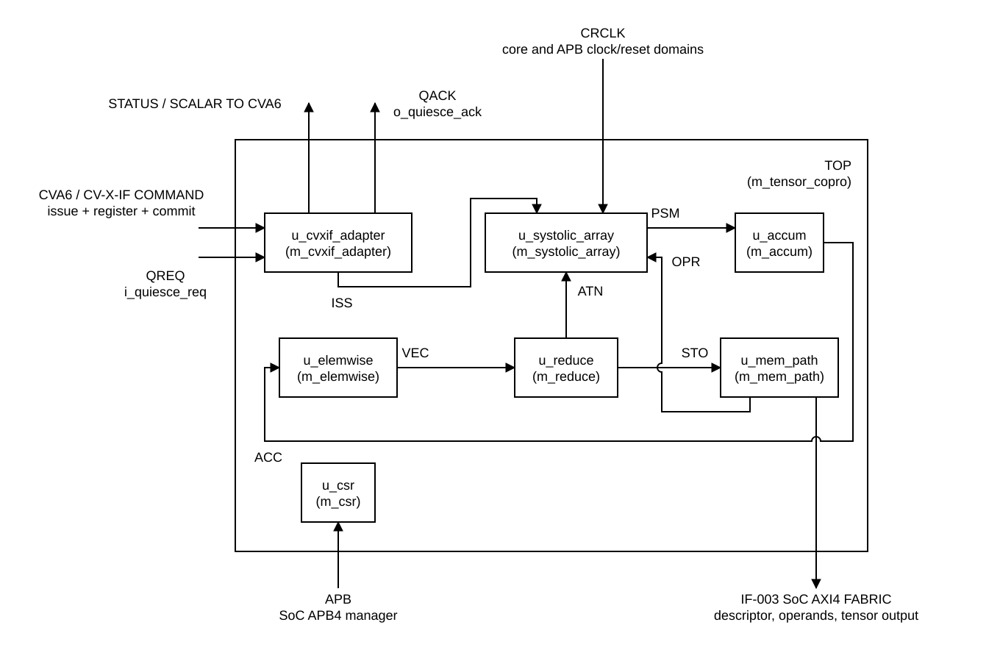

XIF and RES connect the tensor adapter to the CVA6 host. MEM crosses the IP boundary through IF-003 into the SoC firewall and memory fabric. MEM-001 is the accelerator's internal SRAM. The internal arrows show representative compute transfers. See the companion ISA §4 for endpoint directions and §6 for the per-operation paths, including scalar return through RES and memory writeback through IF-003.

```json
{
  "page_name": "BLOCK_DIAGRAM",
  "out_name": "tensor_copro_block_diagram_runtime.drawio",
  "table_suffix": "",
  "layout": {
    "gap_h": 100,
    "gap_v": 90,
    "margin": 40,
    "block_h": 80
  },
  "top": {
    "frame_label": [
      "TOP",
      "(m_tensor_copro)"
    ],
    "block_label": [
      "TOP",
      "(m_tensor_copro)"
    ],
    "block_row": [
      "TOP (m_tensor_copro)",
      "Structural top.",
      "Section 14.2"
    ]
  },
  "frame_row": [
    "TOP (m_tensor_copro) frame",
    "Structural top.",
    "Section 14.2"
  ],
  "frame_interfaces": [
    "XIF",
    "RES",
    "MEM",
    "APB",
    "CRCLK",
    "QREQ",
    "QACK"
  ],
  "blocks": [
    {
      "key": "U_CVXIF_ADAPTER",
      "label": [
        "u_cvxif_adapter",
        "(m_cvxif_adapter)"
      ],
      "width": 200,
      "row": 0,
      "col": 0,
      "row_name": "u_cvxif_adapter (m_cvxif_adapter)",
      "function": "CV-X-IF handshake, decode, per-command mode latch, queue, scoreboard, and dispatch",
      "source": "Section 14.2"
    },
    {
      "key": "U_SYSTOLIC_ARRAY",
      "label": [
        "u_systolic_array",
        "(m_systolic_array)"
      ],
      "width": 220,
      "row": 0,
      "col": 1,
      "row_name": "u_systolic_array (m_systolic_array)",
      "function": "Dense/vector MAC datapath plus paired 2:4 sparse MAC lanes; replicated PARA_ARRAY_COUNT times for active-command tile scheduling",
      "source": "Section 14.2"
    },
    {
      "key": "U_ACCUM",
      "label": [
        "u_accum",
        "(m_accum)"
      ],
      "width": 120,
      "row": 0,
      "col": 2,
      "row_name": "u_accum (m_accum)",
      "function": "Accumulator",
      "source": "Section 14.2"
    },
    {
      "key": "U_ELEMWISE",
      "label": [
        "u_elemwise",
        "(m_elemwise)"
      ],
      "width": 160,
      "row": 1,
      "col": 0,
      "row_name": "u_elemwise (m_elemwise)",
      "function": "Residual/bias/scale/activation epilogue (optional)",
      "source": "Section 14.2"
    },
    {
      "key": "U_REDUCE",
      "label": [
        "u_reduce",
        "(m_reduce)"
      ],
      "width": 140,
      "row": 1,
      "col": 1,
      "row_name": "u_reduce (m_reduce)",
      "function": "Max/exp/sum softmax, Welford layer norm, pipelined piecewise special functions, attention normalization (optional)",
      "source": "Section 14.2"
    },
    {
      "key": "U_MEM_PATH",
      "label": [
        "u_mem_path",
        "(m_mem_path)"
      ],
      "width": 160,
      "row": 1,
      "col": 2,
      "row_name": "u_mem_path (m_mem_path)",
      "function": "Non-coherent AXI4 burst DMA plus banked local SRAM and operand/result buffering",
      "source": "Section 14.2"
    },
    {
      "key": "U_CSR",
      "label": [
        "u_csr",
        "(m_csr)"
      ],
      "width": 100,
      "row": 2,
      "col": 0,
      "row_name": "u_csr (m_csr)",
      "function": "Generated CSR (optional)",
      "source": "Section 14.2"
    }
  ],
  "connectors": [
    {
      "id": "ISS",
      "src": "U_CVXIF_ADAPTER",
      "src_side": "B",
      "dst": "U_SYSTOLIC_ARRAY",
      "dst_side": "T"
    },
    {
      "id": "OPR",
      "src": "U_MEM_PATH",
      "src_side": "B",
      "dst": "U_SYSTOLIC_ARRAY",
      "dst_side": "R"
    },
    {
      "id": "PSM",
      "src": "U_SYSTOLIC_ARRAY",
      "src_side": "R",
      "dst": "U_ACCUM",
      "dst_side": "L"
    },
    {
      "id": "ACC",
      "src": "U_ACCUM",
      "src_side": "R",
      "dst": "U_ELEMWISE",
      "dst_side": "L"
    },
    {
      "id": "VEC",
      "src": "U_ELEMWISE",
      "src_side": "R",
      "dst": "U_REDUCE",
      "dst_side": "L"
    },
    {
      "id": "ATN",
      "src": "U_REDUCE",
      "src_side": "T",
      "dst": "U_SYSTOLIC_ARRAY",
      "dst_side": "B"
    },
    {
      "id": "STO",
      "src": "U_REDUCE",
      "src_side": "R",
      "dst": "U_MEM_PATH",
      "dst_side": "L"
    }
  ],
  "externals": [
    {
      "id": "XIF",
      "block": "U_CVXIF_ADAPTER",
      "side": "L",
      "dir": "in",
      "pos": 0,
      "text": [
        "CVA6 / CV-X-IF COMMAND",
        "issue + register + commit"
      ]
    },
    {
      "id": "RES",
      "block": "U_CVXIF_ADAPTER",
      "side": "T",
      "dir": "out",
      "pos": 0,
      "text": [
        "STATUS / SCALAR TO CVA6"
      ]
    },
    {
      "id": "MEM",
      "block": "U_MEM_PATH",
      "side": "B",
      "dir": "out",
      "pos": 0,
      "text": [
        "IF-003 SoC AXI4 FABRIC",
        "descriptor, operands, tensor output"
      ]
    },
    {
      "id": "APB",
      "block": "U_CSR",
      "side": "B",
      "dir": "in",
      "pos": 0,
      "text": [
        "APB",
        "SoC APB4 manager"
      ]
    },
    {
      "id": "CRCLK",
      "block": "U_SYSTOLIC_ARRAY",
      "side": "T",
      "dir": "in",
      "pos": 0,
      "text": [
        "CRCLK",
        "core and APB clock/reset domains"
      ]
    },
    {
      "id": "QREQ",
      "block": "U_CVXIF_ADAPTER",
      "side": "L",
      "dir": "in",
      "pos": 1,
      "text": [
        "QREQ",
        "i_quiesce_req"
      ]
    },
    {
      "id": "QACK",
      "block": "U_CVXIF_ADAPTER",
      "side": "T",
      "dir": "out",
      "pos": 1,
      "text": [
        "QACK",
        "o_quiesce_ack"
      ]
    }
  ],
  "nets": [],
  "interfaces": [
    {
      "id": "XIF",
      "name": "CV-X-IF issue/register/commit input sub-interfaces",
      "category": "handshake",
      "active": "host -> coprocessor",
      "signals": "issue_valid, issue_req.instr/hartid/id; register_valid, register.hartid/id/rs[]/rs_valid; commit_valid, commit.hartid/id/commit_kill; issue_ready and register_ready return from coprocessor"
    },
    {
      "id": "RES",
      "name": "CV-X-IF issue response and result sub-interfaces",
      "category": "handshake",
      "active": "coprocessor -> host",
      "signals": "issue_resp.accept/writeback/register_read; result_valid, result.hartid/id/data/rd/we; result_ready supplied by host"
    },
    {
      "id": "MEM",
      "name": "IF-003 non-coherent AXI4 to the SoC memory fabric",
      "category": "custom",
      "active": "mixed: coprocessor requests/outputs; memory system returns operands/responses",
      "signals": "AXI4 AR/AW/W/R/B channels through SoC firewall. SRAM ports stay internal. Bus sizing and timing per DEC-004"
    },
    {
      "id": "QREQ",
      "name": "IF-004 ordinary-reset quiesce request",
      "category": "custom",
      "active": "SoC reset controller -> tensor coprocessor",
      "signals": "i_quiesce_req; active-high level request stops new commands and drains accepted work before reset"
    },
    {
      "id": "QACK",
      "name": "IF-004 ordinary-reset quiesce acknowledgment",
      "category": "custom",
      "active": "tensor coprocessor -> SoC reset controller",
      "signals": "o_quiesce_ack; active-high level acknowledgment only after accepted CV-X-IF commands/results, OP-003 fence, and all AXI transactions are drained; no abort/isolation"
    },
    {
      "id": "APB",
      "name": "APB4 CSR access",
      "category": "custom",
      "active": "SoC -> CSR subordinate",
      "signals": "PSEL, PENABLE, PWRITE, PADDR, PWDATA; PRDATA, PREADY, PSLVERR returned"
    },
    {
      "id": "CRCLK",
      "name": "Clock and reset",
      "category": "custom",
      "active": "SoC -> tensor coprocessor",
      "signals": "i_clk_core, i_rst_n_core; optional i_clk_apb, i_rst_n_apb"
    },
    {
      "id": "ISS",
      "name": "Queued operation and mode",
      "category": "custom",
      "active": "u_cvxif_adapter -> u_systolic_array",
      "signals": "command mode, precision, shape, tile metadata"
    },
    {
      "id": "OPR",
      "name": "Operand tiles",
      "category": "custom",
      "active": "u_mem_path -> u_systolic_array",
      "signals": "operand tiles and sparse metadata"
    },
    {
      "id": "PSM",
      "name": "Partial sums",
      "category": "custom",
      "active": "u_systolic_array -> u_accum",
      "signals": "partial sums and tile coordinates"
    },
    {
      "id": "ACC",
      "name": "Accumulator result",
      "category": "custom",
      "active": "u_accum -> u_elemwise",
      "signals": "accumulated tile and precision"
    },
    {
      "id": "VEC",
      "name": "Epilogue vector",
      "category": "custom",
      "active": "u_elemwise -> u_reduce",
      "signals": "post-processed vector tile"
    },
    {
      "id": "ATN",
      "name": "Attention softmax feedback",
      "category": "custom",
      "active": "u_reduce -> u_systolic_array",
      "signals": "on-chip attention state and next matrix phase"
    },
    {
      "id": "STO",
      "name": "Post-processed output tile",
      "category": "custom",
      "active": "u_reduce -> u_mem_path",
      "signals": "result tile and completion metadata"
    }
  ],
  "legend_note": "The enclosing frame is the top module; blocks inside are its instances.",
  "library_sha256": "15DFB183E267D2A94F8CAB316E01EB3D2E9D2F9C006DC816790A394F4123506C"
}
```

*Figure 5-1. Tensor coprocessor top-level block diagram and interfaces. Source: `figures/tensor_copro_block_diagram_runtime.drawio` (draw.io, VLSIT library, drawn by `vlsit_spec_diagram.py`).*

#### 5.2.1 Lower-level block diagrams

The two blocks with the most control logic are drawn one level lower. These are specification-level decompositions: no RTL exists yet, so each box is a function the specification assigns to the block, and the section that defines it is named in the figure source. They are not RTL modules. A block with a single function is not drawn.

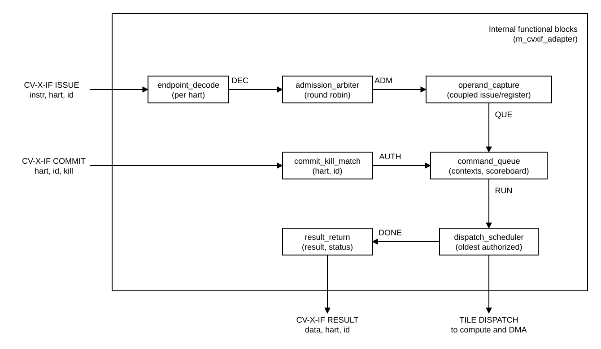

*Figure 5-2. `m_cvxif_adapter`: per-hart decode, round-robin admission, operand capture, commit and kill matching by hart and id, command queue, dispatch and result return. Source: [draw.io](figures/m_cvxif_adapter_internal.drawio), [JSON](figures/m_cvxif_adapter_internal.json). The host-side frontier that produces the commit packets is in Section 5.3.1 (HFC-1..HFC-9).*

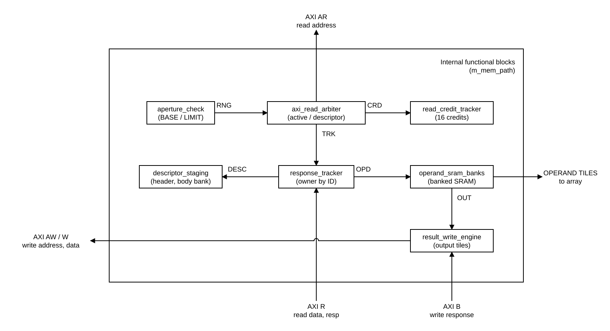

*Figure 5-3. `m_mem_path`: aperture check, active/descriptor read arbitration with read credits, response tracking by owner, descriptor staging, banked operand SRAM and the result write engine. Source: [draw.io](figures/m_mem_path_internal.drawio), [JSON](figures/m_mem_path_internal.json).*

### 5.3 Transaction and dataflow

1. The processor fetches the custom instruction from its normal instruction memory/cache and sends its 32-bit instruction word and transaction identity to `m_cvxif_adapter` on CV-X-IF issue. The selected tensor-host profile uses `X_ISSUE_REGISTER_SPLIT=0` (DEC-024): issue and register are coupled, and the adapter captures requested `rs1`/`rs2` values only on their joint accepted handshake. The generic CV-X-IF profile permits later/reordered register packets only when split mode is enabled (REF-001 §5.5.7–5.5.8, 5.6); that mode is not selected for this release. These values can carry scalar parameters or tensor/descriptor addresses, not an entire large tensor.
2. The host/runtime chooses a mode using shape, precision, prefill/decode phase, and model metadata; only a mode enabled by `PARA_ALGORITHM_MASK` is legal for the built variant. Instruction selectors and the descriptor container are selected; exact per-operation field maps and schema sizes are frozen by DEC-065 in the instruction-set companion §10.
3. The coprocessor allocates a command context on the coupled issue/register acceptance handshake and may accept a different next mode while an earlier command executes. It captures the requested source lanes in that handshake and applies commit/kill packets to the per-hart instruction order: a non-kill commit makes the identified instruction and older instructions non-speculative; a kill cancels the identified instruction and younger instructions from that hart. Under DEC-033, the CVA6 host tracks a per-hart irrevocability frontier and delays non-kill commit until the command and all older instructions can no longer be flushed. An older CV-X-IF command already covered by non-kill commit may still be computing; it does not block the frontier or N+1 authorization. An older non-tensor instruction that can still fault or flush does block it. The coprocessor may capture context at issue, but descriptor/tensor DMA, output writes, and result are gated until the matching delayed non-kill commit. A squash before that commit produces the per-hart kill boundary and no memory/result side effect; after non-kill authorization, the host shall not kill that command. This authorization marks the command irrevocable, not architecturally retired; CVA6 still waits for its result before retirement. Coupled split=0 is selected in DEC-024. A queued command's descriptor may be prefetched while an older committed command computes only after its own operands are captured and delayed non-kill commit is known, per DEC-026; overlap is an objective, not a latency guarantee.
4. Exact attention may iterate across tiles while updating on-chip softmax statistics; approximate/linear attention uses its separately defined state and accuracy contract.
5. The coprocessor writes tensor outputs to the command's output address through `m_mem_path`. Separately, CV-X-IF returns one instruction-completion transaction. Per the selected DEC-010 policy, an opcode defined to return a scalar register result places that value in `data/rd/we`; other opcodes place completion status there when `rd!=x0`. In mode 2, a tensor/status opcode may use `rd=x0` and complete with `we=0`; accepted-command errors are reported through the sticky CSR record. The result never carries a tensor tile. Scalar-result opcodes require APB CSR and a nonzero destination. Pipeline-cut parameters remain fixed for the synthesized build.

#### 5.3.1 Host safe-commit tracker (DEC-033/034 implementation method)

The tensor IP cannot infer whether an older CPU instruction may still fault or flush from CV-X-IF issue/register/commit alone. This tracker belongs in the CVA6 host/scoreboard integration; it is not a new tensor IP port. The selected implementation contract is:

1. **Record accepted commands.** For each hart, append a command record only on the coupled issue/register handshake with `issue_resp.accept=1`. Store `(hartid,id)`, the CVA6 scoreboard age/order tag, and `accepted`, `nonkill_sent`, and `killed` state. A rejected instruction creates no tensor command record. The CVA6 host still tracks the disposition of its completed issue transaction, as required by REF-001 §5.5.8. Do not sort transaction IDs numerically: they wrap and identify live transactions, not program age.
2. **Advance only across fault-resolved older work (DEC-034).** For a candidate command, every older non-tensor scoreboard entry must be marked by a new internal `fault_resolved` state only after all exception and redirect sources that apply to that instruction have reached a final outcome. `scoreboard_entry_t.valid` means result data is valid; it is not, by itself, proof that no later commit-stage exception or flush can occur. An older CV-X-IF command may be passed only after its non-kill commit was sent; its result need not be ready. The candidate's own result is never required for authorization.

   **Fault and event sources.** Per-entry `fault_resolved` shall cover execution/writeback exceptions; branch resolution and misprediction; load/store address translation, protection, and access-fault completion at the last stage where the configured LSU can still report an error; CSR/commit-stage exceptions; and fences or other instructions that can request a controller redirect/flush. Asynchronous interrupt/debug requests are not a per-entry fault bit: the host arbiter shall give any selected trap/redirect priority over authorization in the same cycle. If such an event is selected before or on authorization, suppress non-kill commit and kill the affected uncommitted suffix. Once non-kill commit has been sent, the command is irrevocable and its result/context must be retained. DEC-035 selects deferred interrupt/debug entry. Latch the selected event per hart, stop issuing or non-kill-authorizing younger work for that hart, kill any accepted but not-yet-authorized CV-X-IF suffix, and allow all commands already non-kill-authorized before event selection to complete and retire in program order. Enter the interrupt/debug handler only at the resulting precise architectural boundary; preserve the selected event until entry, and do not block unrelated harts. Never kill or discard an already-authorized command. This is CVA6 host behavior and adds no tensor-IP event port. The worst-case entry delay depends on the maximum already-authorized backlog, their maximum shape/tile counts, result backpressure, and the SoC memory-response/watchdog contract; DEC-018 requires a quantified latency target before performance signoff. Concrete source mapping and event arbitration remain host-integration signoff items.

3. **Emit one authorization.** When the age-ordered conditions hold, pulse `commit_valid` once for the candidate with `commit_kill=0` and its matching hart/id. Do not emit non-kill commit in the issue-acceptance cycle. No descriptor read, tensor read, output write, or result may start before the tensor IP observes that matching authorization.
4. **Require the selected early frontier for signoff.** DEC-034 selects fault-resolved tracking for the first release. A retirement-only frontier may be used for bring-up diagnosis, but it is not an approved performance implementation: an older tensor waiting for its result can block in-order retirement of younger scalar setup instructions and delay N+1. If the per-entry fault-resolved event and complete source mapping are unavailable, the tensor-enabled host remains unqualified; do not silently substitute retirement-only behavior.
5. **Kill by scoreboard age.** On exception/branch squash, use the scoreboard's age-ordered affected suffix to locate the oldest affected completed CV-X-IF issue transaction for that hart. Use it as the kill boundary, including when that transaction was rejected. Cancel the affected younger accepted commands without creating a command context for the rejected boundary. A pending squash takes priority over same-cycle safe-frontier authorization. Never select the boundary by comparing wrapped ID values. If the host cannot identify the affected suffix, the tensor host is not qualified to issue DMA.
6. **Keep authorization distinct from retirement.** Once a command is non-kill committed it cannot later be killed, but its CVA6 scoreboard entry still waits for the CV-X-IF result before architectural retirement. Reuse IDs only according to the CVA6 live-transaction/scoreboard contract after the matching result or kill has been consumed.

**Safe-frontier integration anchors from the checked-in CVA6.** Bind the following observations to the sources that the new tensor-enabled top actually elaborates. These inspected files show candidate hook points and late-fault cases. The new host still needs age-tagged indication wires and integration proof.

| Older entry or event | Checked-in source evidence | Required fact before advancing |
|---|---|---|
| Ordinary execution/writeback | [scoreboard.sv](../../rtl/common/modified/cva6/core/scoreboard.sv) updates issued entries on wt_valid_i and trans_id_i, and captures valid/timing exceptions from ex_i. | For a class whose final fault-capable stage is execution, require its tagged successful writeback, retain the entry age and rule out any configured later exception, macro or debug check that still applies. A result-valid scoreboard entry alone is insufficient. |
| Branch | [ex_stage.sv](../../rtl/common/modified/cva6/core/ex_stage.sv) exports resolved_branch_o; [controller.sv](../../rtl/common/modified/cva6/core/controller.sv) uses the mispredict field to flush unissued/IF work. | Attribute the actual resolved outcome to its original scoreboard age. A mispredict selects the affected suffix. Do not infer age from a global flush or current issue ID. |
| Load | [load_unit.sv](../../rtl/common/modified/cva6/core/load_unit.sv) associates responses with the load-buffer ID; successful data return is distinct from data_error, translation faults and killed/flushed loads. | Observe final tagged LSU completion after the selected cache/MMU route reports any access error. Translation success or request acceptance alone cannot close a load. |
| Store/CMO/AMO | [store_unit.sv](../../rtl/common/modified/cva6/core/store_unit.sv), [store_buffer.sv](../../rtl/common/modified/cva6/core/store_buffer.sv), [commit_stage.sv](../../rtl/common/modified/cva6/core/commit_stage.sv). The ordinary store-buffer commit-ready signal tests queue space; commit handles CMO completion/error and AMO acknowledgment on different paths. | Identify the last stage that can still deliver a synchronous exception for each kind of store-like operation in the selected platform. If a late fabric error exists, document whether the platform routes it as a synchronous exception or as a separate event. A store-buffer credit/grant cannot prove either case. |
| CSR, fence, architectural retirement | [commit_stage.sv](../../rtl/common/modified/cva6/core/commit_stage.sv) checks csr_exception_i and fence/flush conditions, and can assert commit_ack_o for an entry it drops. | Require the final no-exception/no-redirect disposition or a proven earlier equivalent. An acknowledgment that drops an entry is not evidence of successful retirement. A class whose fault checks occur at retirement can close there, while other proven classes still use the early frontier. |
| Interrupt/debug and CV-X-IF | The current [CV-X-IF driver](../../rtl/common/third_party/cva6/core/cvxif_issue_register_commit_if_driver.sv) emits commit from the issue handshake and ties kill low. [controller.sv](../../rtl/common/modified/cva6/core/controller.sv) applies trap/redirect actions. | Replace issue-cycle authorization in the new host. Feed the pre-flush event selection to the frontier, with same-cycle priority. Hold DEC-035 deferred events before the controller discards any authorized destination or result context. |

For TEST-029, include a clean load-translation phase followed by a delayed data_error and a store-buffer commit-ready pulse before the actual final store-class outcome. Also exercise a commit acknowledgment that drops an exception entry. In each case either prove that the particular configured route cannot produce a later synchronous fault or wait for its final classified event. Record the elaborated configuration, source revisions and waveforms per class. Do not assume a checked-in third-party example and a modified core build share the same final fault points.

**Ordinary stores, CMO and AMO have different frontier events.** In the checked-in modified core, [store_buffer.sv](../../rtl/common/modified/cva6/core/store_buffer.sv) derives commit_ready_o from committed-queue capacity and no_st_pending_o from its count. An ordinary committed store can leave that queue on the cache grant. The modified [HPDcache adapter](../../rtl/common/modified/cva6/core/cache_subsystem/cva6_hpdcache_if_adapter.sv) sets need_rsp=0 for an ordinary HPDCACHE_REQ_STORE, but requests a response for CMO and AMO. These source facts distinguish retirement and cache admission from eventual external write completion. They do not establish the late-error classification for the new tensor SoC route.

For the ordinary posted-store class, close the host frontier at successful architectural retirement for the initial candidate only after proving that the integrated route cannot still deliver a precise synchronous exception for that store. Classify downstream failures separately as required by that platform, for example as a later asynchronous event if the integration implements one. The CPU-to-DMA cache clean and fence required by Section 11.2 remain the data-visibility contract. A store's frontier closure neither publishes its buffer to DMA nor proves its write reached DRAM.

If the selected ordinary-store route can still report a synchronous fault after the proposed closure point, wait for its final tagged disposition. Preserve the older obligation across any intervening internal queue release. The host cannot qualify a route that loses its age or final fault state before the tensor safe-commit decision. CMO success requires its configured completion/error outcome, and a fence with an instruction-cache completion requirement must include that completion. AMO success requires acknowledgment without amo_error_i and resolution of any associated commit-stage flush under the host's redirect priority. A raw acknowledgment is insufficient for either class.

Extend TEST-029 for the selected SRAM/cache/MMIO routes. Separate grant, committed-queue empty, terminal response, successful retirement, and redirect selection in the trace. For the posted-store route establish whether a deliberately delayed downstream write failure is visible as a precise fault or a separately classified event. For CMO/AMO exercise success, returned error and same-cycle flush/authorization. When a precise fault remains possible, require no younger tensor descriptor AR before clean resolution. At a synchronous fault require the age-correct kill and no AXI DMA from the killed command. Preserve the previously authorized prefix for later asynchronous event handling under DEC-035.

**Host decoder enforcement of DEC-027.** The modified [CVA6 decoder](../../rtl/common/modified/cva6/core/decoder.sv) exposes both priv_lvl_i and v_i. Its generic CV-X-IF fallback converts otherwise illegal instructions to CVXIF/OFFLOAD when CvxifEn is set. Its final illegal-instruction path also suppresses decoded_exception.valid when CvxifEn is set. Therefore setting only illegal_instr for a denied tensor opcode can still send it to the coprocessor. Select the denied-tensor case before the fallback can classify it as an offload, and create the valid host exception even with CvxifEn enabled. Preserve any older exception already carried into decode. Carry the selected hart's issue-classification decision with that instruction until dispatch, with no direct coprocessor-side privilege test.

The trusted supervisor in DEC-027 is the platform S-mode driver. The local [HPDcache CVA6 configuration](../../rtl/common/modified/cva6/core/include/cv64a6_imafdc_sv39_hpdcache_wb_config_pkg.sv) has CVA6ConfigHExtEn=0. Use this nonvirtual assumption for the first engineering host. If a later host enables the hypervisor extension, its tensor gate must distinguish a platform supervisor from a guest supervisor. An instruction with active virtualization is outside this DMA trust domain and shall be blocked before XIF unless a future virtualization contract is separately defined. The future host profile specifies its guest trap handling. For the selected nonvirtual U-mode policy keep illegal-instruction cause 2.

In TEST-026, enable CvxifEn, issue an assigned tensor opcode from U-mode and force the generic decoder path that would normally offload an illegal word. Prove that the local exception is valid and no tensor issue request or command disposition leaks to the accelerator. Cross supported S/M cases with queue backpressure and concurrent other-hart activity. If qualifying a host with virtualization enabled, test both virtual supervisor and virtual user denial even when their numeric privilege encoding matches an admitted native mode.

**Issue dispositions and rejected boundaries.** REF-001 §5.5.8 requires CPU disposition of every completed issue transaction, including rejection. Any rejected tensor instruction that takes an illegal-instruction trap receives a kill disposition, possibly as part of an age-ordered batch. The tensor command FIFO contains only accepted work. A rejected issue can still serve as an identity/order marker for a later kill boundary. The first direct host-to-tensor integration must preserve enough per-hart issue-order information to apply such a boundary to the correct accepted suffix. A compact ordered marker for each unresolved issue transaction is one candidate. State its independent capacity and prevent wrap/reuse while the disposition is pending under the REF-001 §5.5.2 live-ID rules. A marker alone grants no descriptor or operand access. If a wrapper observes only a filtered issue stream, validate how it maps boundaries that name instructions absent from that stream before qualifying it.

For example, a hart completes issues in order 14, 15, 1, 3 with a four-bit ID. ID 14 is already authorized, ID 15 is rejected, and IDs 1 and 3 are accepted but uncommitted. A kill boundary at 15 disposes of the rejected issue and kills 1 and 3. It leaves 14 and matching numeric IDs on other harts unchanged. The selected direct integration shall suppress affected same-hart issue in the kill cycle. REF-001 §5.5.8 requires commit/kill observation without ready and prevents treating a same-cycle issue as a new unaffected command. A repeated disposition for an already disposed identity must not allocate a new context or alter an authorized command. The host must not send an old disposition once the same hart/ID pair has been reused. An internal generation tag is not carried on the CV-X-IF wire.

The current repository driver emits commit from issue-valid/ready and receives only a generic flush input. The CVA6 scoreboard records result-valid and exception state, branch resolution, and commit-stage behavior, but the host does not currently export one complete per-entry `fault_resolved` indication to the CV-X-IF driver; `scoreboard_entry_t.valid` alone is insufficient because CSR/commit-stage exceptions and other flush sources are resolved later. The P0 integration work must add that per-hart age-ordered proof and map every applicable source plus the kill suffix; the signal-level contract is HFC-1..HFC-9 below. TEST-022/029, SVA-011, and COV-005/010 shall cover the source classes, squash priority, ID wrap, N+1 overlap, and multiple harts.

**DEC-033/034 source map for the tensor-enabled CVA6 top.** The following anchors refer to the checked-in `rtl/common/third_party/cva6/core` variant. They identify where the integration needs evidence. A signal name in the table alone does not authorize a tensor command.

| Class | Existing source anchor | Tensor-enabled host requirement |
|---|---|---|
| Issue acceptance and operand capture | `issue_read_operands.sv` instantiates `cvxif_issue_register_commit_if_driver`. That driver computes `issue_valid_o` using valid and flush, asserts commit on issue ready, and ties kill low | Capture the accepted tensor command and its scoreboard age only on the coupled acceptance. Replace the tensor host's immediate commit path with a separate event selected from the age-ordered authorization or squash logic |
| Ordinary execution and exceptions | `issue_stage.sv` passes writeback and exception inputs into `scoreboard.sv`. The scoreboard updates result and exception by `trans_id_i` | Attach final-OK/fault evidence to the live scoreboard generation and instruction class. A class may use its result-valid edge only after proving it is also its last synchronous fault/redirect opportunity |
| Branch and younger cancellation | `scoreboard.sv` computes `bmiss` from a valid mispredict. With SpeculativeSb enabled, the checked-in code can cancel the single entry at FLU writeback transaction ID plus one. `controller.sv` requests a front-end/unissued flush for a mispredict | Use the actual resolved branch age and the same cancelled suffix as the scoreboard. Correct prediction resolves the branch condition. Mispredict suppresses any affected same-cycle authorization and emits one kill from the oldest affected completed tensor issue, including a rejected boundary |
| Load/store/AMO | `ex_stage.sv` exposes `load_valid_o`, `store_valid_o` and corresponding exception ports. `commit_stage.sv` has separate store/AMO commit conditions | Determine the last configured source of translation, address, access and memory exceptions for each class. Any class whose later exception remains possible blocks the frontier until the final condition. Store address/data or writeback readiness alone is insufficient |
| CSR, fence and commit-stage redirect | `commit_stage.sv` selects `exception_o`, resolves fence progress and returns commit acknowledgements. The controller has separate flush/redirect paths | Reach final-OK only when any still-applicable CSR legality, privilege, exception or redirect has been resolved. A per-class retirement dependency is safe for classes with late resolution. Preserve early advancement across classes with proven earlier resolution and do not gate all commands at retirement |
| Privilege and selected interrupt/debug event | `cva6.sv` holds `priv_lvl` and `debug_mode` and connects flush control to its front end and back end. `scoreboard.sv` clears entries on full flush | Enforce S/M-only issue before the interface. Apply the DEC-035 defer decision upstream of the destructive flush. Preserve the already-authorized scoreboard prefix through result/writeback/retirement. Kill only the uncommitted affected suffix |

Implement the source decision per live instruction class and program age, using scoreboard pointers or an equivalent age tag across ring wrap. Expose an explicit condition for final-OK and an identified fault/squash event. If an entry is still waiting on any applicable late source, keep it unresolved. Ignore stale source updates for invalidated entry generations. On a selected trap, redirect or debug boundary, determine the affected suffix once before emitting commit. A same-cycle authorization for an affected command is suppressed. A matching selected event after authorization defers its destructive flush until DEC-035 retirement is safe. An older new synchronous fault after the host proved the frontier safe is an integration assertion failure. A younger synchronous fault follows precise retirement and cannot erase an older authorized tensor entry.

Review all branch/trap/flush writers and every enabled LSU/CSR instruction class in the actual top. Demonstrate a positive case where N+1 authorizes while N still computes, and negative cases where older unresolved/faulting work blocks or kills N+1 without AXI. Trace source completion, scoreboard age, pending event, kill boundary, commit pulse, first DMA and tensor result. The checked-in signals identify anchors for this work. The final-OK proofs and the modified host still require integration evidence.


**CVA6 squash and deferred-event integration constraints.** In the checked-in scoreboard, the branch cancel assignment is conditional on SpeculativeSb. It is a possible single-entry cancel by scoreboard slot, not an exported age-ordered CV-X-IF suffix. The configuration builder derives SpeculativeSb from SuperscalarEn. Use the resolved branch identity, the live scoreboard walk and the selected host's actual issued/retained window to build the eligible kill suffix. For a given branch, entries younger than the branch are eligible only if that branch's squash discards them. Exclude the branch, older instructions and unrelated harts. A speculative branch redirect must never encounter an already-authorized entry in its affected window; flag that as a failed frontier proof. A front-end/unissued flush alone does not identify which completed CV-X-IF issues to kill.

The scoreboard's full `flush_i` clears every live `issued`, `cancelled`, result-valid and exception-valid field and resets its issue/commit pointers. A pending event latch placed only after that flush cannot preserve an authorized tensor instruction. In the tensor-enabled host, separate event selection from destructive flush delivery. On selection, suppress new issue/authorization for the affected hart and snapshot the affected uncommitted suffix before discarding its scoreboard state. Keep the already-authorized prefix and the ordinary instructions needed to retire that prefix in architectural order. Result accept, writeback and commit must remain live for the prefix. In particular, the checked-in commit stage only advances an ordinary valid head while `!halt_i`; driving the same hart's commit halt during the drain can prevent the event from ever reaching entry. Gate the front-end and authorization during drain and apply the architectural debug/trap stop at the precise retirement boundary.

For the first tensor-top bring-up, use a single-issue CVA6 candidate to reduce the issue-window combinations. The existing cluster configuration has single issue and CV-X-IF disabled, so it provides configuration context only. A dual-issue tensor profile requires its own proof and additional tests. Neither profile can use a wrapped numeric CV-X-IF ID as an age comparison. Sample each eligible event against the current live scoreboard generation before allocation/retirement updates can reuse the slot. In the same cycle, an affected kill or selected event suppresses new authorization even if a final-OK source also resolves. Preserve the selected event until architectural entry and derive the saved PC from the precise post-drain retirement boundary. Software must not resume at an already-retired tensor instruction.

For TEST-029/030, drive three distinct witnesses:

- A branch resolves incorrectly with a completed rejected CV-X-IF issue at the first discarded XIF position and an accepted younger issue behind it across ID wrap. Drive this combination with the host-integration harness if the selected issue window cannot produce it in a software trace. Verify the correct kill boundary, no AXI for either issue and no effect on the unaffected older prefix. Separately exercise a real branch trace at the maximum window the selected host can produce.
- N is authorized before a debug/interrupt selection. Inject result backpressure and hold a younger accepted N+1 behind the event. Verify that authorization of N+1 is suppressed, N retains its scoreboard/destination and receives one result, commit remains available to retire it, and only then does the destructive flush occur. Monitor `halt_i`, scoreboard valid bits, and saved PC to detect early halt, early flush or replay.
- N is authorized and pending, and a non-faulting integer setup instruction precedes N+1. Establish the scalar instruction's last fault/redirect resolution while N is pending and show N+1 can authorize. Replace that setup instruction with an older CSR or store whose final outcome is still unresolved. N+1 must wait even if the scoreboard has result-valid for that entry.

**Signal-level host frontier contract (HFC-1..HFC-9; closes the signal-mapping part of RV-017; proposed refinement of DEC-033/034, pending designer approval).** This contract fixes the observed CVA6 signals, the new internal signals and the decision rule. It is normative through REQ-IF-006. It adds no tensor-IP port and no new DEC number. Host RTL and integration evidence do not exist yet and remain open.

*Source facts used (inspected, not simulated).*

- **Fact A, ID is the scoreboard slot.** `scoreboard.sv:161` sets `issue_instr_o[i].trans_id = issue_pointer[i]`. `issue_read_operands.sv:259-260` passes that value to the driver as `issue_req_o.id`. `build_config_pkg.sv:212` sets `X_ID_WIDTH = TRANS_ID_BITS`. The checked-in cluster configuration has `NrScoreboardEntries = 8`, so the ID is 3 bits and wraps after eight live issues. Within the live window, age equals the ring distance `(slot - head) mod NR_SB_ENTRIES`, where `head = commit_pointer_q[0]`. A numeric comparison of IDs remains forbidden.
- **Fact B, issue-time commit.** `cvxif_issue_register_commit_if_driver.sv:57-64` drives `commit_valid_o = issue_valid_o && issue_ready_i` and `commit_o.commit_kill = 1'b0`. Its comment says speculation is impossible and marks it "TODO to be verified". The claim does not cover older loads, stores, CSR, fence or commit-stage faults, which are resolved after issue.
- **Fact C, destructive flush.** `scoreboard.sv:260-267` clears `issued`, `cancelled`, `valid` and `ex.valid` on `flush_i`. `scoreboard.sv:239,271-272` cancels one entry (`after_flu_wb`) only when `SpeculativeSb` is on and a mispredict is resolved. The checked-in cluster configuration has `SuperscalarEn = 0`, so `SpeculativeSb` is derived off there. A tensor top with other settings needs its own proof.
- **Fact D, retirement ports.** `commit_stage.sv:168` exports only `commit_tran_id_o = commit_instr_i[0].trans_id`. The checked-in configuration has `NrCommitPorts = 2`. Port 1 can acknowledge a slot (`commit_ack_o[1]`) without an exported ID, so a retirement-closing class cannot be tracked for port 1 until the host exports it.

*HFC-1 Per-hart ledger.* Each hart's host keeps one record per scoreboard slot: `led_acc`, `led_rej` (rejected marker), `led_auth` (non-kill sent), `led_kill`, and `fr` (fault resolved). `led_acc`/`led_rej` are set on `x_transaction_accepted_o`/`x_transaction_rejected` (`issue_read_operands.sv:276-277`) for slot `issue_instr_i[0].trans_id`. All bits clear when the slot retires (`commit_ack_o`) or is dropped. A record is indexed by slot and ordered by ring distance from `commit_pointer_q[0]`. Never use the ID value as an order key.

*HFC-2 Final-OK sources per class.* A new internal `fr[slot]` is set only from the source listed for the entry's class. A class absent from the table closes at retirement (fail-safe default).

| Class (decoded `fu`/`op`) | `fr` set by | Existing signals | Default if the final-fault proof is missing |
|---|---|---|---|
| ALU, MULT, FPU, FPU_VEC (non-branch) | tagged write-back without exception | `wt_valid_i[i]`, `trans_id_i[i]`, `ex_i[i].valid==0` (`scoreboard.sv` write-back loop) | retirement |
| Branch / jump | resolution with `is_mispredict=0` | `resolved_branch_i`, `trans_id_i[FLU_WB]` (`scoreboard.sv:271-272`) | retirement |
| Load | final tagged load completion without exception | `load_valid_ex_id`, `load_trans_id_ex_id`, `load_exception_ex_id` (`cva6.sv:576-579`) | retirement |
| Store (ordinary) | successful retirement unless TEST-029 proves no later precise fault | `commit_ack_o`, `commit_lsu_o`, `commit_drop_i` (`commit_stage.sv`) | retirement |
| CSR, FENCE, FENCE.I, SFENCE/HFENCE, CMO, AMO, any redirecting op | successful retirement without drop, `csr_exception_i` or redirect | `commit_ack_o[k]`, `~commit_drop_i[k]`, per-port slot ID (Fact D) | retirement |
| Accepted tensor entry | own non-kill authorization (`led_auth`), not its result | ledger | not applicable |

*HFC-3 Squash sources and kill boundary.* A squash source selects a boundary slot `b`. The host kills the oldest completed CV-X-IF issue (accepted or rejected) with ring distance greater than or equal to `b` and not yet authorized, and every younger same-hart record. Sources: (a) `exception_o`/`ex_commit.valid` for the head slot (`cva6.sv:486,1332`), where `b` is the first slot after the faulting head; (b) mispredict through `bmiss`, where `b` is the first slot after the resolved branch slot; (c) commit-stage redirect or flush such as `flush_commit_o`, `flush_csr_i`, `flush_acc_i` and the controller flush outputs, where `b` is the first slot after the causing head; (d) `commit_drop_i`/`cancelled` on an accepted entry, which kills that entry. A flush wired only to `flush_i` of the scoreboard is not a boundary.

*HFC-4 Authorization rule.* In decision cycle t, for hart H and candidate slot `c`: authorize iff `led_acc[c] && !led_auth[c] && !led_kill[c] && !cancelled[c] && !sq_sel_q[H] && !ev_sel_q[H]` and, for every slot `t` in `[head, c)`, `led_acc[t] ? led_auth[t] : fr[t]`. The rule reads only registered state (HFC-6). At most one candidate per hart per cycle; the oldest eligible candidate wins. The host never waits for a prior tensor entry's result.

*HFC-5 Driver interface.* The driver in the tensor top (a modified copy under `rtl/common/modified/cva6/core/`; the third-party driver stays unchanged) replaces the issue-cycle commit with inputs `auth_valid_i`, `auth_id_i`, `kill_valid_i`, `kill_id_i`. It outputs `commit_valid_o = auth_valid_i | kill_valid_i`, `commit_o.id = kill_valid_i ? kill_id_i : auth_id_i`, `commit_o.commit_kill = kill_valid_i`. A kill wins over an authorization on the single commit channel. A kill at `kill_id_i` disposes of that issue and every younger accepted issue of the hart (REF-001 §5.5.8), as in the 14/15/1/3 example above.

*HFC-6 Timing and same-cycle priority.* `auth_valid_i` and `kill_valid_i` come from flops. A source sets `fr` in cycle t only when no squash or event is selected for H in that cycle; a squash selected in cycle t sets `sq_sel_q` and the kill record for cycle t+1. The authorization decision for the same candidate at t sees the register state of t, so a squash selected at t cannot lose to an authorization generated from earlier state unless `fr` was already set: that case is an older fault after proven safety and fails SVA-011. The core already misses the 1.04 ns clock (family H4 in the consolidated review), so this path shall not add a combinational scan from the flush/exception cone to `commit_valid_o`. A registered frontier pointer that advances over resolved slots is an allowed equivalent of the scan in HFC-4, provided the latency added to "accept to safe commit" is measured under DEC-018.

*HFC-7 Interrupt and debug (DEC-035).* The controller/CSR logic exports a pre-flush `ev_sel[H]` and its cause. On selection the host sets `ev_sel_q[H]`, stops new issue and authorization for H, kills the accepted not-yet-authorized suffix through HFC-5, and delays the destructive `flush_i`/`halt_i` until every authorized entry has retired in order. `ev_sel_q` clears only at precise handler/debug entry. Other harts are not gated.

*HFC-8 Required RTL changes (all in the tensor top only).* (1) New `cva6_xif_frontier.sv` containing HFC-1..HFC-4; (2) modified driver (HFC-5); (3) `issue_read_operands.sv` exports the accepted/rejected push and slot; (4) `commit_stage.sv` exports per-port retire ID and acknowledge (Fact D); (5) `ex_stage.sv`/`cva6.sv` expose the load, store and branch completion taps from HFC-2; (6) `controller.sv`/`csr_regfile.sv` expose the pre-flush selection and cause (HFC-3/7); (7) `scoreboard.sv` exports per-slot `issued`/`cancelled` (the `still_issued` forward already exists). Build assertions: `X_ID_WIDTH == TRANS_ID_BITS`, single-issue for the first profile, and a stated `SpeculativeSb` value.

*HFC-9 Verification mapping.* SVA-011 shall be refined into four checks: no authorization with an unresolved older non-tensor slot; no authorization of a killed or cancelled slot; no kill of an authorized slot; no authorization in a cycle where `sq_sel_q` or `ev_sel_q` is set. TEST-029 and COV-010 cross the HFC-2 classes with the HFC-3 sources and ID wrap (eight slots, 3-bit ID); TEST-022 covers the push on accepted and rejected issues; TEST-030 and COV-011 cover HFC-7. Port-1 retirement of a retirement-closing class is a mandatory directed case (Fact D).

**Coupled issue data-dependency rules (DEC-024).** The checked-in split=0 driver drives register_valid from issue_valid and copies issue hart/id into the register packet. The modified [issue operand stage](../../rtl/common/modified/cva6/core/issue_read_operands.sv) uses issue_resp.accept and register_read to remove stalls for unused sources and derives rs_valid from the remaining source stalls. Form the supported-command decode result and requested-source mask from the current instruction and static build qualification. Keep that classification independent of rs_valid, register operand values, and ready. In particular, do not make accept=1 depend on ready or use descriptor data to determine the mask. Only the matched joint handshake makes the classification effective as acceptance.

For a supported descriptor instruction, use a subset test (rs_valid & requested_mask) == requested_mask. On RV64 an unused rs2 lane cannot delay issue; on RV32 both selected lanes must be valid before either gets captured. Gate coupled readiness with an eligible endpoint, matching hart/id and slot availability, and the selected fence, reset and kill rules. Reject unsupported instruction-visible combinations with no source requirements or queue allocation. A rejected issue can complete even when its unused source is not ready or no execution slot is free, subject to the host's issue-disposition and global admission gates. Association of an unsupported response with a rejected marker follows Section 5.3.1.

Before a joint handshake, the coprocessor has no accepted pointer and no authority to fetch. If the CPU retracts a stalled issue, discard any combinational selection, then classify and match the current endpoint again. Never reuse the previous cycle's source mask or readiness for a new hart/id. If ready is delayed for timing, qualify the endpoint selection and buffering against the coupled handshake and retract rules instead of exposing a stale registered ready. An internal pipeline cut downstream of accepted source capture remains independent of this path.

Cover in TEST-022 both source-valid arrival orders on RV32, a permanently invalid unused lane on RV64, an issue rejection with unknown source data and a full execution queue, and a stalled request retracted before a different hart/id presents. Check that the requested mask is correct independent of ready, that capture occurs exactly once on the valid coupled transfer, and that no operand or mode state from an unaccepted transaction is used.

#### 5.3.2 Committed descriptor prefetch staging (DEC-026/065/071)

Use one active parsed-command context and one younger prefetch slot as the first overlap candidate. Command queue depth counts accepted contexts, including the active one. A prefetch slot is storage owned by a queued context, not another accepted command credit. A single raw slot needs 896 bytes to hold the largest fixed schema. Two raw banks, one active and one younger, need 1,792 logical bytes. An implementation may recycle the active raw bank after copying all fields and embedded LUT bytes required by its compute path into the active context. Account for those copied bytes separately. More queue entries can hold accepted metadata without each receiving a full descriptor bank.

Eligible prefetch targets the next command in the selected dispatch order after its own safe commit and source capture. Header fetching and validation precede the build-known body fetch. Capture instruction identity, scoreboard command key, slot generation, request phase, expected beat count and byte position at AXI dispatch. The AXI response tracker uses the actual AXI ID/ordering contract to route a returned beat back to its owner. It shall not infer ownership from the currently active compute command. The slot is reusable after ownership is transferred to the active context or the owning command completes and all descriptor transactions are reconciled. The commit/kill host contract prevents a legal kill of an authorized slot.

Prefetch may read only the descriptor and run its schema checks. Algorithm-metadata reads, operand reads, compute and writes remain gated by active dispatch. If N+1 fails header/body validation or its prefetch read hits a returned AXI fault while N is active, retain the error in N+1's own context until its ordered completion path. Do not publish its sticky CSR, emit its CV-X-IF result or poison N's output early. If N then fails, publish N's first error and complete N under DEC-012. The mode-2 W1C gate holds further dispatch and publication. Already accepted AXI requests still drain into their owning slot. After the clear, N+1 may complete with its own stored error without launching numerical work. A killed entry before safe commit has no descriptor AXI traffic or result.

**Descriptor prefetch credit and grant candidate (DEC-026).** In the 16-read-credit bring-up profile, allow at most one reserved or outstanding younger descriptor burst, including a stalled AR offer. Keep the remaining 15 read credits usable by the active command. Reserve destination capacity for the younger burst in its own descriptor bank before offering AR. Receiving descriptor data cannot require space in the active operand queue, or vice versa. The prefetch path uses no write credits. The maximum is one younger descriptor, with header and body still ordered by successful header validation. Receipt of the terminal R transfers or frees the burst reservation under the same DEC-074 rules as other reads.

For the initial arbitration comparison, let active traffic borrow the last credit while no younger descriptor request is eligible. Once eligible work waits for that credit, give it the next eligible released credit within the signed active response-service bound. When both classes have a ready request and a reserved credit, grant one younger-descriptor AR after at most four accepted active ARs. Use active-first ordering between those turns, and grant either class immediately when it is the only eligible requester. Count actual AR handshakes, hold the selected address/owner while ARREADY is low, and account for this hold in the signed request-stage service. This is one candidate schedule for characterization. Record active contention, maximum prefetch wait and whether prefetch finishes before dispatch. An alternative arbitration must bound both classes under the same permitted traffic.

For the 256-bit AXI example with 64-byte descriptor alignment and a 64-beat burst cap, the 896-byte maximum descriptor uses one header AR for 64 bytes and at most two body ARs for the 832-byte body when it crosses a 4-KiB boundary. It requires 28 data beats. With one outstanding younger burst, measure or bound all three grant/response intervals, header checks, body checks and slot transfer before crediting full overlap. A page split or a prior borrowed credit can eliminate some latency benefit. A returned prefetch fault stays with its younger owner and releases storage only after eligible drain. A missing response follows the existing full-SoC timeout policy.

**Promotion of an unfinished prefetched descriptor.** If the scheduler grants N+1 active ownership while its header or body is incomplete, continue the same fetch state and retain the descriptor slot and response owner tags. A promotion does not create a second descriptor fetch or cancel a stalled AR. An already offered AR keeps its latched request class and credit until handshake and response. After that obligation resolves, new bursts for this owner can use active-command arbitration. While N+1 owns the active context but its descriptor slot is still loading, inhibit younger prefetch into that slot. Release the slot only after moving the verified fields and all required inline bytes to the active context, or after ordered descriptor error completion and response drain. Numeric traffic requires both active dispatch and a fully validated descriptor. Accepting the active grant can advance those events in either order without changing the set of reads.

For the one-burst younger credit, bound credit wait, local AR arbitration, fabric acceptance, terminal R and validation separately for each required request. If all read credits were borrowed by active traffic, include the time for an eligible credit to return. If an active AR is already offered when a younger descriptor becomes eligible, it retains the channel until handshake and counts toward the four-active-grant budget while the younger request stays ready with its reservation. A qualifying bound includes any already-started offer, selection bubbles and fabric ARREADY wait rather than converting four accepted ARs directly to four cycles. Do not restart a ready younger request's accounting on unrelated active stalls. Charge header checks before a body request can receive any grant.

Record descriptor-ready time and ordered active-grant time per command generation. The companion trace accepts descriptor_ready_ns for successful descriptor validation and dispatch_ns for that active grant. Use descriptor_ar_ns for the first sampled descriptor address transfer, after the matching commit edge. Probe ARVALID tagged with the owner and export descriptor_ar_offer_ns so TEST-022 covers an early held request even before ARREADY. Export first_numeric_dma_offer_ns when available to check the active grant and descriptor validation prerequisites separately. Report both gaps with sample counts; omit descriptor_ready_ns when descriptor validation fails. If grant arrives first, their positive difference is exposed descriptor wait; if the descriptor is ready first, the remaining gap is waiting for dispatch. A completed descriptor that becomes ready before dispatch can hide its own fetch work while still increasing N's stalls through AXI contention. Compare the two-command makespan and N's operand stall time under identical traffic with prefetch enabled and disabled. Example: a descriptor ready 200 ns after N+1 commits has 50 ns of exposed wait if grant arrives at 150 ns. If prefetch also delays N's completion, check end-to-end latency against the baseline rather than reporting only the exposed wait.

Provide bounded service for both active traffic and eligible descriptor prefetch under the actual fabric contract. Limit the candidate to one prefetched descriptor at a time. Track descriptor and active tensor traffic separately for arbitration and latency accounting, even if the same manager port is used. Prevent prefetch from consuming local credits needed to drain active DMA. The first characterization shall measure useful overlap, request contention and attributable AXI wait with the same workload and prefetch disabled/enabled as characterization variants. When the descriptor is not complete by dispatch, the command waits for that slot. An empty descriptor slot cannot authorize numeric requests.

#### 5.3.3 Multi-hart admission and global command age

Use a work-conserving round-robin arbiter as the first multi-hart admission candidate. Each eligible endpoint presents a complete coupled issue/register transaction when it requests acceptance. Apply source validity for lanes requested by that instruction, selected host event/kill gating, the global OP-003 fence and slot availability where applicable. A blocked operand or missing slot shall not lock the grant and starve another legal request. Advertise a local instruction classification and requested-source mask to every requesting endpoint independently of the arbiter grant. Assert coupled readiness for the selected endpoint only, and allocate one global FIFO position only when its accepted transaction handshakes. Advance round-robin priority after a completed issue transaction, including issue rejection, without allocating a rejection a FIFO position. When a request stays continuously eligible, at most H-1 other issue transactions may win first for H routed endpoints. This is a grant-count bound. Admission pauses, dependencies and elapsed-clock delay are separate. Commit, kill and result progress of existing contexts remain independent of new issue grants.

**Per-endpoint source decode before shared admission.** Decode the major opcode, operation ID, precision and result-class legality locally for every valid endpoint. Use the common build qualification rows and each endpoint's XLEN. This lightweight decode supplies the speculative accept/register_read response used by the corresponding CVA6 source logic. An unselected endpoint sees its own source mask and no ready. The shared arbiter takes these independent eligibility results and routes only the chosen instruction and its matched register values into command capture. Keep full descriptor validation and numeric-mode configuration in the shared active-command hardware.

For example, if hart 0 presents an RV64 descriptor command and only rs1 is valid, its request stays eligible when hart 1 wins first. Do not present hart 1's register mask to hart 0 or wait for hart 0's unused lane. An unsupported request advertises no operand demand and still produces a rejection only when its own coupled handshake completes. Verify the path from per-hart accept/register_read through host rs_valid and shared arbitration to ready without a combinational cycle. Report local decode, crossbar and ready timing separately under the chosen hart count. A data-path pipeline cut after accepted capture does not qualify this control path.

Once accepted, assign global dispatch order at the acceptance handshake and retain each hart's own CVA6 age for its commit and kill decisions. A later command that commits first does not overtake the oldest accepted context. If that oldest context has no non-kill commit yet, it blocks younger dispatch until authorization or valid cancellation. Preserve the relative order of surviving entries after a per-hart kill. For example, an accepted hart-0 tensor command can wait on an older load while a later accepted hart-1 command has committed. The hart-1 command waits behind it. If the hart-0 command is killed, remove it without DMA or result and advance to the hart-1 command when otherwise eligible.

Apply the DEC-021 global fence at the same edge that accepts OP-003 at a clean boundary. The driver lock stops new cooperating submissions while the driver drains existing work and takes CSR ownership. Before OP-003 acceptance, the arbiter's clean-boundary condition can backpressure that request without prioritizing it over draining obligations. During the fence, block new tensor acceptance from every hart. Service the fenced result and any owner's required zero check independently of the issue arbiter. Admission resumes only after the specified fence release.

**Merging simultaneous per-hart dispositions onto the single commit input.** IF-001 has one commit packet per sampled edge and no ready. The host must arbitrate pending dispositions before it drives this wire. It cannot let independent harts emit pulses and discard the unselected pulses. In the first shared-port candidate, each hart retains its oldest eligible non-kill candidate in the host frontier stage, and holds any selected squash boundary in a per-hart pending kill record. A round-robin arbiter selects a hart each service opportunity. Within that hart a pending kill takes precedence over an affected non-kill candidate. Only the selected packet is driven to the IP. Update host disposition state on the edge on which the packet is observed. Each packet is valid for one sampled edge. If the selected implementation allows consecutive valid edges, verify that both sides independently sample the distinct packet on every edge.

A non-kill candidate waiting for arbiter selection is provisional. Recheck its age proof, journal binding and same-cycle event/squash priority at the actual emit edge. If a trap or branch invalidates it before emission, cancel the candidate and retain the appropriate kill boundary. Do not report safe commit to the tensor or launch descriptor DMA based on a provisional local grant. A hart with a pending kill retains the affected issue-order/ID markers and inhibits same-hart admission and non-kill authorization until that kill is emitted. This keeps a new instruction generation outside the held suffix. If another redirect extends the same pending suffix, keep the oldest affected boundary by host age, with no numeric ID comparison. Other harts and all already-authorized result paths keep progressing. A valid pending kill must be serviced during ordinary quiesce even after stopping new issue.

At H routed harts, this round-robin candidate permits at most H-1 other commit-port service opportunities before a continuously eligible hart. Measure from pending eligibility through the actual IF-001 sample and charge port bubbles, recomputation and same-hart predecessor dispositions separately in the safe-frontier or kill bound. Do not hold a port slot for a canceled or newly ineligible candidate. A direct configuration with independent tensor commit ports may capture simultaneous events without this serialization; its admitted packet rate and topology need separate qualification.

**Multi-hart result routing and CVA6 writeback conflict.** Route the presented tensor result using its latched hart ID and matching authorized context. Drive result_valid only at that endpoint and use only its effective result_ready. Another hart's ready cannot consume or release the packet. Keep the same owner and entire packet stable while that endpoint stalls, including data, ID, rd and we. Apply the raw-result classification and live-binding rules before any host-side writeback mask can discard completion-only diagnostic data.

The checked-in [CV-X-IF functional unit](../../rtl/common/third_party/cva6/core/cvxif_fu.sv) ties result_ready_o high. It shares one writeback output between the local rejected-instruction indication and the incoming tensor result, and selects the rejected instruction's transaction ID when both inputs are valid. The modified [issue operand stage](../../rtl/common/modified/cva6/core/issue_read_operands.sv) registers its rejection pulse before that functional unit. Therefore a younger rejection can collide with an older tensor result even when the two issue handshakes occurred on different cycles. A constant-ready assumption cannot qualify this case.

For the first host implementation candidate, give the registered local rejection the writeback port for its exception cycle and deassert that endpoint's effective tensor result_ready until the writeback port can accept the tensor packet. Present the rejection's own ID and exception with no GPR write from the stalled tensor result. Consume and capture the tensor fields only on the tensor result handshake. Keep the older authorized context intact if the rejected younger instruction causes a subsequent squash. If a host wrapper instead buffers the result, reserve a slot and capture the full packet on the external handshake; guarantee eventual internal writeback before release of the architectural binding. Qualify the maximum ready-low interval under permitted rejection and retirement traffic for DEC-039.

**Bounded writeback service for held results.** If rejected instructions can keep producing registered local exceptions, rejection priority alone does not guarantee a finite result hold. In the first single-stage rejection candidate, when the owning hart sees tensor result_valid and a registered rejection is using the writeback port, inhibit that hart's new rejected-issue handshake for this cycle. The current rejection completes; blocking the next rejected handshake keeps the next writeback slot available for the already-held tensor packet. Generate the block from the presented result and the registered rejection state. Do not make result_valid or instruction classification depend on this cycle's result_ready. The rejected instruction consumes no host/tensor issue disposition until its own delayed handshake. If a younger squash retracts that offer, no rejection record was created for it.

Under the one-stage source schedule, with the shared CV-X-IF writeback sink otherwise available and no other already booked writeback slot, a presented tensor result can be delayed by at most one cycle by this rejection conflict. For example, rejection A owns cycle n and the tensor result is held. Reject admission for B is backpressured at n, so the result can use n+1. Rejection B may be admitted again as its host conditions permit. Other harts retain independent admission eligibility. A deeper reject pipeline or an extra shared writeback source needs its own reservation/credit analysis for already booked cycles. The one-cycle bound covers this conflict only. Charge separately any scoreboard, buffering, or routing hold allowed by the actual host.

In TEST-022, arrange for a younger issue rejection to reach CVA6 writeback on the exact cycle the older authorized tensor result is first valid. Check that the host publishes the rejected instruction's local exception and that the tensor result either waits or is captured into dedicated storage under its own ID. Verify one later result writeback, no write from the rejected instruction, and preservation of the older authorized prefix. Repeat with rd=x0 and two harts using the same numeric ID, with a different hart ready while the owner is blocked. Exercise consecutive rejected offers on the owner while an older result remains valid. Check that the next unbooked shared writeback slot is available for the held result, the delayed rejection does not create a duplicate disposition, and the measured hold obeys the stated one-cycle conflict bound under its assumptions.

### 5.4 Invariants

- Each accepted instruction is handled according to the CV-X-IF commit/kill contract; commit transactions may cover multiple instructions, and killed instructions shall not produce a result.
- Each accepted instruction that is committed and not killed produces exactly one CV-X-IF result transaction; that transaction may complete without a scalar register write-back (`we=0`).
- `result_valid` is never retracted once asserted (REF-001 §5.7).
- Transaction IDs distinguish accepted commands; each ID has at most one result, and the supported outstanding count is bounded by the command queue / scoreboard capacity (DEC-006).
- Each command latches its own operation mode, precision, dimensions, and memory metadata. The active command's mode and precision remain fixed until completion; a queued command may carry a different selection.
- `PARA_CMD_QUEUE_DEPTH` counts accepted, not-yet-completed command contexts including the active command. With the minimum depth of two, one command executes while one different-mode command waits. The first-release scheduler owns all arrays with one active command and distributes that command's independent tiles across the arrays; normally it hands off to the next queued command when the active command completes. In mode 2, a valid sticky first-error CSR record pauses that handoff until W1C is synchronized into `CLK-CORE`; issue may continue until the queue is full. Cross-command array interleaving is a later optimization and requires per-array context, arbitration, and result-order analysis (DEC-006).

## 6. External interfaces and ports

### 6.1 Interface inventory

| Interface ID | Type and revision | Role | Direction at IP boundary | Clock domain | Required / optional | Configurations |
|---|---|---|---|---|---|---|
| IF-001 | CV-X-IF, OpenHW v1.0.1-dev.0 | Coprocessor | Mixed sub-interfaces: issue/register/commit into the IP; issue response/result out | CLK-CORE | Required | All |
| IF-002 | AMBA APB4 (IHI 0024) | Subordinate | Address/control/write data in; read data/ready/error out | CLK-APB | Optional | `PARA_CTRL_MODE = 2` |
| IF-003 | Non-coherent AXI4 burst DMA plus banked local SRAM | AXI4 manager; local SRAM is accelerator-owned storage | AXI4 reads fetch descriptors and operand data; AXI4 writes carry tensor outputs, with write responses returning to the IP; local SRAM ports feed the arrays | CLK-CORE (or wrapper CDC if required) | Required for all release-1 builds. All descriptors use this path, even when the SoC backs the target addresses with SRAM | `PARA_MEM_PATH`; DEC-004 |
| IF-004 | SoC reset/quiesce control sideband; project-specific, separate from AMBA AXI4 | Coordinates ordinary functional reset after graceful drain | `quiesce_req` in / `quiesce_ack` out; it never aborts or isolates AXI traffic | CLK-CORE; wrapper synchronizes level handshake if source clock differs | Required for the tensor-enabled top | DEC-028 |
| IF-005 | SoC service interrupt sideband | Active-high level source to the SoC interrupt controller for the dedicated service hart | `o_service_irq` out; APB serves the snapshot and W1C independently | CLK-APB; synchronize at the SoC interrupt receiver if asynchronous | Required in the selected mode-2 top | DEC-075/076 |
| IF-006 | Tensor-local banked storage | Dedicated synchronous bank interface from the tensor core to each selected storage backend | Read/write commands out; read data/valid and acceptance in. May be exposed at the core boundary to an SRAM macro wrapper | CLK-CORE | Required for enabled macro-capable bulk buffers | MEM-001, REQ-MEM-001 |

CV-X-IF transfers the instruction and scalar register operands/control only. The cited CV-X-IF revision does not define memory request/response or memory-result sub-interfaces (REF-001 §5.5.9–§5.5.10), so IF-003 is a separate integration path. APB accesses the CSR block only. DEC-004 selects non-coherent AXI4 burst DMA plus banked local SRAM. The selected burst, drain and response rules are specified below. Actual AXI signal widths, ID and credit counts, arbitration, SRAM allocation and tile geometry must be qualified for the integrated build. The user expects tensor-local SRAM to act as a working set backed by external DRAM over this AXI path. DEC-047 selects DMA-managed tile SRAM without transparent tags; DEC-045 selects keeping active attention state in SRAM across its K/V loop; DEC-048 selects build-static tile/context configuration with a capacity check.
IF-004 is the selected SoC reset sideband, not an AXI4 signal extension. `quiesce_req` is an active-high level held by the reset controller until `quiesce_ack` is observed; it blocks new tensor command acceptance. Reconcile legal commits and kills for previously accepted commands, and finish DMA and result delivery for authorized work. The IP asserts `quiesce_ack` only when accepted command/result state, the OP-003 scalar-check fence, and every AXI ID/response have drained. The host and memory fabric remain operational until acknowledgment; after acknowledgment, the reset controller may assert the ordinary functional reset. The reset controller latches the observed acknowledgment before asserting reset and holds `quiesce_req` through reset release. `quiesce_ack` resets low. The controller must complete the reset sequence using its latched observation. Once reset release is complete, drop `quiesce_req`. Admission is eligible again after the synchronized request falls and normal command-enable conditions hold. This handshake never cancels AXI requests and is not a recovery path for a missing response. No tensor-local abort or isolation interface exists. A missing required R/B response that reaches the SoC watchdog triggers a full SoC reset as the sole recovery; the interrupted command produces no result. The full reset covers all harts and on-SoC transaction state capable of retaining or returning the request, and release must prevent stale responses from reaching a new command. Any output possibly written before reset remains invalid under REQ-ERR-003. If clocks differ, the wrapper synchronizes the level handshake in both directions. Watchdog/reset integration details remain in DEC-029.

**Selected IF-003 for the current repository:** non-coherent AXI4 burst DMA feeding banked local SRAM/double buffers (user selected option A on 2026-11-15). DEC-047 selects DMA-managed tile SRAM: descriptors provide full-tensor addresses/shapes/strides, hardware derives tile addresses, fills SRAM banks through AXI, and writes completed outputs back. The SRAM has no transparent tag/replacement path in the selected first-release architecture. Full tensors reside in external DRAM; local SRAM holds the active working set and ping-pong operand/output tiles. DEC-045 selects keeping active attention `m/l/o` state on chip across its K/V loop; DEC-048 selects static tile/context configuration with capacity validation. The repository's `m_vlsit_riscv_cluster_axi_top` exposes an AXI4 external-memory manager path; `m_vlsit_axi_llc` connects a CPU-side AXI4+ATOP request interface to the external AXI4+ATOP manager; and `m_vlsit_riscv_coh_fabric` manages MESI ownership/probes among CPU harts. These modules do not expose a tensor-facing ACE snoop port, so ACE would require new coherent-master and snoop integration rather than a direct connection. Explicit buffer ownership and cache maintenance are required whenever CPU and accelerator share non-coherent buffers.
**Host integration direction selected by user (DEC-016):** use a separate tensor-enabled top containing a CV-X-IF-enabled CVA6 host connected to the tensor IP; keep the existing `m_vlsit_riscv_cluster_axi_top` and its `CVA6ConfigCvxifEn=0` profile unchanged. The first host uses `X_ISSUE_REGISTER_SPLIT=0` under DEC-024 and delayed safe commit under DEC-033/034. The first mode-2 profile reserves a privileged service hart independent of tensor submitters under DEC-075. The exact top/module, CVA6 configuration instance, physical hart and endpoint counts, routing and arbitration, reset wiring, and memory-interconnect composition remain integration work. Some repository CVA6 configurations enable CV-X-IF, but that alone does not establish a qualified tensor host. Until the separate top is instantiated and verified, command reachability is architecturally selected but not implemented or signed off.

| Candidate | Main benefit | Main cost / constraint | Fit for this tensor IP |
|---|---|---|---|
| Non-coherent AXI4 bursts + banked SRAM | Burst DMA, double buffering, and local operand reuse give a predictable feed to the arrays without cache-line snoops on every tile transfer | Needs AXI arbitration/port integration and explicit buffer ownership/cache maintenance: clean CPU-written inputs/descriptors before DMA reads; before DMA output writes, clean/invalidate dirty CPU lines or use dedicated cache-line-aligned output buffers; after completion, invalidate output lines before CPU reads; no simultaneous CPU/DMA access to the same buffer | **Selected by user** for high throughput and scalable `PARA_ARRAY_COUNT` |
| ACE coherent master | CPU and accelerator can share cacheable buffers with hardware coherence; reduces explicit cache-maintenance steps and helps workloads that exchange small shared structures | Current repo has no accelerator ACE endpoint; requires snoop/fabric integration, coherence deadlock/order verification, QoS analysis, and additional area/routing. Coherence itself does not raise tensor compute bandwidth | Choose if transparent shared-buffer semantics are a hard SoC requirement and the target fabric already has a qualified ACE port |
| Internal SRAM only | Lowest and most deterministic local access latency, with simple local timing | Requires a defined preload path and capacity for weights/state; without bulk ingress/egress it cannot serve large model tensors or general output buffers | Useful as a local buffer tier, not a complete data path for this target |

The 64-TOPS compute target is not a requirement for 64 TOPS of external-memory bandwidth: systolic operand reuse reduces off-chip traffic, while the local SRAM banking and injection network must sustain each array's boundary feed. The current theoretical candidate's aggregate on-chip operand injection is about 2.048 TB/s for 16 32×32 INT8 arrays at 2 GHz; this is an internal feed figure, not an external AXI bandwidth target. Burst length, outstanding depth, bus width, SRAM bank count, arbitration, and the achieved utilization remain to be sized in DEC-004/005.

#### Preliminary IF-003 sizing candidate (not frozen)

| Design item | Initial candidate | Rationale and remaining check |
|---|---|---|
| SoC topology | Connect the CV-X-IF-enabled CVA6 in the selected tensor top to `m_tensor_copro`; connect tensor DMA as a separate AXI4 manager to the SoC memory interconnect, keeping CV-X-IF/APB control separate from bulk data | The existing `m_vlsit_riscv_cluster_axi_top` remains unchanged and has no CV-X-IF endpoint. Its CPU/LLC manager path may be part of the wider system memory fabric, but the tensor DMA is not attached directly to that CPU-only top. The new top’s memory-fabric composition and arbitration remain to be defined. |
| Address/data width | 64-bit DMA-visible address; 256-bit AXI data as the first target build, with a width adapter if the memory controller is narrower | 256 bits matches the largest `PARA_AXI_MEM_DATA_W` value in the current cluster top. At 2 GHz this has a theoretical 64 GB/s per direction before protocol/clock/memory losses. Release-1 AXI and descriptor addresses are system physical addresses; release 1 has no IOMMU translation or IOVA support, and the IP does not translate CPU virtual addresses. Whether the target memory system can sustain that rate is unverified. |
| Burst policy | AXI4 INCR bursts; 64 beats preferred, split at 4-KiB boundaries; aligned bulk buffers with byte enables for tails | At 256-bit width a 64-beat burst is 2 KiB. Longer bursts may be allowed up to AXI4 limits when they do not cross a 4-KiB boundary and latency/QoS measurements support them. |
| Outstanding work | Start with 16 read and 8 write transactions, IDs retained through response and mapped to command/tile/buffer context | 16 × 2-KiB reads expose up to 32 KiB of read data in flight. Reorder storage and ID width must be derived from the selected outstanding counts; increase only from latency/bandwidth measurements. |
| Operand banking | Separate, striped A and B operand banks, preferably distributed near each array; two tile slots per operand class for ping-pong prefetch/compute | Each 32×32 INT8 array consumes up to 32 A bytes plus 32 B bytes per cycle. Sixteen arrays therefore need 1,024 bytes/cycle (8,192 bits/cycle) at the array boundary at 2 GHz. Avoid a single centralized narrow SRAM port. |
| First tile-capacity point | For 16 arrays arranged as a 4×4 grid of 32×32 arrays, evaluate an output tile `Mt=Nt=128` and reduction tile `Kt=128`. A and B tiles are 16 KiB each; ping-pong A/B storage is 64 KiB total; a 128×128 INT32 result/accumulator tile is 64 KiB. Budget at least 128 KiB for those buffers, plus write staging, metadata, sparse indices, descriptors, and attention state. | This is a sizing example, not a fixed tile or SRAM macro size. Exact dataflow, accumulator placement, write overlap, attention/KV/linear state residency, and prefill/decode traffic must be modeled before the capacity is selected. |

This sizing candidate is intended to hide memory latency and keep operands local; it does not claim that one 256-bit AXI port sustains 64 TOPS for every workload. `PARA_ARRAY_COUNT` may be increased only in released configurations whose DMA channels, SRAM banks, tile reuse, and external memory supply meet the selected throughput/utilization target.

**SoC AXI QoS and memory-service qualification.** Use ARQOS=0 and AWQOS=0 for the initial engineering path unless the selected interconnect profile defines other values. Treat QoS fields as routing or priority hints under REF-013 Section A8.1. They do not establish an arbitration result or DRAM response-time bound. The tensor port holds its chosen QoS metadata with the other address fields while stalled. The released profile records the chosen classes and whether clock/width conversion, the firewall and fabric preserve or explicitly remap them.

At a shared service point, agree on the permitted competing managers, maximum burst lengths/outstanding counts, arbitration rule, and bounded blocking by already admitted traffic, DRAM turnaround and refresh. A work-conserving, finite quantum arbiter with a reserved share is a candidate when strict priority would leave another required client without a service bound. Specify whether a quantum is measured in granted transactions, beats or bytes. Equal transaction counts do not reserve equal bandwidth if burst lengths differ. Bound latency separately for supported read and write paths and for the response side. An address grant guarantee alone cannot qualify the terminal read or write response. Include the APB/CPU service dependencies independently for Mode 2 fault progress.

Illustrative saturated data service: a reserved four-to-one tensor-to-other-client schedule with equal 2-KiB bursts and exactly 64 GB/s aggregate delivered burst bytes assigns 51.2 GB/s of that service to tensor before useful-payload losses. At a four-to-one transaction ratio with tensor bursts of 64 bytes and other-client bursts of 2 KiB, the tensor byte share is only 1/9, or about 7.11 GB/s at the same ideal aggregate rate. These examples establish the unit distinction. They do not select arbitration weights or assert a DRAM performance floor.

In release characterization report both sustained useful bytes/s and maximum AXI service gaps under the same approved contention. Include short descriptor/header reads, mixed bulk reads and writes, different competing burst lengths and the worst admitted outstanding set. Apply the measured/signed grant and response envelopes to TEST-047 and the Section 13 worksheet rather than using the nominal 256-bit wire ceiling. If finite shared service cannot be established, report measured percentiles under named traffic and keep the conditional latency bound unqualified.

### 6.2 Current port list and interface completion status

| Port | Direction | Width | Meaning (function) | Clock domain | Signal type | Reset / idle value | Timing / sampling | Configurations |
|---|---|---|---:|---|---|---|---|---|
| i_clk_core | Input | 1 | Core datapath clock | CLK-CORE | clock | — | rising edge | All |
| i_rst_n_core | Input | 1 | Active-low core reset | CLK-CORE | reset | 0 during reset | async assert / sync release | All |
| i_quiesce_req | Input | 1 | SoC reset controller requests graceful stop and drain before an ordinary functional reset | CLK-CORE | level | 0 | Assert before drain and hold through reset release. Synchronize in the wrapper if the source clock differs | Tensor-enabled top |
| o_quiesce_ack | Output | 1 | No accepted command/result context or AXI transaction remains; ordinary functional reset may proceed | CLK-CORE | level | 0 | Asserted only after complete drain. Cleared by core reset or when the request falls | Tensor-enabled top |
| i_clk_apb | Input | 1 | APB CSR clock | CLK-APB | clock | — | rising edge | PARA_CTRL_MODE = 2 |
| i_rst_n_apb | Input | 1 | Active-low APB reset | CLK-APB | reset | 0 during reset | async assert / sync release | PARA_CTRL_MODE = 2 |
| i_xif_issue_valid | Input | 1 | Host wants to offload an instruction | CLK-CORE | level | 0 | sampled with i_xif_issue_ready | All |
| o_xif_issue_ready | Output | 1 | Coprocessor can complete the issue request handshake; acceptance/rejection is separately returned by `o_xif_issue_resp_accept` | CLK-CORE | level | 0 | combinational from structural/decode availability | All |
| i_xif_issue_req_instr | Input | 32 | Offloaded instruction word | CLK-CORE | data (valid with i_xif_issue_valid) | — | stable while valid | All |
| i_xif_issue_req_hartid | Input | `X_HARTID_WIDTH` | Hart identity associated with the instruction | CLK-CORE | data (valid with i_xif_issue_valid) | — | stable while valid | All |
| i_xif_issue_req_id | Input | `X_ID_WIDTH` | Transaction identity | CLK-CORE | data (valid with i_xif_issue_valid) | — | stable while valid | All |
| o_xif_issue_resp_accept | Output | 1 | Coprocessor accepts this instruction | CLK-CORE | level | 0 | valid while issue accepted | All |
| o_xif_issue_resp_writeback | Output | `[X_DUALWRITE:0]` | Declares the result register write-back lane(s), decoded from instruction result class and `rd`; descriptor fields cannot change this decision | CLK-CORE | data | 0 | valid during issue handshake | All |
| o_xif_issue_resp_src_rd | Output | `[X_NUM_RS+X_DUALREAD-1:0]` | CV-X-IF `issue_resp.register_read`, declaring which source-register operand(s) the instruction needs | CLK-CORE | data | 0 | valid during issue handshake | All |
| i_xif_register_valid | Input | 1 | Host provides register contents | CLK-CORE | level | 0 | sampled with ready | All |
| o_xif_register_ready | Output | 1 | CV-X-IF split=0 coupled register readiness; shall equal `o_xif_issue_ready` and accept the requested source lanes on the same handshake | CLK-CORE | level | 0 | combinational | All |
| i_xif_register_hartid | Input | `X_HARTID_WIDTH` | Hart identity associated with the register operands | CLK-CORE | data (valid with i_xif_register_valid) | — | stable while valid | All |
| i_xif_register_id | Input | `X_ID_WIDTH` | Instruction identity associated with the register operands | CLK-CORE | data (valid with i_xif_register_valid) | — | stable while valid | All |
| i_xif_register_rs | Input | `[X_NUM_RS-1:0][X_RFR_WIDTH-1:0]` | Source-register values; may carry scalar arguments, addresses, or descriptor pointers | CLK-CORE | data (valid with i_xif_register_valid and matching rs_valid bit) | — | stable while valid for each asserted rs_valid bit | All |
| i_xif_register_rs_valid | Input | `[X_NUM_RS+X_DUALREAD-1:0]` | Validity of each source-register value/lane | CLK-CORE | data (valid with i_xif_register_valid) | 0 | sampled with valid | All |
| i_xif_commit_valid | Input | 1 | Host commits or kills the instruction | CLK-CORE | pulse (one cycle) | 0 | sampled; no ready signal | All |
| i_xif_commit_hartid | Input | `X_HARTID_WIDTH` | Hart identity for the commit/kill packet | CLK-CORE | data (valid with i_xif_commit_valid) | — | sampled with valid | All |
| i_xif_commit_id | Input | `X_ID_WIDTH` | Instruction identity for the commit/kill packet | CLK-CORE | data (valid with i_xif_commit_valid) | — | sampled with valid | All |
| i_xif_commit_kill | Input | 1 | Marks the instruction and younger commands for cancellation when asserted | CLK-CORE | data (valid with i_xif_commit_valid) | 0 | sampled with valid | All |
| o_xif_result_valid | Output | 1 | Coprocessor has a result | CLK-CORE | level | 0 | never retracted | All |
| i_xif_result_ready | Input | 1 | Host accepts the result | CLK-CORE | level | 0 | sampled | All |
| o_xif_result_hartid | Output | `X_HARTID_WIDTH` | Hart identity associated with the completed instruction | CLK-CORE | data (valid with o_xif_result_valid) | 0 | stable while valid | All |
| o_xif_result_id | Output | `X_ID_WIDTH` | Completed instruction identity | CLK-CORE | data (valid with o_xif_result_valid) | 0 | stable while valid | All |
| o_xif_result_data | Output | `X_RFW_WIDTH` | Opcode-defined scalar register result or DEC-010 completion status when write-back is enabled; never carries a tensor tile | CLK-CORE | data (valid with o_xif_result_valid) | 0 | stable while valid | All |
| o_xif_result_rd | Output | 5 | Integer-register destination for the opcode-defined scalar result or DEC-010 status write-back | CLK-CORE | data (valid with o_xif_result_valid) | 0 | stable while valid | All |
| o_xif_result_we | Output | `[X_DUALWRITE:0]` | Register write-enable lane(s), matching issue-response writeback | CLK-CORE | data (valid with o_xif_result_valid) | 0 | stable while valid | All |
| i_apb_psel | Input | 1 | APB select | CLK-APB | level | 0 | sampled with penable | PARA_CTRL_MODE = 2 |
| i_apb_penable | Input | 1 | APB enable phase | CLK-APB | level | 0 | sampled | PARA_CTRL_MODE = 2 |
| i_apb_pwrite | Input | 1 | APB write/read | CLK-APB | level | 0 | sampled | PARA_CTRL_MODE = 2 |
| i_apb_paddr | Input | 16 | APB address | CLK-APB | data (valid during access) | 0 | sampled with penable | PARA_CTRL_MODE = 2 |
| i_apb_pwdata | Input | 32 | APB write data | CLK-APB | data (valid on write) | 0 | sampled with penable | PARA_CTRL_MODE = 2 |
| i_apb_pstrb | Input | 4 | Byte enables for APB write data | CLK-APB | data (valid during access) | 0 | Hold with address/control through PREADY; legal driver writes use 0xF and reads use 0x0 | PARA_CTRL_MODE = 2 |
| o_apb_pready | Output | 1 | APB ready | CLK-APB | level | 0 | — | PARA_CTRL_MODE = 2 |
| o_apb_prdata | Output | 32 | APB read data | CLK-APB | data (valid with pready) | 0 | — | PARA_CTRL_MODE = 2 |
| o_apb_pslverr | Output | 1 | APB error response | CLK-APB | level | 0 | — | PARA_CTRL_MODE = 2 |
| o_service_irq | Output | 1 | Ordinary mode-2 error snapshot visible and awaiting APB retirement | CLK-APB | level (active high) | 0 | Held independently of IRQ claim/complete; CDC at receiver if needed | PARA_CTRL_MODE = 2 |

#### IF-003 AXI4 manager ports (proposed names)

The tensor DMA is a separate non-coherent AXI4 manager. AXI signals are in `CLK-CORE`; exact widths are set by the sizing parameters and must match the SoC interconnect. Read and write address/data/response channels are independently handshaken. An `AxID` remains associated with its command, tile, and local-buffer slot until the response is consumed. These are proposed port names; the initial widths and burst limits remain candidates, not sign-off requirements.

| Port | Direction | Width | Meaning (function) | Clock domain | Signal type | Reset / idle value | Timing / sampling | Configurations |
|---|---|---|---|---|---|---|---|---|
| o_axi_tensor_arid | Output | `PARA_TENSOR_AXI_ID_W` | Read transaction ID | CLK-CORE | data | 0 | stable while `arvalid && !arready` | AXI wrapper, `PARA_MEM_PATH=0` |
| o_axi_tensor_araddr | Output | 64 | Read start DMA-visible byte address | CLK-CORE | data (address) | 0 | stable while `arvalid && !arready` | AXI wrapper, `PARA_MEM_PATH=0` |
| o_axi_tensor_arlen | Output | 8 | Read burst beats minus one | CLK-CORE | data | 0 | stable while `arvalid && !arready` | AXI wrapper, `PARA_MEM_PATH=0` |
| o_axi_tensor_arsize | Output | 3 | Log2(bytes per beat) | CLK-CORE | data | 0 | stable while `arvalid && !arready` | AXI wrapper, `PARA_MEM_PATH=0` |
| o_axi_tensor_arburst | Output | 2 | Burst type; INCR for tensor tiles | CLK-CORE | data (control) | 0 | stable while `arvalid && !arready` | AXI wrapper, `PARA_MEM_PATH=0` |
| o_axi_tensor_arlock | Output | 1 | Exclusive access; tied low in first release | CLK-CORE | data (control) | 0 | stable while `arvalid && !arready` | AXI wrapper, `PARA_MEM_PATH=0` |
| o_axi_tensor_arcache | Output | 4 | Memory/cache attribute; exact value TBD | CLK-CORE | data (control) | 0 | stable while `arvalid && !arready` | AXI wrapper, `PARA_MEM_PATH=0` |
| o_axi_tensor_arprot | Output | 3 | Protection attribute; exact value TBD | CLK-CORE | data (control) | 0 | stable while `arvalid && !arready` | AXI wrapper, `PARA_MEM_PATH=0` |
| o_axi_tensor_arqos | Output | 4 | Read QoS class; engineering default zero unless selected SoC profile overrides | CLK-CORE | data (control) | 0 | stable while `arvalid && !arready` | AXI wrapper, `PARA_MEM_PATH=0` |
| o_axi_tensor_arregion | Output | 4 | Region attribute; tie to 0 unless fabric needs mapping | CLK-CORE | data (control) | 0 | stable while `arvalid && !arready` | AXI wrapper, `PARA_MEM_PATH=0` |
| o_axi_tensor_arvalid | Output | 1 | Read address/control valid | CLK-CORE | level | 0 | held until `arready` | AXI wrapper, `PARA_MEM_PATH=0` |
| i_axi_tensor_arready | Input | 1 | Read address accepted | CLK-CORE | level | — | sampled with `arvalid` | AXI wrapper, `PARA_MEM_PATH=0` |
| i_axi_tensor_rid | Input | `PARA_TENSOR_AXI_ID_W` | Read response transaction ID | CLK-CORE | data | — | valid with `rvalid` | AXI wrapper, `PARA_MEM_PATH=0` |
| i_axi_tensor_rdata | Input | `PARA_TENSOR_AXI_DATA_W` | Read response data beat | CLK-CORE | data | — | stable while `rvalid && !rready` | AXI wrapper, `PARA_MEM_PATH=0` |
| i_axi_tensor_rresp | Input | 2 | Read response status | CLK-CORE | data (control) | — | valid with `rvalid` | AXI wrapper, `PARA_MEM_PATH=0` |
| i_axi_tensor_rlast | Input | 1 | Final read beat marker | CLK-CORE | data (control) | — | valid with `rvalid` | AXI wrapper, `PARA_MEM_PATH=0` |
| i_axi_tensor_rvalid | Input | 1 | Read data/response valid | CLK-CORE | level | 0 | held by the responding subordinate until `rready` | AXI wrapper, `PARA_MEM_PATH=0` |
| o_axi_tensor_rready | Output | 1 | Read response acceptance | CLK-CORE | level | 0 | may deassert when response buffer is full | AXI wrapper, `PARA_MEM_PATH=0` |
| o_axi_tensor_awid | Output | `PARA_TENSOR_AXI_ID_W` | Write transaction ID | CLK-CORE | data | 0 | stable while `awvalid && !awready` | AXI wrapper, `PARA_MEM_PATH=0` |
| o_axi_tensor_awaddr | Output | 64 | Write start DMA-visible byte address | CLK-CORE | data (address) | 0 | stable while `awvalid && !awready` | AXI wrapper, `PARA_MEM_PATH=0` |
| o_axi_tensor_awlen | Output | 8 | Write burst beats minus one | CLK-CORE | data | 0 | stable while `awvalid && !awready` | AXI wrapper, `PARA_MEM_PATH=0` |
| o_axi_tensor_awsize | Output | 3 | Log2(bytes per beat) | CLK-CORE | data | 0 | stable while `awvalid && !awready` | AXI wrapper, `PARA_MEM_PATH=0` |
| o_axi_tensor_awburst | Output | 2 | Burst type; INCR for tensor tiles | CLK-CORE | data (control) | 0 | stable while `awvalid && !awready` | AXI wrapper, `PARA_MEM_PATH=0` |
| o_axi_tensor_awlock | Output | 1 | Exclusive access; tied low in first release | CLK-CORE | data (control) | 0 | stable while `awvalid && !awready` | AXI wrapper, `PARA_MEM_PATH=0` |
| o_axi_tensor_awcache | Output | 4 | Memory/cache attribute; exact value TBD | CLK-CORE | data (control) | 0 | stable while `awvalid && !awready` | AXI wrapper, `PARA_MEM_PATH=0` |
| o_axi_tensor_awprot | Output | 3 | Protection attribute; exact value TBD | CLK-CORE | data (control) | 0 | stable while `awvalid && !awready` | AXI wrapper, `PARA_MEM_PATH=0` |
| o_axi_tensor_awqos | Output | 4 | Write QoS class; engineering default zero unless selected SoC profile overrides | CLK-CORE | data (control) | 0 | stable while `awvalid && !awready` | AXI wrapper, `PARA_MEM_PATH=0` |
| o_axi_tensor_awregion | Output | 4 | Region attribute; tie to 0 unless fabric needs mapping | CLK-CORE | data (control) | 0 | stable while `awvalid && !awready` | AXI wrapper, `PARA_MEM_PATH=0` |
| o_axi_tensor_awvalid | Output | 1 | Write address/control valid | CLK-CORE | level | 0 | held until `awready` | AXI wrapper, `PARA_MEM_PATH=0` |
| i_axi_tensor_awready | Input | 1 | Write address accepted | CLK-CORE | level | — | sampled with `awvalid` | AXI wrapper, `PARA_MEM_PATH=0` |
| o_axi_tensor_wdata | Output | `PARA_TENSOR_AXI_DATA_W` | Write data beat | CLK-CORE | data | 0 | stable while `wvalid && !wready` | AXI wrapper, `PARA_MEM_PATH=0` |
| o_axi_tensor_wstrb | Output | `PARA_TENSOR_AXI_DATA_W/8` | Per-byte write enable | CLK-CORE | data (control) | 0 | stable while `wvalid && !wready` | AXI wrapper, `PARA_MEM_PATH=0` |
| o_axi_tensor_wlast | Output | 1 | Final write beat marker | CLK-CORE | data (control) | 0 | stable while `wvalid && !wready` | AXI wrapper, `PARA_MEM_PATH=0` |
| o_axi_tensor_wvalid | Output | 1 | Write data valid | CLK-CORE | level | 0 | held until `wready` | AXI wrapper, `PARA_MEM_PATH=0` |
| i_axi_tensor_wready | Input | 1 | Write data accepted | CLK-CORE | level | — | sampled with `wvalid` | AXI wrapper, `PARA_MEM_PATH=0` |
| i_axi_tensor_bid | Input | `PARA_TENSOR_AXI_ID_W` | Write response transaction ID | CLK-CORE | data | — | valid with `bvalid` | AXI wrapper, `PARA_MEM_PATH=0` |
| i_axi_tensor_bresp | Input | 2 | Write response status | CLK-CORE | data (control) | — | valid with `bvalid` | AXI wrapper, `PARA_MEM_PATH=0` |
| i_axi_tensor_bvalid | Input | 1 | Write response valid | CLK-CORE | level | 0 | held by the responding subordinate until `bready` | AXI wrapper, `PARA_MEM_PATH=0` |
| o_axi_tensor_bready | Output | 1 | Write response acceptance | CLK-CORE | level | 0 | may deassert when response buffer is full | AXI wrapper, `PARA_MEM_PATH=0` |

MEM-001 banks use the dedicated IF-006 contract in Section 10.5. The interface is visible at the tensor core boundary when an integration wrapper binds the bank to an external SRAM macro. An integrated backend terminates the same interface locally. Host and DMA transactions continue to use IF-001 and IF-003. AXI4 user signals are not exposed; lock is tied low, and region is tied to 0 unless the target fabric requires region mapping. Narrow/unaligned transfer policy, exact `AxCACHE/AxPROT/AxQOS` values, QoS arbitration, address mapping, and transaction sizing remain integration decisions in DEC-004; ordinary reset/quiesce uses the selected IF-004 handshake in DEC-028. Missing-response recovery is selected as full SoC reset in DEC-029; watchdog threshold/owner and reset integration details remain open. The initial DMA topology uses one manager port; if workload measurements show the 256-bit path cannot supply the arrays, scale with additional independent memory channels or a wider fabric endpoint rather than raising `PARA_ARRAY_COUNT` alone.

> Note: CV-X-IF packet fields are flattened into individual packed-vector ports. Widths are derived from the selected CV-X-IF parameters (`X_HARTID_WIDTH`, `X_ID_WIDTH`, `X_NUM_RS`, `X_RFR_WIDTH`, `X_RFW_WIDTH`, `X_DUALREAD`, and `X_DUALWRITE`) and must be bound to the CVA6 integration configuration. The register packet, not the issue packet, carries source-register values. REF-001 §5.5.9–§5.5.10 explicitly says that memory request/response and memory-result interfaces are not included in this revision; no CV-X-IF memory ports are defined here. IF-003 uses non-coherent AXI4 burst DMA plus banked SRAM; its exact ports/wrapper remain incomplete until DEC-004 sizing is finalized.

**RV32/RV64 port binding and CSR identity.** The checked-in CVA6 configuration builder sets X_RFR_WIDTH=X_RFW_WIDTH=XLEN, X_HARTID_WIDTH=XLEN, X_DUALREAD=0, and X_DUALWRITE=0. The tensor host uses the selected single-lane register profile with the coupled issue/register handshake. The descriptor address remains an unsigned 64-bit DMA address on both builds. On RV32 it concatenates the two 32-bit source values, including an unsigned high half. On RV64 it uses one 64-bit source value. Status-class data uses a 32-bit unsigned enum, zero-extended on RV64. Scalar bit patterns follow their operation-specific extension rules and have the same width as result.data.

The fixed mode-2 error CSR map stores hart ID and transaction ID in separate 32-bit words. A wide port does not expand either register. For the release-1 host, configure each routed hart ID and all live transaction IDs to fit the corresponding 32-bit value. Use one unique hart identity per routed endpoint and preserve it across issue, commit, result and journal lookup. Check that any higher port bits are zero before creating an accepted context. At elaboration/integration, prove the actual tag ranges and that truncation cannot collapse two live identities. For example, a 64-bit ID field carrying hart ID 7 is compatible. A second routed hart using 0x0000000100000007 cannot use the same low bits in this CSR map. Qualify this rule before enabling the selected mode-2 top. Add TEST-015/030 checks for RV32 and RV64 extension, full-width pointer capture, and incompatible high hart tag bits. An incompatible host identity is an integration failure rather than an accepted command's runtime status code.

### 6.3 Protocol behavior

| Case | Legal behavior | Illegal / unsupported case | IP response | Requirement IDs |
|---|---|---|---|---|
| Issue acceptance | Accept a supported operation/mode when an ID and queue entry are available; decode result class/writeback from the instruction | Unknown opcode, mask-disabled family, precision absent from build, invalid `rd=x0` class, or full queue | Unknown opcode, build-disabled family/precision, and invalid `rd=x0` class are rejected at issue with `accept=0` and no result; a full queue applies issue backpressure; descriptor contents cannot change result class after acceptance; a descriptor-only invalid mode returns `TC_ERR_DESCRIPTOR_MODE` after acceptance. Rejection behavior follows REF-001 §5.5.6 and DEC-002 | REQ-IF-001, REQ-IF-004, REQ-ERR-001, REQ-FUNC-007, REQ-PARAM-003 |
| Instruction-field decode | Match `inst[6:0]=7'b0001011` (`custom-0`), then decode `operation_id` from `inst[31:25]` (`funct7`) and `precision_id` from `inst[14:12]` (`funct3`) at issue; values `000/001/010` select INT8/BF16/FP16 | Non-`custom-0` major opcode, unknown operation ID, reserved `funct3`, or selector for a precision absent from the build | Reject at issue with `accept=0`, do not allocate a queue entry, and produce no result; the descriptor cannot override operation family, result class, or precision | REQ-IF-005, REQ-PARAM-003, REF-011 §2.2 |
| Result return | Return one stable result transaction for each accepted instruction that is committed and not killed; `result.we` equals the issue-response writeback declaration; status/tensor opcodes in mode 2 may complete with `rd=x0` and `we=0` | Result before commit, for a killed instruction, or with inconsistent write-enable | Not performed; hold result fields stable until `result_ready` | REQ-IF-001, REQ-IF-004 |
| Bulk tensor-data access (IF-003) | Read input/weight/descriptor tiles through non-coherent AXI4 DMA into banked local SRAM; write complete output tiles through the DMA to destination memory | Descriptor/operand range or alignment violation, returned AXI error, response framing error, or missing required response | Check every `RRESP`/`BRESP`, response ID, and `RLAST`; returned AXI errors follow the per-command error path after drain. A missing required `R/B` response that reaches the SoC watchdog triggers full SoC reset as the sole recovery; it creates no tensor result or local timeout status, abandons the CV-X-IF instruction, and invalidates any output. No local abort/isolation or ID reuse is allowed. Watchdog/reset integration remains open in DEC-029; address mapping/burst details remain open in DEC-004; normal functional reset/quiesce is governed by DEC-023/028. The cited CV-X-IF memory sub-interface cannot be assumed | REQ-FUNC-006, REQ-ERR-001, REQ-ERR-003 |
| APB access | Aligned 32-bit accesses per the register map with full write strobes | Partial-strobe or misaligned access in the strict mode-2 profile | PSLVERR with no register side effect. An aligned unmapped offset reads zero or ignores the write with OKAY (§11.4) | REQ-IF-002 |

**Dense operand bank and broadcast candidate (DEC-004/006).** At the peak candidate, a 4 by 4 group of 32 by 32 arrays consumes 1,024 INT8 operand bytes per cycle at the sixteen endpoints. This is 2.048 TB/s of local delivery at 2 GHz. A phase-aligned tile can share each 32-byte A vector across four column arrays in its grid row and each 32-byte B vector across four row arrays in its grid column. That reduces distinct SRAM read data to 256 bytes per cycle: four A words plus four B words. At 256 bits per bank read port and one read per cycle, eight simultaneous logical read ports suffice under this sharing schedule. Per-array replication without broadcast would need 32 read ports at the same width. These are port service counts, not SRAM macro counts.

As a starting logical organization, each operand slot holds four A banks and four B banks. Bank word k contains the 32 INT8 lanes for that grid row or column at reduction step k. At Kt=128, each logical bank holds 4 KiB and one slot holds 32 KiB. A second slot holds another 32 KiB for fill/compute overlap. Rewrite only the inactive slot until its complete-operand validity is established. If slots share a physical macro, the measured macro ports and arbitration must support simultaneous fill and read. A single-port macro serving both operations at once cannot be credited twice. Count DMA unpack/transpose writes, output draining, and additional metadata or accumulator accesses separately.

Fanout paths need balanced distribution or operand replication to meet timing. Place the fixed per-PE input skew after equivalent fanout staging so all column/row consumers see the same logical k. If a consumer stalls, either hold all destinations sharing the word together or keep explicit per-destination acceptance and stable payload until all take it. One consumer's ready cannot retire a word for a different consumer. Verify bank conflicts, resident tile state, row/column phase, and setup/hold at the selected cuts. Measure useful PE updates and bank occupancy on full tiles and tails. Sparse 2:4 gathering and FP widths need separate feed budgets. The dense INT8 broadcast result does not cover either path automatically.

**Array fanout flow control for the dense candidate.** For each logical k of a 4×4 group, read four A words and four B words using the eight independent logical SRAM read ports. At destination (r,c), pair A[r] with B[c] at the same k and enqueue them as one bundle. Include the command/tile owner, k, lane-valid masks and end-of-slice status. Both operand halves keep their reservation until the destination pair is present. A late bank return cannot pair with data from the following k or enable any partial MAC update. Apply the fixed per-PE skew after paired local delivery.

| 4×4 fanout option | Forward and backpressure behavior | Trade-off to measure |
|---|---|---|
| Group lockstep | Advance a k step only after every active destination can accept its pair. Hold the group at the current step during a destination stall. | Simple pairing and low buffering. A blocked array can idle otherwise ready PEs. A direct ready reduction over 16 arrays can become a critical path. |
| Credit-reserved local queues | Before launching a read group, reserve one local queue entry for every active destination; enqueue each pair when both words reach it. Destinations consume independently in increasing k. Return a credit only when that destination releases its entry. | Registered credits break the combinational path from array-ready to bank issue. A few steps can remain in flight during a short local stall. The slowest destination still eventually limits sustained rate. |

For the credit candidate, each destination counts stored pairs plus guaranteed arrivals from outstanding reads/fanout. That sum shall not exceed its queue depth. The reservation is made before issuing bank reads even when SRAM read latency is fixed and its return cannot stall. A lane outside the clipped group takes no reservation and cannot block a group launch. Carry the active-destination mask with the read group. A younger tile cannot reuse the slot while pending responses or local pairs still refer to the old tile. On an accepted fault, account for every returned bank read and each queued pair before freeing the old owner, whether the pair executes or is explicitly discarded under drain.

A two-entry payload queue at all sixteen destinations needs 16×2×(32+32)=2,048 bytes before tags, valid bits and physical rounding. Use this as the first comparison point, then size using the measured no-stall credit round trip, including fixed SRAM and return-credit stages. If a slot cannot be reserved again until L cycles after its allocation, a group capable of a launch every cycle needs at least L slots per continuously active destination to avoid credit-only bubbles. For example, two credits and a three-cycle reusable-credit distance allow at most two launch slots in three cycles for that destination. This storage is additional to operand ping-pong banks. Check that a stalled destination never causes a replay into any peer that already accepted the same k. Measure bank reads, fanout timing, queue high-water marks, credit-limited stalls and committed PE updates under TEST-014/049 before choosing the release implementation.

**IF-003 allocation boundaries.** The DMA planner shall work from the validated reference and logical tile or record byte interval. A tensor input read may use a full aligned beat around a narrow interval when the entire beat remains inside that reference's declared allocation. Consume only requested payload bytes. At a reference boundary, use an appropriately sized transfer or split, and keep all bus accesses inside the validated allocation and 4-KiB burst boundary. Do not widen descriptor header/body reads beyond their authorized byte counts. On writes, assert `WSTRB` only for payload bytes owned by the current tile/record. A writer shall preserve row gaps and TLAS alignment padding. Count the actual bus beats, burst overhead and repeated reads in latency analysis. Count declared spans once for logical allocation caps.

**Exact descriptor reads on wide AXI ports (REQ-IF-008).** Partition descriptor transport into the fixed intervals [base,base+64) and [base+64,base+schema_bytes). Dispatch the second interval only after successful header fetch and validation. Within either interval, select an aligned power-of-two transfer no wider than the AXI data port, and group consecutive equal-size beats without crossing the 4-KiB boundary or the build burst cap. For narrow transfers, extract the referenced bytes from the active RDATA lane range starting at transfer_address modulo bus_data_bytes. Store them by descriptor byte offset and discard unrelated lanes. Preserve owner, phase, offset and expected terminal beat through the MEM cut, backpressure and faults.

On a 128-byte data port the 64-byte header uses ARSIZE=6, ARLEN=0. If base modulo 128 is 64, header bytes arrive on bus lanes 64 through 127. For a 384-byte fused OP-004 descriptor whose base is 0 modulo 128 and far from a 4-KiB boundary, the body starts with one 64-byte transfer, then two 128-byte transfers. If base is 64 modulo 128, the body can use two 128-byte transfers followed by one 64-byte transfer. No full-width header beat may cover body bytes. With the example burst cap and all legal page residues, charge up to four ARs and four R handshakes, equivalent to occupying 512 bus byte lanes while requesting only 384 bytes. Emit the shortest correct transport for the named profile, and qualify the narrow transaction end-to-end through routing, width conversion, firewall and target. If the fabric cannot transport the required narrow reads, use an appropriately sized qualified IF-003 profile or bridge whose downstream accesses preserve the authorized intervals. Increasing descriptor alignment alone cannot separate header from body within a 128-byte transfer.

For TEST-019/028, check each header address residue, every schema size, page splits at the header/body seam and malformed headers on a wide port. Inject distinguishable data on inactive RDATA lanes, and assert that those lanes do not affect validation. Monitor actual byte intervals at every fabric-side expansion point. Any header fault shall suppress the body AR even when unrelated data arrives in inactive lanes. Model burst count and data-port occupancy separately from requested byte count.

**Width-converter source check for the bring-up route.** The repository's [LLC width adapter](../../rtl/non_coherence_cluster/m_vlsit_riscv_axi_dw_adapter.sv) has a fixed 64-bit LLC-side interface and instantiates a generic converter. It cannot serve directly as a 256-bit tensor-facing adapter. The checked-in [AXI upsizer](../../rtl/common/third_party/axi/src/axi_dw_upsizer.sv) changes ARSIZE to the downstream maximum for a modifiable multi-beat INCR read. It uses the original address and derives the new burst length from the aligned downstream first and last transfer positions. A modifiable eight-beat, 8-byte header read starting at address 0 modulo 128 can become one 128-byte read on a 1,024-bit downstream port, covering body bytes. At address 64 modulo 128 the same transformation produces ARSIZE=7 at an address unaligned for that size. That output would not pass the aligned-only firewall profile. The upstream firewall check alone cannot establish preservation of the exact downstream intervals.

For a route using this upsizer, the bring-up candidate sends exact header/body reads as non-modifiable transactions, with ARCACHE[1]=0 preserved through the converter. The upsizer's non-modifiable INCR path preserves the request's size and length. The CPU-side adapter's existing 32/64/128/256-bit report exercises its own fixed interface and a single 64-bit read; that result does not cover the tensor's 64-byte header through a 1,024-bit bus. Prefer an exact-width tensor ingress for bring-up if the full downstream path cannot demonstrate narrow or pass-through behavior. On any selected path, compare upstream and downstream address/size/length and byte union before accepting the profile. In TEST-019/028, include the modifiable example as a negative route-qualification case, both address residues, and a non-modifiable equivalent. Keep the phase boundary enforced through the target and retain independent checks for tensor bulk traffic. This proposal specifies a descriptor-route requirement and does not extend the checked-in cluster wrapper.

**Half-open ranges and aligned INCR burst checks.** For each present allocation, check that span is nonzero and compute exclusive end with a carry check before truncating to u64. The IP checks that end-1 fits the AXI address width W. Driver preflight additionally checks base at or above the aperture base and end at or below the exclusive aperture limit. An exclusive end equal to 2^W is valid for W<64 if that value is within the configured aperture. For example, a 32-bit AXI port with a 64-byte allocation at 0xFFFF_FFC0 addresses through 0xFFFF_FFFF and ends at 0x1_0000_0000. The end itself is never sent as an AXI address. A sum of 2^64 cannot be represented in the u64 range check and is rejected.

For an aligned AXI4 INCR burst (REF-013 §A3.4.1), decode N=AxLEN+1 in at least nine bits and B=2^AxSIZE. Check B against the bus beat width, address alignment to B, and N against the configured burst cap. Compute the full span [AxADDR, AxADDR+N*B) with the same checked endpoint arithmetic. Require N*B <= 4096-(AxADDR mod 4096). Ending exactly at the next 4-KiB boundary is valid. The SoC firewall forwards only if the advertised span is within its aperture. The IP checks the owning allocation before issue. WSTRB controls which bytes are written within the authorized burst. It cannot authorize a burst whose advertised span crosses the aperture. An implementation that allows unaligned INCR must qualify its additional address equations independently.

**Response watchdog integration (DEC-029).** The SoC watchdog shall distinguish response service from local receiver backpressure. For a read, arm tracking on each AR handshake and track the expected R beat count and terminal beat. Count eligible response wait after AR and between matching beats. For a write, start the B response allowance once the matching AW and every W beat, including WLAST, have handshaken. Track AW and W progress independently until both obligations are complete. A matching response already offered while tensor RREADY or BREADY is low is present. Attribute the hold to local backpressure. A returned AXI error or framing error follows DEC-012 after all response obligations are resolved. DEC-074 defines the selected unresolved-framing cases for the SoC missing-response watchdog.

The SoC service contract shall specify where matching response presence is observed, the read/write eligible-wait limits and the maximum legal local stalls. A paused interval must have an independently bounded cause. R response ordering and ID reuse must use the actual AXI path rules. State the separate request-channel service assumptions for AR/AW/W in the performance contract. A request held before handshake has not started the missing-response timer described here. A missing eligible response beyond the approved limit requests full SoC reset. Release the new tensor-enabled system only after all participating transaction agents and bridges are reset or have a platform guarantee excluding a pre-reset response. DEC-029 uses only full SoC reset for recovery. The interrupted command produces no result.

**Shared response channel and timeout accounting.** The integration shall bound eligible response wait per outstanding transaction, including fabric arbitration with other IDs. The following accounting applies when the watchdog observes the tensor-facing shared R or B channel. An accepted response that advances one identifiable transaction refreshes only that transaction's eligible-gap counter. Other waiting IDs accrue eligible wait that cycle. This prevents continuous traffic on one ID from hiding a missing response on another ID. When a protocol-valid, attributable response is offered but held by local backpressure, record a local stall instead. At that observation point the same response occupies the channel and cannot be replaced by a different ID. Count that local blockage for every waiting transaction sharing the channel, even if its ID differs from the held response.

| Observed channel state | Timer for the cited waiting transaction |
|---|---|
| No response is offered | Count eligible wait. Deasserted ready alone does not prove the fabric offered a response. |
| An eligible response for this transaction handshakes | Advance this transaction. Restart the gap timer if more response work is required. |
| Another eligible response handshakes | Count eligible wait for this transaction under the signed arbitration envelope. |
| An eligible response is held on the shared channel because the tensor cannot accept it | Count local blockage separately and pause the eligible gap timer at this observation point. |
| A response is unattributable or does not advance a live protocol obligation | It cannot restart any ID's timer. Keep the unresolved obligation and apply the selected framing policy. |

The hard-bound model must bound cumulative locally blocked cycles within one response gap, as well as the eligible fabric gap. A limit on the length of each isolated pause alone cannot bound arbitrarily many pauses. With a watchdog placed upstream of a buffer or bridge, specify the equivalent observer and how it distinguishes its grants and the tensor's backpressure. A local-stall violation is an integration qualification failure with a separately attributed diagnostic. It does not satisfy a missing response. Keep read and write response channels independent when applying the accounting.

**Request-stage liveness and reset ownership (DEC-029).** A B timer alone cannot detect a write stuck before its last W acceptance. For example, AW has handshaken, the tensor is holding WVALID with beat 3 stable, and the fabric never asserts WREADY. The write remains live, but B is not yet owed. A response watchdog that is armed only after WLAST can wait indefinitely. The SoC service contract shall bound request acceptance separately for every offered AR, AW and W beat, including write data before or after AW. The fabric-side request monitor candidate counts consecutive cycles of a stable offered VALID without READY at its named observation point. A handshake within the allowed cycles clears the associated wait. With no offered VALID, attributable tensor staging stalls are measured separately and do not count as fabric request wait. Translate all limits into the observer clock and include bridges in the qualification. If the platform classifies request-stage service expiry as a bus timeout, use the same full-SoC reset policy. Distinguish it from the missing R/B diagnostic. No request-stage expiry creates a local tensor result, transaction-ID recycle, or an abort/isolation interface.

| Observer state | Obligation and service to qualify |
|---|---|
| AR offered, no AR handshake | Request-stage AR acceptance. No R timer yet. |
| AR accepted, matching R not offered or accepted as specified above | Track the remaining beat/terminal obligation per ID under response eligible-wait and local-stall limits. |
| AW or W offered but held, including AW already accepted and a stalled W beat | Bound each offered channel separately and track progress of accepted W beats. Keep advertised payload stable. No B timer until matching AW and all W have handshaken. |
| AW and complete W accepted | Arm the B response timer for the matching write. An early or wrong-ID B cannot satisfy it. |

Provision independent observations for request-stage and response-stage waits. If using a saturating counter, treat the first cycle after a qualifying handoff as the first eligible wait sample. A matching handshake on the last allowed cycle satisfies that stage. Select exact no-progress threshold edges in the SoC profile and test one cycle below, on, and one cycle above those edges. Capture the first expired stage, port/channel, any valid bus ID, and any captured address in a reset-cause record that survives the full system reset. An unaccepted W beat has no AXI WID; use the observer's tracked write stream with an explicit attribution-valid indication. The SoC reset controller owns escalation. The current cluster top exposes a reset input. Its reset fanout does not establish an independent watchdog or the required coverage of the new tensor top, memory fabric and retained bridges.

For TEST-024 add a write with AW accepted and WVALID held by deasserted WREADY, and a legal case with W accepted before AW. Confirm the B timer cannot run early and the request-stage timeout, when enabled by the selected SoC profile, has its own diagnostic and uses full SoC reset only. After fatal reset, boot firmware reads the retained cause and abandons prior in-flight DMA ownership. Any external memory or bridge state that survives reset must be proven unable to deliver a pre-reset response into the new transaction epoch. Do not release the tensor-enabled system into new traffic until the reset plan establishes that condition.

**AXI framing and drain (DEC-074).** REF-013 Part A3.3.3, page A3-43, requires RLAST on the final read transfer. For the first DMA integration candidate, allocate at most one active burst per read ID and one per write ID, separately per channel. Track each accepted AR's expected count N=ARLEN+1. A matched read retires only on beat N with RLAST set. An early RLAST records the command's protocol fault and does not retire the ID or reduce the number of remaining expected beats beyond the beat just received. Continue accepting responses. If the remaining beats arrive and the matched Nth beat has RLAST, the command can report TC_ERR_AXI_PROTOCOL after drain. If the Nth matched beat lacks RLAST, retain the ID and its unresolved terminal obligation. Discard any surplus beat. A late RLAST cannot retire the read under the selected policy.

An unknown RID or BID never removes a different live ID's obligation. A B response is eligible only for a matching write whose AW and all W beats have handshaken. A premature matching B records the protocol fault and does not satisfy that write. Associate a detected fault only with a context that the implementation can identify. Report orphan responses with no identifiable owner to the SoC integration monitor. After a fault, keep every already-offered AR/AW/W payload stable and complete every started write burst under the launch rule below. Suppress new unoffered transactions for the faulted command. Discard malformed or surplus data before SRAM or numeric processing.

If an expected matching response or eligible terminal beat never arrives, late or wrong-ID activity shall not refresh its response deadline. DEC-029 applies when this unresolved obligation reaches the SoC watchdog. Full SoC reset abandons the in-flight command with no tensor completion. The fabric integration must qualify the selected framing policy and demonstrate that reset release cannot admit a stale response. This policy requires no new tensor abort signal.

**Response eligibility at the sampling edge (DEC-074).** Classify R and B using the transaction obligations that existed before the sampling edge. A read reservation in the local allocator, or AR accepted on the same edge as a response for that fresh ID, does not make that response legal. Attribute a premature response only if the reserved command is identifiable. Discard its data, retain the intended obligation after AR acceptance, and wait for an eligible response under DEC-029/074. A matching BID is eligible only if the matching AW and final W handshakes had both occurred before the B response was offered. BVALID asserted for the first time on the same edge as the last prerequisite handshake is premature, even if BREADY is low. An invalid response offered and held across several cycles cannot become eligible just because its prerequisites complete later. Track the classification for that held offer until the handshake, drain it according to the protocol-fault policy, and let any remaining valid obligation continue. This implements the checked-in REF-013 A3.3 response dependency rules.

Resolve a valid terminal R/B against its old owner before returning the ID or reservation. A same-edge internal handoff can reserve that credit for another command after the old response's state and sink ownership are captured. For the first one-live-ID-per-direction candidate, expose the new AR/AW with that ID only from the following registered interface state. A different live-free ID can still issue on the same edge. Do not use incoming RVALID/RID or BVALID/BID combinationally to generate a new external address VALID. If a future implementation permits simultaneous retire and new bus acceptance with the same ID, qualify its multi-owner ordering, reservation and no-combinational-path rules separately. Include any turnaround cycle in the released ID service model.

Extend TEST-024/028 to cover AR and an unsolicited R for the new ID on the same edge, B concurrent with final W or AW, and a premature B held until after both prerequisites complete. Separate a valid final R for a previously accepted ID from a new AR on a different ID. Exercise the earliest legal beat in the cycle after acceptance and a valid terminal beat followed by attempted ID reuse under backpressure. In every case confirm old data does not reach a new context, malformed beats cannot falsely refresh a missing obligation, and every permitted terminal response is accounted for exactly once.

**DMA reservation and service sizing (DEC-004).** Reserve a tracking entry and destination range before offering AR. Keep the entry live through the last required R beat and route each beat using its actual AXI ID, context, byte position and remaining count. Reserve space in the owning SRAM tile banks or in an ingress buffer for every issued read. Direct placement can use the reserved tile capacity as credit. A separate full-size response FIFO is needed only for a design that cannot guarantee safe placement or bounded backpressure. A tile has one owner until its required data has arrived and the consumer releases it. Reserve write tracking and stable payload/strobes before offering AW/W. Once accepted, the write remains live through B and the payload state is retained as long as any W beat remains pending. A write byte buffer may release completed W payload storage separately from the ID/response tracker. Keep AR/AW/W payloads stable during backpressure and maintain response ownership through fault drain. Tensor, descriptor and metadata requests share the configured limits and require separate service accounting.

**Read/write ID ownership and write-data order.** With one outstanding burst per ID per direction, validate `max(read_limit,write_limit) <= 2^id_width` at elaboration. The AXI read and write namespaces are separate. With four ID bits, 16 reads plus eight writes can be reserved concurrently using 16 read records and eight write records. A numeric ID used for AR/R can also be used for AW/B. A 32-read configuration needs at least five bits at the tensor endpoint. If a wrapper compresses or remaps IDs, reserve its own tracking entries and preserve a one-to-one live mapping for each direction. Effective concurrency is bounded by the smallest relevant table and credit pool.

Reserve the local credit and its ID before offering a request. A stalled offer still occupies that reservation. After acceptance keep the ID live until its eligible terminal response handshakes. Reclaim the ID exactly once. A malformed or missing response retains its obligation as defined in DEC-074. Backpressure or simultaneous release and reallocation must preserve the old response's owner before the new owner takes the ID.

REF-013 §A5.2.2 orders AXI4 write data by write address. W has no transaction ID in AXI4. Keep an ordered write-data queue established as write requests are allocated for the AW stream. All W beats through WLAST come from the first entry before advancing to the next. This ordering applies if W handshakes before AW, and if either channel stalls. Record AW acceptance and final W separately in the write response table. A write may release storage for its W payload once WLAST is accepted, but it retains the write ID and its context until a matching eligible B handshakes. Allow B returns out of write-data order across different IDs and route each response by its own tracker. On a fault, preserve offered payloads and finish the remaining W beats for started write transactions.

**Write launch and the fault-drain boundary.** A write transaction becomes irrevocably started when the manager first presents either its AWVALID or its first WVALID, even when that channel is stalled. A write with only a reserved table entry and no externally offered AW or W can be canceled internally on an ordinary command fault. Once either channel has been offered, finish both: keep any stalled offer stable, present the matching AW if it has not yet been offered, send the remaining W beats through WLAST in stream order, and consume the matching eligible B. Issuing the missing counterpart of a started burst during drain completes the same transaction. Classify a fault coincident with first offer or handshake using that offer as a live obligation. Do not make AWVALID or WVALID depend on subordinate READY (REF-013 §A3.3). A read whose ARVALID is already offered likewise remains live through AR acceptance and eligible terminal R.

The first DMA implementation candidate stages the entire burst's planned WDATA/WSTRB under its write-queue owner before either channel is offered. A streaming implementation needs a proof that an already-started burst can supply every remaining W beat even when the fault stops unstarted compute work. Separate payload availability from response tracking. Do not wait for B to recreate missing W payload, since B itself waits for WLAST. Error result and quiesce acknowledgment must both wait for all live obligations. If AW/W or the eligible response fails to progress to the platform timeout, follow DEC-029 and produce no tensor result.

Use bytes per transaction and observed credit lifetime to size the initial queue. For C identical credits, S bytes of useful payload per transaction, and mean credit lifetime L seconds, the stationary service ceiling from credits is C*S/L. It is also limited by the bus and actual memory service. Short bursts reduce S. Bursts occupy slots through their last read beat or B, so first-beat latency is insufficient for sizing. An independently bounded response/retirement time and arbitration model are required for a hard latency claim. Keep mean credit occupation and maximum permitted service bounds separate.

| 256-bit candidate, 64 beats per burst | Read | Write |
|---|---:|---:|
| Bytes per full burst | 2 KiB | 2 KiB |
| Credits in candidate | 16 | 8 |
| Maximum full-burst payload represented by live credits | 32 KiB | 16 KiB |
| Mean credit lifetime compatible with 64 GB/s under full bursts | 512 ns or lower | 256 ns or lower |

For illustration, if mean read credit lifetime is 800 ns, the 16-entry read window is limited to about 40.96 GB/s even with full 2-KiB bursts. If one of those credits is occupied continuously by descriptor service, the 15 remaining read slots support 38.4 GB/s at the same lifetime. Charge real descriptor traffic and arbitration in measurements, including cases where it does not occupy a permanent slot. Do not infer that read and write directions simultaneously sustain the theoretical port rates on the shared memory controller. Record actual useful bytes, physical beats, active credit occupancy, AR-to-last-R and write-credit-to-B lifetimes, SRAM backpressure and latency by traffic class. Use these measurements to decide whether more credits, longer bursts, additional banks, or wider/multiple memory paths improve the release profile.

### 6.4 Interrupts and events

| Signal/event | Polarity | Assert condition | Clear/deassert condition | Mask/priority | Crossing | Reset state |
|---|---|---|---|---|---|---|
| Command scalar result/status | CV-X-IF result data/rd/we | Accepted, committed, non-killed command completes. Successful scalar-result opcodes return their scalar value; other opcodes return 0 on success and a nonzero DEC-010 status on failure when rd!=x0. In mode 2 a tensor/status opcode may use rd=x0 with we=0 | Result handshake retires the CV-X-IF command. Scalar-result opcodes require APB CSR and nonzero rd; sticky error status/detail marks their scalar result invalid on failure. Mode-2 rd=x0 errors are reported by CSR | The ordinary mode-2 error drives the dedicated service IRQ after APB publication. The one-entry first-error record holds hartid/id/status until W1C. After a failure, younger execution pauses until synchronized W1C. OP-003 additionally holds a global all-hart admission fence until its zero result is checked and explicitly acknowledged | CLK-CORE; CSR required for scalar-result opcodes in CLK-APB | Reset clears record, pause, and fence state |
| CSR first-error record | APB tcop_sts and error-detail registers | First accepted-command error in mode 2 captures hartid, CV-X-IF id, and status | W1C clears the record after synchronization into CLK-CORE; a later command error cannot overwrite the record before clear | Single-entry, first-error retention; queued younger commands remain ordered and wait. An OP-003 zero-result fence remains asserted even after W1C until scalar_ack is consumed | Error detail crosses core-to-APB; W1C and scalar-ack requests cross APB-to-core | Clear, pause, and fence state reset |
| Mode-2 service IRQ | Active high | Coherent APB snapshot is readable and belongs to an ordinary command | Matching W1C is reconciled and its snapshot retires in CLK-APB. A new ordinary snapshot can keep the level high | Route only to the dedicated privileged service hart. IRQ controller masking does not affect the CSR or poll path | CLK-APB to SoC IRQ receiver, with level synchronization if asynchronous | 0 |

Mode 2 uses IF-005 to notify the dedicated service hart. Normal successful completion still uses CV-X-IF. CV-X-IF x_result_t has register-writeback fields but no error bit (REF-001 §5.5.11). The selected opcode-dependent data/rd/we semantics return scalar data for OP-003/OP-004 and status for other operations; mode 2 permits rd=x0 only for tensor/status operations. OP-003 and OP-004 require APB CSR and rd!=x0; OP-003 uses the global fence in REQ-ERR-004 because zero is both a valid result and its accepted-error payload. The first-error CSR is one entry and is retained until W1C crosses into CLK-CORE; ordinary younger commands pause after error until that clear. For OP-003, no younger tensor command can be accepted from any hart until the software scalar acknowledgment is consumed, so a zero-result err_valid record is attributable to that OP-003. Other result/status details follow DEC-010 and §12.1.

## 7. Clock, reset, and power

### 7.1 Clock domains

| Domain | Clock port | Edge | Frequency range | Source | Relationship to other clocks | Gating policy |
|---|---|---|---|---|---|---|
| CLK-CORE | i_clk_core | Rising | Host CVA6 core clock (nominal 1–2 GHz) | SoC clock | — | No internal gating |
| CLK-APB | i_clk_apb | Rising | APB bus clock | SoC clock | Asynchronous to CLK-CORE | No internal gating |

**Host/tensor timing boundary.** In the selected first-release topology, CVA6 and IF-001 share CLK-CORE with the tensor datapath. The release clock must pass joint STA at the integrated top. Check the coupled issue/register acceptance paths in both directions, result backpressure, the host non-kill/kill pulse path and the tensor paths at the same setup/hold corners. Include real routes, clock uncertainty and generated-clock relationships. The five datapath cuts do not change the synchronous IF-001 contract. Avoid inserting a register on only one of the issue/register handshake paths. A local queue or retimed admission path must preserve atomic instruction/source capture and the matching result/commit identity.

The isolated tensor clock target alone cannot establish system peak. For a 32×32 dense INT8 array at one MAC per PE per cycle, sixteen arrays need at least 1.953125 GHz to reach 64 peak TOPS. At a shared signed-off 1.5 GHz the same sixteen arrays peak at 49.152 TOPS; the next legal array count of 32 peaks at 98.304 TOPS. At 1 GHz, 32 arrays peak at 65.536 TOPS. Compare resource cost, operand delivery, SRAM and AXI service for any higher-array-count candidate. These are arithmetic ceilings for full waves, with no workload utilization credit. If the integrated build misses the shared-clock point, record the achieved ceiling and candidate build rather than claiming an isolated tensor Fmax for the full system.

A future independent compute clock would require a separate integration profile. Terminate IF-001 in the host clock domain, preserve split=0 source capture and per-hart commit/kill handling there, and cross complete authorized command and result records through explicitly sized CDC channels. The host-side ledger must retain every unacknowledged context and preserve the no-ready commit/kill semantics even when a compute-domain FIFO is full. A direct crossing of ready signals, scoreboard IDs or commit pulses does not meet this contract. Qualify latency, quiesce/drain, both reset domains and credit/ID reuse before using that profile. IF-003's permitted memory-wrapper CDC is a separate boundary and does not authorize an asynchronous IF-001 connection.

### 7.2 CDC and RDC

| Crossing ID | From → to | Signals | Structure | Reset handling | Constraints / verification |
|---|---|---|---|---|---|
| CDC-001 | CLK-APB → CLK-CORE | Mode-2 command enable level from `tcop_ctrl.en` | Single-bit level synchronizer | Reset core enable projection low | Check synchronization and issue backpressure during enable propagation |
| CDC-002 | CLK-CORE → CLK-APB | Datapath busy level for ordinary command status | Single-bit level synchronizer with APB busy projection | Reset APB projection low | For OP-003 zero, the level synchronizer alone does not establish the visibility barrier in CDC-006 |
| CDC-003 | CLK-CORE → CLK-APB, ACK returns to CLK-CORE | Error snapshot including valid, status, hart/command identity, internal ordinary-service qualifier and applicable DMA detail | Bundled payload held stable with synchronized request/acknowledgment | Reinitialize both handshake endpoints to the same idle epoch | Check every bit is captured in the same snapshot. Qualify payload settling and stability for the selected CDC and timing implementation |
| CDC-004 | CLK-APB → CLK-CORE, ACK returns to CLK-APB | W1C of the current published error | Synchronized request/acknowledgment tied to that publication | Clear any stale request and agree on idle epoch | Check publication, W1C and next snapshot ordering. Check no duplicate clear |
| CDC-005 | CLK-APB → CLK-CORE, ACK returns to CLK-APB | OP-003 scalar acknowledgment | Synchronized one-shot request/acknowledgment | Clear any stale request and agree on idle epoch | Release only the current zero-result fence after result handshake and any required W1C |
| CDC-006 | CLK-CORE → CLK-APB, ACK returns to CLK-CORE | OP-003 zero-result busy visibility | Acknowledge visibility for the current fence. This may share the coherent publication path in CDC-003 | Reinitialize both sides and the busy projection | Assert busy in APB before releasing the matching zero result. Disallow a stale visibility acknowledgment |
| CDC-007 | Reset-controller clock ↔ CLK-CORE if asynchronous | IF-004 quiesce request and acknowledgment | Synchronized single-bit levels | Reset controller retains observed drain through the IP reset. IP ack resets low | Verify ordinary reset order and no stale acknowledgment before the next reset sequence |
| CDC-008 | CLK-APB to SoC interrupt receiver if asynchronous | IF-005 active-high level | Registered APB indication, receiver-domain level synchronizer | Hold low until mailbox initialization and reset release | Verify level assertion follows coherent publication. Cover masking, reassertion or continuous high across errors, and reset without a stale notification. |

CDC-001 through CDC-006 apply to mode 2. Algorithm/precision capabilities and `PARA_CTRL_MODE` are elaboration parameters. The CV-X-IF result handshake reports command completion. Apply §7.3 to independent APB/core reset sequences.

**Physical checks for APB crossing.** Bind CDC-001–006 to the clock domains of the implemented CSR wrapper. The workbook's asynchronous bridge can carry some transfers directly to core-clock registers. Verify the actual bridge and mailbox paths together. Qualify a crossing by its implemented source storage, synchronized control, destination capture and release acknowledgment. An extra external synchronizer is unnecessary when the generated bridge already proves the same transfer contract. Any crossings added by generated-clock, reset-wrapper or independent memory-clock choices must be inventoried in the selected top.

For CDC-003's multi-bit error snapshot, latch the complete source bundle, initiate the synchronized request, and hold the payload unchanged until its acknowledged capture. Under the earliest possible qualified destination capture, the latest payload bit must arrive with sufficient settling/setup margin. Derive the bound from the actual synchronization and capture schedule and constrain the bundle path accordingly. Check maximum arrival and inter-bit skew when needed for that implementation. Destination logic exposes all fields and err_valid together. Acknowledgment originates only after the APB-visible snapshot is available. CDC-004/005/006 must use their own current publication/fence association and cannot re-use a stale acknowledgment. At reset, neither domain may accept a mailbox event until its local reset release is synchronized and the shared epoch handshake is initialized.

### 7.3 Reset domains and sequencing

Per DEC-023/028, an ordinary functional reset asserts IF-004 `i_quiesce_req`, blocks new command acceptance, and waits for `o_quiesce_ack`. Authorized commands may issue the DMA needed to finish. Previously accepted uncommitted entries must receive their ordinary host commit/kill resolution. The IP asserts ack only after accepted command/result state, every AXI read/write response, and any OP-003 scalar-check fence have drained or been explicitly released; only then may the reset controller assert functional core reset. A pending zero-result fence therefore requires the scalar_ack software sequence in §11.2 before quiesce acknowledgment.

Keep CLK-CORE, host commit/kill arbitration, result acceptance and AXI progress active during drain. In mode 2, retain APB clock and the software error-service path while any admitted command depends on CSR W1C or scalar acknowledgment. A freeze of host issue admission does not freeze resolution of already accepted contexts. The reset controller observes and stores completion of the drain before any participating clock or reset domain can erase the original acknowledgment. If CLK-CORE and CLK-APB are reset independently, integration must prove that error publication, W1C and scalar acknowledgment cannot be replayed into the next epoch. Coordinated reset of both endpoints is a candidate implementation. Keep admission inhibited until any required CDC initialization and the normal enable sequence complete. A missing AXI response that reaches the SoC watchdog timeout is a fatal bus event and bypasses local recovery: the SoC performs a full SoC reset, including all CPU harts, the tensor IP, AXI interconnect, and on-SoC transaction agents holding the request. No tensor-local abort, isolation, timeout result, or ID reuse is allowed. The interrupted CV-X-IF instruction has no result, and any partially written output is invalid under REQ-ERR-003. Reset release must prevent old responses from matching new transactions. Watchdog threshold/owner, reset coverage/release, reset-cause capture, and software restart remain SoC integration details in DEC-029.

| Reset ID | Port | Polarity / assertion | Sync or async | Scope | Deassertion | Reset value |
|---|---|---|---|---|---|---|
| RST-CORE | i_rst_n_core | Active-low | Async assert / sync release | Datapath + CV-X-IF | Synchronized to CLK-CORE | Idle, no in-flight work |
| RST-APB | i_rst_n_apb | Active-low | Async assert / sync release | CSR block | Synchronized to CLK-APB | Workbook reset values |

**Mode-2 reset and service readiness (DEC-028/029/075).** Treat IF-004 as the tensor datapath quiesce indication. Before an ordinary reset clears the APB mailbox, the integrated controller also waits for the host/service state to settle. The final ordinary fault may be APB-visible with an empty tensor queue and all AXI activity drained. Let its service hart publish the saved record, perform W1C, and reconcile the matching host clear. Wait for any affected result retirement, remaining protected live-binding release and completion of the service hart's in-progress CSR access. The first integration candidate combines these facts with the existing quiesce_ack inside the reset controller. It introduces no tensor abort or new external tensor port. Do not wait for deferred user consumption of an already saved record when that record can remain valid across the ordinary tensor reset.

Block new submissions and retain the clocks, APB path and active result/commit service until the applicable drain conditions hold. Then close the current live lookup generation. For an ordinary tensor reset with the harts and journal still active, preserve unread terminal records needed by existing owners and exclude them from the next epoch's live lookup. Keep their storage charged until consumption. The pre-reset active binding and its former XIF ID cannot name a new fault. For DEC-029 full-SoC timeout reset, abandon old in-flight work, invalidate old handles and pending mailbox events, and reinitialize the trusted service structures before new submissions. Memory retained across reset needs explicit software epoch initialization; old buffer contents and saved records cannot truthfully indicate a new command's result.

On bring-up and after reset, keep mode-2 hardware admission disabled. Establish the new host and service generation, complete mailbox CDC initialization, restore the privileged APB and journal routes, configure the service IRQ route and fallback timer, and let the dedicated service hart declare readiness for that generation. Enable admission only after the fabric reset controller has established that old AXI traffic cannot match the new epoch and the service hart is ready. Then perform the normal tcop_ctrl.en write and wait for synchronized core enable. The integrated host readiness gate shall keep an early or stale enable write from allowing mode-2 authorization. Mode 0 has no service-hart or APB-enable dependency.

In TEST-007/024/030, force an ordinary reset request after the last faulting result leaves the tensor queue but before the service hart saves its record. Keep reset off until the matched host/service drain completes. Start one new command after reset while the owner of the old saved record has yet to read it. Verify separate generation attribution. On a full-SoC watchdog reset, skew APB/core/host or service readiness and attempt an early enable/issue with an old status record still present in retained storage. Verify no acceptance before readiness and no old response, clear or result observed in the new epoch.

### 7.4 Power intent (if applicable)

**Not required (confirmed by user, 2026-11-15):** no power domains, isolation, retention, or UPF intent is defined for this IP; it shares the host core's power domain.

## 8. Parameters and elaboration configurations

| Parameter | Purpose | Default | Legal values / range | Dependencies / invalid combinations | Effect |
|---|---|---|---|---|---|
| PARA_MAC_ROW | Systolic array rows (M dimension) | 16 | 8, 16, 32 | — | Array area and GEMM tile height |
| PARA_MAC_COL | Systolic array columns (N dimension) | 16 | 8, 16, 32 | — | Array area and GEMM tile width |
| PARA_ARRAY_COUNT | Number of generated systolic-array instances | 1 | 1, 2, 4, 8, 16, 32, 64, 128 | Shared scheduler, local buffers, interconnect, and memory path must feed the selected count; PPA scales with count | Independent tile engines; ideal peak scales linearly before utilization and physical limits |
| PARA_DATA_PREC | Elaboration-time precision datapath capability set | 0 (draft candidate; release profile depends on DEC-017) | 0 = INT8 only; 1 = INT8, BF16, and FP16 datapaths present | A multi-precision build uses instruction `funct3` codes `000=INT8`, `001=BF16`, `010=FP16`; selectors absent from the build are rejected at issue and reserved values `011`–`111` are illegal. The operation/precision pair must also be release-qualified in §9.1; a present datapath does not imply every algorithm/precision pair is legal | Datapath width and FP units; selected precision is latched per command |
| PARA_ALGORITHM_MASK | Compile-time capability mask; bit 0 dense/tiled GEMM, bit 1 exact tiled attention, bit 2 softmax/layer norm, bit 3 residual/bias/activation epilogue, bit 4 structured 2:4 sparse GEMM, bit 5 low-latency vector/decode, bit 6 approximate/linear attention | `32'h0000_0001` (coherent default with INT8-only precision). Full-family profiles explicitly use `32'h0000_007F` | Bit 0 shall be one; any subset of bits [6:1]; all higher bits shall be zero | Bit 1 requires bits 0 and 2. Bit 4 requires bit 0. Bits 1, 2 and 6 require `PARA_DATA_PREC=1`. Bit 5 requires `PARA_CTRL_MODE=2`. Release requires qualification of each advertised pair | Generate only selected hardware; runtime commands may select only enabled modes |
| PARA_ARGMAX_IMPL | Elaboration-time implementation selected for OP-004 greedy-token argmax | 1 (fused candidate for lower decode latency) | 0 = standalone logits-vector ARGMAX; 1 = fused final vocabulary projection plus ARGMAX | Effective only when algorithm-mask bit 5 is enabled and scalar-result commands are supported; scalar OP-004 still requires `PARA_CTRL_MODE=2` and `rd!=x0`; parameter is static and cannot change at runtime; descriptor input-schema ID must match the build; both implementations use the compare representation defined by precision: storage format for standalone, exact scale-adjusted integer score for fused INT8 (DEC-065), and IEEE FP32 for fused BF16/FP16 (DEC-069); all use fixed lower-index tie resolution | Value 0 reads the completed logits vector and reduces it; value 1 compares projection accumulators before output rounding, then folds tile winners without materializing the full logits vector |
| PARA_CMD_QUEUE_DEPTH | Maximum accepted, not-yet-completed command contexts (active command included) | 2 (proposed) | 2, 4, 8 | Must be at least 2 so one command can execute while a different-mode command waits; actual host outstanding capacity may be lower | More queue/context storage can hide dispatch latency; it does not reduce a single operation's intrinsic latency |
| PARA_MAX_DESCRIPTOR_BYTES | Fixed release-1 upper bound for descriptor schema staging (not runtime programmable) | 896 bytes | Exactly 896; ABI schemas are fixed positive multiples of 64 bytes | Must equal the largest schema in DEC-065; staging/fetch buffer supports this full size | Bounds descriptor storage/fetch and prevents descriptor-controlled unbounded reads |
| PARA_DMA_ALIGN_BYTES | Static alignment for tensor DMA buffers and independent row/batch pitches | SoC-derived build value | Positive power of two; >= max(64, AXI data-beat bytes, CPU cache-line bytes) | Every present TREF64 base and declared span is a multiple; each operation-defined independent row/batch pitch is a multiple. Fixed compact OP-008 lane/group strides retain DEC-062 layout and are not padded; the DMA reader shall split internal unaligned burst edges correctly. Misalignment returns `TC_ERR_ADDRESS` before numeric reads. The same value is compiled into IP and S-mode driver. | Aligns DMA bursts/cache ownership and makes row-start traffic predictable; padding counts in `span_bytes` and logical-span caps |
| PARA_MAX_GEMM_M | Maximum logical row dimension M for OP-001/OP-008 | 16,384 (first build; DEC-064) | Positive unsigned integer; first build = 16,384 | M=0 or M>cap returns `TC_ERR_SHAPE` before tensor-data DMA; shared by dense/sparse paths | Covers up to 2× the DEC-018 batch-4 × sequence-2,048 row example; the work/tile/span caps limit legal combinations |
| PARA_MAX_GEMM_N | Maximum logical output-channel dimension N for OP-001/OP-008 | 16,384 (first build; DEC-064) | Positive unsigned integer; first build = 16,384 | N=0 or N>cap returns `TC_ERR_SHAPE` before tensor-data DMA; shared by dense/sparse paths | Supports up to 4× the largest named hidden width 4,096; work/tile/span caps limit legal combinations |
| PARA_MAX_GEMM_PRODUCTS | Maximum selected multiplication terms per OP-001/OP-008 command | 34,359,738,368 (2^35; first build; DEC-064) | Positive unsigned integer; first build = 2^35 | Dense count is checked `M*N*K`; sparse count is checked `M*N*(K/2)` after K divisibility validation. Over-cap returns `TC_ERR_SHAPE` before tensor-data DMA, array launch, MAC, or output write. Checked arithmetic uses unsigned 64-bit after M/N/K caps. | At the ideal 64-TOPS dense point (32 TMAC/s), 2^35 dense MACs have a 1.074-ms compute floor; sparse paired lanes have a lower ideal floor. This is not an end-to-end latency guarantee |
| PARA_MAX_GEMM_OUTPUT_TILES | Maximum M×N array-output tiles per OP-001/OP-008 command | 4,096 (first build; DEC-064) | Positive unsigned integer; first build = 4,096 | Checked tile count is `ceil(M/PARA_MAC_ROW)*ceil(N/PARA_MAC_COL)`; over-cap returns `TC_ERR_SHAPE` before tensor-data DMA. Array count changes parallel scheduling, not the logical tile count. | Bounds scheduler iterations and per-command fill/drain overhead independently of MAC count |
| PARA_MAX_GEMM_READ_SPAN_BYTES | Sum of logical read-reference spans for OP-001/OP-008 | 67,108,864 bytes (64 MiB; first build; DEC-064) | Positive byte count; first build = 64 MiB | Sum checked spans for all enabled input/addend/metadata/coefficient references, including row padding; over-cap returns `TC_ERR_SHAPE` before tensor-data DMA. Each reference is counted once; repeated tile reloads are included in measured/worst-case DMA service analysis, not this logical-span sum. | At candidate 64 GB/s this amount is about 1.05 ms for a single pass; actual traffic may be higher due tile reuse and SoC contention |
| PARA_MAX_GEMM_WRITE_SPAN_BYTES | Sum of logical output-reference spans for OP-001/OP-008 | 67,108,864 bytes (64 MiB; first build; DEC-064) | Positive byte count; first build = 64 MiB | Sum checked output spans including padding; over-cap returns `TC_ERR_SHAPE` before tensor-data DMA. | Bounds direct output bytes; actual burst/response service remains in PPA-005/007 |

| PARA_MAX_REDUCE_ELEMENTS | Maximum input-vector length for scalar OP-003 | 1,048,576 (selected first build under DEC-057) | 1..16,777,216 for the signed-32 INT8 SUM contract. First build = 1,048,576 | Reject a cap outside this interval at elaboration. Length 0 or greater than the elaborated cap returns `TC_ERR_SHAPE` after descriptor validation and before numeric reads; driver uses the same build constant | Caps scalar reduction work and proves the INT8 SUM magnitude <=134,217,728, safely inside signed 32-bit range |
| PARA_MAX_ELEMWISE_ELEMENTS[0..5] | Maximum logical OP-002 elements by op2_mode | 33,554,432 for ADD/BIAS_ADD/RESIDUAL_ADD/SCALE/ACT_ONLY. 16,777,216 for SWIGLU | Six positive u64 entries | Driver and RTL use the same table indexed only by a validated op2_mode. Check the active X extent product before numeric DMA | Bounds work by operation mode |
| PARA_MAX_ELEMWISE_READ_SPAN_BYTES | Sum of declared OP-002 input spans | 134,217,728 (128 MiB) | Positive u64 | Count X and each enabled RHS/bias reference once including padding. Check overflow and cap before numeric DMA | Limits allocation bytes assigned to the read stream |
| PARA_MAX_ELEMWISE_WRITE_SPAN_BYTES | OP-002 output span | 67,108,864 (64 MiB) | Positive u64 | Count Y including padding. Check cap before numeric DMA | Limits allocation bytes assigned to the write stream |
| PARA_MAX_SOFTMAX_ROWS | Maximum OP-006 row count | 65,536 (first-build cap) | Positive integer; first build = 65,536 | Zero/over-cap or checked total-element cap returns `TC_ERR_SHAPE` before numeric DMA | Bounds row scheduling and command duration |
| PARA_MAX_SOFTMAX_ROW_LENGTH | Maximum OP-006 elements per row | 65,536 (first-build cap) | Positive integer; first build = 65,536 | Zero/over-cap returns `TC_ERR_SHAPE` before numeric DMA | Bounds max/sum trees, exp/reciprocal range, and row buffering |
| PARA_MAX_SOFTMAX_TOTAL_ELEMENTS | Maximum OP-006 row_count*row_length | 16,777,216 (first-build cap) | Positive integer; first build = 16,777,216 | Checked product above cap returns `TC_ERR_SHAPE` before numeric DMA | Bounds work and traffic; maximum BF16 tensor is 32 MiB |
| PARA_MAX_LN_ROWS | Maximum OP-007 row count | 65,536 (first-build cap) | Positive integer; first build = 65,536 | Zero/over-cap or checked total-element cap returns `TC_ERR_SHAPE` before numeric DMA | Bounds row scheduling and command duration |
| PARA_MAX_LN_ROW_WIDTH | Maximum OP-007 features per row | 65,536 (first-build cap) | Positive integer; first build = 65,536 | Zero/over-cap returns `TC_ERR_SHAPE` before numeric DMA | Bounds Welford tree, row buffer, and rsqrt work |
| PARA_MAX_LN_TOTAL_ELEMENTS | Maximum OP-007 row_count*row_width | 16,777,216 (first-build cap) | Positive integer; first build = 16,777,216 | Checked product above cap returns `TC_ERR_SHAPE` before numeric DMA | Bounds work and traffic; maximum BF16 tensor is 32 MiB |
| PARA_MAX_LINEAR_BATCH | Maximum samples in an OP-009 command | 4 (first-build cap) | Positive integer; first build = 4 | Zero/over-cap returns `TC_ERR_SHAPE` before state or Q/K/V numeric DMA | Bounds independent recurrent streams |
| PARA_MAX_LINEAR_SEQUENCE | Maximum new tokens per OP-009 command | 65,536 (first-build cap) | Positive integer; first build = 65,536 | Zero/over-cap returns `TC_ERR_SHAPE` before state or Q/K/V numeric DMA | Work cap can impose a lower effective sequence length |
| PARA_MAX_LINEAR_HEADS | Maximum OP-009 heads | 64 (first-build cap) | Positive integer; first build = 64 | Zero/over-cap returns `TC_ERR_SHAPE` before numeric DMA | Bounds independent recurrent state contexts |
| PARA_MAX_LINEAR_QK_HEAD_WIDTH | Maximum per-head R feature-map width | 128 (first-build cap) | Positive integer; first build = 128 | Zero/over-cap returns `TC_ERR_SHAPE` before numeric DMA | Bounds S/z state per head |
| PARA_MAX_LINEAR_V_HEAD_WIDTH | Maximum per-head Dv value width | 128 (first-build cap) | Positive integer; first build = 128 | Zero/over-cap returns `TC_ERR_SHAPE` before numeric DMA | Bounds state matrix and output width |
| PARA_MAX_LINEAR_QK_WIDTH | Maximum aggregate heads*R width | 4,096 (first-build cap) | Positive integer; first build = 4,096 | Checked product above cap returns `TC_ERR_SHAPE` before numeric DMA | Bounds feature-map and head parallelism |
| PARA_MAX_LINEAR_V_WIDTH | Maximum aggregate heads*Dv width | 4,096 (first-build cap) | Positive integer; first build = 4,096 | Checked product above cap returns `TC_ERR_SHAPE` before numeric DMA | Bounds output features and state bytes |
| PARA_MAX_LINEAR_STATE_ELEMENTS | Maximum state-payload FP32 elements per command | 16,777,216 (first-build cap) | Positive integer; first build = 16,777,216 | Checked batch*heads*R*(Dv+1) above cap returns `TC_ERR_SHAPE` before numeric reads | Caps each state payload at 64 MiB, excluding headers/alignment |
| PARA_MAX_LINEAR_MAC_EQUIV | Maximum checked OP-009 work terms per command | 17,179,869,184 (first-build cap) | Positive integer; first build = 17,179,869,184 | Checked batch*sequence*heads*R*(2*Dv+2) above cap returns `TC_ERR_SHAPE` before Q/K/V/state-output DMA | Bounds recurrent update and query numerator/denominator products |
| PARA_LINEAR_MAX_ACTIVE_CONTEXTS | Maximum sample/head FP32 states resident simultaneously | 1 (bring-up default) | Integer 1..256 and <=PARA_MAX_LINEAR_BATCH*PARA_MAX_LINEAR_HEADS | Elaboration/signoff shall prove resident state plus Q/K/V/output staging fits `PARA_MEM_SRAM_BYTES`; unqualified combinations shall not be released | More contexts expose head/sample parallelism but increase SRAM, ports, routing and leakage |
| PARA_MAX_ATTN_Q | Maximum query length Lq per OP-005 command | 2,048 (selected first build) | Positive integer; first build = 2,048 | Lq=0 or Lq>PARA_MAX_ATTN_Q returns TC_ERR_SHAPE before numeric tensor reads; exact descriptor field width/encoding is fixed in companion §10.3 | Bounds query-block count; exact-attention score positions grow with Lq×Lkv×head count×Q/K feature width |
| PARA_MAX_ATTN_KV | Maximum key/value context length Lkv per OP-005 command | 2,048 (selected first build) | Positive integer; first build = 2,048 | Lkv=0 or Lkv>PARA_MAX_ATTN_KV returns TC_ERR_SHAPE before numeric tensor reads; exact descriptor field width/encoding is fixed in companion §10.3 | Bounds K/V tile count; with both sequence caps at 2,048, one head has at most 4,194,304 query-key score positions before multiplying by feature width |
| PARA_MAX_ATTN_QK_WIDTH | Maximum aggregate Q/K feature width per OP-005 command, summed across attention heads | 4,096 (selected first bounded build) | Positive integer; first build = 4,096 | Derived aggregate Q/K width=0 or >cap returns `TC_ERR_SHAPE` after descriptor validation but before Q/K/V numeric reads; descriptor schema in companion §10.3 exposes or permits checked derivation of this width | Bounds QK MAC work together with sequence lengths; with 2,048 query/context and width 4,096, QK is at most 17,179,869,184 MACs per batch item |
| PARA_MAX_ATTN_V_WIDTH | Maximum aggregate V/output feature width per OP-005 command, summed across attention heads | 4,096 (selected first bounded build) | Positive integer; first bounded build = 4,096 | Derived aggregate V width=0 or >cap returns `TC_ERR_SHAPE` after descriptor validation but before Q/K/V numeric reads; descriptor schema in companion §10.3 exposes or permits checked derivation of this width | Bounds PV MAC work together with sequence lengths; with 2,048 query/context and width 4,096, PV is at most 17,179,869,184 MACs per batch item |
| PARA_MAX_ATTN_V_HEAD_WIDTH | Maximum V/output feature width for any individual OP-005 head | 128 (selected first bounded build under DEC-049) | Positive integer; first bounded build = 128 | Any head width=0 or >cap returns `TC_ERR_SHAPE` after descriptor validation and before Q/K/V numeric reads; aggregate width is separately checked against `PARA_MAX_ATTN_V_WIDTH=4,096` | Bounds per-context FP32 output-state size; with `Tq=32`, `m/l/o` requires at most 16.25 KiB per query/head context |
| PARA_MAX_ATTN_HEADS | Maximum OP-005 query-head count per command | 64 (selected first bounded build) | Positive integer; first build = 64 | `head_count=0` or `head_count>PARA_MAX_ATTN_HEADS` returns `TC_ERR_SHAPE` after descriptor validation but before Q/K/V numeric reads; fixed descriptor representation in companion §10.3 encodes the head count | With `Lq=2,048`, bounds query/softmax rows to 131,072 per batch item. If every row is resident, FP32 `m/l` uses 1 MiB and FP32 output accumulator `o` adds 32 MiB, or 33 MiB total logical state per batch item. This is not a required SRAM capacity: tile scheduling can lower simultaneous residency; active-block count and state/SRAM budget remain open in DEC-048 |
| PARA_MAX_ATTN_BATCH | Maximum samples in one OP-005 descriptor batch | 4 (selected first build) | Integer 1..4 | `batch_count=0` or `batch_count>PARA_MAX_ATTN_BATCH` returns `TC_ERR_SHAPE` after descriptor validation and before Q/K/V numeric reads; fixed descriptor in companion §10.3 carries per-sample Q/K/V/output mapping | Bounds per-command attention work to at most four independent samples; DEC-046 schedules samples in waves bounded by `PARA_ATTN_MAX_ACTIVE_SAMPLES` |
| PARA_ATTN_MAX_ACTIVE_SAMPLES | Maximum distinct OP-005 samples admitted to one execution wave | 1 (bring-up default) | Integer 1..4 and no greater than `PARA_MAX_ATTN_BATCH` | Elaboration shall reject 0 or >4. Actual active sample count is `min(batch_count - next_sample, PARA_ATTN_MAX_ACTIVE_SAMPLES, PARA_ATTN_MAX_ACTIVE_CONTEXTS)`, because every active sample must own at least one live query/head context. `batch_count` is runtime; both limits are build-static. | A higher cap can improve batch decode occupancy only when the context and SRAM budgets support it; otherwise the context cap lowers actual concurrency without changing correctness; see DEC-045/046/047/048 |
| PARA_ATTN_TILE_Q | Query rows per exact-attention query tile (`Tq`) | 16 (bring-up default) | Positive integer, not greater than `PARA_MAX_ATTN_Q`; release values TBD | Fixed at elaboration; descriptor `Lq` may use a smaller final tile. Required context-state SRAM shall be calculated using the selected per-head width cap. | Larger tiles reduce tile-control/wave overhead but increase live `m/l/o` state and SRAM demand |
| PARA_ATTN_TILE_KV | Key/value tokens per DMA/compute tile (`Tk`) | 64 (bring-up default) | Positive integer, not greater than `PARA_MAX_ATTN_KV`; release values TBD | Fixed at elaboration; descriptor `Lkv` may use a smaller final tile. AXI burst splitting and ping-pong capacity shall support the selected value. | Larger tiles amortize control/address overhead but increase Q/K/V ping-pong storage |
| PARA_ATTN_MAX_ACTIVE_CONTEXTS | Maximum simultaneously resident OP-005 contexts, each identifying one sample, query tile, and head tile with its live `m/l/o` state | 1 (bring-up default) | Positive integer; total contexts are also limited by `PARA_MEM_SRAM_BYTES` | Fixed at elaboration; runtime scheduler may use fewer contexts but shall not exceed this cap. Every active sample gets at least one context; any remaining contexts may be scheduled to additional query/head tiles in that wave. Build/signoff shall reject a configuration if the selected contexts and required operand, score/probability, metadata, and output staging buffers exceed the attention allocation within MEM-001. | More contexts can improve array occupancy and reduce scheduling waves, at the cost of more SRAM capacity/banks and routing |
| PARA_MAX_ARGMAX_VOCAB | Maximum vocabulary length for OP-004, shared by standalone and fused builds | 65,536 (selected first bounded build) | Positive integer; first bounded build = 65,536 | `vocab_length=0` or `vocab_length>PARA_MAX_ARGMAX_VOCAB` returns `TC_ERR_SHAPE` after descriptor validation but before logits, activation, or vocabulary-weight numeric reads; the fixed descriptor field in companion §10.3 represents the range 0..65,536, and the cap is identical for `PARA_ARGMAX_IMPL=0/1` | Bounds standalone reduction and fused projection/winner-merge work; 65,536 BF16 logits occupy at most 128 KiB, while fused work also depends on the separately capped projection input width |
| PARA_MAX_ARGMAX_INPUT | Maximum fused projection input/hidden width for OP-004 (`PARA_ARGMAX_IMPL=1`) | 4,096 (selected first bounded build) | Positive integer; first bounded build = 4,096 | `input_width=0` or `input_width>PARA_MAX_ARGMAX_INPUT` returns `TC_ERR_SHAPE` after descriptor validation but before activation or vocabulary-weight numeric reads; the fixed descriptor field in companion §10.3 represents values through 4,096; ignored by standalone variant | Together with `PARA_MAX_ARGMAX_VOCAB`, bounds fused projection MAC count and weight traffic; first-build maximum is 268,435,456 MACs and 256 MiB INT8 or 512 MiB BF16/FP16 weights
| PARA_MEM_PATH | Bulk tensor-data path selector | 0 | 0 = non-coherent AXI4 burst DMA feeding banked SRAM. All other values are reserved in release 1 | Elaborate only 0. Exact AXI widths/IDs/burst limits, DMA arbitration/outstanding depth, SRAM size/banks/ports and platform cache ownership remain integration items in DEC-004 | Operand/result transport |
| PARA_MEM_SRAM_BYTES | Capacity of tensor-owned MEM-001 banked SRAM in the selected build | TBD from selected SRAM macros | Positive byte count derived by summing depth × word bytes across configured physical banks | Build/signoff shall fit simultaneously live allocations in the physical bank map by schedule phase, including descriptor overlap and drain. Check depth, width and available service for each allocated bank, as specified in §10.5. This reports on-chip SRAM capacity only; operand tensors beyond it are streamed over IF-003 from DRAM. | Bounds on-chip reuse and attention context concurrency; sourced from macro/build configuration, not a runtime CSR |
| PARA_MEM_BANK_COUNT | Number of configured physical MEM-001 banks | Set by build | Positive integer | Bank parameters below each contain one entry per bank | Each bank has an independent interface |
| PARA_MEM_BANK_DEPTH / PARA_MEM_BANK_DATA_W | Depth in words and data width in bits per bank | Set by build | Positive depth; positive width divisible by 8 | Validate the address range, reservations and write-mask width for each bank | Sets capacity per bank |
| PARA_MEM_BANK_RD_LATENCY / PARA_MEM_BANK_PORTS | Fixed read latency and port profile per bank | Set by build | Read latency >=1 cycle; 1RW or 1R1W | Check return credits, simultaneous access and hazards | Sets service rate and startup latency |
| PARA_MEM_BANK_IMPL | Backend per bank | Set by build | Behavioral/inferred storage or SRAM macro adapter | Match the same bank contract in either implementation | Permits mixed RAM and macro use |
| PARA_TENSOR_AXI_DATA_W | Tensor DMA AXI4 data width | 256 (candidate) | 64, 128, 256; wider builds require a fabric-width extension | Match the connected interconnect or provide a width converter; the candidate matches the current SoC top's maximum memory width | Burst bandwidth, routing and port area |
| PARA_TENSOR_AXI_ID_W | Tensor DMA AXI4 ID width | 4 (candidate) | 4, 5, 6 | Require `max(PARA_MEM_RD_OUTSTANDING, PARA_MEM_WR_OUTSTANDING) <= 2^PARA_TENSOR_AXI_ID_W` for independent per-direction ID pools. Qualify any downstream ID remapping and its actual capacity | Reordering/concurrency storage |
| PARA_MEM_RD_OUTSTANDING | Maximum in-flight AXI4 read transactions | 16 (candidate) | 4, 8, 16, 32 | Read IDs, return-buffer capacity, and command/tile tracking must support the selected count | Hides read latency; uses response buffering |
| PARA_MEM_WR_OUTSTANDING | Maximum in-flight AXI4 write transactions | 8 (candidate) | 2, 4, 8, 16 | Write IDs and response tracking must support the selected count | Hides write-response latency; uses tracking storage |
| PARA_MEM_BURST_MAX_BEATS | Maximum beats per AXI4 INCR burst | 64 (candidate) | 16, 32, 64, 128, subject to the 4-KiB boundary rule | Split transactions at 4-KiB boundaries; burst size and outstanding depth must fit the local buffers | Amortizes address/ arbitration overhead; affects latency and fairness |
| PARA_CTRL_MODE | Control/interface mode | 2 | 0 = CV-X-IF command/result only; 1 = reserved/illegal; 2 = CV-X-IF plus APB CSR | User confirmed mode 1 reserved/illegal; all commands enter through CV-X-IF. APB is optional for status-result builds, but scalar-GPR-result operation IDs require mode 2 (DEC-010/011) | APB CSR presence and legal operation IDs |
| PARA_ACCUM_W | Integer MAC accumulator width | 32 | 32, 48, 64 | Must exceed operand width. Applies to integer accumulation; BF16/FP16 operations use IEEE FP32 accumulators as specified in §9. | Integer accumulation precision and state area |
| PARA_PIPELINE_INPUT_EN | Operand capture / format-conversion boundary | 0 (bring-up default) | 0 = bypass; 1 = insert one registered stage | Carry operand, precision, tile position, ID, and valid together | Input timing/latency |
| PARA_PIPELINE_MUL_EN | Multiplier or paired-product-combine output to accumulator input | 0 (bring-up default) | 0 = bypass; 1 = insert one registered stage | Product(s), partial sum, precision, and control remain aligned; resulting initiation interval must be verified | MAC timing/latency |
| PARA_PIPELINE_EPILOGUE_EN | Accumulator to element-wise/reduction epilogue boundary | 0 (bring-up default) | 0 = bypass; 1 = insert one registered stage | Keep operation, precision, rounding, tile position, and status aligned | Epilogue timing/latency |
| PARA_PIPELINE_POST_EN | Post-processing to result/memory-write boundary | 0 (bring-up default) | 0 = bypass; 1 = insert one registered stage | Keep result data and error/status metadata stable through backpressure | Result timing/latency |
| PARA_PIPELINE_MEM_EN | Memory response to operand buffer boundary | 0 (bring-up default) | 0 = bypass; 1 = insert one registered stage | Preserve request identity, response ordering, and backpressure | Memory timing/overlap |

#### Per-operation completion-shape cap matrix (DEC-018)

The baseline points in §13 are for percentile measurement only. Hard-bound analysis requires build-time caps for the dimensions below; operation-specific schema field maps and exact sizes are fixed by DEC-065. OP-001/OP-008 use `PARA_MAX_K=16,384`; OP-003 uses `PARA_MAX_REDUCE_ELEMENTS=1,048,576`; OP-005 uses `PARA_MAX_ATTN_Q=PARA_MAX_ATTN_KV=2,048`, aggregate `PARA_MAX_ATTN_QK_WIDTH=PARA_MAX_ATTN_V_WIDTH=4,096`, `PARA_MAX_ATTN_V_HEAD_WIDTH=128`, and `PARA_MAX_ATTN_HEADS=64`; OP-004 uses `PARA_MAX_ARGMAX_VOCAB=65,536` plus fused-only `PARA_MAX_ARGMAX_INPUT=4,096`. The operation caps below apply together with the build parameters in §8. Every legal maximum shall also bound the derived tile count and memory/state footprint used by the command.

| Operation | Shape dimensions requiring a cap | Why these dimensions bound work | Selected numeric cap |
|---|---|---|---|
| OP-001 dense GEMM | M, N, K; derived output/reduction tile counts | Work grows with M×N×K; tile count controls scheduling, output writes, and command duration | M/N<=16,384; product terms<=`PARA_MAX_GEMM_PRODUCTS=34,359,738,368`; output tiles<=4,096; read/output logical spans<=64 MiB each; K<=`PARA_MAX_K=16,384` |
| OP-002 element-wise/epilogue | Total output elements; operand/broadcast extents used by the selected submode | Work and memory traffic grow with processed elements and number of source/destination streams | DEC-067 uses a per-mode element cap plus independent 128-MiB read and 64-MiB write allocation caps for the first build. Physical bus traffic and service bound require the selected transfer schedule and SoC contract. |
| OP-003 REDUCE | Number of elements in the single input vector | Reduction depth and memory reads determine scalar-result latency and accumulator range | `length`: `PARA_MAX_REDUCE_ELEMENTS=1,048,576` for the first build; length must be 1..cap |
| OP-004 ARGMAX/GREEDY_TOKEN | `vocab_length`; fused variant also projection input/hidden width and derived projection work | Standalone comparison is O(vocab_length); fused mode adds final projection work proportional to input width×vocabulary length | `vocab_length`: `PARA_MAX_ARGMAX_VOCAB=65,536` for both variants; fused `input_width`: `PARA_MAX_ARGMAX_INPUT=4,096`; DEC-073 derives maximum tile count and physical read service from the selected fixed schedule |
| OP-005 exact attention | Batch if supported by schema, query length Lq, key/value length Lkv, head count, Q/K feature width, per-head V feature width; derived score/output tile counts | Score and weighted-value work grows with Lq×Lkv×head dimensions; the exact score matrix is not materialized externally | Lq: `PARA_MAX_ATTN_Q=2,048`; Lkv: `PARA_MAX_ATTN_KV=2,048`; aggregate Q/K and V widths: `PARA_MAX_ATTN_QK_WIDTH=PARA_MAX_ATTN_V_WIDTH=4,096`; per-head V width: `PARA_MAX_ATTN_V_HEAD_WIDTH=128`; head_count: `PARA_MAX_ATTN_HEADS=64`; batch cap 4; tile/context limits remain build parameters pending SRAM/PPA signoff |
| OP-006 softmax | Row count and normalized row length | Reduction, exponentiation, and normalization work grows with rows×row length | Rows and row length each <=65,536. Total elements <=16,777,216 using PARA_MAX_SOFTMAX_TOTAL_ELEMENTS. |
| OP-007 layer normalization | Row count and normalized row width | Mean/variance passes and affine output work grows with rows×normalized width | Rows and row width each <=65,536. Total elements <=16,777,216 using PARA_MAX_LN_TOTAL_ELEMENTS. |
| OP-008 sparse 2:4 GEMM | M, N, K; metadata-group and output/reduction tile counts | Work grows with M×N×K/2 valid products, while metadata and tile counts add bounded decode/traffic work | M/N<=16,384; selected products<=`PARA_MAX_GEMM_PRODUCTS=34,359,738,368`; output tiles<=4,096; read/output logical spans<=64 MiB each; K<=`PARA_MAX_K=16,384`, divisible by four |
| OP-009 kernelized causal linear attention | Batch, new-token count, head count, feature/value widths, derived state and work | The recurrence updates and consumes S/z per token and head, and persists one state per sample | Batch<=4; sequence<=65,536; heads<=64; per-head R/Dv<=128; aggregate widths<=4,096; state elements<=16,777,216; work<=17,179,869,184 MAC-equivalent terms |

Hardware shall reject any shape beyond its operation/build cap with `TC_ERR_SHAPE` before numeric tensor traffic. The cap values, checked-product widths, and exact driver constants must be signed per released build before claiming a finite conditional hard bound.

### 8.1 Pipeline-boundary configuration analysis

Pipeline placement is an elaboration-time choice for a built hardware variant. The selected five binary controls are operand capture, multiplier/product-combine output to accumulator input, accumulator-to-epilogue, post-processing output, and memory response. PE forwarding and accumulator feedback remain fixed, with no user parameter. The five controls yield 32 raw cut combinations; crossed with the seven-bit algorithm-mask encoding, there are 4,096 raw encodings before legality dependencies and array size/count, precision, queue depth, memory path, and clock are included. Each parameter shall select a generate-time register insertion or bypass, with no run-time bypass mux. Physical signoff is required for every released build; an unqualified parameter combination shall not be released. DEC-001 records all-zero bring-up defaults. The characterization sweep below defines the first engineering comparison. Released vectors and their measured latency remain subject to qualification.

| Candidate boundary | Parameter | Potential benefit | Latency / area cost | Required correctness condition | Status |
|---|---|---|---|---|
| Operand capture / format conversion to array input | `PARA_PIPELINE_INPUT_EN` | Shortens input-to-array and conversion paths | Adds cycles and operand registers | Operand data, precision, tile coordinates, transaction ID, and valid state advance together; backpressure must not drop or duplicate a tile | Selected; qualification pending |
| Multiplier / paired-product-combine output to accumulator input | `PARA_PIPELINE_MUL_EN` | Splits the multiply-accumulate combinational path | Adds a cycle and pipeline state per active lane | Dense products or the combined sparse product pair, partial sums, and control remain aligned; initiation interval (II) must be stated | Selected; qualification pending |
| Systolic processing-element forwarding boundary | Fixed in RTL; no parameter | Could reduce long row/column wire and logic paths | Changing it can alter wavefront fill/drain and array schedule | Preserve the A/B skew, data-stationary schedule, and one-result-per-processing-element-per-cycle target | Fixed per user decision; review timing internally |
| Accumulator feedback loop | Fixed in RTL; no parameter | Could address a recurrence-limited critical path | Registering it may increase II or require interleaved / replicated accumulators | A single accumulator cannot accept a dependent update faster than its feedback latency without a proven bypass or interleaving scheme | Fixed per user decision; avoid this throughput risk |
| Accumulator to element-wise / reduction unit | `PARA_PIPELINE_EPILOGUE_EN` | Separates accumulation from post-processing | Adds result buffering and cycles | Operation, precision, rounding mode, and tile position remain attached to each result | Selected; qualification pending |
| Post-processing to result / memory write path | `PARA_PIPELINE_POST_EN` | Shortens output formatting and write-control paths | Adds output latency and storage | Result data and error/status metadata remain stable through backpressure | Selected; qualification pending |
| Memory response to operand buffer / array input | `PARA_PIPELINE_MEM_EN` | Allows buffering and load/compute overlap | Adds buffer area; end-to-end latency depends on memory response | Outstanding request identity, response ordering, and buffer-full behavior must be defined | Selected; memory implementation qualification pending |

Any implementation shall balance pipeline stages across all associated data and control signals. Pipeline tuning must be evaluated separately for timing, first-result latency, tile completion latency, steady-state II, area, power, and utilization. Adding registers alone does not guarantee higher sustained throughput, particularly when the accumulator recurrence, memory bandwidth, or backpressure is limiting. The selected configuration method is individual boundary parameters. Before release, enumerate the pipeline parameter combinations that have passed elaboration, equivalence, and timing signoff; do not assume every possible combination has been qualified.

| Configuration | Parameter overrides | Features/interfaces | Expected hierarchy | Elaboration/lint/synthesis target |
|---|---|---|---|---|
| CFG-BASE | PARA_MAC_ROW=8, PARA_MAC_COL=8, PARA_DATA_PREC=0, PARA_ALGORITHM_MASK=32'h0000_0001, PARA_ARGMAX_IMPL=0, PARA_MEM_PATH=0, PARA_CTRL_MODE=0, PARA_ACCUM_W=32; all five pipeline cuts = 0 | FEAT-001/002/003/006/008/009 (GEMM capability only) | m_tensor_copro → m_cvxif_adapter, m_systolic_array, m_accum, m_mem_path with non-coherent AXI4 DMA + banked SRAM | Planned configuration only; no tensor RTL exists, so elaboration/lint have not run |
| CFG-FULL | PARA_MAC_ROW=16, PARA_MAC_COL=16, PARA_DATA_PREC=1, PARA_ALGORITHM_MASK=32'h0000_007F, PARA_ARGMAX_IMPL=1, PARA_MEM_PATH=0, PARA_CTRL_MODE=2, PARA_ACCUM_W=32; pipeline cuts selected per release build | Target all families and three precision datapaths, subject to §9.1 pair qualification | + enabled algorithm units and m_csr; non-coherent AXI4 DMA + banked SRAM | Elaboration candidate after static resource checks. Release gated on verified operation/precision pairs and SoC integration. Tensor RTL evidence is absent |
| CFG-64TOPS | PARA_MAC_ROW=32, PARA_MAC_COL=32, PARA_ARRAY_COUNT=16, PARA_DATA_PREC=1, PARA_ALGORITHM_MASK=32'h0000_007F, PARA_CTRL_MODE=2, PARA_ARGMAX_IMPL=1, PARA_CMD_QUEUE_DEPTH=4; all five `PARA_PIPELINE_*_EN=1` as an initial timing-oriented candidate; core clock = 2 GHz (system constraint, not an RTL parameter) | Target all families and three precision datapaths, subject to §9.1 pair qualification; 16 arrays | Sixteen dense INT8 array engines establish the peak target; other operation families add area, local-feed bandwidth, interconnect, and package-power costs | Ideal dense INT8 peak = 65.536 TOPS; candidate parameter set is not elaborated or physically qualified; no tensor RTL/library timing data exists |

Illegal parameter encodings are rejected at elaboration. Validate each pipeline override as 0 or 1 before narrowing to internal one-bit controls so a value such as 2 cannot silently become bypass. The characterization vector records five independent settings and is not a separate RTL parameter. `PARA_ALGORITHM_MASK` values with bit 0 clear or any bits above bit 6 set are illegal. Exact attention requires dense GEMM and normalization capabilities; structured sparse GEMM requires the base matrix engine. For every enabled family, the selected precision and control configuration must contain a structurally legal candidate pair in §9.1. Bits 1, 2 and 6 have only BF16/FP16 operation pairs in release 1. Bit 5 contains only OP-003 and OP-004 under the release-1 opcode map, and both require the CSR mode. An unsupported structural combination fails elaboration. For example, INT8-only with mask 0x13 fails because bit 1 requires BF16/FP16 and bit 2. Mask 0x21 with mode 0 fails because neither bit-5 command can run. Mask 0x11 (dense plus sparse GEMM) can elaborate in INT8-only mode 0. An FP-capable mode-2 profile can elaborate mask 0x7F and use either ARGMAX implementation. Lack of verification evidence blocks release rather than blocking the engineering build that will produce that evidence. `PARA_ARGMAX_IMPL` selects one implementation for the lifetime of the built variant; it does not add a runtime mode bit. With algorithm-mask bit 5 disabled, OP-004 hardware is absent. With bit 5 enabled, the descriptor must identify the selected standalone/fused schema and the command must satisfy the scalar-result CSR rules. The AXI4 manager and SRAM port widths still require definition in DEC-004. The external release-1 top exposes IF-003 for `PARA_MEM_PATH=0`. An AXI4 SRAM subordinate or a memory model can supply the physical addresses during bring-up with the same descriptor and completion ABI. An SRAM-only internal path without AXI would require a defined descriptor-loading and output-retrieval interface. AXI4-Lite is also outside the released IF-003 choices. The three rows above are build targets, not evidence of elaboration or timing: tensor RTL evidence is absent. The release qualification gates in §9.1 still apply.


**Bring-up configurations and release qualification.** Use CFG-BASE for the minimum control/DMA path and a one-array 16 by 16 CFG-FULL instance as the first all-family functional candidate. Use PARA_CMD_QUEUE_DEPTH=2, CSR mode 2, the existing full mask and three precision datapaths. Start with all five cuts bypassed as the cycle reference. Build the fused and standalone ARGMAX variants separately with identical remaining parameters. Exercise both before characterizing CFG-64TOPS. The five RTL parameter defaults are 0 so the omitted-override bring-up build matches the explicit all-bypass cycle reference. A released profile supplies all five values explicitly and ties them to its timing and protocol evidence. The isolated OP-008 PE probe in the review measures 70 versus 48 generic logic levels for no cut versus the single multiplier cut. It supports prioritizing that comparison and does not establish integrated timing.

For the initial CFG-FULL simulation candidate, the bring-up defaults are Tq=16, Tk=64, one active query/head context and one active sample. These values define a reproducible functional profile. A release build supplies its selected tile and concurrency values explicitly and verifies both its bank allocation and service schedule. Evaluate resident Q with K feature slices of 128 elements as in §10.2.2. At the legal high-width case Dqk=4,096 and Dv=128, the six logical buffers of that candidate need about 214.125 KiB per context. Start OP-009 with one active sample/head context. The integrated build must still bind actual SRAM bytes and ports and apply all allocation checks, including the longest standalone normalization rows. A larger reference workload may require multiple descriptors under the unchanged shape, byte and per-array tile caps. For example, an INT8 M=1,024 by N=4,096 GEMM has 16,384 logical tiles on a 16 by 16 build, so software can use four M=256 chunks at 4,096 tiles each if the remaining caps pass. Retain the separate CFG-64TOPS measurements and true model workload timing.

An engineering build may exercise candidate pairs to establish qualification. Output from such a build is qualification evidence. A release build shall only accept operation/precision pairs explicitly qualified for that configuration and expose only supported modes under the existing issue rules. A present datapath cannot justify advertising an unqualified operation/precision pair. The release record shall identify build parameters, eligible operation/precision pairs, reference results, protocol/CDC verification and timing evidence. No change to instruction encoding or descriptor layout is needed.

**Bring-up evidence by build.** Bind each run to the actual RTL elaboration, generated ABI and platform capability record. A synthetic memory model can validate the flow before a technology or DRAM target is selected. Retain the memory service assumptions with the result so a functional bring-up run cannot be mistaken for a physical or product throughput claim.

| Build step | Run to obtain evidence | Exit evidence for this step |
|---|---|---|
| CFG-BASE, mode 0, dense INT8 | Use the planned 8×8 array and all cuts bypassed. Run one accepted GEMM with a nonzero status destination against a non-coherent AXI memory model. Exercise a rejected command, an older exception/kill, one returned read error and one returned write error. | Exact output and status through the normal host/AXI interfaces, no DMA or result for a pre-commit kill, no premature success, and deterministic drain for returned faults. Measured cycles under the named memory model. |
| CFG-FULL functional qualification, mode 2 | Use one 16×16 array, separate standalone/fused ARGMAX builds and the selected dedicated CSR service hart in the integration profile. Exercise the nine operations against their references, change modes between commands, enable each cut in turn, and exercise CSR/APB crossing and owner fencing. | Reference and byte-exact ABI checks, fault attribution for result/backpressure/W1C, no cross-command buffer reuse, and safe reset sequencing. Qualification is per operation/precision pair and matched platform configuration. |
| CFG-64TOPS physical study | Compare signed-off shared clocks, array counts and cut vectors with the actual SRAM macro map, AXI/system traffic and approved test workload. Retain the effective prefill/decode measurements and the separately signed service limits used by the hard-bound worksheet. | Integrated STA and area/power evidence, sustained utilization and throughput, service-level TTFT/ITL and a traceable command/interrupt latency envelope. The ideal arithmetic target remains a separate value. |

Compare the selected operation/precision, full descriptor shape and all platform-dependent execution limits before applying a named model. Report any required legal chunking, additional repacking or software step in the measured service. If the model exceeds a cap or needs an unavailable operation/precision, record the gap and its impact; a successful reduced-shape synthetic case does not establish model coverage.

**Command chunking for the DEC-018 prefill shape.** A projection with batch 4, sequence 2,048 and hidden width 4,096 has logical M=8,192 and N=K=4,096. Keeping both M and N in one BF16/FP16 OP-001 would take 131,072 output tiles for 16-by-16 PEs or 32,768 for 32-by-32 PEs, above the 4,096-command cap. It also exceeds the product cap and the 64-MiB combined input-span cap. Preserve the full K in every command to retain FP32 FMA order. Compare splitting M alone with splitting both M and N.

| Base array tile | Logical M by N per command | Commands | Array output tiles per command | One-pass logical A+B payload across commands | Logical output writes |
|---|---:|---:|---:|---:|---:|
| 16 by 16 | 256 by 4,096 | 32 | 4,096 | 1,088 MiB | 64 MiB |
| 16 by 16 | 1,024 by 1,024 | 32 | 4,096 | 512 MiB | 64 MiB |
| 32 by 32 | 1,024 by 4,096 | 8 | 4,096 | 320 MiB | 64 MiB |
| 32 by 32 | 2,048 by 2,048 | 8 | 4,096 | 256 MiB | 64 MiB |

The payload calculation uses 2*Mchunk*K bytes of A and 2*K*Nchunk bytes of B per command, assumes one load of each reference per command and no addends, and excludes array tile reloads. Each example passes the selected product and shape caps with compact input refs. A K-contiguous packed B with transpose_B=1 permits each N slice to reference full K rows at a disjoint outer offset. A logical N slice of a row-major B can instead retain a large original row pitch and must be checked using its full physical allocation span, including gaps. Apply the same check to each actual output or addend slice. These byte counts are for the indicated layouts before bus and software overhead, rather than a service-level latency estimate.

Disjoint logical output elements do not imply disjoint physical spans. Two N slices of one pitched output matrix can have overlapping declared spans because each span includes gaps between rows. Either stage chunks into separate compact allocations, or serialize writes under one exclusive lease on the assembled output and verify WSTRB preserves other chunks. Validate all chunk references, including DMA alignment of slice offsets and padded spans, before launch. Do not expose partial output or issue a dependent consumer before every chunk succeeds. Cover both staging choices, transpose_B and a later-chunk failure in TEST-045. Compare payload reduction against packing/copy time and command boundaries in the service benchmark.

**Fused-arithmetic discriminator for the MUL cut.** Use BF16 F=0x7F7F, the largest finite BF16 value. At logical feature indices 0 and 1, compute [1,2] dot [-F,F]. The ordered fused FP32 accumulator reaches -F, then F. Rounding the second product to FP32 before the add instead turns 2F into +Inf. For OP-001, require successful BF16 output F. For fused OP-004, place that score on channel 0 and a legitimate +Inf on channel 1. Require index 1, since a false infinity tie would incorrectly return index 0. For OP-005 QK with scale 1, one key and V=1, require successful output 1. Run each applicable vector with MUL bypassed and registered, and delay the transfer between the two features. Also check gradual underflow and final-conversion signed zero. The local numerical checker supplies these bit-pattern witnesses independently of RTL.

**Cut timing and ownership contract (DEC-001).** An enabled boundary transfers its logical payload through a registered stage. Under no backpressure, an item crossing that boundary observes one extra cycle relative to bypass. Stalls add further cycles. An item bypassing an operation's unused boundary pays no delay for that boundary. Timing of a full command also depends on fill/drain, operand pairing, dependency feedback, scheduling and memory service. The number of enabled cuts alone cannot determine command latency.

- The producer offers one bundle containing data, lane masks, mode/precision, owner and tile coordinates, last markers, and applicable fault sideband. On a blocked transfer, retain the entire bundle until its consumer takes it. Allow same-cycle pop/push from a full stage when the selected buffering implementation guarantees capacity. If ready is pipelined, reserve enough slots for in-flight transfers before deassertion becomes visible to the producer. Bypass connects both forward data/valid and reverse flow control with no generated stage. Check the full configuration for ready/valid combinational loops.
- Align A/B streams and any metadata at their consumer. If one branch crosses an enabled cut and another bypasses it, pair them using matching context, coordinates and validity. Never select an unmatched item merely because it arrived earlier. Hold or freeze the owning PE wavefront consistently when an input or downstream stage stalls. Preserve the fixed PE forwarding and feedback scheduling.
- The multiplier boundary for OP-001 FP and fused OP-004 FP shall preserve the fused FMA semantics of DEC-068/069. When enabled it can register the exact product representation or an internal state of the fused path, including sign, exponent and classification. It shall not round a product independently to FP32 and then add to the accumulator. The OP-005 P×V tree follows its own separately rounded product rule. Integer paired sparse products may be combined before the cut with sufficient exact width.
- Before introducing or removing stages, bind every accepted memory response and pending output beat to a live owner. The MEM cut does not retire an AXI transaction by dropping a locally stalled response. Fault, quiesce and result completion shall account for all cut-resident bundles, any pending AXI responses and retained writeback state. Once an output bundle is offered to an external ready/valid interface, preserve that interface's hold rule through drain. A killed precommit command has no authorized DMA or architectural result.

**Fixed INT8 feedback implementation candidate (review TT-01).** The build keeps a fixed feedback loop and the same five selectable boundaries. First characterize a carry-save loop for CFG-64TOPS alongside a carry-propagate baseline. For one accumulator width W, hold unsigned W-bit bit vectors S and C, with C already shifted. Let P be the sign-extended dense product or the signed 17-bit paired sparse sum, sign-extended to W. Each accepted update uses S'=S XOR C XOR P and C'=((S AND C) OR (S AND P) OR (C AND P)) shifted left one bit, truncated to W. Starting at S=C=0, the update preserves S'+C'=S+C+P modulo 2^W. The format-derived range check in §9.1 bounds the true signed intermediate and final sums, so the W-bit signed reconstruction is exact. If the owning output crosses K tiles, retain both vectors and apply the accumulator-domain addends in their specified sequence. Convert S+C to two's complement once the required updates finish and only then requantize or compare. Neither the dense nor the sparse path can truncate the product before sign extension. In particular the sparse pair +32,768 requires the signed 17-bit representation.

The feedback loop needs one extra W-bit vector per physical accumulator. For sixteen 32-by-32 arrays and one 32-bit integer accumulator per PE, this adds 64 KiB of state bits before control and scan overhead. It also moves the carry-propagate adder to a finalization path. If each array supplies one full 32-by-32 tile every K=128 compute cycles, a 32-bit finalizer must provide an average service of eight complete sums per cycle per array to avoid a sustained output backlog. A single fully pipelined one-result-per-cycle finalizer takes at least 1,024 cycles to accept that tile. If finalization is shared, size the queue and final-value retention for the burst of completed outputs and demonstrate safe state reuse. Include addend cycles, finalizer pipeline/II, epilogue stalls and accumulator bank/slot ownership. Do not free an output's state until its last update and reconstruction are accounted for. This finalizer calculation illustrates required service, rather than imposing a fixed lane count or buffer count.

The review's Yosys/ABC gate-depth probe reports 48 levels for an isolated 32-bit carry-propagate feedback path and four for its carry-save compressor. Those are relative levels for the review probes. Only library-mapped setup/hold timing of the selected width, implementation and finalizer can qualify the configured clock. A 48/64-bit width remains legal for integer arithmetic but must separately meet that build's clock and area budget. No additional pipeline switch is needed. For TEST-011/031/044, compare reconstructions with the exact signed reference after long positive and negative sequences, paired extrema, K seams, stalls and same-bank drain/reuse. In the latency report, record feedback II, end-of-tile reconstruction time and the finalizer's sustained rate independently.

**Ready-path timing and storage at each selectable cut.** A forward register can shorten data/valid timing while leaving a combinational ready path across multiple blocks. Characterize those two directions separately. With one forward payload register and combinational ready, full pop/push is safe when the consumer accepts the old bundle on that edge. If ready deassertion takes D additional acceptance opportunities to reach a source and that source can accept W bundles per opportunity, reserve space for up to D*W additional bundles beyond the occupancy at which stop is requested. Count all outstanding arrivals that consume this reservation, including in-flight memory responses already assigned to the MEM cut. If storage is shared with another producer, account for both admission streams or reserve their capacity independently. Do not count a dequeue for capacity until it is guaranteed. The queue invariant is occupancy plus unavoidable future arrivals <= allocated capacity; a subsequent stall must not overwrite a saved bundle.

For a single-bundle boundary that requests stop with one bundle occupied and has one-cycle stop propagation, provision a second storage slot or an equivalent upstream credit. Under no stalls the second slot need not add a forward cycle. Example: hold the downstream consumer while A is buffered. B can still be accepted on the delayed-ready edge and must occupy the spare slot. C must wait until capacity is available. Verify both the fill and sustained recovery interval. An implementation that waits a cycle to re-advertise ready after a pop can add a bubble despite its 1-cycle forward latency. Derive credit/ready behavior over all enabled and bypassed cuts and report independent II under steady flow and under each specified downstream stall pattern. For TEST-011, record occupancy and unavoidable arrivals at the stop threshold, drive enough consecutive bundles to exhaust the reservation, and check ordered data, owner, lane-mask and fault metadata on release. Check that timing exceptions or RTL optimizations do not hide a cycle-breaking change in either direction.

**First characterization sweep.** Hold array geometry, operation capabilities, SRAM and the workload/traffic profile fixed. Encode each candidate as a five-bit vector in INPUT, MUL, EPILOGUE, POST, MEM order, with INPUT written at the left. Start with `00000`, the five vectors with one bit set, and `11111`. If the bypassed baseline cannot meet the target clock, also try the five vectors with one bit cleared from `11111`. This second comparison measures the effect of removing each cut from a viable timing candidate, including new endpoint paths that can be hidden at the bypassed baseline. Both groups together cover 12 distinct vectors and leave all five controls independent. Use the measured endpoints, cycle counts and stall breakdown to choose any additional combinations.

Characterize setup and hold for data/valid and reverse flow control under the same library, corners and constraints. Record the endpoints and path category so that a timing bottleneck moving from multiplier logic to ready fanout or SRAM admission is visible. Compare cycle counts at identical interface timing first, then compare latency and throughput at each build's qualified clock and actual clock ratios. Keep per-operation active boundary/latency measurements and report unused boundaries separately. Select among configurations that meet resource and protocol checks. Reduce batch-one decode latency and improve sustained prefill throughput under the same memory budget. Where the preferred vectors differ, publish their exact bits and measured workloads as separate qualified builds. A one-bit result does not qualify an untested combination.

**Pipeline latency and rate break-even.** At a fixed workload and memory service profile, a reported Fmax change only changes runtime if the integrated clock changes. For a serial critical path with measured core-cycle count C and external wall-clock time E, compare C/f_core+E. If E is unchanged, candidate B improves latency over A when f_B/f_A>C_B/C_A. For paths that overlap DMA and compute, use the observed or proven schedule intervals, qualify all clock ratios and compare the complete critical path. Adding every register cycle to every command or treating overlapping memory service as a separate serial delay can overstate latency. Include additional fill, drain, feedback or backpressure cycles if the cut introduces them.

For example, a candidate at 1.20 GHz that changes a short core-only interval from 20 to 25 cycles takes 20.83 ns, compared with 20 ns at 1.00 GHz for the bypassed build. For a longer core-only interval that changes from 1,000 to 1,005 cycles, the same candidate takes 837.5 ns, compared with 1,000 ns. These are illustrative critical-path intervals, not an assumption that five enabled cuts always add five cycles. A candidate can improve long compute while slowing a short operation. For steady-state prefill with equal useful work per admitted tile, apply the analogous comparison f_core/II_tile, where II_tile is measured at a common internal boundary with actual memory and downstream service. Confirm TTFT and decode token gap at the system boundary before selecting release profiles.

For the multiplier cut specifically, record per-lane FMA allocation and dependent-issue spacing with the cut disabled and enabled. A cut before the accumulator consume point can increase product delivery time without increasing the recurrence distance when products are independently scheduled into the accumulator; a cut included in the dependent scheduler/writeback round trip can increase that distance. Measure at acceptance and writeback as defined in §10.2.2. For example, with independent II=1 and four live outputs per lane, an implementation at 1.6 GHz with dependent spacing of four cycles can reach 1.6 GFMA/s per lane. If the enabled cut raises clock to 1.8 GHz and spacing to five cycles, the same four outputs cap the lane at 1.44 GFMA/s. A fifth independent output would recover the independent issue rate if it has storage and ports. This example assumes stall-free feeds; it illustrates why the timing comparison must include both full and thin/tail command shapes.

## 9. Data representation and arithmetic

| Quantity | Width | Encoding / range | Extension / truncation | Overflow / invalid behavior |
|---|---:|---|---|---|
| INT8 operand | 8 | two's-complement, -128..127 | sign-extended to accumulator | — |
| BF16 operand | 16 | 1 sign + 8 exp + 7 mantissa | — | IEEE-style rounding |
| FP16 operand | 16 | 1 sign + 5 exp + 10 mantissa | — | IEEE-style rounding |
| Integer accumulator | `PARA_ACCUM_W` (32, 48, or 64) | two's-complement | — | OP-001/OP-008 use the descriptor-stage conservative range check in §9.1; an out-of-range command returns `TC_ERR_ACCUM_RANGE` before tensor-operand fetch, MAC, or output writes |
| FP accumulator | 32 | IEEE single | — | IEEE rounding |
| Result payload | XLEN (32 or 64) | Opcode-defined scalar/status bit pattern in an integer GPR | — | — |
| Error code | 32 | Stable status enumeration in §12.1 | — | — |

**INT8 GEMM output conversion (DEC-053/054; OP-001 and OP-008).** Activations and weights are signed symmetric INT8 with zero-point 0. Activation scale is common across K; weight scale is per logical output channel j; output scale is common to the command output tensor. The S-mode driver computes r_j=(activation_scale*weight_scale[j])/output_scale and encodes it as `multiplier_q31` (unsigned, valid range 0x40000000..0x7fffffff) and `exponent` (signed, -31..+31), representing r_j ~= (multiplier_q31/2^31)*2^exponent. Each little-endian 8-byte channel record contains the 32-bit multiplier, 8-bit signed exponent, and three reserved-zero bytes. The record vector has N contiguous entries at an 8-byte stride and uses REQ-IF-009 allocation alignment. Hardware validates all records before any activation/weight numeric read, compute, or output write; malformed coefficient content returns `TC_ERR_REQUANT_COEFF`, while a bad address/alignment returns `TC_ERR_ADDRESS`. For accumulator A_j, compute signed P_j=A_j*multiplier_q31 in `PARA_ACCUM_W+32` bits, then symmetrically round P_j/2^(31-exponent) to nearest with exact halfway cases choosing the even integer, and saturate to [-128,127]. This operation writes INT8 and never writes the raw accumulator. The coefficient vector is scanned once for validation, then fetched by output-channel tile for the epilogue; coefficients are held/aligned with their logical N channels. Descriptor field offsets are fixed in companion §10.3 and activation order in DEC-055; model-level accuracy tolerance remains a release qualification item.
**INT8 fused activation (DEC-055; OP-001 and OP-008).** INT8 fused order is add initial-C/bias/residual in accumulator units, requantize and saturate to INT8, apply optional activation, then store. `ACT_NONE` passes the value; `ACT_RELU` computes max(q,0); `ACT_LUT8` uses a 256-byte inline table indexed by the raw INT8 result bits. The S-mode packer constructs each entry from the model's unary activation and output scale; hardware implements the supplied mapping exactly. This avoids a second tensor command or activation tensor DMA. Because LUT input is already quantized, model accuracy must be measured for each target model. `SwiGLU` consumes two vectors and remains a separate OP-002 mode. For BF16/FP16 OP-001, DEC-068 defines ordered FP32 FMA and addends plus one final RNE conversion. Descriptor activation is NONE. Use OP-002 for FP activation.

Packed hardware data is unsigned 4-state `logic` vectors per REF-003 (TYP-01); two's-complement and IEEE meanings are mathematical interpretations defined here, and RTL shall use explicit bit-level extension/comparison without signed declarations or casts (P22).

### 9.1 Operation and precision qualification

`funct3` selects one command-wide precision for all tensor input and tensor-output elements in that command; per-operand mixed formats are excluded from the first release. A command may use wider internal accumulators/intermediates defined by its operation. Descriptors may carry quantization scales/zero-points only when that operation schema defines them, and shall not override operand/output formats. Software may select another supported precision on a later command; precision cannot change within a command. The user selected the pair scope shown below, but a scoped pair is not yet release-qualified until its representation, rounding/saturation, intermediate width, overflow/special-value behavior, and reference tolerance are specified and verified. `PARA_DATA_PREC=0` contains only INT8; `PARA_DATA_PREC=1` makes INT8, BF16, and FP16 selectable only for numerically qualified pairs.

| Operation | INT8 | BF16 | FP16 | Selected scope and remaining qualification |
|---|---|---|---|---|
| OP-001 dense GEMM | Selected scope; signed INT8 products into `PARA_ACCUM_W`; pre-compute conservative bound/error method, arithmetic-safe K boundary, and first-build `PARA_MAX_K=16,384` selected; target-model compatibility remains open; addend reference slots and enable/presence rules are fixed by DEC-065; DEC-053/054 select per-channel multiplier/exponent requantization and INT8 saturation; DEC-055 selects activation-after-requantization. | DEC-068 ordered FP32 FMA/addends, final command-format RNE conversion and activation NONE | DEC-068 ordered FP32 FMA/addends, final command-format RNE conversion and activation NONE | INT8/BF16/FP16 scope selected; no pair is release-qualified until its full numeric contract closes |
| OP-002 elementwise/epilogue | Selected: symmetric signed INT8, zero-point 0, one common scale per command; six fixed operation modes; Q16.16 SCALE, defined saturating add, LUT nonlinear and Q31 SwiGLU output conversion | Selected: FP32 internal arithmetic, round-to-nearest-even at each arithmetic node, one final BF16 conversion; GELU_TANH/SILU error and special-value behavior defined | Selected: FP32 internal arithmetic, round-to-nearest-even at each arithmetic node, one final FP16 conversion; GELU_TANH/SILU error and special-value behavior defined | Numerical semantics selected by DEC-056; target-model accuracy and implementation PPA/Fmax remain qualification gates |
| OP-003 scalar REDUCE | Exact signed-32 SUM of raw INT8 values; signed raw INT8 MAX; sign-extended result in rd | Widen to FP32; fixed balanced nearest-even SUM; decoded-value MAX; result encoding zero-extended in rd | Same as BF16, using FP16 input/output encoding | Selected: cap 1,048,576; deterministic index-based sum tree; IEEE Inf behavior, NaN error, signed-zero max rule, and GPR result encoding defined |
| OP-004 ARGMAX/GREEDY_TOKEN | Standalone signed INT8 logits on one shared scale. Fused exact scale-adjusted dot-product score per DEC-065 | Standalone compares stored BF16 logits. Fused compares ordered FP32 projection plus optional bias per DEC-069 | Standalone compares stored FP16 logits. Fused compares ordered FP32 projection plus optional bias per DEC-069 | All three pair scopes and descriptor encoding selected; full verification remains a release gate |
| OP-005 exact attention | Deferred in first release | Selected: BF16 inputs/output, FP32 QK/online-softmax/context state, fixed FMA/tree order and function accuracy in REQ-FUNC-020 | Selected: FP16 inputs/output, FP32 QK/online-softmax/context state, fixed FMA/tree order and function accuracy in REQ-FUNC-020 | Numeric recurrence, supported masks, output conversion, finite-value/error behavior selected; model accuracy and physical throughput remain qualification gates |
| OP-006 row softmax | Out of release-1 scope. Reject at issue. | Selected BF16 input, FP32 max/exp/sum/reciprocal, BF16 output under REQ-FUNC-021 | Selected FP16 input, FP32 max/exp/sum/reciprocal, FP16 output under REQ-FUNC-021 | Masked/empty-row, finite-value, deterministic-tree, approximation, and output-rounding behavior fixed; model tolerance and physical throughput remain qualification gates |
| OP-007 layer normalization | Out of release-1 scope. Reject at issue. | Selected BF16 input/gamma/beta/output, FP32 Welford and affine state under REQ-FUNC-022 | Selected FP16 input/gamma/beta/output, FP32 Welford and affine state under REQ-FUNC-022 | Population variance, epsilon domain, affine ordering, fixed merge tree, and output rounding fixed; model tolerance and physical throughput remain qualification gates |
| OP-008 sparse GEMM 2:4 | DEC-062 nibble selector and group-major packed INT8 payload are fixed; DEC-063 selects per-tile metadata validation before that tile numeric access. Descriptor offsets/sizes are fixed in companion §10; remaining items are metadata-tile staging/prefetch size, product-adder/gather timing, output dimension caps, and model qualification. | Deferred in first release; paired floating lanes not defined | Deferred in first release; paired floating lanes not defined | INT8 scope selected; BF16/FP16 deferred pending area/timing/numeric design
| OP-009 kernelized causal linear attention | Out of release-1 scope. Reject at issue. | Selected BF16 input/output and FP32 state | Selected FP16 input/output and FP32 state | Map, recurrence, state, error and cap contracts selected; model-quality and physical throughput remain qualification gates |

**Build capabilities used at issue and by the driver.** Maintain one qualified-precision bit row per operation in the release build description. Bit 0 represents INT8, bit 1 BF16 and bit 2 FP16. The maximum structural rows for OP-001 through OP-009, in order, are [0x7,0x7,0x7,0x7,0x6,0x6,0x6,0x1,0x6] before applying family bits, structural dependencies, PARA_DATA_PREC and PARA_CTRL_MODE. These maxima describe candidate scope. The qualified row for a release must be a subset of the filtered structural row. Each exposed family needs at least one qualified pair. Reserved opcodes and precision selectors need no table entry. Issue qualifies the decoded operation and precision against these rows, then applies the existing rd and command admission rules. A false capability check produces the existing issue rejection, independent of descriptor contents or pointer value.

Generate the release issue configuration and trusted platform capability record from the same build description. The descriptor ABI generator supports a shared capability table for C and SystemVerilog via its optional build-profile input. The generator checks structural consistency; platform packaging and runtime admission still need evidence. The platform binds that record to the exact integrated hardware build at boot or driver probe. For a programmable image, the platform loader can supply the identity of the image it actually loaded and pair it with metadata generated for that image. For fixed hardware, the platform can map a verified SoC variant or board revision to the exact build. Validate the association in release packaging and retain the expected identity in the trusted platform description. A self-declared identity from the capability record alone does not verify the association. Record the ABI/schema version, qualified operation/precision rows, family mask, control mode, selected ARGMAX variant, XLEN and build-specific shape/byte/alignment limits used for software preflight. Bind any descriptor-only mode legality to the same operation schema and build. The existing APB version register describes the register model version; it does not identify the algorithm subset or ARGMAX variant. Supply capabilities through the trusted platform configuration for both control modes, without discovery instructions or a CSR map extension. A missing or mismatched capability record leaves software unable to bind an accelerated path for that instance. A build may qualify the hardware with engineering candidates, but its engineering record shall not advertise them as release-qualified.

For example, a full-precision build with OP-005 qualified only for BF16 has OP-005 row 0x2 despite structurally supporting 0x6. The mode-selection software may use OP-005 BF16 when the model and shape allow it. OP-005 FP16 is rejected during issue with no descriptor traffic. A valid BF16 operation that carries an illegal descriptor mask still takes the post-acceptance error path. In TEST-010 compare valid issuable forms across every pair with the platform record on the exact build. Add an independent stale-record test that uses a different qualified subset or ARGMAX variant with the same APB version.

**Datapath methods and uses.** The following table summarizes the selected arithmetic architecture; requirements in the detailed behavior section are normative.

| Operation | Candidate datapath method | Typical Transformer use | Remaining sign-off |
|---|---|---|---|
| OP-001 dense GEMM | INT8 signed products into `PARA_ACCUM_W`; selected descriptor-stage conservative range guard, arithmetic-safe K boundary, and first-build `PARA_MAX_K=16,384`; target-model compatibility remains open; descriptor addend encoding/presence is fixed by DEC-065; DEC-053 selects per-output-channel fixed-point requantization, nearest-even rounding, saturation, and zero-point 0, while coefficient encoding/tolerance remain open | Q/K/V and output projections, MLP up/down/gate projections | Target-model compatibility of the range guard and K boundary; requantization coefficient encoding and tolerance |
| OP-002 elementwise/epilogue | Tiled vector lanes implement one selected add/bias/residual/scale/activation/SwiGLU mode; INT8 uses signed fixed-point Q16.16/Q31 paths and saturation; BF16/FP16 widen to FP32 and use pipelined nonlinear functions | Residual connections, bias/scale, MLP GELU, gated MLP SwiGLU | Model-level quantized/nonlinear accuracy; area/Fmax and selected vector width |
| OP-003 scalar REDUCE | INT8 signed-32 exact sum/signed max; FP32 widened balanced sum/value max; scalar encoding in `rd` | Vector statistics and one-off sum/max reductions where software needs a scalar | Only generated descriptor constants, per-build cap changes, and measured latency remain open |
| OP-004 ARGMAX | Per-lane `(score,index,valid)` comparison, then deterministic tile/array merge | Greedy next-token choice from vocabulary logits | Existing tie/non-finite rules plus full storage/accumulator path verification |
| OP-005 exact attention | QK uses ordered FP32 FMA; online softmax uses FP32 m/l/o, max-rescale, fixed-tree exp/probability/value reductions and reciprocal; BF16/FP16 final output conversion | Standard causal decoder attention and non-causal encoder/ViT attention | Model accuracy; SRAM/context parameters; function-unit area/Fmax; memory-service signoff |
| OP-006 row softmax | Mask validation, fixed-index max tree, max-subtract, pipelined exp, fixed-index sum tree, reciprocal, normalization; BF16/FP16 output | Normalize standalone attention-score or vocabulary-logit rows and apply Boolean suppression masks | Function-error bounds, finite-value policy, empty-row error, and output cast fixed by DEC-059 |
| OP-007 layer normalization | Fixed balanced Welford `(n,mu,M2)` tree, population variance, epsilon, pipelined rsqrt, optional gamma/beta affine, output cast; FP32 state | Pre-attention and pre-MLP normalization, with or without model affine parameters | Epsilon range, merge rounding, rsqrt accuracy, affine order, and output conversion fixed by DEC-060 |
| OP-008 sparse GEMM 2:4 | Validate full descriptor shape/address spans, compute the INT8 accumulator bound, then validate each metadata tile before its paired activation/weight fetch; combine two products and issue one accumulator update per group; stop on malformed metadata and invalidate whole output | Compressed INT8 projection/MLP weights | Metadata-tile staging and prefetch size, product-adder and gather timing, output dimension caps, model qualification |
| OP-009 kernelized causal linear attention | ELU+1 positive feature map; FP32 S/z recurrent state; causal update-before-output; persistent RESET/CONTINUE records | Autoregressive attention only for compatible trained/qualified models | Model-quality acceptance and state/PPA signoff |
**Selected INT8 accumulator-range method (DEC-017, user decision 2026-11-18; OP-001/OP-008).** A signed INT8 product has maximum absolute magnitude $128 \times 128=16{,}384$ (including $-128 \times -128$). For each output accumulator, the implementation shall compute a conservative magnitude bound before fetching numeric tensor operands or starting a MAC:
$$B = N_{prod} \cdot A_{max} \cdot W_{max} + \sum_q X_{q,max}.$$
For dense OP-001, $N_{prod}=K$. For OP-008, K must be divisible by four or the command returns `TC_ERR_SHAPE` before metadata or numeric tensor reads. OP-008 has exactly two scheduled product slots for each four K positions, so $N_{prod}=K/2$ for its conservative bound regardless of which legal positions the metadata selects; the bound does not require reading metadata. Check metadata and packed-value address/span arithmetic before any operation DMA. Compute the accumulator bound before tile processing and before metadata/numeric payload fetch. If it passes, fetch one metadata tile, validate all selector pairs and any final tail nibble in that tile, and only then read that tile activation and packed-weight numeric values. A malformed tile returns `TC_ERR_SPARSE_METADATA`, does not read numeric values or write output for that tile, stops unstarted tiles, and drains prior accepted work. Earlier tiles may have partial reads/writes; the whole output is invalid and must be discarded. Metadata for the next tile may be fetched/validated during current-tile compute if staging resources permit. $A_{max}$ and $W_{max}$ are the maximum magnitudes implied by the signed operand formats (128 for signed INT8). Each $X_{q,max}$ bounds an initial C value or any bias/residual term accumulated before the bound. For first-release INT8 OP-001/OP-008, each in-accumulator initial-C, bias, or residual term is signed INT8 in the same accumulator integer scale, with at most one term of each type. Each contributes 128, so addends contribute 128*Naddends for 0<=Naddends<=3. The bound uses the full format range and requires no data pre-scan. No independent zero-point/scale conversion is applied to these in-accumulator addends; a mode that needs one is unsupported until separately specified. An epilogue operating after accumulator completion has its own width/numeric contract and is not included in this sum. A descriptor-claimed range never overrides the format-derived limits.

The command passes only when $B \le 2^{W-1}-1$, where $W=\texttt{PARA_ACCUM_W}$. This symmetric limit is deliberately conservative by one count on the negative endpoint; it avoids special-case asymmetric comparison and proves the sum remains representable in signed W-bit two's-complement. The bound arithmetic shall use sufficient extended unsigned width or saturating comparison so that the check itself cannot wrap. For dense OP-001 with W=32 and up to three selected signed-INT8 addends, K=131,071 passes at the signed-INT8 worst case and K=131,072 fails. For valid OP-008, Nprod=K/2 and K is a multiple of four; with up to three addends K=262,140 passes and K=262,144 fails. For W=48 or W=64, every descriptor-representable unsigned 32-bit K passes this INT8 bound, even with three addends. K=4,096 has product-only dense bound 67,108,864. The build-time PARA_MAX_K may impose a lower shape cap than these arithmetic limits.

**Required command ordering and failure behavior.** After issue acceptance, source capture and non-kill commit, fetch and validate the descriptor; reject K=0 or K>PARA_MAX_K and all invalid derived spans/shapes before tensor-data DMA. For OP-001/OP-008, first validate the DEC-064 M/N/product/output-tile/logical-span caps using checked arithmetic before any tensor-data DMA. Then, for OP-001, compute the conservative accumulator bound before any numeric tensor read, array launch, MAC or output write. For OP-008, compute the K/2 bound before metadata/numeric tile traffic; if over-limit, return `TC_ERR_ACCUM_RANGE` with no sparse-metadata, activation, or packed-weight data request, MAC or output write. If the bound passes, validate each metadata tile before reading that tiles activation or packed-weight numeric values; a metadata error may follow earlier valid tiles that already ran. On any accepted error, stop unstarted tiles, drain active compute and all accepted AXI requests/responses, apply DEC-012 priority, invalidate the entire destination and complete once with the issue-time result class. In mode 2 capture the selected first-error record before result completion. The driver must not use any partial output; it discards/reinitializes the whole destination and retries only the full command after correction. A descriptor fetch error prevents all tensor-data traffic and the bound. The selected method is not per-MAC overflow detection and does not define modulo wrap or saturation.

**Remaining numeric closure under DEC-017/036/037.** The addend value domain, fixed-width K field, arithmetic-safe K boundaries, INT8 requantization ABI (DEC-053/054), fused activation order (DEC-055), and OP-008 nibble metadata/payload order plus per-tile validation contract (DEC-062/063) are selected. DEC-065 fixes descriptor addend layout and presence. Remaining qualification includes sparse metadata tile/staging dimensions and overlap service, model-specific output tolerances, and verification of the selected operation/precision pairs. Any wider or differently scaled in-accumulator addend is unsupported in the first release; descriptor claims cannot expand the signed-INT8 domain. Saturating every MAC remains excluded because it is order-dependent and could change results with tile/array reduction order.

**DEC-017 selected ABI and pair scope (user decision 2026-11-18).** Precision is command-wide: `funct3` applies to all tensor-element inputs and tensor outputs of one command; internal accumulators may be wider as specified by the operation. The first release does not support INT8 weights with BF16 activations in the same command. A descriptor may supply same-format quantization parameters where the operation needs them, but it cannot select a different datatype per operand. Runtime precision changes take effect only on a later command. The user selected the first-release pair scope in the table above. For INT8 OP-001/OP-008, conservative bound validation A and the signed-INT8 same-accumulator-scale addend domain B are selected; candidate arithmetic methods for all pairs remain proposals until each numerical contract is closed.
At issue, hardware shall check `(operation_id, precision_id, build capability)` before accepting a command. The descriptor may refine shape and submode but cannot upgrade an unqualified pair. This prevents runtime dispatch from silently selecting a datapath with undefined numerical behavior. DEC-017 tracks numeric qualification of the selected pairs and closure of conditional/deferred pairs.

## 10. Detailed functional behavior

### 10.1 Modes and state transitions

<!-- FSM-DIAGRAM:ctrl -->
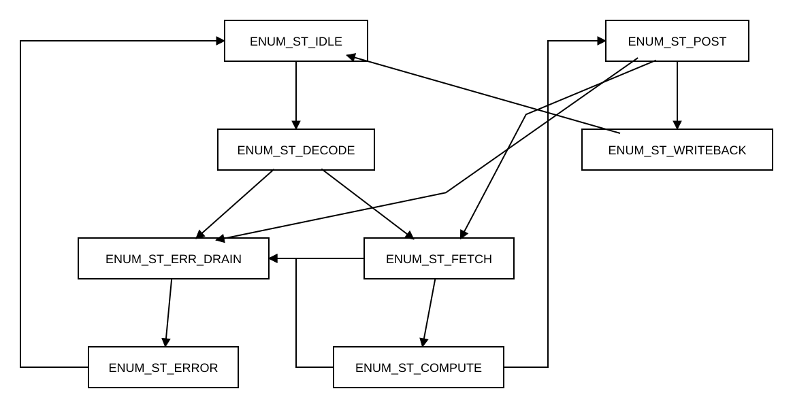

```json
{
  "page_name": "FSM_CTRL",
  "out_name": "ctrl_fsm.drawio",
  "function": "ctrl",
  "initial": "ENUM_ST_IDLE",
  "state_pattern": "^ENUM_ST_[A-Z0-9_]+$",
  "states": [
    {
      "name": "ENUM_ST_IDLE"
    },
    {
      "name": "ENUM_ST_DECODE"
    },
    {
      "name": "ENUM_ST_FETCH"
    },
    {
      "name": "ENUM_ST_COMPUTE"
    },
    {
      "name": "ENUM_ST_POST"
    },
    {
      "name": "ENUM_ST_WRITEBACK"
    },
    {
      "name": "ENUM_ST_ERR_DRAIN"
    },
    {
      "name": "ENUM_ST_ERROR"
    }
  ],
  "transitions": [
    {
      "src": "ENUM_ST_IDLE",
      "dst": "ENUM_ST_DECODE",
      "label": "issue accepted"
    },
    {
      "src": "ENUM_ST_DECODE",
      "dst": "ENUM_ST_FETCH",
      "label": "descriptor/control ready"
    },
    {
      "src": "ENUM_ST_DECODE",
      "dst": "ENUM_ST_ERR_DRAIN",
      "label": "accepted descriptor fault"
    },
    {
      "src": "ENUM_ST_FETCH",
      "dst": "ENUM_ST_COMPUTE",
      "label": "operands ready"
    },
    {
      "src": "ENUM_ST_FETCH",
      "dst": "ENUM_ST_ERR_DRAIN",
      "label": "read/descriptor fault"
    },
    {
      "src": "ENUM_ST_COMPUTE",
      "dst": "ENUM_ST_POST",
      "label": "tile phase complete"
    },
    {
      "src": "ENUM_ST_COMPUTE",
      "dst": "ENUM_ST_ERR_DRAIN",
      "label": "execution fault"
    },
    {
      "src": "ENUM_ST_POST",
      "dst": "ENUM_ST_FETCH",
      "label": "more tiles or phases"
    },
    {
      "src": "ENUM_ST_POST",
      "dst": "ENUM_ST_WRITEBACK",
      "label": "command complete"
    },
    {
      "src": "ENUM_ST_POST",
      "dst": "ENUM_ST_ERR_DRAIN",
      "label": "postprocess fault"
    },
    {
      "src": "ENUM_ST_WRITEBACK",
      "dst": "ENUM_ST_IDLE",
      "label": "result handshake"
    },
    {
      "src": "ENUM_ST_ERR_DRAIN",
      "dst": "ENUM_ST_ERROR",
      "label": "drained; status captured"
    },
    {
      "src": "ENUM_ST_ERROR",
      "dst": "ENUM_ST_IDLE",
      "label": "error result handshake"
    }
  ],
  "layout": {
    "margin": 40
  }
}
```

*Figure 10-1. FSM state diagram of the tensor coprocessor control. Source: `figures/ctrl_fsm.drawio` (draw.io, VLSIT library, generated by `vlsit_fsm_diagram.py`).*
<!-- /FSM-DIAGRAM:ctrl -->

The control FSM below tracks the active command only; the front-end queue retains later commands and their independent mode fields. Attention algorithms may iterate through fetch, matrix compute, and normalization phases for each tile before completing the command. Unused state encodings recover to IDLE.

| Mode/state | Entry condition | Behavior | Exit condition | Outputs / side effects |
|---|---|---|---|---|
| ENUM_ST_IDLE | Reset or previous result handshake | Wait for an accepted CV-X-IF command | `issue_valid && accept` | Allocate command context |
| ENUM_ST_DECODE | Command accepted | Decode the already issue-validated operation/result class and fetch descriptor metadata; validate accepted descriptor fields | Descriptor/control ready, or accepted-command fault | Latch per-command operation, precision, and shape |
| ENUM_ST_FETCH | Descriptor/shape valid or next tile requested | Fetch operand tile through IF-003 into local banks | Operand tile ready, or memory/descriptor fault | AXI requests and response tracking |
| ENUM_ST_COMPUTE | Operand tile ready | Stream tile through selected MAC/algorithm datapath | Tile phase complete, or execution fault | MAC/reduction activity |
| ENUM_ST_POST | Compute phase complete | Post-process, update online state, and finish required output writes and AXI responses before declaring command complete | More tiles/phases → FETCH; command complete → WRITEBACK; fault → ERR_DRAIN | Intermediate state or final tensor result |
| ENUM_ST_WRITEBACK | All command work and required AXI responses complete without fault | Present successful CV-X-IF completion and retain its payload under backpressure | Result handshake accepted | CV-X-IF result transaction |
| ENUM_ST_ERR_DRAIN | Accepted-command fault detected | Stop launching new work; drain accepted AXI transactions and active array work; discard invalid AXI data; choose status by DEC-012 and capture CSR record when present | All accepted work drained and record captured | Fault flags retained per command |
| ENUM_ST_ERROR | Error result prepared | Present the command's required result-class payload; hold it stable under backpressure | Error result handshake accepted | OP-004 sentinel, OP-003 zero, or status-class code per DEC-010 |

An unknown opcode, reserved precision code, disabled family, or unqualified operation/precision pair is rejected at issue and never enters this FSM. An accepted descriptor error enters `ERR_DRAIN`; if no request was issued, drain completes immediately. Younger queued commands may be accepted while a command executes, but a mode-2 sticky error pauses their start until W1C is acknowledged in `CLK-CORE`.

**Result backpressure characterization (re-review N-03).** The baseline holds the active context through its CV-X-IF result handshake. Only committed descriptor prefetch may overlap with this wait. A successful result is never presented before all writes complete without error. A late write response error stays on the POST-to-ERR_DRAIN path, with no successful result published. Keep this behavior as the reference for the host-coupled build.

Evaluate a one-entry elastic result slot as a scheduling candidate for independent commands. After final validation and response drain, atomically move the complete result packet into the slot and release the compute resources. Retain the accepted-command queue credit and (hartid,id) ownership until the *external* result handshake. The slot's head is the only presented result. Without an empty slot or a same-cycle dequeue, the next completed command must hold its payload and cannot overwrite the head. Start at most one younger compute context and only when normal authorization, mode-2 sticky-error gating and resource rules permit it. OP-003 admission/fence and zero-result acknowledgement remain tied to the original architectural boundaries. A full result slot also counts as busy for quiesce and reset. Internal enqueue is not an external completion and cannot release the host authorization ledger.

For an independent authorized command N+1 ready when N finishes, let W be N's external result stall and C be N+1's compute-to-result-ready duration with common resources available. Ignoring shared handoff cycles, the baseline exposes N+1 after W+C. The one-slot candidate can expose it after max(W,C), hiding min(W,C) of the stall. For W=0 there is no stall to hide, and neither path can raise the host result handshake rate. Measure after adjusting for new register stages, idle cycles, actual host authorization and DMA pressure. Include W=0, a stall shorter than C, a stall longer than C, simultaneous dequeue/enqueue, sticky-error pause, OP-003 clean admission while a result is pending, and normal quiesce with a full slot. Select the candidate only after showing improvement on the DEC-018 trace without increasing the live-command budget or weakening TEST-022/030 and the result-backpressure assertions.

### 10.2 Operations

| Operation ID | Inputs / preconditions | Processing semantics | Result / completion | Latency / ordering |
|---|---|---|---|---|
| OP-001 GEMM (`funct7=0x01`) | A (M×K), B (K×N) tiles resident | $C_{i,j} = \sum_k A_{i,k} B_{k,j} + C_{i,j}$ | C tile written through IF-003; CV-X-IF result class is status, with completion-only `we=0` allowed for mode-2 `rd=x0` | First-result latency, tile completion latency, and steady-state II are TBD per shape and pipeline configuration; in-order |
| OP-002 ELEMWISE / EPILOGUE (`funct7=0x02`) | vector tile + descriptor submode | add/scale/activation element-wise | vector written through IF-003; CV-X-IF result class is status, with completion-only `we=0` allowed for mode-2 `rd=x0` | Shape- and pipeline-dependent; in-order |
| OP-003 REDUCE (funct7=0x03) | vector descriptor + sum/max submode; requires mode 2 and rd!=x0 | sum or maximum value over elements | Successful scalar value in rd; accepted execution failure writes zero with result.we=1 and captures detailed status in CSR. Hardware accepts only at a clean global boundary, then atomically blocks later tensor issue from all harts. Nonzero result releases the fence at result handshake; zero holds the fence and busy=1 until software checks err_valid, reads/W1C-clears the record if set, and writes tcop_ctrl.scalar_ack=1. The privileged driver serializes all hart submissions and performs the pre-issue drain/error check; exact steps are in §11.2. A kill before non-kill commit cancels without result and releases the reserved fence | Reduction-tree/shape dependent; the global fence blocks every hart during the entire OP-003 execution through result handshake, and a zero result adds software/APB/CDC acknowledgment latency |
| OP-004 ARGMAX / GREEDY_TOKEN (`funct7=0x04`) | Input schema selected by `PARA_ARGMAX_IMPL`: logits vector address/length/stride when `=0`; projection activation, vocabulary-weight matrix, optional model projection bias, and dimensions when `=1` | Both compute the maximum over candidate logits. Standalone compares the exact values decoded from storage format; fused FP computes the ordered FP32 projection plus optional model bias. Fused INT8 applies the per-channel scale to the exact dot product with no bias. Both compare in their specified domains before output rounding. Each lane/tile/array emits `(score,index)`; every merge keeps the greater score, then the smaller index on exact equality. The same compare function is used at every level, so scheduling order does not affect ties. No softmax or application logit bias is applied in this release; bias extension is specified in REQ-FUNC-014 | Same scalar token-index class for both builds; requires `PARA_CTRL_MODE=2`, `rd!=x0`, and matching descriptor schema. Accepted errors write `TC_INVALID_TOKEN_INDEX` to `rd` and report detail through CSR. The vocabulary length excludes the all-ones XLEN sentinel. Identical compare-domain values yield identical winners; differing quantization domains can change close-score winners | In-order; standalone includes logits read + reduction; fused includes projection plus cross-tile winner merge |
| OP-005 EXACT ATTENTION (`funct7=0x05`) | Q, K, V tensors, shape/strides, and causal or explicit mask policy | Tiled QK, scale/mask, online softmax recurrence, then PV; does not materialize the full score matrix | Context tensor through IF-003; CV-X-IF status completion | In-order by accepted command; tile schedule and row service rate are workload-dependent |
| OP-006 ROW SOFTMAX (`funct7=0x06`) | BF16/FP16; Logit rows and optional byte Boolean mask | Fixed max-subtract-exp-sum-reciprocal with FP32 trees; masked outputs +0; all-masked row errors | Probability tensor through IF-003; CV-X-IF status completion | `PARA_MAX_SOFTMAX_*`; exp/reciprocal service rate |
| OP-007 LAYER NORM (`funct7=0x07`) | BF16/FP16; Input rows, optional same-precision gamma/beta, positive FP32 epsilon | Fixed-tree FP32 Welford population variance, rsqrt, optional affine transform | Normalized tensor through IF-003; CV-X-IF status completion | `PARA_MAX_LN_*`; Welford/rsqrt service rate |
| OP-008 SPARSE GEMM 2:4 (`funct7=0x08`) | A/B tiles plus validated 2:4 metadata | Decode two selected positions per group and use paired MAC lanes. A selected weight payload may be zero; malformed metadata completes with error | C tensor through IF-003; CV-X-IF status completion | Paired-lane peak depends on metadata/operand balance and sparse feed rate |
| OP-009 KERNELIZED CAUSAL LINEAR ATTENTION (`funct7=0x09`) | BF16/FP16; Causal Q/K/V sequence, optional initial FP32 state, context and final FP32 state | ELU+1; update S/z before output; RESET or CONTINUE; no exact-softmax fallback | Context/state through IF-003; CV-X-IF status completion | State traffic, context parallelism and `PARA_MAX_LINEAR_MAC_EQUIV` bound rate/work |

### 10.2.1 Runtime algorithm selection and transformer workload coverage

The elaboration-time feature set defines which hardware is present; runtime selection chooses an operation/algorithm that this build supports. PARA_ALGORITHM_MASK, PARA_DATA_PREC, PARA_ARRAY_COUNT, PARA_ARGMAX_IMPL, and the five pipeline-cut parameters are static synthesis/elaboration controls. PARA_ARGMAX_IMPL selects exactly one OP-004 datapath for a build; it is not a runtime mode, while the host may still switch between OP-004 and other supported Transformer operations between commands. In a multi-precision build, command metadata selects one precision from the built set. Operation mode and precision are latched with each accepted command and remain immutable through completion. Normally the queue counts the active context and can retain at least one following command with a different mode while the active command runs. OP-003 is the exception: its global fence blocks issue at every hart from clean-boundary acceptance through result handshake, and after a zero result until software acknowledgment; no younger tensor command can be queued across that interval. The first-release scheduler distributes the active command's tiles across available arrays, then starts the next queued command without CSR reconfiguration unless a mode-2 sticky error record is valid; that record pauses execution until W1C is synchronized to the core. Instruction IDs and byte-exact descriptor fields are fixed by the companion ISA and DEC-065. Per-build queue depth and measured overlap remain subject to DEC-006/026 and the selected host/AXI service contract.

#### Runtime selection mechanism trade-off

| Mechanism | Dispatch performance | Flexibility / cost | Assessment |
|---|---|---|---|
| Per-command mode in instruction and/or CV-X-IF source operands | Lowest configuration overhead; mode arrives with the command and different queued commands can differ | Limited bits for dimensions, strides, precision, mask, and addresses; needs a well-defined packed descriptor | Recommended primary path; avoid one CSR write per operation |
| Per-command descriptor in memory | Carries large tensor metadata and allows software-defined shapes | Requires descriptor fetch and storage; adds latency unless prefetched or queued | Use when instruction/register payload capacity is insufficient; prefetch descriptors to hide the added read |
| Global mode in CSR | Simple control implementation | APB/clock-domain crossing cost, shared mutable state, and hazards if software changes it while old commands are in flight | Not recommended for per-operation dispatch; useful only for infrequent global policy controls |
| Hardware auto-selection from shape/metadata | Removes a software choice for each mode | Needs a hardware cost model, accuracy policy, fallback rules, and predictable worst-case latency; extra control can outweigh small-op savings | Optional future layer above explicit command modes, not the baseline |

**Selected policy:** keep hardware capability selection at elaboration, and let the host runtime select the mode per command from shape, prefill/decode phase, supported precision, accuracy requirement, and model metadata. Use a compact command header with an operation/algorithm ID and precision ID; the operation ID resolves to a fixed per-operation input schema for the build. All currently assigned IDs `0x01`-`0x09` use descriptors; `PARA_ARGMAX_IMPL` selects OP-004's build-specific schema. Any future inline-register operation uses a separately assigned operation ID. The descriptor carries dimensions, strides, addresses, masks, and algorithm-specific fields. Latch the instruction and register payload at CV-X-IF acceptance; for pointer commands, copy the descriptor into its command context before execution and require software to keep it and its referenced buffers stable until completion. This gives low dispatch overhead, deterministic mode choice, and runtime switching without APB reprogramming. Define `PARA_CMD_QUEUE_DEPTH` as accepted outstanding contexts including the active command; depth two is sufficient to queue one different-mode successor. Start that successor directly from the queue when the current command completes. Deeper queues hide host dispatch gaps, while cross-command execution overlap should be added only if workload measurements show array bubbles that within-command tiling cannot fill (DEC-006).

#### Operation-ID and capability-mask dispatch rules

At issue, the `funct7` operation ID selects one concrete operation, one result class, one capability-mask family, and one input schema for the elaborated build. The numeric assignments below are selected by the user. A descriptor may choose a submode only within that operation family and result class; it cannot switch dense GEMM to sparse GEMM, exact to approximate attention, or tensor output to scalar output. This lets hardware reject build-disabled requests before descriptor fetch. `0x00` and `0x0A`-`0x7F` are reserved and shall be rejected at issue. Every current tensor operation uses a descriptor; OP-004 uses the schema selected by the static `PARA_ARGMAX_IMPL` parameter.

| `funct7` / operation ID | Operation | `PARA_ALGORITHM_MASK` bit | CV-X-IF result class | Input schema |
|---|---|---:|---|---|
| `0x00` | Reserved / illegal | — | None; issue reject | None |
| `0x01` | OP-001 dense/tiled GEMM | 0 | Tensor output + status completion | Versioned tensor descriptor |
| `0x02` | OP-002 element-wise / epilogue (add, residual, bias, scale, activation) | 3 | Tensor output + status completion | Versioned tensor descriptor |
| `0x03` | OP-003 REDUCE (sum or maximum) | 5 | Scalar reduction value | Versioned vector descriptor |
| `0x04` | OP-004 ARGMAX / GREEDY_TOKEN | 5 | Scalar token index | `PARA_ARGMAX_IMPL`-selected descriptor schema |
| `0x05` | OP-005 exact tiled attention | 1 | Tensor output + status completion | Versioned attention descriptor |
| `0x06` | OP-006 row softmax | 2 | Tensor output + status completion | Versioned vector descriptor |
| `0x07` | OP-007 layer normalization | 2 | Tensor output + status completion | Versioned normalization descriptor |
| `0x08` | OP-008 structured 2:4 sparse GEMM | 4 | Tensor output + status completion | Versioned sparse-GEMM descriptor with validated 2:4 metadata |
| `0x09` | OP-009 kernelized causal linear attention | 6 | Tensor output + status completion | Versioned linear-attention descriptor with state/feature-map metadata |
| `0x0A`-`0x7F` | Reserved for future assignments | — | None; issue reject until defined | None |

#### Selected command ABI and descriptor field layout

| Field/carrier | Proposed meaning | Dispatch impact / constraint |
|---|---|---|
| 32-bit instruction `opcode` | RISC-V `custom-0`, `inst[6:0]=7'b0001011` (`0x0B`), selected for this IP | CVA6 fetches it through the normal instruction path and sends the word through CV-X-IF issue; it does not travel over IF-003 |
| `funct7[6:0]` | `operation_id`, naming a concrete operation/result class; each ID maps to one `PARA_ALGORITHM_MASK` family and fixes scalar-result vs status/no-writeback behavior at issue | Operation is explicit, so hardware need not run an unpredictable cost model. The numeric IDs and reserved values are selected in the operation-ID table; descriptors may set shapes/strides/algorithm data but cannot change result class |
| `funct3[2:0]` | command-wide `precision_id`: `000=INT8`, `001=BF16`, `010=FP16`; `011`-`111` are reserved and rejected at issue | The selected format applies uniformly to tensor-element operands/outputs of the command; descriptor fields cannot override it. All three bits are allocated to precision. There is no payload-mode bit; each operation ID resolves to one fixed input schema per build (`PARA_ARGMAX_IMPL` selects OP-004's schema), and operations needing inline and descriptor forms require distinct operation IDs |
| `rd` | Opcode-defined integer-register destination: scalar-result opcodes return their scalar value; other opcodes return completion status per DEC-010 | Mode 0 requires `rd!=x0`; mode 2 permits `rd=x0` for tensor/status opcodes with `we=0`; scalar-result opcodes require mode 2 and `rd!=x0`. Result class is assigned per operation ID |
| `rs1`, `rs2` values | Values follow the fixed input schema assigned by operation ID. For descriptor commands on RV32, the low 32 bits of the value selected by instruction `rs1` and high 32 bits of the value selected by `rs2` form the 64-bit DMA-visible descriptor byte address; on RV64, the value selected by `rs1` carries the address and `rs2` is unused. Descriptor flags and limits reside in the descriptor. | The CV-X-IF register packet supplies values separately from the issue instruction; combining the two RV32 source values adds no command or bus transaction. Use system physical DMA addresses, never IOVAs or implicit CPU virtual addresses; release 1 has no address-translation unit. The pointer must fit the implemented AXI address port and satisfy 64-byte descriptor alignment; pre-request misalignment/unrepresentable range returns TC_ERR_ADDRESS, while firewall aperture denial returns the AXI error status. |
| Descriptor container (fixed release-1 body ABI) | One fixed, versioned schema per operation and elaborated input variant; `operation_id` plus build configuration selects the schema and exact total byte size. Every descriptor begins with the byte-exact 64-byte header in the table below; all multibyte values are little-endian, the schema version is 1.0, and reserved bytes are zero. Descriptor base addresses shall be 64-byte aligned and every exact schema size is a positive multiple of 64 bytes. `PARA_ARGMAX_IMPL` selects the OP-004 schema/variant. Tensor references in the body use the common release-1 base/extent/stride representation and contiguous-span rule in REQ-IF-009; the instruction-set companion §10.3 defines exact field offsets, shapes, permitted layouts, and sizes. | After safe-commit, reject a base address with any low six bits set as `TC_ERR_ADDRESS` without issuing a descriptor read. Otherwise read exactly the 64-byte header and validate magic, version, header size, operation/precision echoes, expected schema size, implementation variant, and reserved bytes. Format-field failure returns `TC_ERR_DESCRIPTOR_FORMAT`; a build-variant mismatch returns `TC_ERR_DESCRIPTOR_MODE`. No tensor operand/output DMA may precede successful header validation and the applicable REQ-IF-009 body/range validation. Fetch no more than the fixed expected size selected by operation/build; the declared size never controls an unbounded fetch. Per-operation offsets/sizes and validation order are fixed by companion §10.2–10.4; SoC aperture/service and physical staging remain signoff items. Descriptor prefetch still requires captured sources and matching non-kill commit per DEC-026. |

| Byte offset | Width | Field | Required value / validation |
|---:|---:|---|---|
| 0 | 4 bytes | `magic` | Literal bytes `54 43 4F 50` (ASCII `TCOP`); mismatch → `TC_ERR_DESCRIPTOR_FORMAT` |
| 4 | 2 bytes | `schema_major` | Unsigned little-endian; release-1 value `1`; mismatch → `TC_ERR_DESCRIPTOR_FORMAT` |
| 6 | 2 bytes | `schema_minor` | Unsigned little-endian; release-1 value `0`; mismatch → `TC_ERR_DESCRIPTOR_FORMAT` |
| 8 | 2 bytes | `header_bytes` | Unsigned little-endian; must equal `64`; mismatch → `TC_ERR_DESCRIPTOR_FORMAT` |
| 10 | 1 byte | `operation_id_echo` | Must equal instruction `funct7[6:0]` zero-extended; mismatch → `TC_ERR_DESCRIPTOR_FORMAT` |
| 11 | 1 byte | `precision_id_echo` | Must equal instruction `funct3[2:0]` zero-extended; mismatch → `TC_ERR_DESCRIPTOR_FORMAT` |
| 12 | 4 bytes | `schema_bytes` | Unsigned little-endian total schema size including this header; must equal the operation/build constant and be a positive multiple of 64; mismatch → `TC_ERR_DESCRIPTOR_FORMAT` |
| 16 | 1 byte | `implementation_variant` | OP-004 must equal elaborated `PARA_ARGMAX_IMPL`; every other operation must be zero. Mismatch → `TC_ERR_DESCRIPTOR_MODE` |
| 17 | 47 bytes | `reserved` | Every byte must be zero; any nonzero byte → `TC_ERR_DESCRIPTOR_FORMAT` |

The descriptor schema version identifies the operation/build-specific descriptor ABI and is independent of the APB `tcop_version` IP release number (`1.1`). Every first-release operation schema uses descriptor schema version `1.0`; the hardware requires an exact version match and does not negotiate versions. A future schema change shall update the expected version for the affected operation/build schema and the matching software definition.

**Release-1 tensor-reference body convention (fixed in DEC-065):** every reference is a 64-byte `TREF64`: u64 physical byte base, u64 declared contiguous physical span, four u32 logical extents, and four u64 byte strides, all little-endian. Rank, element format and logical axis meaning are fixed by the operation slot; unused extent/stride entries are zero. Before numeric traffic, checked arithmetic verifies element_bytes + sum((extent[d]−1)×stride[d]) <= span_bytes over the operation-defined active rank dimensions only (unused zero-extent dimensions are excluded), and the exclusive end `base+span_bytes` is representable in u64 without wrap. The last addressed byte `end-1` must fit the configured AXI address width. The declared span includes allocation padding and is checked against the firewall aperture and logical-span caps. Ordinary element size is 1 byte for INT8 and 2 for BF16/FP16; named auxiliary refs use their fixed record/byte sizes, including REQUANT8, BOOL mask, sparse metadata and OP-009 FP32 TLAS state. No scatter-gather/IOVA exists; the driver rejects noncontiguous mappings or stages them into contiguous DMA-visible buffers. The DEC-051 nested-pitch rule remains: each operation names the contiguous axis, permits only checked row/batch padding, and explicitly declares any transpose or alternate order. Release-1 schemas grant no input/output alias permission. Exact slot maps and permitted layouts are in companion §10.3; the SoC firewall is authoritative for the physical aperture.

**Selected ABI architecture:** use the hybrid path: keep operation and precision selectors in the instruction, use one fixed, versioned descriptor schema per operation and elaborated input variant for all currently assigned operations `0x01`-`0x09`, whose tensor addresses, shapes, strides, masks, or state pointers exceed the register payload. The ABI reserves inline register operands for future small operations; no currently assigned operation uses that form. This keeps dispatch compact while carrying full tensor metadata without overloading the CV-X-IF register payload. Every descriptor starts with the byte-exact 64-byte common header above, with schema version 1.0, header size 64, instruction operation/precision echoes, exact schema size, and implementation variant. All multibyte integers are little-endian; all reserved header bytes are zero. The descriptor base is 64-byte aligned, and each operation/build-specific schema has an exact fixed total size that is a positive multiple of 64 bytes. Hardware validates the header after matching safe-commit and before tensor operand/output DMA; malformed header fields return `TC_ERR_DESCRIPTOR_FORMAT`, while implementation-variant mismatch returns `TC_ERR_DESCRIPTOR_MODE`. The declared schema size never controls an unbounded fetch. The accelerator allocates command context and captures the descriptor pointer on the coupled issue/register handshake selected by DEC-024; split=0 has no later/reordered register packet. Descriptor fetch begins only after the required source lanes are captured and a matching delayed non-kill commit satisfies the CPU irrevocability guarantee in REF-001 §5.5.8. DEC-033 selects a per-hart safe frontier; the repository CVA6 driver currently commits at issue acceptance and must be modified before tensor DMA is enabled. Descriptor and tensor-buffer pointers are system physical DMA addresses, not CPU virtual addresses or IOVAs; release 1 performs no address translation. The S-mode driver checks ownership and aperture policy, and the SoC firewall enforces the static aperture under DEC-025/030/031. Software must keep that descriptor and its tensor buffers unchanged until command completion; descriptor fetch errors occur after acceptance and use the DEC-010 completion status. The standalone and fused OP-004 schemas are build-specific but return the same scalar token-index class. The common header and tensor-reference widths/units are selected; companion §10 fixes body offsets/rank/sizes, span field and operation layouts. Remaining items are SoC aperture constants, operation/precision release qualification, and driver generation (DEC-002/013/025/040/050/065). OP-003/004 scalar-error payload rules are selected in DEC-010.

**Selected R-type field allocation:** `inst[31:25]` (`funct7`) carries the 7-bit `operation_id`; `inst[14:12]` (`funct3`) carries the 3-bit command-wide `precision_id` (`000=INT8`, `001=BF16`, `010=FP16`; all other values reserved). All tensor-element inputs/outputs in the command use that format; mixed operand formats are deferred. This is the user-selected IP allocation using the R-type field layout in REF-011 §2.2. The `operation_id` determines result class at issue and selects a fixed versioned descriptor schema for the elaborated build; `PARA_ARGMAX_IMPL` selects the OP-004 input variant. The descriptor carries tensor dimensions, strides, masks, and algorithm-specific submodes. `OP-001`-style labels are specification identifiers, not the numeric values encoded in `funct7`. The custom-0 major opcode, operation-ID table, per-operation fixed-schema container, and common 64-byte descriptor header are selected in DEC-014/015/040; DEC-065 defines the per-operation body fields and exact sizes in the instruction-set companion §10. RV-007 tracks remaining build integration work.

Do not allow the five pipeline-cut choices to change at runtime. They are elaboration parameters fixed in the synthesized netlist; use constant generate branches so a bypassed stage does not leave a run-time mux on the critical path. A run-time bypass mux can negate the frequency gain and complicate valid/data alignment. Provide timing-qualified builds for different latency/frequency targets. The recommended command contract changes mode between queued commands only; changing an algorithm inside one accepted command would require tile-boundary checkpointing and context save/restore and is out of scope.

**Per-command dataflow policy:** the active command owns the array set; the tile scheduler assigns independent output tiles across arrays. For GEMM, split independent M/N output tiles first and keep the K accumulation with the owning output tile where possible. For exact attention, split query blocks and/or heads while keeping each block's online-softmax state with its owner; K/V tile updates for that block follow the required order. For structured sparse GEMM, partition work with validated 2:4 metadata and account for load imbalance. For batch-one decode with small M, partition N/output channels or independent heads across arrays instead of waiting to assemble a large M tile; account for weight and KV-cache traffic. For vector, normalization, and epilogue modes, partition independent elements or rows. This reuses one compute fabric across modes without mixing command state. Cross-command array interleaving can improve occupancy when the active command exposes too few tiles, but it needs a separate per-array context and fairness/error-order contract and is not required for the first release. For an OP-005 batch, DEC-046 selects bounded execution waves: each wave starts up to `PARA_ATTN_MAX_ACTIVE_SAMPLES` samples, and a later wave starts only after the current wave completes successfully. Array/tile issue across the active samples remains work within the single batch command; one CV-X-IF result is returned only after all samples succeed or all started work has drained on error. Any accepted error stops later waves and invalidates every output in the batch by DEC-022.

| Candidate runtime mode | Transformer use | Extra hardware / dataflow needed | Decision status |
|---|---|---|---|
| Dense tiled GEMM | Q/K/V and output projections, feed-forward network, and attention matrix products | Tile scheduler, operand reuse, accumulator, scratchpad/buffering, dimension/stride support | Core mode; tile order and descriptor fields TBD |
| Exact tiled attention with online softmax | Fuses $QK^T$, scale/mask, numerically stable softmax statistics, and $PV$ while retaining intermediate tiles on-chip | Online row maximum and exponential sum state, exponent/reciprocal approximation or exact unit, causal-mask handling, and attention tile storage | In requested scope; numerical and storage details open; see REF-006 and REF-007 |
| Softmax and layer normalization | Attention normalization and transformer normalization | Stable max-subtract-exp-sum-normalize path; layer normalization additionally requires sum, sum-of-squares or variance, epsilon, and reciprocal-square-root behavior | In requested scope; equations and numeric rules open |
| Residual, bias, scale, and activation epilogue | Residual add and MLP/attention activation around matrix products | Fused or standalone element-wise path, with defined activation functions and rounding | In requested scope; exact functions and rounding points open |
| Structured sparse GEMM | Models with matching structured-pruning metadata | Sparse metadata decode, load balancing, zero-skip control, and software/model constraints | In requested scope; enable with mask bit 4; area and model compatibility open; REF-008 |
| Low-latency vector / decode mode | Batch-one token decode, where matrix shapes can underfill a large array; OP-004 turns vocabulary logits into a token index without returning the full vector to the CPU | Vector-friendly dispatch, weight/KV-cache bandwidth, short command setup, and low fill/drain overhead; standalone and fused dataflow are mutually selected at elaboration | In requested scope; enable with mask bit 5; `PARA_ARGMAX_IMPL` selects the OP-004 implementation; the scalar result requires mode 2 |
| Approximate / linear attention | Workloads whose model/runtime accepts a non-exact attention formulation | Explicit algorithm definition, sequence/state representation, approximation metadata, and model-level accuracy budget | In requested scope; enable with mask bit 6; never silently substitute for exact attention; REF-009 |

#### Algorithm trade-off and runtime dispatch policy

| Mode family | Main performance opportunity | Main cost or limitation | Recommended runtime selection rule |
|---|---|---|---|
| Dense tiled GEMM | Reuses operands across the systolic array and preserves standard matrix semantics; preferred for projections and MLP layers | Large tiles can underfill during batch-one decode; memory reuse depends on local buffers and shape | Select for large projection/MLP tiles and exact dense products; tune tile shape separately for prefill and decode |
| Exact tiled attention | Keeps score/probability tiles on-chip and updates online softmax statistics, reducing external intermediate traffic [4][5] | Needs local attention storage, stable max/exp/sum/normalization units, and more controller state | Select when standard softmax attention semantics are required and the on-chip tile fits the storage budget |
| Approximate / linear attention | Some formulations reduce sequence-dependent work or state traffic for compatible models [7] | Changes the attention formulation and may reduce model quality; cannot be substituted transparently | Select only when the model/runtime explicitly declares the approximation and its measured accuracy budget is accepted |
| Structured 2:4 sparse GEMM | Skips the constrained zero entries when weights carry the required pattern; sparse math units can raise peak arithmetic rate [6] | Requires compatible trained/pruned weights and metadata; decode, load, and utilization overhead may erase gains | Select only for validated 2:4 weights; precompute/check metadata and benchmark end-to-end latency |
| Low-latency vector/decode | Avoids treating a very short query like a large prefill matrix and can reduce array fill/setup overhead | Often constrained by weight/KV-cache movement and cannot reach peak array occupancy | Select for batch-one decode or small M shapes; measure cycles/token and memory stalls |
| OP-004 implementation, elaboration parameter | Lets one build choose between general standalone logits reduction and fused final-projection token selection | Exactly one hardware path is generated; the choice cannot change between commands, and software/descriptor schema must match the built parameter | Use `PARA_ARGMAX_IMPL=1` fused for decode latency/bandwidth priority; select `=0` standalone when a reusable arbitrary-logits reducer and simpler projection timing matter |
| Softmax, layer norm, residual/activation epilogues | Fusing with the producer can avoid intermediate memory writes and extra command round-trips | Adds nonlinear arithmetic, storage, and rounding-order constraints; exact fusion can affect area and timing | Fuse when intermediate data remains on-chip and bit-accurate/numerical behavior is defined; otherwise issue a separate mode |

##### OP-004 implementation impact

Let $V$ be vocabulary size, $b$ bytes per logit, and $K$ the hidden dimension of the final vocabulary projection.

| Impact | Standalone (`PARA_ARGMAX_IMPL=0`) | Fused projection (`PARA_ARGMAX_IMPL=1`) |
|---|---|---|
| Command sequence | Projection writes logits, then OP-004 reads and reduces them | One OP-004 command computes the final projection and reduces its output tiles |
| Intermediate traffic | About $2Vb$ bytes through the intermediate buffer when logits are written once and read once | Avoids materializing/re-reading the full logits vector; still reads projection weights and the hidden-state vector |
| Illustrative size | For $V=32768$ and BF16 ($b=2$), logits occupy 64 KiB; a write plus a later read moves about 128 KiB through the intermediate path | Can avoid that approximate 128 KiB intermediate movement and one command dispatch, subject to output reuse requirements |
| Hardware fit | General compare-reduction accepts logits from any producer; simpler isolation from GEMM timing | Shares the systolic projection engine and needs local `(value,index)` winners plus a cross-tile/array merge |
| Latency limit | IF-003/SRAM read service, reducer lane count, and an extra command boundary | Projection compute and weight traffic remain; global winner merge and result timing must meet the projection tile schedule |
| Best fit | Existing logits, reusable vector reductions, debug/reference flows, or any later consumer that still needs the logits | Batch-one greedy decode when only the token index is needed and the final vocabulary projection is computed by this IP |

The 128-KiB example is intermediate-buffer traffic, not a claim about external DRAM traffic or a guaranteed cycle reduction. If another operation needs the full logits vector, the fused mode must either store it and lose part of its traffic advantage or be unsuitable; OP-004 as specified returns only the winning index. The fused mode is the recommended performance-oriented build, while the parameter preserves the standalone build option for generality and simpler timing closure.

**Batch-one array-occupancy risk:** the final projection is mathematically $1\times K$ by $K\times V$. On a conventional output-stationary 32×32 mapping without K-splitting, a single decode token activates one of 32 PE rows (3.125% row occupancy) per array. The fused argmax still saves the logits-buffer pass and command boundary, but it does not by itself raise MAC utilization. To improve compute latency, the design may need a vector-dot-product mapping, output-channel packing, or split-K partial sums with a cross-array reduction. Those options add datapath or reduction state and may alter rounding order; size and sign off them from the actual decode workload rather than the 64-TOPS prefill peak (DEC-003/005/009).

**Fused OP-004 decode mapping candidates (RV-016).** The fused weight reference is logical [K,V] with vocabulary channels contiguous. Assign disjoint contiguous vocabulary-channel stripes to independent compute contexts. Broadcast an activation feature to lanes owning independent channels and traverse logical K in increasing order for each channel. Keep a live accumulator per channel until its full score is ready. For FP, interleave independent channels to cover FMA recurrence latency while respecting DEC-069. Splitting K into independently accumulated FP sums and then merging changes the specified rounding order. Apply optional model bias after each complete FP dot. For INT8 apply the per-channel scale once after the complete exact dot and then merge candidate winners by score/index. An optional integer-only K partition needs a proof that every partial dot and merge fits its accumulator. With the first-build K cap of 4,096, a conservative bound is 4,096*128*128=67,108,864 before scaling, which fits a signed 32-bit accumulator. There is no intermediate INT8 requantization.

Keep K-outer access within a stripe so every fetched weight segment spans neighboring vocabulary channels. A single logical weight row may be fetched once and distributed when its stripes can progress together. Smaller independently fetched stripes can improve local buffering but create shorter DMA segments. Count actual per-row burst fragmentation, activation reloads, coefficient rereads and final winner merge service. A weight tile and its activation slice must carry channel/K coordinates through each configured pipeline cut. The winner is eligible only after its full projection and bias/scale treatment.

At vocabulary 65,536 and K=4,096, one fused command has 65,536 dot products totaling 268,435,456 MAC terms. For a conventional single-active-row mapping with 16 arrays, each contributing 32 active INT8 lanes at 2 GHz and one MAC per lane per cycle, compute alone would take about 262 us. At 64 GB/s a cold single fetch of 256 MiB INT8 weights instead takes about 4.19 ms. A full two-way intermediate INT8 logits trip would be 128 KiB, or about 2.05 us at the same rate if it went through that memory path. For BF16/FP16, use 512 MiB of weights and 256 KiB of intermediate logits and measure the FP rate independently. These calculations are ideal lower bounds for the stated service. Fusing saves intermediate traffic and a command boundary. The main cold decode limit is weight service in this example.

**OP-004 tile and DMA qualification (DEC-073, RV-016).** The selected shape limits remain 65,536 vocabulary channels and 4,096 input features. For a fixed fused schedule with `C` channels per compute stripe and `Tk` logical features per tile, derive `Nstripe=ceil(V/C)` and `Nfeature=ceil(K/Tk)`. Use `Nstripe*Nfeature` to bound the logical tile-grid visits in a single projection pass. The build shall account for any additional internal phases, visits or loads in the selected schedule. Compute the maximum tile grid from the shape caps and verify counter widths at elaboration. Handle logical tails without reading padding as score data. Compute stripes and DMA stripes may have different widths. No independent runtime tile or byte cap is added by DEC-073. Derive the logical read segments from the validated addresses and row pitch, and apply the AXI beat and burst rules of §6.1.1 to those segments. Use the selected bank schedule to count activation, weight, bias or coefficient rereads. Include the descriptor, initial INT8 coefficient validation and any later coefficient reads. Count actual read address handshakes and data beats through IF-003, and SRAM bank stalls, accumulator dependency stalls, merge service and CV-X-IF completion separately. A successful scalar OP-004 issues no tensor output write.

For illustration, take the maximum compact BF16/FP16 shape and one weight pass. Assume a 4-KiB-aligned weight base, a 128-KiB row pitch, a 256-bit AXI data port and a 64-beat burst limit for this example. Each row reads all 65,536 channels. The table assumes the DMA forms one burst per stripe segment per weight row. Stripe width is a group of channels served together by DMA. Several compute tiles can share a DMA stripe if staging can hold and distribute it.

| Channels per DMA stripe | Weight bytes per row segment | Weight read bursts per command | Average read-credit lifetime needed at 64 GB/s with 16 outstanding reads |
|---:|---:|---:|---:|
| 32 | 64 | 8,388,608 | 16 ns or less |
| 512 | 1,024 | 524,288 | 256 ns or less |
| 1,024 | 2,048 | 262,144 | 512 ns or less |

These rows transfer the same 512 MiB of weight payload. They have different request counts and credit needs. The credit calculation divides outstanding payload capacity by byte rate. It is an ideal throughput condition under the example assumptions. Qualify the worst physical traffic across legal row padding, base alignment and tile tails. A compact maximum-size tensor alone does not establish the maximum burst count. The [roofline probe](../../project_support/review/tensor_probes/roofline.py) counts one independent-stripe weight pass. With 1,024 channels per DMA stripe and a 64-byte DMA-alignment build, increasing the pitch from 131,072 to 131,136 bytes adds 4-KiB splits. The burst count rises from 262,144 to 389,120. The weight payload and bus bytes both remain 512 MiB. For a fixed independent-stripe weight pass, evaluate burst fragmentation for every build-aligned row-start residue within 4 KiB. Use the maximum per-row burst count times K. A page-multiple pitch can repeat that worst residue on every row. Increasing V at fixed stripe geometry extends a tail or adds stripes, so the maximum vocabulary length bounds smaller shapes as well. The method bounds layouts without needing to enumerate full physical addresses. The platform aperture may exclude the witness. At the shape limits, 64-byte alignment and the example AXI configuration, the weight-only maxima are 8,388,608 bursts for 32 channels, 655,360 for 512 channels, and 393,216 for 1,024 channels per DMA stripe. For 1,024 channels, the last maximum is attained with base residue 64 bytes and the compact 131,072-byte pitch. The model covers one weight pass. Charge descriptor, activation, optional bias or coefficients and schedule-dependent rereads separately.

**Example full read envelope.** Use 32 channels per compute stripe and 1,024 channels per DMA stripe at the maximum shape. The roofline probe counts the exact 64-byte descriptor header and 320-byte body as separate reads. It models one weight pass, one contiguous FP bias read when enabled, and one contiguous INT8 coefficient-validation pass. If the build does not keep those coefficients, read each DMA stripe's coefficient interval once more at use. The resident-activation case reads the full vector once. The reload case reads it once per compute stripe. Sum individual reference bounds across legal alignment residues.

| Candidate success schedule | Read burst envelope | Bus bytes (MiB, rounded) |
|---|---:|---:|
| BF16/FP16, bias enabled, activation resident | 393,289 | 512.133 |
| BF16/FP16, bias enabled, activation loaded for each compute stripe | 403,524 | 528.125 |
| INT8, resident activation, coefficients validated and reread by stripe | 328,263 | 257.004 |
| INT8, resident activation, coefficients retained after validation | 327,943 | 256.504 |

At this shape, keeping the BF16/FP16 activation consumes 8 KiB of payload storage and saves 2,047 full activation loads. Keeping all INT8 coefficients consumes 512 KiB and saves 320 bursts in this example. Compare the SRAM port and capacity costs before selecting either schedule. These examples assume 64-byte DMA alignment, full-width 32-byte beats, a 64-beat burst cap, and no coalescing between stripes. A release build must also validate its own accepted-fault drain, service schedule, AXI timing and result completion under DEC-039. At the same shape, the entire BF16/FP16 activation vector is 8 KiB. A resident copy can serve every stripe, subject to SRAM allocation and port service. If a 32-channel-stripe schedule instead reads the vector anew for each stripe, it adds 16 MiB of activation payload. The release report shall use the actual backend mapping and the integrated SoC contract for maximum service delays and minimum sustained service to qualify a hard upper bound. The table does not select a DMA stripe or change the accepted shape envelope.

**OP-004 full-row DMA candidate.** Compare the preceding independent stripes against a K-outer sweep with all vocabulary-channel accumulators resident. Stream each contiguous physical weight row once, stopping bursts only at the page/AXI cap and the row end. Unpack channel spans into their owning lanes or SRAM banks while retaining the accumulator across rows. For FP, each channel consumes the K features in increasing logical order and carries one RNE FP32 accumulator, including at a row or bank scheduling boundary. For INT8 use the same exact accumulator and apply per-channel scaling only after the dot completes. At the last K row, deliver each complete score to its compare-domain epilogue and winner reduction. This changes scheduling only. The descriptor, score precision and tie rules stay fixed.

At the maximum BF16/FP16 shape, one 32-bit state per 65,536 channels needs 256 KiB before banking, tags or operand/epilogue storage. A stripe holding 1,024 channels needs 4 KiB of accumulator values. Neither estimate includes DMA buffers. For a simple banked full-row implementation that reads and writes a state word on each MAC, charge up to 2 GiB of local state traffic over the full projection. At 64 GB/s of BF16/FP16 weight input that path requires up to 256 GB/s of aggregate accumulator read/write service, excluding other traffic. With a 2 GHz accumulator clock this is 64 bytes read and 64 bytes written per cycle on average. A register-resident mapping or proven forwarding can reduce SRAM traffic. Include simultaneous memory fill, compute and final score service when checking bank ports.

The table uses the DEC-073 shape caps, 64-byte legal alignment and the illustrative 256-bit/64-beat AXI port. The roofline probe models a full row by setting DMA stripe width equal to vocabulary length. It evaluates every legal page residue and counts each row separately. Both candidates transfer the same weight bytes. The timing columns are weight-only lower bounds for the stated service scenario. All 16 read credits are available to this command and the in-use lifetime averages 512 ns from allocation to release. Divide bursts*512 ns by 16 for the credit bound; divide weight bytes by 64 GB/s for the data bound. Use the larger bound.

| Precision and DMA schedule | Worst weight read bursts | Data floor (ms) | Credit floor (ms) |
|---|---:|---:|---:|
| BF16/FP16, 1,024-channel stripes | 393,216 | 8.389 | 12.583 |
| BF16/FP16, full-row sweep | 266,240 | 8.389 | 8.520 |
| INT8, 1,024-channel stripes | 327,680 | 4.194 | 10.486 |
| INT8, full-row sweep | 135,168 | 4.194 | 4.325 |

For BF16/FP16 at the maximum shape, the stripe schedule requires an average credit lifetime of at most about 341 ns to sustain 64 GB/s at its worst legal alignment. Full-row DMA raises that limit to about 504 ns while increasing resident state and bank pressure. Evaluate both layouts with the same SoC workload and release build. TEST-020 should include base residue 64 and a compact page-multiple pitch to reproduce the worst-case burst counts, plus a nonmultiple vocabulary tail. Track AR/R beat and credit occupancy, accumulator bandwidth and stalls. Prefer full-row staging only when the remaining SRAM, bank service and latency measurements justify it. DEC-073's hard bound still uses the selected build's worst-case trace and signed SoC service assumptions.

Follow the vocabulary head dispatch cases in companion ISA §6 for pre-existing logits, an OP-008 final projection, and fallback in a fused build. Compare pre-narrow and stored INT8 scores explicitly. For example, scaled scores 127.25 and 127.75 both store as 127 after requantization, so the lower-index tie rule changes the winner only in the stored domain. Record the actual score domain and model acceptance when selecting a build. For a paired fused/standalone benchmark, report whether logits start in SRAM or external memory and whether the projection is included. Count the projection and materialization when measuring a complete standalone token-selection path. Verify each variant against its own compare domain and record any token-index differences caused by materializing logits. For example, BF16 output conversion maps FP32 scores 1 and 1+2^-9 to the same stored value. Fused OP-004 selects index 1. Standalone selects index 0 from the tied stored logits.

Before releasing a fused build, record the fixed tile geometry, maximum logical visits, maximum IF-003 beat and burst counts, maximum permitted service/arbitration delays and the success and fault-drain schedules. Reconcile analytical traffic bounds with directed traces at the maximum shape and at legal padding and alignment cases. Use DEC-039 to derive a conditional hard latency bound once the host and SoC limits are signed. Characterize the contiguous channel mapping as the first shared-array candidate. Compare a wider vector-dot path only if the resident-weight or actual DRAM traces expose compute/reduction as the bottleneck. Record weight traffic, useful lane updates, FMA dependency stalls, stripe/array tails, merge timing and end-to-end elapsed time with identical model checkpoint inputs. A fused/standalone comparison shall specify both compare domains and account for standalone materialization rounding.

**Recommended hardware organization:** share the systolic array for dense GEMM, the matrix products inside attention, and sparse/vector MACs where their operand formats permit; provide dedicated online-softmax/normalization and metadata-control paths where reuse cannot meet throughput. Use `PARA_ALGORITHM_MASK` to compile optional families in/out. At runtime, the host dispatcher selects a family and, in a multi-precision build, precision per command from workload shape, prefill/decode phase, model-supported formats, accuracy constraints, and metadata. The selected family is immutable for that command; a later queued command may switch modes while the accelerator is active. Host selection is the best first-release balance: it avoids CSR setup per op, keeps latency predictable, and preserves model/accuracy policy in software. Hardware auto-selection may be added later if profiling proves host dispatch overhead is material and the hardware cost model can choose deterministically.

Algorithm diversity alone does not ensure high Transformer performance. Prefill and decode have different tensor shapes, array utilization, data-reuse patterns, and memory traffic, so each needs its own latency and throughput characterization. Runtime mode selection must be explicit for each command and consider dimensions, precision, phase, model metadata, and accuracy constraints. Fused exact attention is a useful mode because IO-aware tiling can avoid materializing the full attention score matrix and update softmax statistics per tile [4]; the required local storage and parallel partitioning depend on the workload [5]. Approximate/linear attention is a separate mode with a separate accuracy contract [7].

### 10.2.2 Algorithm-level behavior and logic design

This section defines first-release datapath and sequencing for each enabled algorithm family. The equations define mathematical intent; any numeric contract selected by a decision row is normative, while unresolved tile sizes, non-OP-002 numerical contracts, and physical timing/resource limits remain subject to the listed signoff gates. A runtime `operation_id` selects one family and its descriptor selects a sub-operation; `PARA_ALGORITHM_MASK` determines whether that family is present in the synthesized build.

#### Dense tiled GEMM

For each output tile, the array computes:

$$C_{tile} \leftarrow C_{tile} + A_{tile} B_{tile}, \qquad C_{i,j}=\sum_{k=0}^{K-1} A_{i,k}B_{k,j}+C^{initial}_{i,j}.$$

OP-001 dimensions M, N, and K are logical dimensions: A is M×K, B is K×N, and output C is M×N for every storage orientation. Runtime descriptor flags transpose_A and transpose_B independently select the transposed physical storage order for A and B; each accepts only 0 or 1. For transpose_A=0, K is contiguous in A; for transpose_A=1, M is contiguous. For transpose_B=0, N is contiguous in B; for transpose_B=1, K is contiguous. In all cases the applicable contiguous stride equals element_bytes, and the other matrix stride may include the explicitly supported row pitch. The logical addresses are A_base+i*S_A_M+k*S_A_K, B_base+k*S_B_K+j*S_B_N, and C_base+i*S_C_M+j*S_C_N. C is always stored in logical row-major order, with N contiguous and optional padded row pitch; output transpose is not supported. Invalid flags return TC_ERR_DESCRIPTOR_MODE; valid flags paired with an inconsistent extent/stride/pitch return TC_ERR_SHAPE before operand reads. These flags add no build variant and permit all four input orientations while preserving burst-contiguous access.

- **Logic path:** command validator checks dimensions, precision, addresses, and tile bounds; `m_mem_path` fetches A/B tiles into ping-pong operand buffers; the tile scheduler primes the A/B wavefront; the replicated systolic arrays perform signed multiply-accumulate; `m_accum` retains partial sums across K tiles; optional epilogue and output stages write C and return completion.
- **INT8 output conversion (DEC-053/054):**
- **Array mapping:** split independent M/N output tiles over available arrays first. Keep the K reduction with its owning output tile to avoid an inter-array reduction when possible. `Tk` and tile-buffer capacity are implementation choices still open in DEC-004/005.
- **Transformer use:** Q/K/V/O projections, MLP up/gate/down projections, and the QK or PV matrix products used by attention. Large MLP and prefill tiles are the primary high-occupancy workloads; decode may require output-channel splitting.
- **Performance limit:** operand reuse and local storage determine utilization. The critical paths include multiplier/accumulator timing, operand delivery, and partial-sum storage. The fixed accumulator-feedback path must sustain the required initiation interval.

**OP-001 BF16/FP16 numerical contract (DEC-068).** For each logical output element start the FP32 dot accumulator at +0. Widen its A and B values exactly from command format, then perform one FP32 fused multiply-add per logical k in increasing order, with one round to nearest, ties to even (RNE) at each FMA. A K tile boundary shall carry the same FP32 accumulator to the next tile. After the last product, add enabled initial C, bias and residual in that order, each widened exactly from command format and rounded once in FP32. A disabled addend has no addition and no DMA. Convert once to the command format using RNE. Preserve IEEE signed zero and gradual underflow at each named FP node. There is no separate product rounding, cross-array reduction over independent K partial sums, or flush-to-zero in this release contract.

FP commands require activation NONE and a zero LUT area, consistent with the fixed descriptor. Use OP-002 for FP activation. NaN in a used input or generated result maps to TC_ERR_NUMERIC_NAN. Infinity in a used input or any other non-finite FP intermediate or converted output, including overflow to infinity, maps to TC_ERR_NUMERIC_NONFINITE. Existing DEC-012 priority applies when multiple faults are observed. Stop unstarted tiles, drain accepted work, and invalidate the complete output (DEC-022). Check OP-001 independently for every supported FP precision. For a BF16 dot with A=[2^30,1,-2^30] and B=[1,1,1], the required K order produces +0. Reordering K to cancel the large terms first produces 1. For a zero dot with initial C=2^30, bias=-2^30 and residual=1, the required addend order produces 1. Adding the residual before the bias instead produces +0. Use these witnesses to test across K tile seams and pipeline cuts. A finite FP32 dot can still fail at final conversion: FP16 65,504 times two fits FP32 but overflows FP16 and returns TC_ERR_NUMERIC_NONFINITE.

The FP32 feedback path limits the rate of dependent updates to one output. To improve throughput, a build can interleave independent output accumulators if the array dataflow can sustain it. Report the measured initiation interval and occupancy for thin decode and prefill. Keep the numeric order identical across valid pipeline configurations.

**Ordered FP32 feedback characterization (re-review N-02).** For OP-001 and fused FP OP-004, one feedback context is one logical output dot product. For OP-005 QK, it is one query/key score. An FMA commits one rounded FP32 value for that context and logical feature index. An implementation may issue work for a different context while that value is in flight. A context can issue its next feature only when its previous value is available. This interleaving operates on independent outputs within the active command. Splitting one dot into independently rounded feature sums and merging them changes the required result. The P×V tree uses separate rounded products and is characterized separately.

For one physical FMA lane, let I be the independent-input initiation interval, L the minimum no-stall cycle distance between dependent accepted FMAs, and C the number of independent live accumulators mapped to that same lane. Measure L at the scheduler, including forwarding, register boundaries, and the bank write/read if there is no bypass. The sustainable rate is at most min(1/I,C/L) accepted FMAs/cycle before feed stalls. A no-stall periodic schedule sends one feature per context in fixed order, spaces requests by I within a round, and separates round starts by max(L,C*I). Full independent-input rate requires C>=ceil(L/I). For K features per context, if first issue is at cycle 0 and the last result is available L cycles after its issue, this schedule completes after (K-1)*max(L,C*I)+(C-1)*I+L cycles, excluding operand staging and output handling.

| Illustrative FP lane with I=1, L=4 and K=4,096 | Last result available (cycles) | FMA/cycle per lane including fill/drain |
|---|---:|---:|
| One resident output | 16,384 | 0.2500 |
| Two independent resident outputs | 16,385 | 0.5000 |
| Four independent resident outputs | 16,387 | 0.9998 |

Four resident outputs consume at least 16 bytes of FP32 values per lane plus tags/valid bits and staging for their operand streams. Illustratively, 1,024 lanes require 16 KiB per array for those values alone. A large command exposes many outputs, but it only supplies C contexts when the lane can address and service them concurrently. Count actual bank reads, writes, live state and bank conflicts. At a narrow decode or final tile, insufficient independent work lowers C. For a structural roofline report count physical signed-off FP lanes, multiply lane service by the signed-off clock and count two operations per accepted FMA. Report active-lane fraction and observed service alongside it. Keep the INT8 64-TOPS peak separate.

Carry a context tag and logical feature index with the FMA until the rounded result returns. If an enabled cut or a stalled bank delays writeback, use per-context ready state or a verified forwarding grant. The no-stall cycle formula alone cannot authorize a new dependent operation. Stop issue for faulted contexts and drain tagged updates before slot reuse. Test the DEC-068 rounding-order witnesses using multiple interleaved outputs in every released pipeline configuration. Also test a tail with C below ceil(L/I), a stalled accumulator write and a simultaneous return/issue on the same context. Record C, L, I, achieved MAC/cycle, feedback and feed bubbles, Fmax, and accumulator storage for the selected prefill and decode points before assigning a sustained FP throughput target.

**OP-001 tile reuse and prefill DMA schedule (DEC-004/064).** Separate the logical command caps from the physical traffic model. The output-tile cap counts per-array tiles using PARA_MAC_ROW/COL. The scheduler may group those into an Mt by Nt output block. Compare schedules that keep each active output accumulator on chip through its complete K sequence. Execute the same logical K order for FP. For INT8 the accumulation and requantization rules still apply once per output element.

For a compact M=1,024, N=K=4,096 INT8 GEMM with no addends and Mt=Nt=Kt=128, there are eight M groups, 32 N groups and 32 K slices. A, B and output occupy 4, 16 and 4 MiB. On a 32 by 32 array build the logical tile count is 4,096, within DEC-064. The descriptor's 32-KiB requant vector and traffic for its validation/reuse are additional. Compare the following single-command schedules under the same effective AXI service:

| Scheduler candidate | Ideal A+B+output payload under that schedule | Transfer floor at 64 GB/s | Incremental local state |
|---|---:|---:|---|
| Independent output blocks, each streaming both operands across K | 128+128+4 = 260 MiB | 4.26 ms | One active output block per lane group, plus ping-pong A/B slices |
| Reuse each B slice across two M blocks before advancing K | 128+64+4 = 196 MiB | 3.21 ms | Two live output blocks per lane group, plus shared B slice and required A staging |
| Retain one full K by Nt B panel while stepping over all M blocks | 128+16+4 = 148 MiB | 2.42 ms | 512 KiB per retained B panel, before banking or double buffering |
| Whole-matrix reuse reference | 4+16+4 = 24 MiB | 0.39 ms | Requires an independently proven retention/reuse plan |

A 128 by 128 INT32 accumulation block occupies 64 KiB. The two-M-block schedule adds 64 KiB of active accumulation state relative to the one-block schedule. It needs sufficient SRAM ports or accumulator banks to complete both consumers of a B slice and release that slice safely. The B-panel schedule saves more external traffic but delays the first output while staging the panel and adds substantially more working storage. Counts are useful payload without protocol overhead, transpose-induced burst segmentation, pipeline effects, or bank conflict stalls. The compute floor for the same command at ideal 64 TOPS (two operations per MAC) is about 0.54 ms. Overlap can hide parts of the transfers only when SRAM, AXI and compute scheduling allow it.

Characterize two-block B reuse as the first upgrade over independent output blocks. Compare against B-panel retention if the SRAM budget can hold it. For the release profile record actual beat and burst counts, active accumulator residency, first tile latency, steady-state interval and stalls. Apply DEC-052 transpose layouts in address generation. Repeat counters for every released transpose combination because full-row contiguity can differ even when logical payload matches. Do not expand the allowed logical span to accommodate repeated physical fetches. Use the schedule-derived physical traffic and actual service limits for latency signoff.

**Finalization and output-write service for full INT8 GEMM tiles.** A full 128×128 output block spans sixteen 32×32 arrays and produces 16,384 INT8 output bytes. Finalization happens once after its complete logical reduction K. Visiting a Kt slice does not create an output block while the owning accumulators still have remaining features. If the controller starts finished blocks Iblock cycles apart, finalization and requantization must each accept at least 16,384/Iblock elements per cycle on average to avoid sustained backlog. Charge the carry-save final adder, enabled addends, coefficient reads, requantization and activation before fill of the output-byte FIFO. An equivalent smaller lane count is possible when actual blocks arrive farther apart.

| Idealized completion interval for full blocks | Required finalized elements/core cycle | INT8 output rate at 2 GHz |
|---:|---:|---:|
| 128 cycles | 128 | 256 GB/s |
| 512 cycles | 32 | 64 GB/s |
| 4,096 cycles | 4 | 8 GB/s |

These are candidate demands and assume the full output group is active. At a theoretical 256-bit write beat every core cycle, writing one block takes at least 512 cycles even before row fragmentation, AW/W arbitration, B-response credit, shared read/write service and memory stalls. For example, an ideal K=128 one-update-per-PE/cycle schedule delivering a block every 128 cycles would exceed the write path's sustained rate, even with a finalizer capable of producing 128 outputs/cycle. Extra buffering can smooth a completion burst but cannot absorb a steady excess. For thin or clipped tiles derive both active output count and actual completion interval. Kt remains a reload/compute tile dimension rather than a proxy for output rate.

Size output storage from the maximum cumulative difference between complete finalized bytes offered and the bytes whose storage the write engine can safely release, under the selected issue schedule and stall envelope. Pay separately for any overlap of completed-output staging and accumulators that still wait for finalization. Reuse each buffer only after its owning serializer has captured the relevant data, strobes and tags. Following the DEC-074 write tracking rule, payload release can precede B when all W beats have handshaken, but the command/ID tracker must survive until the eligible B response. A filled buffer backpressures finalization before accepting work, and that backpressure must propagate through selectable cuts without dropping results. Evaluate serialized block handoff against overlapped finalization and output drain. Record bytes/cycle, finalized elements/cycle, buffer high-water marks, stalling stage and B completion separately for short and long logical K. Add this comparison to TEST-049's workload windows under continuously fed operands and then under the released memory service.

**Two-axis reuse with resident partial outputs (TP-01/02, UT-01).** A second prefill candidate reuses both operands across a rectangular group of output tiles. For an M by N output divided into base tiles Tm by Tn, hold partial sums for up to Gm tile rows and Gn tile columns. For each K slice, load the Gm A slices and Gn B slices once, execute each owned tile pair using those slices, then move to the next K slice in order. Retain all Gm*Gn partial outputs until the final K slice. Apply the existing per-output epilogue only after that tile's entire dot is complete. Process clipped groups with actual row/column extents. Do not introduce an intermediate external partial-sum format.

For compact INT8 with no addends and one write per element, A payload is M*K*ceil(ceil(N/Tn)/Gn), B payload is K*N*ceil(ceil(M/Tm)/Gm), and output payload is M*N. The group needs 2*Kt*(Gm*Tm+Gn*Tn) bytes of ping-pong operand staging and 4*Gm*Gn*Tm*Tn bytes of 32-bit accumulation state, counting PE-resident state toward the total. Coefficients, physical bank rounding, addends, output staging and any carry-save overhead are additional. For M=1,024, N=K=4,096, Tm=Tn=Kt=128 and an ideal 64-GB/s aggregate read/write budget, the same command gives the following logical counts.

| Gm by Gn | A+B+Y payload | Operand slots plus accumulator values | Bandwidth-only roof (TOPS) |
|---|---:|---:|---:|
| 1 by 1 | 260 MiB | 128 KiB | 8.07 |
| 2 by 1 | 196 MiB | 224 KiB | 10.70 |
| 2 by 2 | 132 MiB | 384 KiB | 15.89 |
| 4 by 4 | 68 MiB | 1,280 KiB | 30.84 |
| 8 by 8 | 36 MiB | 4,608 KiB | 58.25 |
| 8 by 11 | 32 MiB | 6,240 KiB | 65.54 |

These are bandwidth-only ceilings. For the final row the compute and bandwidth ceilings are nearly equal at the 16-array, 2-GHz candidate, leaving essentially no room for overhead. Measure partial-output state movement as part of the schedule. If each 128-by-128 result tile is read and written from SRAM at each K slice, its 64-KiB partial output accounts for up to 128 KiB of local traffic per visit. At one such visit per 128 core cycles, this alone would need up to 1 KiB/cycle (2.048 TB/s at 2 GHz) across the group. Separate PE-resident updates, spill/reload, final drain and actual bank throughput before choosing Gm/Gn. Evaluate 2-by-2 as the bounded-storage comparison against the two-M-block B reuse candidate. Compare larger groups and B-panel retention only with matched compute, memory service and storage accounting. For batch-one decode the tile-row dimension collapses and the prefill reuse figures do not apply.

For the per-row aligned-read candidate, the repository roofline script also counts full AXI beats and burst splits for a tile. Example: a logical 16 by 128 INT8 tile at column zero with a 4,096-byte physical row pitch carries 2,048 useful bytes in either orientation. With 32-byte beats, the row-major layout uses 16 bursts and 2,048 wire bytes, while the transposed layout uses 128 separate bursts and 4,096 wire bytes. The model uses aligned full-width reads inside the declared allocation and splits at the burst limit and 4-KiB boundary. A measured implementation may coalesce intervals or use narrower transfers where the fabric supports them. The model counts only this stated read schedule and does not predict the memory controller's attained service rate.

#### Exact tiled attention

For each query row or query block, maintain a running maximum `m`, softmax denominator `l`, and weighted-value accumulator `o`. Initialize `m=-infinity`, `l=0`, and `o=0`. For each K/V tile, calculate scaled and masked scores `s = Q K^T / sqrt(d_k)`, then update:

$$m' = \max(m, \operatorname{rowmax}(s)),$$
$$p = \exp(s-m'), \quad \alpha = \exp(m-m'),$$
$$l' = \alpha l + \operatorname{rowsum}(p), \quad o' = \alpha o + pV.$$

After all K/V tiles, output `o/l`. Causal masking excludes future positions; non-causal masking follows the command's supplied mask policy. The recurrence is exact softmax attention in real arithmetic; finite-precision exp and accumulation introduce the separately specified numerical error.

**Numerical and mask contract (DEC-058).** OP-005 supports BF16/FP16 Q/K/V and output; each tensor value widens exactly to FP32. The descriptor carries finite positive binary32 `attention_scale`; a non-finite or nonpositive value returns `TC_ERR_DESCRIPTOR_FORMAT` before operand DMA. Software normally supplies the nearest-even FP32 encoding of 1/sqrt(Dqk), so the accelerator does not run a reciprocal-square-root per score. `mask_mode=0 NONE`, `1 CAUSAL`, or `2 BOOL`; other values return `TC_ERR_DESCRIPTOR_MODE` before numeric DMA. In causal mode, each batch sample has an unsigned 32-bit `query_position_start[b]`; zero-based key index k is valid iff `k <= query_position_start[b]+query_index`. Checked overflow of `query_position_start[b]+Lq-1` returns `TC_ERR_SHAPE` before numeric DMA. Boolean mode reads one byte per batch/query/key, any nonzero byte is valid, and the matrix is shared across heads. For NONE/BOOL, every `query_position_start[b]` is reserved zero; non-BOOL modes have no mask tensor. Additive masks, sliding windows and arbitrary broadcast are not supported in release 1.

For each valid query/key pair, compute the QK dot product as FP32 FMA operations in increasing feature index with nearest-even after every FMA, then multiply by `attention_scale` and round FP32. Process K/V tiles in increasing key order. Within a tile, exclude masked scores before row max, set `m_new=max(m,rowmax(scores))`, `alpha=exp(m-m_new)`, and `p_k=exp(score_k-m_new)` for valid keys (zero otherwise); compute `l_scaled=RNE_FP32(alpha*l)`, `l_tile=fixed_balanced_sum(p)` with RNE at every tree node, and `l_new=RNE_FP32(l_scaled+l_tile)`; compute each value feature as `o_scaled=RNE_FP32(alpha*o)`, `o_tile=fixed_balanced_sum(RNE_FP32(p_k*V_k))` with RNE at each product/tree node, and `o_new=RNE_FP32(o_scaled+o_tile)`. Both sums use a fixed balanced tree in increasing key-index order; this is deterministic within a build and tile geometry. `m/l/o` are FP32. After the final tile, multiply `o` by the pipelined reciprocal of l, then convert once to command precision using nearest-even; the reciprocal relative error is at most 2^-20 for l in [1,2,049]. The exp unit has absolute error at most 2^-20 over [-16,0], returns zero below -16, and returns exactly one at zero and clamps output to [0,1]. A tile with no valid keys leaves its state unchanged; if l remains zero after the final tile, report `TC_ERR_NO_VALID_ATTENTION_ROW`.

**Causal tile classification and tails (DEC-058).** Check the logical sample's maximum query position before operand DMA. For each sample use its own `query_position_start[b]`. For a nonempty clipped query tile `q_first..q_last` and K/V tile `k_first..k_last`, define `p_first=query_position_start[b]+q_first` and `p_last=query_position_start[b]+q_last`. If `k_first > p_last`, every pair is invalid and the controller can skip that K/V tile for this context. If `k_last <= p_first`, every logical pair in the tile is valid. Otherwise evaluate `k <= query_position_start[b]+q` per pair. Clip both tile ends to their logical lengths before computing the fast path. For data shared across contexts, omit the physical read only if every consumer of that read can skip it. A read that has already been issued must finish or drain, including its error response. For example, with two samples, `Lq=3`, `Lkv=10`, `Tk=4` and query starts 3 and 7, K/V tiles 0..3, 4..7 and 8..9 are full, partial and empty for the first sample, and full, full and partial for the second.

Classify Q/K/V operands only where a valid pair uses them. Classify a valid V even if its computed probability underflows to zero. Emit exact FP32 +0 for invalid P×V leaves without evaluating 0 times an invalid V. This also makes a numeric result independent of whether the hardware prefetched unused data. Padding lanes cannot generate a numeric error. In valid pairs, NaN inputs or generated NaN report `TC_ERR_NUMERIC_NAN`. An infinity input or another non-finite FP32 score/state/output reports `TC_ERR_NUMERIC_NONFINITE`. These numerical errors stop unstarted tiles, drain already accepted AXI and array work, preserve one status result, capture CSR detail when enabled, and invalidate the entire output under REQ-ERR-003. The status priority among simultaneous faults is defined by DEC-012. Since tile reduction boundaries and approximation error can change low bits, bitwise identity across different `PARA_ATTN_TILE_KV` builds is not promised; each build is deterministic for its fixed parameters and is compared with the defined FP32 reference/tolerance.


- **Logic path:** shared systolic arrays execute QK and may supply rounded P×V products to the fixed key-index tree; score scaling and mask precede row max; `m_reduce` holds per-row `m/l` and performs the online rescaling; probabilities multiply the matching V tile; `m_mem_path` retains only current Q/K/V and required output/state tiles, not the full score matrix. The attention context stays owned by its query tile until completion.
- **Transformer use:** standard causal decoder attention and non-causal encoder/ViT attention when model semantics require softmax attention. It is selected instead of separate QK, full score write, softmax, and PV commands when the on-chip tile/context storage is sufficient.
- **Performance limit:** QK/PV array work is only one part of latency; `m_reduce` exp/max/sum throughput, state-buffer bandwidth, and K/V movement can stall the arrays. Query blocks/heads are the safe primary parallel partition. Exact numerical equivalence is bounded by the approved precision and approximation of elementary functions.

**Attention live-state sizing and DEC-045 (active-tile residency selected).** DEC-046 has selected bounded sample waves. Distinguish total logical state from simultaneously resident state. With FP32 online-softmax `m/l` and FP32 output accumulator `o`, a full-residency upper estimate is `S_full = B × H × Lq × (8 + 4 × Dv)` bytes, where `B` is batch count, `H` head count, and `Dv` the per-head V width. For uniform heads, this is `B × Lq × (8H + 4W_V)`. At the selected maxima (`B=1`, `H=64`, `Lq=2,048`, aggregate `W_V=4,096`), this is 33 MiB per sample: 1 MiB for `m/l` and 32 MiB for `o`; batch 4 would be 132 MiB if all rows were resident. This remains the logical full-state upper bound because 64 heads × 64 V features reaches aggregate width 4,096 while satisfying `PARA_MAX_ATTN_V_HEAD_WIDTH=128`. It is not a requirement to build that much SRAM: DEC-045 retains state only for configured active query/head contexts; DEC-048 statically configures tile dimensions/context count and requires capacity validation.

As a sizing illustration only, a concurrent work group with `Tq=32`, `Tk=128`, per-head `Dq=Dk=Dv=64`, BF16 Q/K/V, and FP32 score staging needs about 4 KiB for Q, 64 KiB for ping-pong K/V, 16 KiB for a score/probability tile, and 8,448 bytes for `m/l/o`, totaling 94,464 bytes (about 92.25 KiB) per work group before array-internal registers, write staging, metadata, and shared-buffer overhead. Sixteen such groups would need about 1.44 MiB of these tile buffers alone. The existing 128-KiB GEMM sizing point therefore cannot be treated as an all-up SRAM budget for the 16-array Transformer build. These figures are examples, not selected tile sizes or SRAM capacities.

User decisions DEC-045/047/048/049: tensor-local SRAM shall serve as a working set for large tensors backed by external DRAM over non-coherent AXI4. DEC-047 selects DMA-managed tile SRAM: descriptors provide full-tensor base addresses, shapes, and strides; hardware generates per-tile AXI bursts into ping-pong SRAM banks and writes completed outputs back. Software does not submit each tile separately; it manages CPU/DMA buffer ownership and cache maintenance. DEC-045 selects keeping the `m/l/o` state for each active attention query/head tile in SRAM across the complete K/V loop; schedule other tiles in later waves and do not spill active state to external DRAM between K/V tiles. DEC-048 selects build-static configuration using `PARA_ATTN_TILE_Q`, `PARA_ATTN_TILE_KV`, and `PARA_ATTN_MAX_ACTIVE_CONTEXTS`; build/signoff shall reject any configuration whose allocated SRAM is smaller than the derived active-state plus operand/score/metadata/output buffer minimum. DEC-049 limits each head's V width to `PARA_MAX_ATTN_V_HEAD_WIDTH=128` while retaining aggregate V width cap 4,096; larger per-head values return `TC_ERR_SHAPE` before numeric DMA. At the selected aggregate cap, full logical state can still reach 33 MiB per sample (132 MiB if all four samples and all query rows were resident); this remains distinct from the smaller configured active-context state. Still to sign off: numeric tile/context defaults, SRAM bank count/capacity/ports, and AXI burst/service parameters.

**Empty state and centered exponential (DEC-070, OP-005/006).** Track a per-query-row `seen_valid` bit in OP-005, initialized to zero. On an all-masked tile for that row, hold the bit and m/l/o. Skip the row's subtract, exp, rescale and add operations for that tile. On the first tile containing a valid score, form the new max from valid finite scores and supply alpha=+0 directly. Execute the existing state-update arithmetic with the initialized +0 l/o, then set `seen_valid`. On later nonempty tiles form m_new with both the old max and the tile max, and compute alpha from their difference. At the last K/V tile, a row whose bit is still zero fails with TC_ERR_NO_VALID_ATTENTION_ROW before reciprocal. Do not evaluate an infinity subtraction for the empty-state sentinel.

For OP-005 score and row-rescale exp, and for OP-006 row exp, classify operands at their existing validation points. When the two source values of the centered subtraction are finite and the center is no smaller than the source, subtract and round once to FP32 RNE. A rounded result of -Inf due to negative overflow is below the exp cutoff and supplies +0 directly. This exception applies only to the centered subtraction with finite operands. Other non-finite input, score, product, state or output faults use existing status codes. A centered result less than -16 also supplies +0, either signed zero supplies exactly one, and -16 through negative finite values above it use the stated approximation. OP-006 still rejects an all-masked row before normalization. For example, finite BF16 logits near opposite extrema may overflow their FP32 difference to -Inf. A two-element softmax row of these logits produces [1,0] in descending-score order, without a numeric error.

The per-row bit is part of live context state and is cleared on context allocation and reuse. Preserve it across K/V bubbles, mask skips and backpressure. Include at least Tq bits per context plus physical storage rounding in the SRAM/control budget.

**OP-005 SRAM sizing candidates (DEC-048/049).** Use one sample/head/query tile per context in this sizing example. Let Tq be query rows, Tk be K/V rows, Dq be Q/K features per head and Dv be V features per head. At BF16/FP16, a conservative candidate with private buffers per live context has the following logical byte budget. All row counts use configured tile maxima. A tail tile uses the same allocated buffers.

| Buffer | Bytes per context | Residency |
|---|---:|---|
| FP32 online max, sum and output accumulator | Tq * (8 + 4*Dv) | Entire K/V loop |
| Q tile | 2*Tq*Dq | Entire K/V loop in the full-width candidate |
| K/V ping-pong | 4*Tk*(Dq+Dv) | Current and next K/V tile |
| FP32 score or probability scratch | 4*Tq*Tk | One shared scratch only if the score and probability phases safely reuse it |
| Byte BOOL mask ping-pong | 2*Tq*Tk | Current and next mask tile. Size for BOOL when supported |
| BF16/FP16 output ping-pong | 4*Tq*Dv | Two local output slots until their contents can be safely reused |

For Tk=128, Dq=Dv=128 and Tq=16, the sum is 160.125 KiB/context. At Tq=32 it is 192.25 KiB/context, or 769 KiB for four private contexts. Tq=32 can reduce K/V reloads across query tiles by up to 2x compared with Tq=16 at Lq=2,048 when each query tile streams K/V independently. Decode with one query row has no such per-head reuse gain. These are buffer examples. Round each buffer for physical bank geometry and account for extra scratch, context/control structures, bank conflicts, DMA reservations and any other simultaneously live allocations. Only credit shared buffers after proving lifetime and port service under the selected schedule.

The current aggregate Q/K cap admits H=1 and Dq=4,096. Keeping whole Q/K tiles at that legal shape with Dv=128, Tq=32 and Tk=128 raises the same candidate to about 2.37 MiB/context. Preserve the existing shape envelope in the next design candidate by streaming Q/K in fixed feature slices, for example 128 features, and carrying one FP32 partial score per query/key pair across slices. Preserve the increasing feature FMA order and start max/exp only once the final score is available. The design comparison shall charge any Q reloads and added AXI bursts caused by slicing, plus any simultaneous score and probability scratch. Compare this schedule with full-width resident tiles and measure the high-width case before setting Tq, Tk, context count, bank/port configuration or the release SRAM budget.

**Numerical qualification across K/V tile widths.** The DEC-070 exp cutoff acts on each centered exp input in the online recurrence. It does not define a global pruning threshold relative to the eventual row maximum. A BF16 row with Q=[1], K=[-10,-20,0], V=[0,2^30,0] and scale 1 illustrates the difference. With Tk=1 or Tk=2, the second key contributes through two exp(-10) factors, including the later alpha rescale, and the candidate reference returns BF16 `0x400E` (2.21875). With Tk=3 it is centered directly at -20, so its weight and the output are exact +0. These legal schedules follow the same recurrence. The local exp/reciprocal bounds cannot establish a common absolute output tolerance for unrestricted BF16 V. Include this fixture in TEST-040. Verify each build against its own tile-specific arithmetic reference and evaluate cross-build tolerances on the explicitly qualified model/data range before advertising interchangeability. Preserve the selected cutoff and keep the one-pass schedule for this candidate.

**OP-005 Q/K staging comparison.** For each context, visit K/V tiles in increasing key order. Within a K/V tile, visit feature slices in increasing feature order and carry one FP32 partial score per query/key pair. Apply the scale and online-softmax step only after the last feature slice. Keep V in a distinct buffer, stage it at most once per K/V tile in this model, and consume it when the probability tile is ready. A controller may overlap fetching the next K slice with the current FMA only if both buffer slots and SRAM port service exist.

Let F be the maximum feature slice width, Rq and Rk the actual valid query/key rows in a tile, and J the number of K/V tiles visited for the context after any proven causal tile skips. Use the configured tile maxima for SRAM allocation and actual rows for payload accounting. The staging terms below are logical bytes. The common state, score, mask and output buffers remain as in the previous table.

| Candidate | Q and K SRAM per context | Total Q payload per query tile | K payload per visited K/V tile |
|---|---:|---:|---:|
| Full-width Q and K | 2*Tq*Dq + 4*Tk*Dq | 2*Rq*Dq | 2*Rk*Dq |
| Resident Q and sliced K | 2*Tq*Dq + 4*Tk*min(Dq,F) | 2*Rq*Dq | 2*Rk*Dq |
| Sliced Q and K with two slots each | 4*Tq*min(Dq,F) + 4*Tk*min(Dq,F) | 2*Rq*Dq*J | 2*Rk*Dq |

V ping-pong contributes 4*Tk*Dv SRAM bytes in each row. The V payload is 2*Rk*Dv per visited tile. The sliced-K candidates can create short per-row DMA segments because the row pitch remains based on Dq. For each DMA interval, count actual bus beats, row segments, 4-KiB splits and burst setup under IF-003. Logical byte equality alone does not establish equal service time. Charge extra Q reload traffic when a Q slice has been released and a later K tile needs it again.

For Tq=32, Tk=128, F=128, Dq=4,096, Dv=128, one full query tile, and Lkv=2,048 with no K/V tile skips, J=16. Including all six buffer classes above, logical SRAM is 2,424.25 KiB for full-width Q/K, 440.25 KiB for resident Q with sliced K, and 200.25 KiB for sliced Q/K. Q/K/V input payload per query tile is 16.75 MiB in the first two cases and 20.50 MiB in the third (about 22% more). Mask and output transfers are additional. These sizes exclude SRAM macro rounding and controller state.

**Selecting the K feature slice for prefill characterization.** The repository roofline probe models a compact high-width BF16/FP16 K tensor with 4,096 features, an 8,192-byte row pitch and base address at byte 64 in a 4-KiB page. Consider one K tile with 128 rows and one DMA interval per row per feature slice. On the candidate 256-bit AXI, cap a burst at 64 beats and split at every 4-KiB boundary. Each option transfers the same 1 MiB of K data per tile. The differences are the burst count and K ping-pong capacity. With resident Q, Tq=32 and Dv=128, the six buffer classes above have the following logical footprint.

| Maximum K features per slice | Bursts per K tile | SRAM per live context | Average lifetime per read credit allowed at 64 GB/s with 16 K credits |
|---:|---:|---:|---:|
| 128 | 4,352 | 440.25 KiB | 60.2 ns |
| 256 | 2,304 | 504.25 KiB | 113.8 ns |
| 512 | 1,280 | 632.25 KiB | 204.8 ns |
| 1,024 | 768 | 888.25 KiB | 341.3 ns |
| 4,096 (full width) | 640 | 2,424.25 KiB | 409.6 ns |

The credit calculation is 16 times mean burst bytes divided by 64 GB/s. This is a necessary steady-state condition with all 16 credits available to K. Actual simultaneous Q/V/mask traffic, descriptor prefetch, SRAM conflicts and tail fragmentation can reduce K service. At an illustrative mean credit lifetime of 200 ns, the 128-feature case has a K-only credit ceiling of about 19.3 GB/s before additional stalls. A 512-feature slice reduces burst count by 70.6% for 192 KiB more logical SRAM per context. Four such contexts need about 2.47 MiB for the listed buffers before macro rounding or additional allocations. Start the prefill comparison at 512 features when the macro budget permits it, and retain 128/256 features as capacity-constrained candidates. Use 1,024 features as a comparison if measured credit lifetime or K stalls dominate. The choice is a modeling candidate for the build, pending the actual bank layout and shared-credit characterization.

Use resident Q with sliced K as the first candidate for prefill characterization. It lowers high-width SRAM without rereading Q across K/V tiles. Include full-width staging in the measurement for Dq=64/128 and compare sliced Q/K under the tighter SRAM profile. For single-query decode repeat the comparison with Rq=1. A fixed Tq can still reserve its full capacity even when only one row is valid. Evaluate all cases using the same selected pipeline cuts, legal numerical order, configured AXI service assumptions and context count. Record allocated bytes per bank, sustainable read/write ports, physical AXI beats, FMA stalls and command latency before locking the release profile.

**OP-005 compute and nonlinear service budget (RV-012).** The DEC-058 P×V arithmetic first rounds each product to FP32 and then applies a fixed key-index balanced add tree. The array may supply the product stage if it can export those rounded products. A conventional serial FMA/GEMM accumulation cannot implement that P×V order. A shared-array implementation needs a tree datapath or a staged tree schedule, including the bandwidth to deliver products and partials. Size and characterize P×V separately from QK.

For a full unmasked tile, let U=Tq*Tk and let P be the implemented padded tree length, the next power of two at or above Tk. A conservative ledger that does not credit elimination of identity leaves has the following per-tile work. At tails or with masks, use the actual schedule to determine which work is removed.

| Resource | Work per full K/V tile | Additional work |
|---|---:|---|
| QK dot products | U*Dqk FP32 FMA updates | Count dependency stalls and K feature-slice reloads separately |
| Score scaling and max | U scale multiplies and up to Tq*(P-1) tree comparisons | Up to Tq comparisons against the previous row maxima |
| Exponential and denominator | At most U+Tq exp inputs including row rescale, plus Tq*(P-1) denominator tree adds | Count subtraction, row rescale and the final denominator add separately |
| P×V | U*Dv rounded FP32 multiplies and up to Tq*Dv*(P-1) FP32 tree adds | Track intermediate storage and reads/writes based on the bound schedule |
| Online output state | Tq*Dv rescale multiplies and Tq*Dv adds | Final normalization requires Tq reciprocal requests and Tq*Dv scale/conversions after the final K/V tile |

For G independent contexts starting a tile every I cycles each, provision average exp acceptance >= G*(U+Tq)/I inputs/cycle, or demonstrate a lower bound from a guaranteed schedule and independent skip rules. For an exp pipeline with initiation interval E cycles per lane, the average condition is lanes/E >= required inputs/cycle. Apply the same calculation to product, tree, reciprocal, rescale and SRAM stages. Average capacity alone permits bursts that overflow the score queue. Size queue depth from the maximum difference between producer and consumer cumulative transfers under the allowed alignment of the contexts and their worst service stalls. Include feedback completion before the next K/V tile uses the same row state.

Example: Tq=32, Tk=128, Dqk=Dv=128 gives 524,288 QK FMA updates, 524,288 P×V products, up to 520,192 P×V add nodes and at most 4,128 exp evaluations per K/V tile. If characterization targets one tile per 1,024 cycles per context, the average exp demand is about 4.03 inputs/cycle per context or 64.5 across 16 synchronized contexts. With exp II=1, the latter requires at least 65 lanes for average capacity under those assumptions. The 1,024-cycle interval is an illustrative target (two 524,288-work phases at 1,024 work items/cycle before overhead). Neither P×V tree throughput nor the sustained tile interval follows from the INT8 64-TOPS target. Record the achieved interval, exp/tree queue high-water marks and stall breakdown before selecting the number of active contexts and any unit replication.

**P×V tree implementation candidate (DEC-058, RV-012).** A bounded streaming tree can represent the same balanced key-index tree without allocating the complete product tile. Each independent reduction is one (context, query row, value feature) tuple. Emit its FP32 rounded product leaves in key-index order, including +0 for masked or padded leaves. Operand classification still follows DEC-058. Retain one left partial per tree level. At level zero, park the first leaf as a left partial, then merge its sibling on arrival. Feed the merged node into the next level and repeat. Each merge is FP32 RNE with the older left interval as the left operand. A level h partial represents a contiguous, aligned interval of 2^h leaves. Merge only adjacent left and right siblings from the same tuple and tile. At the top level emit the tile's root and combine it with the prior output state in the prescribed DEC-058 order. A tree with one leaf emits that leaf directly.

The controller can group contiguous output features or query rows into a compile-time-sized stripe. Hold each stripe's partials until all its leaves have been consumed. Keep the FP32 probability tile and completed V tile available across the stripes that reuse them. The next K/V tile may fill independent ping-pong buffers during reduction. It cannot update the same row state before the current root and rescale are committed. A stalled merge keeps its tuple, key interval, partial-valid state and operands stable. Separate pipelines or interleaving across tuples may hide FP add latency provided these state and pairing rules still hold. After a fault, stop new reduction work and account for outstanding multiplier/adder work before reclaiming the affected contexts.

| Example for Tq=32, Tk=128, Dv=128 | Logical temporary data |
|---|---:|
| Materialized product tile, at 4 bytes per product | 2 MiB |
| Seven FP32 partial slots for each of the 4,096 output elements | 112 KiB |
| Seven FP32 partial slots for a stripe of 64 live outputs | 1.75 KiB |

The table compares product/partial storage alone. Add probability/V residency, root and pipeline staging, tags, valid bits and physical bank rounding. The striped candidate trades a smaller partial store for more passes over resident probability/V data. Count local SRAM reads, simultaneous adder completions and any product-to-tree backpressure before choosing a stripe width. Compare against a spatial tree using the same FP rounding rules and actual memory ports. Prefer the streaming tree as a low-SRAM candidate. A sustained-cycle target still requires measured tree and SRAM bandwidth. Conformance evidence includes odd lengths, masked leaves among valid leaves, interleaved tuples and backpressure at each level. For example, FP32 leaves [2^24, 1, -2^24, -1] return +0 under the balanced tree and -1 under a left-to-right sequential sum.

**P×V SRAM feed and stripe selection.** Group a stripe into Rs query rows by Vs value features. For each key in order, read Rs FP32 probabilities and Vs BF16/FP16 V elements once and broadcast them over the Rs×Vs multiplier inputs. A full key step consumes 4*Rs+2*Vs bytes at the local operand interface. The tree keeps a separate left partial per level for each live output in the stripe. For a full tile with Tq query rows, Tk keys and Dv value features, and no reuse between stripes, the P read traffic is 4*Tq*Tk*ceil(Dv/Vs) bytes and the V read traffic is 2*Tk*Dv*ceil(Tq/Rs) bytes. These are local SRAM operand reads. Count score writes, scratch and tree partial traffic, roots and DMA port contention separately. On tails, process only the live row/feature lanes while preserving the key-index tree and its masked or padded leaves.

| Stripe with 64 output lanes | FP32 P reads per tile | BF16/FP16 V reads per tile | Local operand bytes per key step |
|---|---:|---:|---:|
| 1 query row × 64 value features | 32 KiB | 1,024 KiB | 132 B |
| 4 query rows × 16 value features | 128 KiB | 256 KiB | 48 B |
| 8 query rows × 8 value features | 256 KiB | 128 KiB | 48 B |
| 32 query rows × 2 value features | 1,024 KiB | 32 KiB | 132 B |

The example uses Tq=32, Tk=128 and Dv=128. The repository roofline probe reproduces these reads. Start prefill characterization at 8×8 with separate P and V banks, as a candidate that needs 32 B of P and 16 B of V for each key step. Arrange the P bank mapping so Rs different query rows at the same key are simultaneously readable. A simple row-major P tile with a bank index drawn only from the low column bits can put all of those reads into one bank. Candidate banking can use query-row bits or key-major scratch, provided score production, softmax output and scratch reuse also meet their port schedules. Compare 4×16 when the V banks offer more read bandwidth than the P banks. Both reduce the modeled local operand reads from 1,056 to 384 KiB per tile relative to 1×64. For batch-one decode with one query row, 8×8 has only eight active product lanes. Characterize a separate 1×64 mapping if the layout, bank ports and fanout supply its wider V read. This selects the candidate geometry based on command shape while preserving the fixed key order for each output.

At one 8×8 key step per cycle, one stripe issues 64 products per cycle. With Tk=128 it needs 8,128 adds over 128 issue cycles, or 63.5 adds per cycle on average before stalls and flush cycles. The first level alone can receive 64 sibling pairs on alternate key steps. Size the level ports or stage queues for that burst plus delayed completions from upstream adders. On any full queue, retain the matching key and tuple across backpressure, or stage its operands in a bounded buffer before advancing. Measure input, tree and root stalls separately. The 48 B/cycle feed corresponds to 96 GB/s of local SRAM operand throughput at an illustrative 2 GHz. It does not include AXI service, tree partials or other SRAM writers. The stripe geometry and banking require PPA and SRAM port qualification before selection.

#### Row softmax (OP-006)

For each logical row, compute `m=max(x_i)` over valid elements, `e_i=exp(RNE(x_i-m))`, `z=sum(e_i)`, and `p_i=RNE(e_i*rcp(z))`.

- **Descriptor and shape:** `row_count` and `row_length` are nonzero and individually capped at 65,536; their checked product is at most 16,777,216. Logits/output are rank-2 row-major tensors with contiguous elements inside a row and allowed padded row pitch. Input and output spans do not overlap. `mask_mode=0 NONE` has no mask tensor; `mask_mode=1 BOOL` supplies a same-shape byte mask, any nonzero byte valid. Other modes are rejected before numeric tensor DMA.
- **Logic and ordering:** validate descriptor, dimensions, pitches, and addresses first. For each row, mask-valid logits feed a deterministic max tree over increasing logical indices, padded to a power of two with -Inf; subtract and apply exp, then a deterministic sum tree padded with +0. Every sum node rounds FP32 nearest-even. Masked positions bypass numeric classification and produce exact +0. Row scheduling may be time-multiplexed across arrays but shall preserve logical tree pairing. Output converts once to command precision nearest-even.
- **Function accuracy:** pipelined exp returns exactly 1 at zero, has absolute error <=2^-20 on finite inputs [-16,0], returns +0 below -16, and is clamped [0,1]. Pipelined reciprocal relative error <=2^-20 for finite denominators [1,65,536]. Every nonempty valid finite row has a max mapped to exp(0)=1, so its denominator is nonzero. A row with no valid entries returns `TC_ERR_NO_VALID_SOFTMAX_ROW`; the entire command output is invalidated.
- **Exceptional values and use:** valid-element NaN returns `TC_ERR_NUMERIC_NAN`; valid-element infinity or another non-finite intermediate outside the DEC-070 centered-difference exception returns `TC_ERR_NUMERIC_NONFINITE`; masked NaN/Inf values are ignored. Use OP-006 for standalone probability normalization, vocabulary-logit filtering, or separate attention-score normalization. OP-005 remains lower traffic when exact attention can fuse score generation, masking, softmax, and value accumulation. Accepted errors drain traffic and follow DEC-012.
- **Trade-off:** max/sum trees and exp/reciprocal throughput bound performance; Boolean masking adds one byte read per element. Caps bound work but do not guarantee latency. Row-buffer banking, exp lane count, SRAM sizing, PPA, and model tolerance remain signoff items.

**OP-006 row storage and exp replay candidates (DEC-059/070, RV-012).** Keep three ordered phases for a row: validate and find the max, produce exponentials and reduce their fixed logical-index denominator tree, then normalize with the reciprocal and write. The third phase starts only after a nonempty finite row has a valid denominator and reciprocal. For Boolean masks, convert the incoming byte mask to one valid bit per element when buffering the row. A masked logit is excluded before numerical classification and always produces exact +0. With DMA replay, validate the row owner under the existing immutable-input contract across all passes. A replay read fault takes the existing drain and whole-command invalidation path.

| Candidate | Local raw/exp storage at D=65,536 (BOOL mask) | Exp evaluations per valid element | Input DMA passes |
|---|---:|---:|---:|
| Separate raw/mask and FP32 exp buffers | 392 KiB | 1 | 1 |
| Replace each raw/mask slot with FP32 exp after max | 256 KiB | 1 | 1 |
| Keep row and recompute exp for writeback | 136 KiB | 2 | 1 |
| Replay logits and mask from memory | Tile buffers plus reduction and row scalars | 2 | 3 |

The buffered examples have 128 KiB of BF16/FP16 logits, 8 KiB of packed valid bits and, when cached, 256 KiB of FP32 exp values. Budget extra SRAM for banking/ping-pong, reduction partials and output staging. Replay uses one pass for max, another for the denominator tree, and a third for normalization. Compared with one input pass, the additional input payload at the row cap is 384 KiB/row with BOOL or 256 KiB/row with NONE, before AXI split/beat overhead. Its one output write is unchanged. Repeat exp with the same fixed function implementation and centered input bits. The exp cache stores FP32 results without an intermediate BF16/FP16 conversion. Do not replace the denominator tree with a streaming sequential sum.

**Shared row storage candidate.** Allocate one 32-bit slot per logical element. In the max pass store the original 16-bit logit and the one-bit mask-valid flag in that slot. After the max is finalized, consume each slot exactly once in logical index order. Read and latch its raw value and flag before scheduling overwrite. Generate the specified FP32 exp for a valid logit or exact FP32 +0 for an invalid slot. Fan out the same FP32 result to the indexed sum tree and to the slot writeback. Keep the row, index and ownership tags until both destinations have taken the value. Once the denominator and all slot writes are complete, read the slots for normalization in logical order. A masked slot's +0 remains +0 after multiplication by the finite positive reciprocal. No mask needs to be reread for this phase. Padded leaves enter the tree as +0 and allocate no tensor slot or output address.

At the row cap this candidate uses 256 KiB of row storage, saving 136 KiB per active BOOL row versus separate raw/mask and exp buffers. Its phase-two slot update needs a 32-bit read and a 32-bit write per element. A 1RW bank can serialize those accesses or use banking with an explicit conflict schedule. A 1R1W bank can overlap different addresses subject to its documented port rules. The scheduler must still honor the fixed-latency read reservation, collision and ownership rules in §10.5. Do not overwrite a raw slot before it is captured or begin normalization before its exp is stored. Publish no output on a fault before normalization starts. The physical banking, row depth, lane rate and any overlap across rows remain build choices.

Prefer row buffering with recomputed exp as the first SRAM/DRAM compromise to characterize. Compare it with FP32 exp caching in separate and shared row storage at each representative width, and with DMA replay under a constrained SRAM build. Check sustained exp acceptance, local row rereads, port stalls, maximum row length and actual AXI service before selecting the release schedule. A row-level pipeline may overlap different rows if their buffers and reciprocal/tag state are separate. Preserve one command completion and whole-output invalidation if a later row fails.

#### Layer normalization (OP-007)

For each row of width D, compute population statistics `mu` and `var=M2/D`, then `y_i=((x_i-mu)*rsqrt(var+epsilon))*gamma_i+beta_i` when affine is enabled; otherwise omit the gamma/beta transform.

- **Descriptor and shape:** row_count and row_width are nonzero, each <=65,536, and checked product <=16,777,216. Input/output are rank-2 matrices with contiguous features and schema-allowed row padding; spans do not overlap. `epsilon` is finite binary32 in [2^-24,1]. `affine_enable=0` requires zero gamma/beta bases/strides and no gamma/beta DMA. `affine_enable=1` requires same-precision contiguous gamma/beta vectors of exactly D elements. Invalid selectors or malformed unused fields are rejected before numeric tensor DMA.
- **Statistics datapath:** widen x to FP32. Feature i creates Welford leaf `(1,x_i,+0)`; pad to the next power of two with identity `(0,+0,+0)`. Merge fixed balanced tree over increasing logical feature index, independent of tile/array completion. For nonempty states A/B define `n=nA+nB`, `delta=RNE(muB-muA)`, `r=RNE(nB/n)`, `mu=RNE(muA+RNE(delta*r))`, `f=RNE((nA*nB)/n)`, `cross=RNE(RNE(delta*delta)*f)`, `M2=RNE(M2A+RNE(M2B+cross))`; empty state is identity. Use population variance `var=RNE(M2/D)` and `v_eps=RNE(var+epsilon)`.
- **Affine/output datapath:** `invstd=rsqrt(v_eps)` from pipelined unit, relative error <=2^-20 over finite positive FP32 [2^-24, largest finite]. Compute `centered=RNE(x_i-mu)` and `normalized=RNE(centered*invstd)`. If affine: `scaled=RNE(normalized*gamma_i)`, then `y=RNE(scaled+beta_i)`; else y=normalized. Convert once to BF16/FP16 nearest-even. Gamma/beta shared across rows.
- **Exceptional values and use:** NaN in x/gamma/beta or generated by statistics/affine returns `TC_ERR_NUMERIC_NAN`; infinity inputs or any other non-finite Welford/rsqrt/affine/output intermediate returns `TC_ERR_NUMERIC_NONFINITE`. Error in any row drains traffic and invalidates all outputs. Intended for pre-attention/pre-MLP normalization. RMSNorm is not OP-007.
- **Trade-off:** Welford avoids cancellation in `E[x^2]-E[x]^2`; fixed merge tree gives repeatability. It needs row buffering until statistics complete and an FP32 tree with division/rsqrt; next-row prefetch may overlap current-row affine/writeback. SRAM, tree throughput, special-function timing, PPA, and model tolerance remain signoff items.
**OP-007 count-derived coefficients and row storage (DEC-060).** In the fixed balanced tree, logical data fills a prefix of D leaves; only the final suffix contains empty identities. For an internal node with nonempty children at level h, the older left child covers all A=2^h leaves in its half and the right child has B valid leaves, with 1<=B<=A. Full nodes have B=A and therefore exact r=0.5 and f=A/2. Empty-child nodes forward the nonempty state with no arithmetic. At each level, at most one merge per row has two nonempty children with unequal counts. Those two coefficients depend only on descriptor D and node level. The controller may calculate or look them up once per command and reuse them across rows.

Carry nA/nB/n as exact unsigned counts through 65,536 using at least 17 bits and compute nA*nB as an exact unsigned product of at most 2^30. The ratio expressions r and f specify one correctly rounded FP32 result of the exact count ratio. The final variance uses one correctly rounded FP32 M2/D. A multiply by the rounded reciprocal of D can differ from that division even when the reciprocal pipeline itself meets the stated approximation bound for other operations. Use exact division, or a shortcut proven bit-equivalent for every legal operand. Preserve distinct rounding points for delta, its square, cross and the two M2 additions. These coefficient shortcuts do not alter the variance divide or the classification of x.

**Exact variance division candidate.** The divisor D is constant for every row in a command. At descriptor validation, derive whether D is a power of two and its shift count. For a power of two, implement exponent scaling with nearest-even rounding at the subnormal boundary. For the general case, first classify M2 under REQ-FUNC-022 and bypass positive zero directly. For finite positive M2 write its binary32 representation as `M2=S*2^P`, where S is the integer significand and P is its least-significant bit exponent. Determine the floor exponent E of the exact quotient by comparing S with appropriately shifted D. The target output bit exponent is `U=max(E-23,-149)`. Compute integer quotient Q and remainder R of `(S << (P-U))/D`. Increment Q when `2*R>D`, or when `2*R==D` and Q is odd. Then pack `Q*2^U`, handling a carry into the next exponent and a rounded subnormal that reaches the smallest normal. For D in 1..65,536, the shift P-U is 0..16 for normal inputs and zero for subnormal inputs. The shifted numerator fits 40 bits and twice the remainder fits 17 bits. This establishes a fixed-width candidate. Record its row-service rate and compare the staged-base implementation against a general correctly rounded divider before selecting the implementation.

A directed witness uses one input row [-8,-8,-7], exactly representable in BF16 and FP16. The specified Welford tree produces M2 bits `0x3F2AAAAB`. The required FP32 variance `RNE(M2/3)` has bits `0x3E638E39`. Multiplication by `RNE(1/3)` gives `0x3E638E3A`. Compare the FP32 statistics before the later rsqrt, normalization and output cast can hide the difference.

For BF16/FP16 at the 65,536-element row cap, a packed raw row takes 128 KiB. A pair of input banks for current-row affine and next-row statistics takes 256 KiB before SRAM rounding, tree state and output staging. Optional gamma/beta retained across rows cost up to 256 KiB across both vectors. A smaller-SRAM alternative reads x for statistics, then replays the same DMA-visible row for affine under the existing input ownership contract. It adds one 128-KiB payload read per cap-sized row and needs the service bound to account for both passes. Record memory ports and DMA service for either schedule, and use the same fixed tree/reference. For a width-five example, the only unequal nonempty merge is (A=4,B=1), with r=RNE(1/5) and f=RNE(4/5). Width one forwards the single leaf and divides M2=+0 by one.

**LayerNorm row-service sizing (DEC-009/060, RV-012).** Characterize the tree with separate rates for input leaves, Welford merges, variance division, rsqrt, and normalization/writeback. With D valid leaves the fixed tree has exactly D-1 merges of two nonempty states if identity-only work is bypassed. For a target interval Irow cycles between row starts, the aggregate merge rate must be at least (D-1)/Irow. Budget individual levels separately. For a power-of-two full row with W leaves issued per cycle, the first level sees W/2 merge inputs per cycle, the second W/4 and so on when W is divisible at that level. Later levels receive sparser bursts. Do not assume one shared Welford pipeline can serve the sum of those streams in every cycle. Each merge must retain the required separately rounded nodes and the pairing of its original left and right logical intervals.

For a width-4,096 BF16 example and 16 input elements/cycle, sustained row interval cannot be below 256 cycles. To sustain that interval, characterize roughly 16 aggregate merges/cycle, with at least eight assigned to level zero on average. The per-row exact variance divide and rsqrt each need one request per 256 cycles at this width. Sharing a unit may be practical if its service, latency and queued rows meet the bound. At width 16, the same leaf rate proposes one row per cycle, raising divide/rsqrt demand to one per cycle and requiring independent tagged rows to hide their latency. A scalar port adequate for width 4,096 does not qualify the short-row case. Use the power-of-two variance shortcut only for eligible widths. For general widths, retain correct rounding and include tail lane utilization and the actual divider initiation interval.

For a 16-element/cycle affine path, reading buffered x, gamma and beta costs 96 B/cycle in total for BF16/FP16. If output is staged to SRAM, the same path writes 32 B/cycle of y. When the next row streams directly into the statistics pipeline while its raw copy is written to the other input slot, charge another 32 B/cycle of input writes. Thus the combined schedule needs 96 B/cycle read and 64 B/cycle write service in the illustrated staging design, before ECC and tree or replay traffic. Use actual port widths and conflicts to check that these transfers can occur together. For example, a common 32-byte 1RW bank cannot independently supply three read words and two write words every cycle. A qualified direct output route or local coefficient registers can change the SRAM demand. Report their separate staging, port and fanout costs.

Start characterization with the 16-leaf/16-affine-lane point as a comparison candidate. Measure widths 16, 4,096 and an odd width near a tile boundary. Derive the achieved row interval from producer/consumer traces rather than the arithmetic averages alone. Record row-buffer occupancy and separately identify tree feedback, divide/rsqrt, affine, output and DMA stalls. Keep the original x row slot until its last affine consumer has captured data. If all row slots are occupied, backpressure new rows before launching fixed-latency bank reads. Keep statistics and rsqrt results tagged to their row under concurrent progress and faults.

#### Residual, bias, scale, and activation epilogue

The epilogue consumes the completed GEMM output tile and applies only the unary activation selected by its fixed descriptor field; DEC-055 defines the fused INT8 order and DEC-056 defines standalone OP-002. The descriptor does not provide an arbitrary reorderable operation list. For INT8 GEMM, permitted accumulator-domain addends are followed by per-channel requantization to signed INT8, then optional `ACT_NONE`, `ACT_RELU`, or descriptor-inline `ACT_LUT8`. For BF16/FP16 OP-001, DEC-068 defines the FP32 dot/addends and final conversion. Activation NONE is required. Standalone FP activation uses DEC-056.

- **Logic path:** for fused INT8 GEMM, the requantizer feeds an optional signed-INT8 ReLU clamp or 256-entry LUT lookup; the LUT resides in the descriptor schema and is registered through the post-processing boundary. Standalone OP-002 validates the mode pair and shapes, streams source/auxiliary tiles through vector lanes, uses FP32 arithmetic/function pipelines or INT8 Q16.16/Q31/saturating units, and writes completed output tiles through IF-003. The activation and operation selectors are latched per command, so the next queued command may choose a different mode without reconfiguring the active datapath.
- **Transformer use:** residual paths, linear-layer bias, GELU in MLPs, and SiLU/SwiGLU in gated MLPs. Fuse when it avoids an intermediate write/read without violating the model's prescribed order.
- **Performance limit:** lane count, function initiation interval, extra residual/bias reads, and output backpressure. The shared FP32 GELU_TANH/SILU unit is pipelined and has the DEC-056 absolute-error bound; model accuracy, vector width, and PPA/Fmax still require release qualification.

**Standalone OP-002 mode datapaths (DEC-056).** A command carries exactly one `op2_mode` and one `activation_mode`; both are latched with the command, so software may queue a different mode while an older command computes. Values are `op2_mode=0 ADD`, `1 BIAS_ADD`, `2 RESIDUAL_ADD`, `3 SCALE`, `4 ACT_ONLY`, `5 SWIGLU`; `activation_mode=0 NONE`, `1 RELU`, `2 GELU_TANH`, `3 SILU`, `4 LUT8`. Other encodings are rejected as `TC_ERR_DESCRIPTOR_MODE` after descriptor read and before tensor numeric reads. ADD and RESIDUAL_ADD use two equal-shape tensors; BIAS_ADD adds a one-dimensional bias indexed by the last coordinate; SCALE and ACT_ONLY are unary same-shape operations; SWIGLU uses equal-shape `gate` and `up` tensors. Output shape equals the principal input shape. Broadcast is supported only for BIAS_ADD's last-axis vector; all other unequal shapes, arbitrary broadcast, and implicit layout conversion return `TC_ERR_SHAPE`. ACT_ONLY requires a non-NONE activation; SWIGLU requires `activation_mode=NONE` because SiLU is intrinsic. FP16/BF16 do not support LUT8; invalid mode/precision combinations are rejected before numeric operand DMA.

For BF16/FP16, decode each element exactly to FP32. Each named arithmetic node rounds to IEEE FP32 nearest-even; contraction/reassociation across named nodes is forbidden. `ADD` and `RESIDUAL_ADD` compute `x+y`; `BIAS_ADD` computes `x+bias[last_index]`; `SCALE` computes `x*alpha`, where `alpha` is one finite FP32 descriptor scalar (a non-finite scalar is `TC_ERR_DESCRIPTOR_FORMAT` before operand DMA); `ACT_ONLY` forwards x to activation. `SWIGLU` computes `SiLU(gate)` as one rounded FP32 node, then multiplies by up and rounds that product to FP32. Apply optional activation after ADD/BIAS_ADD/RESIDUAL_ADD/SCALE; ACT_ONLY applies its selected activation directly. `RELU` maps negative values to +0 and preserves nonnegative values; NaN becomes canonical quiet NaN. `GELU_TANH` is `0.5*x*(1+tanh(0.7978845608*(x+0.044715*x^3)))`, with constants encoded as binary32 `0x3F4C422A` and `0x3D372713`; `SILU` is `x/(1+exp(-x))`. The pipelined function unit shall be within absolute error 2^-10 of these defined FP32 functions for finite x in [-10,10]; for x<-10, GELU_TANH returns signed zero and SILU returns -0; for x>10 both return x. At -Inf these functions return signed zero; at +Inf they return +Inf. Any NaN input produces canonical FP32 qNaN `0x7FC00000`. Final BF16/FP16 conversion occurs once after the selected operation/activation: round-to-nearest-even, preserve representable subnormals and signed zero, overflow to signed infinity, and canonicalize NaN to BF16 `0x7FC0` or FP16 `0x7E00`.

**Shared FP32 activation candidate.** Classify NaN, signed zero and the interval endpoints first. For |x|<=10, SiLU uses u=|x|. GELU_TANH uses u=2*abs(t), where t=0.7978845608*(x+0.044715*x^3). The candidate builds the magnitude polynomial with the specified binary32 constants and separate RNE multiplies/adds. In both paths, compute e=exp(-u), w=rcp(RNE(1+e)) and return RNE(x*w) for x>=0 or RNE(RNE(x*e)*w) for negative x. The identity uses (1+tanh(t))/2=sigmoid(2*t). The negative branch avoids cancellation and preserves the sign of zero. Outside the interval use the DEC-056 bypasses. SwiGLU uses the rounded FP32 SiLU result as the left operand of a separate FP32 multiply before the final 16-bit cast.

The finite path issues one nonpositive exp and one reciprocal with denominator in [1,2], within the domains of the shared candidates. In the independent arithmetic check over 70,002 binary32 samples per activation, the largest observed absolute errors before the final format cast were 1.67e-6 for SiLU and 7.50e-7 for GELU_TANH. TEST-038 should compare the activation lane against the 2^-10 contract before the BF16/FP16 cast or the SwiGLU multiply. Exercise both exact interval endpoints and their adjacent out-of-range encodings, signed zeros, subnormals, infinities, and a generated NaN from -Inf gate and +Inf up. The sample sweep is numerical evidence for the candidate. It does not establish the sustained exp/reciprocal service rate or STA. For one nonlinear element per cycle per active lane, the shared exp and reciprocal stages each need one accepted request per cycle per such lane, or scheduling must backpressure the lane.

**OP-002 physical traffic candidate (DEC-067).** The allocation caps alone do not predict time on the bus. For a single-pass schedule, open each contiguous inner row once per active source stream and once for Y. Select rows by all outer extents and validated nested pitches. Stream the row across compute tiles so the tile boundary does not split AXI intervals. For BIAS_ADD, the worst case of this schedule reads the complete bias vector once per X row. Caching the bias or broadcasting a feature slice to multiple X rows can reduce that traffic. Other modes have at most two source streams. Keep one final Y write per logical element and use WSTRB to preserve gaps and padding.

For the illustrative A=64-byte DMA alignment, 32-byte AXI beat and 64-beat burst limit, row bases, page boundaries and the 2,048-byte burst cap are A-aligned. Let R be the number of logical rows and L the contiguous payload bytes per row. Each possible burst start occupies a distinct A-byte cell within the rounded row interval. Therefore each row uses at most ceil(L/A) bursts and at most A*ceil(L/A) bus bytes. The same bound covers the rank-1 bias fetched once per row because it has the same payload length and alignment. The validated Y layout puts these rounded row intervals in disjoint cells, including the last row, so R*A*ceil(L/A)<=Y.span_bytes. At the candidate 64-MiB Y cap this bounds read address transactions by 2,097,152 and write address transactions by 1,048,576, plus independent descriptor fetch on the read side. It bounds tensor-data bus bytes by 128 MiB read and 64 MiB write. These counts rely on the stated full-beat row planner, splits only at legal burst/page limits and no rereads other than per-row bias. Slot fragmentation, additional passes or different beat/alignment/burst geometry require their own derivation.

| Legal BF16/FP16 ADD case in the candidate build | Declared allocation per operand | Read bursts | Write bursts | Combined tensor-data bus bytes |
|---|---:|---:|---:|---:|
| Compact [4,2048,4096] with page-aligned bases | 64 MiB | 65,536 | 32,768 | 192 MiB |
| [1,048,576,1] with all row pitches 64 bytes | 64 MiB | 2,097,152 | 1,048,576 | 96 MiB |

The strided case transfers fewer bytes but uses 32 times as many transactions. A latency bound based only on bandwidth times bytes would miss address/response service and ID occupancy. In TEST-038 cover both layouts, BIAS_ADD with and without repeated bias reads, row tails and valid byte strobes. Check physical beats and bursts separately from declared spans. Combine them with per-channel service, maximum outstanding credits, nonlinear lane service, and accepted-fault drain in the DEC-039 bound. Charge downstream read-modify-write if the actual fabric or memory controller uses it for partial WSTRB. Qualify the two layouts separately even when they have the same allocation footprint.

For INT8, every operand and output is signed symmetric INT8 with zero-point zero and one common positive real scale S for the command. ADD/BIAS_ADD/RESIDUAL_ADD perform exact signed 16-bit integer addition then one saturation to [-128,127]. SCALE carries signed 32-bit `scale_q16_16`, alpha=`scale_q16_16/2^16`, and computes the signed 40-bit product `x*scale_q16_16`; round its value divided by 2^16 to nearest-even (round magnitude then restore sign), then saturate to INT8. ACT_ONLY applies activation to the input byte. For these modes, optional RELU or LUT8 follows the base result's saturation; NONE is pass-through. INT8 RELU is max(q,0); GELU_TANH and SILU are available only as a software-generated LUT8 mapping. LUT8 is a 256-byte descriptor table indexed by the preactivation raw byte; entries are signed INT8 output and hardware guarantees exact lookup. For ADD/BIAS_ADD/RESIDUAL_ADD/SCALE/ACT_ONLY the table must be all zero unless activation_mode is LUT8; for FP commands it must always be zero. For SWIGLU, the table is the intrinsic SiLU(gate) mapping and `activation_mode` must be NONE. INT8 SWIGLU computes `gq=LUT_SILU[gate]`, `p=gq*up` in signed 16 bits, then `y=sat8(RNE(p*r))`, where positive r is the command's input scale S and is encoded by one DEC-054 8-byte Q31 multiplier/exponent record in the OP-002 body. Its record must have legal multiplier/exponent and zero reserved bytes; invalid record returns `TC_ERR_REQUANT_COEFF`. The table packer maps each signed gate value q to `sat8(RNE(SiLU(q*S)/S))`; the S-mode driver owns S and table generation. All table/coefficient reserved content is checked before tensor numeric reads. No INT8 add, multiply, requantize, or saturation operation wraps. The activation table is model-prepared; model quality remains a measured qualification item.

**Hardware datapath.** `m_mem_path` streams one or two operands into ping-pong vector banks; the lane controller emits coordinates and validity; a mode mux selects add, bias-index, Q16.16 scale, activation, or SWIGLU; the shared FP32 activation pipeline or INT8 LUT/saturating path follows the specified order; and the output bank writes through IF-003. A per-command mode register controls the active datapath while queue entries retain their own mode and precision. Invalid mode, shape, scalar, table, or coefficient metadata is resolved before tensor data fetch and output write. Operation-specific byte offsets and exact schema size remain part of DEC-040's fixed-schema freeze, but may not change any DEC-056 field meaning or ordering.

#### Structured 2:4 sparse GEMM

Each consecutive group of four logical K positions has two selected positions. For `q=g*N+n`, one metadata nibble encodes `p0=bits[1:0]`, `p1=bits[3:2]`; the only valid condition is `p0<p1`, yielding legal values `0x4, 0x8, 0x9, 0xC, 0xD, 0xE`. Even q occupies the low nibble and odd q the high nibble; the unused final high nibble is zero when `N*(K/4)` is odd. The two signed INT8 payload values follow `[k_group][output_channel][slot]`, with slot 0 matching p0 and slot 1 matching p1. A payload value of zero is legal and still runs through a lane; hardware validates selector metadata, not the numerical nonzero property of every stored value. Check the full descriptor spans before starting operation DMA. Then fetch and validate one metadata tile before reading that tile activation/packed-weight numeric values or writing its output. A malformed tile is not used, unstarted tiles stop, active accepted work drains, and the whole output is invalid even if an earlier tile already wrote partial data. Metadata for the following tile may be prefetched and validated while the current tile computes if the selected staging resources allow it. For every valid group, two selector-controlled activation gathers feed two multiplier lanes; a local adder combines their products into one accumulator update for the owning output tile. The accumulator-feedback loop therefore receives one combined update per group.

- **Logic path:** sparse tile loader reads selectors first and validates each owned group before authorizing numeric operand requests; index decoder controls activation selection; paired multiplier lanes feed a local adder that combines both products; if `PARA_PIPELINE_MUL_EN=1`, that combined partial product and its aligned control are registered before the accumulator update. The accumulator still receives one update per cycle; output uses the same epilogue/store path as dense GEMM.
- **INT8 output conversion (DEC-053/054):** OP-008 uses the shared GEMM requantization and optional activation after the full K accumulation.
- **Transformer use:** only linear layers whose checkpoint was pruned/trained and stored in the supported 2:4 pattern. The runtime must validate model metadata and must not silently apply this mode to dense weights.
- **Selected datapath:** paired lanes accept two selected payload products per assigned PE per cycle after pipeline fill. A zero-valued stored slot still uses its multiplier lane, so the spec measures selected-product rate and does not claim that every product is numerically nonzero. The paired lanes add multiplier, selector, adder, routing, and activation-feed bandwidth; they do not guarantee a two-times end-to-end speedup because metadata decode, load balance, accumulator timing, and memory traffic still matter (DEC-007/062/063).
- **Packed-weight traffic estimate:** the selected 4-bit nibble layout stores two INT8 payload values (16 bits) plus 4 metadata bits per four logical weights: 20 bits versus 32 dense bits, a theoretical 37.5% reduction in weight bytes before burst padding and activation-gather traffic. Per-tile validation reuses the metadata tile for its compute when staging permits, removing the full-stream second metadata pass. Total memory traffic also includes activations, outputs and descriptors, so the weight reduction is not an end-to-end speedup guarantee.

**OP-008 paired-lane widths and feed (DEC-007/062).** Each signed INT8 product fits a signed 16-bit intermediate. The paired sum ranges from -32,512 to +32,768. The upper endpoint occurs when both lanes multiply -128 by -128. Sign-extend both products and add in at least 17 signed bits before sign extension to PARA_ACCUM_W. If the multiplier boundary is enabled, the registered combined partial and its control retain this full width. This preserves the single combined accumulator update and avoids a sign change at +32,768.

Use a full four-position activation candidate at the row-bank output for each K group. Channels can select different position pairs, so selecting just two activations for an entire array row would be incorrect in general. In the aligned 4 by 4 array group of §6.3, perfect grid broadcast for one group step requires 512 distinct activation bytes (4 positions times 128 rows), 256 packed weight bytes (2 slots times 128 channels), and 64 selector bytes. Total distinct feed is 832 bytes per group step, including selector delivery. If packed selectors were already latched in separate local decoder state, account for that state and its initial read rather than double-count it. At one step per cycle and a 256-bit bank port this is 26 port-equivalents. Real selector banks may need extra ports if each 16-byte column slice issues separately. Ktile=128 has 32 group steps and 26 KiB logical operand/selector payload per slot before padding and tags. Two slots need 52 KiB under these assumptions.

External packed weight traffic and internal gather feed have different limits. The dense broadcast candidate needs only 256 distinct operand bytes/cycle, so a sparse build cannot infer group-step II=1 from the dense bank ports. Compare local replication, separately staged selector lanes, and any cycles spent filling four gathers under real SRAM port and routing limits. Report measured selected products/cycle, actual group-step II, and stalls from gather, selector validation or SRAM. In release accounting retain two MAC terms per group per output, including legal zero weights.

**OP-008 comparison with dense INT8 decode (PPA-009).** Use the same pruned INT8 checkpoint for both paths when isolating the datapath effect. Expand the selected positions into an otherwise-zero dense B for the OP-001 comparison. Keep signed INT8 inputs, addends and requantization parameters equivalent. Compare output bits per channel before reporting throughput. For the ideal one-active-row mapping with sixteen arrays of 32 active output lanes each at 2 GHz, a batch-one projection with M=1 and N=K=4,096 has the following weight-only and compute-only floors.

| Mode | Executed products | Weight or packed payload | Selector payload | Compute-only floor | Weight-plus-selector transfer floor at 64 GB/s |
|---|---:|---:|---:|---:|---:|
| Dense OP-001 | 16,777,216 | 16 MiB | 0 | 16.384 us | 262.144 us |
| Sparse OP-008 | 8,388,608 | 8 MiB | 2 MiB | 4.096 us | 163.840 us |

The ideal fourfold reduction in compute cycles in this example combines half as many executed products and two products per sparse step. The memory-only ratio for the same example is 1.6 because selector bytes remain. Both calculations exclude coefficient validation, tensor alignment, physical burst fragmentation, activation loading, output store, selector-gate gaps and command overhead. The per-tile selector gate can lengthen the critical path if the next interval is not ready when compute releases the current one. Measure actual accepted AXI addresses, wire beats, and cycles spent on that gate. Never label the ideal dense-shaped work ratio as a measured sparse result or a model-quality claim.

For full prefill tiles, reusing the dense candidate's eight 256-bit read ports gives 256 bytes/cycle of SRAM service. Under the 832-byte-per-group sparse feed assumption above, it can supply at most 4/13 groups/cycle on average before arbitration and port conflicts. The ideal sparse loop would need four logical K positions per group, so the same logical-K step rate as a no-stall dense loop requires at least one group every four cycles. A design that transfers a group in four nonoverlapped bank cycles can therefore lose the compute-cycle benefit even while reducing external weight bytes. Sign off separate metrics for accepted group steps, selected products/s and end-to-end decoded tokens/s. Exercise dense-expanded and compressed versions of the same checkpoint, odd channel tails, selector-prefetch contention and the disabled/enabled multiplier cut in TEST-044 and the DEC-018 benchmarks.

**Sparse operand-bank schedules for characterization.** With eight shared 32-byte read service slots per cycle, start with a four-cycle gather for each full group: two cycles of activation words, one of packed weights and one of selectors. Reserve local pair-launch storage and retain the group tag for every partial read. The group reaches the paired MAC lanes only when all three inputs are present and its selector tile and full coefficient vector are valid. This schedule uses 512+256+64=832 bytes of a 1,024-byte service interval. Idle selector-phase lanes may be reused only after preserving the current group and any bank conflicts.

Compare a second schedule that packs selectors from four consecutive groups into eight 32-byte logical read words. Store those 256 bytes in a selector staging window tagged with the validated interval. Then issue three operand-bank cycles per group: two for activation and one for weights. A full four-group window uses 13 bank service cycles for 3,328 bytes instead of 16 cycles under the per-group selector schedule. This can approach the 4/13 group/cycle bank bound without increasing the operand read-port count. The selector fetch must actually use conflict-free 32-byte reads under the chosen SRAM layout. If its source has narrow or conflicting banks, add the extra cycles. A selector still gates only its own group and is consumed exactly once; a co-fetched selector belonging to another tile needs its own validation. Tail groups outside the valid interval occupy no numeric launch slot. Include staged selectors, tags, lane masks, next-window fill and any state needed when the product buffer stalls.

| Full-wave reference with 16 dense 32×32 array positions | Logical K positions advanced per bank service cycle | Selected products per PE per service cycle |
|---|---:|---:|
| Dense feed at one K position per cycle | 1 | 1 |
| Sparse, four bank cycles per group | 1 | 0.5 |
| Sparse, 13 bank cycles per four groups | 16/13 | 8/13 |
| Sparse, dedicated feed at one group per cycle | 4 | 2 |

The 13-cycle schedule could shorten the operand-bank portion of the same logical sparse-versus-dense projection by 16/13 before stalls. It does not deliver a pair to each PE in every cycle, and it does not establish speedup on AXI or at service level. Use the four-cycle plan as the functional sharing baseline and measure the packed-selector plan against it. A release profile that claims one full sparse group per cycle under continuous feed must separately provision the necessary banking, staging and issue service. In TEST-044 split stalls among selector staging, gather, physical MAC issue and downstream writeback. Replay identical checkpoint data under both feed schedules and compare output bits, checked metadata boundaries and zero-valued selected weights.

**OP-008 metadata tile ownership and staging (DEC-062/063).** Let a compute slice cover consecutive K groups g in [g0,g0+Gtile) and consecutive output channels n in [n0,n0+Ntile). For each g, compute q0=g*N+n0 and q1=q0+Ntile using checked arithmetic. Read selector bytes in [floor(q0/2),ceil(q1/2)) relative to the metadata base. Validate exactly the nibbles with q in [q0,q1). A byte can contain a nibble owned by an adjacent channel tile. A shared-byte fetch alone neither validates that adjacent nibble nor reports its invalid pattern against the current tile. The exception is the unused high nibble of the entire stream when the global group count is odd. Check it when validating the tile that owns the final low nibble. Keep IF-003 allocation and burst boundary rules for every physical read.

Use compact ping-pong selector slots as the first staging candidate. Tag each slot with command context and its K-group/channel interval. A slot transitions from fill to validation to ready, or to failure. Record success only after the last required read response and all owned nibble checks. The numeric scheduler may issue activation and packed-weight reads for that slice only with a matching ready slot and the command's successful complete requantization-vector check. Each ready slot remains associated with its consumer until the last selector use. One slot can feed current compute while the other fills and validates the next slice. A malformed slice cannot authorize numeric reads or writes. Stop unstarted work and drain accepted operations as specified, even if other slices already wrote output. A fault on an accepted metadata AXI read follows the existing AXI precedence. Reuse of activation data already obtained for valid work also requires the consumer slice to pass its selector gate before using it.

For a simple packed-row slot, the byte demand is the sum across the slice's Gtile groups of ceil((q0+Ntile)/2)-floor(q0/2). The worst case for each group is floor(Ntile/2)+1 bytes (for Ntile>=1), allowing for the nibble at either boundary. For example, Ktile=128 logical K positions and Ntile=32 give Gtile=32 and a slot of at most 544 logical bytes, or 1,088 bytes for two slots, before tag, SRAM alignment and DMA staging overhead. Those values cover selector bytes only. A beat can cover a larger interval than the inspected nibbles, and repeated reads of shared bytes across slices or M tiles count in the physical service ledger. Cache/reuse credit requires a matching validated interval and lifetime.

Compare compact staging with unpacked selectors only if decode or gather timing requires it. Compact staging leaves the nibble extract and decode at the consumer. Unpacked staging spends storage to simplify that path. Characterize a true tail with odd N, a shared byte with one good and one malformed nibble, and a metadata or coefficient stall while the other slot computes. For example, q0=3 and Ntile=2 owns the high nibble of byte 1 and the low nibble of byte 2. Its adjacent low/high nibbles are outside that slice.

#### Scalar vector reduction (OP-003)

The descriptor selects SUM or MAX over one flattened logical vector with `1 <= length <= PARA_MAX_REDUCE_ELEMENTS=1,048,576`. The memory path validates the mode, precision, extent, byte span and address before reading values; every vector element is consumed exactly once and padding outside `length` is excluded. A fixed balanced tree pairs logical indices independent of tile/array finish order; missing leaves are +0. INT8 SUM accumulates exactly in signed 32 bits and INT8 MAX compares signed bytes. BF16/FP16 values widen exactly to FP32; SUM adds at fixed tree nodes with nearest-even rounding and MAX compares FP32 values but retains the source 16-bit encoding. Any FP NaN input or generated NaN is a numeric error. MAX treats +0 as greater than -0 and otherwise follows numeric ordering; infinities participate normally.

- **Logic path:** a sequential DMA reader fills vector banks; lane-local partials feed the fixed index-order reduction tree; the final node converts to the command scalar encoding; the result unit writes the scalar through the CV-X-IF GPR response. The existing global OP-003 fence guarantees attribution for a zero scalar or rd=0 error. Internal OP-005/006/007 reductions do not use this scalar-result path.
- **Transformer use:** small statistics, vector sums or maxima requested by software. It is not the implementation of internal attention softmax, layer-normalization, or argmax reductions.
- **Performance limit:** the operation reads up to 1,048,576 elements, so its latency is bandwidth/reduction-tree bounded. The global all-hart fence blocks younger tensor commands until result handling, and exact service latency remains governed by the signed memory/response-ready envelope.

#### Low-latency vector and decode path

This mode is a scheduling/dataflow profile for matrix-vector or small-M workloads, not a different mathematical operator. A projection remains `y = W x + b`, with dimensions and precision unchanged. OP-004 `ARGMAX/GREEDY_TOKEN` returns an unsigned token index through the scalar-result class fixed by its instruction. `PARA_ARGMAX_IMPL` selects which input/dataflow architecture exists in the elaborated build; software cannot switch it at runtime.

- **Projection logic path:** bypass large-tile fill thresholds; stream/broadcast the token vector; partition output channels or independent heads across arrays; keep each output channel's K reduction local; apply an optional fused epilogue; prioritize short setup and early result. The controller reports memory stalls separately from compute cycles.
- **Standalone argmax logic path (`PARA_ARGMAX_IMPL=0`):** `m_mem_path` reads the completed logits vector into the banked SRAM/vector buffer and uses the descriptor-declared element format. Each compare lane decodes a valid element without another lossy conversion and carries `(score, token_index, valid)` through its local reduction tree. The comparison can use no more precision than the stored input contains; widening a BF16/FP16 value for comparison preserves its value but cannot restore bits rounded away before the DMA read. Padding lanes are excluded using `valid`.
- **Fused projection-plus-argmax logic path (`PARA_ARGMAX_IMPL=1`):** `m_mem_path` streams the hidden-state vector and vocabulary weights to the systolic arrays. For each vocabulary channel, compute $z_j=\sum_k x_k W_{k,j}+b_j$, with $b_j=0$ when the model has no trained output-projection bias; add `b_j` in the accumulator domain and tap the `PARA_ACCUM_W` result before conversion or rounding to the output tensor format. Each valid output lane carries `(score, token_index, valid)`; the local comparator, tile merge, and cross-array merge use the identical winner function. The full logits vector is never written to SRAM or external memory. This mode may retain distinctions lost by a stored low-precision logits vector; exact standalone/fused agreement is guaranteed when both receive the same compare-domain scores, while close-score outputs can differ if their available precisions differ.
- **Winner comparator and tie rule:** for candidate `c` and current winner `b`, accept `c` when `c.valid` and either `b.valid` is false, `c.score > b.score`, or `c.score == b.score` and `c.token_index < b.token_index`. Equality is exact in the selected compare representation; there is no epsilon band. Apply this lexicographic comparison at every lane, tile, and array merge. This makes the result independent of tile/array completion order. If two logits are exactly equal at the highest precision available, the model scores them equally; the lower token index is the deterministic fallback. NaN and infinity behavior follows the selected policy in DEC-005.
- **Score transformation and softmax:** the base OP-004 score is the raw logit (including the trained projection bias in fused mode); no application-supplied preference is inferred from the logits. For finite values, softmax preserves the ordering and ties of the logits, so OP-004 does not calculate it. A later runtime-bias extension would add a descriptor field containing an optional bias-vector address and format; `m_mem_path` would fetch bias values alongside each logit tile and compute `adjusted_score = raw_logit + application_bias[token_index]` before the same winner comparator. A sparse `(token_index, bias)` list is an alternative for a small set of overrides but needs lookup logic. Both forms add memory traffic and change decoding policy, so application logit bias is deferred from this release and disabled in the base ABI.
- **Non-finite score policy (selected 2026-11-16):** this rule applies to valid, non-padding floating-point OP-004 candidates; INT8 values cannot encode NaN or infinity. The classifier examines the exact compare-domain encoding before numeric comparison. In BF16/FP16 standalone mode, use the stored 16-bit value; in fused mode, classify the FP32 accumulator result before output-format rounding. For all three formats, an all-ones exponent and nonzero fraction is NaN (quiet or signaling); an all-ones exponent and zero fraction is infinity; the sign bit distinguishes `+Inf` from `-Inf`.

| Format | Sign bit | Exponent bits | Fraction bits | Class rule |
|---|---:|---:|---:|---|
| BF16 | `[15]` | `[14:7]` | `[6:0]` | exponent all ones + fraction nonzero → NaN; fraction zero → infinity |
| FP16 | `[15]` | `[14:10]` | `[9:0]` | exponent all ones + fraction nonzero → NaN; fraction zero → infinity |
| FP32 accumulator | `[31]` | `[30:23]` | `[22:0]` | exponent all ones + fraction nonzero → NaN; fraction zero → infinity |

Here, NaN means “not a number”: an encoded floating-point result that is invalid for ordering. `+Inf` and `-Inf` mean positive and negative infinity, special values outside the finite range; this design treats `-Inf` as the usual masked-token marker and `+Inf` as the greatest score. These bit patterns exist only in floating-point formats, not INT8.
Before scanning, require `vocab_length >= 1`; zero length is rejected as `TC_ERR_SHAPE`. For a valid shape, each token index from zero through `vocab_length-1` maps to exactly one valid candidate lane; padded lanes have `valid=0`. Initialize `winner_valid=0` for each command and ignore invalid lanes before classifying their data. Any NaN among valid candidates sets sticky command-local `nan_seen`, even if another candidate has a valid or `+Inf` score. `-Inf` is an ineligible/masked candidate and does not update the winner. `+Inf` is eligible and compares above finite values; multiple `+Inf` candidates use the selected lower-index tie rule. If the scan finishes with no eligible candidate, every valid candidate was `-Inf` and there is no valid token. On NaN detection, stop issuing unstarted tiles, safely drain already accepted AXI reads and active array work, then select the command status using DEC-012, capture it in CSR, and complete with `TC_INVALID_TOKEN_INDEX` and `result.we=1`.
```text
if candidate.valid:
    if is_nan(candidate.score):
        nan_seen = 1
    elif is_negative_infinity(candidate.score):
        skip candidate
    else:
        update winner using greater-score / lower-index comparator
after drain:
    if protocol_fault: status = TC_ERR_AXI_PROTOCOL
    elif read_fault: status = TC_ERR_AXI_READ
    elif write_fault: status = TC_ERR_AXI_WRITE
    elif nan_seen: status = TC_ERR_NUMERIC_NAN
    elif no winner_valid: status = TC_ERR_ARGMAX_NO_VALID_LOGIT
    else: return winner_index
```
This reports corrupted floating-point arithmetic rather than silently selecting an unrelated token, while retaining the common `-Inf` masking behavior. NaN handling applies to stored logits in standalone mode and computed channel logits in fused mode. The priority is fixed by DEC-012: accumulate command-local fault flags, stop issuing unstarted tiles after a fault, drain accepted AXI/array work, ignore data beats whose AXI response is erroneous, then select one status before CSR capture and result completion. This makes the selected status independent of the relative arrival time of concurrent AXI and numeric faults.
- **Transformer use:** batch-one autoregressive token decode, small-batch projection, greedy token selection from final vocabulary logits, and small row-wise vector/reduction work. Standalone argmax does not return the vector to the CPU but reads it internally; fused argmax also avoids materializing the logits vector and saves a command round-trip. Neither path implements top-k/top-p or stochastic sampling. Attention state/KV-cache updates remain model- and interface-specific; this mode does not itself define KV-cache format.
- **Performance/area trade-off:** standalone path has a shorter integration path and accepts arbitrary logits tensors, while requiring logits SRAM traffic and a second command after projection. Fused path avoids a full logits write/read and one command dispatch, which benefits batch-one decode, while adding cross-array winner state/merge control and coupling argmax to the final projection descriptor/rounding. It can increase the projection-to-result critical path and needs its own STA and full-vocabulary reference test. The parameter permits only one path per build; benchmark each elaboration across token shapes, vocabulary sizes, memory stalls, and array counts. Neither option removes weight/KV-cache traffic.

#### Kernelized causal linear attention (OP-009)

The first release implements one explicit approximate formulation selected by `funct7=0x09`. It is valid only for a model trained or qualified for this exact feature map and state recurrence; it is never a fallback for OP-005 standard softmax attention.

- **Feature map.** `feature_map_id=0` is the sole supported value and names `ELU_PLUS_ONE`: for FP32 x>0, `phi(x)=RNE(x+1)`; for x<=0, `phi(x)=exp_fp32(x)`. The exp unit returns exact 1 at zero, absolute error <=2^-20 on [-16,0], and +0 below -16, so the negative tail is explicitly truncated. Unsupported IDs return `TC_ERR_DESCRIPTOR_MODE` before Q/K/V DMA. FAVOR+ and random/learned projection maps are deferred because they need distinct basis/projection/state formats and trained checkpoints.
- **Tensor shapes and caps.** Q/K shape is [batch,head,sequence,R] and V/context shape is [batch,head,sequence,Dv], matching the logical extent and stride slots of ISA §10.3. Q/K/V/context use command precision BF16/FP16 with contiguous inner feature and only schema-declared row/batch padding. First-build caps: batch<=4, sequence 1..65,536, heads<=64, R/Dv<=128, head_count*R and head_count*Dv<=4,096, state elements `batch*heads*R*(Dv+1)<=16,777,216`, checked work `batch*sequence*heads*R*(2*Dv+2)<=17,179,869,184`. Invalid/overflowing shape returns `TC_ERR_SHAPE` before state/Q/K/V numeric DMA or output write. `PARA_LINEAR_MAX_ACTIVE_CONTEXTS` controls simultaneous sample/head states; elaboration/signoff must prove active state plus staging fits `PARA_MEM_SRAM_BYTES`.
- **Causal recurrence.** Each sample/head has FP32 `S[R,Dv]` and `z[R]`. Process sequence tokens in increasing order. For token t first update `S_t[r,d]=RNE(S_(t-1)[r,d]+RNE(phi(k_t[r])*v_t[d]))` and `z_t[r]=RNE(z_(t-1)[r]+phi(k_t[r]))`; then compute `num[d]` as a fixed balanced tree over increasing r of `RNE(phi(q_t[r])*S_t[r,d])`, and `den` as a matching tree of `RNE(phi(q_t[r])*z_t[r])`. Trees pad to a power of two with +0 and round each FP32 node nearest-even. The update-before-output rule includes current-token K/V in its own causal context. No attention-scale or mask submode exists; model-side scaling is part of trained Q/K tensors.
- **Normalization and numeric faults.** Classify NaN and infinity under the numeric-error rules before applying the finite-denominator lower bound. A finite `den<2^-126` returns `TC_ERR_LINEAR_ZERO_DENOM`. Pipelined reciprocal relative error is <=2^-20 for finite positive FP32 inputs [2^-126, largest finite FP32]. Compute `y[d]=RNE(num[d]*rcp(den))` and convert once to BF16/FP16 nearest-even. NaN in valid Q/K/V/state or generated values returns `TC_ERR_NUMERIC_NAN`; infinity or another non-finite intermediate/output returns `TC_ERR_NUMERIC_NONFINITE`.
- **State ABI and persistence.** `state_mode=0 RESET` requires canonical-zero state-input base/stride, does not read prior state, starts S/z at +0, and emits final state. `state_mode=1 CONTINUE` requires state input/output and processes exactly sequence_length new tokens per sample on success. Other values return `TC_ERR_DESCRIPTOR_MODE`. Each sample state block begins on `max(64,PARA_DMA_ALIGN_BYTES)` alignment: fixed 64-byte little-endian header, FP32 payload, then unused alignment padding to `state_sample_stride_bytes=align_up(64+payload_bytes,max(64,PARA_DMA_ALIGN_BYTES))`. Header bytes: 0..3 magic `TLAS`; 4..5 major=1; 6..7 header_bytes=64; 8 feature_map_id=0; 9 command-precision echo; 10 state_format=1 (FP32); 11 reserved zero; 12..15 head_count; 16..19 R; 20..23 Dv; 24..31 processed-token count; 32..35 payload_bytes=`4*H*R*(Dv+1)`; 36..63 zero. Payload order is head, feature row r, then Dv S values followed by z[r], all little-endian IEEE FP32. Each sample's header shall match the instruction precision and current shape. CONTINUE also requires nonzero previous token count and no u64 count overflow. Header/shape/format mismatch or negative finite z returns `TC_ERR_LINEAR_STATE`; NaN/Inf payload values use numeric status. RESET requires zero state-input base/stride and has no state-input DMA. Input/output state spans are disjoint.
- **Failure atomicity and use.** Updated state is written to a separate output buffer; prior state is never overwritten. The S-mode driver changes its state handle only after successful completion. Partial context/state output is invalid under REQ-ERR-003, while old input state remains usable after failure. RESET is used for causal prefill and emits one context per token plus final state; CONTINUE extends a saved stream, normally with sequence length 1 for decode. The DMA engine loads active state to SRAM once per command/context, keeps it resident while processing the command's tokens, streams Q/K/V/output rows, and writes updated state after compute. State-in/state-out traffic scales with `H*R*(Dv+1)` and may dominate one-token decode; head/sample waves trade SRAM for parallelism. No transparent cache or hidden cross-command state residency is assumed.
- **Model-quality contract.** The model manifest names this feature map and recurrence. Before release, evaluate each approved model against its defined quality metric/baseline and freeze an acceptance threshold. OP-009 is not mathematically equal to OP-005; no hardware fallback may silently change the algorithm.

**Attention numerical and model qualification (OP-005/OP-009).** Compare each candidate with its configured arithmetic reference first. Fix the precision, approximation implementation, masks and tile geometry and compare stored result bits and error status where the reference models that implementation. For OP-009, also compare every TLAS payload and continuation against an uninterrupted run, preserving each context's token order. If the release uses different permitted function approximations, compare the defined rounding/ordering stages, function-domain errors and error statuses under their own contracts.

Then measure error against an independent mathematical/model reference. For OP-005, compare against higher-precision masked softmax attention with the same quantized Q/K/V inputs to isolate the numerical effect of the implemented arithmetic. Run separately against the deployment model baseline if that baseline uses different input precision. Include long contexts, late changes in the maximum, cancellation near zero, mask tails and valid large-magnitude V. Report absolute output error and a per-row norm error with a declared nonzero normalization floor. Relative error alone is unstable near zero. Compare each proposed K/V tile width independently and retain the precision and tile identity with the results.

Use the existing TEST-040 cutoff fixture to illustrate the two checks. Scores [-10,-20,0] and values [0,2^30,0] give a mathematical softmax output of approximately 2.21304637. The BF16 implementation reference returns 2.21875 for Tk=1 or Tk=2 and zero for Tk=3. With Tk=3, the -20 term is below the local exp cutoff. With smaller tiles it contributes before the maximum reaches zero and the earlier partial is rescaled. A valid bit-exact result for one tile width therefore does not bound deviation from mathematical softmax for another. This is a deliberately high-dynamic-range witness, not a model acceptance threshold.

For OP-009, compare the RTL with the selected ELU+1 recurrence and the model with its approved deployment baseline on the same evaluation corpus. Differences between a standard softmax model and a kernelized model reflect the model and training as well as arithmetic. Record model/checkpoint identity, selected feature map and per-layer command mapping, precision, state mode, context/generation lengths, calibration or evaluation data and its quality criterion. For autoregressive evaluation, compare logits on the same token prefixes before comparing task score or generated sequences. Report near-tie decisions separately if greedy token agreement is used. Use the ISA OP-004 top-two margin procedure and label the actual stored or pre-conversion compare domain. Select OP-009 only for an approved compatible model and keep the command selection in software. A build capability bit alone does not certify model quality. Product thresholds and corpus selection still require the deployment profile.

**OP-009 checkpoint and active-context schedule (DEC-061).** In CONTINUE, validate each sample header and compute its new processed-token count with checked u64 addition before starting the recurrence. RESET uses an effective old count of zero. For each active (sample, head), the fixed state payload offset from the sample record is 64+4*head*R*(Dv+1). Load and validate the head payload before that head consumes its dependent Q/K/V rows. RESET initializes that state locally. Retain the state for all T new tokens, processing them in increasing order for that context. Head/sample waves are independent and may interleave when tagged and backed by separate state slots. State does not spill between tokens of one context in this schedule. Write each head's final payload once after its last token. Implementations may emit the new sample header after all its heads finish. Hardware publishes one successful command status only after all heads and samples have finished and every required write response has succeeded. A TLAS header in memory is not a completion marker. The trusted driver binds each checkpoint to its model/layer, feature-space configuration and sequence. The hardware header checks format compatibility. Equal format and shape do not establish that two checkpoints belong to the same model or stream. Keep the original state input immutable and publish the complete new checkpoint set only after observing command success and establishing output visibility. On failure discard the new state and context output and keep the old state handle.

**OP-009 state update and reduction forwarding candidate.** Stage one token's Q/K feature-map values and input V for the active (sample,head) slot. Visit feature rows in increasing r. For each cell read old S or z, compute its new FP32 word with the separate RNE product and update nodes required by DEC-061, then fan out that exact rounded word to the state-bank write and the output-product lane. Multiply the forwarded word by phi(q[r]) with FP32 RNE. For S, deliver the result to the fixed key-feature tree for its value channel. For z, deliver it to the denominator tree. Use a fixed balanced tree over increasing r, with +0 inserted for padding. This overlaps update with reduction while preserving the functional rule that token t uses S_t and z_t. It removes the separate full state reread for the projection.

Tag each forwarded bundle with sample, head, token, feature row and value channel or z. Retain it until both state and reduction destinations accept it; a stalled branch must neither duplicate a write nor drop a product. A token is complete for bank reuse only after every required state update is committed and all its consumers have captured their inputs. A later token of that slot must also wait for the current token's numeric status before it starts. Independent sample/head slots can fill bubbles where their banks and arithmetic resources have available capacity. Classify denominator before reciprocal. Do not offer context output until the token's expected roots, denominator guard and numeric checks succeed. On failure, stop unstarted work, drain owned pipelines and DMA, and invalidate command outputs under DEC-022. The old external CONTINUE checkpoint remains immutable.

With E=R*(Dv+1) FP32 state words, a two-pass local schedule reads and writes E words for update and reads E words again for reduction, or 12*E bytes per head/token. The forwarding candidate uses 8*E state bytes per head/token, before initial and final TLAS transfer. At R=64 and Dv=128, E=8,256, so the two schedules use 99,072 and 66,048 local state bytes respectively. For H=32, this is about 3.02 MiB versus 2.02 MiB per new token. At an illustrative sustained aggregate local state service of 256 GB/s, the state-transfer floors are about 12.38 and 8.26 microseconds for the 32 heads. This calculation excludes Q/K/V, feature-map and reduction work, checkpoint traffic, arbitration and final output. There are E state additions, R*Dv rounded update products, E output products and up to (next_pow2(R)-1)*(Dv+1) tree additions before normalization per head/token. Size arithmetic throughput and bank ports for those streams rather than assigning the sustained rate from the state byte ratio.

Compare a read/write bank profile with an interleaved single-port profile before choosing slot and lane counts. Record work service and stalls from bank read, write, exp, rounded product, reduction and reciprocal paths. In TEST-043 compare the two schedules against the same numerical reference and exercise independent backpressure on state writes and tree input, an odd feature tail, concurrent head slots, and a fault while a forwarded word is pending. Assert one write and one product per issued valid word and no new-token read of an old state word. This is a candidate schedule within the existing build-static context and SRAM-capacity choices.

**Checkpoint equivalence test (TEST-043).** On the same build and initial state, run a legal token sequence in one command. Run it again with a legal split and feed the first command's TLAS output into CONTINUE for the remaining tokens. For a successful run, compare concatenated context rows per sample/head and the final TLAS header and payload byte-for-byte. Exclude record stride padding from the comparison. The checkpoint stores already-rounded FP32 S/z state, so crossing the command boundary shall introduce no additional rounding or state transformation. Include a split one token before the end to cover prefill followed by single-token decode. At the denominator guard, use R=Dv=1 and a CONTINUE state with S=z, Q=0 and K=-17. The key feature maps to +0, so an input z word `0x007FFFFF` returns `TC_ERR_LINEAR_ZERO_DENOM`, and `0x00800000` passes and yields context 1 with the specified reciprocal error budget and output rounding.

For C simultaneously active sample/head contexts the FP32 state capacity alone is C*4*R*(Dv+1) bytes. At R=64 and Dv=128, one head is 32.25 KiB and four are 129 KiB, before state banking, feature-map inputs, FP32 reduction/normalization and DMA staging. For H=32 and one sample the state payload is 1,056,768 bytes. In CONTINUE, reading and writing the state once plus both 64-byte headers costs 2,113,664 logical bytes, or about 33.0 microseconds at 64 GB/s sustained aggregate transfer for this traffic alone. Count physical AXI beats, pads and Q/K/V/output separately. For a one-token decode command all checkpoint bytes are charged to that token. With T=128 in one command, the same checkpoint payload amortizes to about 16.1 KiB/token, before other traffic. Batching distinct samples increases total state traffic. A command may process multiple known tokens together, subject to the ABI caps and model dependencies. Future autoregressive tokens cannot be grouped before they exist.

**OP-009 decode checkpoint versus OP-005 K/V traffic.** For one sample, one new token and a cold external checkpoint, OP-009 CONTINUE reads and writes 64+4*H_linear*R*(Dv+1) logical bytes in each direction. H_linear is the number of live recurrent heads stored in TLAS. The total excludes Q/K/V for the new token, output, padding and AXI overhead. For OP-005 with one new query, the corresponding cold cached K/V sweep reads s*H_kv*Lkv*(Dqk+Dv) bytes, where s=2 for BF16/FP16. H_kv counts distinct fetched heads only when the descriptor mapping and scheduler actually reuse each K/V head across its Q heads. Count repeats when they do not. The byte comparison isolates historical state traffic; measure new-token data and all other reads/writes separately.

| Illustrative one-sample BF16 decode profile | History traffic at Lkv=128 | History traffic at Lkv=2,048 | Logical history transfer floor at 64 GB/s aggregate, 128 / 2,048 |
|---|---:|---:|---:|
| OP-005, 32 distinct fetched K/V heads, Dqk=Dv=128 | 2 MiB read | 32 MiB read | 32.77 / 524.29 us |
| OP-005, 8 distinct fetched K/V heads with query-head reuse, Dqk=Dv=128 | 0.5 MiB read | 8 MiB read | 8.19 / 131.07 us |
| OP-009, 32 recurrent heads, R=64, Dv=128 | 2,113,664 bytes read plus write | 2,113,664 bytes read plus write | 33.03 / 33.03 us |

The first OP-005 profile crosses the OP-009 byte count at 130 tokens, where its cold history read becomes larger. With eight K/V heads fetched once the corresponding point is 517 tokens. The crossing changes with recurrent feature width R, the actual K/V fetch count and checkpoint placement. For timing, use separate delivered read and write rates and any shared-service ceiling: the transfer floor is at least the maximum of read bytes/read rate, write bytes/write rate and total bytes/shared rate when those three limits apply. Estimate the actual staging/compute/write chronology separately. The table assumes a single 64-GB/s aggregate limit. It does not establish a decode latency, energy or model-quality crossover.

In the DEC-018 benchmark, report OP-009 TLAS bytes by direction, context length, feature width, local state bank stalls and token service time. Compare one-token CONTINUE with legal multi-token blocks where the model already has the full block, for example prefill. For OP-005 identify how many K/V head copies are fetched, not just the descriptor head count. Both commands still follow model compatibility, and context length alone cannot select OP-009 for an OP-005 model.

#### Common command and datapath control

The proposed command path is: validate operation/precision/shape and enabled capability; latch the complete descriptor; fetch or prefetch tiles; schedule the selected algorithm's tile phases; wait for the owning accumulators/reduction/epilogue state; write output tiles through IF-003; then complete the CV-X-IF instruction with the selected scalar write-back/status behavior. `m_cvxif_adapter` owns queue and command ID, `m_tensor_copro` selects the algorithm controller, `m_systolic_array` provides shared MAC tiles, `m_reduce` performs row/head reductions and nonlinear functions, `m_elemwise` handles vector epilogues, and `m_mem_path` supplies data and context buffers. Every pipeline cut carries data, mode, precision, tile coordinates, masks, valid/ready, and transaction ID together.

The selected numeric architecture is mergeable Welford for layer-normalization statistics and pipelined piecewise-polynomial exp/reciprocal/rsqrt units. Operation requirements now define function domains, result/error bounds, and rounding behavior for the released OP-002/005/006/007/009 uses. The particular piecewise coefficients/table segmentation, lane count, and shared-unit service rate remain implementation choices that must be measured against workload throughput and signoff limits. Use one shared resource only if its measured service rate sustains the selected array count; otherwise replicate or bank nonlinear lanes. This is an area-versus-stall trade-off. Likewise, select tile sizes from the SRAM capacity and bandwidth model, not only `PARA_MAC_ROW/COL`. These are implementation signoff items in DEC-004/009, not unspecified operation-level math.

**Centered exp candidate for DEC-058/059/061.** Split [-16,0] into 64 segments of width 1/4. For input x, select segment i=min(63,floor(-4x)) and center c=-(2i+1)/8. Compute r=RNE(x-c) and evaluate a fourth-degree Taylor polynomial with coefficients RNE(exp(c)/n!) for n=0..4. Horner evaluation uses four FP32 FMAs, each rounded once. Store 64 rows of five FP32 coefficients, or 1,280 bytes before memory-port replication. Both signed zeros bypass to exact 1. A finite input below -16 bypasses to +0. The DEC-070 classifier handles the non-finite centered-difference cases before this unit. Clamp the polynomial output to [0,1].

The exact Taylor remainder is bounded by (1/8)^5/120 because the midpoint-to-input interval stays at or below zero. The residual rounding is at most 2^-27. For |r|<=1/8, the derivative bound for the exact polynomial from the coefficients bounded by 1 is (8/7)^2. Coefficient quantization and each Horner-stage rounding are conservatively bounded by 2^-24 in absolute value. All intermediate Horner magnitudes stay below 2. The combined absolute bound is (1/8)^5/120 + 2*2^-24*(8/7) + 2^-27*(8/7)^2, or about 4.003e-7. This is within the 2^-20 allowance. The [candidate reference](../../project_support/tensor_coprocessor/tcop_exp_candidate.py) evaluates the FP32 steps and emits coefficient encodings.

A proposed lane uses one index/residual stage and four Horner stages. Accepting one input per cycle requires initiation interval one in each stage, coefficient bandwidth for each lane and adequate output buffering. Keep the initial stage, table and FMA tags aligned through backpressure. The bound above addresses this arithmetic only. The area, attainable clock, operand issue rate and model-level accuracy determine whether it is suitable for the released build.

**Reciprocal candidate for DEC-058/059/061.** Decompose a positive normal FP32 denominator as d=m*2^E with 1<=m<2. Index a ROM with the top five fraction bits of m. Store 32 FP32 seed values rounded from the reciprocals of the bin centers c=(65+2i)/64. The 128-byte table is shared or replicated by the selected lane organization. Starting at seed y, perform two steps of r=FMA(-m,y,1) then y=FMA(y,r,y). Each FMA rounds once to FP32. Rescale y by 2^-E with RNE at the subnormal boundary. For exact powers of two, bypass the Newton steps and form the exact reciprocal by exponent scaling.

The initial relative error is bounded by E0=1/64+2^-23, including the seed quantization. At each step |1-my|<1/32, so rounding of r is at most 2^-30 in absolute value. Its effect on the new relative error is at most 2^-29 because |my|<2. The update's FP32 rounding contributes at most 2^-23 in relative error on the normalized interval. Thus bound each next error by Enew=Eold^2+2^-29+2^-23. Renormalizing the result adds at most 2^-22 in relative error, since the smallest true reciprocal is greater than 2^-128 and an FP32 subnormal rounds by at most half a 2^-149 step. The two iterations and final rescale give a combined bound of about 4.192e-7, below 2^-20. The [candidate model](../../project_support/tensor_coprocessor/tcop_reciprocal_candidate.py) preserves subnormal outputs. The largest finite denominator, for example, returns 0x00200000. Apply the operation-specific denominator and non-finite checks before issue to the unit.

Four FMA stages can sustain one input per cycle only when every stage and its seed/storage path has that service rate. A time-shared FMA trades area for a lower rate or extra buffering. Schedule this unit by observed row/head normalization demand. OP-007 variance still requires the correctly rounded divide in DEC-060. The reciprocal accuracy envelope alone cannot replace it.

**Reciprocal square-root candidate for DEC-060.** For a finite LayerNorm variance-plus-epsilon v in [2^-24, largest finite FP32], write v=m*2^E with 1<=m<2. Decompose E=2q+p with p in {0,1}, and use M=m*2^p in [1,4). A parity bit and the top four fraction bits select a 32-entry FP32 seed ROM of 128 bytes. Each seed approximates the reciprocal square root of its bin midpoint. Starting at y, take two steps using s=RNE(y*y), r=FMA(-M,s,1), and y=FMA(y/2,r,y). Halving is exact. Restore 2^-q by changing the exponent. Outputs remain normal across the selected v domain. When v is a power of four, use an exact exponent-only bypass. For v=2^-24, the result is 4,096.

Within a bin the relative deviation M/c-1 from midpoint c has magnitude <=1/32. Dividing by sqrt(M/c)+1 bounds the initial error of an unrounded seed by 1/63. Include seed rounding and use E0=1/63+2^-23. If e is the relative error magnitude before a step, the unrounded Newton correction gives at most (3/2)*e^2+(1/2)*e^3. All s and y values stay below 2, and r stays within magnitude 1/16 including the square rounding. Relative error from roundings is bounded by 2^-22 for the square, 2^-29 for the residual and 2^-23 for the update, using sqrt(M)*y/2<1 and sqrt(M)<2. Two iterations give an error bound of about 5.765e-7, within 2^-20. The exponent rescale adds no rounding on this domain.

The [candidate model](../../project_support/tensor_coprocessor/tcop_rsqrt_candidate.py) evaluates the specified FP32 operations. A fully pipelined candidate has six arithmetic stages for the two Newton steps plus seed and scale logic. A shared arithmetic pipeline reduces area when the row rate permits it. In either design, keep the reciprocal-square-root result paired with its row's mean and affine work under backpressure. Qualify the row initiation interval, area, Fmax and model output on the selected implementation.

### 10.2.3 Complete instruction-set and datapath contract

The operation-ID encoding, command lifecycle, interface separation, result classes, per-operation datapath/behavior, and fixed release-1 descriptor ABI are incorporated by reference: [TENSOR_COPROCESSOR_INSTRUCTION_SET.md](TENSOR_COPROCESSOR_INSTRUCTION_SET.md). That companion document is part of this HDS specification set and shall be reviewed with Sections 3, 6, 8, 9, 10.2, and 12. Its §10 freezes descriptor body sizes, offsets, tensor-reference records, and pre-numeric-DMA validation order. Numerical/model qualification, tile-buffer/PPA sizing, and SoC service contracts remain release gates in Section 20.

### 10.3 Cycle-level behavior

**Waveform plan (rule R-024).** The initial eight-waveform plan was confirmed by the user on 2026-11-15; WF-009/010 for OP-004 and WF-011 through WF-015 for the additional algorithms were approved on 2026-11-16. WF-016/017 were approved on 2026-11-18 to illustrate DEC-033 delayed non-kill commit and older-exception kill behavior. Cycle placement illustrates ordering and intended overlap only; it is not a latency contract. Parenthetical “conceptual” signals are explanatory labels, not frozen RTL ports.

| Waveform ID | Function / operation | Scenario (success / error / corner) | Signals shown | Figure | Confirmed by user |
|---|---|---|---|---|---|
| WF-001 | OP-001 GEMM issue+result | success | issue_valid/ready, result_valid/ready | figures/wf001_gemm_success.svg | 2026-11-15 |
| WF-002 | Unsupported tensor instruction | error | issue_valid, issue_resp.accept | figures/wf002_gemm_error.svg | 2026-11-15 |
| WF-003 | IF-003 two-beat AXI4 read with backpressure | success | One AR handshake, held RDATA and final RLAST | figures/wf003_mem_handshake.svg | 2026-11-15 |
| WF-004 | OP-002 element-wise | success | issue_valid/ready, result | figures/wf004_elemwise.svg | 2026-11-15 |
| WF-005 | OP-003 scalar reduction sum/max | success (illustrative only) | issue_valid/ready, scalar result data, result_valid/ready | figures/wf005_reduce.svg | 2026-11-15 |
| WF-006 | APB register write/read | success | psel/penable/pwrite/pready/prdata | figures/wf006_apb.svg | 2026-11-15 |
| WF-007 | IF-004 quiesce/drain followed by ordinary functional reset | corner | `i_quiesce_req`, `o_quiesce_ack`, `i_rst_n_core`, issue, delayed commit, AXI read handshake, result delivery and reset-controller drain observation | figures/wf007_reset.svg | 2026-11-15 plan updated 2026-11-19; illustrative, not a latency contract |
| WF-008 | Result backpressure | corner | result_valid, result_ready | figures/wf008_backpressure.svg | 2026-11-15 |
| WF-009 | OP-004 ARGMAX/GREEDY_TOKEN success (`PARA_ARGMAX_IMPL=0/1` elaborations) | success | issue/accept, IF-003 operand read, internal winner-valid, scalar `result.data/rd/we` | figures/wf009_argmax_success.svg | 2026-11-16 |
| WF-010 | OP-004 operand AXI read error and scalar-result CSR report (`PARA_ARGMAX_IMPL=0/1` elaborations) | error | issue/accept, IF-003 read response/status, CSR first-error valid, scalar result transaction with all-ones invalid token sentinel and `we=1` | figures/wf010_argmax_read_error.svg | 2026-11-16 |
| WF-011 | OP-005 exact tiled attention: QK tile, online-softmax state update, PV tile, output write | success | issue/accept, descriptor fetch, QK/PV phase, row max/sum state, IF-003 write, CV-X-IF completion | figures/wf011_exact_attention.svg | 2026-11-16; illustrative, not a latency contract |
| WF-012 | OP-006 row softmax: max, exp, sum, reciprocal, normalized row | success | issue/accept, IF-003 row read/write, reduction-valid, exp/reciprocal valid, CV-X-IF completion | figures/wf012_row_softmax.svg | 2026-11-16; illustrative, not a latency contract |
| WF-013 | OP-007 layer normalization: Welford statistics, rsqrt, affine output | success | issue/accept, row input, Welford count/mean/M2, rsqrt valid, gamma/beta path, IF-003 write, completion | figures/wf013_layer_norm.svg | 2026-11-16; illustrative, not a latency contract |
| WF-014 | OP-008 sparse 2:4 GEMM: coefficient and per-tile metadata validation with paired-MAC overlap | success | issue/accept, descriptor/metadata/coefficient reads, first-tile validation barrier, next-tile metadata prefetch during compute, IF-003 write, completion | figures/wf014_sparse_gemm.svg | 2026-11-16/2026-11-19; illustrative, not a latency contract |
| WF-015 | OP-009 kernelized causal linear attention: feature map and recurrent-state update | success | issue/accept, descriptor/state read, feature-map valid, S/z update, normalization, IF-003 state/output write, completion | figures/wf015_linear_attention.svg | 2026-11-16; illustrative, not a latency contract |
| WF-016 | DEC-033: older load resolves cleanly; delayed non-kill commits authorize N then N+1 while N computes | success | coupled issue/register for N/N+1, conceptual older-load status, per-ID commit, IF-003 descriptor reads, conceptual N compute, completion | figures/wf016_delayed_commit_overlap.svg | 2026-11-18; illustrative, not a latency contract |
| WF-017 | DEC-033: older load exception kills accepted N and younger N+1 before any DMA | error/corner | coupled issue/register, conceptual exception/flush, per-ID kill boundary, IF-003 read/write valids held low, result_valid held low | figures/wf017_commit_kill_no_dma.svg | 2026-11-18; illustrative, not a latency contract |


```wavedrom
{"head":{"text":"WF-001 GEMM status and tensor write (success)"},"signal":[{"name":"i_clk_core","wave":"p............."},{"name":"i_xif_issue_valid","wave":"01000000000000"},{"name":"o_xif_issue_ready","wave":"01000000000000"},{"name":"i_xif_issue_req_instr[31:0]","wave":"x=xxxxxxxxxxxx","data":["OP-001"]},{"name":"o_xif_issue_resp_accept","wave":"01000000000000"},{"name":"o_xif_issue_resp_writeback","wave":"01000000000000"},{"name":"i_xif_commit_valid","wave":"00010000000000"},{"name":"i_xif_commit_kill","wave":"xxx0xxxxxxxxxx"},{"name":"if003_desc_validated (conceptual)","wave":"00000010000000"},{"name":"if003_output_writes_drained (conceptual)","wave":"00000000001000"},{"name":"o_xif_result_valid","wave":"00000000000100"},{"name":"i_xif_result_ready","wave":"00000000000100"},{"name":"o_xif_result_rd","wave":"xxxxxxxxxxx=xx","data":["x12"]},{"name":"o_xif_result_we","wave":"xxxxxxxxxxx1xx"},{"name":"o_xif_result_data","wave":"xxxxxxxxxxx=xx","data":["0"]}],"foot":{"text":"GEMM C goes through IF-003. CV-X-IF writes success status to x12 after output writes drain."},"config":{"hscale":3}}
```

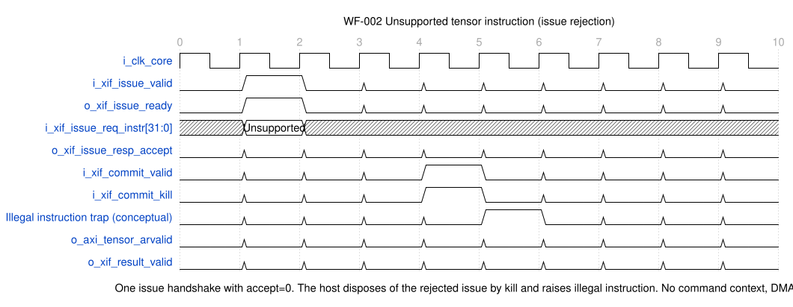

```wavedrom
{
  "head": {
    "text": "WF-002 Unsupported tensor instruction (issue rejection)",
    "tick": 0
  },
  "signal": [
    {
      "name": "i_clk_core",
      "wave": "p........."
    },
    {
      "name": "i_xif_issue_valid",
      "wave": "0100000000"
    },
    {
      "name": "o_xif_issue_ready",
      "wave": "0100000000"
    },
    {
      "name": "i_xif_issue_req_instr[31:0]",
      "wave": "x=xxxxxxxx",
      "data": [
        "Unsupported"
      ]
    },
    {
      "name": "o_xif_issue_resp_accept",
      "wave": "0000000000"
    },
    {
      "name": "i_xif_commit_valid",
      "wave": "0000100000"
    },
    {
      "name": "i_xif_commit_kill",
      "wave": "0000100000"
    },
    {
      "name": "Illegal instruction trap (conceptual)",
      "wave": "0000010000"
    },
    {
      "name": "o_axi_tensor_arvalid",
      "wave": "0000000000"
    },
    {
      "name": "o_xif_result_valid",
      "wave": "0000000000"
    }
  ],
  "foot": {
    "text": "One issue handshake with accept=0. The host disposes of the rejected issue by kill and raises illegal instruction. No command context, DMA, or result."
  },
  "config": {
    "hscale": 2
  }
}
```


```wavedrom
{
  "head": {
    "text": "WF-003 IF-003 two-beat AXI4 read with backpressure",
    "tick": 0
  },
  "signal": [
    {
      "name": "i_clk_core",
      "wave": "p.........."
    },
    {
      "name": "o_axi_tensor_arvalid",
      "wave": "01110000000"
    },
    {
      "name": "i_axi_tensor_arready",
      "wave": "00010000000"
    },
    {
      "name": "o_axi_tensor_araddr",
      "wave": "x=..xxxxxxx",
      "data": [
        "0x1000"
      ]
    },
    {
      "name": "o_axi_tensor_arlen",
      "wave": "x=..xxxxxxx",
      "data": [
        "1"
      ]
    },
    {
      "name": "o_axi_tensor_arsize",
      "wave": "x=..xxxxxxx",
      "data": [
        "5"
      ]
    },
    {
      "name": "o_axi_tensor_arid",
      "wave": "x=..xxxxxxx",
      "data": [
        "A"
      ]
    },
    {
      "name": "i_axi_tensor_rvalid",
      "wave": "00000111000"
    },
    {
      "name": "o_axi_tensor_rready",
      "wave": "00000011000"
    },
    {
      "name": "i_axi_tensor_rlast",
      "wave": "00000001000"
    },
    {
      "name": "i_axi_tensor_rid",
      "wave": "xxxxx=..xxx",
      "data": [
        "A"
      ]
    },
    {
      "name": "i_axi_tensor_rresp",
      "wave": "xxxxx=..xxx",
      "data": [
        "OKAY"
      ]
    },
    {
      "name": "i_axi_tensor_rdata",
      "wave": "xxxxx=.=xxx",
      "data": [
        "D0",
        "D1"
      ]
    }
  ],
  "foot": {
    "text": "Illustrative. AR fires once. D0 remains stable while stalled and is accepted before D1, the final beat."
  },
  "config": {
    "hscale": 2
  }
}
```


```wavedrom
{
  "head": {
    "text": "WF-004 OP-002 completion-only elementwise success",
    "tick": 0
  },
  "signal": [
    {
      "name": "i_clk_core",
      "wave": "p.............."
    },
    {
      "name": "i_xif_issue_valid",
      "wave": "010000000000000"
    },
    {
      "name": "o_xif_issue_ready",
      "wave": "010000000000000"
    },
    {
      "name": "i_xif_issue_req_instr[31:0]",
      "wave": "x=xxxxxxxxxxxxx",
      "data": [
        "OP-002, rd=x0"
      ]
    },
    {
      "name": "o_xif_issue_resp_accept",
      "wave": "010000000000000"
    },
    {
      "name": "i_xif_commit_valid",
      "wave": "000100000000000"
    },
    {
      "name": "i_xif_commit_kill",
      "wave": "000000000000000"
    },
    {
      "name": "Descriptor validated (conceptual)",
      "wave": "000000100000000"
    },
    {
      "name": "Input tile ready (conceptual)",
      "wave": "000000001000000"
    },
    {
      "name": "Elementwise lane active (conceptual)",
      "wave": "000000000110000"
    },
    {
      "name": "All output writes successful (conceptual)",
      "wave": "000000000001000"
    },
    {
      "name": "o_xif_result_valid",
      "wave": "000000000000100"
    },
    {
      "name": "i_xif_result_ready",
      "wave": "000000000000100"
    },
    {
      "name": "o_xif_result_we",
      "wave": "000000000000000"
    }
  ],
  "foot": {
    "text": "Mode 2 permits rd=x0 for OP-002. The vector is written by IF-003; the result handshake completes the instruction with we=0."
  },
  "config": {
    "hscale": 2
  }
}
```

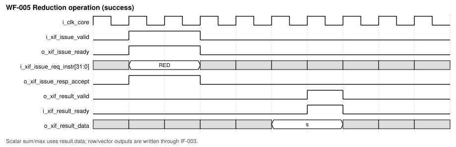

WF-005 illustrates a valid zero scalar and the owner-driven CSR acknowledgment. The conceptual APB rows show ordering across clock domains. WF-010 shows the OP-004 accepted-read-error path and sentinel result. On accepted OP-003 failure, `rd` receives zero; software checks the matching CSR record before using it, as defined in DEC-010.

```wavedrom
{
  "head": {
    "text": "WF-005 OP-003 valid zero scalar and owner acknowledgment",
    "tick": 0
  },
  "signal": [
    {
      "name": "i_clk_core",
      "wave": "p................"
    },
    {
      "name": "i_xif_issue_valid",
      "wave": "01000000000000000"
    },
    {
      "name": "o_xif_issue_ready",
      "wave": "01000000000000000"
    },
    {
      "name": "i_xif_issue_req_instr[31:0]",
      "wave": "x=xxxxxxxxxxxxxxx",
      "data": [
        "OP-003"
      ]
    },
    {
      "name": "o_xif_issue_resp_accept",
      "wave": "01000000000000000"
    },
    {
      "name": "i_xif_commit_valid",
      "wave": "00010000000000000"
    },
    {
      "name": "i_xif_commit_kill",
      "wave": "00000000000000000"
    },
    {
      "name": "Descriptor validated (conceptual)",
      "wave": "00000010000000000"
    },
    {
      "name": "Input read drained (conceptual)",
      "wave": "00000000100000000"
    },
    {
      "name": "Scalar zero ready (conceptual)",
      "wave": "00000000010000000"
    },
    {
      "name": "Busy visible in APB (conceptual)",
      "wave": "00000000111111100"
    },
    {
      "name": "Error visible in APB (conceptual)",
      "wave": "00000000000000000"
    },
    {
      "name": "o_xif_result_valid",
      "wave": "00000000001000000"
    },
    {
      "name": "i_xif_result_ready",
      "wave": "00000000001000000"
    },
    {
      "name": "o_xif_result_we",
      "wave": "00000000001000000"
    },
    {
      "name": "o_xif_result_rd",
      "wave": "xxxxxxxxxx=xxxxxx",
      "data": [
        "x12"
      ]
    },
    {
      "name": "o_xif_result_data",
      "wave": "xxxxxxxxxx=xxxxxx",
      "data": [
        "0"
      ]
    },
    {
      "name": "Owner reads err_valid=0 (conceptual)",
      "wave": "00000000000100000"
    },
    {
      "name": "Owner writes scalar_ack (conceptual)",
      "wave": "00000000000010000"
    },
    {
      "name": "Scalar ack consumed in core (conceptual)",
      "wave": "00000000000000100"
    }
  ],
  "foot": {
    "text": "The clean fence protects attribution of a valid scalar zero. Its result fires before the owner checks CSR and acknowledges. APB rows show ordering only."
  },
  "config": {
    "hscale": 2
  }
}
```


```wavedrom
{"head":{"text":"WF-006 APB control write and version read"},"signal":[{"name":"i_clk_apb","wave":"p..........."},{"name":"i_apb_psel","wave":"011111111000"},{"name":"i_apb_penable","wave":"001110111000"},{"name":"i_apb_pwrite","wave":"011110000000"},{"name":"i_apb_paddr[15:0]","wave":"x=...=...xxx","data":["0x4","0x0"]},{"name":"i_apb_pwdata[31:0]","wave":"x=...xxxxxxx","data":["0x00000001"]},{"name":"i_apb_pstrb[3:0]","wave":"x=...=...xxx","data":["0xF","0x0"]},{"name":"o_apb_pready","wave":"000010001000"},{"name":"o_apb_prdata[31:0]","wave":"xxxxxxxx=xxx","data":["0x00010001"]}],"foot":{"text":"The write enables commands. The next transfer reads IP version 1.1. Wait cycles are illustrative."},"config":{"hscale":3}}
```


```wavedrom
{"head":{"text":"WF-007 Drain an accepted command before ordinary reset"},"signal":[{"name":"i_clk_core","wave":"p................"},{"name":"i_rst_n_core","wave":"11111111111100111"},{"name":"i_quiesce_req","wave":"00111111111111100"},{"name":"o_quiesce_ack","wave":"00000000001100100"},{"name":"drain_seen (reset controller)","wave":"00000000000111110"},{"name":"i_xif_issue_valid","wave":"01000000000000001"},{"name":"o_xif_issue_ready","wave":"11000000000000011"},{"name":"o_xif_issue_resp_accept","wave":"01000000000000001"},{"name":"i_xif_commit_valid","wave":"00001000000000000"},{"name":"i_xif_commit_kill","wave":"xxxx0xxxxxxxxxxxx"},{"name":"o_axi_arvalid","wave":"00000100000000000"},{"name":"i_axi_arready","wave":"00000100000000000"},{"name":"i_axi_rvalid (last required read)","wave":"00000001000000000"},{"name":"o_axi_rready","wave":"11111111000000000"},{"name":"o_xif_result_valid","wave":"00000000010000000"},{"name":"i_xif_result_ready","wave":"00000000010000000"}],"foot":{"text":"The accepted command commits during drain. The controller latches ack before resetting the IP."},"config":{"hscale":3}}
```


```wavedrom
{"head":{"text":"WF-008 CV-X-IF result backpressure"},"signal":[{"name":"i_clk_core","wave":"p........."},{"name":"o_xif_result_valid","wave":"0111100000"},{"name":"i_xif_result_ready","wave":"0000100000"},{"name":"o_xif_result_data","wave":"x=...xxxxx","data":["6"]},{"name":"o_xif_result_rd","wave":"x=...xxxxx","data":["x12"]},{"name":"o_xif_result_we","wave":"x1...xxxxx"},{"name":"o_xif_result_id","wave":"x=...xxxxx","data":["N"]}],"foot":{"text":"The scalar result and its destination stay stable through the single valid/ready handshake."},"config":{"hscale":3}}
```


```wavedrom
{
  "head": {
    "text": "WF-009 OP-004 ARGMAX scalar success",
    "tick": 0
  },
  "signal": [
    {
      "name": "i_clk_core",
      "wave": "p................."
    },
    {
      "name": "PARA_ARGMAX_IMPL (static)",
      "wave": "=................x",
      "data": [
        "0 or 1"
      ]
    },
    {
      "name": "i_xif_issue_valid",
      "wave": "010000000000000000"
    },
    {
      "name": "o_xif_issue_ready",
      "wave": "010000000000000000"
    },
    {
      "name": "i_xif_issue_req_instr[31:0]",
      "wave": "x=xxxxxxxxxxxxxxxx",
      "data": [
        "OP-004"
      ]
    },
    {
      "name": "o_xif_issue_resp_accept",
      "wave": "010000000000000000"
    },
    {
      "name": "i_xif_commit_valid",
      "wave": "000100000000000000"
    },
    {
      "name": "i_xif_commit_kill",
      "wave": "000000000000000000"
    },
    {
      "name": "Descriptor validated (conceptual)",
      "wave": "000000100000000000"
    },
    {
      "name": "Operand read request (conceptual)",
      "wave": "000000010000000000"
    },
    {
      "name": "Operands ready (conceptual)",
      "wave": "000000000100000000"
    },
    {
      "name": "Global winner valid (conceptual)",
      "wave": "000000000000100000"
    },
    {
      "name": "o_xif_result_valid",
      "wave": "000000000000010000"
    },
    {
      "name": "i_xif_result_ready",
      "wave": "000000000000010000"
    },
    {
      "name": "o_xif_result_we",
      "wave": "000000000000010000"
    },
    {
      "name": "o_xif_result_rd",
      "wave": "xxxxxxxxxxxxx=xxxx",
      "data": [
        "x12"
      ]
    },
    {
      "name": "o_xif_result_data",
      "wave": "xxxxxxxxxxxxx=xxxx",
      "data": [
        "token index"
      ]
    }
  ],
  "foot": {
    "text": "Mode 2. Both elaborations return an index in x12. Standalone reads stored logits; fused reads projection operands. No fixed latency is implied."
  },
  "config": {
    "hscale": 2
  }
}
```


```wavedrom
{"head":{"text":"WF-010 OP-004 read fault, APB publication and scalar result"},"signal":[{"name":"i_clk_core","wave":"p.................."},{"name":"i_xif_issue_valid","wave":"0100000000000000000"},{"name":"o_xif_issue_ready","wave":"0100000000000000000"},{"name":"o_xif_issue_resp_accept","wave":"0100000000000000000"},{"name":"o_xif_issue_resp_writeback","wave":"0100000000000000000"},{"name":"i_xif_commit_valid","wave":"0001000000000000000"},{"name":"i_xif_commit_kill","wave":"xxx0xxxxxxxxxxxxxxx"},{"name":"descriptor validated (conceptual)","wave":"0000010000000000000"},{"name":"IF-003 operand AR handshake (conceptual)","wave":"0000001000000000000"},{"name":"IF-003 operand R handshake (conceptual)","wave":"0000000010100000000"},{"name":"IF-003 RRESP (conceptual)","wave":"xxxxxxxx=x=xxxxxxxx","data":["SLVERR","OKAY"]},{"name":"IF-003 RLAST on final transfer (conceptual)","wave":"0000000000100000000"},{"name":"all accepted traffic drained (conceptual)","wave":"0000000000010000000"},{"name":"APB publication ACK in core (conceptual)","wave":"0000000000000100000"},{"name":"o_xif_result_valid","wave":"0000000000000011100"},{"name":"i_xif_result_ready","wave":"0000000000000000100"},{"name":"o_xif_result_data","wave":"xxxxxxxxxxxxxx=..xx","data":["all-ones"]},{"name":"o_xif_result_we","wave":"xxxxxxxxxxxxxx1..xx"}],"foot":{"text":"The failing command drains first. APB publication precedes the scalar sentinel. Cycle placement is illustrative."},"config":{"hscale":3}}
```

[DEC-072 publication and ACK detail, offline viewer](figures/dec072_csr_publish.html) · [WaveJSON source](figures/dec072_csr_publish.json). The detail shows ordering across clock domains and does not specify cycle counts.

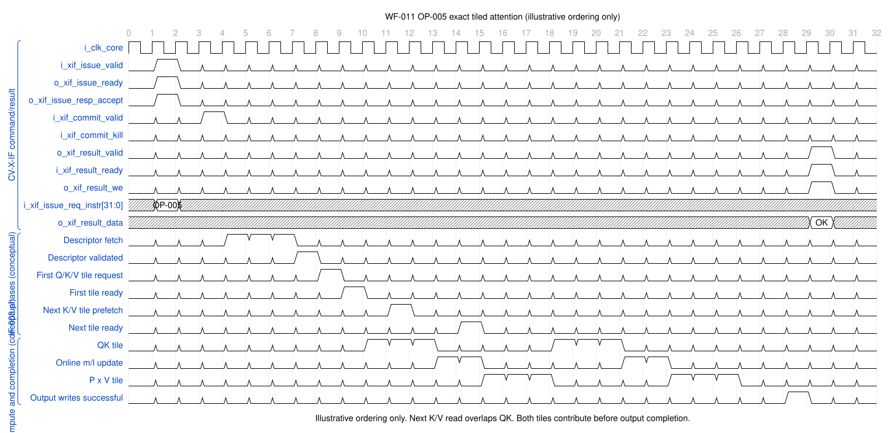

```wavedrom
{
  "head": {
    "text": "WF-011 OP-005 exact tiled attention (illustrative ordering only)",
    "tick": 0
  },
  "signal": [
    [
      "CV-X-IF command/result",
      {
        "name": "i_clk_core",
        "wave": "p..............................."
      },
      {
        "name": "i_xif_issue_valid",
        "wave": "01000000000000000000000000000000"
      },
      {
        "name": "o_xif_issue_ready",
        "wave": "01000000000000000000000000000000"
      },
      {
        "name": "o_xif_issue_resp_accept",
        "wave": "01000000000000000000000000000000"
      },
      {
        "name": "i_xif_commit_valid",
        "wave": "00010000000000000000000000000000"
      },
      {
        "name": "i_xif_commit_kill",
        "wave": "00000000000000000000000000000000"
      },
      {
        "name": "o_xif_result_valid",
        "wave": "00000000000000000000000000000100"
      },
      {
        "name": "i_xif_result_ready",
        "wave": "00000000000000000000000000000100"
      },
      {
        "name": "o_xif_result_we",
        "wave": "00000000000000000000000000000100"
      },
      {
        "name": "i_xif_issue_req_instr[31:0]",
        "wave": "x=xxxxxxxxxxxxxxxxxxxxxxxxxxxxxx",
        "data": [
          "OP-005"
        ]
      },
      {
        "name": "o_xif_result_data",
        "wave": "xxxxxxxxxxxxxxxxxxxxxxxxxxxxx=xx",
        "data": [
          "OK"
        ]
      }
    ],
    [
      "IF-003 phases (conceptual)",
      {
        "name": "Descriptor fetch",
        "wave": "00001110000000000000000000000000"
      },
      {
        "name": "Descriptor validated",
        "wave": "00000001000000000000000000000000"
      },
      {
        "name": "First Q/K/V tile request",
        "wave": "00000000100000000000000000000000"
      },
      {
        "name": "First tile ready",
        "wave": "00000000010000000000000000000000"
      },
      {
        "name": "Next K/V tile prefetch",
        "wave": "00000000000100000000000000000000"
      },
      {
        "name": "Next tile ready",
        "wave": "00000000000000100000000000000000"
      }
    ],
    [
      "Compute and completion (conceptual)",
      {
        "name": "QK tile",
        "wave": "00000000001110000011100000000000"
      },
      {
        "name": "Online m/l update",
        "wave": "00000000000001100000011000000000"
      },
      {
        "name": "P x V tile",
        "wave": "00000000000000011100000111000000"
      },
      {
        "name": "Output writes successful",
        "wave": "00000000000000000000000000001000"
      }
    ]
  ],
  "foot": {
    "text": "Illustrative ordering only. Next K/V read overlaps QK. Both tiles contribute before output completion."
  },
  "config": {
    "hscale": 1
  }
}
```

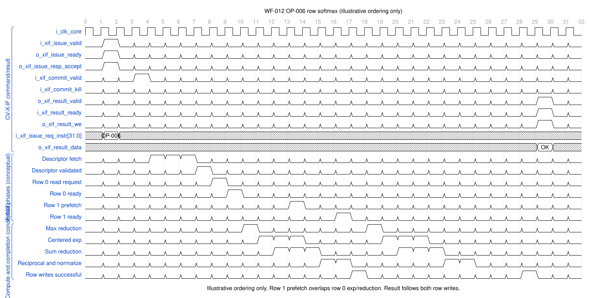

```wavedrom
{
  "head": {
    "text": "WF-012 OP-006 row softmax (illustrative ordering only)",
    "tick": 0
  },
  "signal": [
    [
      "CV-X-IF command/result",
      {
        "name": "i_clk_core",
        "wave": "p..............................."
      },
      {
        "name": "i_xif_issue_valid",
        "wave": "01000000000000000000000000000000"
      },
      {
        "name": "o_xif_issue_ready",
        "wave": "01000000000000000000000000000000"
      },
      {
        "name": "o_xif_issue_resp_accept",
        "wave": "01000000000000000000000000000000"
      },
      {
        "name": "i_xif_commit_valid",
        "wave": "00010000000000000000000000000000"
      },
      {
        "name": "i_xif_commit_kill",
        "wave": "00000000000000000000000000000000"
      },
      {
        "name": "o_xif_result_valid",
        "wave": "00000000000000000000000000000100"
      },
      {
        "name": "i_xif_result_ready",
        "wave": "00000000000000000000000000000100"
      },
      {
        "name": "o_xif_result_we",
        "wave": "00000000000000000000000000000100"
      },
      {
        "name": "i_xif_issue_req_instr[31:0]",
        "wave": "x=xxxxxxxxxxxxxxxxxxxxxxxxxxxxxx",
        "data": [
          "OP-006"
        ]
      },
      {
        "name": "o_xif_result_data",
        "wave": "xxxxxxxxxxxxxxxxxxxxxxxxxxxxx=xx",
        "data": [
          "OK"
        ]
      }
    ],
    [
      "IF-003 phases (conceptual)",
      {
        "name": "Descriptor fetch",
        "wave": "00001110000000000000000000000000"
      },
      {
        "name": "Descriptor validated",
        "wave": "00000001000000000000000000000000"
      },
      {
        "name": "Row 0 read request",
        "wave": "00000000100000000000000000000000"
      },
      {
        "name": "Row 0 ready",
        "wave": "00000000010000000000000000000000"
      },
      {
        "name": "Row 1 prefetch",
        "wave": "00000000000001000000000000000000"
      },
      {
        "name": "Row 1 ready",
        "wave": "00000000000000001000000000000000"
      }
    ],
    [
      "Compute and completion (conceptual)",
      {
        "name": "Max reduction",
        "wave": "00000000001000000010000000000000"
      },
      {
        "name": "Centered exp",
        "wave": "00000000000111000001110000000000"
      },
      {
        "name": "Sum reduction",
        "wave": "00000000000011100000111000000000"
      },
      {
        "name": "Reciprocal and normalize",
        "wave": "00000000000000011000000110000000"
      },
      {
        "name": "Row writes successful",
        "wave": "00000000000000000100000000001000"
      }
    ]
  ],
  "foot": {
    "text": "Illustrative ordering only. Row 1 prefetch overlaps row 0 exp/reduction. Result follows both row writes."
  },
  "config": {
    "hscale": 1
  }
}
```

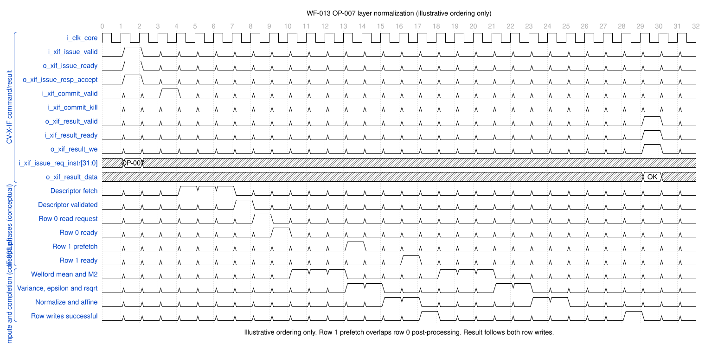

```wavedrom
{
  "head": {
    "text": "WF-013 OP-007 layer normalization (illustrative ordering only)",
    "tick": 0
  },
  "signal": [
    [
      "CV-X-IF command/result",
      {
        "name": "i_clk_core",
        "wave": "p..............................."
      },
      {
        "name": "i_xif_issue_valid",
        "wave": "01000000000000000000000000000000"
      },
      {
        "name": "o_xif_issue_ready",
        "wave": "01000000000000000000000000000000"
      },
      {
        "name": "o_xif_issue_resp_accept",
        "wave": "01000000000000000000000000000000"
      },
      {
        "name": "i_xif_commit_valid",
        "wave": "00010000000000000000000000000000"
      },
      {
        "name": "i_xif_commit_kill",
        "wave": "00000000000000000000000000000000"
      },
      {
        "name": "o_xif_result_valid",
        "wave": "00000000000000000000000000000100"
      },
      {
        "name": "i_xif_result_ready",
        "wave": "00000000000000000000000000000100"
      },
      {
        "name": "o_xif_result_we",
        "wave": "00000000000000000000000000000100"
      },
      {
        "name": "i_xif_issue_req_instr[31:0]",
        "wave": "x=xxxxxxxxxxxxxxxxxxxxxxxxxxxxxx",
        "data": [
          "OP-007"
        ]
      },
      {
        "name": "o_xif_result_data",
        "wave": "xxxxxxxxxxxxxxxxxxxxxxxxxxxxx=xx",
        "data": [
          "OK"
        ]
      }
    ],
    [
      "IF-003 phases (conceptual)",
      {
        "name": "Descriptor fetch",
        "wave": "00001110000000000000000000000000"
      },
      {
        "name": "Descriptor validated",
        "wave": "00000001000000000000000000000000"
      },
      {
        "name": "Row 0 read request",
        "wave": "00000000100000000000000000000000"
      },
      {
        "name": "Row 0 ready",
        "wave": "00000000010000000000000000000000"
      },
      {
        "name": "Row 1 prefetch",
        "wave": "00000000000001000000000000000000"
      },
      {
        "name": "Row 1 ready",
        "wave": "00000000000000001000000000000000"
      }
    ],
    [
      "Compute and completion (conceptual)",
      {
        "name": "Welford mean and M2",
        "wave": "00000000001110000011100000000000"
      },
      {
        "name": "Variance, epsilon and rsqrt",
        "wave": "00000000000001100000011000000000"
      },
      {
        "name": "Normalize and affine",
        "wave": "00000000000000011000000110000000"
      },
      {
        "name": "Row writes successful",
        "wave": "00000000000000000100000000001000"
      }
    ]
  ],
  "foot": {
    "text": "Illustrative ordering only. Row 1 prefetch overlaps row 0 post-processing. Result follows both row writes."
  },
  "config": {
    "hscale": 1
  }
}
```

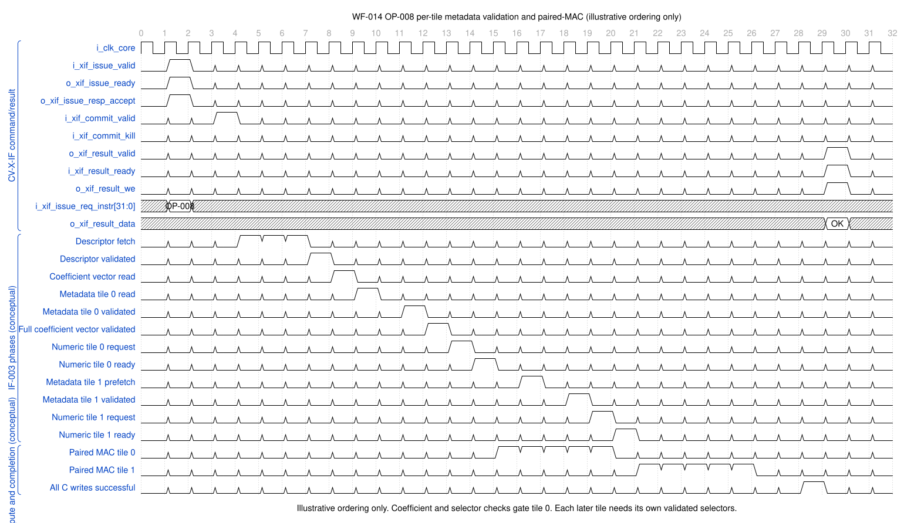

```wavedrom
{
  "head": {
    "text": "WF-014 OP-008 per-tile metadata validation and paired-MAC (illustrative ordering only)",
    "tick": 0
  },
  "signal": [
    [
      "CV-X-IF command/result",
      {
        "name": "i_clk_core",
        "wave": "p..............................."
      },
      {
        "name": "i_xif_issue_valid",
        "wave": "01000000000000000000000000000000"
      },
      {
        "name": "o_xif_issue_ready",
        "wave": "01000000000000000000000000000000"
      },
      {
        "name": "o_xif_issue_resp_accept",
        "wave": "01000000000000000000000000000000"
      },
      {
        "name": "i_xif_commit_valid",
        "wave": "00010000000000000000000000000000"
      },
      {
        "name": "i_xif_commit_kill",
        "wave": "00000000000000000000000000000000"
      },
      {
        "name": "o_xif_result_valid",
        "wave": "00000000000000000000000000000100"
      },
      {
        "name": "i_xif_result_ready",
        "wave": "00000000000000000000000000000100"
      },
      {
        "name": "o_xif_result_we",
        "wave": "00000000000000000000000000000100"
      },
      {
        "name": "i_xif_issue_req_instr[31:0]",
        "wave": "x=xxxxxxxxxxxxxxxxxxxxxxxxxxxxxx",
        "data": [
          "OP-008"
        ]
      },
      {
        "name": "o_xif_result_data",
        "wave": "xxxxxxxxxxxxxxxxxxxxxxxxxxxxx=xx",
        "data": [
          "OK"
        ]
      }
    ],
    [
      "IF-003 phases (conceptual)",
      {
        "name": "Descriptor fetch",
        "wave": "00001110000000000000000000000000"
      },
      {
        "name": "Descriptor validated",
        "wave": "00000001000000000000000000000000"
      },
      {
        "name": "Coefficient vector read",
        "wave": "00000000100000000000000000000000"
      },
      {
        "name": "Metadata tile 0 read",
        "wave": "00000000010000000000000000000000"
      },
      {
        "name": "Metadata tile 0 validated",
        "wave": "00000000000100000000000000000000"
      },
      {
        "name": "Full coefficient vector validated",
        "wave": "00000000000010000000000000000000"
      },
      {
        "name": "Numeric tile 0 request",
        "wave": "00000000000001000000000000000000"
      },
      {
        "name": "Numeric tile 0 ready",
        "wave": "00000000000000100000000000000000"
      },
      {
        "name": "Metadata tile 1 prefetch",
        "wave": "00000000000000001000000000000000"
      },
      {
        "name": "Metadata tile 1 validated",
        "wave": "00000000000000000010000000000000"
      },
      {
        "name": "Numeric tile 1 request",
        "wave": "00000000000000000001000000000000"
      },
      {
        "name": "Numeric tile 1 ready",
        "wave": "00000000000000000000100000000000"
      }
    ],
    [
      "Compute and completion (conceptual)",
      {
        "name": "Paired MAC tile 0",
        "wave": "00000000000000011111000000000000"
      },
      {
        "name": "Paired MAC tile 1",
        "wave": "00000000000000000000011111000000"
      },
      {
        "name": "All C writes successful",
        "wave": "00000000000000000000000000001000"
      }
    ]
  ],
  "foot": {
    "text": "Illustrative ordering only. Coefficient and selector checks gate tile 0. Each later tile needs its own validated selectors."
  },
  "config": {
    "hscale": 1
  }
}
```

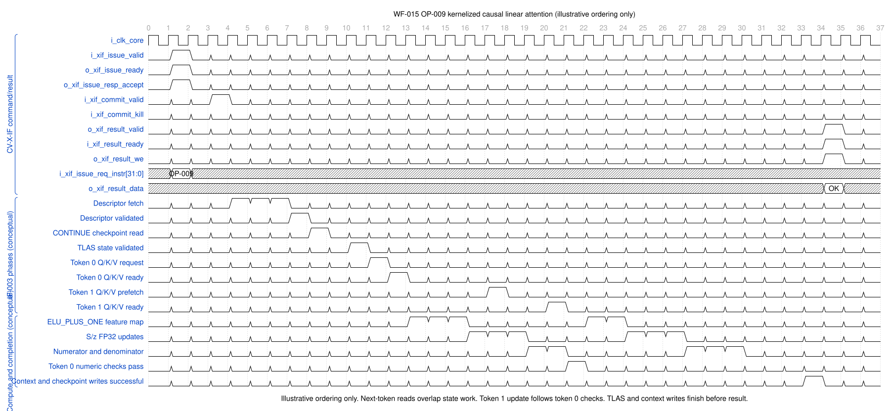

```wavedrom
{
  "head": {
    "text": "WF-015 OP-009 kernelized causal linear attention (illustrative ordering only)",
    "tick": 0
  },
  "signal": [
    [
      "CV-X-IF command/result",
      {
        "name": "i_clk_core",
        "wave": "p...................................."
      },
      {
        "name": "i_xif_issue_valid",
        "wave": "0100000000000000000000000000000000000"
      },
      {
        "name": "o_xif_issue_ready",
        "wave": "0100000000000000000000000000000000000"
      },
      {
        "name": "o_xif_issue_resp_accept",
        "wave": "0100000000000000000000000000000000000"
      },
      {
        "name": "i_xif_commit_valid",
        "wave": "0001000000000000000000000000000000000"
      },
      {
        "name": "i_xif_commit_kill",
        "wave": "0000000000000000000000000000000000000"
      },
      {
        "name": "o_xif_result_valid",
        "wave": "0000000000000000000000000000000000100"
      },
      {
        "name": "i_xif_result_ready",
        "wave": "0000000000000000000000000000000000100"
      },
      {
        "name": "o_xif_result_we",
        "wave": "0000000000000000000000000000000000100"
      },
      {
        "name": "i_xif_issue_req_instr[31:0]",
        "wave": "x=xxxxxxxxxxxxxxxxxxxxxxxxxxxxxxxxxxx",
        "data": [
          "OP-009"
        ]
      },
      {
        "name": "o_xif_result_data",
        "wave": "xxxxxxxxxxxxxxxxxxxxxxxxxxxxxxxxxx=xx",
        "data": [
          "OK"
        ]
      }
    ],
    [
      "IF-003 phases (conceptual)",
      {
        "name": "Descriptor fetch",
        "wave": "0000111000000000000000000000000000000"
      },
      {
        "name": "Descriptor validated",
        "wave": "0000000100000000000000000000000000000"
      },
      {
        "name": "CONTINUE checkpoint read",
        "wave": "0000000010000000000000000000000000000"
      },
      {
        "name": "TLAS state validated",
        "wave": "0000000000100000000000000000000000000"
      },
      {
        "name": "Token 0 Q/K/V request",
        "wave": "0000000000010000000000000000000000000"
      },
      {
        "name": "Token 0 Q/K/V ready",
        "wave": "0000000000001000000000000000000000000"
      },
      {
        "name": "Token 1 Q/K/V prefetch",
        "wave": "0000000000000000010000000000000000000"
      },
      {
        "name": "Token 1 Q/K/V ready",
        "wave": "0000000000000000000010000000000000000"
      }
    ],
    [
      "Compute and completion (conceptual)",
      {
        "name": "ELU_PLUS_ONE feature map",
        "wave": "0000000000000111000000110000000000000"
      },
      {
        "name": "S/z FP32 updates",
        "wave": "0000000000000000111000001110000000000"
      },
      {
        "name": "Numerator and denominator",
        "wave": "0000000000000000000110000001110000000"
      },
      {
        "name": "Token 0 numeric checks pass",
        "wave": "0000000000000000000001000000000000000"
      },
      {
        "name": "Context and checkpoint writes successful",
        "wave": "0000000000000000000000000000000001000"
      }
    ]
  ],
  "foot": {
    "text": "Illustrative ordering only. Next-token reads overlap state work. Token 1 update follows token 0 checks. TLAS and context writes finish before result."
  },
  "config": {
    "hscale": 1
  }
}
```

| Cycle / event | Input condition | State/action | Output condition |
|---|---|---|---|
| t0 | issue_valid=1, issue_ready=1 | accept, move to DECODE | issue_resp.accept=1 |
| t1..tK | operands ready | stream MAC rows | partial sums |
| tK+1 | tile done | drive result_valid | result_ready→done |

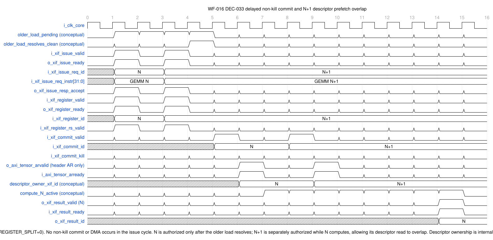

```wavedrom
{
  "head": {
    "text": "WF-016 DEC-033 delayed non-kill commit and N+1 descriptor prefetch overlap",
    "tick": 0
  },
  "signal": [
    {
      "name": "i_clk_core",
      "wave": "p..............."
    },
    {
      "name": "older_load_pending (conceptual)",
      "wave": "0111100000000000"
    },
    {
      "name": "older_load_resolves_clean (conceptual)",
      "wave": "0000100000000000"
    },
    {
      "name": "i_xif_issue_valid",
      "wave": "0101000000000000"
    },
    {
      "name": "o_xif_issue_ready",
      "wave": "0101000000000000"
    },
    {
      "name": "i_xif_issue_req_id",
      "wave": "x=.=............",
      "data": [
        "N",
        "N+1"
      ]
    },
    {
      "name": "i_xif_issue_req_instr[31:0]",
      "wave": "x=.=............",
      "data": [
        "GEMM N",
        "GEMM N+1"
      ]
    },
    {
      "name": "o_xif_issue_resp_accept",
      "wave": "0101000000000000"
    },
    {
      "name": "i_xif_register_valid",
      "wave": "0101000000000000"
    },
    {
      "name": "o_xif_register_ready",
      "wave": "0101000000000000"
    },
    {
      "name": "i_xif_register_id",
      "wave": "x=.=............",
      "data": [
        "N",
        "N+1"
      ]
    },
    {
      "name": "i_xif_register_rs_valid",
      "wave": "0101000000000000"
    },
    {
      "name": "i_xif_commit_valid",
      "wave": "0000010010000000"
    },
    {
      "name": "i_xif_commit_id",
      "wave": "xxxxx=..=.......",
      "data": [
        "N",
        "N+1"
      ]
    },
    {
      "name": "i_xif_commit_kill",
      "wave": "0000000000000000"
    },
    {
      "name": "o_axi_tensor_arvalid (header AR only)",
      "wave": "0000001001000000"
    },
    {
      "name": "i_axi_tensor_arready",
      "wave": "0000001001000000"
    },
    {
      "name": "descriptor_owner_xif_id (conceptual)",
      "wave": "xxxxxx=..=......",
      "data": [
        "N",
        "N+1"
      ]
    },
    {
      "name": "compute_N_active (conceptual)",
      "wave": "0000000111111110"
    },
    {
      "name": "o_xif_result_valid (N)",
      "wave": "0000000000000010"
    },
    {
      "name": "i_xif_result_ready",
      "wave": "0000000000000010"
    },
    {
      "name": "o_xif_result_id",
      "wave": "xxxxxxxxxxxxxx=.",
      "data": [
        "N"
      ]
    }
  ],
  "foot": {
    "text": "Illustrative ordering only; no fixed latency is implied. Issue and register are coupled (X_ISSUE_REGISTER_SPLIT=0). No non-kill commit or DMA occurs in the issue cycle. N is authorized only after the older load resolves; N+1 is separately authorized while N computes, allowing its descriptor read to overlap. Descriptor ownership is internal context tracking; AXI IDs are not CV-X-IF IDs. Only header address handshakes are shown. Header data and body fetches are omitted."
  },
  "config": {
    "hscale": 2
  }
}
```

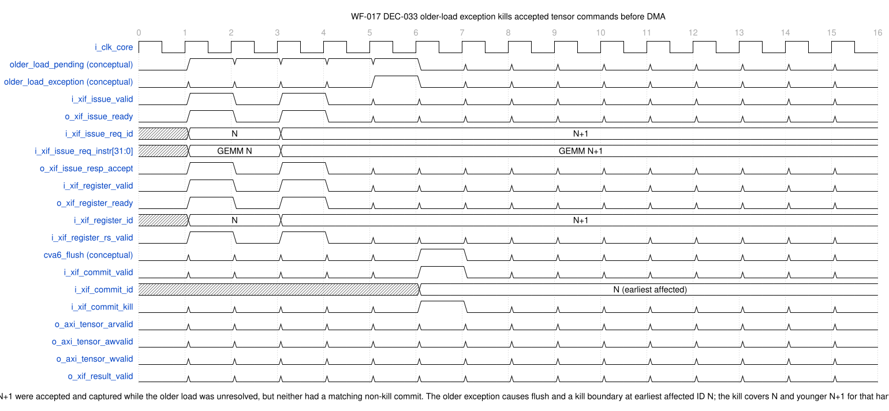

```wavedrom
{
  "head": {
    "text": "WF-017 DEC-033 older-load exception kills accepted tensor commands before DMA",
    "tick": 0
  },
  "signal": [
    {
      "name": "i_clk_core",
      "wave": "p..............."
    },
    {
      "name": "older_load_pending (conceptual)",
      "wave": "0111110000000000"
    },
    {
      "name": "older_load_exception (conceptual)",
      "wave": "0000010000000000"
    },
    {
      "name": "i_xif_issue_valid",
      "wave": "0101000000000000"
    },
    {
      "name": "o_xif_issue_ready",
      "wave": "0101000000000000"
    },
    {
      "name": "i_xif_issue_req_id",
      "wave": "x=.=............",
      "data": [
        "N",
        "N+1"
      ]
    },
    {
      "name": "i_xif_issue_req_instr[31:0]",
      "wave": "x=.=............",
      "data": [
        "GEMM N",
        "GEMM N+1"
      ]
    },
    {
      "name": "o_xif_issue_resp_accept",
      "wave": "0101000000000000"
    },
    {
      "name": "i_xif_register_valid",
      "wave": "0101000000000000"
    },
    {
      "name": "o_xif_register_ready",
      "wave": "0101000000000000"
    },
    {
      "name": "i_xif_register_id",
      "wave": "x=.=............",
      "data": [
        "N",
        "N+1"
      ]
    },
    {
      "name": "i_xif_register_rs_valid",
      "wave": "0101000000000000"
    },
    {
      "name": "cva6_flush (conceptual)",
      "wave": "0000001000000000"
    },
    {
      "name": "i_xif_commit_valid",
      "wave": "0000001000000000"
    },
    {
      "name": "i_xif_commit_id",
      "wave": "xxxxxx=.........",
      "data": [
        "N (earliest affected)"
      ]
    },
    {
      "name": "i_xif_commit_kill",
      "wave": "0000001000000000"
    },
    {
      "name": "o_axi_tensor_arvalid",
      "wave": "0000000000000000"
    },
    {
      "name": "o_axi_tensor_awvalid",
      "wave": "0000000000000000"
    },
    {
      "name": "o_axi_tensor_wvalid",
      "wave": "0000000000000000"
    },
    {
      "name": "o_xif_result_valid",
      "wave": "0000000000000000"
    }
  ],
  "foot": {
    "text": "Illustrative ordering only; no fixed latency is implied. N and N+1 were accepted and captured while the older load was unresolved, but neither had a matching non-kill commit. The older exception causes flush and a kill boundary at earliest affected ID N; the kill covers N and younger N+1 for that hart. No descriptor/data read, output write, or CV-X-IF result may occur for either killed command."
  },
  "config": {
    "hscale": 2
  }
}
```

### 10.4 Arbitration, buffering, and throughput

Each accepted command retains its own mode and metadata in the queue/scoreboard. The architecture accepts a next command with a different mode while the active command executes when queue space is available. In the first release, one command owns the arrays until completion; the scheduler parallelizes independent tiles of that command across the selected arrays, then hands off to the next queued command. Results therefore retire in acceptance order. Within the active command, tile fetch, compute and writeback can overlap when bank ownership and credits permit. After the matching non-kill commit, the next command may prefetch its descriptor into a separate staging context under DEC-026. The next command waits for array ownership to transfer before executing. The array target remains one MAC per PE per cycle after fill for steady dense GEMM, with stalls and mode-specific utilization reported separately. Backpressure is honored at every queue and interface boundary.

**Command-mode handoff on shared units.** Before granting the next array owner, end the previous owner's ability to update reused state. Every valid pipeline entry, SRAM request/return reservation, delayed accumulator update and pending output consumer must be retired or safely drained according to its existing owner and result contract. A stalled entry retains its command generation, tile identity, lane mask and mode-derived controls, or retains an immutable link to that information for its whole lifetime. Do not recompute these controls from the new queue head. A younger descriptor-bank update is independent and must not alter active or draining state.

At dispatch, set the selected operation/precision once for the new active generation. Start it with its own accumulator, reduction and tile-valid state. Logical initialization may reset validity and initialize state on first use. Bulk SRAM bytes persist and are usable only after the new owner has written or otherwise initialized the required region. Ordinary command failure drains old writes and outstanding responses under DEC-012 before reuse, and Mode 2 additionally waits for the matching core W1C before starting the younger operation.

For TEST-010, queue FP exact attention while INT8 sparse GEMM owns the arrays, then reverse the order. Use one disabled cut and one enabled timing-oriented combination, and cover every qualified build's supported transition pairs. Stall the final write/result, interleave the younger descriptor responses, and keep old SRAM data nonzero. Require each reference model to match the independently run operation. Repeat with an older numeric failure, an older returned AXI fault, and a malformed younger descriptor. Observe generation tags at the enabled pipeline cuts, final older consumer retirement, no younger numeric traffic before its active grant and valid descriptor, correct new first-use state, and no completion or result-class change in the older command.

### 10.5 Memories and storage

| Storage ID | Kind | Depth × width | Ports | Read latency | Write mask | Reset/init | ECC/parity | Implementation |
|---|---|---|---|---|---|---|---|---|
| MEM-001 | Banked local scratchpad SRAM (operands, weights, staging) | Configured per-bank depth and data width through IF-006 | Configured bank count and 1RW or 1R1W profile | Configured fixed read-return latency per bank | Byte/word mask per macro | No bulk data reset requirement; validity/ownership reset | Optional parity/ECC by implementation | SRAM macro + bank/interconnect wrapper |
| MEM-002 | PE accumulator/partial-sum state | `PARA_ARRAY_COUNT × PARA_MAC_ROW × PARA_MAC_COL × PARA_ACCUM_W` bits for one active context per PE; extra contexts/banks are additional and not assumed | Per-PE read/modify/write or equivalent local feedback; exact implementation TBD | One-cycle feedback is an unverified timing target, not an established macro latency | Full-word accumulator update | Initialize the dot-product accumulator to zero for each new output. Apply initial C at the operation-defined addend stage. Reset valid/control state | None selected | PE flops/registers or local SRAM after timing/area analysis |

**Dedicated configurable storage banks (IF-006).** Map each large operand/weight ping-pong buffer, output staging buffer, sparse metadata/coefficient tile, attention Q/K/V and live state buffer, or normalization row buffer to one or more configured banks. Logical regions can share physical banks when the lifetime and port checks below permit it. Small scalar, tag and elastic registers may remain in flops. Use macro-backed PE accumulator storage only if its feedback latency and initiation interval are qualified.

Use one independent synchronous interface per physical bank. A core-with-macro-ports wrapper exposes those interfaces for external SRAM macro adapters. A self-contained wrapper terminates them in inferred or behavioral RAM or locally instantiated macro adapters. Each wrapper has a fixed port declaration. Translate macro-specific enables, polarity, banking and MBIST within the adapter. IF-006 runs at CLK-CORE. IF-003 AXI DMA continues to carry data to and from system DRAM.

| Per-bank signal | Direction at tensor core | Width | Contract |
|---|---|---|---|
| o_sram_rd_valid, o_sram_rd_addr | Out | 1 and max(1, ceil(log2(depth))) | Bank-local word address. Hold while valid until accepted. |
| i_sram_rd_ready | In | 1 | Read request acceptance at the clock edge. |
| i_sram_rd_valid, i_sram_rd_data | In | 1 and bank data width | Each accepted read returns one word in order at the configured fixed latency. No response ready. Reserve space before issuing a read. |
| o_sram_wr_valid, o_sram_wr_addr, o_sram_wr_data, o_sram_wr_strb | Out | 1, word-address width, bank data width, one strobe per byte | Hold while valid until accepted. Only strobed lanes change. |
| i_sram_wr_ready | In | 1 | Accept a write only on an edge that can perform the write. |

A 1RW backend accepts at most one request per bank per edge. A 1R1W backend can accept one read and one write at distinct addresses on the same edge. Serialize same-address conflicts unless the adapter qualifies explicit forwarding. Validate byte-enable capability. If partial writes need adaptation, qualify ordering, latency and service of that adapter. Reset clears validity and ownership. Ordinary quiesce drains accepted accesses and reserved read returns before resetting their trackers.

Logical bank capacity is depth times data width divided by 8. PARA_MEM_SRAM_BYTES is the sum over physical banks, counting each once. Eight banks of 4,096 words at 128 bits provide 512 KiB before accounting for macro granularity. Depth, count, width and tile placement can vary by build. Validate every region's live capacity and simultaneous access needs. Reject builds whose enabled modes cannot fit or whose selected backend cannot meet the declared access contract. Disabled modes need no bank allocation. Descriptors and CSRs cannot resize these banks.

**Bank allocation across runtime operations.** With one active compute command, mode-private SRAM regions whose lifetimes do not overlap may use the same physical banks. A capacity worksheet shall list, for every enabled operation and selected schedule, each physical region's width, rounded depth, bank binding, owner, allocation/release event and required simultaneous read/write service. Include pipeline and read-return reservations, ping-pong buffers, auxiliary tables and output staging if they occupy SRAM. Charge PE-resident state separately from MEM-001 unless it is actually stored in MEM-001. Qualify the maximum simultaneously live allocation per bank. The sum of mode-private byte budgets overstates capacity when nonoverlap is proven. Taking only the largest mode-private budget understates capacity whenever other state remains live alongside it.

Keep the active/younger descriptor storage and any response data it can write in disjoint regions from the current compute working set, or account for them as separate storage outside MEM-001. With the two-raw-bank candidate of §5.3, if both raw descriptor banks sit in MEM-001, charge 1,792 logical bytes before macro rounding and any parsed state. The command queue depth is a separate context limit. For the baseline, allow a new operation to reuse a mode-private region only after old writes, return reservations, consumers and pending output reads from that region are resolved. An external AXI response with storage already detached still retains its own tracker. If the optional elastic result schedule permits a younger mode to compute while an older result or data remains live, qualify the actual overlap rather than assuming the same SRAM map as the baseline. A command-mode switch reinitializes ownership and validity for its own regions. There is no need to clear the bulk SRAM contents between commands.

| Illustrative one-command working set | Logical storage to include in mode ledger |
|---|---:|
| OP-005 CFG-FULL simulation candidate, one context, Tq=16, Tk=64, K slices of 128 features at the high-width shape | 214.125 KiB for the six listed tile buffers |
| OP-006 one 65,536-element row with the in-place local exp buffer candidate | 256 KiB for the row |
| OP-007 two 65,536-element BF16/FP16 row slots plus resident same-precision gamma and beta | 512 KiB for input rows and affine vectors |

These are partial footprints for illustrative schedules. For example, even with all three operations overlaying the same banks, the OP-005 footprint alone cannot size the full-family build. If the chosen OP-007 schedule occupies 512 KiB before tree/output staging and the two descriptor banks also reside in MEM-001, their combined logical capacity already exceeds 512 KiB. Characterize a one-row or replay variant if macro space is tight, and include the extra reads and latency in that variant's performance envelope. The largest logical footprint also does not establish adequate ports. Verify the bank map with overlaps that occur in the real schedule, including descriptor prefetch during mode compute, row fill during output drain, and independent read-return backpressure.

**512-KiB shared-SRAM screening example.** Assume a logical 512-KiB MEM-001 capacity, placement of both 896-byte raw descriptor banks in MEM-001, and mutually exclusive active modes. This is a comparison point only. For the high-width OP-005 bring-up schedule above, one, two and four independent contexts plus descriptor banks use 215.875, 430.000 and 858.250 KiB respectively before other staging and macro rounding. Thus a two-context candidate has 82 KiB of logical headroom, while the four-context candidate exceeds the example capacity even before overhead. A smaller effective context count at runtime does not qualify a static build whose allocated worst-case capacity exceeds the bank map.

| Maximum-width OP-007 candidate with affine enabled | Logical raw rows, affine data and descriptor storage | Throughput or traffic trade-off |
|---|---:|---|
| Two complete input rows and retained gamma/beta | 513.750 KiB | Supports overlapping next-row statistics with current-row normalization given adequate ports. Already exceeds 512 KiB. |
| One complete input row and retained gamma/beta | 385.750 KiB | No X reread. Reuse one row buffer only after current-row normalization and its consumers release it. |
| One complete input row and one 1,024-element gamma/beta stripe | 133.750 KiB | No X reread. Can read two affine vectors per output row if stripes cannot be retained across rows. At the row cap this is up to 256 KiB of gamma/beta read traffic per row. |

Compare the one-row retained-affine plan first when the two-row plan exceeds budget. This trades row overlap for capacity without adding input traffic. Use streamed affine as a lower-capacity comparison and include its extra AXI service before selecting it. The OP-006 in-place exp row plus the same descriptors takes 257.750 KiB. These mode-private regions may overlay only when the handoff and outstanding-response ownership checks allow it. For actual bank signing, charge output staging, masks, reduction partials, parsed fields, alignment, and data-return reservations not already backed by counted destination slots. Count each reserved byte once. Select the build using both the rounded physical bank occupancy and simultaneous access-port demands.

**SRAM bank ownership and response reservation (REQ-PARAM-005).** Track the tile owner and generation of each staging region through fill, use and release. A ping-pong bank becomes eligible for consumption only after its required fills have completed successfully. A bank cannot be assigned to the next tile while an earlier owner can still write to it or while an undrained read, replay or output-drain operation still needs that bank. A bank read may release its ownership at capture into an independent response buffer only when the consumer no longer relies on the original bank and all other uses of that region have ended. Tag the response with owner, tile coordinates, lane validity and fault state at request acceptance and carry those fields with data through the memory-response cut.

For an SRAM port whose accepted read cannot be backpressured at return, reserve space before launching that read. For a response path of capacity C, check that buffered responses plus accepted reads not yet returned do not exceed C. Receiving one promised response converts a reservation into an occupied entry. Consuming or draining a buffered response releases the entry. For multiple ports, same-cycle admissions must collectively fit the remaining capacity. A response is credited as consumed only when the next stage accepts it or the fault-drain path discards it under the owning context. For example, with two slots, two accepted reads can be in flight when the consumer stalls. Both may return under that stall. The scheduler must hold a third request until a slot is freed. An enabled pipeline cut adds capacity only if its valid/ready behavior guarantees an independently usable entry. Disabling the cut does not remove the storage required by fixed-latency returns.

Do not depend on read-first/write-first values of a same-address SRAM collision. Prevent conflicting issue unless the released wrapper explicitly implements and verifies the required forwarding/ordering. Include collisions, port counts, macro latency, ECC, arbitration and reserved response slots in the memory-path timing and SRAM throughput model.

## 11. Register and programming model

### 11.1 CSR specification source

| Item | Specification |
|---|---|
| CSR workbook file | `doc/tensor_coprocessor/TENSOR_COPROCESSOR_CSR.xlsx` |
| JSON source file | `doc/tensor_coprocessor/tcop_regs.json` |
| Sheet used for this IP | `ASYNC_CSR` |
| Workbook revision / date | 2026-11-17 |
| CSR source / generator | `tcop_regs.json` / `vlsit_csr_tool.py` |
| CSR module name | `m_vlsit_csr_tcop` |
| Register prefix | `tcop` |
| IP version | 1.1 |
| Asynchronous | 1 (APB clock i_clk_apb and register clock i_clk_core differ) |
| APB clock and register clock | i_clk_apb drives i_clk_apb; i_clk_core drives i_clk_reg |
| Source of `i_protect_en` and `i_slverr_en` | Generator options tied by the integrator; first mode-2 integration profile ties i_slverr_en high for strict access checks |

The CSR block is present only when PARA_CTRL_MODE = 2. `tcop_regs.json` is the maintained generator input and `TENSOR_COPROCESSOR_CSR.xlsx` is the integration-facing map; validate both together. The register map, fields, access types, and reset values are declared in these matching artifacts (REF-005).

### 11.2 Software sequences

The primary programming path is instruction offload; the CSR block (when present) augments it with enable/status/config. Flow below covers the GEMM offload use.

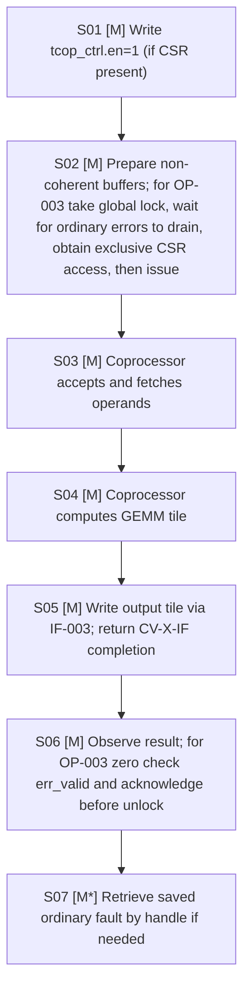

| No. | Step | Option (M/O) | Interface | CSR | Description |
|---|---|---|---|---|---|
| S01 | Enable the coprocessor | O | APB write | `tcop_ctrl.en = 1` | Only used when CSR is present; command completion does not require polling this register |
| S02 | Prepare buffers and issue the tensor instruction | M | Cache maintenance/fence, then CV-X-IF issue + register | For OP-003, shared driver lock plus tcop_sts busy/err_valid checks | Host offloads the instruction; clean CPU inputs/descriptors and fence before issue. Before OP-003, the privileged driver locks submission across every hart, waits for busy=0 and for the service hart to reconcile any earlier ordinary error, takes exclusive CSR ownership, and then issues with rd!=x0. The hardware separately verifies a clean global boundary. |
| S03 | Fetch operands | M | IF-003 AXI4 burst/DMA + banked SRAM | N/A (instruction-driven; CSR block optional) | `m_mem_path` fetches descriptor/operand tiles through the non-coherent AXI4 DMA into banked local SRAM; the SRAM supplies the array during compute. |
| S04 | Compute GEMM | M | internal | N/A (instruction-driven; CSR block optional) | Systolic array produces the result tile |
| S05 | Write tensor output and complete command | M | IF-003 write path + CV-X-IF result | Not used for this step: all commands enter and complete through CV-X-IF; scalar-result commands still require mode 2 under DEC-010 | Tensor output uses IF-003; CV-X-IF completes the instruction and carries the opcode-defined scalar or status payload. A tensor-output command succeeds only after all required write responses succeed. After an accepted failure, the entire destination is invalid per REQ-ERR-003, even if earlier tiles reached memory; mode-2 failures populate the first-error record before completion. |
| S06 | Observe completion and synchronize output | M | CV-X-IF result; cache maintenance/fence if required by IF-003 | For OP-003 zero, tcop_sts.err_valid and tcop_ctrl.scalar_ack | On ordinary tensor-output success, apply the required fence/cache invalidation. For rd=x0 first wait for the handle-qualified host outcome. Synchronize and publish a result buffer only on confirmed success. For OP-003 nonzero, result handshake releases the hardware fence. Return CSR ownership before releasing the driver lock. For OP-003 zero, keep the driver lock, read err_valid (0=valid zero, 1=this command failed), read/W1C-clear details if valid, write scalar_ack=1, wait busy=0, return CSR ownership, then unlock. |
| S07 | Retrieve ordinary command diagnostic | M* | Privileged error journal, indexed by submission handle | The independent hart reads tcop_err_* and issues W1C | For the OP-004 sentinel, wait for the saved diagnostic. Status-result owners may retrieve detail by handle after a reported failure. For completion-only rd=x0, retrieve the diagnostic if S06 reports a failed host outcome. The service hart may finish before or after CV-X-IF completion. For OP-003 zero the owner instead performs the S06 checks. |

`M*` means mandatory only for the operation/result cases stated in the step description; `O` means optional for the current command.

#### OP-003 scalar-check sequence (mode 2)

1. The privileged driver takes a system-wide tensor-submission lock shared by every hart using this IP. It waits until tcop_sts.busy=0 and allows the designated service hart to save and clear any earlier ordinary fault. It waits for the matching clear reconciliation, then obtains exclusive error-CSR access from the service hart before submitting OP-003. The lock prevents command-stream starvation while hardware reaches the clean boundary.
2. The driver issues OP-003 with rd!=x0. Hardware independently requires no accepted CV-X-IF contexts, queued/active commands, result transaction, outstanding AXI IDs/responses, or valid error record. Until all are absent, every tensor endpoint applies normal issue backpressure (issue_ready=0); it does not report an unsupported-instruction rejection. The global arbiter accepts only one issue on the clean boundary and asserts the scalar fence atomically with OP-003 acceptance.
3. While the command executes, issue from every connected hart remains backpressured. A kill before non-kill commit cancels OP-003 without a result and drops the reserved fence. Otherwise the scalar result is returned with the issue-declared we=1 and rd.
4. If rd is nonzero, the scalar fence releases when the CV-X-IF result handshake completes; the driver then returns CSR ownership to the service hart before releasing its submission lock. If rd=0, hardware retires the result but keeps the global fence asserted and tcop_sts.busy=1.
5. For a zero result, software reads tcop_sts.err_valid. 0 means the REDUCE result is a valid zero. 1 means this OP-003 failed; software reads and records all error fields, then writes W1C to tcop_sts.err_valid. Software writes 1 to tcop_ctrl.scalar_ack after checking the state; hardware waits for any W1C clear to cross into CLK-CORE, consumes the one-shot acknowledgment, clears its request state, and releases the fence.
6. Software waits for tcop_sts.busy=0 and returns CSR ownership before releasing the global submission lock. If issue is rejected or pre-commit kill is confirmed, return ownership after resolving that disposition. An acknowledgment written when no zero-result check is pending is discarded and cannot be retained for a future OP-003.

**Non-coherent buffer ownership and command dependencies.** Use the platform's DMA synchronization operations over complete CPU cache lines and every relevant CPU alias or sharing agent. The trusted driver pins the allocation, validates its access direction and retains exclusive ownership for DMA destinations until completion. Enforce that ownership through the OS mapping/sharing policy or use a private staging allocation when existing mappings cannot be made safe. Cache maintenance does not prevent a hart with a writable alias from dirtying the allocation again. A source remains immutable until the last DMA consumer completes.

| Handoff | Driver and system ordering |
|---|---|
| CPU-produced data to accelerator | Finish CPU stores. Publish the immutable descriptor and required input bytes with the platform's DMA-to-device clean and ordering operation before issue. Quiesce CPU aliases that can write or replace protected cache lines. |
| Accelerator writes to a CPU-visible buffer | Before issue, complete the platform's DMA-from-device preparation so no old dirty CPU line can write back over DMA output. Prevent CPU access during the DMA write lease. After observing successful instruction completion, perform the platform's CPU synchronization/invalidate and ordering before releasing mappings or reading the data. |
| Accelerator output to a later accelerator command | Hold DMA ownership across commands. Establish the producer's successful result and write visibility in the selected SoC memory domain before submitting the dependent consumer. If CPU accesses are excluded and the platform guarantees visibility to that consumer, no CPU cache clean is needed between device-only steps. |
| Error, interrupted result or reset | Treat all possibly written destination bytes as unpublished and invalid. Finish drain or complete the selected SoC reset. Perform platform cache and ownership cleanup before reuse. Preserve an immutable OP-009 old checkpoint separately. |

The current command ABI carries no hardware dependency token that can suppress a consumer when its producer fails. Queueing a dependent command before establishing producer success is unsafe: after an ordinary fault is cleared, younger execution can resume and consume an invalid buffer. For an ordinary tensor-result producer, use a nonzero rd to obtain its command-local status when constructing dependent command sequences. Independent work can still issue and prefetch after safe commit. Preserve the driver pre-issue release and post-completion acquire ordering around the custom instruction and any MMIO/cache maintenance. The actual cache operations, fence sequence, write-visibility guarantee and OS lease mechanism are platform integration items. Characterize both the command hardware timestamps and buffer handoff overhead for service-level KPI reporting.

**Exact-attention decode append and publication.** Use the worked head-major K/V cache layout in companion ISA §7.1 as the fixed-capacity bring-up candidate. The driver validates both K/V append ranges and exclusively owns them until data is written and visible. A prior prefix remains usable on an append failure only if it lies outside every affected producer destination and protected cache-line write range. Use independently aligned token rows or staging when a direct write would share cache-maintenance lines with the old prefix. If the producer itself declares a destination covering the old prefix, the whole-command invalidation rule applies to that declared output and the driver cannot preserve its validity merely by retaining the old logical length.

Keep the committed prefix length separate from the pending descriptor length. For each pending append, wait for all K/V producer completion statuses and the required memory-domain synchronization. Then submit OP-005 with the pending length. At the runtime retry boundary, publish the new length atomically with respect to other submissions for that request. On failure, discard the pending update and keep the old prefix when its ranges were protected. The driver may prepare unrelated descriptors during this sequence. It may not issue the dependent attention command while only one of the K/V producers has succeeded. The hardware ABI contains no dependency signal or rollback for software cache state. Measure producer completion to consumer acceptance, any layout-copy/cache synchronization time, and K/V payload reads separately in the decode service trace.

**SoC cache boundary and DMA visibility signoff (DEC-004/025/031).** The modified CPU configuration `cv64a6_imafdc_sv39_hpdcache_wb_config_pkg.sv` enables RVZiCbom and disables D-cache flush on ordinary FENCE. The checked-in HPDcache interface adapter maps CBO_CLEAN and CBO_FLUSH to its line maintenance requests. Neither observation establishes visibility past a separate system cache on the tensor DMA route. In the existing cluster core, the LLC cacheable range is derived from address region zero. If the new tensor manager reaches memory downstream of a write-back LLC, cleaning only the CPU's private line can leave the latest descriptor or operand dirty in the LLC. After DMA writes, a valid old LLC line can also refill a private cache after private invalidation. The actual tensor top shall trace both manager paths to the first point that observes the latest tensor bytes in both directions.

| Candidate for the new tensor top | Required evidence and cost |
|---|---|
| DRAM carveout uncacheable on every CPU path | Reserve DMA-visible DRAM within the fixed firewall aperture. Verify that CPU PMA/mappings, interconnect routing and any system cache bypass all agree for the same physical interval. Eliminate cacheable aliases. Verify that CPU stores and DMA writes drain to the common visibility point before handoff. Recommend this as the bring-up profile. CPU initialization and reads may be slower, so include them in service-level timing. |
| Cacheable DMA buffers with platform synchronization | Prove the CPU clean reaches the common visibility point through every relevant private/shared cache. On DMA completion, prove stale clean lines cannot refill CPU reads and no dirty line can write back over the device output. A DMA route serializing with a shared cache or explicit maintenance of that cache can meet this contract when qualified. CPU cacheability may improve staging performance, but the top and driver must agree on completion and barriers at every stage. |

The signed platform map shall name the physical firewall BASE/LIMIT, CPU cached/uncached regions including all aliases, private-cache block size, LLC cache/bypass and write-response semantics, the common visibility point and driver synchronization primitive for each direction. Fixed DMA alignment uses the largest cache-maintenance granule applicable to the protected buffers in that profile. Retain a complete cache-line ownership lease, including padding of 64-byte descriptor allocations when the maintenance granule is larger than 64 bytes. A successful tensor result proves the master's required B handshakes succeeded. The top must prove those handshakes establish the agreed visibility, or provide a subsequent platform synchronization step before releasing the buffer to CPU or another manager.

Exercise two dirty/stale-line witnesses during SoC integration. First seed old descriptor/input data at the common memory target, then update it through the CPU cache hierarchy, apply the selected pre-issue sequence and verify DMA reads the new data. Second preload the destination with an old value at every enabled CPU cache level, perform a DMA overwrite and the selected post-completion synchronization, then force a CPU refill and verify it returns the new value. Repeat with interference and alternate hart aliases. For the uncached candidate, prove bypass from CPU request to DRAM and confirm no line is allocated in any CPU cache on the transfer path. The cacheable profile additionally needs transactions showing dirty shared-cache data and stale shared-cache refills are handled explicitly. Bind the test observations to IF-003 and the selected cache/SoC profile before claiming safe cacheable operation.

### 11.3 CSR connection to the design

| Workbook register.field | Direction at the CSR | Design signal | Clock domain of the signal | Behavior notes |
|---|---|---|---|---|
| `tcop_ctrl.en` | control out | `w_csr_enable` | CLK-APB → CLK-CORE | Level control; changing it while work is outstanding is prohibited. A legal issue waits with issue_ready and register_ready low while the synchronized enable is low. This includes issue immediately following the APB enable write. Mode 0 has no APB enable crossing |
| `tcop_ctrl.scalar_ack` | software write-only request | `w_scalar_ack_req` | CLK-APB → CLK-CORE bundled request/ack CDC | One-shot acknowledge for a pending OP-003 zero-result fence. Accepted only when scalar_check_pending=1; if an error record is valid, the request waits for synchronized W1C clear. A request observed with no pending scalar check is discarded, never saved for a later OP-003. |
| `tcop_sts.busy` | status in | `w_dpath_busy` | CLK-CORE → CLK-APB | Synchronized level; high while an accepted command is active or queued, or while an OP-003 zero-result scalar-check fence remains pending |
| `tcop_sts.err_valid` | hardware set, software W1C | `w_err_valid` | Bundled-data handshake CLK-CORE ↔ CLK-APB | First-error record valid; all fields below are captured atomically and held stable until clear acknowledgment returns to core |
| `tcop_err_sts.code` | status in | `w_err_status` | Bundled-data handshake CLK-CORE → CLK-APB | Stable 32-bit DEC-012 status while `err_valid=1` |
| `tcop_err_hartid.hartid` | status in | `w_err_hartid` | Bundled-data handshake CLK-CORE → CLK-APB | Zero-extended CV-X-IF hart ID while `err_valid=1` |
| `tcop_err_xif_id.xif_id` | status in | `w_err_xif_id` | Bundled-data handshake CLK-CORE → CLK-APB | Zero-extended CV-X-IF transaction ID while `err_valid=1` |
| `tcop_err_addr_lo.addr_lo` | status in | `w_err_addr[31:0]` | Bundled-data handshake CLK-CORE → CLK-APB | Low half of associated DMA byte address; zero when not applicable |
| `tcop_err_addr_hi.addr_hi` | status in | `w_err_addr[63:32]` | Bundled-data handshake CLK-CORE → CLK-APB | High half of associated DMA byte address; zero when not applicable |
| `tcop_err_axi_id.axi_id` | status in | `w_err_axi_id` | Bundled-data handshake CLK-CORE → CLK-APB | Zero-extended AXI transaction ID; zero when not applicable |
| `tcop_err_detail.detail` | status in | `w_err_detail` | Bundled-data handshake CLK-CORE → CLK-APB | Reserved for future diagnostics; first release writes zero for every status per DEC-020 |

Do not independently synchronize each bit of the error record. The OP-003 scalar-ack request also uses a request/acknowledge CDC and is consumed only for an outstanding zero-result fence; a spurious request is discarded so it cannot release a later fence. The busy level remains asserted from OP-003 acceptance through a zero-result check and acknowledgment, including the interval after its CV-X-IF result handshake. Ordinary quiesce acknowledgment is not asserted until this fence is released.

**APB publication before CV-X-IF result (DEC-072).** Mode 2 shall complete the error record as a bundled snapshot. After the final DEC-012 status is selected, freeze the core copy and send a publication request to CLK-APB. Capture all fields in the APB holding registers and make the snapshot and err_valid readable together. Return a publication acknowledgment to CLK-CORE only after that APB state is readable. Only then may the core offer the failed command's CV-X-IF result. A register snapshot held only in CLK-CORE does not satisfy the publication barrier. This ordering also applies to accepted failures with rd=x0 and to scalar sentinel results. Successes require no error publication.

For an OP-003 zero result, ensure the APB-visible busy indication is already high before offering result_valid. For failure zero, also wait for error publication as above. Match the busy visibility acknowledgment to the current scalar fence. An acknowledgment for an earlier busy transition cannot release this result. In a coherent mailbox implementation, the APB side may acknowledge busy visibility and the failure snapshot together after publishing both. For success zero, enforce the already-selected clean boundary with no prior error visible in APB. This ensures the first ordered MMIO read after the scalar result cannot observe an old err_valid=0 for a failure, or an old busy=0 before the scalar check is complete. Keep busy high until the actual request/acknowledge sequence releases the fence and the APB projection observes that release.

Use a publication handshake or equivalent coherent mailbox. Hold the source payload stable through its ACK and follow implementation CDC timing constraints. W1C must clear the current published snapshot only. Do not start a new publication while a previous clear handshake can still clear it. A scalar_ack received for the current zero fence waits for its required W1C to complete in CLK-CORE and can be consumed only after the zero result handshakes. Requests with no eligible fence cannot accumulate for use by a later command. Clock or reset sequencing must avoid fabricated ACK events. The mode-2 scheduler may pause younger work but must still permit the faulting result after successful APB publication.

**Mailbox edge ordering (DEC-072).** A W1C side effect occurs once per successful aligned APB word-write transfer with PSTRB=0xF and err_valid set in PWDATA. Use the snapshot that was visible before the active clock edge to qualify the write. A W1C received while no snapshot is visible, including on the edge that first publishes a new snapshot, has no clear side effect. For a visible snapshot, bind the first W1C to that generation, retain its request across CDC, and suppress duplicate clears while its acknowledgment is outstanding. Do not carry a duplicate clear into a later generation. A different snapshot cannot replace the published payload until the old publication and clear handshakes have been reconciled. If a younger failure is already drained, hold its selected status in its owning command context until the mailbox is available.

Keep an explicit publication-complete fact with the failed command until result handshake, independent of the live CSR bit. Example: an independent service agent saves and clears N's ordinary error immediately after APB publication, while result_ready remains low. When publication and clear reach CLK-CORE close together, apply both to N. N remains a failed command, presents the original status or scalar sentinel, and handshakes once. The clear permits younger execution subject to normal dispatch rules and cannot change N's payload. No result may use APB publication or clear evidence for a different command. Only the fenced owner may perform the OP-003 W1C/ack sequence, so this early-clear case does not apply to the OP-003 zero discriminator.

In TEST-017, sweep APB/core phase and delay publication ACK, W1C and result_ready independently. Exercise a W1C before any snapshot, on its first publish edge, repeated W1C while clear is in flight, partial strobes that include and exclude err_valid, and the first valid full-word W1C with the failing result still held. Finish by publishing a second failure and show no old clear consumes it. In TEST-025, additionally send a spurious scalar_ack before a zero fence and delay its synchronizer observation until the next fence is visible. Prove the CDC path cannot convert it into permission for the new fence. Correlate requests with the fence generation where they originate, and consume a matching zero-fence ACK only after result handshake and any required error clear.

Charge the core-to-APB-to-core publication interval in failure latency, under bounded APB and core clock service. For OP-003 charge any busy-visibility wait before the zero result and the separate software W1C/scalar_ack round-trip when bounding fence release. The software sequence and CSR offsets are unchanged. Directed integration evidence includes APB slower than core with the earliest allowed CSR read, backpressured results, separate W1C/ACK crossings, and back-to-back failures with no stale-clear carryover.

### 11.4 APB access behavior of the CSR

| Case | Behavior |
|---|---|
| Normal read or write | PREADY after the asynchronous handshake; software waits for PREADY (Asynchronous = 1) |
| Write with PSTRB not all ones | PSLVERR and no change in the selected strict profile. No W1C or scalar_ack mailbox request is generated. |
| Address not word aligned | PSLVERR and no register side effect in the selected strict profile. |
| Aligned address that is not a register | OKAY; read returns 0; write is ignored |
| Reserved bits | read as 0; write ignored |
| Reset | registers take workbook reset values; async assert, sync release to CLK-APB |

## 12. Error handling and recovery

### 12.1 Runtime status ABI

Post-acceptance errors use a stable unsigned 32-bit enumeration. For a status-result opcode, `0` means success and a nonzero code means failure; the value is zero-extended into `x_result.data` on RV64. The same 32-bit code is captured in the mode-2 first-error CSR record. The Mode-2 diagnostics report an associated DMA address and AXI ID when applicable. The detail field remains zero in release 1 under DEC-020. Scalar-result opcodes (including OP-003 scalar reduction and OP-004 `ARGMAX/GREEDY_TOKEN`) return scalar data on success; on failure the scalar result is invalid and the status code is available through the required CSR. Issue-time rejects (unknown opcode, disabled operation family, unsupported instruction precision, or illegal `rd`) do not produce a result transaction or runtime status code.

| Status code | Symbol | Meaning |
|---:|---|---|
| `0x0000_0000` | `TC_STATUS_OK` | Accepted command completed successfully; used for status-result opcodes |
| `0x0000_0001` | `TC_ERR_DESCRIPTOR_FORMAT` | Descriptor magic/version/header/schema length or operation/precision echo is invalid, or an operation-schema reserved byte violates its zero rule |
| `0x0000_0002` | `TC_ERR_DESCRIPTOR_MODE` | Descriptor contains an unsupported or illegal algorithm-specific mode/flag not detectable at issue |
| `0x0000_0010` | `TC_ERR_SHAPE` | Dimensions, strides, tile bounds, or operation-specific shape constraints are invalid |
| `0x0000_0011` | `TC_ERR_ADDRESS` | Descriptor/tensor address is misaligned, address-span arithmetic wraps, or the address cannot be represented by the implemented AXI address port. A firewall aperture denial is an AXI read/write error, not this pre-request validation status. |
| `0x0000_0020` | `TC_ERR_AXI_READ` | AXI read response reports an error, including descriptor fetch `RRESP` |
| `0x0000_0021` | `TC_ERR_AXI_WRITE` | AXI write response reports an error (`BRESP`) |
| `0x0000_0022` | `TC_ERR_AXI_PROTOCOL` | AXI response ID, `RLAST`, or response sequencing is inconsistent |
| `0x0000_0030` | `TC_ERR_SPARSE_METADATA` | Structured sparse metadata is malformed or violates the selected 2:4 encoding |
| `0x0000_0040` | `TC_ERR_NUMERIC_NAN` | OP-001 FP or OP-003/004/005/006/007/009 input or generated NaN in the operation-defined compute format |
| `0x0000_0041` | `TC_ERR_ARGMAX_NO_VALID_LOGIT` | Every OP-004 candidate logit is `-Inf`, so no token remains eligible |
| `0x0000_0042` | `TC_ERR_ACCUM_RANGE` | Conservative INT8 OP-001/OP-008 accumulator bound exceeds the signed `PARA_ACCUM_W` range before activation/weight numeric values are read or compute begins |
| `0x0000_0043` | `TC_ERR_REQUANT_COEFF` | INT8 OP-001/OP-008 per-channel or OP-002 SwiGLU requantization metadata has a multiplier/exponent outside the selected encoding range or a nonzero reserved byte |
| `0x0000_0044` | `TC_ERR_NUMERIC_NONFINITE` | OP-001 FP or OP-005/006/007/009 encountered infinity or another non-finite intermediate/output; NaN is classified separately as `TC_ERR_NUMERIC_NAN` |
| `0x0000_0045` | `TC_ERR_NO_VALID_ATTENTION_ROW` | Every key position was masked for at least one required OP-005 query row |
| `0x0000_0046` | `TC_ERR_NO_VALID_SOFTMAX_ROW` | Every OP-006 logit position was masked for at least one required output row |
| `0x0000_0047` | `TC_ERR_LINEAR_ZERO_DENOM` | OP-009 causal normalization denominator is zero or below the finite reciprocal range |
| `0x0000_0048` | `TC_ERR_LINEAR_STATE` | OP-009 state header/shape/format is incompatible, processed-token count is invalid/overflows, or finite z-state is negative |

Unknown instruction opcodes, build-disabled algorithm families, and instruction-selected precisions absent from the build are rejected at issue and are not assigned a post-acceptance status code; CV-X-IF rejection causes the CPU illegal-instruction exception as specified in REF-001 §5.5.6. A malformed algorithm-specific mode discovered only after an accepted descriptor fetch returns `TC_ERR_DESCRIPTOR_MODE`. A returned AXI error response follows the per-command error/status path. A missing required `R/B` response that reaches the SoC timeout watchdog causes a full SoC reset under REQ-RESET-002: the accepted CV-X-IF instruction is abandoned without result or local timeout status, and the output is invalid. The watchdog threshold/owner, reset coverage/release, reset-cause capture, and post-reset software restart flow are SoC integration details in DEC-029. An AXI timeout never cancels an accepted request locally.

| Error ID | Detection condition | Observable response/status | Interrupt | Clear/recovery | Reset behavior |
|---|---|---|---|---|---|
| ERR-001 | Unsupported opcode on issue | issue_resp.accept = 0; host illegal-instruction | none | host handles | clears |
| ERR-002 | Tensor address/span misalignment, wrap, or unrepresentable pre-request address. Firewall denial uses ERR-005 | `TC_ERR_ADDRESS` | IF-005 for ordinary mode-2 fault | Host handles; in mode 2 clear sticky first-error record with W1C | result code is per-command; CSR detail clears by W1C/reset |
| ERR-003 | Illegal operand configuration (bad dimensions/strides) | `TC_ERR_SHAPE` | IF-005 for ordinary mode-2 fault | Host handles; in mode 2 clear sticky first-error record with W1C | result code is per-command; CSR detail clears by W1C/reset |
| ERR-004 | Runtime mode is disabled by `PARA_ALGORITHM_MASK`, precision is not built by `PARA_DATA_PREC`, or descriptor metadata requests an unsupported mode | Build-disabled family/precision: `issue_resp.accept=0`, no queue entry, and no result; descriptor-only invalid mode discovered after acceptance: `TC_ERR_DESCRIPTOR_MODE` with normal result-class/writeback behavior | IF-005 for ordinary mode-2 fault | The host handles issue rejection through the illegal-instruction path; software handles an accepted descriptor error and clears sticky CSR in mode 2 | Rejected issue has no result; accepted descriptor error completes and releases its command context |
| ERR-005 | AXI4 `RRESP`/`BRESP` error, response ID mismatch, or read `RLAST` mismatch when a response is received | `TC_ERR_AXI_READ`, `TC_ERR_AXI_WRITE`, or `TC_ERR_AXI_PROTOCOL`, respectively; if multiple classes occur, select by DEC-012 priority after drain | IF-005 for ordinary mode-2 fault | Stop new requests for the failed command, safely drain/retire accepted transactions, then pause the scheduler until W1C; functional reset/quiesce is tracked in DEC-028 | CSR first-error record clears by W1C/reset |
| ERR-006 | Descriptor header/schema echo or byte length is invalid, or an operation-schema reserved byte is nonzero | `TC_ERR_DESCRIPTOR_FORMAT` | IF-005 for ordinary mode-2 fault | Host fixes descriptor; in mode 2 clear sticky first-error record with W1C | result code is per-command; CSR detail clears by W1C/reset |
| ERR-007 | A tile has malformed OP-008 sparse selector or tail metadata | `TC_ERR_SPARSE_METADATA`; no numeric read/MAC/output write for the failing tile; stop unstarted tiles, drain active traffic, invalidate the whole command destination even if earlier tiles wrote partial output | IF-005 for ordinary mode-2 fault | Driver discards/reinitializes the entire output and fixes/re-packs metadata; in mode 2 clear sticky first-error record with W1C | Result follows DEC-012 after accepted work drains; CSR detail clears by W1C/reset |
| ERR-008 | OP-004 detects any NaN in a valid, non-padding floating-point logits candidate | `TC_ERR_NUMERIC_NAN` unless a higher-priority DEC-012 fault is also recorded; `rd=TC_INVALID_TOKEN_INDEX`, `result.we=1`; CSR captures the selected status before completion | IF-005 for ordinary mode-2 fault | Stop issuing unstarted tiles, drain accepted reads/array work, then handle the CSR error and clear first-error with W1C | Sticky CSR and scheduler hold clear by W1C/reset |
| ERR-009 | OP-004 has no eligible candidate because every logit is `-Inf` | `TC_ERR_ARGMAX_NO_VALID_LOGIT` unless a higher-priority DEC-012 fault is also recorded; `rd=TC_INVALID_TOKEN_INDEX`, `result.we=1`; CSR captures the selected status before completion | IF-005 for ordinary mode-2 fault | Host corrects mask/logits; clear first-error with W1C after handling | Sticky CSR and scheduler hold clear by W1C/reset |
| ERR-010 | An accepted AXI read or write does not receive its required `R/B` response before the SoC timeout watchdog expires | No tensor result, no `TC_ERR_AXI_TIMEOUT`, and no tensor-local CSR completion. The fatal reset reason is SoC-level; reset-cause retention/visibility is an integration item in DEC-029 | SoC-level policy | Full SoC reset is the sole recovery; the in-flight CV-X-IF instruction is abandoned and any partial tensor output is invalid | Reset all harts, tensor IP, AXI interconnect, and on-SoC transaction agents holding the request; prevent stale response matching after release |
| ERR-011 | INT8 OP-001/OP-008 conservative bound exceeds signed `PARA_ACCUM_W` after descriptor validation | `TC_ERR_ACCUM_RANGE`; status-result payload follows the issue-time class; no activation/weight numeric-value read, MAC, or output write; whole output destination invalid | IF-005 for ordinary mode-2 fault | Driver selects a larger-accumulator build or legal shape/addend domain; clear the mode-2 sticky record with W1C | Command completes after descriptor traffic is drained; no local reset |
| ERR-012 | INT8 OP-001/OP-008 has an invalid coefficient record in the fully read vector, or INT8 OP-002 SWIGLU has an invalid inline coefficient record | `TC_ERR_REQUANT_COEFF`; preserve issue-time status result class; no tensor numeric read, array launch, MAC, or output write | IF-005 for ordinary mode-2 fault | Correct the coefficient metadata and retry; clear the mode-2 sticky error record with W1C | Complete after accepted descriptor/metadata AXI reads are drained; no local reset |
| ERR-013 | A valid FP OP-003 input is NaN or SUM creates NaN (including opposite infinities) | `TC_ERR_NUMERIC_NAN`; preserve scalar result class and write `rd=0`; CSR captures the selected status before completion; drain accepted reads | none | Correct input and retry; clear the mode-2 sticky error with W1C; the global zero-result fence requires CSR check and scalar_ack | Complete only after accepted reads/responses drain; no local reset |
| ERR-014 | OP-005 reads or generates an infinity/non-finite numeric value | `TC_ERR_NUMERIC_NONFINITE`; preserve status-result class; stop unstarted tiles, drain started traffic/compute, and invalidate the whole attention output | IF-005 for ordinary mode-2 fault | Correct/requantize the model input and retry; clear mode-2 sticky error with W1C | Complete after all accepted AXI and array work drains; no local reset |
| ERR-015 | Every key is masked for a required OP-005 query row | `TC_ERR_NO_VALID_ATTENTION_ROW`; preserve status-result class; drain command and invalidate the complete output | IF-005 for ordinary mode-2 fault | Correct the causal position/mask or exclude the query row in the caller; clear mode-2 sticky error with W1C | Complete after accepted work drains; no local reset |
| ERR-016 | Every element is masked for a required OP-006 row | `TC_ERR_NO_VALID_SOFTMAX_ROW`; preserve status-result class; drain command and invalidate the complete output | IF-005 for ordinary mode-2 fault | Correct the Boolean mask or remove the empty row; clear mode-2 sticky error with W1C | Complete after accepted work drains; no local reset |
| ERR-017 | A valid OP-006/OP-007 input or generated floating-point intermediate is NaN | `TC_ERR_NUMERIC_NAN`; preserve status-result class; drain work and invalidate complete output | IF-005 for ordinary mode-2 fault | Correct input/model parameters; clear mode-2 sticky error with W1C | Complete after accepted work drains; no local reset |
| ERR-018 | OP-006/OP-007 input or generated floating-point intermediate is infinite/non-finite | `TC_ERR_NUMERIC_NONFINITE`; preserve status-result class; drain work and invalidate complete output | IF-005 for ordinary mode-2 fault | Correct input/model parameters; clear mode-2 sticky error with W1C | Complete after accepted work drains; no local reset |
| ERR-019 | OP-009 state header/shape/format mismatch, invalid prior token count/overflow, or negative finite z-state | `TC_ERR_LINEAR_STATE`; preserve status-result class; drain traffic and invalidate context/state outputs | IF-005 for ordinary mode-2 fault | Preserve prior input state; discard new state output; fix/replace the state handle and clear mode-2 sticky error with W1C | Complete after accepted work drains; no local reset |
| ERR-020 | OP-009 normalization denominator is zero or below 2^-126 | `TC_ERR_LINEAR_ZERO_DENOM`; preserve status-result class; drain traffic and invalidate context/state outputs | IF-005 for ordinary mode-2 fault | Recheck model/input/feature-map compatibility; preserve prior state and retry only after correction | Complete after accepted work drains; no local reset |

An accepted, committed, non-killed command that encounters a detected execution error must complete and release its command context after all accepted traffic has responded and safely drained; it does not hang on an error that the engine has fully observed. Returned AXI `SLVERR`/`DECERR` and protocol faults whose response obligations are fully resolved use the ordinary command error/status path. A missing AXI `R/B` response that reaches the SoC timeout watchdog instead requires full SoC reset under DEC-029; the in-flight CV-X-IF instruction is abandoned with no result or local error status, and any output is invalid. Watchdog threshold/owner, reset coverage/release, reset-cause capture, and software restart must be defined at SoC integration. A status-result opcode returns the corresponding nonzero code from §12.1 when `rd!=x0`; with mode-2 `rd=x0`, or for a scalar-result opcode, the code is captured in the first-error CSR record. Unknown opcodes and instruction-visible unsupported modes are rejected at issue. If one command sets multiple fault flags and all required responses arrive, the engine stops issuing new work, drains every accepted transaction and active array operation, ignores invalid AXI response data, and selects exactly one status using the fixed DEC-012 priority before result/CSR completion. After a mode-2 failure, no younger command starts until W1C is synchronized into the core domain. Later commands cannot overwrite the first-error CSR record before acknowledgment. For a failed tensor-output command, the complete destination is invalid per REQ-ERR-003, even when no output tile was written; software shall not consume it and must retry the entire command after reinitializing/reallocating the destination. Normal reset/quiesce follows DEC-023/028; missing-response full-SoC reset follows DEC-029.

**Diagnostic association for multiple faults (DEC-012/020).** Select the command's status from the observed fault flags after draining all started work. Attach address/AXI ID from a witness belonging to the winning status and the same command generation. For example, if a numeric NaN is seen first and an attributable read SLVERR arrives during drain, return TC_ERR_AXI_READ and the read witness. An unrelated or discarded response cannot supply an address for that command. An orphan response with no identifiable owner is reported to the SoC monitor under Section 6.3.

Keep same-status witness selection off the arithmetic hot path. A suitable low-cost implementation retains the first observed witness for the currently highest-priority fault, replaces it only when a higher-priority fault is observed, and uses a fixed local input priority when multiple equal-status witnesses arrive on the same edge. Repeatability of the status under DEC-012 applies to the same set of observed faults. Same-status diagnostic witnesses may vary with response order. The stable ABI is the status, and the service hart uses hartid/id and its host binding to attribute the saved record.

For a read response error, an implementation can derive the associated failing transfer address from the live burst and its beat index. A write response error is associated with the latched start address of its burst because the response does not identify a failing byte. For protocol faults record address and AXI ID only when attributable to a live request or otherwise unambiguous under the interface rules. Use zero for unavailable fields and detail=0. Publish the selected record atomically after drain as specified by DEC-072.

Extend TEST-017 with two attributable read faults from the same command returned in opposite orders, and with an attributable protocol fault of higher priority arriving during drain. Require a stable selected status for each fixed fault set, a diagnostic witness belonging to that status and command, and no fabricated byte address for a write response. Verify the entire published record remains coherent through APB backpressure and W1C.

### 12.2 Scalar-result failures and software-visible payload

The application-level contract for OP-004 is `token_index = argmax(logits)`, with a successful result in the instruction's `rd`. A descriptor fetch, logits read, or projection read can fail after the instruction has been accepted, in which case no valid token index exists. The failure must still complete the accepted instruction and preserve the result class selected at issue. Under CV-X-IF, `result.we` must equal the issue-time `issue_resp.writeback`; an accepted, committed instruction also produces a result transaction even when no register writeback is requested (REF-001 §5.5.11). Therefore, an OP-004 execution failure cannot change `rd` into a status-result class or withdraw a writeback that was declared at issue. The `rd` payload is invalid on failure; CSR is the source of the detailed status and error context.

| Failure payload policy | Application behavior | Benefits | Costs and risks | Assessment |
|---|---|---|---|---|
| Write zero to `rd`; CSR is authoritative | Software inspects err_valid while the global OP-003 fence is held; err_valid=0 means valid zero and err_valid=1 means this OP-003 failed | Smallest datapath and fixed scalar writeback; no status-versus-data encoding; works for arbitrary scalar reductions | The global fence serializes all harts during every OP-003 command through its result handshake. A zero result then requires CSR/CDC round-trip plus scalar_ack, extending the stall; nonzero releases at result handshake. | **Selected for OP-003:** write zero on accepted failure; use global fence and explicit CSR acknowledgment per DEC-021/REQ-ERR-004 |
| Write the nonzero error status code to `rd`; also capture it in CSR | Software can inspect `rd` for an error and then read CSR for address/ID detail | Potentially detects failures without a CSR read on every success, if the error encoding cannot be a valid scalar result | Error codes can overlap valid token indices and arbitrary reduction values. A collision can look like a valid result; this policy needs a reserved disjoint encoding and explicit result-domain limits | Do not use as a generic scalar policy. Could be considered for OP-004 only with a proven disjoint code range |
| Write an opcode-specific invalid sentinel to `rd`; CSR retains status | For bounded index results, compare `rd` against the reserved sentinel; use the token immediately on the normal path and read CSR only on the sentinel path | Preserves scalar writeback, gives a fast success path without a CSR read per token, and provides unambiguous failure detection when the sentinel is outside the valid index domain | Requires a documented maximum vocabulary length and RV32/RV64 encoding; cannot be applied blindly to an unbounded sum/reduction result | **Selected for OP-004:** `TC_INVALID_TOKEN_INDEX = {XLEN{1'b1}}`, and legal vocabulary length shall be less than `2^XLEN`; keep OP-003 scalar reduction policy separate |
| Suppress writeback (`result.we=0`) on failure | Destination register keeps its previous value | Avoids writing a placeholder | Violates the issue-time writeback declaration for scalar-result commands and leaves software with a stale, plausible-looking value | Not permitted by the selected CV-X-IF contract |

For OP-004, `TC_INVALID_TOKEN_INDEX` is the all-ones XLEN value, and the descriptor's vocabulary-length field shall be constrained so no valid index can equal it. On a post-acceptance OP-004 error, complete with result.we=1 and the sentinel; atomically capture hartid, CV-X-IF id, and the 32-bit error status in the sticky CSR before completion. Software may use a non-sentinel token result without a CSR access; when it sees the sentinel, it waits for the error record saved under the submission handle and handles that fault. The dedicated service hart reads the live first-error CSR, publishes the saved record, and issues W1C independently. Younger work can resume after core-side clear, even if the submitter has yet to consume the saved record. OP-003 REDUCE writes zero to rd on an accepted error and captures the error in CSR before completion. The global fence in DEC-021/REQ-ERR-004 ensures that no younger command can replace the record before software checks it: after a zero result, err_valid=0 means success and err_valid=1 means this OP-003 failed. Read the complete record and W1C-clear an error if present, then write tcop_ctrl.scalar_ack=1 and wait for busy=0 before submitting younger work. This preserves the selected scalar result ABI; the CSR round trip and global stall occur only for a zero-valued result. OP-003 REDUCE and OP-004 ARGMAX/GREEDY_TOKEN are the currently defined scalar-result operations.

## 13. Performance, power, and area

| Metric ID | Metric | Target / limit | Conditions | Measurement method | Hard / goal |
|---|---|---|---|---|---|
| PPA-001 | Maximum frequency | ≥ 1 GHz general goal; 2 GHz characterization point for CFG-64TOPS; its 16 arrays of 32 by 32 PEs with one MAC per PE per cycle needs at least 1.953125 GHz for 64 ideal TOPS | SS corner, core clock, with explicit array count | STA with delivered SDC | goal; 2 GHz unverified Default: TD-01. |
| PPA-002 | Area | Scales with `PARA_ARRAY_COUNT × PARA_MAC_ROW × PARA_MAC_COL`, paired sparse multiplier/selector lanes, precision and special-function units, scratchpad, and queues | target PDK, utilization, memory macros, array placement | synthesis cell area and placed area | goal; numeric limit open Default: TD-04. |
| PPA-003 | Power | datapath-active only | activity, corner | power analysis | goal Default: TD-05. |
| PPA-004 | Dense peak arithmetic throughput | User-selected ideal peak target: 64 TOPS per IP for dense GEMM/prefill configurations; for INT8 with one MAC/PE/cycle and two operations/MAC, ideal peak is $2 \times PARA\_ARRAY\_COUNT \times PARA\_MAC\_ROW \times PARA\_MAC\_COL \times f_{core}$ operations/s | All selected arrays fully occupied; no memory or host stalls; one multiply and one add count as two operations. This is not a decode throughput requirement | Analytical ceiling, then confirm mapped resources and STA frequency | ideal peak goal; area/bandwidth feasibility open Default: TD-02. |
| PPA-005 | Command, tile, and application latency | Report p50/p95/p99 at the representative DEC-018 workload points and a conditional hard upper bound for each operation using separately signed operation-specific maximum shapes. The representative points are not hardware shape caps. At baseline, report prefill time-to-first-token and decode inter-token latency separately from command/tile completion | Use `T_accept`, `T_commit`, `T_result_valid`, and `T_result_fire` from REQ-PERF-002; report each interval plus final tile completion. Hard bound requires signed per-operation max shape/tile count, host safe-frontier, queue, result-ready, SRAM, and memory-service limits | Cycle-accurate simulation/trace for distributions; workload trace plus worst-case schedule and host/SoC service guarantees for conditional bound | both metric types required; OP-001/OP-008 first-build caps selected by DEC-064; numeric thresholds and service assumptions remain open Default: TD-03. |
| PPA-006 | Sustained throughput, utilization, and decode service | At the DEC-018 baseline, prefill reports prompt tokens/s and time-to-first-token; decode reports p50/p95/p99 inter-token latency and generated tokens/s at batch/sequence points. Also report sustained operations/s and array utilization; conditional latency bounds remain separate | Report achieved MAC/cycle, utilization, host/memory stalls, model/profile, traffic profile, run/sample count, and configuration. Measurements may use cycle-accurate simulation, trace, or system-level performance counters; this draft does not require on-IP counters | Named workload microbenchmarks plus cycle/trace analysis and separate conditional resource/service model | latency percentiles and hard bound required; numeric latency/throughput targets open Default: TD-02, TD-08. |
| PPA-007 | Memory bandwidth and local storage | Selected path: non-coherent AXI4 burst DMA plus banked SRAM. Initial 256-bit/16-read/8-write candidate in §6.1.1; OP-001/OP-008 logical span caps are fixed by DEC-064, while actual tile-reload traffic, minimum SoC bandwidth, SRAM, and arbitration remain to be signed off | Include operand reads, result writes, buffer capacity, ports, SRAM latency, and outstanding transactions | Traffic model plus memory-system simulation | hard definition; detailed sizing open |
| PPA-008 | Nonlinear/reduction service rate | Derive request rates and queue bounds for each released per-mode schedule as described below | Declare row/element/tile geometry, unit initiation intervals and concurrent contexts. Compare available service with peak phase demand and report backpressure | Per-mode cycle model and workload measurements | hard definition; numeric target open |
| PPA-009 | INT8 2:4 sparse selected-product rate | Target after pipeline fill: $2 \times PARA\_ARRAY\_COUNT \times PARA\_MAC\_ROW \times PARA\_MAC\_COL \times f_{core}$ selected products/s for paired lanes | Valid 2:4 metadata, both multiplier lanes occupied, no memory or backpressure stalls; zero-valued payload slots are included; this is a sparse-mode product rate and shall not be reported as dense TOPS or end-to-end speedup | Analytical lane ceiling, mapped-resource count, then per-model benchmark | selected architecture target; physical feasibility open
| PPA-010 | Interrupt/debug handler-entry latency | Report p50/p95/p99 event-to-handler-entry for named traffic and a conditional hard bound with maximum authorized backlog, released command shapes, result-ready response, and memory-service assumptions | Use `T_event` to `T_handler`; if the SoC AXI watchdog fires, recovery is full-SoC reset and handler-entry latency is not defined for that event | CVA6/tensor cycle trace plus bounded backlog/service analysis and SoC reset-contract review | both metric types required; threshold and assumptions open |
| PERF-001 | Throughput | 1 MAC/PE/cycle sustained | steady GEMM | simulation / analysis | hard |

**Representative workload baseline (DEC-018).** For initial performance comparison, use synthetic LLM workload points with hidden dimension 2,048 or 4,096 and sequence/context length 128 or 2,048 tokens. Include batch 1 and batch 4; batch 4 means four independent prompts/streams are concurrently presented to the inference service. DEC-044 now maps the four OP-005 samples to one descriptor with `batch_count=4` and per-sample tensor mapping. Internal execution may still serialize or schedule samples in bounded parallel waves; DEC-046 selects bounded sample waves limited by the build-static `PARA_ATTN_MAX_ACTIVE_SAMPLES`; `batch_count` remains runtime. The current scheduler executes one active command context, and sample state is allocated only for the active wave. These are benchmark points only: they do not define hardware-legal maxima or imply that every Cartesian combination is required. Conditional hard bounds shall instead use separately selected maximum shapes and tile counts for each operation. Treat the baseline as representative geometry, not as a claim for a named product model. Apply the service-level timestamp definitions and formulas in REQ-PERF-003, and retain the CV-X-IF command intervals in REQ-PERF-002 for hardware diagnosis. The exact vocabulary size, model identity, per-operation shape caps, numeric pass thresholds, release sample counts, and system traffic conditions remain open. Use the measurement procedure below for comparable characterization. The 64-TOPS target remains an ideal dense GEMM/prefill peak, not a decode service target.

For one array, a 16×16 configuration at 1 GHz has an ideal ceiling of 0.512 TOPS and a 32×32 configuration at 1 GHz has 2.048 TOPS, assuming two operations per INT8 MAC and perfect utilization. At 2 GHz those ceilings are 1.024 TOPS and 4.096 TOPS. A 32×32 array count of 16 at 2 GHz, or 32 at 1 GHz, gives an ideal 65.536 TOPS; a 16×16 array count of 64 at 2 GHz or 128 at 1 GHz gives the same ideal peak. CFG-64TOPS records one candidate point, not a timing, area, bandwidth, or power result (DEC-003/004/006). At the 32×32 × 16 × 2 GHz candidate point, each array consumes up to 32 INT8 A values plus 32 INT8 B values per cycle at its input edge; aggregate on-chip operand injection is therefore 2.048 TB/s before output, metadata, and other traffic. This is an internal operand-feed requirement, not a claim that DRAM must deliver that raw rate: systolic reuse and local buffering reduce external traffic, but the buffer banks and interconnect must still sustain array injection to reach peak. The ceiling does not predict realized throughput; memory supply, utilization, interconnect, queueing, and control overhead must be measured.

Memory demand also differs sharply between prefill and decode. For an illustrative INT8 GEMM with `C[M,N]=A[M,K]×B[K,N]`, one read of each operand, and an INT8 output write after DEC-053 requantization, traffic is approximately `M×K + K×N + M×N` bytes and work is `2×M×N×K` operations. For batch-one decode (`M=1`, `N=K=4096`), this is about 16.8 MB for 33.6 M operations, roughly 2 operations/byte if weights are fetched for every command; at 64 GB/s the memory roof is only about 0.13 TOPS. For prefill (`M=1024`, `N=K=4096`), the same model gives about 25.2 MB for 34.4 G operations, roughly 1,365 operations/byte; 64 GB/s gives a theoretical memory roof near 87 TOPS before real protocol, controller, and compute losses. These examples exclude cache reuse, compression, scale-coefficient metadata, and attention traffic. They show why one static `PARA_ARRAY_COUNT` does not guarantee the same efficiency in decode and prefill: decode needs strong weight reuse/cache capacity or more memory channels, while prefill benefits greatly from tile reuse. Final target points require representative model shapes and a memory-system model (DEC-003..006).
The approximately 87-TOPS memory roof above is an optimistic whole-matrix reuse case: it assumes each input operand is fetched once for the modeled operation and does not establish that the current local-memory capacity can retain the required data. With a finite `T×T` output tile and streamed K dimension, arithmetic intensity is approximately `T` operations/byte before output/staging overhead. For one ideal 64-GB/s AXI direction, the corresponding bandwidth ceilings are approximately 4.10, 8.19, 16.38, 32.77, and 65.54 TOPS for `T=64,128,256,512,1024`; these points require approximately 48 KiB, 128 KiB, 384 KiB, 1,280 KiB, and 4,608 KiB for the modeled ping-pong input plus INT32 output/accumulator storage. These are analytical candidates, not release targets. The `T=128` candidate is therefore near 8.2 TOPS in this model, while the whole-matrix memory roof is 87 TOPS and the ideal compute target is 64 TOPS; actual traffic, bank conflicts, tile tails, output staging, and attention state can lower it further. Retain 64 TOPS as the user-selected ideal dense compute ceiling, and report sustained prefill separately for a named shape and memory configuration.

**Nonlinear lane and queue sizing (PPA-008).** For each released compute schedule, list the native work unit and the busiest legal phase. Use the enabled precision, actual pipeline cuts, active contexts, SRAM arbitration and measured unit initiation interval. The following work counts are conservative per supported mode. Bypass, masking and reuse can lower counts only where the released schedule guarantees the saving.

| Operation and work unit | Shared-function requests | Traffic or dependency that can limit useful service |
|---|---|---|
| OP-002 FP SiLU/GELU or SwiGLU gate, one nonlinear element | 1 exp and 1 reciprocal | SwiGLU also consumes an up operand and a final multiply. RTL must align the up operand with the rounded gate result. |
| OP-005, one full query/KV tile | At most Tq*(Tk+1) exp; Tq reciprocal only at the final K/V tile | Score max, denominator sum, fixed P x V tree and row-state feedback also limit tile admission. |
| OP-006, one row of length D | Up to D exp with buffering or 2*D if the chosen schedule recomputes exponentials; 1 reciprocal | Max reduction precedes exp; denominator sum precedes normalize. Include rereads and row-buffer bank conflicts. |
| OP-007, one row of length D | 1 rsqrt after valid Welford statistics | Welford merges, including correctly rounded count divisions, plus normalization and optional affine stages are separate resources. |
| OP-009, one head/token at feature width R | Up to 2*R exp for Q/K feature map; 1 reciprocal | All nonpositive Q/K features can request exp. Include state-bank service and the token recurrence. |

Convert each count to requests/cycle using the achieved or targeted work-unit interval. For a shared physical instance, sum only demand from phases that can overlap on that instance, including overlapped contexts. The first-release scheduler executes one active command, so size a resource shared across operations for the maximum per-command demand. Include any residual pipeline occupancy at command boundaries. Derive a throughput ceiling for each resource from its lane count and initiation interval. A resource that falls below the target demand either reduces the admitted work-unit rate or stalls its producer. Verify queue occupancy from cumulative transfers through bursts and stalls, and verify same-context recurrence latency separately.

Worked characterization point: at Tq=16 and Tk=64, a full OP-005 tile contributes up to 1,040 exp requests. A target launch interval of 512 cycles across the aggregate schedule needs 2.03125 exp requests/cycle on average, so at least three II=1 lanes. If the legal score producer offers 16 requests per cycle for 65 consecutive cycles and the exp lanes accept three per cycle starting that same cycle, 845 requests accumulate before the burst ends. A smaller FIFO needs earlier producer throttling or staggered delivery. Conversely, an OP-002 target of eight nonlinear elements/cycle needs eight exp and eight reciprocal acceptances per cycle. For OP-007, an ingress target of 32 elements/cycle would present one full row every four cycles at D=128 and 32 rows per cycle at D=1. The implemented row scheduler may restrict the latter case. Measure and document that limit instead of deriving a universal rows/cycle target from element bandwidth.

Use TEST-038 and TEST-040 through TEST-043 to report steady-state native work units per cycle, accepted function requests, queue high-water marks and upstream stall cycles. Include unmasked full tiles, short rows and tails, final K/V tiles aligned across contexts, and the approved output or SRAM backpressure. These are sizing and verification requirements. The worked rates are analytical inputs for comparing implementations and do not certify timing, SRAM ports, or sustained SoC throughput.

**Grouped-query decode mapping and measurement.** For uniform groups, the OP-005 mapping in companion ISA §7.2 can put the distinct K/V groups on the hardware head axis and the query heads sharing each group on the query-row axis. In the representative 32-query/eight-KV-head case this permits one descriptor with B=1, H=8, Lq=4. With one K/V pass per group, the historical payload is 8 MiB at Lkv=2,048 and BF16 Dqk=Dv=128. Compare with eight per-group commands and 32 per-query-head commands under identical masks, data and precision. The descriptor changes scheduling granularity. Fewer issue/result boundaries do not imply that eight head contexts are concurrently resident. Measure K/V fetch counts, layout conversion, hardware command gap and achieved parallelism. A fault in any group invalidates the one-command output under DEC-022. Publish assembled output only when every required group has succeeded.

**Grouped-query prefill traffic.** The one-read-per-group decode comparison does not carry over to long prefill. Consider 2,048 prompt tokens, 32 query heads, eight K/V heads, four query heads per group, BF16 Dqk=Dv=128, Tq=32 physical query rows and Tk=128 keys. Each K/V tile carries 64 KiB. Assume a query tile streams each required K/V tile from DRAM, with no reuse between distinct query tiles. An ungrouped query tile covers 32 original tokens. A token-major folded tile with four query rows per token covers only eight. The ABI cap requires four folded commands of 512 original tokens each. Each descriptor clips Lkv to its final visible prefix, 512, 1,024, 1,536 or 2,048 tokens.

| Logical schedule | K/V tile visits | K/V payload |
|---|---:|---:|
| Per-query-head CAUSAL, Tq=32 | 17,408 | 1,088 MiB |
| Folded Tq=32 with exact causal-equivalent all-invalid tile skipping, as a characterization target | 17,408 | 1,088 MiB |
| Folded Tq=32 with chunk-prefix clipping and no further BOOL skipping | 20,480 | 1,280 MiB |
| Folded Tq=128 with ideal all-invalid tile skipping, or per-query-head CAUSAL at Tq=128 | 4,352 | 272 MiB |

The last row needs larger live query storage and is a separate build comparison. For the first row each K/V tile count from 1 to 16 appears in four query tiles per head. For the folded Tq=32 case with ideal skipping, each count appears in 16 query tiles per group, so the decrease in fetched head count is canceled by additional tiles. The four folded BOOL masks together hold 10 MiB of logical bytes per sample. Include physical mask traffic, any reload across heads, mask formation and Q/output repacking. Count only skips implemented and proven in the selected schedule. Never suppress a fault on an already accepted mask or numeric request. Keep single-token fold as the decode candidate, and use the per-query-head CAUSAL layout as the long-prefill baseline. In TEST-040 include a multi-token folded chunk starting at nonzero original position and compare against the equivalent per-head CAUSAL outputs with the same numeric K/V tile width.

**Batch-1 and batch-4 service throughput windows (DEC-018).** Preserve TTFT, token gaps and rates per request. Also report throughput for each named request cohort over a shared wall-clock interval. For prefill, sum prompt tokens across the cohort and divide by the interval from the first request acceptance to the last prefill completion. For decode, use the requests with at least two delivered tokens. Sum their delivered tokens after their respective first tokens and divide by the interval from the earliest first token to the latest last token among those requests. Report both endpoints and contributing request counts. A one-token request has TTFT and contributes to prefill; it adds neither decode work nor time to the cohort decode window. If there is no positive-duration decode window, report its rate as unavailable.

Evaluate batch 4 with four independent prompts/streams in the same cohort capture. The rates above include any scheduling gaps between streams in their respective windows. Summing per-request token/s would count concurrent intervals inconsistently when streams start or finish at different times. If runs have different batches, warm-up policy or offered load, export them separately. Preserve each run's workload/profile metadata and label cohort decode throughput separately from rate measured over a defined sustained-load window. Use complete request delivery traces or disclose exclusions and failed/truncated request counts separately. Apply the same common timebase as the hardware correlation. Report TTFT and token-gap percentiles even when the cohort throughput improves.

**Reproducible workload latency run (DEC-018/039).** Record the input geometry, precision, accelerator and host build, pipeline-cut vector, model or synthetic workload identity, prompt/token fixtures and seeds, KV-cache starting length, requested generation length, request arrival schedule, and actual competing AXI traffic. Pin the same fixtures and delivery timestamp boundary when comparing two builds. For an algorithm comparison that changes the model or token sequence, identify both workloads and compare model quality separately. Record prefill/decode placement and any software repacking or fallback so those costs can be reproduced.

Report cold-start and warmed steady-service runs separately. For cold-start measurements, identify which preparation costs occur before the first request and which are inside its timestamp interval. For warmed runs, state the warm-up request count, how the initialization and DMA buffers were prepared, and whether KV history or weights were already resident at request acceptance. Exclude only the predeclared warm-up cohort from the timed result. Batch 4 keeps four independently identified streams; preserve per-request timestamps even when one OP-005 descriptor serves the cohort.

Use nearest-rank percentiles as in the trace tool. For a positive sample count N, sort the selected interval samples and use the one-based rank ceil(p*N/100). With four completed requests the empirical p99 is the largest observed TTFT; label it as a small-sample observation. For a characterization report aiming to inspect the tail, start with at least 100 completed requests per compared condition when the simulation or target permits. A four-stream cohort still contributes four TTFT samples and cannot replace repeated runs. The release acceptance profile separately specifies its required sample counts and pass thresholds. For token-gap p50/p95/p99, state that the pooled statistic weights streams by their delivered gap count, and retain per-request rates and gap counts to expose starvation or unequal generation lengths.

Export completed sample counts, admitted requests, failed/truncated/reset outcomes and their reasons per run. The companion trace accepts explicit request outcomes and counts incomplete delivered token prefixes separately. A partial prefix does not add samples to the successful cohort TTFT or token-gap distributions. A run with incomplete deliveries must disclose them alongside successful-delivery percentiles. Keep host/tensor event timestamps on the same timebase and retain the component intervals for bottleneck attribution. TEST-012 shall compare two runs using identical fixtures and separately exercise an early failure and unequal-length streams so denominator and sample selection errors are observable. The service-level p99 remains an observation; the DEC-039 conditional hard bound uses independent service guarantees.

**Dense and sparse array service measurement (REQ-PERF-001).** Use testbench or trace monitors at PE feedback update, with no additional CSR. A committed PE update is a successful local accumulator update for one valid dense product or for one validated sparse pair. Count it once on the state-update edge. Ready or valid offered without transfer, padding, discarded tags and retries that do not update local state contribute zero. A selected sparse slot still counts when its payload is zero. Associate the update with the accepted command and report faulted runs separately from successful-work throughput.

Use two separately labeled observation windows. The rate test measures continuous full waves after fill, with admitted operands and unconstrained downstream capture, and checks one committed dense or one paired-sparse update per assigned PE per cycle. The workload window includes fill, drain, unassigned lanes, and actual scheduler/SRAM/DMA stalls for its declared boundaries. For each window count available PE cycles as generated arrays × PE rows × PE columns × measured core cycles. Count assigned PE cycles for each cycle that a PE owns pending valid work, including cycles stalled by feed or feedback; do not derive assignment from input valid or from the update pulse. Check committed updates <= assigned cycles <= available cycles. Report assignment coverage, update efficiency within assigned cycles, and total utilization separately. One sparse update represents two selected product slots, not two PE cycles. Report slots/s with the actual clock and keep dense two-operations-per-MAC TOPS and sparse selected-product rate separately labeled. Instrumentation is available through the optional array_windows format in the companion README.

**Latency reporting and conditional-bound method (DEC-039).** Each release shall publish both workload latency percentiles and a conditional hard latency bound; never label p99 as a maximum. Report throughput and utilization separately. Instrument `T_accept`, `T_commit`, `T_result_valid`, and `T_result_fire` so host safe-frontier delay, accelerator execution, and response backpressure are separated. The end-to-end accepted-command bound is the sum of the three consecutive interval bounds:
$$L_{accept\rightarrow fire,max}=L_{accept\rightarrow commit,max}+L_{commit\rightarrow result\_valid,max}+L_{result\_valid\rightarrow fire,max}.$$
The accept-to-commit interval requires a CVA6 host bound on the older scoreboard work needed to establish the fault-resolved frontier, including the maximum relevant load/store, branch, and exception-resolution delay. If an older instruction faults and kills the tensor command before non-kill commit, that command has no tensor result and is excluded from accepted-command result latency. For each operation/precision, derive the commit-to-result-valid accelerator interval using the released maximum descriptor shape and tile count, command queue/backlog, SRAM/bank-conflict allowance, and maximum AXI read/write service and arbitration delay. Account for overlap using the actual schedule and include the longest success or accepted-error drain path. The result-valid-to-fire interval requires a finite CV-X-IF `result_ready` response assumption. The event bound starts at selected interrupt/debug arbitration and ends at precise handler entry; it additionally includes the maximum already-authorized per-hart backlog and ordered retirement/trap-entry delay. A missing AXI response that reaches the SoC watchdog is outside this conditional bound and causes the full-SoC reset in DEC-029. Named workload percentiles shall report p50/p95/p99 with model/shape, precision, pipeline build, traffic/backpressure profile, run/sample count, cycles and elapsed time. Numeric thresholds and integration service limits remain open in DEC-018/039. Selected operation shape caps are listed in §8.

**DEC-039 release bound worksheet.** Derive each limit for the exact build and precision. Convert intervals from their own clock domains into time before summation. For measured traces, convert events from a common capture origin and retain sub-nanosecond resolution where the clock period is shorter than 1 ns. At 2 GHz, a one-cycle wait shall be reported as 0.5 ns. Keep the original clock-domain and cycle observations for diagnosis. Integer-nanosecond rounding at each endpoint can hide an entire clock cycle. Measure workload percentiles separately from the following proof inputs.

| Bound component | How to obtain the bound | Signoff owner |
|---|---|---|
| Accept to safe commit | Bound the age and resolution time of older host operations and any host arbitration before DEC-034 frontier advancement. Record the host configuration and maximum outstanding older work. | CVA6 integration |
| Dispatch after safe commit | Enumerate all contexts that can delay dispatch under the global scheduler, across harts. With FIFO order and no overtaking, an accepted command has at most queue depth minus one other resident contexts ahead of it. For a different policy, prove a finite arbitration/overtaking bound. Include result retention and any scheduler stop conditions that block dispatch or slot reuse. For each older accepted entry still uncommitted, charge its remaining safe-commit or kill delay using that entry's host, even if the measured command has already committed on another hart. If that delay cannot be bounded for any allowed predecessor, the measured command has no conditional dispatch bound under that profile. | Tensor scheduler and host |
| Command service | Derive separate maximum success and accepted-fault schedules. Count descriptor fetches, physical bursts including reloads and split transfers, array/vector and epilogue cycles, SRAM port stalls, output write acknowledgements and fault drain. Use a conservative serialized sum as a starting bound. Credit overlap only when the schedule and port reservations guarantee it. A per-burst allowance must cover admission arbitration and final response at the permitted outstanding depth. | Tensor DMA, SRAM and SoC fabric |
| Result valid to result fire | Prove a maximum ready wait under the released host configuration and all permitted dispatch/result backpressure. | CVA6 integration |
| Interrupt/debug to handler entry | Freeze the authorized prefix for the affected hart as in DEC-035. Bound the time until that prefix retires, including interference from the global engine and the dispatch, service and ready bounds above. Add host retirement/trap entry time and any required CSR service on the prefix's critical path. | CVA6, tensor integration and platform software |

**AXI burst service terms for DEC-039.** Use the same named observation point for the timing contract and the trace. Document its clock, permitted outstanding traffic, arbiter behavior, and any width-conversion or clock-crossing service. Express limits as elapsed sampling-edge distances with the endpoint transfer already included. For example, a response handshaking on the next edge after its predecessor takes one observer cycle. A bound quoted as empty wait samples needs conversion to this convention before entering the worksheet.

| Interval | Required bound |
|---|---|
| A prepared read becomes eligible to its AR handshake | Local ID/port scheduling and address acceptance, including a held AR offer. If eligibility already includes credit availability, charge any preceding wait for credit to the scheduler exactly once. |
| AR handshake to first eligible R handshake | First-beat gap, including separately bounded cumulative local response blockage. |
| Each subsequent eligible R handshake | Inter-beat gap, also including local blockage. The final step must be the eligible terminal beat under DEC-074. |
| A prepared write becomes eligible to AW acceptance | Bound from a common burst origin, including any local grant delay and held address. |
| Same burst origin to WLAST acceptance | First-beat readiness and every actual W beat, including gaps between offered beats and fabric acceptance. Use an origin preceding both AW and W when W can arrive first. |
| Later of AW and WLAST handshakes to eligible B handshake | B response service and local hold, under the same observer and outstanding limit. |

For a read burst of N beats, use AR_elapsed + R_first + (N-1)*R_next when a single subsequent-gap cap applies. For a write burst, use max(AW_elapsed,W_last_elapsed)+B_elapsed only when AW and W each have a bound measured from the same origin. Dependency on an earlier write-data stream must be covered in W_last_elapsed or charged to the scheduler prefix, once. If deriving a conservative serialized bound instead, state how address scheduling, payload staging and acceptance share the intervals. Count every physical burst and beat on the selected schedule, including descriptor header/body, alignment splits, tile rereads and outstanding accepted-fault drain. For an in-flight burst at fault detection, the schedule may charge only the remaining obligations when that residual can be bounded. Include pending compute drains and publication before result-valid separately.

As an illustrative one-clock ledger, let AR take at most 4 cycles, first R 10, and subsequent R 3 each. A four-beat read has a 23-cycle bound. Let AW and WLAST take at most 5 and 12 cycles from a common origin and B take 6 after both. The write has an 18-cycle bound even if W arrives first, because the bound covers both orders. Charging these two bursts serially gives 41 observer cycles before any separate operation work. These example values are not SoC service guarantees. Overlap needs schedule/port evidence. A response outside the signed envelope violates an assumption. If the watchdog expires, DEC-029 applies and there is no ordinary completion for that command.

**Dispatch timing diagnostic.** If the trace observes the scheduler's grant of active-command ownership, record `T_dispatch`. Split commit-to-result-valid into commit-to-dispatch and dispatch-to-result-valid. An earlier descriptor prefetch does not start active-command ownership. Report success and accepted-error sample sets separately, including counts. For a mode-2 error, correlate the first APB-visible error snapshot and the core-observed W1C with the same generation. Count visible errors with no clear in the capture window separately from timed clear samples.

**Queue service accounting for the first release.** For a target command C, take a snapshot at its safe commit. Identify surviving predecessors by global acceptance order, across all harts. There are at most `PARA_CMD_QUEUE_DEPTH-1` older resident contexts. A later acceptance can contend for shared resources within the signed arbitration envelope; it cannot move ahead of C for active-command ownership. Record any ordinary first-error hold from an already released predecessor separately, since it can survive with zero older resident contexts.

- For each older resident context, bound the remaining time until its host authorizes it or applies a pre-commit kill. Include any blocking fault-resolution, ID or journal-publication dependency. If it is killed, count the time until the scheduler removes it. If authorized, count its remaining service through success or fault drain, then any result-ready wait that gates queue advance. Use the actual arbiter's bounds under the maximum permitted cross-hart traffic. A bound on C's own safe commit does not bound the time an older entry from another hart can remain at the head.
- Include each required ordinary error clear once, from the point the scheduler hold begins through core recognition of the matching W1C. This covers publication to APB, independent service, and CDC back to the core. If the hold was already in progress at C's safe commit, bound only its residual. Predecessor result backpressure and CSR servicing can run concurrently. Summing their separate maxima is conservative when overlap is unproven; a measured trace shall attribute overlapping cycles only once.
- For command C, charge any guaranteed remaining descriptor read time to dispatch-to-result-valid. Credit a prefetched descriptor only if the schedule guarantees the required descriptor bytes are available by dispatch under the same signed service envelope. Count C's own result-ready delay only in its result-valid-to-fire interval. An ordinary error clear for C contributes to a younger command that depends on it.
- For interrupt/debug, identify the youngest already-authorized command of the affected hart that must retire for precise entry. Bound the global queue prefix through that command once, including any older commands on other harts that block it. Add the remaining ordered host retirement and event entry delay. OP-003 is admitted only at a clean, exclusive boundary. Its owner checks a zero result and releases the fence after architectural retirement. Charge this acknowledgment to the next global issue opportunity, outside the accepted OP-003 result latency and the tensor retirement dependency for precise handler entry.

For example, with queue depth two, N can have retired before N+1 reaches safe commit while the ordinary error hold from N is still active. N+1 has no older resident context, but cannot dispatch until the core observes W1C for N. In a separate case, N is still at the head, waiting for authorization on a different hart when N+1 reaches safe commit. If that hart can wait indefinitely without authorizing or killing N, the conditional dispatch bound is unavailable even if every AXI request is served promptly. Verify the queue and service assumptions with TEST-047.

**Mode-2 error stop and event progress.** DEC-010/012 require the first-error CSR to pause younger execution until W1C reaches the core domain. Use an explicit bound for the interval from error visibility through software clear and APB/core synchronization when another command's completion depends on that clear. Include OP-003 zero-result acknowledgement when bounding global issue availability. If a service agent waits for a tensor command or handler entry that itself waits for the clear, the dependency can deadlock even with prompt AXI responses. For example, if N fails and already-authorized N+1 must retire before the pending handler can enter, clearing N only in that handler cannot unblock N+1. A fault-inclusive handler-entry bound requires an integration path that can service the CSR independently of that deferred handler, plus a bounded response from that path. Record that evidence before claiming the fault-inclusive bound. In its absence, report the success-path bound under explicitly named assumptions and record fault-inclusive handler entry as unresolved. Keep the DEC-029 missing-response watchdog recovery separate.

**Mode-2 recovery design comparison (DEC-075).** The first tensor-enabled mode-2 top uses independent privileged CSR service, selected by the user to preserve DEC-026 overlap. The comparison below records the alternatives and their consequences. The first-error record, W1C behavior, result payloads and precise retirement order remain governed by DEC-010/012/035.

| Candidate | Progress mechanism | Integration and performance impact |
|---|---|---|
| Independent privileged CSR service (selected) | Provide a bounded notification or polling path to a trusted agent that can access APB while the submitter is waiting for results or handler entry. The agent reads and saves the complete first-error record before issuing W1C. It retains the saved error until the owner has retrieved it. | Keeps multi-command safe commit and DEC-026 prefetch overlap. Requires an actual service agent, a bounded schedule, an ownership protocol, and visibility of clear in CLK-CORE. Another hart alone does not prove progress if it can wait on the same queue or the submitter's driver lock. |
| One globally authorized command at a time | Host authorizes a command only when the previous authorization has retired and the accelerator reports no pending CSR error stop. Host may still capture younger instructions speculatively and kill them on a selected event. The sole authorized faulting command must return and retire with the sticky record held. | The failed command cannot leave a second authorized tensor command waiting behind its W1C. This cuts descriptor prefetch overlap because DEC-026 forbids prefetch of the next command before its own commit. The guard must be global for a shared engine and must use a synchronized status or host ownership handshake. This is an integration fallback for review because it reduces overlap. |
| Synchronous fault retirement or autonomous clearing | Would change the existing result or sticky-record contract. | Requires reopening the selected ABI or first-error policy. |

The user selected one dedicated privileged CSR service hart for the first tensor-enabled mode-2 build. This hart is distinct from every tensor-submitting hart. The integration supplies it with an independent execution context, the existing APB CSR route, and access to the privileged live-command binding and error journal. Its stack, polling path and journal accesses shall progress independently of the submitter's result and handler. Reserve this hart for service, give it no tensor submission role, and keep service routines independent of the tensor-submission lock. The first mode-2 system therefore needs at least one submitting hart and this separate service hart. Reserve and publish all required command attribution before non-kill authorization. The selected design keeps multiple non-kill authorizations and post-commit descriptor prefetch overlap.

At boot and after full-SoC reset, start the service hart on the current journal epoch and establish its APB and journal readiness before enabling mode-2 tensor submission. Hold ordinary authorizations if the dedicated service is uninitialized. Loss of service while work is already authorized is an integration liveness failure; a controlled debug or stop sequence must keep service running through the applicable drain. This is a host/platform contract, without a new tensor CSR or port. The recovery trace shall demonstrate that the faulting result can fire while `err_valid` remains set. For an independently serviced profile, show capture of the record, W1C reaching CLK-CORE, resumption of N+1, retirement and handler entry. Do not release W1C until the error detail has been preserved for its owner. For OP-003 the existing global fence orders the zero-result check, optional W1C and `scalar_ack`. An independent agent clearing that OP-003 record early would turn an error zero into a success zero. Keep its handoff under the fenced owner's protocol. The fence prevents a younger authorized tensor command from requiring that clear in order to retire.

**Independent CSR service: attribution and capacity (DEC-075).** The architectural result carries status or a scalar payload and the hardware error CSR carries hartid/id. Software cannot assume that an ID uniquely identifies a command across reuse or that a token sentinel supplies the ID. The integration candidate therefore requires a stable submission handle and a way to join the hardware pair to that handle while the pair still refers to the faulting command. This join belongs to the host/integration contract. Do not infer attribution from the value in rd or from the most recent issue. The checked-in CVA6 example does not demonstrate this contract.

1. Before a mode-2 non-kill commit, reserve completion and fault storage for the command and record its host identity with a stable handle. Hold the slot until both live-binding release and any required owner observation are complete. Bound authorized work by this capacity. Unread failures and unread rd=x0 successes continue to occupy slots after live-ID release. A full journal can delay new authorizations but cannot prevent service for a command that was already authorized.
2. Keep the hartid/id association until both the result and any required error capture have been reconciled. One implementation candidate is a host shadow table that prevents reuse of an ID until the live hardware pair has been resolved into the stable handle. A reset invalidates the table and changes the handle epoch before submissions resume. Define the mechanism and prove it with the actual host.
3. On a fault other than fenced OP-003, a designated privileged agent is the sole ordinary-error W1C writer. It reads the coherent sticky snapshot, joins the record to its reserved handle, publishes the saved record with the platform's required ordering, and issues W1C. Command owners consume the published record by handle. Hardware resumes only when the clear crosses to CLK-CORE. The agent must be able to do all of this even if the owner is inside deferred event handling or holds the submit lock.
4. For fenced OP-003, keep the record live until the owner checks zero and performs the selected W1C/ACK sequence. The agent leaves that sequence to the owner. Functional reset still waits for quiesce as specified in DEC-028. An AXI watchdog timeout follows DEC-029.

**First host association candidate (DEC-075).** The driver reserves a journal slot and registers the immutable descriptor's DMA base with a stable submission handle before issuing. Associate the reservation with the submitting hart and reset epoch, and keep the descriptor base unique among its live submissions. At accepted issue, the host adapter has the captured source values and scoreboard identity. Before authorizing a journaled command, bind that accepted (hartid,id) to the reservation through a privileged host table readable by the service agent. Exclude software-only or unaccepted reservations from the live-ID lookup. On a pre-commit kill, cancel the matching reservation with the host disposition. Preserve the binding through architectural result retirement and required fault capture. Retain the operation_id decoded at accepted issue and its ordinary/fenced-owner service policy in the binding. The error journal is privileged driver state. The host lookup needs integration implementation, and does not add a tensor CV-X-IF or CSR field. If shared memory carries the reservation or journal, verify publication and cache visibility between the submitting and service harts on that platform. Merely seeing the same physical number in the two harts is insufficient.

**Independent service result classification and ID release.** Hardware command-context release, CVA6 architectural retirement, and software fault-journal consumption are separate events. For an ordinary status command with rd!=x0, the nonzero status identifies failure. For OP-004, the reserved all-ones sentinel identifies failure. For the allowed mode-2 completion-only command with rd=x0, result.we is zero and there is no architectural GPR status. A journal design shall not release the (hartid,id)-to-handle association solely from that handshake or from a later read of the live err_valid bit. An independently cleared sticky record may be absent by the time the owner reads it. OP-003 stays under its fenced owner protocol.

Use status-class rd!=x0 for the first independent-service trial. The released mode-2 top must qualify the allowed rd=x0 path as well: every authorized ordinary command needs service coverage if it can block other authorized work. Its missing GPR status makes independent success/fault classification necessary. One integration candidate is a per-reservation completion classifier set by the same logic that prepares the final result after drain. Record success or failure with the live owner before result delivery; the classifier is internal to the SoC integration and does not change the CV-X-IF payload. A fault record arriving before result marks the reserved handle as failed, and remains there across W1C. After result retirement, release the live pair for a classified success. For a classified ordinary failure, release the live pair only after retirement, saved-record publication, and reconciliation of the matching clear handshake on both sides of the mailbox. Keep the saved slot until the owner consumes it. This separates ID reuse from long-lived software error retention. If a record cannot be classified, preserve the pair and reservation rather than recycling it. An unresolved classification invalidates the profile's bounded-progress claim.

**Completion-only classifier candidate using the existing result packet.** In the first dedicated-hart integration, evaluate carrying the ordinary DEC-010 status on result.data for rd=x0 as well as for rd!=x0. Keep result.rd=x0 and the issue/result writeback flags zero for the completion-only form. This is internal transport for the host classifier. The software ABI still obtains the error from the CSR service journal and receives no architectural writeback for x0. REF-001 §5.5.11 requires a stable complete packet even for a result with no data written to the CPU register file. It defines no architectural write when we is zero. The status format in this unused-writeback case is a contract of the selected paired host/tensor implementation, not a generic CV-X-IF guarantee.

Capture the raw result transport before any scoreboard or wrapper masking of the writeback payload. The checked-in [modified CVA6 top](../../rtl/common/modified/cva6/core/cva6.sv) forwards cvxif_resp_i.result into x_result. On the matching result handshake, use that packet's hartid/id and the already-bound operation class to record success/failure in its reserved live entry. Status-class OK is zero; a nonzero DEC-010 result status is failure. An OP-004 scalar uses its separate sentinel rule. Fenced OP-003 remains owner-serviced. Preserve the record through any backpressure and through result retirement. If the CSR service already saved an error for this binding, reconcile the transport outcome with the saved record rather than replacing it. A successful status and an already-saved failure for the same binding is an integration mismatch and shall not free the entry. The decision to accept a pending result shall not depend on the service agent or a new journal allocation. For rd=x0, publish the terminal outcome to the submitting driver under its stable handle after recording architectural retirement. Retain that per-handle outcome until the driver has observed it, independently of live ID release. On failure, the saved error may become available independently through the journal. The driver must see a matching success before it makes the tensor output available to consumers. A result handshake with we=0 or an empty live CSR cannot authorize buffer publication. Account for any retained completion storage and owner backpressure in the release profile. The hypothesized benefit is removing the need for a separate tensor fault-classification port. Qualify the no-writeback path and the raw packet preservation on the integrated host before selecting this candidate.

For TEST-030, exercise the same numeric hartid/id reused after result retirement in each ordering. First let N's result retire before the agent saves the fault, and assert that the pair stays unavailable until both the save and matching clear are reconciled. Then let the agent publish and W1C-clear the record before the result retires. Assert that a later reader finds N's saved fault even with a clear live CSR, and that a subsequent fault using the same pair populates a different handle. For any journaled completion-only profile, repeat with rd=x0 for both success and failure. For the result-packet candidate, check classification before writeback masking, stable status during stalled result_ready, no architectural write, and detection of a mismatched saved failure. Delay the owner until after live ID reuse and verify that it still distinguishes successful output from a failed buffer by handle. Delay host outcome publication and verify the driver cannot publish either buffer early. Check the OP-003 valid-zero/error-zero path separately and exclude it from ordinary autonomous service.

**Independent service sizing and proof obligations.** Count journal slots from the earliest software reservation through final reclamation. Partition occupied ordinary slots into two disjoint classes. In-progress slots include reservations before issue, accepted but not yet authorized work, authorized work, and completed failures still waiting for publication, matching clear reconciliation or live-binding release. Retained slots have released their live binding and hold either a failure whose owner still needs its record or an rd=x0 terminal outcome that its owner has yet to observe. A slot moves between classes without allocating a second slot. In the shared-slot candidate, reserve space for the terminal outcome and maximum ordinary error detail together. Keep host outcome and service data in separately owned storage fields. Use the platform's ordered publication and cache-sharing contract so concurrent writers cannot overwrite another writer's update. Use a single reclamation owner or atomic transition to return the slot once all required release and consumption conditions hold. Fenced OP-003 uses its separate owner protocol.

Let Q be the maximum in-progress reservations the integration promises to support, and R the number of retained slots at which the profile still promises room for Q in-progress reservations. This needs at least Q+R slots, with allocation across submitting harts governed by the same pool. R is a capacity guarantee point. A completed command may move into the retained class even when the retained population already equals R. Let I be in-progress usage, J retained usage and C physical capacity; admit a new reservation only if I<Q and I+J<C. An in-place transition leaves I+J unchanged. Sustained admission also needs owner consumption. Owner delay can exhaust all slots and block new commands while giving all reserved commands enough space to finish. Each reservation is made before issuing and remains charged to Q until all in-progress conditions have resolved. Observe backpressure at driver reservation or host admission when no slot is available. An already-authorized fault always has room for its full record and never waits for another journal allocation or for the submitter lock. A pre-issue cancellation can free only its own unpublished reservation. After successful issue, reclaim a killed reservation only after the matching host disposition. A rejected issue never publishes a tensor fault record; its order marker can remain live after its unbound software reservation is reclaimed.

For the queue-depth-two trial, size the first candidate to four slots with Q=2 and R=2. A descriptor reservation made before issue counts against the same two in-progress slots, even when the hardware command queue still has room. If the platform wants two active/authorized reservations plus one independent pre-issue reservation while two terminal records are retained, it needs at least five slots. Conversely, two retained records do not prevent service for two already-reserved commands, because completion and error publication use those commands' existing reservations. If both commands then complete and still need owner observation, all four slots can become retained. When one owner consumes its record and the slot is reclaimed, one new reservation can proceed. An ordinary fault that has already retired but is still waiting for clear reconciliation remains in-progress and must be included in latency/credit-pressure measurements. Actual accepted/authorized queue capacity and journal capacity remain distinct.

Include the reservation source and lifecycle in TEST-030. Fill the two retained slots, allocate one pre-issue reservation and commit an ordinary command from the other in-progress slot. Repeat with a retained rd=x0 success and a retained failure. Attempt another reservation and verify that it waits before issue. Fault the committed command, delay the owner's post-result access, and verify the service hart can still publish and clear it in its own slot. Complete the other reserved command with an unread rd=x0 success and verify that four retained slots block only new reservations. Consume one completed record and verify exactly one capacity credit returns. Exercise outcome publication and fault saving in opposite orders and check that separate writers preserve both. Exercise issue rejection and kill without accidentally freeing a matching numeric ID from a different generation. Confirm that a saved record remains available by handle after its hardware ID is reusable.

For any independently scheduled service profile, identify the execution context that polls or observes the APB error snapshot, its scheduling period and interference bound, how it maps hart/ID to a stable submission handle, and which memory ordering events establish saved-record visibility before W1C. Allow the failing command's result to fire before or after the agent saves the snapshot. An owner waiting for a saved record can only use its own handle. The agent must already hold the reservation and be able to finish even if the owner has not serviced its result, is paused in debug, or holds the submission lock. A service hart using polling needs a validated bound even under the worst approved interrupt and APB load. A poll running on the affected hart only after a deferred handler enters cannot meet that requirement. The one-command authorization alternative remains a comparison because its limit removes cross-command descriptor prefetch.

**Dispatch policy and lifetime for the CSR service (DEC-075).** The APB first-error record has a hart ID, CV-X-IF ID, status and diagnostic fields. It has no operation ID. An OP-003 read fault and an ordinary tensor read fault can therefore have the same status. The host binding shall supply the accepted opcode-derived service policy. Bind fenced OP-003 commands for attribution even if the fenced owner path uses no ordinary journal slot. If the service agent finds an OP-003 record, it leaves that record live for the owner. It must not guess the policy from the error code, result value, descriptor contents or the most recent issue. If a live error record cannot be associated with a matching authorized binding, leave it intact and report a host integration failure.

| Event | Effect for an ordinary command |
|---|---|
| Reserve before issue | Assign a private slot and stable handle. Publish the reservation before sending the instruction. An issue reject produces no fault journal entry. |
| Accept and authorize | Bind the accepted live (hartid,id) to the handle and its service policy before sending non-kill authorization. Pre-commit kill cancels only that generation's reservation. |
| APB snapshot observed | The agent reads and saves the coherent record in its reserved slot. The saved fault is readable by the owner only after release publication. Issue one W1C after publication. Track the pending clear by handle and wait for matched completion before taking another snapshot. |
| Result retires | The host records this once. Retirement frees the live ID for success. For failure, it is only one of the conditions required to free the ID. |
| Matching clear is reconciled | Complete the same-generation mailbox exchange and mark the request serviced. Return the failed command's live ID only once retirement and fault publication also hold. The host may track the clear acknowledgment internally; the agent shall not depend on observing a transient err_valid=0 between two published faults. |
| Owner observes the required record | The owner acquires and reads the saved fault or rd=x0 outcome by handle, even after live ID reuse. Recycle the slot after all required owner observations and live-binding release. A new owner uses a new handle generation. |

This first-profile reuse rule keeps an old still-visible CSR from joining to a new command with the same numeric ID. It delays ID recycling on the fault path without delaying the ordinary success path. For TEST-030 exercise both retirement-before-clear and clear-before-retirement, repeated checking of the pending host completion while the old record is still visible, and publication of the next failure without a sampled err_valid=0. Use the same numeric ID on two harts and across successive generations. Also inject the same numeric status for OP-003 and an ordinary command and verify that only the ordinary fault is cleared by the service agent. Confirm pre-commit cancellation can recycle its unused reservation, and reset invalidates old lookup entries. Record authorization stalls from ID or journal pressure separately from the clear-service budget.

**Clear completion at the host (DEC-072/075 implementation candidate).** A successful APB write proves that the CSR accepted W1C. The request can still be in transit to CLK-CORE. A core-side clear may unblock dispatch while the APB side still exposes the old snapshot. Keep the failed binding protected until the service side has retired that APB snapshot as well. This release boundary applies even when the failed result retired before the W1C write.

Reuse the one-entry mailbox and carry an internal completion indication from its APB side after it consumes the core clear ACK and makes the cleared generation unavailable to readers. If the APB holding registers replace it with the next snapshot at that edge, associate completion with the old generation. Deliver this indication to CLK-CORE with an acknowledged crossing tied to the in-flight clear. Retain or latch the clearing record's identity until the host consumes the indication and matches it to its live binding. The return observation can use single-outstanding mailbox phase state rather than a software-visible sequence number. A new completion shall not overwrite an unobserved one. If the next snapshot is visible while the previous host return is outstanding, capture its first eligible W1C normally and retain the current generation until the host return slot is free. A single-slot implementation can delay retirement of that APB generation and its host indication. It must not drop the write or rely on a software retry. Include this bounded wait in mailbox reuse timing. In the shared-CVA6/tensor-clock host candidate, drive the host release bookkeeping in CLK-CORE. A different host clock needs a qualified crossing into that host. The integration path is internal to the SoC and adds no CV-X-IF result field or APB register.

Mark the matched binding clear-reconciled at that observation. Release its issue-ring protection only after retirement and saved-record publication also hold, regardless of their order. Saved-record publication is ordered before the service hart's W1C transaction. Thus the completed ordinary-clear path can establish that publication provided the SoC's memory-to-MMIO ordering is qualified. The fenced OP-003 owner clear does not release an ordinary binding. Discard completion indications from the prior epoch on full-SoC reset. Qualify reset release so it cannot manufacture a completion.

In TEST-017/030, stall the APB-side observation of the core ACK after the core has applied W1C. Require forward dispatch when allowed, keep the old ID protected, and permit only the original saved record. Then delay delivery of the APB retirement indication to the host while publishing the next snapshot. Verify that each completion matches only its own binding and that ID release never depends on a sampled low pulse of err_valid. Measure the acknowledgment return delay as part of ID reuse latency, separately from the W1C-to-core dispatch unblock interval. Export w1c_core_ns, w1c_host_ns, retire_ns and id_reusable_ns in the companion trace format when each event is observed. Join by command generation. Compare the host reconciliation and ID release distributions with the dispatch-unblock distribution.

**Service-hart snapshot read window (DEC-072/075 implementation candidate).** Gate the next multiword error read on completion of the service hart's previous W1C. For example, if the service hart reads the old hart ID, then APB replaces the cleared snapshot before it reads the XIF ID, the combined key can name a third live command. Checking err_valid at both ends is insufficient because both snapshots can be valid. An ordinary snapshot is stable before its first W1C because the service hart is the only reader and clearer in that ownership phase.

Before W1C, arm a pending-clear record for the stable handle in the privileged host-to-service channel. After successful W1C, wait for the matching host completion before reading the next snapshot or granting an OP-003 ownership handoff. The service hart may check completion while it waits. The host publishes the completion only after it observes the APB snapshot retirement indication. Retain that completion in a dedicated service slot until the hart observes it, independently of ID release, journal slot reclamation or immediate reuse of the numeric pair. The hart acquires the completion and orders later MMIO reads after that observation. It then checks err_valid, reads a complete new snapshot if valid, and repeats. A next fault can already be visible when the hart resumes reading. Use the generation-qualified service completion itself and keep the tensor CSR map unchanged. The integration profile must implement and qualify the software-visible privileged host-to-service channel and its ordering.

In TEST-017/030, force replacement between the hart-ID and XIF-ID read opportunities of an attempted poll after W1C. Check that the agent performs neither snapshot-field read while the matching completion is pending. Deliver the next snapshot with no sampled err_valid=0. Recycle the previous journal slot and reuse its numeric pair before the agent observes the saved completion, then verify the agent captures the new fault exactly once and never clears it under the old handle. Include an OP-003 handoff request while the service completion is pending and a reset that removes the old pending generation.

**CVA6 issue-ring interaction (DEC-075 implementation candidate).** The checked-in [scoreboard](../../rtl/common/modified/cva6/core/scoreboard.sv) derives each issue lane's transaction ID from consecutive issue-ring positions. Retirement clears the scoreboard entry and a core flush resets the issue pointer to zero. Neither operation proves that the service hart has saved a failed command or that its matching clear has been reconciled. Keep the retired-but-unreconciled tensor binding in host state outside the scoreboard entry's normal retirement and speculative-flush cleanup.

For the initial host candidate, qualify admission at the selected ring position before the instruction is offered for issue, including before any CV-X-IF issue or register transfer. If that position has a protected binding, hold it and stall all younger issue lanes. Older unblocked lanes may still issue under the host lane-ordering rules. Never skip a protected position or offer a younger lane past it. The stall must leave retirement, result acceptance, fault lookup and clear reconciliation able to progress. A normal core flush or pointer wrap does not drop the protection. The position becomes eligible after the release conditions in the table above are met. A full-SoC reset removes the binding with the old service epoch.

This candidate keeps native CVA6 transaction numbering and can delay scalar instructions at a protected position, including the first instruction of an interrupt handler after its architectural entry. Measure that issue stall separately from the event-to-handler-entry metric, and include it if the platform claims a bound to first handler instruction execution. Export last_authorized_retire_ns for the affected hart's last outstanding authorized tensor retirement and first_handler_issue_ns for the handler's first accepted issue when observed. The trace tool checks their order relative to handler entry and reports the intervals separately. A reset-abandoned or capture-pending event is counted without a handler-delay sample. An alternative host with a separate CV-X-IF ID allocator can avoid this scalar stall, but needs an explicit map from host retirement slots to extension IDs and independent kill, writeback, and reuse verification. Neither mechanism changes the tensor instruction encoding or APB register map.

Extend TEST-030 to retire a faulting tensor instruction while its binding remains protected, then wrap the issue pointer or flush it to the protected position. Try a scalar instruction and a tensor instruction at that position, with a younger valid issue lane if supported. Require no allocation or XIF transfer for the blocked positions, and allow the service hart to finish the matching clear independently. Release exactly once and prove that the next tensor generation receives its own stable handle. Record scalar issue stalls under the maximum approved service delay.

**Exclusive CSR snapshot reader during OP-003 (DEC-075).** A multiword APB snapshot is stable until its matching W1C. During OP-003, the fenced owner can clear it. An independent poll must not start reading a fenced record and continue across that clear into a later ordinary record. Combining hart ID from the old record with an XIF ID from the new record could select the wrong reservation.

For the first service-hart profile, hand off CSR error ownership explicitly. The driver holds the system-wide submission lock, waits for a clean boundary and lets the ordinary agent finish any already visible error and its clear exchange. Only then request exclusive access for OP-003. The service hart finishes any poll in progress, acknowledges the handoff and stops reading or clearing error snapshots for that interval. Issue OP-003 only after the handoff. The host admission rules still independently require the hardware clean boundary. Hold exclusive access through result and the selected scalar check/W1C/acknowledgment sequence, then return ownership to the service agent before unlocking submission. A rejected or pre-commit killed OP-003 returns ownership after disposition has been resolved. The service hart must acknowledge the handoff without taking the tensor-submission lock. Do not take this handoff while an ordinary authorized command could still require service to reach its clean boundary. The handoff is an integration/driver mechanism with the current APB register map.

In TEST-025/030, stop an ordinary poll between two APB reads, request the handoff, and verify the OP-003 owner cannot publish or clear a record before that poll finishes. Delay the service hart during the handoff and verify that accepted work can still drain. After the owner releases its zero fence, inject a new ordinary fault and verify that it is attributed solely to its own binding. Test the cancel paths and prohibit a second reader/clear owner during either phase.

**Debug-stop service continuity (DEC-035/075).** A platform debug group may select the submitting hart and the ordinary CSR service hart together. If the service hart halts immediately, a faulting N can retire while already-authorized N+1 waits for W1C. The submitting hart then still owes precise retirement for N+1 before entering debug. A bounded APB fabric does not resolve that dependency if no agent can issue the clear.

For the selected dedicated-hart profile, exclude the service hart from debug group halt during the authorized drain, or hold delivery of its halt request at the SoC debug controller until the drain is complete. On a selected group-stop request, freeze younger authorizations for the affected submitting harts as in DEC-035. Keep their already-authorized result paths and the service hart, required clocks, APB and memory paths running. The service agent publishes any ordinary error required for progress before issuing W1C. Wait for the matched core clear and ordered retirement of the affected authorized work before halting the service agent if group membership requests it. Preserve saved records in retained storage for later owner consumption. Before halting the last eligible service agent, block new ordinary tensor authorization across all submitting harts and drain their already-authorized ordinary work, including any needed clears. If unrelated harts keep authorizing, leave a qualified independent agent running. Resume normal authorization only after that service is ready.

A debug implementation that must stop the service hart immediately needs an agent outside that halt domain to keep the fault-inclusive bound. Record supported debug halt scopes in the SoC profile. A stop path that disables every eligible agent while an authorized command depends on W1C has no finite fault-inclusive debug-entry bound. A pending OP-003 owner check after scalar retirement remains a different case: do not make precise halt or entry wait for scalar_ack, and do not let the ordinary agent clear the fenced record. Resume or service that owner check before allowing dependent tensor submissions. This is debug/host integration coordination, with no new tensor interface or reset exception.

Extend TEST-030 with a cold boot and full-SoC reset with delayed service-hart readiness, then a group-stop request targeting both harts while N faults and N+1 is committed. Prove that mode-2 authorization only resumes after service is ready for the current journal epoch. Observe the service hart and result path remain active, journal publication precedes W1C, N+1 retires, and only then the service hart can halt. Also attempt to halt the last service agent with unrelated submitters still enabled. Exercise OP-003 valid zero and error zero with the owner halted after result retirement, preserving the fence and the record. Include service continuity in the signed fault-inclusive latency profile.

**IRQ-primary discovery with polling fallback (DEC-075/076).** Drive IF-005 from the APB-domain snapshot projection using its readable valid bit and internal ordinary-service qualifier. Carry that qualifier with the same coherent error publication payload. It is derived from the accepted command class and retained until the snapshot retires. It adds no CSR field. Fenced OP-003 errors remain visible to their owner and do not assert IF-005. If the receiving clock differs, synchronize the level at the SoC receiver. The interrupt controller routes the source only to the dedicated privileged service hart, with platform-selected interrupt ID, priority and mask policy.

Both IRQ and periodic timer invoke or schedule the same serialized service routine. The routine reads tcop_sts only while it owns the ordinary CSR and is not waiting for an earlier matched clear. On a valid snapshot, it resolves the command handle, saves the complete record, publishes it with the required ordering, and writes W1C exactly once. IRQ claim/complete and timer arrival never clear the CSR snapshot. Mask or defer re-entry during service and matched-clear wait. After matching host completion, recheck tcop_sts while retaining ownership before relying on another notification. This also handles a newer snapshot replacing the old one with no observed low level. Stale IRQ deliveries and simultaneous IRQ/poll requests cause no duplicate reads of a changing snapshot, no duplicate publication and no duplicate W1C. During an OP-003 handoff, the service hart refrains from reading or clearing that record.

The fallback timer and its scheduling must progress without delivery of the tensor IRQ and without the submitter. A poll that finds no error only reads tcop_sts. A masked, delayed or unserviced IRQ cannot disable this fallback. Qualify the maximum interval between eligible status observations and any residual previous-clear wait, including interference, rather than using only the programmed timer period. For example, at 100 MHz APB a two-cycle status read every 2 us uses about 1 percent of the APB cycles with no wait states. The actual interval remains a SoC qualification input.

**Mode-2 clear budget (DEC-075).** Record the upper bound from APB-visible ordinary error to synchronized W1C as poll or notification delay + APB snapshot reads + live-ID join + saved-record publication + APB W1C + core-domain clear delivery. Include worst approved interference on each resource, including APB traffic, shared memory and service-hart scheduling. Report IRQ-visible-to-first-status-observation in normal operation separately from the fallback-only case. For a fault-inclusive hard bound when IRQ can be masked, use the qualified fallback detection bound. For the fallback poll, define the detection bound as the maximum gap between successive successful error-valid read observations when the service hart owns the CSR. This gap includes APB arbitration, the poll transaction, and scheduling jitter. An ordinary error becoming visible immediately after a clean observation gives the worst poll phase. Measure the gap in TEST-030 with concurrent APB traffic and add only the remaining snapshot reads after the detecting observation to the clear budget. If the error appears while the agent is waiting for the previous matching completion, add the maximum remaining APB-to-host return and service observation delay before applying the poll bound. Count this delay once if the measured poll gap already includes that phase. The initial queue-depth-two trial can use four journal slots when it promises two in-progress reservations, including those made before issue, and two retained terminal records. Apply the in-progress and retained accounting above to every submitting hart. Capacity pressure may backpressure new owners, while the service agent always has an assigned slot for an authorized failure. The driver must suppress result/journal reuse races under TEST-030. The interrupt/debug bound must additionally include older blocking commands in the shared dispatch order, their result-ready wait, relevant W1C intervals, and in-order retirement. Prove any claimed advantage of overlap with a concrete trace. A debug mode that halts the service hart as well requires an independent surviving service agent or a separate service assumption. The dedicated service role is selected. Physical hart ID, IRQ route and ID, APB mapping and privilege, fallback interval, memory visibility, journal limits and maximum service times remain SoC qualification inputs.

The current APB map uses one successful tcop_sts poll, seven error words at offsets 0x0C through 0x24, and one tcop_sts W1C write for a complete ordinary fault. Budget nine completed APB transfers after the service starts the successful poll. Issue an aligned 32-bit write of 0x00000002 to tcop_sts with PSTRB=0xF. A status read-modify-write is unsafe for a W1C field. Count any discarded earlier polls, host-table traffic, publication barriers, retries and clear-acknowledgment reads in the appropriate service/interference term. For example, a 1-microsecond poll period, 0.5-microsecond service scheduling delay, 80 ns per APB transfer, 300 ns of lookup and journal publication, and 20 ns of delivery to core sum to 2.54 microseconds from APB visibility to core clear in this illustrative scenario. Obtain these numbers from the actual platform before publishing a bound. Measure the poll request, each APB completion, completed publication, W1C transfer and core clear for the same fault generation.

For OP-003 zero, retain the distinct owner-driven W1C and scalar acknowledgment sequence. The authorized OP-003 result can retire while the global scalar-check fence remains held. If control enters a handler while that fence is pending, any path that needs the tensor interface must honor the outstanding owner check. It cannot wait on a new tensor command before the fence is released.

Candidate qualification shall cover OP-004 sentinel returning before the record is copied, two consecutive accepted faults with an owner delayed across both, reused IDs, equal IDs on separate harts, exhaustion of additional reservations, and reset of a pending handoff. In each case distinguish owner consumption from hardware W1C. The current live CSR read described in §12 remains the base behavior. An independently serviced profile needs the saved-record lookup in its driver and a proven host association path. No numeric W1C or handler bound follows from the journal design alone.

Pipeline choices must be compared in both cycles and time. An inserted stage can increase first-result/tile latency in cycles while raising the clock enough to reduce elapsed time; it preserves steady-state throughput only when every stage and the fixed accumulator feedback sustain the required initiation interval. For batch-one decode, compare measured accept-to-result nanoseconds/cycles-per-token; for prefill, compare sustained operations/s and array utilization. Do not select `PARA_PIPELINE_*_EN` values by frequency alone. For equal mode, shape and traffic, split the measured elapsed time into core work/service charged in core cycles and external service charged in its own clock domain. When candidate A spends C_A core cycles at f_A and candidate B spends C_B core cycles at f_B with the same nonoverlapped external delay, B is faster only when f_B/f_A > C_B/C_A. For example, 32 cycles at 1.6 GHz take 20 ns, while 38 cycles at 1.8 GHz take about 21.11 ns; the second core is faster in frequency but slower for that command. If AXI, CVA6 or clock crossings change with the cut configuration, remeasure the external waits and overlap instead of applying that ratio. Compare PPA only at STA-qualified clocks on the same process/corner and memory configuration. Select a release tuple of cut bits, clock and buffering using the workload KPI and service envelope together.

No timing closure is claimed from RTL synthesis alone (REF-003 §11). Compare pipeline configurations using the same library, corner, SDC, workload, and memory assumptions; record both STA slack/frequency and cycle latency, because improving frequency can add cycles to a batch-one operation.

## 14. RTL implementation contract

### 14.1 Required coding baseline

The VLSIT RTL Design Rules v2 (REF-003) is the mandatory coding authority. One synthesizable module per `.sv` file with matching names; structural top `m_tensor_copro`; ANSI ports (`input wire`, `output logic`); unsigned 4-state `logic` vectors; `always_comb`/`always_ff` only; named connections; overridable parameters declared as `parameter logic [31:0]` with the three PAR-02 comment lines; dedicated synchronizer modules for CDC; reset control in wrappers.

### 14.2 RTL hierarchy

| Module | Responsibility | Parent / instance | Clock/reset domains | Interface |
|---|---|---|---|---|
| m_tensor_copro | Structural top | top / u_tensor_copro | CLK-CORE, CLK-APB | CV-X-IF + non-coherent AXI4 burst DMA/banked SRAM + optional APB |
| m_cvxif_adapter | CV-X-IF handshake, decode, per-command mode latch, queue, scoreboard, and dispatch | m_tensor_copro / u_cvxif_adapter | CLK-CORE | CV-X-IF |
| m_systolic_array | Dense/vector PE array plus paired 2:4 sparse multiplier lanes | m_tensor_copro / u_systolic_array | CLK-CORE | mode-tagged tiles and sparse indices → partial sums |
| m_accum | Accumulator | m_tensor_copro / u_accum | CLK-CORE | partial sums → result |
| m_elemwise | Residual/bias/scale/activation epilogue (optional) | m_tensor_copro / u_elemwise | CLK-CORE | vector/tile data and mode |
| m_reduce | Softmax, Welford layer norm, piecewise exp/reciprocal/rsqrt, attention normalization (optional) | m_tensor_copro / u_reduce | CLK-CORE | vector tiles and running exact/linear attention statistics |
| m_mem_path | Non-coherent AXI4 burst DMA, banked SRAM, and local operand/result buffering | m_tensor_copro / u_mem_path | CLK-CORE | AXI4 manager + SRAM ports; sizing TBD |
| m_csr | Generated CSR and snapshot service IRQ (mode 2) | m_tensor_copro / u_csr | CLK-APB | APB4 and IF-005 service IRQ |

### 14.3 Synthesis assumptions

| Item | Value / source |
|---|---|
| Top / source file list | m_tensor_copro.sv + child modules |
| Frontend version and options | selected synthesis frontend, IEEE 1800-2017 subset |
| Parameters/configuration | CFG-BASE or CFG-FULL per §4 |
| Libraries/corners | target PDK; SRAM macro for MEM-001 |
| Memory flow | macro wrapper per REF-003 HIE-06 |
| Lint rule configuration | REF-003 checker |

## 15. Verification specification

### 15.1 Scope and strategy

Block simulation (directed + constrained-random), CV-X-IF protocol compliance, integration with CVA6, CDC analysis (CLK-APB ↔ CLK-CORE), lint, synthesis checks. Reproducible seeds; all configurations of §4.

### 15.2 Requirement-based test plan

| Test ID | Requirements | Scenario / stimulus | Expected result | Test type | Configuration |
|---|---|---|---|---|---|
| TEST-001 | REQ-FUNC-001, REQ-IF-001, REQ-FUNC-006 | Issue a legal GEMM and monitor IF-003 operand reads, output writes and response drain | Accept once, expected memory data and one successful result after write drain | Directed | CFG-BASE |
| TEST-002 | REQ-FUNC-002 | Random GEMM tiles vs reference | C = A·B + C | Random | CFG-BASE |
| TEST-003 | REQ-FUNC-003 | INT8 and BF16/FP16 GEMM. For DEC-068 exercise fused vs separately rounded products, K tile boundaries, enabled addend order, rounding ties, signed zero, subnormals, NaN/Inf, final-format overflow and FP activation rejection. With interleaving, test full and tail context counts, bank stalls, same-cycle forward/issue and a fault with tagged feedback in flight | Compare to the ordered reference and verify first-error status, drain and destination invalidation on numerical faults | Directed | CFG-FULL and each released FP build |
| TEST-004 | REQ-FUNC-004/005 | element-wise + reduce | correct vectors/scalars | Directed | CFG-FULL |
| TEST-005 | REQ-ERR-001 | unsupported opcode | accept=0, no hang | Directed | CFG-BASE |
| TEST-006 | REQ-RESET-001 | Assert reset from idle/acknowledged quiesce with skewed domain release. Separately apply full-SoC reset during active work via the selected timeout policy | Local control state clears on assertion, remains reset through synchronization, and releases without stale result or DMA. Active traffic is abandoned only under the full-SoC policy | Directed | CFG-BASE |
| TEST-007 | REQ-CLK-001 | Exercise CDC-001 through CDC-006 with asynchronous clocks, a legal issue immediately after enable, coherent error publication, current-fence busy visibility, W1C and scalar ACK ordering, and skewed reset release | Coupled issue waits for synchronized enable. The earliest ordered APB access after a failed result sees the matching snapshot. A zero result waits for current-fence busy visibility. Stale or early acknowledgments cannot affect a later command | Directed + CDC | CFG-FULL |
| TEST-008 | REQ-REG-001, REQ-IF-002 | Read tcop_version at reset, attempt a write to it, exercise writable enable and read back the implemented APB4 register map | Major=1, minor=1; version is read-only; legal full-word APB accesses match the workbook and reset values; partial or misaligned accesses return PSLVERR without side effects, and aligned unmapped offsets complete with OKAY | Directed | CFG-FULL |
| TEST-009 | REQ-PARAM-001..004, REQ-PARAM-006 | Cross all low-seven-bit masks with precision builds 0/1 and control modes 0/1/2, test illegal upper mask bits, and exercise both ARGMAX implementation values with bit 5 enabled. Reject structural dependencies at elaboration, including FP-only families in INT8-only builds and scalar-result bit 5 in mode 0. Reject all nonzero PARA_MEM_PATH values in release 1. Reject 32 reads with a four-bit ID field and accept the independent 16-read/eight-write limits with four bits when buffer and fabric constraints pass. With path 0, run the same descriptor fetch and tensor output test using an AXI4 SRAM memory model at the target physical addresses. Issue operations whose families/precisions are disabled. Cross all nine operation IDs with all eight funct3 encodings. Exercise out-of-scope pairs with the operation and datatype individually enabled (INT8 OP-005/006/007/009 and BF16/FP16 OP-008). Exercise in-scope pairs omitted from the build qualification set. Also submit an invalid descriptor-only mode after acceptance | legal elaborates; issue rejects have `accept=0`, consume no queue entry, and create no result; accepted descriptor-only mode errors complete with `TC_ERR_DESCRIPTOR_MODE`; enabled per-command precision and operands stay aligned | Elaboration/lint + simulation | CFG-BASE/CFG-FULL |
| TEST-010 | REQ-FUNC-007..012, REQ-IF-005, REQ-PARAM-002, REQ-PARAM-006, REQ-PARAM-003 | match `custom-0` (`inst[6:0]=0001011`), reject any other major opcode at issue, decode operation ID from `funct7[31:25]` and precision from `funct3[14:12]`; cover all assigned IDs, all three precision values, reserved precision values, different queued modes and precisions with shared-unit drain as in Section 10.4, build-disabled families, a structurally legal but unqualified pair, a stale build capability record and an invalid descriptor-only selector | the exact build capability record matches issue qualification and a stale record cannot bind; assigned IDs and precision codes dispatch to the matching datapaths; non-`custom-0` opcode, reserved precision, and build-disabled family/precision requests handshake with `accept=0` and produce no queue entry/result; invalid descriptor-only mode completes with `TC_ERR_DESCRIPTOR_MODE`; descriptors cannot alter family/result class; cross-family descriptor modes are rejected; no state corruption or metadata mixing | Directed + constrained-random | every legal feature configuration |
| TEST-011 | REQ-PARAM-005, REQ-MEM-001 | Elaborate the omitted-override build and the explicit all-zero build and compare generated stage presence and cycle behavior. Exercise a single enabled boundary and illegal overrides before Boolean narrowing. Elaborate approved configurations. Compare architectural results and required transaction ordering with cycle delay abstracted. Preserve exact numeric results, including fused FP rounding witnesses. Stall every enabled boundary across mixed-mode commands, lane tails, paired sparse products, AXI response hold and accepted-fault drain. Stop each SRAM consumer while fixed-latency reads are in flight. Fill the reserved response capacity, hold the following request, then release one slot and resume. Exercise consecutive OP-005/006/007 commands mapped to the same physical banks while a younger descriptor prefetch is live. Verify address ownership on success, accepted fault and slot reuse. Attempt ping-pong reuse during fill and while old readers or output drains still own the bank. Capture measured data/valid and ready path endpoints for the cut sweep. Compare MUL on/off for exact INT8 accumulation and ordered FP32 FMA with both full and insufficient independent contexts; hold feedback writeback while new products are buffered, then resume. Exercise IF-006 with multiple capacities, both port profiles, inferred and macro backends, masked writes, return under stall, concurrent banks and illegal configurations. | No drop, duplicate, cross-owner pairing, premature bank reuse, speculative side effect or numeric change. Record independent II, dependent issue spacing, contexts per lane, sustained service, latency and STA for each released build. Verify each buffered product updates its intended accumulator once with the correct prior state and feature index. Legal backends match data and order with exact read return latency. Invalid addresses and over-allocation are blocked. | Elaboration, equivalence, protocol checks, STA | released pipeline vectors and baseline comparisons |
| TEST-012 | REQ-PERF-002/003, REQ-FUNC-010/011 | Measure prefill and decode workloads across shapes, precision, paths, and pipeline configurations. On compatible models compare OP-009 one-token CONTINUE and legal prefill chunks. For OP-005 report actual K/V head reloads and any reuse. Run dense, exact and sparse modes separately and identify small-M and greedy token selection in decode. | Report latency, II, throughput, utilization and read/write traffic under fixed assumptions. Separate OP-009 TLAS traffic from ordinary operand bytes and OP-005 historical K/V bytes from newly produced data. Record model compatibility and the memory service used for each run. | Workload benchmark | release configurations |
| TEST-013 | REQ-PARAM-007 | elaborate supported command-queue depths and fill to capacity | queue accepts the legal count, applies backpressure at full, and retains each command mode/ID | Elaboration and simulation | queue-depth configurations |
| TEST-014 | REQ-PARAM-008, REQ-FUNC-013 | Elaborate array counts and issue independent tiles across replicated arrays. In the dense broadcast group stall one destination, delay one A or B bank return, and exercise clipped groups and slot reuse with reads or pairs outstanding. For the local-queue candidate, force all credits to be reserved before consumer progress and inject a fault with reads in flight. | Physical hierarchy matches the parameter. Every active destination receives its own A/B pair once and in k order. No padding destination consumes a credit or blocks launch. Occupied slots plus guaranteed arrivals stay within capacity, and no tile state is reused while an older owner remains live. | Elaboration, synthesis hierarchy, transaction monitor and cycle-accurate simulation | array-count configurations and selected fanout implementation |
| TEST-015 | REQ-IF-003/008/009, REQ-IF-001 | For RV32 and RV64, drive issue and register valid together under `X_ISSUE_REGISTER_SPLIT=0`; vary required `rs_valid` lanes and pointer values, including a 64-byte-misaligned descriptor base, an address beyond the implemented AXI range, malformed tensor span arithmetic, inner-dimension non-unit stride, too-small padded pitch, undeclared transpose, zero-stride broadcast, and output self-overlap | `issue_ready` equals `register_ready`; the request is not accepted and no pointer/context is captured until all required lanes are valid and a slot is available; on the joint handshake, RV32 captures low=`rs1`/high=`rs2`, RV64 captures `rs1` and ignores `rs2`; invalid descriptor range emits no malformed AXI request; invalid tensor byte-span arithmetic/layout returns the selected pre-DMA status with no numeric tensor request; a misaligned descriptor completes with `TC_ERR_ADDRESS` and emits no descriptor AXI request | Directed simulation | RV32 and RV64 variants; coupled CV-X-IF profile |
| TEST-016 | REQ-PARAM-009, REQ-ERR-004 | Reject OP-003/OP-004 under mode 0; for each operation separately, run mode 2, inject a post-acceptance execution error, and queue a younger command | Mode 0 requests are rejected; mode-2 OP-003 failure writes zero to rd and records attributable CSR status before completion, then keeps all-hart issue fenced until W1C and scalar_ack are consumed; OP-004 failure writes the all-ones sentinel and remains paused until W1C; both keep result.we=1. | Elaboration and directed simulation | PARA_CTRL_MODE=0/2; OP-003/OP-004; queue-depth and multi-hart variants |
| TEST-017 | REQ-ERR-002 | Queue ordinary non-scalar commands; inject an error in the active command, hold W1C, then acknowledge from APB across the CDC boundary | First hartid/xif_id/status/address/AXI_ID/detail record remains atomically stable; failed command completes; younger command does not start before synchronized W1C and then starts once in order. OP-003 zero-result handling is covered separately by TEST-025. | Directed + CDC simulation | PARA_CTRL_MODE=2; queue-depth variants |
| TEST-018 | REQ-IF-004 | Exercise `rd=x0` on mode-0 status opcode, mode-2 status opcode, and scalar-result opcode; vary descriptor fields after issue decode | Mode 0 and scalar-result `rd=x0` requests are rejected; mode-2 status/tensor `rd=x0` completes with `we=0`; descriptor data cannot alter result class; every accepted result `we` matches issue response | Directed simulation | `PARA_CTRL_MODE=0/2`; RV32/RV64 |
| TEST-019 | REQ-ERR-001/002, REQ-IF-008/009, REQ-PARAM-003 | Inject each common-header failure after acceptance: magic, schema major/minor, header length, operation echo, precision echo, schema size, nonzero reserved byte, and implementation-variant mismatch; also inject body mode/shape, checked-span overflow, address, AXI read/write/protocol, OP-004 NaN, and OP-004 all-`-Inf` errors; issue an unknown opcode, build-disabled family, and unsupported precision | Header format-field faults return `TC_ERR_DESCRIPTOR_FORMAT`; implementation-variant/body-mode faults return `TC_ERR_DESCRIPTOR_MODE`; no malformed header/body causes tensor operand/output DMA; a misaligned base returns `TC_ERR_ADDRESS` before descriptor DMA; accepted faults preserve the issue-time result class and return the exact §12.1 code through `rd`/CSR; simultaneous faults follow DEC-012 independent of response order; OP-004 failures return the sentinel and selected CSR status; issue rejects have `accept=0` and no result; mode-2 failures pause younger execution until W1C | Directed fault injection with response-order permutations | `PARA_CTRL_MODE=0/2`; relevant algorithm-mask builds; OP-004 standalone/fused |
| TEST-020 | REQ-FUNC-014, REQ-PARAM-009, REQ-PARAM-010, REQ-FUNC-010 | Run OP-004 with `PARA_ARGMAX_IMPL=0` using BF16/FP16 logits vectors and with `=1` using an independent ordered FP32 FMA reference and the scale-adjusted INT8 reference. Cover feature tiling, FP bias RNE, interleaved FP output channels with a partial final context stripe, generated infinities and NaNs, signed-zero ties, channel stripes with non-multiple tails and delayed winner arrival, INT8 scale-induced reversals, INT8 saturation-induced ties between fused and materialized paths, a packed OP-008 projection followed by a legal stored-logit selection path, rejection of INT8 fused bias, unique maxima, exact ties within a tile and across tiles/arrays, pairs distinguishable before output rounding, the fused finite-result witness (largest finite BF16 times two plus its negative remains finite), NaN, `+Inf`, mixed finite/`-Inf`, all-`-Inf`, mode/`rd` rejection, post-acceptance operand read fault, descriptor implementation-ID mismatch, sentinel exclusion at the maximum legal vocabulary length, and concurrent AXI/numeric faults with reversed response order. For the fused release schedule, exercise the maximum legal shape, non-multiple channel/feature tails and padded weight pitches. Check per-operand DMA transactions, rereads and tile visits against the DEC-073 build bounds | Each path matches a reference using its defined compare domain; exact ties choose the lowest token index at lane/tile/array merges; NaN in any valid candidate returns `TC_ERR_NUMERIC_NAN`, `-Inf` is skipped, `+Inf` wins, and an all-`-Inf` vector returns `TC_ERR_ARGMAX_NO_VALID_LOGIT`; both errors write the all-ones sentinel and record CSR status before completion. Concurrent faults always report the highest-priority recorded class after drain (protocol > read > write > NaN > all-`-Inf`) | Directed + randomized reference simulation | Both `PARA_ARGMAX_IMPL` values; `PARA_CTRL_MODE=2`; algorithm mask bit 5; supported precision builds |
| TEST-021 | REQ-PARAM-010 | Elaborate values 0 and 1, inspect hierarchy to ensure only the selected input/compute path is generated, and verify bit-5-off behavior | Value 0 has standalone logits-vector reduction only; value 1 has fused projection/winner merge only; bit-5-off builds contain no OP-004 hardware | Elaboration, hierarchy inspection, synthesis comparison | `PARA_ALGORITHM_MASK[5]=0/1` |
| TEST-022 | REQ-IF-001, REQ-IF-003, REQ-IF-006, REQ-IF-008 | For the selected `X_ISSUE_REGISTER_SPLIT=0` host, exercise coupled issue/register handshakes with no requested source valid, partial/all requested `rs_valid`, queue full, legal/rejected instructions, and multiple harts. Prove there is no non-kill commit in the issue-acceptance cycle. Use a rejected issue as the kill boundary for an accepted suffix across ID wrap. Check that the rejected boundary consumes no command slot, accepted siblings on other harts survive, and the authorized older prefix retires normally. Suppress same-hart affected issue during kill. Hold an older load unresolved while accepting a younger tensor command, then inject an older-load exception; separately cover branch misprediction and flush. In the clean case, resolve older fault-capable instructions without exception, observe delayed non-kill commit, and then allow descriptor read. Queue N+1 while committed N computes and exercise descriptor prefetch. Exhaust active read credits, stall a selected AR, and grant N+1 active ownership while its prefetched header or split body is held. Prove there is no duplicate fetch, owner/tag change on an outstanding request, or early numeric DMA. Confirm the ready younger grant count includes an already offered active AR and measure the exposed descriptor wait and active-command interference. Inject an N+1 prefetch fault followed by an N execution fault. Check owner isolation, older sticky error first, W1C gating and N+1 completion without numeric DMA. Exercise AXI beats interleaved across owners. Exercise the same-hart rejected-instruction/result writeback collision and cross-hart ready isolation in Section 5.3.3. Drive simultaneous pending commits and kills from different harts into the shared host merger, including equal numeric IDs and a same-hart squash arriving while a non-kill candidate loses arbitration. Prove that all eligible dispositions are emitted once, killed candidates never launch DMA, the selected packet is stable at its sampling edge, and the pending kill inhibits unsafe ID reuse until sampled. Include back-to-back packet sampling if enabled and measure arbitration wait. For the round-robin candidate, hold one endpoint operand-invalid while another submits and drive continuously eligible contenders across issue rejections. Check the eligible grant-count bound and zero queue allocation for rejected issues. While two endpoints contend, compare each accept/register_read classification against its own instruction even when ready stays low. Use dissimilar supported/rejected requests and an invalid unused source lane. A change in one endpoint must not alter another endpoint's source mask. Verify that a rotating grant never changes the acceptance condition for an unselected valid request with stable operands and build state. Accept two commands on different harts, commit the younger first, and hold then authorize or kill the older entry. Check global FIFO dispatch, per-hart kill scope and the younger command's measured head-of-line delay. Also squash an uncommitted younger command while N computes. Exercise transaction-ID wrap, the earliest affected CV-X-IF ID at a squash boundary, and a simultaneous safe-frontier/flush condition; the flush must win for every affected uncommitted ID. | Ready signals remain coupled; operands are captured once on acceptance; no same-cycle issue/non-kill-commit occurs; older-load fault or branch flush produces the correct per-hart kill boundary and no descriptor/tensor DMA, output write, or result for killed commands; the safe frontier advances in scoreboard age order, not numeric ID order; earlier non-kill-committed tensor N does not block N+1 solely because N's result is pending; a same-cycle flush prevents non-kill authorization of the killed suffix; rejected instructions allocate no command context; IDs and errors remain attributed to the correct hart/command | Directed + constrained-random CV-X-IF and CVA6 integration simulation | `X_ISSUE_REGISTER_SPLIT=0`; RV32/RV64; selected host; single-/multi-hart; transaction-ID wrap; queue-depth variants |
| TEST-023 | REQ-ERR-001, REQ-ERR-003 | Inject read/write/protocol errors before and after earlier output beats/tiles have reached memory; vary outstanding writes and response order. Send W before AW on one burst, stall AW and W independently across two write IDs, and return their B responses in reverse order. Verify separate read/write pools with the same numeric ID, full reservation under address backpressure, and correct selection of the old owner when a response retires an ID that is reallocated in the same cycle. Queue a younger command and retain a reserved-but-unoffered burst when a fault is selected. Test a started W-only burst with AWVALID not yet asserted, a started AW-only burst with WVALID not yet asserted, and an already offered AR held by backpressure. Inject faults before, on and after each first-offer edge | Hardware cancels reserved-but-unoffered work, retains outstanding offers, finishes both channels of every started write, and drains all matching eligible `B` and terminal `R` responses, reports failure only after drain, never reports success after any failed required write, and preserves the whole-destination-invalid rule; software model discards/reinitializes and retries the entire command rather than reusing partial output | Directed + constrained-random AXI fault-injection simulation plus driver-contract review | Tensor-output opcodes; queue depth >= 2; AXI response/error permutations |
| TEST-024 | REQ-RESET-002, REQ-ERR-003 | Request ordinary quiesce with commands queued/active, result backpressure, AXI reads/writes outstanding, and an OP-003 zero-result fence pending. Include an accepted command that requires a new write burst after quiesce request and an accepted uncommitted command resolved by non-kill commit or kill during drain. In both cases the host remains able to resolve the command. Observe ack before reset, check ack resets low, and hold the request through synchronized reset release. In mode 2, exercise skewed reset release and verify pending CDC state cannot be consumed as a new publication, W1C or scalar ack. Verify quiesce waits until scalar acknowledgment and all delayed AXI responses drain before functional reset. Inject early RLAST followed by the correct terminal beat, early RLAST with missing beats, missing RLAST on the expected Nth beat followed by surplus beats, and an unmatched response ID while another ID is outstanding. Check that the early-RLAST case with a correct final beat can drain and report protocol status. Cases with an unresolved matching response or terminal beat must preserve the obligation through watchdog expiry. Inject an unrelated ID followed by the correct response as a separate case. Verify wrong-ID or surplus traffic does not refresh the unresolved deadline. On the shared R channel, wait on ID B while the tensor holds a valid response for ID A under local backpressure, then release it and advance A repeatedly while keeping B missing. Check that B pauses only during the bounded local blockage, then accumulates eligible wait despite A's progress. Repeat the same accounting for B responses and validate the cumulative local-stall bound. Separately withhold an accepted R or B response until the SoC watchdog fires; exercise full SoC reset covering all harts, tensor IP, AXI interconnect, and transaction agents; check that no tensor result or TC_ERR_AXI_TIMEOUT is produced and no pre-reset response is matched after release | Ordinary reset blocks new admission and waits for OP-003 fence release plus full drain; timeout causes full SoC reset as the sole recovery; interrupted CV-X-IF command has no result; reset release prevents stale response/ID reuse; interrupted output is invalid and software discards it | Directed reset/AXI fault-injection simulation and SoC reset-sequencing review | Selected DEC-028 quiesce mechanism; watchdog/reset-domain contract per DEC-029 |
| TEST-025 | REQ-ERR-004, REQ-PARAM-009 | Exercise two or more hart endpoints and attempt concurrent OP-003/other tensor issues; test nonzero success, valid zero, accepted failure returning zero, old sticky error, queued/outstanding command, result backpressure, delayed W1C CDC, delayed scalar-ack CDC, spurious ack before a fence, earliest APB read after result with varied APB/core clocks, kill before non-kill commit, and quiesce while fenced | OP-003 is accepted only at a clean global boundary; all other harts see issue_ready=0 from atomic acceptance until release; no unsupported-instruction rejection is generated by the fence; nonzero releases on result handshake; zero keeps busy/fence asserted; err_valid=0 identifies valid zero and err_valid=1 identifies this OP-003 failure; W1C plus scalar ack releases once; stale ack never releases a later command; killed command has no result and no stuck fence; quiesce waits | Directed multi-hart + CDC simulation; driver-contract review | PARA_CTRL_MODE=2; at least two harts; zero/nonzero/error cases |
| TEST-026 | REQ-SEC-001 | On every configured hart, attempt each assigned operation ID 0x01..0x09 from U-mode using every funct3 value; repeat supported legal operations from S-mode and M-mode while varying accelerator ready/queue-full state | Each U-mode attempt raises illegal-instruction exception code 2 and never asserts or handshakes CV-X-IF issue; no command context, CSR effect, AXI traffic, SRAM write, or result is produced. S/M instructions pass the host gate and follow normal coprocessor acceptance/backpressure and operation validation. The gate decision uses the issuing hart's privilege and does not suppress another hart's legal S/M issue | Directed host/core integration simulation and assertion checks | Tensor-enabled CVA6 top; RV32/RV64; single- and multi-hart; all assigned operation IDs |
| TEST-027 | REQ-SEC-002, REQ-SEC-001, REQ-ERR-003, REQ-IF-009 | Submit valid and adversarial U-mode driver requests: forged/stale/cross-process handles, raw physical addresses, user-owned descriptors, invalid dimensions/strides, span overflow, out-of-aperture spans, read/write violations, forbidden aliasing, noncontiguous mappings, user writes during descriptor use, U-mode APB access, AXI failure after partial output, and valid requests with cache-dirty inputs | Invalid requests are rejected before S-mode tensor issue and cause no CV-X-IF, AXI, or CSR side effect. Valid requests produce a kernel-owned immutable descriptor whose checked spans belong to the caller or an explicitly shared buffer and fit the aperture; buffers stay owned/pinned through complete DMA drain. Cache maintenance surrounds non-coherent DMA. U-mode cannot read/write CSR diagnostics. Failed output is reported invalid and never published as successful | Driver unit/integration simulation plus SoC access-control review | U/S modes; PARA_MEM_PATH=AXI; PARA_CTRL_MODE=2; valid/invalid handle and AXI response cases |
| TEST-028 | REQ-SEC-003, REQ-SEC-002, REQ-ERR-001 | Exercise read and write bursts wholly inside the aperture, starting at BASE, ending at LIMIT, starting below BASE, crossing BASE/LIMIT, ending exactly at 2^W for a narrow AXI address port, ending exactly at 4 KiB, crossing 4 KiB, and wrapping u64 endpoint arithmetic. Include AxLEN=255 in an AXI profile whose physical burst cap admits it and a write with strobes on only the in-range part of a denied burst; vary burst length, transfer size, and direction | In-range bursts are forwarded and their downstream responses preserved. Every denied burst is blocked in full: denied reads return `ARLEN+1` zero-data `SLVERR` beats with original ID and final-only `RLAST`; denied writes drain `AWLEN+1` input beats and return one `SLVERR` `BRESP` after the final W beat. Check response stability under backpressure, tensor status mapping, and no downstream memory side effect. Driver uses the same immutable BASE/LIMIT values as the firewall | SoC firewall + tensor-DMA integration verification and platform-build consistency review | PARA_MEM_PATH=AXI; all relevant read/write channels; aperture-edge, overflow, framing, ID, and backpressure cases |
| TEST-029 | REQ-IF-006, REQ-IF-001, REQ-IF-003/007 | For each configured older-instruction source, place an accepted but uncommitted tensor command behind it and verify the frontier waits until the source's final outcome: ALU/writeback exception, correctly/mispredicted branch, load translation/protection/access fault, store fault at the configured final fault-capable stage, CSR/commit-stage exception, fence/controller flush, debug event, and interrupt arbitration. Inject the fault/trap before authorization and on the same cycle as a candidate authorization; separately assert interrupt/debug after authorization while the tensor result is delayed. Include an older committed tensor with pending result and a younger scalar setup instruction before N+1. | No candidate is non-kill committed while an older entry can still fault/redirect; a pre-authorization fault/trap kills the proper age-ordered XIF suffix with no DMA/result; same-cycle squash wins; a post-authorization interrupt/debug follows the selected DEC-035 policy without killing the command or losing its result/context; an older committed tensor does not block the frontier solely due to result latency; the scalar setup instruction must become fault-resolved before N+1 authorization; retire-only fallback is not performance-qualified | Directed + constrained-random CVA6 scoreboard/LSU/controller integration simulation | Selected tensor-enabled host; XIF queue depth >= 2; load/store/CSR/branch/interrupt/debug/fence cases; multi-hart; ID wrap |
| TEST-030 | REQ-IF-007, REQ-IF-006, REQ-PERF-002 | On one hart, select maskable interrupt, NMI/debug as supported, at issue, same cycle as delayed non-kill commit, after one authorized command, after multiple authorized commands, while result_valid is backpressured, and after final result handshake but before retirement. Include accepted but uncommitted younger XIF commands, younger scalar work, and simultaneous legal work on another hart. Measure the event-to-handler/debug-entry latency at maximum released command/backlog and memory traffic. In mode 2, fault N while already-authorized N+1 and the selected event are pending. Delay the DEC-075/076 CSR service to its approved limit. Exercise IRQ-first, polling with the IRQ masked or delayed, concurrent IRQ and poll wakeups, and a new ordinary error published without an observed low IRQ between snapshots. Publish a fallback test error immediately after a clean observation under maximum qualified interference. Require one save and one W1C per ordinary generation, no IRQ for fenced OP-003, and no stale IRQ after reset. Hold the submitter lock and its deferred event through the fault, keep the service hart schedulable, and observe publication to the reserved handle before W1C crosses into core. | Before/on authorization, selected trap suppresses non-kill commit and kills the uncommitted suffix without DMA/result. After authorization, the selected event is retained; no younger command from that hart is newly accepted/non-kill-authorized; all prior authorized commands preserve IDs/destinations, deliver one result, and retire in order before precise handler/debug entry at the next architectural PC. Other harts remain eligible. No event is lost under result backpressure; full-SoC reset remains the only missing-AXI-response recovery. Measured worst-case entry latency is compared with the DEC-018 target. N+1 resumes after independent clear and the deferred handler enters after ordered retirement. A numeric bound may be claimed only after the selected host, AXI and service limits are verified. | Directed + constrained-random CVA6/CV-X-IF integration simulation, interrupt/debug BFM, and latency report | Selected tensor-enabled host; multi-hart; queue-depth, operation, shape, event timing, AXI response, and result-ready variants |
| TEST-031 | REQ-ERR-005, REQ-ERR-001, REQ-ERR-003 | For INT8 OP-001/OP-008, use test-only W=32 configurations whose PARA_MAX_K admits the conservative-bound boundaries; compare the exact safe boundary and first failing product count, accounting for dense Nprod=K and sparse Nprod=K/2 plus K%4=0; vary zero through three addends at signed-INT8 extrema (-128 and +127). The first build's PARA_MAX_K=16,384 cannot reach the range error, so verify every shape-legal W=32 command passes the bound there. For W=48/64, prove every unsigned 32-bit K is within the bound, including three addends. Also verify non-wrapping bound arithmetic and inject a descriptor-fetch AXI error. | At a passing boundary the command proceeds to operand fetch/compute and matches the reference. At the first failing W=32 boundary in a larger-cap test configuration it completes with TC_ERR_ACCUM_RANGE after descriptor drain, with no activation/weight numeric-value read, array/MAC activity, or output write; issue-time result class is preserved, mode-2 CSR attribution is correct, and whole destination is invalid. The first-build W=32 configuration and all W=48/64 descriptor-representable K values never report this range error. Descriptor-fetch AXI error reports the AXI status and does not run the bound check. | Directed + constrained-random boundary/fault simulation | `PARA_ACCUM_W=32/48/64`; OP-001/OP-008; test-only larger `PARA_MAX_K`; `PARA_CTRL_MODE=0/2` |
| TEST-032 | REQ-PARAM-011, REQ-ERR-001, REQ-ERR-005 | Elaborate the first build at PARA_MAX_K=16,384 and test other parameter builds at 0, 1, selected cap, and above the 32-bit unsigned range; submit descriptor K=0, 1, cap, and cap+1 when cap+1 is representable, plus operation-specific INT8 boundary values in test-only larger-cap builds: dense OP-001 K=131071/131072 and valid sparse OP-008 K=262140/262144 for W=32 with up to three addends. At PARA_MAX_K=2^32-1, verify no larger descriptor K is representable. Include OP-008 divisibility cases and verify the S-mode driver constant matches each build. | Invalid parameter values fail elaboration. K=0, representable K>cap, or sparse K%4!=0 returns TC_ERR_SHAPE before numeric reads/compute; a shape-legal INT8 K whose conservative bound exceeds the accumulator limit returns TC_ERR_ACCUM_RANGE only in a build whose cap admits that threshold; for W=48/64 all descriptor-representable INT8 K pass. All valid-range cases preserve attribution and produce correct results. | Elaboration + directed boundary simulation and driver-contract check | First-build PARA_MAX_K=16,384; larger-cap test variants; PARA_ACCUM_W=32/48/64 |

| TEST-033 | REQ-PARAM-012, REQ-ERR-001, REQ-FUNC-008 | For every descriptor operation and elaborated schema variant, submit each shape dimension at minimum legal value, immediately below and at its selected cap, and one above the cap. Include zero dimensions, checked-product/byte-span/tile-count overflow, and combinations whose individual dimensions are legal but derived work exceeds a representable counter or build cap. For OP-004, in both `PARA_ARGMAX_IMPL=0/1`, test `vocab_length=0`, 65,536, and 65,537; for fused `PARA_ARGMAX_IMPL=1`, test `input_width=0`, 4,096, and 4,097 and verify zero/over-cap cases perform no activation/weight numeric read. For OP-005, explicitly test `batch_count=0,1,4,5`, `Lq=Lkv=2,048`, over-cap values `Lq=2,049` and `Lkv=2,049`, aggregate Q/K and V widths 0, 4,096, and 4,097, per-head V widths 0, 128, and 129, and a checked head-count×per-head-width product above 4,096; also test `head_count=0`, 64, and 65. Verify zero/over-cap/unrepresentable batch count, aggregate/per-head widths, or head counts return `TC_ERR_SHAPE` before Q/K/V numeric reads, array launch, or output write. Verify the driver uses matching build constants and per-sample addresses/strides. | Legal shapes proceed and match the reference. Zero, over-cap, or unrepresentable shapes return exactly one `TC_ERR_SHAPE` through the instruction's fixed result class, with no numeric tensor DMA, array launch, or output write. | Directed + constrained-random boundary simulation, assertions, and driver/build-contract check | All OP-001..OP-009 caps; OP-004 both `PARA_ARGMAX_IMPL=0/1` with `PARA_MAX_ARGMAX_VOCAB=65,536`; fused `PARA_MAX_ARGMAX_INPUT=4,096`; OP-005 `PARA_MAX_ATTN_Q/KV=2,048`, `PARA_MAX_ATTN_QK_WIDTH/PARA_MAX_ATTN_V_WIDTH=4,096`; `PARA_MAX_ATTN_V_HEAD_WIDTH=128`; `PARA_MAX_ATTN_HEADS=64`, `PARA_MAX_ATTN_BATCH=4`; sample schedule open |

| TEST-034 | REQ-FUNC-008, REQ-PARAM-012, REQ-ERR-001, REQ-ERR-003 | Elaborate `PARA_ATTN_MAX_ACTIVE_SAMPLES=1,2,3,4`; test OP-005 batch sizes 1..4 with distinct Q/K/V patterns and outputs, including batch 3 with active limit 2. Inject an accepted AXI/compute fault in each wave position. | Parameter values 0 or >4 fail elaboration. Every wave starts at most the configured sample count, no sample is duplicated/skipped, and outputs match their per-sample reference. The next wave starts only after current-wave success. An error prevents later waves, drains already-started work, produces one command status, captures CSR detail under DEC-012 when enabled, and invalidates all batch outputs under DEC-022. | Directed + constrained-random attention scheduling/fault simulation and assertions | `PARA_ATTN_MAX_ACTIVE_SAMPLES=1/2/3/4`; `PARA_MAX_ATTN_BATCH=4`; batch=1..4; AXI backpressure/error ordering |
| TEST-035 | REQ-FUNC-015, REQ-IF-009, REQ-PARAM-012 | For OP-001, test transpose_A/transpose_B values (0,0), (0,1), (1,0), and (1,1) with distinct asymmetric matrices so an accidental transpose is visible; use legal padded pitches in each orientation. Inject flag value 2, a wrong contiguous-axis stride, a pitch below the minimum, and address-span overflow. | All four legal orientations produce the same logical C as the independent GEMM reference and keep output C in logical row-major order; illegal flags return TC_ERR_DESCRIPTOR_MODE; illegal stride/pitch returns TC_ERR_SHAPE; invalid descriptors issue no numeric A/B read, MAC, or C write. | Directed simulation plus transaction monitor and reference model | OP-001; all release-qualified precision pairs; PARA_ALGORITHM_MASK[0]=1 |
| TEST-036 | REQ-FUNC-016, REQ-ERR-005, REQ-ERR-003 | For INT8 OP-001/OP-008, test different records by logical output channel; multiplier min/max legal values, zero/unnormalized multiplier, exponent -31/+31 and out-of-range values, nonzero reserved bytes, and coefficient base alignment/span. Cover positive/negative accumulators, exact halfway cases for even/odd neighbors, both saturation limits, and values immediately inside/outside the endpoints for every released `PARA_ACCUM_W`. Inject AXI errors during the full-vector validation pass. | An independent bit-exact model checks P=A*M in `PARA_ACCUM_W+32`, shift=31-e, symmetric ties-to-even, saturation to [-128,127], no wrap, correct per-channel association, and status priority. Invalid coefficient content returns `TC_ERR_REQUANT_COEFF`; no numeric operand read, array launch, MAC, or output write occurs. AXI error payload is ignored and AXI status wins. | Directed reference simulation, AXI fault injection, and output-write/data-read monitors | INT8 OP-001/OP-008; all released accumulator widths and legal layouts |
| TEST-037 | REQ-FUNC-017, REQ-FUNC-016, REQ-ERR-001 | Exercise ACT_NONE/RELU/LUT8, exhaustively enumerate all 256 signed INT8 LUT inputs, change mode across consecutive commands, inject unsupported modes and nonzero reserved table bytes, and monitor tensor-data DMA. | NONE passes through, RELU yields max(q,0), LUT8 exactly returns the indexed signed byte; illegal modes/table-reserved content report the specified code before numeric operand reads or output writes. Compare the generated table with an independent scale-aware model LUT. | Independent table reference, descriptor fault injection, AXI/data/output monitors | INT8 OP-001/OP-008 fused epilogue |
| TEST-038 | REQ-FUNC-004/018, REQ-ERR-001 | For OP-002, cross all legal operation/activation pairs in INT8/BF16/FP16; exercise rank 1..4, element counts at 1/cap/cap+1 for each mode, identical shape accepted for ADD and rejected for SWIGLU, directional span at/exceeding each cap through padding even with legal element counts, valid bias reference counted once, extent-product and span-sum overflow attempts, and last-axis bias mapping, scale endpoints including x=-128 with scale_q16_16=-2^31 (positive full product 2^38 and output +127), positive/negative rounding ties, saturated INT8 -128 indexing LUT byte 0x80, each nonlinear function at range/tail/NaN/Inf/signed-zero values, all 256 SWIGLU table inputs, DEC-054 coefficient limits, consecutive queued commands with different OP-002 modes, malformed mode pairs/tables/coefficients/scalars, and output-DMA faults. Check no tensor numeric DMA/output on descriptor-only rejection. | Independent integer/FP32 reference matches every named arithmetic node, rounding point, special value and output conversion; invalid metadata returns the specified status before numeric DMA; accepted AXI/output faults drain and invalidate the full destination. | Bit-accurate software reference, directed/constrained-random descriptor and AXI fault injection, transaction monitors | OP-002 `PARA_ALGORITHM_MASK[3]`; each released precision |
| TEST-039 | REQ-FUNC-019, REQ-PARAM-009/012, REQ-ERR-001/004 | Test OP-003 SUM/MAX for INT8/BF16/FP16 at length 1, non-power-of-two lengths, 1,048,576 and over-cap; exercise integer extrema and signed-32 bound, FP exact-tree pairing independent of tile/array schedule, including BF16 [2^30,1,-2^30,1] which returns +0 with the balanced tree, a non-power-of-two row of negative zeros with +0 padding, negative-zero nonzero GPR payload release, ±0 and tie cases, NaN input and +Inf+-Inf intermediate, infinities, scalar output encodings on RV32/RV64, accepted-failure `rd=0`, successful zero and nonzero fence paths, invalid modes/shapes, read faults, and mode-2/rd!=x0 issue guards. | Integer and FP results match the reference; over-cap/invalid mode reject before numeric DMA; NaN completes with TC_ERR_NUMERIC_NAN and rd=0; nonzero values release at result handshake; zero values require the ordered CSR check/W1C/ack protocol; execution errors remain distinguishable from valid zero. | Independent bit-accurate reduction model, randomized schedule perturbation, CV-X-IF/CSR/AXI monitors | OP-003 `PARA_ALGORITHM_MASK[5]`; `PARA_MAX_REDUCE_ELEMENTS=1,048,576`; `PARA_CTRL_MODE=2`; RV32/RV64 |
| TEST-040 | REQ-FUNC-008/020, REQ-PARAM-012, REQ-ERR-001/003 | Exercise causal and non-causal NONE/BOOL masks, query_position_start boundaries, all-masked rows, invalid tiles before/between/after valid tiles, batch samples with different causal starts and asymmetric query/KV tails, skipped-tile versus prefetched-data behavior, masked NaN/Inf and valid V NaN/Inf even when probability underflows to zero, AXI read fault from an already-issued prefetch of a later-masked tile, per-row first-valid alpha bypass, negative centered-difference overflow from finite operands, masked scores excluded from max/sums, ordered QK FMA across independently varied K feature-slice widths, including partial feature tails, stalls between slices and independent score contexts; compare AXI beats and burst splits for the 64-byte page-residue probe and legal padded pitches; tile-key order, fixed-tree l/pV reductions including a balanced-vs-sequential witness, odd leaf count, mask zeros, interleaved tuples and per-level backpressure, P/V stripe geometry and tails, same-key multirow bank conflicts, and local operand read counters at full tiles with operand broadcasts, T_k variants, exp/reciprocal boundaries and error bounds, final BF16/FP16 casts, NaN/Inf/overflow in Q/K/V/score/state/output, and memory/array faults during later tiles. Compare single-token grouped-query mappings with one head per command and multiple groups on the descriptor head axis. Use distinct group data to detect a cross-head mix, verify identical per-query outputs and monitor K/V fetch counts under the resident schedule. | Results match a reference that uses the exact specified FP32 order and function error envelope; mask errors and all-masked rows return the defined code; numeric errors drain and invalidate every output; tile/array schedule changes do not change pairing within one build; varying the K feature-slice width with fixed T_k preserves QK FMA order and output bits; changing P/V stripe geometry preserves the balanced-tree operands, roots and architectural results. Different T_k builds are verified against their own arithmetic schedules, with cross-build tolerance evaluated only on a qualified model/data range. | Independent FP32 online-attention reference, directed/constrained-random mask/data tests, error injection and transaction monitors | OP-005; BF16/FP16; `PARA_MAX_ATTN_Q/KV=2,048`; `PARA_MAX_ATTN_HEADS=64`; `PARA_MAX_ATTN_V_HEAD_WIDTH=128` |
| TEST-041 | REQ-FUNC-021, REQ-PARAM-012, REQ-ERR-001/003 | Exercise OP-006 at row lengths 1, powers/non-powers of two and cap boundaries; NONE/BOOL masks; masked NaN/Inf; one/all-masked rows; exp cutoff including -16 and both zeros, finite BF16 extreme-logit subtraction overflow, and result backpressure. Compare released buffered/replay schedules against the same tree and exp reference. For a shared-slot implementation, stall the denominator-tree and slot-write destinations independently, test bank conflicts and partial row tails, and check that every exp/zero arrives once at both destinations before its indexed output is read. Inject fault on a replay pass if enabled. | Fixed-tree output meets function bounds; masked output is +0; all-masked row returns `TC_ERR_NO_VALID_SOFTMAX_ROW`; numeric faults follow DEC-012; accepted error invalidates all output; invalid shape/mode causes no numeric DMA. | Fixed-order reference, directed fault injection and assertions | OP-006 BF16/FP16; `PARA_MAX_SOFTMAX_*` |
| TEST-042 | REQ-FUNC-022, REQ-PARAM-012, REQ-ERR-001/003 | Exercise OP-007 widths 1, odd, power/non-power of two and cap boundaries. Compare precomputed count coefficients for full and partial nodes. Check internal variance against the correctly rounded divide for row [-8,-8,-7], width-one and power-of-two fast paths, and positive subnormal/tie-to-even divider fixtures; affine on/off; epsilon endpoints; constant/high-dynamic-range rows; gamma/beta errors; NaN/Inf and rsqrt/output exceptional cases. Exercise short, long and odd row widths under independent tree, variance/rsqrt, affine and writeback stalls; check row tags, input slot ownership and simultaneous SRAM reads/writes. | Welford/affine match fixed RNE reference; width-one/constant rows stable; invalid epsilon/shape has no numeric DMA; accepted numeric error drains and invalidates all output. | Fixed-tree reference, directed boundary/fault injection and assertions | OP-007 BF16/FP16; `PARA_MAX_LN_*` |
| TEST-043 | REQ-FUNC-023, REQ-PARAM-012, REQ-ERR-001/003 | Exercise RESET and CONTINUE across prefill chunks and one-token decode, head/sequence axis mapping with H different from T, head-wave state offsets and checked per-sample counts, including different input counts for two samples and exactly T new tokens per sample. Inject a late state-write fault before software publishes the new handle; feature-map IDs; state headers/count/reserved bytes/FP32 offsets; dimensions/work caps; negative z; NaN/Inf; zero/tiny denominator; count overflow; state/QKV/output AXI errors and result backpressure. | ELU+1 and recurrence match fixed reference; update-before-output is causal; state output is valid only on success; a failed continuation preserves old state; invalid mode/shape/state-header blocks forbidden Q/K/V DMA. | Fixed numerical reference, model-integration quality study, directed fault injection and assertions | OP-009 BF16/FP16; FP32 state; `PARA_MAX_LINEAR_*`; `PARA_LINEAR_MAX_ACTIVE_CONTEXTS` |
| TEST-044 | REQ-FUNC-009, REQ-ERR-005, REQ-IF-009, REQ-PERF-001, REQ-FUNC-016 | Exercise all six legal selector nibbles and invalid nibbles, low/high nibble order, shared-byte slices with an invalid unowned neighbor nibble, odd final group count and zero tail nibble, selector slot ownership on reuse and stalls, checked spans, q=g*N+n order, payload-slot mapping, zero-valued packed weights, the paired sum +32,768 in both multiplier-cut builds (all selected activations and values are -128. With multiplier ratio 1/512 and no addends, the INT8 output must be +64. A signed-16 wrap would give -64), invalid metadata in first and later tiles, metadata AXI errors, prefetch overlap, coefficient-vector scan overlap with first-tile validation, invalid coefficients, and concurrent coefficient/metadata/AXI/numeric faults in reversed response order Compare single-group and four-group selector staging, including a short final window, delayed banks, downstream stall and invalid metadata in the next tile. | The first tile reads numeric operands only after both its metadata and the full coefficient vector validate; later tiles read/compute only after their own metadata validates; an invalid tile issues no matching activation/packed-weight numeric read, MAC or output write; prior tiles may have partial output, but the whole destination is invalid and later tiles stop; status follows DEC-012 independent of response order; zero slots execute as products | Directed and randomized sparse reference with AXI fault injection | INT8 OP-008; all legal K/N boundaries; paired-lane builds
| TEST-045 | REQ-PARAM-011/013, REQ-ERR-001, REQ-ERR-003 | Sweep M/N/K at zero, one, each cap, cap+1, output-tile cap, product cap, input/output span cap, checked arithmetic overflow, transpose layouts, dense/sparse formulas, and each legal PARA_MAC_ROW/COL build. Verify software M/N chunking uses disjoint output regions and a failed chunk invalidates the whole software transaction | Every over-cap or unrepresentable descriptor returns TC_ERR_SHAPE before tensor-data DMA, array launch, MAC, or output write; exact-cap descriptors pass all prechecks; K cannot be chunked; physical-span padding counts toward the configured span limit | Directed + constrained-random descriptor/reference tests | OP-001/OP-008 first-build caps |
| TEST-046 | REQ-IF-008/009/010, REQ-SEC-002, REQ-ERR-001 | Generate descriptors for every operation and OP-004 build variant, including the independent worked ABI fixtures in the instruction-set companion §10.5; check exact size and every listed offset/width, reserved-zero fields, optional-reference presence, four extents/strides, minimum/padded spans, overflow, non-overlap, and one malformed field at a time. Exercise concurrent invalid mode and reserved bits, invalid mode with mode-dependent fields, prohibited overlap plus aggregate cap violation, equal adjacent endpoints, overlap only in allocation padding, allowed read-only aliases in OP-002, prohibited read-only aliases in OP-006/007, disjoint initial and output C in OP-001, descriptor overlap, overlapping OP-009 outputs and state-in/state-out aliases, malformed header plus variant mismatch, both directions of a cross-build OP-004 header (wrong schema size and variant), and AXI fault on bytes that would otherwise fail validation. The cross-build header returns `TC_ERR_DESCRIPTOR_FORMAT` without body DMA. A header with the correct size and only a wrong variant byte returns `TC_ERR_DESCRIPTOR_MODE` without body DMA. Check priority independent of response and validation order. Include a logically valid pitch with invalid alignment, a too-short aligned allocation, an unaligned internal coefficient/selector interval, and an OP-009 state output with prefilled alignment padding. Check DMA never crosses the declared allocation and write strobes preserve padding. Inject header/body short-read, read AXI error, misalignment, firewall denial and descriptor-mutation attempts; monitor descriptor versus numeric requests. | Valid descriptors fetch exactly the fixed schema and reach only operation-permitted numeric traffic. Every invalid body is rejected before tensor numeric read, array launch or output write with the mapped status; no field expands a fetch. Descriptor remains immutable through completion. | Generated encoder/decoder cross-check, independent span model, directed AXI/firewall fault injection and DMA monitors | OP-001..OP-009; OP-004 variants 0/1; max descriptor 896 bytes |
| TEST-047 | REQ-IF-006/007, REQ-ERR-002/004, REQ-PERF-002 | At queue depth two and each released deeper build, commit a target behind an older unresolved command on a different hart. Exercise both authorize and kill dispositions at the signed limit. Repeat with an older held result, with a retired ordinary fault still holding dispatch, and with result backpressure concurrent with independent CSR service. Select an event on the target hart while an older other-hart command delays the authorized prefix. Exercise precise event entry with a retired OP-003 zero awaiting owner acknowledgment. | Every trace records acceptance, non-kill or kill, dispatch, result valid/fire and applicable W1C/retirement/handler events. Global acceptance order is preserved. Each scheduler stop appears once in the measured latency. Per-interval maxima stay within the conditional bound when all assumptions hold. An over-limit host/CSR wait is identified as a violated assumption. A retired OP-003 zero can block later tensor issue without requiring owner acknowledgment before precise handler entry. | Directed host/tensor integration simulation and interval accounting | Released FIFO builds, multiple harts, mode 0/2, maximum backlog and signed service profiles |
| TEST-048 | REQ-SEC-002, REQ-FUNC-008, REQ-ERR-003, REQ-PERF-003 | Run the companion ISA §7.1 cache append from 128 to 129 tokens. Inject partial write failures in each K/V producer, delay visibility after an otherwise successful status, and inject an attention failure after both appends succeed. Test packed projection copying to pitched rows, an illegal overlap with the old prefix, lease conflicts with an earlier reader, and the first rejection at the cache capacity. | A dependent OP-005 issues only after all inputs are visible. The visible descriptor reads the correct current-token rows for every head. On failure the protected prefix and committed length remain usable; neither a partly written tail nor a failed output is published. Record cache layout and handoff time separately from accelerator service. | Driver and SoC integration simulation, IF-003 monitor, independent attention reference and service trace | OP-005 BF16/FP16; batch-one decode; selected DMA visibility profile |
| TEST-049 | REQ-PERF-001, REQ-PARAM-005/008 | With admitted operands and nonblocking output, observe continuous full dense INT8 and sparse 2:4 waves after fill. Repeat with multiple arrays, tile tails, a held feedback update, delayed selector/operand delivery and a zero-valued selected weight. Use the workload window to capture real stalls and empty lanes. | Under continuous full service each assigned PE commits one dense update or one sparse pair each cycle. Count every selected sparse pair as two slots. Workload counters distinguish unassigned and stalled PE cycles, and discarded work is never counted as successful command throughput. | Directed cycle-accurate RTL simulation and trace counters | All released INT8 array and pipeline profiles, with OP-008 where enabled |
| TEST-050 | REQ-IF-001/008, REQ-PERF-002, DEC-026/039 | Commit a younger descriptor behind continuous active reads with all credits in use. Exercise a borrowed credit, delayed ARREADY, RREADY backpressure, a page-split largest descriptor, a malformed header, and an independent active write drain. Replay with and without prefetch under the same bus profile. | One younger burst maximum including a held offer; active credit floor is preserved; eligible prefetch obtains the specified bounded grant; header validation gates the body and no younger numeric request precedes dispatch. Read and write obligations drain without cross-owner blockage. Report actual contention, prefetch completion, overlap and worst-case waits for the signed envelope. Compare every AR-to-first/next-R interval and every later-of-AW/WLAST-to-B interval with the signed observer bounds. | Directed DMA/scheduler simulation and trace accounting | Multi-command AXI build, occupied read credits, selected release arbiter |


### 15.3 Assertions and coverage

| Property / coverage ID | Intent | Requirements | Checker / source set | Acceptance criterion |
|---|---|---|---|---|
| SVA-001 | result_valid never retracted | REQ-IF-001 | Verification | no violation |
| SVA-002 | one result per accept | REQ-FUNC-001 | Verification | no violation |
| SVA-003 | descriptor pointer uses the selected source-register values and stays attached to its command; misaligned/unrepresentable pointers and wrapped tensor spans issue no malformed descriptor/tensor AXI request; tensor operand/output DMA is gated until the 64-byte header validates | REQ-IF-003/008/009 | CV-X-IF/AXI protocol assertions | no violation |
| SVA-004 | Final command status equals the highest-priority asserted fault after drain; a read beat with non-OKAY RRESP is never marked valid to the numerical comparator; all fields of the sticky first-error record remain atomically stable while valid; for ordinary non-scalar command errors no younger command launches until synchronized W1C, then the oldest queued command launches once | REQ-ERR-001, REQ-ERR-002 | Concurrent-fault priority, AXI-data qualification, CSR/core CDC and command-scheduler assertions | no violation |
| SVA-005 | accepted command result write-enable matches issue-response writeback; result class is instruction-derived; illegal `rd=x0` classes are rejected and legal mode-2 `rd=x0` commands complete without register writes | REQ-IF-004 | CV-X-IF issue/result assertions | no violation |
| SVA-006 | A command can launch descriptor/tensor DMA only after the coupled issue/register handshake captured every requested source lane and the matching delayed non-kill commit is observed; the selected host shall not assert non-kill commit in the issue-acceptance cycle. A kill before authorization cancels the command without descriptor/tensor DMA, output write, or result; a command already non-kill committed shall not later be killed | REQ-IF-001, REQ-IF-003, REQ-IF-006, DEC-033/034 | CV-X-IF/AXI protocol and host integration assertions | no violation |
| SVA-007 | A tensor-output command cannot complete successfully until every required write response is successful; after any command fault, no unstarted output tile is launched, every started write retains its AW/W/B obligations until eligible completion, and the command destination remains classified invalid | REQ-ERR-001, REQ-ERR-003 | AXI scheduler and command-completion assertions | no violation |
| SVA-008 | Normal functional reset cannot clear AXI ID/context state while any accepted response may still return; quiesce acknowledgement requires no admitted command/result/AXI activity. A missing-response timeout causes the SoC full reset; the tensor produces no local completion, and reset release is allowed only after all relevant on-SoC transaction state is reset so pre-reset responses cannot match a new command | REQ-RESET-002 | Reset-controller, AXI, and full-SoC-reset assertions | no violation |
| SVA-009 | OP-003 acceptance implies a globally clean command/result/AXI/error boundary; acceptance atomically asserts all-hart issue backpressure; the fence cannot release before nonzero result handshake or, for zero, both error-clear condition and a fresh scalar acknowledgment; busy stays high while the zero check is pending; a spurious ack is discarded | REQ-ERR-004, REQ-PARAM-009 | Multi-hart issue, scalar fence, APB/core CDC, busy, and quiesce assertions | no violation |
| SVA-010 | For each assigned tensor opcode, if the issuing hart is not in S-mode or M-mode, CVA6 raises illegal-instruction exception code 2 and keeps CV-X-IF issue_valid low; no denied command causes coprocessor or memory side effects. S/M-mode issue is not blocked by another hart's privilege decision | REQ-SEC-001 | CVA6 decode/dispatch and tensor-top integration assertions | no violation |
| SVA-011 | Non-kill commit for an accepted CV-X-IF command implies every older non-tensor scoreboard entry is `fault_resolved` and no higher-priority squash/trap is selected; fault resolution is not inferred from result-valid alone. Same-cycle squash wins over authorization. A pre-authorization squash kills the age-ordered affected XIF suffix before any DMA/result; after non-kill commit, the host never kills the command or loses its pending result/context, and selected interrupt/debug behavior follows REQ-IF-007/DEC-035 | REQ-IF-006, DEC-034/035 | CVA6 scoreboard, LSU, branch, CSR, controller and CV-X-IF integration assertions | no violation |
| SVA-012 | If a post-authorization interrupt/debug event is selected for hart H while any earlier authorized CV-X-IF command is not retired, retain the event, block younger H issue/authorization, never kill/discard an authorized H command, and enter the handler/debug state only after all authorized commands retire in order; unrelated harts are not blocked | REQ-IF-007, DEC-035 | CVA6 trap arbiter, issue/commit tracker, scoreboard and CV-X-IF result assertions | no violation |
| SVA-013 | If an accepted INT8 OP-001/OP-008 command's conservative bound exceeds `2^(PARA_ACCUM_W-1)-1`, the engine shall issue no activation/weight numeric-value read, array/MAC launch, or output write; it shall complete exactly once with `TC_ERR_ACCUM_RANGE` using the issue-time result class, and any tensor destination remains invalid. Bound arithmetic shall not wrap. | REQ-ERR-005 | Descriptor validator, memory scheduler, array launch, and result/CSR assertions | no violation |
| SVA-014 | For OP-001/OP-008, accepted K=0, K>PARA_MAX_K, or OP-008 K not divisible by four shall issue no numeric tensor operand read, MAC, or output write and shall complete once with TC_ERR_SHAPE. For shape-legal INT8 K, if the conservative bound exceeds 2^(PARA_ACCUM_W-1)-1, issue no numeric tensor operand read/MAC/output write and complete once with TC_ERR_ACCUM_RANGE. | REQ-PARAM-011, REQ-ERR-005 | Descriptor validator, memory scheduler, array launch, and completion assertions | no violation |
| SVA-015 | For every descriptor operation, once the common descriptor header is valid, any zero, over-cap, or arithmetically unrepresentable shape shall prevent tensor numeric reads, array launch, and output writes; the accepted command shall return exactly one `TC_ERR_SHAPE` result using its issue-time result class. | REQ-PARAM-012, REQ-ERR-001 | Descriptor validator, operation controller, memory scheduler, array launch, and completion assertions | no violation |
| SVA-016 | For INT8 OP-008, no activation/packed-weight numeric read, MAC, or output write may occur until the complete requantization coefficient vector and the current tile selector nibbles/applicable final tail nibble validate. A malformed tile issues none of those actions for itself, stops unstarted tiles, drains active/accepted work, completes once with `TC_ERR_SPARSE_METADATA` under DEC-012, and marks the entire command output invalid; earlier tiles may have written partial data. | REQ-FUNC-009/016, REQ-ERR-003, DEC-063 | Sparse tile validator, coefficient validator, scheduler, memory path and completion/error assertions | no violation |
| SVA-017 | For OP-001/OP-008, the controller shall not issue tensor-data requests, array launch, MAC, or output writes before descriptor, M/N/K, product-count, output-tile-count, and logical-span checks pass. Any over-cap/overflow command shall complete once with `TC_ERR_SHAPE` and have no tensor-data side effect. | REQ-PARAM-013, REQ-ERR-001, DEC-064 | Descriptor validator, request scheduler, array launch and result completion | no violation |
| SVA-018 | After a valid header selects an operation/build schema, descriptor fetch shall never exceed its fixed `schema_bytes`; any invalid body field/reference shall block tensor numeric requests, array launch and output writes, then produce exactly one completion with the mapped descriptor/shape/address status. | REQ-IF-008/009/010, REQ-ERR-001 | Descriptor reader/validator, request scheduler, operation controller and result completion | no violation |
| COV-001 | operation/algorithm mode × result class × precision × path × pipeline configuration × array count cross | REQ-FUNC-001..014, REQ-IF-004, REQ-PARAM-003, REQ-PARAM-005..008, REQ-PARAM-010 | Verification | 100% defined legal points |
| COV-002 | prefill/decode × tensor shape × precision × memory path × queue occupancy × array utilization | REQ-PERF-002, REQ-PARAM-007..008 | Verification | Every agreed workload point measured |
| COV-003 | issue-rejection cause (unknown opcode/build-disabled family/unbuilt precision/reserved `funct3`/invalid `rd`) × accept outcome × result count; accepted fault source × status code × opcode/result class × scalar failure payload policy (OP-003 zero, OP-004 sentinel) × CSR presence × concurrent-fault class pair × response-arrival order | REQ-ERR-001, REQ-ERR-002, REQ-IF-005, REQ-PARAM-003, REQ-PARAM-009 | Verification | Each issue-rejection cause has `accept=0`, no queue allocation, and no result; every defined runtime code and scalar failure payload is observed; concurrent-fault pairs return the fixed highest-priority code independent of arrival order |
| COV-004 | OP-004 implementation parameter × logits/projection shape × storage/accumulator precision × unique maximum/exact tie × tie location (lane/tile/array) × close pre-round scores × non-finite pattern (NaN/+Inf/mixed -Inf/all -Inf) × memory stall × result readiness × accepted-error sentinel detection × concurrent AXI/numeric fault order | REQ-FUNC-014, REQ-PARAM-009..010, REQ-ERR-001 | Verification | Both elaboration paths, path-specific compare domains, lower-index tie resolution at every merge level, NaN/+Inf/-Inf handling, sentinel exclusion, accepted-error CSR ordering, and DEC-012 priority independence covered |
| COV-005 | `rs_valid` pattern (none/partial/all requested lanes) × RV32/RV64 source mask × queue occupancy × accepted/rejected issue × issue-to-commit delay × commit/kill/flush outcome × hart ID × descriptor-prefetch eligibility × active-compute overlap × older exception/branch-resolution timing × transaction-ID wrap × same-cycle flush/frontier × all fault-resolution sources | REQ-IF-001, REQ-IF-003, REQ-IF-006, DEC-033/034 | CV-X-IF protocol verification | Coupled-ready behavior, no same-cycle issue/non-kill commit, pointer capture on acceptance, delayed per-hart authorization, age-ordered kill safety through ID wrap, older-load/store/branch/CSR/interrupt/debug safety, flush priority, queue-full progress, multi-hart ID isolation, no DMA before authorization, committed N+1 prefetch during N compute, and correct error attribution covered |
| COV-006 | OP-003 clean-boundary state × simultaneous/multi-hart issue × result class (nonzero/valid zero/error zero) × old/new err_valid × queue and AXI occupancy × result backpressure × W1C/ack order and CDC delay × stale ack × kill × quiesce | REQ-ERR-004, REQ-PARAM-009, REQ-RESET-002 | Verification | Every blocked condition is backpressured without issue rejection; accepted OP-003 has exclusive all-hart attribution; only nonzero handshake or checked-zero acknowledgment releases the fence; no stale error/ack can alter a later result |
| COV-007 | issuing-hart privilege (U/S/M) × hart ID × assigned operation ID × funct3 value × host gate outcome × accelerator-ready/queue-full state | REQ-SEC-001 | CVA6/CV-X-IF integration verification | Every U-mode operation/precision combination traps before CV-X-IF; legal S/M requests reach normal accelerator validation; per-hart decisions remain independent |
| COV-008 | caller privilege × handle owner/shared status × buffer direction × span validity/overflow × aperture membership × physical contiguity × overlap policy × CSR access attempt × command result | REQ-SEC-002, REQ-ERR-003 | Driver and SoC integration verification | Every invalid request is rejected before CV-X-IF; valid accepted buffers satisfy ownership/range/cache contract; failed outputs remain invalid |
| COV-009 | AXI direction (read/write) × aperture relation (inside/start-at-base/end-at-limit/below/cross-base/cross-limit) × burst length/size/type × address overflow × firewall decision × response backpressure × error completion | REQ-SEC-003, REQ-ERR-001 | SoC AXI firewall verification | In-range responses pass through; denied reads produce all expected `SLVERR` beats and denied writes drain all expected W beats before `SLVERR` B response; all denied bursts have no downstream side effect |
| COV-010 | older instruction class (ALU/writeback, branch, load, store, CSR, fence, debug, interrupt/trap) × final fault-resolved outcome × issue-to-safe delay × commit/kill/squash collision × age/ID wrap × pending older tensor result × scalar setup before N+1 × hart ID × post-authorization interrupt/debug disposition | REQ-IF-006, DEC-033/034/035 | CVA6 core integration verification | Each fault source blocks the frontier until final resolution; each pre-authorization fault selects the correct kill suffix; same-cycle squash wins; authorized tensor commands are never killed or lose results; interrupt/debug follows DEC-035; N+1 proceeds after intervening scalar work is fault-resolved |
| COV-011 | event type (interrupt/debug) × event timing (pre-authorization/same-cycle/post-authorization/pre-retirement) × authorized backlog (0/1/multiple/maximum) × XIF result backpressure × accepted younger suffix × other-hart activity × operation/shape/memory delay × older accepted fault with independent W1C service | REQ-IF-007, REQ-PERF-002, DEC-035/075 | CVA6 core integration verification | All event sources are retained and delivered at the precise boundary; authorized command count drains in order; no younger same-hart authorization occurs after selection; unrelated harts progress; worst-case entry latency is measured against the approved bound |
| COV-012 | operation (OP-001/OP-008) × accumulator width (32/48/64) × K boundary (below/at/above) × addend count (0..3) × signed-INT8 extrema × dense/2:4 count × descriptor validity/AXI response × bound-calculation saturation × operand-read/MAC/output-write activity × result/CSR class | REQ-ERR-005, REQ-ERR-001, REQ-ERR-003 | Verification | Exact-bound commands proceed; over-bound commands produce the stable error before activation/weight numeric-value traffic, never write output, and preserve destination-invalid semantics |
| COV-013 | PARA_MAX_K value/legality (including first build 16,384 and larger-cap verification builds) × descriptor K (zero/one/cap/cap+1 when representable/operation-specific accumulator boundary) × operation × precision × OP-008 divisibility × driver/build cap match × resulting status (success/TC_ERR_SHAPE/TC_ERR_ACCUM_RANGE) × numeric-read/MAC/output activity | REQ-PARAM-011, REQ-ERR-001, REQ-ERR-005 | Verification | First-build shape-legal INT8 commands pass the bound; larger-cap W=32 configurations reach each valid operation-specific range boundary; W=48/64 never range-fail for descriptor-representable K; shape errors precede tensor numeric traffic |
| COV-015 | OP-008 tile index/order × metadata nibble × legal/invalid/tail code × coefficient-vector validity × first-metadata/coeff-scan overlap × metadata prefetch/compute overlap × tile AXI/numeric/output fault × earlier partial output × response order | REQ-FUNC-009, REQ-ERR-003, DEC-012/063 | Verification | Every bad tile prevents its own numeric access; late errors invalidate whole output; active traffic drains; fixed error priority holds for all response orders |
| COV-016 | OP-001/OP-008 × M/N/K boundary × dense/sparse product formula × output-tile count × read/write span (including padding) × transpose mode × array row/column configuration × status/no-DMA side effect × M/N chunk retry/failure | REQ-PARAM-013, REQ-ERR-001/003, DEC-052/064 | Verification | Every single cap and cross-cap boundary is hit; over-cap and overflow reject before tensor-data DMA; valid chunks have disjoint output and any failed chunk invalidates the full software output |
| COV-017 | operation ID × OP-004 build variant × schema size × config enum/flag × reserved byte × optional-reference presence × rank/extents/strides × base/span alignment/range/overflow × alias relation × status × descriptor/numeric DMA and array/write side effect | REQ-IF-008/009/010, REQ-SEC-002, REQ-ERR-001 | Generated descriptor ABI verification | Every operation/build layout has valid and one-field-invalid coverage; exact max fetch is observed; each rejection has required status/no numeric side effect; driver and hardware span calculations agree |
| COV-014 | Operation ID × elaborated schema variant × every cap-controlled dimension × zero/below-min/at-cap/over-cap × derived-product overflow × result class/status × numeric-DMA/compute/output side effect | REQ-PARAM-012, REQ-ERR-001 | Verification | Every operation/build cap has below/at/above boundary coverage; invalid dimensions return `TC_ERR_SHAPE` before numeric tensor traffic or output |

### 15.4 Formal, CDC, and RDC

| Analysis | Scope | Assumptions / constraints | Evaluation method |
|---|---|---|---|
| Formal | GEMM datapath equivalence vs reference | fixed tile sizes | property checking |
| CDC structural | CDC-001–006 in mode 2; CDC-007 for an asynchronous reset-controller source; all additional crossings in the selected wrapper | Name actual source and destination clocks and reset domains; inspect synchronized control and bundled-payload capture | CDC structural report, intentional crossing mapping, protocol properties and actual SDC path evidence |
| RDC and CDC sequence | APB/core/status mailboxes, IF-004 reset, and mode-2 service readiness | Check independently skewed release, coordinated mailbox initialization, and stale/early request or ACK at every phase | TEST-007/017/024/025/030, SVA-004/008/009, RDC report and directed traces |

## 16. DFT and testability

| Topic | Requirement / decision |
|---|---|
| Scan architecture and scan eligibility | Scan-insertable; no latches/combloops/internal tri-state |
| Scan/test clocks, controls, reset behavior | test reset override in wrapper (REF-003 RST-04) |
| Test-mode entry/exit and safe state | idle safe state on test enable |
| MBIST, memory repair, LBIST | MBIST for MEM-001 SRAM; no LBIST |
| Test access, wrappers, test points | SRAM wrapper test hooks (REF-003 HIE-06) |
| Clock-gating test enable | no internal ICG; N/A (no clock gating is used) |
| ATPG constraints and exclusions | provided by DFT team |

## 17. Physical design and timing integration

### 17.1 Timing constraints and budgets

The IP delivers an SDC with the SoC integrator; placeholders below describe required content.

#### 17.1.1 Clock and analysis scenarios

| Clock ID | Port / source object | Primary/generated and master | Period, waveform, phase / ratio | Latency / uncertainty / transition | Clock group / mode | Constraint source |
|---|---|---|---|---|---|---|
| CLK-CORE | i_clk_core | primary | shared signed-off CVA6/tensor period | per flow | CLK-CORE group. Time IF-001 through the integrated host/tensor endpoints in both directions | SDC and integrated setup/hold STA |
| CLK-APB | i_clk_apb | primary | APB period | per flow | CLK-APB group (async to CORE) | SDC |

#### 17.1.2 Interface timing budgets

| Interface / port group | Direction | Reference clock | External min / max delay | Input transition / output load | IP timing budget | Mode / condition | Constraint source |
|---|---|---|---|---|---|---|---|
| CV-X-IF | Input/Output | CLK-CORE | integrator | integrator | shared | functional | SDC |
| IF-003 tensor-data path | Input/Output | CLK-CORE / wrapper-selected | AXI4 manager + local SRAM | TBD | burst and width TBD | Protocol family selected in DEC-004; pin widths, bursts, outstanding requests, arbitration and SRAM timing TBD | SDC after port sizing |
| APB | Input/Output | CLK-APB | integrator | integrator | shared | functional | SDC |

#### 17.1.3 Timing exception inventory

| Exception ID | Type / SDC command | From | Through | To | Value | Mode / condition | Technical rationale |
|---|---|---|---|---|---|---|---|
| EXC-001 | Asynchronous control-crossing exception | CLK-CORE or CLK-APB launch point | qualified CDC control path | first synchronizer capture in the other domain | flow-specific | mode 2; include reverse controls | Exclude only paths covered by the asynchronous control treatment. Retain normal timing between synchronizer stages in the receiving domain. |
| EXC-002 | Bundled-payload max delay and required skew bound | held core error snapshot storage | CDC-003 mailbox | APB snapshot capture | derive from earliest permitted capture and margin | mode 2 | Confirm the implementation's SDC exception precedence leaves these payload checks active. Blanket asynchronous grouping is insufficient if it masks them. |

### 17.2 Physical assumptions

| Topic | Requirement / assumption |
|---|---|
| Hard/memory macros and views | SRAM macro for MEM-001 |
| Floorplan, placement region, pin placement | near host core for CV-X-IF |
| Utilization/congestion target | MAC-array bounded |
| Power intent, clock/reset trees | share host domain |
| Delivery form: RTL/netlist/hardened layout | soft RTL |

## 18. Security, safety, and reliability

| Topic | Requirement / rationale | Verification method / expected behavior |
|---|---|---|
| Security boundary and threat assumptions | S/M-mode code is trusted to issue tensor instructions. U-mode can use tensor only through the S-mode driver and validated opaque buffer handles under DEC-030. DMA and model state may contain sensitive data; the fixed SoC firewall aperture bounds DMA but does not isolate S-mode code or two U-mode clients if the driver grants/shared-maps the same buffer. | Threat-model review, driver ownership tests, and firewall integration evidence |
| Access control / privilege | REQ-SEC-001 gates assigned tensor opcodes to S/M before CV-X-IF. REQ-SEC-002 requires U-mode use to go through an S-mode driver that validates handles, spans, permissions, aliases, contiguity, and aperture membership, then creates a kernel-owned immutable descriptor. REQ-SEC-003 fixes the SoC aperture as immutable build-time BASE/LIMIT constants and requires full-burst range checking with no downstream forwarding on denial. U-mode access to APB CSR/error records shall be blocked. Actual address values, read/write policy, CSR bus mapping and physical zeroization remain SoC/OS integration work. Descriptor layout is fixed by DEC-065. | Host gate/driver validation; SoC firewall boundary and CSR access tests |
| Secure clearing / zeroization | Before a buffer or recurrent state can be reassigned across trust domains, define ownership reset, invalidation and zeroization of banked SRAM, operand/output buffers, and linear-attention state (DEC-025). | Multi-domain state-reuse review and directed stale-data checks |
| Information leakage / side channels | Open for multi-tenant operation. Define whether command timing, AXI traffic, cache maintenance, error addresses, and globally visible CSR diagnostics may reveal another domain's workload or memory layout (DEC-025). | SoC security review; access-control and traffic-observation analysis |
| ECC/parity and fault detection | optional parity on MEM-001 | simulation |
| Safety goal / integrity level | N/A (not safety-rated) | — |
| Diagnostics, fail-safe state, recovery | error result + idle recovery (§12) | fault injection |

**Data lifetime at client and reset boundaries (DEC-025/030).** The trusted driver owns tensor descriptors, SRAM visibility and DMA buffer leases. Ordinary consecutive commands can reuse private on-chip storage after owner drain and logical invalidation under Section 10.5. The new owner may consume only its initialized live bytes, even if the storage still physically contains the previous data. Apply the same rule after a fault or a functional reset. A validity reset alone does not erase data in SRAM, external DMA buffers, or a retained TLAS checkpoint.

Keep user-visible buffers under their current lease until all DMA completions or the full-SoC timeout recovery has finished. Before assigning a previously private physical buffer to another untrusted client, follow the OS zero-on-reassignment policy over its entire exposed allocation, including padding and CPU aliases. Complete synchronization before remapping it or leasing it to DMA. Keep captured addresses and diagnostic journal entries privileged. A driver retry of a failed command still discards or reinitializes the whole output under DEC-022; recovering ownership after reset does not make that output publishable.

If a deployment requires secure reassignment of the tensor working set across hardware trust domains, qualify a platform scrub procedure before allowing that reassignment. First quiesce and drain accepted work and prevent new authorization. Then clear each region that could contain data or state from the old domain, including banked SRAM, local accumulator and FIFO state, descriptor and error service records, and any external checkpoints returned to a shared pool. Keep data-plane and debug exposure disabled for the new domain until scrub completion is verified. An IP integration without a qualified scrub procedure must keep the relevant regions assigned to the trusted domain. This covers stale-data access; timing leakage needs its own assessment.

Extend the stale-data and DMA-ownership cases in TEST-046/048. Use distinct client payloads and old nonzero SRAM contents, mode changes, partial writes, a reset with retained external memory, and reassignment of an allocation with padding. Check that a subsequent command reads only its own initialized windows and that a new client receives zeroed or newly initialized exposed bytes. For a secure reassignment profile, include access attempts while scrub is incomplete and account for scrub as a management transition in availability measurements.

## 19. Requirement-to-verification traceability

| Requirement ID | RTL module/location | Test/property | Verification method / analysis | Configuration |
|---|---|---|---|---|
| REQ-FUNC-001 | m_cvxif_adapter | TEST-001 | simulation | CFG-BASE |
| REQ-FUNC-002 | m_systolic_array, m_accum | TEST-002 | simulation | CFG-BASE |
| REQ-FUNC-003 | m_accum | TEST-003 | simulation | CFG-FULL |
| REQ-FUNC-004 | m_elemwise, m_mem_path, descriptor validator, command context | TEST-004, TEST-038 | All OP-002 modes, selected arithmetic order/precision, command-to-command mode change | `PARA_ALGORITHM_MASK[3]`; released precision pairs |
| REQ-FUNC-005 | m_reduce | TEST-004 | simulation | CFG-FULL |
| REQ-FUNC-006 | m_mem_path | TEST-001 | simulation | CFG-BASE |
| REQ-MEM-001 | m_mem_path, IF-006 storage adapters and build bank map | TEST-011 | Check capacity, port profile, fixed read return, byte mask, backend equivalence and quiesce | Behavioral/inferred and SRAM macro variants |
| REQ-IF-001 | m_cvxif_adapter | TEST-001, TEST-015, TEST-022, TEST-029, TEST-050, SVA-001, SVA-006, SVA-011 | CV-X-IF protocol checker; split=0 coupled handshake, source-valid stalls, fault-resolved commit/kill authorization, and no-early-DMA simulation | CFG-BASE and selected host integration |
| REQ-IF-002 | m_csr | TEST-008 | APB4 readback, register access and reset-map checks | CFG-FULL |
| REQ-IF-003 | m_cvxif_adapter, m_mem_path | TEST-015, TEST-022, TEST-029, SVA-003, SVA-006, SVA-011 | RV32/RV64 coupled source capture, descriptor fetch, commit authorization, and AXI address-range simulation/assertions | RV32/RV64; `X_ISSUE_REGISTER_SPLIT=0` |
| REQ-IF-004 | m_cvxif_adapter | TEST-018, SVA-005 | `rd=x0` legality and issue/result writeback consistency | RV32/RV64; `PARA_CTRL_MODE=0/2` |
| REQ-IF-005 | m_cvxif_adapter, operation dispatcher | TEST-010 | `funct7` operation-ID decode, `funct3` precision decode, reserved-code rejection, assembler/disassembler equivalence | RV32/RV64; all precision builds |
| REQ-IF-006 | CVA6 safe-frontier tracker, scoreboard, LSU/branch/CSR/controller integration | TEST-022, TEST-029, TEST-030, TEST-047, SVA-011, COV-010 | Per-entry fault-resolution completeness, age-ordered kill, same-cycle squash priority, DEC-035 post-authorization interrupt/debug deferral, and no-early-DMA verification | Selected tensor-enabled host; split=0; RV32/RV64 |
| REQ-IF-007 | CVA6 per-hart interrupt/debug deferral, issue gate, safe-frontier tracker, scoreboard/result retirement | TEST-029, TEST-030, TEST-047, SVA-012, COV-011 | Event retention, no younger authorization, ordered drain, precise entry, multi-hart independence, and worst-case latency | Selected tensor-enabled host; DEC-018 latency target |
| REQ-SEC-001 | selected CVA6 decode/dispatch before CV-X-IF | TEST-026, TEST-027, SVA-010, COV-007 | U-mode trap/issue suppression; S/M pass-through; per-hart no-side-effect checks | Tensor-enabled CVA6 top; RV32/RV64; supported hart counts |
| REQ-SEC-002 | S-mode driver, user-buffer/descriptor validation, m_mem_path, SoC AXI firewall, CSR address map | TEST-027, TEST-028, TEST-046, TEST-048, COV-008 | Handle ownership, checked spans/aperture, descriptor protection, non-coherent cache contract, output invalidation, and CSR denial | OS/SoC driver integration; PARA_MEM_PATH=AXI; PARA_CTRL_MODE=2 |
| REQ-SEC-003 | SoC AXI firewall, tensor DMA path, S-mode driver platform constants | TEST-028, COV-009 | Static aperture consistency; full burst range and overflow checks; error completion and no downstream access | SoC address-map build; PARA_MEM_PATH=AXI |
| REQ-ERR-002 | `m_cvxif_adapter`, `m_csr`, error-drain scheduler | TEST-017, TEST-019, TEST-047, SVA-004 | Atomic first-error record, multi-fault priority, W1C CDC, pause/resume and error completion | `PARA_CTRL_MODE=2`; queue-depth variants |
| REQ-CLK-001 | m_csr | TEST-007 | CDC | CFG-FULL |
| REQ-RESET-001 | all | TEST-006 | reset test | CFG-BASE |
| REQ-RESET-002 | `m_tensor_copro`, `m_mem_path`, SoC reset controller and AXI fabric | TEST-024, SVA-008 | Ordinary quiesce/drain; missing-response watchdog and full-SoC reset coverage/release; stale-response safety | Selected quiesce implementation; watchdog/reset-cause/software-restart integration details |
| REQ-REG-001 | m_csr | TEST-008 | simulation | CFG-FULL |
| REQ-PARAM-001 | m_tensor_copro | TEST-009 | elaboration/lint | CFG-BASE |
| REQ-PARAM-002 | m_tensor_copro, command context | TEST-009, TEST-010 | elaboration/lint, command-to-command precision switching, and uniform-format checks | CFG-FULL |
| REQ-PARAM-003 | m_tensor_copro, issue decoder and driver build configuration | TEST-009, TEST-010, TEST-019 | elaboration/lint, hardware acceptance versus published capability rows and driver build binding | engineering and release profiles |
| REQ-PARAM-004 | m_tensor_copro | TEST-009 | elaboration/lint | CFG-BASE/CFG-FULL |
| REQ-PARAM-005 | m_tensor_copro, m_systolic_array, m_accum | TEST-011, TEST-049 | elaboration, equivalence, protocol checks, STA | approved pipeline configurations |
| REQ-PARAM-006 | m_tensor_copro, operation units | TEST-009, TEST-010 | elaboration, synthesis hierarchy, runtime mode rejection | algorithm-mask configurations |
| REQ-PARAM-007 | m_cvxif_adapter | TEST-013 | elaboration and queue/backpressure simulation | queue-depth configurations |
| REQ-PARAM-008 | m_tensor_copro | TEST-014, TEST-049 | elaboration, hierarchy inspection, synthesis resource count | array-count configurations |
| REQ-PARAM-009 | m_cvxif_adapter, m_csr, command context | TEST-016, TEST-020, TEST-025, TEST-039, SVA-009, COV-006 | Mode dependency, OP-003 global fence, CSR error attribution, and queued-command simulation | PARA_CTRL_MODE=0/2; queue-depth variants; multi-hart mode-2 top |
| REQ-ERR-001 | m_cvxif_adapter, m_mem_path, error classifier | TEST-005, TEST-019, TEST-023, TEST-028, TEST-031, TEST-032, TEST-033, TEST-034, TEST-037, TEST-038, TEST-039, TEST-040, TEST-041, TEST-042, TEST-043, TEST-045, TEST-046 | issue rejection and post-accept status-code fault injection, including drain with partial output | `PARA_CTRL_MODE=0/2`; relevant algorithm masks |
| REQ-ERR-003 | `m_mem_path`, output scheduler, software driver | TEST-023, TEST-024, TEST-027, TEST-031, TEST-034, TEST-036, TEST-040, TEST-041, TEST-042, TEST-043, TEST-045, TEST-048, SVA-007 | Whole-command destination invalidation, write drain, no success before all B responses, and software retry contract | Tensor-output operations; AXI error/reset injection |
| REQ-ERR-004 | m_cvxif_adapter, global issue arbiter, m_csr, scheduler | TEST-016, TEST-025, TEST-039, TEST-047, SVA-009, COV-006 | Clean-boundary admission, all-hart backpressure, zero-result attribution, one-shot scalar ack/W1C CDC, busy, kill, and quiesce | PARA_CTRL_MODE=2; multi-hart tensor top |
| REQ-ERR-005 | descriptor validator, `m_mem_path`, operation controller, `m_systolic_array`, `m_accum`, error classifier | TEST-031, TEST-032, TEST-036, TEST-044, SVA-013, COV-012 | Non-wrapping range calculation before operand traffic; stable status; no compute/output on range failure | INT8 OP-001/OP-008; `PARA_ACCUM_W=32/48/64`; `PARA_CTRL_MODE=0/2` |
| REQ-PERF-001 | m_systolic_array, sparse paired-MAC lanes | TEST-044, TEST-049 | active-PE steady service and workload utilization by array and pipeline build | released INT8 dense and sparse profiles |
| REQ-FUNC-007 | m_cvxif_adapter, operation dispatcher | TEST-010 | directed/constrained-random simulation with a different mode queued behind the active command | every legal feature configuration |
| REQ-PERF-002 | m_tensor_copro and workload testbench | TEST-012, TEST-030, TEST-047, TEST-050, COV-011 | cycle-accurate benchmark, frontier and global scheduler bounds, memory/service ledger, result/CSR backpressure, STA | release configurations |
| REQ-PERF-003 | trusted S-mode inference service, workload testbench, system trace | TEST-012, TEST-048 | Request/token timestamp capture, TTFT/ITL/prompt-throughput/decode-rate calculation, and correlation with CV-X-IF trace | DEC-018 representative LLM workloads |
| REQ-FUNC-008 | m_systolic_array, m_reduce, attention schedule | TEST-010, TEST-033, TEST-034, TEST-040, TEST-048 | exact-reference simulation, shape-boundary/no-DMA checks, and memory-traffic analysis | algorithm mask bit 1; `PARA_MAX_ATTN_Q/KV`; `PARA_MAX_ATTN_QK_WIDTH`; `PARA_MAX_ATTN_V_WIDTH`; `PARA_MAX_ATTN_V_HEAD_WIDTH` |
| REQ-FUNC-009 | m_systolic_array sparse metadata/payload loader, tile validator, selector, paired MAC and local adder | TEST-010, TEST-044, SVA-016 | Six legal nibbles; per-tile validation-before-data; group/value order; zero payload; late error invalidation and drain | INT8 OP-008; algorithm mask bit 4
| REQ-FUNC-010 | m_systolic_array, m_cvxif_adapter, m_reduce | TEST-010, TEST-012, TEST-020 | mode simulation, batch-one benchmark, and argmax reference comparison | algorithm mask bit 5 |
| REQ-FUNC-011 | m_systolic_array, operation dispatcher | TEST-010, TEST-012 | mode correctness and separate PPA measurements | algorithm mask bit 0 |
| REQ-FUNC-012 | attention schedule and m_reduce | TEST-010 | approximate-reference simulation and model-level accuracy analysis | algorithm mask bit 6 |
| REQ-FUNC-013 | m_cvxif_adapter, m_systolic_array, m_accum | TEST-014 | multi-array tiled simulation and transaction-order assertions | `PARA_ARRAY_COUNT > 1` |
| REQ-FUNC-014 | m_mem_path, m_reduce, m_systolic_array, m_cvxif_adapter, m_csr | TEST-020 | standalone/fused argmax reference, scalar-result ABI and accepted-error simulation | algorithm mask bit 5; `PARA_CTRL_MODE=2`; both `PARA_ARGMAX_IMPL` values |
| REQ-FUNC-015 | descriptor validator, OP-001 address generator, m_systolic_array, m_mem_path | TEST-035 | All four transpose combinations, logical-index address mapping, padded pitches, status mapping, no numeric DMA for invalid layout | OP-001; algorithm mask bit 0 |
| REQ-FUNC-016 | m_accum, m_elemwise/requantizer, descriptor validator, m_mem_path | TEST-036, TEST-037, TEST-044, SVA-016 | DEC-053/054 per-channel fixed-point conversion, 8-byte coefficient records, prevalidation ordering, product width, ties-to-even, saturation, zero-point, channel alignment, whole-command error behavior | INT8 OP-001/OP-008 |
| REQ-FUNC-017 | m_elemwise/activation LUT, descriptor validator, m_mem_path | TEST-037 | INT8 fixed order; ACT_NONE/RELU/LUT8 mapping, embedded table, command-to-command mode switching, no-DMA rejection | INT8 OP-001/OP-008 fused epilogue |
| REQ-FUNC-018 | m_elemwise, FP32 activation pipeline, descriptor validator, m_mem_path | TEST-038 | OP-002 mode matrix, broadcast/shape rules, Q16.16/Q31 integer arithmetic, FP32 node rounding, nonlinear error/special values, table/coefficient validation | INT8/BF16/FP16 OP-002 |
| REQ-FUNC-019 | m_reduce, descriptor validator, m_mem_path, scalar-result/fence controller | TEST-039 | Scalar mode/precision, fixed sum tree, integer bound, FP exception handling, GPR bit encoding and zero-result fence | OP-003; `PARA_MAX_REDUCE_ELEMENTS=1,048,576`; `PARA_CTRL_MODE=2` |
| REQ-FUNC-020 | m_systolic_array, m_reduce, attention scheduler, m_mem_path, descriptor validator | TEST-040 | FP32 FMA/tree order, masks, online state, exp/reciprocal error, non-finite/all-masked errors and whole-output invalidation | OP-005; BF16/FP16; selected attention caps |
| REQ-FUNC-021 | m_reduce, m_elemwise special-function pipeline, descriptor validator, m_mem_path | TEST-041 | Softmax row/mask shape, fixed max/sum trees, exp/reciprocal error, masked +0, exceptional values, empty row and whole-output invalidation | OP-006; BF16/FP16; `PARA_MAX_SOFTMAX_*` |
| REQ-FUNC-022 | m_reduce Welford tree, rsqrt/affine pipeline, descriptor validator, m_mem_path | TEST-042 | Fixed Welford merge order, population variance, epsilon, affine modes, rsqrt bound, exceptional values and whole-output invalidation | OP-007; BF16/FP16; `PARA_MAX_LN_*` |
| REQ-FUNC-023 | feature-map unit, FP32 recurrent-state datapath, m_mem_path, descriptor/state validator | TEST-043 | ELU+1 function, causal recurrence order, state header/layout validation, denominator guard, state-preserving error behavior, and checked work/state caps | OP-009; BF16/FP16 operands/output; FP32 state; `PARA_MAX_LINEAR_*` |
| REQ-PARAM-010 | m_tensor_copro, m_mem_path, m_reduce, m_systolic_array | TEST-020, TEST-021 | elaboration-time generate selection, hierarchy exclusion, descriptor-schema guard | `PARA_ARGMAX_IMPL=0/1`; bit-5 dependency |
| REQ-PARAM-011 | descriptor validator, driver build constants, operation controller, m_mem_path, m_systolic_array, m_accum | TEST-032, TEST-045, SVA-014, COV-013 | Fixed-width K decode, build cap enforcement, sparse K divisibility, and distinct shape/range error paths | OP-001/OP-008; PARA_MAX_K; PARA_ACCUM_W=32/48/64 |

| REQ-IF-008 | descriptor validator, m_cvxif_adapter, m_mem_path | TEST-015, TEST-019, TEST-022, TEST-046, TEST-050, SVA-003, SVA-011 | Per-operation/build schema selection; alignment/status mapping; each fixed header field, echo, and reserved-zero check; bounded fetch; no tensor numeric traffic before header validation | All descriptor operations; OP-004 `PARA_ARGMAX_IMPL=0/1` |
| REQ-IF-009 | descriptor body validator, operation address generators, m_mem_path, S-mode driver | TEST-015, TEST-019, TEST-027, TEST-035, TEST-044, TEST-046, SVA-003 | TREF64 base/span/extents/strides, checked span/end arithmetic, shape/address distinction, no SG/IOVA, contiguous mapping, driver/hardware agreement and no numeric DMA for invalid spans | All release-1 operation schemas including OP-009 TLAS |
| REQ-IF-010 | descriptor validator, descriptor staging buffer, operation controllers, S-mode driver generator | TEST-046, SVA-018, COV-017 | Fixed operation/build schema sizes/offsets, exact bounded fetch, TREF64 checks, format/mode/shape/address status distinction and pre-numeric-DMA rejection | All OP-001..OP-009 schemas; maximum 896 bytes |

| REQ-PARAM-012 | operation-specific descriptor validators, driver build constants, operation controller, m_mem_path | TEST-033, TEST-034, TEST-035, TEST-039, TEST-040, TEST-041, TEST-042, TEST-043, SVA-015, COV-014 | Per-operation dimension caps, checked derived products/tile counts, boundary rejection, and no numeric DMA/output for invalid shapes | OP-001..OP-009; per-build caps; benchmark points are not maxima |
| REQ-PARAM-013 | descriptor validator, driver build constants, tile scheduler, m_mem_path, completion/error path | TEST-045, SVA-017, COV-016 | Checked M/N/product/tile/logical-span caps before tensor-data DMA; release traffic model includes actual tile rereads | OP-001/OP-008; DEC-064 first-build values |

## 20. Assumptions, dependencies, and decisions

### 20.1 Detailed architecture review

| Review ID / priority | Finding in the current draft | Technical consequence | Required follow-up |
|---|---|---|---|
| RV-001 / Critical | The user selected 64 TOPS as the ideal dense GEMM/prefill peak for one IP and selected an array-count parameter; decode is judged separately by latency and tokens/s. The candidate point `32×32 × 16 arrays × 2 GHz` is 65.536 ideal INT8 TOPS, but remains unverified. | This requires 16,384 MACs per cycle, 2 GHz timing, substantial placement/interconnect, and high local operand bandwidth; area, power, memory supply, and utilization may prevent the peak. Decode may remain memory-bound even when this peak is met. | Treat CFG-64TOPS as an analytical prefill/GEMM candidate only. Measure synthesis/physical area, STA, local-buffer bandwidth, power, prefill utilization, and decode latency/tokens/s before claiming target attainment (DEC-003/004/006). |
| RV-002 / Critical | The prior latency formula (“pipeline depth + K/row cycles”) was incomplete; the revised contract now separates first-result latency, tile completion latency, and steady-state II, but numeric targets remain TBD. | The design still cannot show that it meets a low-latency goal, and a deeper pipeline may improve frequency while worsening cycles-to-result. | Supply numeric targets by mode, shape, and build; then measure them under fixed memory/backpressure assumptions (REQ-PERF-002, DEC-003). |
| RV-003 / High | Queue capacity is now defined to include one active command; first-release scheduling assigns all arrays to that command and starts the next queued mode at completion. Cross-command compute interleaving is deferred. Committed descriptor prefetch and eligible intra-command overlap are specified; measure the resulting occupancy. | This provides deterministic mode switching and tile parallelism, but a small active command may leave arrays idle even when other commands are queued. | Measure prefill/decode occupancy. Add per-array multi-command context only if the measured gain justifies arbitration, storage, fairness, and result-order complexity (DEC-006). |
| RV-004 / Critical | The cited CV-X-IF revision explicitly omits memory request/response and memory-result interfaces, but the previous draft assigned them to CV-X-IF. It also placed source values in the issue packet even though REF-001 carries them in the register packet. The result packet is a scalar register-writeback/completion path, not a tensor-tile path. | The former port list could not be connected to the cited CVA6/CV-X-IF profile; tensor ingress/egress, coherence, and error handling could not be integrated or benchmarked. | CV-X-IF remains command/control/register operands/completion only. DEC-004 now selects non-coherent AXI4 burst DMA plus banked SRAM; complete burst/outstanding behavior, alignment, SRAM sizing, buffering, cache ownership and errors before making utilization claims (DEC-004/010). |
| RV-005 / High | §10.2.2 records algorithm equations/dataflow for the requested families. First-release OP-002/005/006/007/009 operation-level math, function bounds, and exception behavior are selected. Paired sparse MAC and the 4-bit nibble/group-major metadata ABI plus DEC-063 per-tile validation are selected; DEC-065 fixes descriptor fields. Metadata staging/overlap, product-adder timing, array/lane sizing, SRAM and PPA still need signoff. | Behavior is modelable, but RTL timing/resource closure depends on tile staging and physical implementation choices. | Use the frozen per-operation schemas, choose sparse tile/staging parameters, then qualify representative prefill/decode shapes and close PPA/service-rate signoff before RTL release. Exact tiled attention is grounded in IO-aware tiling and online-softmax literature [4][5]. |
| RV-006 / High | A parameter cannot conditionally remove ports from one module declaration, and `PARA_CTRL_MODE=1` was described as CSR-only even though CV-X-IF command issue is mandatory. | The module boundary and legal configuration model are not implementable as written; a CSR-only configuration would have no command-submission path. | Mode 1 is now confirmed reserved/illegal; keep CV-X-IF mandatory and use fixed top-level wrapper variants for optional interfaces (DEC-004, DEC-011). |
| RV-007 / High | The hybrid ABI, R-type allocation, precision codes, custom-0 opcode, numeric operation-ID table, per-operation versioned schemas, and byte-exact 64-byte common header are selected. Descriptor base alignment is 64 bytes and each schema size is a positive multiple of 64 bytes. The release-1 header uses literal `TCOP`, schema 1.0, header size 64, operation/precision echoes, exact schema byte count, build-variant echo, little-endian integers, and zero-reserved bytes. DEC-050 selects common tensor-reference widths, byte units, and contiguous physical spans; DEC-051 selects the restricted row/batch-padded layout policy; DEC-052 selects OP-001 transpose semantics. Body offsets/rank/sizes, operation-specific pitch/transpose/alias rules, precision legality, and maximum schema size are fixed by DEC-050/051/065. DEC-066 selects the static tensor-data alignment policy; its numeric build value and SoC aperture/security mapping remain integration gates. | The common header/body maps and alignment policy are normative; remaining software/RTL risk is the SoC-specific parameter value and DMA address contract. | Set `PARA_DMA_ALIGN_BYTES` from the integrated AXI/cache configuration and the SoC DMA address contract, then generate RTL/driver field tables from DEC-065; preserve the selected 64-bit pointer convention (DEC-002/013/014/015/040/004). |
| RV-008 / High | SRAM capacity, number of banks/ports, tile sizes beyond PE dimensions, dataflow, and required read/write bandwidth are not specified. | It is not possible to predict utilization or sustain one MAC/PE/cycle with the selected AXI4-plus-SRAM architecture. | Define tile/buffer capacity and traffic for prefill and decode, then size the memory path against the measured compute demand (DEC-004, DEC-005). |
| RV-009 / Medium | INT8 OP-001/OP-008 now use a selected conservative pre-compute bound, signed-INT8 same-accumulator-scale addends, fixed unsigned 32-bit K descriptor field, and `PARA_MAX_K=16,384` for the first build (DEC-017/036/037/038). DEC-053/054 fix per-output-channel Q31 requantization and DEC-055 fixes fused activation order. Dense and sparse W=32 arithmetic boundaries are specified; the addend fields and sparse metadata encoding are selected by DEC-065 and DEC-062. Target-model K compatibility and implementation qualification remain open. | Remaining items can reject model shapes above the first-build cap or prevent bit-accurate/model qualification; fused operations can add further rounding points. | Confirm named target-model dimensions against the cap, then qualify the selected addend and metadata layouts and model accuracy on RTL freeze (DEC-017/036/037/038/053/054/055, DEC-005, DEC-009). |
| RV-010 / Resolved | A build-disabled operation family or precision is rejected at issue with `accept=0`, consumes no queue entry, and produces no result; a descriptor-only invalid mode discovered after acceptance returns `TC_ERR_DESCRIPTOR_MODE` (REF-001 §5.5.6; DEC-002). | CV-X-IF rejection invokes the CPU illegal-instruction exception, so software must use the build's declared capability configuration or handle the trap. | Decision is recorded in REQ-PARAM-003, REQ-FUNC-007, §6, §12, TEST-009/019, and DEC-002; no further behavior choice remains. |
| RV-011 / Medium | Five pipeline cut bits and seven algorithm capability bits expose up to 4,096 raw cut/mask encodings before other parameters; legal dependencies reduce the usable set but do not remove the PPA matrix. | Exhaustive physical timing signoff across every cut, array-count/size, precision, and memory combination is expensive and can delay release. | Keep all five requested controls, but release only build combinations that pass elaboration, equivalence, and STA; report the supported configuration matrix and reject unsupported combinations (DEC-001). |
| RV-012 / Critical | `PARA_ARRAY_COUNT` scales MAC lanes, but PPA-008 now derives exp/max/sum/reciprocal/rsqrt demand from the mode schedule and array service. Actual lane replication and buffering await build qualification. | Attention or normalization may stall a large MAC array even when memory bandwidth is sufficient, making the 64-TOPS MAC ceiling irrelevant for those modes. | Derive cycles/row and rows/cycle for each mode; size or replicate nonlinear/reduction lanes to meet the chosen utilization target, then report per-mode bottlenecks (DEC-004/009). |
| RV-013 / High | Operation IDs and OP-002 activation selectors are assigned, OP-009 fixes `feature_map_id=0`, and DEC-062/063 fix sparse nibble interpretation and tile validation-before-use. Remaining software/hardware disagreement risks are sparse tile/staging scheduling and model qualification for approximate attention; descriptor body offsets are fixed by DEC-065. | If independent hand-maintained offsets bypass the DEC-065 generated map, driver and hardware could disagree; sparse RTL and software could also implement different legal-tile access schedules. | Generate driver/RTL constants from the frozen DEC-065 body maps, freeze sparse tile staging/prefetch configuration, and define model-compatibility checks before RTL/software ABI release (DEC-002/040/061/062/063). |
| RV-014 / High | The former draft exposed `o_xif_result_err`, but that is not a field in the referenced CV-X-IF `x_result_t`; the result packet carries write-back data, destination, and write-enable. | Opcode-dependent results use standard `data/rd/we`; scalar-result opcodes require CSR. A single sticky record could otherwise be overwritten by a younger command error. | Resolved by a first-error record containing `hartid/id/status` and pausing younger execution until W1C; verify APB-to-core clear synchronization and recovery. A missing W1C stalls queued work but does not affect the no-error fast path. |
| RV-015 / High | The control-mode encoding offered “CSR only” although no APB command descriptor/start path is specified and the accelerator requires CV-X-IF issue. | That build would expose configuration/status registers but no defined way to launch a tensor command. | User confirmed mode 1 reserved/illegal; no APB command-start path is implied (DEC-011). |
| RV-016 / Critical | OP-004's fused batch-one final projection has shape $1\times K$ by $K\times V$. If mapped directly to a conventional 32-row output-stationary array without K-splitting, only one PE row is active (3.125% row occupancy). | Fusing avoids logits-buffer traffic and one command, but the long K reduction and low row occupancy can still dominate cycles/token; increasing `PARA_ARRAY_COUNT` on N/V tiles alone may not improve MAC utilization. Split-K or a vector-dot-product mode adds partial-sum merge, storage, and numeric-order/timing requirements. | Benchmark a real decode shape. Select and characterize the fused dataflow (direct array, split-K, or vector lanes), merge latency, and buffer traffic for both `PARA_ARGMAX_IMPL` builds before claiming low-latency performance (DEC-003/005/009). |
| RV-017 / High | The selected host uses coupled issue/register timing (`X_ISSUE_REGISTER_SPLIT=0`), but the current CVA6 driver emits non-kill commit from issue-valid/ready and sees only a generic flush input. DEC-033 selects a safe frontier; Section 5.3.1 (HFC-1..HFC-9) now maps the proving signals and the age-ordered squash boundary at the level of the checked-in CVA6 sources, but the modified host RTL does not exist yet. CV-X-IF transaction IDs are reusable circular tags, not sortable age numbers. | A generic flush or numeric ID comparison can kill the wrong suffix; issue-time commit can start DMA before an older load/branch exception; waiting for the older tensor result before authorizing N+1 removes the selected overlap. | Implement a CVA6-side per-hart ledger keyed by scoreboard age: append only accepted CV-X-IF handshakes, track one-time non-kill authorization, and advance across non-tensor instructions only on a verified no-future-fault/flush event; allow an earlier tensor entry to be passed once non-kill committed even if its result is pending. On squash, use the scoreboard's age-ordered affected suffix to select the earliest accepted, uncommitted CV-X-IF ID; never infer age from numeric ID. If no earlier no-fault proof is available, wait for the conservative scoreboard commit point and measure the latency cost. Gate all DMA/output/result effects on matching authorization and verify ID wrap, simultaneous flush/frontier, older-load fault, branch mispredict, and N/N+1 overlap. The signal mapping is specified as HFC-1..HFC-9 (proposed, pending designer approval); the modified host RTL, the port-1 retirement ID export and the integration evidence remain P0. |
| RV-018 / Critical | §1.2/§18 previously claimed that privilege mode is signaled through CV-X-IF issue. REF-001 §5.5.6 issue packet has only instruction, hart ID, and transaction ID; the separate AXI DMA is not automatically subject to CPU PMP/MMU checks. | An invalid descriptor or untrusted caller may read/write memory outside its buffers; the global CSR can also expose physical error addresses. The CVA6 S/M-only issue gate is selected in DEC-027 and blocks U-mode. DEC-030 selects an S-mode driver to validate U-mode requests, but S-mode kernel code remains trusted and the static aperture does not enforce per-process ownership. | Implement and verify the pre-CV-X-IF host gate and driver validation under REQ-SEC-001/002; implement/test full-burst static BASE/LIMIT enforcement under REQ-SEC-003; finalize actual values, read/write permissions, CSR access, fault reporting, and SRAM/state zeroization under DEC-025. Do not claim hardware isolation against S-mode code. |
| RV-019 / High | DEC-026 selects descriptor prefetch only after the queued command's source registers are captured and its matching non-kill commit is known. | An implementation that launches prefetch on issue alone can still create observable AXI traffic or a bus fault for a command that may be killed; an incorrectly shared prefetch buffer can attribute a committed command's error to the active command. | Gate each prefetch by the queued command context's operand-valid and non-kill-commit state; tag responses with that command's `(hartid,id)`; verify no pre-commit request, committed N+1 overlap with N compute, and correct fault attribution. |
| RV-020 / High | AXI write errors can occur after earlier beats or output tiles have reached memory; there is no hardware rollback contract. | Software may consume a partly updated output or incorrectly retry only the failed tile, while non-coherent cache lines can retain stale/partially overwritten copies. | Resolved by DEC-022/REQ-ERR-003: the entire command destination is invalid after any accepted failure or interrupted execution; stop unstarted work, drain accepted writes/responses, report failure, and require software to discard/reinitialize/recompute the whole output. No rollback or per-tile validity is promised. |
| RV-021 / High | A local core reset cannot cancel AXI requests already accepted by the fabric. | A delayed response may collide with a reused ID, and a write may complete after software believes reset cleared the command. | Normal functional reset must quiesce and drain. If a required response fails to arrive before the SoC watchdog timeout, the selected recovery is full SoC reset; reset must include every on-SoC transaction agent holding the request and must prevent stale responses after release. Exact sequencing remains open in DEC-028/029. |
| RV-022 / Critical | AXI4 has no requester-side cancel for an accepted transaction, and the SoC watchdog/reset contract is not yet fully specified. | A CV-X-IF instruction can remain pending indefinitely without a result; a late response/write also makes local reset or ID reuse unsafe. | User rejected tensor-local abort/isolation and selected full SoC reset as the only recovery after a missing-response timeout. Do not add `TC_ERR_AXI_TIMEOUT`, local completion, local ID recycle, or tensor isolation. The reset abandons the in-flight instruction and invalidates its output. Define the watchdog threshold/owner, reset coverage/release, reset-cause capture, and software restart in DEC-029. |

### 20.2 Decisions required to close the architecture

| ID | Type | Assumption / dependency / unresolved decision | Technical impact / version / configuration | Resolution / status |
|---|---|---|---|---|
| ASM-001 | Assumption | `custom-0`, numeric `funct7` operation IDs, `funct3` precision codes, and fixed versioned descriptor schemas per operation/build-specific input variant are selected; binary field maps remain to be finalized | decode logic | partially resolved |
| ASM-002 | Assumption | CV-X-IF struct payloads are flattened into packed-vector ports (REF-003 P11) | port list §6.2 | open |
| ASM-003 | Assumption | Accumulator width default 32; wider is a parameter (user answer 2026-11-15) | §8 PARA_ACCUM_W | resolved |
| ASM-004 | Assumption | The mode-2 service IRQ follows DEC-076. CV-X-IF result is opcode-dependent: scalar-result opcodes return scalar data and other opcodes return status. Scalar-result opcodes, including OP-003 reduction and OP-004 greedy-token argmax, require APB CSR; mode 2 stores first hartid/id/status and pauses younger execution until W1C reaches the core domain. OP-003 additionally holds a global all-hart issue fence through a zero-result check and explicit scalar_ack; the privileged driver serializes all hart submissions around its issue/check sequence. OP-004 semantics are identical for both PARA_ARGMAX_IMPL values; the build chooses its input schema and datapath. Error detail is reserved zero in release 1; future result classes remain an ABI extension. | §6.4, DEC-010/020/021, REQ-ERR-004, REQ-PARAM-010 | Completion channel, current scalar-result classes, 32-bit status encoding, first-error retention, OP-003 global-fence protocol, and reserved-zero error detail selected; future result classes require a later ABI revision |
| DEC-001 | Decision | User selected five individually parameterized boundaries: operand capture, multiplier/product-combine output to accumulator input, accumulator-to-epilogue, post-processing output, and memory response. PE forwarding and accumulator feedback remain fixed. Use all-zero parameter defaults for the bring-up cycle reference and record explicit STA-qualified values in each release profile | §8.1, §13, REQ-PARAM-005; impacts timing, latency, area, and verification matrix | Boundary set and bring-up defaults recorded. Physical qualification and release vectors remain open |
| DEC-002 | Decision | Runtime mode changes occur between commands. Selected hybrid ABI architecture in §10.2.1: operation ID and precision selector in the instruction; versioned descriptor pointer for all currently assigned tensor operations; separately assigned inline source-register operation IDs may be added for small operations; prefetch the next queued descriptor while the active command computes except while OP-003's global fence is held, when no younger command is accepted. The selected R-type allocation is inst[31:25]=operation_id and inst[14:12]=precision_id, with precision codes 000=INT8, 001=BF16, and 010=FP16 (DEC-013); precision applies command-wide to every tensor-element operand/output, with no per-operand format overrides in this release. Descriptor pointer is a 64-bit DMA-visible byte address: RV32 takes the low word from the value selected by rs1 and the high word from the value selected by rs2; RV64 uses the value selected by rs1, with rs2 unused by hardware and canonically encoded as x0 by release software. The common descriptor header is the byte-exact 64-byte little-endian layout in §10.2.1; operation and precision echo the instruction, and OP-004 echoes the elaborated implementation variant. Descriptor flags reside in operation-specific descriptor bodies; no payload-mode instruction bit is allocated, and the operation ID fixes the input schema (use distinct IDs for inline and descriptor variants). operation_id in the instruction fixes the result class/writeback behavior at issue; descriptors cannot change it. PARA_ARGMAX_IMPL is an elaboration-time input-schema/datapath selector for OP-004 and cannot change at runtime; descriptor implementation ID must match it. rd returns scalar data for OP-003 reduction and OP-004 greedy-token argmax, and status for other defined opcodes. Mode 0 and scalar-result commands require rd!=x0; mode 2 permits rd=x0 for tensor/status opcodes with no GPR writeback. Scalar-result opcodes require PARA_CTRL_MODE=2. In mode 2, the first error captures hartid/id/status and pauses younger execution until W1C reaches the core domain. A family disabled by PARA_ALGORITHM_MASK or a precision absent from the build is rejected at issue (accept=0) with no result per REF-001 §5.5.6; only a descriptor-only invalid mode discovered after acceptance uses TC_ERR_DESCRIPTOR_MODE. custom-0 is selected; the numeric operation-ID table is selected (DEC-015); DEC-065 fixes per-operation body fields and sizes, and Section 9.1 defines structural operation/precision legality. DEC-025/030/031 define the physical DMA security policy. Actual aperture values, qualified precision rows and platform fallback integration remain release work; OP-003/OP-004 failure payloads and issue-rejection policy are selected. | §3, §6, §8, §10.2.1, §12; impacts ISA, dispatch latency, software, and errors | Hybrid ABI, RV32/RV64 descriptor-pointer convention, instruction encoding, scalar result classes, common header, CSR dependency, and issue-rejection policy are selected; DEC-065 fixes the exact body maps and Section 11 defines the register map and error service. Per-build integration and numerical qualification remain |
| DEC-003 | Decision | User selected 64 TOPS as the ideal dense GEMM/prefill peak target for one IP and `PARA_ARRAY_COUNT` as a build parameter. Decode is evaluated by latency and tokens/s, not by the 64-TOPS peak. Candidate: 16 × 32×32 INT8 arrays at 2 GHz = 65.536 ideal TOPS. Set actual clock, prefill/decode workload shapes, decode latency/tokens/s acceptance, area, power, utilization, and local-feed targets. | §1.4, §8, §13; benchmark and PPA acceptance criteria | Metric split resolved by user; physical, workload, and numeric acceptance targets remain open |
| DEC-004 | Decision | User selected non-coherent AXI4 burst DMA feeding banked local SRAM/double buffers. CV-X-IF memory request/response is unavailable in REF-001 §5.5.9–§5.5.10. Selected path fits the repo's AXI4/AXI4+ATOP memory path; its CPU-hart MESI fabric has no tensor-facing ACE snoop port. Require explicit buffer ownership, cache clean/invalidate and fences for shared buffers. Section 6.1.1 defines the candidate width, burst and credit profile. DEC-025/030/031, DEC-032/074 and DEC-066 define the address, response and static alignment policies. The selected SoC must qualify its actual port widths, credits, SRAM geometry, address aperture, service and alignment values. Release 1 uses only path 0. SRAM may back the AXI address map during bring-up. | §4, §6, §8, §10.5, §17; impacts coherence, integration, and achievable utilization | Non-coherent AXI4 bursts, banked SRAM and the address policy are selected. Actual SoC resource sizing and service qualification remain |
| DEC-005 | Decision | Support all proposed operation families through the capability mask, as requested. User selected a build-time `PARA_ARGMAX_IMPL` to choose one OP-004 architecture: `0=standalone logits-vector reduction`, `1=fused final vocabulary projection plus argmax`. Both preserve the same instruction result class. Standalone compares decoded stored logits without another lossy conversion; fused INT8 compares scaled dot products and has no bias as defined by DEC-065. Fused BF16/FP16 compares the ordered FP32 projection after optional model bias as defined by DEC-069. At every lane/tile/array merge, exact equal scores select the lower token index; no epsilon or arrival-order tie rule is used. Matching compare-domain scores must return matching indices; different available precisions may change near-tie results. Softmax is omitted from argmax. Application logit bias is deferred; a future descriptor extension would add a bias vector/sparse-list pointer and add each bias before the comparator, with memory-traffic and policy costs. Value 1 remains a candidate for batch-one latency and SRAM-traffic reduction; value 0 accepts arbitrary logits. User selected on 2026-11-16 the §10.2.2 policy: any NaN returns `TC_ERR_NUMERIC_NAN`; `-Inf` is a masked/ineligible candidate; `+Inf` is a valid maximum with lower-index tie resolution; all-`-Inf` returns `TC_ERR_ARGMAX_NO_VALID_LOGIT`. On either accepted error, stop new tiles, drain accepted work, capture CSR status, and complete with `TC_INVALID_TOKEN_INDEX` and `result.we=1`. Section 8 sets the first bounded build caps of 65,536 logits and 4,096 projection input features. Each build selects its implementation and validates the workload in its intended score domain. | §1.3–1.4, `8–10, §15; impacts hardware, numeric behavior, software ABI, area, latency, and timing | Implementation choice, compare-precision method, deterministic tie rule, no-softmax rule, and deferred-bias policy selected; non-finite policy and error codes selected; model validation and qualified build selection remain |
| DEC-006 | Decision | Queue depth counts active plus queued, with minimum two contexts. First release schedules one active command across arrays, retires commands in acceptance order, and hands off to the next queued mode at completion; DEC-026 permits post-commit descriptor prefetch, and tile scheduling may overlap eligible DMA and compute. Cross-command array execution is outside the first-release scheduler. Qualify deeper queue values and actual overlap under the selected host service | §5.4, §8, §10.2.1, §10.4, §13; impacts latency hiding, throughput, storage, and transaction ordering | Capacity floor, command order and first-release overlap rules are defined. Queue sizing and actual overlap still need qualification |
| DEC-007 | Decision | User selected paired MAC lanes for the 2:4 sparse datapath and INT8 as the first-release sparse precision. DEC-062 fixes nibble encoding, six legal selector values, q=g*N+n order, packed payload order, tail padding and zero-valued payload behavior. DEC-063 selects per-tile metadata validation before matching numeric operands and permits overlap of next-tile metadata staging with current-tile compute. Remaining work is tile/staging size, product-adder timing, activation gather/bank bandwidth, physical area and Fmax. BF16/FP16 sparse lanes are deferred pending separate qualification. | §3, §8 `PARA_ALGORITHM_MASK[4]`, §10.2.2, §12–13; impacts area, timing, bandwidth, and sparse throughput | Paired-lane architecture, INT8 first-release scope, and metadata/payload ABI selected; staging/tile and physical PPA/timing remain open
| DEC-008 | Decision | User selected kernelized causal linear attention as bit-6 submode. DEC-061 fixes release-1 `feature_map_id=0 ELU_PLUS_ONE`, causal update-before-output recurrence, BF16/FP16 Q/K/V/output, FP32 state, RESET/CONTINUE record format, finite caps, and error behavior. Other maps are deferred; this op is not equivalent to OP-005 and only runs for compatible trained/qualified models. | Sections 3, 8, 9.1, 10.2.2, 12, 13, 15, 17; impacts software/model compatibility, state bandwidth, SRAM, and decode latency | Operation-level algorithm/state contract selected; body offsets are fixed by DEC-065; approved model-quality threshold, state SRAM/PPA/Fmax and measured AXI service remain release gates |
| DEC-009 | Decision | User selected mergeable Welford variance and pipelined piecewise-polynomial exp/reciprocal/rsqrt as the numeric architecture. DEC-056/058/059/060/061 now define the operation-level domains, formula, rounding, exception, and error contracts for the selected uses. Section 10.2.2 and the companion numerical models provide candidate tables and approximation checks. Select release implementations and size/replicate lanes using PPA-008 and actual service, area and Fmax evidence. | §9, §10.2.2, §13; impacts numerical implementation, area, Fmax, and reduction throughput | Operation-level numerical contracts selected; numeric candidates are documented; release implementation and physical service-rate signoff remain |
| DEC-010 | Decision | User selected opcode-dependent result use in standard CV-X-IF data/rd/we: successful scalar-result opcodes return their scalar value; other opcodes return zero on success and a nonzero status on failure when rd!=x0. OP-004 remains scalar-result in both PARA_ARGMAX_IMPL builds. Scalar-result opcodes OP-003 scalar reduction and OP-004 greedy-token index are legal only with PARA_CTRL_MODE=2 and require rd!=x0; mode 2 permits rd=x0 for tensor/status opcodes with we=0, while mode 0 rejects rd=x0. Result class and writeback are instruction-derived at issue; result.we matches the issue-time writeback declaration, so scalar-result failures retain scalar-class writeback. OP-004 accepted failures return TC_INVALID_TOKEN_INDEX. On that sentinel path, the submitter retrieves the saved error by command handle after the DEC-075 service hart captures it. OP-003 accepted failures return zero; the global scalar fence and tcop_ctrl.scalar_ack protocol in DEC-021/REQ-ERR-004 distinguish this from a valid zero without changing the result ABI. Mode 2 retains the first-error hartid/id/status record until W1C reaches CLK-CORE; a younger command cannot overwrite it before clear. The stable post-acceptance 32-bit status enum is in §12.1; issue rejects produce no result status. No custom error sideband is added. The CSR map and read/W1C/ack sequence are defined in §11; DEC-020 reserves `tcop_err_detail.detail` as zero in release 1. | §6.2–§6.4, §8, §10.2.1, §11.2, §12, §15; impacts software ABI, completion, and error verification | Opcode-dependent result policy, OP-004 sentinel, OP-003 scalar fence/ack, CSR dependency, first-error hold behavior, conditional rd=x0, instruction-derived result class, status-code enum, and reserved-zero detail selected |
| DEC-011 | Decision | User confirmed `PARA_CTRL_MODE=1` is reserved/illegal; all commands enter through CV-X-IF, and APB is CSR-only when mode 2 is built. | §6, §8, §11, §14; impacts legal builds, ports, command queue, and software sequence | Resolved; mode 0 is CV-X-IF without APB; mode 1 is illegal; mode 2 is CV-X-IF plus APB CSR |
| DEC-012 | Decision | User selected deterministic multi-fault resolution: accumulate command-local fault flags while accepted work drains, ignore data beats with erroneous AXI responses, then select exactly one status in this order: `TC_ERR_AXI_PROTOCOL` > `TC_ERR_AXI_READ` > `TC_ERR_AXI_WRITE` > `TC_ERR_REQUANT_COEFF` > `TC_ERR_SPARSE_METADATA` > `TC_ERR_NUMERIC_NONFINITE` > `TC_ERR_NUMERIC_NAN` > `TC_ERR_LINEAR_STATE` > `TC_ERR_LINEAR_ZERO_DENOM` > `TC_ERR_NO_VALID_SOFTMAX_ROW` > `TC_ERR_NO_VALID_ATTENTION_ROW` > `TC_ERR_ARGMAX_NO_VALID_LOGIT`. Status selection is independent of response arrival order; descriptor/state/shape/span errors are resolved before tile work, while tile metadata and compute faults are accumulated through drain. OP-004 retains its all-ones sentinel, OP-003 rd=0, and tensor-result operations retain their issue-time result class. | Sections 10.2.2, 12, 15; affects drain flags, deterministic result status, CSR attribution, and output validity | Fixed multi-fault priority extended for per-tile sparse validation; status-code ABI stable, timeout remains SoC reset only
| DEC-013 | Decision | User selected the R-type field allocation: `inst[31:25]` (`funct7`) is the 7-bit operation ID; `inst[14:12]` (`funct3`) is the 3-bit command-wide precision selector, with `000=INT8`, `001=BF16`, `010=FP16`, and `011`–`111` reserved/rejected. Shape, stride, masks, and algorithm-specific modes stay in the descriptor; `OP-xxx` names are documentation labels, not the binary code assignments. The operation ID fixes result class and the build-specific input schema at issue; `PARA_ARGMAX_IMPL` selects OP-004's schema. No payload-mode bit is encoded, and inline/descriptor variants use distinct IDs. | §2 REF-011 §2.2, §3 REQ-IF-005, §6, §8, §10.2.1; impacts assembler, decode, precision selection, issue rejection, and descriptor ABI | Field locations and precision codes resolved by user 2026-11-16; command-wide precision semantics and first-release pair scope selected 2026-11-18; custom-0 major opcode and numeric operation-ID assignments selected in DEC-015 |
| DEC-014 | Decision | User selected RISC-V custom-0 as the tensor major opcode: `inst[6:0]=7'b0001011` (`0x0B`). The RISC-V base opcode map explicitly labels this major-opcode slot `custom-0`. In this repository snapshot, the Culsans CV-X-IF example uses custom-1/custom-2, the CVA6 example uses custom-3, and the generic CVA6 unsupported-instruction generator includes custom-0; integration verification shall therefore treat custom-0 tensor encodings as supported CV-X-IF instructions and update negative-test coverage. The CVA6 decoder routes otherwise illegal instructions to CV-X-IF when enabled. | §2 REF-011 §35.1 Table 1, §3 REQ-IF-005, §6, §10.2.1; impacts decoder, assembler, test generation, and CV-X-IF ownership | Major opcode and numeric operation-ID table selected by user 2026-11-16; descriptor layout is fixed by DEC-040/065; host decode and regression remain |
| DEC-015 | Decision | User selected a flat `funct7[6:0]` operation-ID table: `0x00` reserved; `0x01` OP-001 dense GEMM; `0x02` OP-002 element-wise/epilogue; `0x03` OP-003 scalar REDUCE; `0x04` OP-004 scalar ARGMAX/GREEDY_TOKEN; `0x05` OP-005 exact attention; `0x06` OP-006 row softmax; `0x07` OP-007 layer normalization; `0x08` OP-008 structured 2:4 sparse GEMM; `0x09` OP-009 kernelized causal linear attention; `0x0A`-`0x7F` reserved. Every ID fixes result class and one capability-mask family at issue; all current operations use a descriptor, and OP-004's schema is selected by the static `PARA_ARGMAX_IMPL` parameter. Descriptor fields can select submodes only within the operation's family/result class. | Section 3 REQ-IF-005, Section 8 `PARA_ALGORITHM_MASK`, Sections 10.2.1-10.2.2; impacts assembler, decoder, issue rejection, descriptor ABI, and runtime mode selection | Numeric operation-ID map selected by user 2026-11-16; DEC-040/065 fix descriptor version and per-operation schemas |
| DEC-016 | Decision | User selected a separate tensor-enabled top containing a CV-X-IF-enabled CVA6 host connected to m_tensor_copro; preserve the existing m_vlsit_riscv_cluster_axi_top 2/4-hart configuration with CV-X-IF disabled. The existing CPU cluster is a host subsystem, not a tensor-core cluster, and it cannot issue tensor instructions in its current configuration. The tensor-enabled top requires a shared issue arbiter that can atomically gate every hart endpoint for OP-003 under DEC-021/REQ-ERR-004; only one tensor instruction may be accepted globally per core cycle. Its CVA6 decode/dispatch must also enforce the S/M-only tensor issue policy in REQ-SEC-001 before CV-X-IF. The current release selects `X_ISSUE_REGISTER_SPLIT=0` under DEC-024 and delayed per-hart irrevocability commit under DEC-033. Exact top/module name, CVA6 source/configuration, hart/endpoint count, issue/register/commit/kill routing, frontier update rules, arbitration/fairness, queue-full progress, reset, and memory composition remain integration requirements before signoff. | §2 REF-002, §6, §14, §18; impacts instruction reachability, privilege, arbitration, IDs, reset, and deadlock analysis | Separate host integration strategy and S/M-only issue policy selected; exact host topology and implementation/verification remain |
| DEC-017 | Decision / numeric-qualification gate | User selected command-wide precision and first-release operation/precision scope in §9.1; mixed per-operand formats are deferred. For INT8 OP-001/OP-008, conservative descriptor-stage bound validation is selected before activation/weight numeric reads, MAC, or output: B=Nprod×128×128+128×Naddends, with Nprod=K for dense and K/2 after valid 2:4 metadata, and Naddends=0..3 signed-INT8 terms in the same accumulator integer scale. Pass only if B<=2^(PARA_ACCUM_W-1)-1; otherwise return TC_ERR_ACCUM_RANGE without numeric-operand reads or output writes. Descriptor claims do not bound values. Initial-C/bias/residual domain was decided by DEC-036; unsigned 32-bit K, arithmetic-safe boundaries, and first-build PARA_MAX_K=16,384 are specified by DEC-037/038. DEC-053/054 now define INT8 output scale conversion, per-channel Q31 multiplier/exponent ABI, intermediate width, rounding, saturation, and coefficient error handling; activation ordering is selected by DEC-055. No selected pair is release-qualified until its complete numeric contract is specified and verified; PARA_DATA_PREC=1 alone does not qualify every BF16/FP16 pair. | §3 REQ-PARAM-003/REQ-ERR-005, §9, §10.2, §15; impacts area, timing, numerical ABI, and software dispatch | Command-wide precision/pair scope, INT8 range method, signed-INT8 same-scale addend domain, first-build K cap, INT8 requantization contract and DEC-065 body offsets selected; operation/precision release qualification remains open |
| DEC-018 | Decision / open PPA signoff gate | User selected baseline A, metric boundary C, batch points 1/4, separation A between representative benchmarks and hardware shape caps, and per-operation cap strategy A (2026-11-18). For OP-005, user additionally selected `Lq<=2,048` and `Lkv<=2,048` tokens as first-build hard caps (`PARA_MAX_ATTN_Q/KV`); longer values return `TC_ERR_SHAPE`. These sequence caps permit 4,194,304 query-key score positions per head. User also selected aggregate Q/K and V width caps of 4,096 each (`PARA_MAX_ATTN_QK_WIDTH`, `PARA_MAX_ATTN_V_WIDTH`), checked as head count×per-head width before numeric reads. At batch 1 and both maximum sequence/width values, QK and PV each require up to 17.18B MACs (34.36B total), an ideal 1.07 ms at 64 TOPS using two operations per MAC; batch 4 scales to 4.3 ms. These are arithmetic floors only. User selected `PARA_MAX_ARGMAX_VOCAB=65,536` for both standalone and fused OP-004; zero or over-cap `vocab_length` returns `TC_ERR_SHAPE` after descriptor validation but before numeric logits/activation/weight reads. At this cap, a BF16 standalone logits vector is at most 128 KiB. At the selected fused input-width cap of 4,096, the projection requires 268,435,456 MACs; at ideal 64-TOPS arithmetic this is about 8.4 µs, but it must also read 256 MiB of INT8 weights or 512 MiB of BF16/FP16 weights. At the candidate 64-GB/s AXI rate, those are ideal transfer floors of about 4.2 ms and 8.4 ms respectively, before protocol, arbitration, or other traffic; therefore the fused path is likely memory-bound unless weights are served from faster local storage or reused across requests. These are roofline calculations, not latency guarantees. The first-build input-width cap is now selected; finite latency still requires signed AXI service and local-SRAM residency/reuse assumptions. The first-build head-count cap is `PARA_MAX_ATTN_HEADS=64`; batch cap 4 is selected by DEC-044 while tile/state caps remain open. At `Lq=2,048`, this allows 131,072 query rows per batch item; retaining all two-scalar FP32 online states would use 1 MiB, while fully resident FP32 output accumulators could add 32 MiB per batch item. Tiling can reduce live SRAM state but can affect scheduling and latency. Baseline measurements use synthetic LLM geometry with hidden dimension 2,048/4,096 and sequence/context length 128/2,048; batch 4 means four independent prompts/streams presented concurrently; DEC-044 selects one descriptor with `batch_count=4` and per-sample tensor mapping. DEC-046 subsequently selects bounded sample waves; DEC-047 selects DMA-managed tile SRAM; DEC-045 selects keeping active query/head tile `m/l/o` state in SRAM across K/V tiles; DEC-048 selects build-static tile/context parameters; DEC-049 caps per-head V width at 128. Numeric tile/context values and allocated SRAM still require PPA signoff. The current scheduler has one active command; the batch descriptor does not itself require all sample state to be resident at once. These benchmark points are not legal maxima except for the explicitly selected OP-004/OP-005 dimensions. Each operation shall have finite caps on remaining work/traffic/state dimensions as listed in §8; remaining cap values, exact driver constants, and checked-product widths stay open. Report service-level prefill throughput, TTFT, decode inter-token latency, and generated tokens/s using REQ-PERF-003; also retain CV-X-IF command intervals in REQ-PERF-002. This baseline does not name a product model or assert a pass threshold. DEC-039 requires both workload percentiles and a conditional hard upper bound. Selected under DEC-064: OP-001/OP-008 M/N<=16,384, product terms<=2^35, output tiles<=4,096, read and write logical spans<=64 MiB each. DEC-067 records the candidate OP-002 mode-specific element caps and 128-MiB read/64-MiB write allocation caps. Still open: qualification of those cap values, product/model identity, percentile thresholds and sample protocol, guaranteed `B_dma`, SRAM capacity/banks, and signed queue/result-ready/AXI service envelope. Actual repeated tile traffic for GEMM must be measured or conservatively bounded from the released tile schedule. Quantify worst-case interrupt/debug entry latency under DEC-035, including maximum authorized per-hart backlog and maximum command shapes/tile counts. The roofline limits throughput from above and the transfer and compute floors limit time from below under the stated peak-rate assumptions. The 64-TOPS figure remains an ideal dense GEMM/prefill peak, not a decode target. | §6, §8, §13; impacts array count, memory design, interrupt responsiveness, and product performance | Representative benchmark geometry, batch points, OP-004 vocabulary/input-width and OP-005 sequence/aggregate-width/head-count/per-head-V-width caps, metric boundary, cap strategy, and separation from hardware shape caps selected; other cap values and numeric/service signoff remain open |
| DEC-019 | Decision / first-release performance observability | First release has no tensor-local performance-counter CSRs. Use the required CV-X-IF timestamps, cycle-accurate simulation or trace, and available SoC performance-monitoring counters to report latency, stalls, utilization, and sustained throughput. Add on-IP counters only in a later revision after workload/counter semantics and CSR cost are justified. | §11, §13, §15; impacts CSR area and measurement observability | First-release hardware-counter scope closed: no on-IP counters |
| DEC-020 | Decision / first-release error-detail ABI | First release writes zero to all bits of `tcop_err_detail.detail` for every status. Software shall use only the stable `tcop_err_sts.code` for control flow; `detail` is reserved and has no subcode semantics in release 1. This avoids binding per-operation body-field offsets or AXI response details before the body ABI and normative AXI source are frozen. A future version may define a subcode map with a CSR/IP version change. | §11, §12; impacts debug software and fault-injection coverage | Error status enum is the only software-stable error ABI; diagnostic detail is reserved zero in release 1 |
| DEC-021 | Decision | User selected a global OP-003 scalar-result fence to distinguish a valid reduction value of zero from the accepted-error payload rd=0. The privileged driver holds a system-wide submission lock, waits for busy=0, handles/clears old error state, then issues OP-003; hardware independently admits it only at a globally clean boundary with no other accepted CV-X-IF context, command, result, outstanding AXI transaction, or sticky error. Admission atomically blocks later tensor issue at every hart with normal issue_ready=0 backpressure. A nonzero result releases the fence at result handshake. After a zero result, busy remains high and no younger command can be accepted: err_valid=0 means valid zero; err_valid=1 identifies the fenced OP-003 failure. Software reads the complete record and W1C-clears it if valid, then writes tcop_ctrl.scalar_ack=1; hardware holds that request until the error clear crosses into CLK-CORE, consumes it only for the pending zero check, and releases the fence. Spurious acknowledgments with no pending zero check are discarded. A kill before non-kill commit cancels the reserved fence without a result. Quiesce/reset waits for release. The CSR addition is tcop_ctrl.scalar_ack at bit 1; CSR/IP map minor version is 1.1. The driver lock serializes compliant software submitters and prevents their commands from starving OP-003. Hardware fencing protects attribution after acceptance; host U-mode issue is separately blocked before CV-X-IF by DEC-027/REQ-SEC-001. Remaining work is RTL, multi-hart/CDC verification, and software-driver integration, not an open ABI choice. | §6.4, §10.2.1, §11.2, §12.2, §14; impacts scalar-result correctness, issue arbitration, CSR protocol, quiesce, and software ABI | Global fence, clean-boundary rule, all-hart backpressure, valid-zero/error-zero protocol, explicit CSR ack, and release conditions selected by user 2026-11-17; implementation/signoff remain |
| DEC-022 | Decision | User selected whole-command output invalidation after any accepted command error. Hardware does not roll back already accepted output writes or promise per-tile validity; it stops launching unstarted work, drains accepted writes and their `B` responses, then completes with the error. Success requires all required write responses to succeed. Software discards/reinitializes the entire tensor destination and retries the full command; output buffers are cache-line aligned and exclusively owned during accelerator execution. Partial output may exist in memory after failure and must not be consumed. | §6, §10.5, §12; impacts memory/software ABI and error recovery | Selected by user 2026-11-17; REQ-ERR-003 defines behavior |
| DEC-023 | Decision | User selected quiesce/drain before ordinary functional core reset, then rejected tensor-local abort/isolation. Stop new command admission. Previously accepted commands still resolve through commit/kill. Authorized work can launch the DMA required to finish. Drain accepted reads through `RLAST` and writes through `B` before clearing command/ID state. A missing response that reaches the SoC watchdog timeout is a fatal bus event whose sole recovery is full SoC reset under DEC-029; no local reset/release, timeout result, or ID reuse is permitted. The reset abandons the in-flight CV-X-IF instruction and any partial output is invalid per DEC-022. DEC-028 closes the ordinary reset wire protocol with IF-004; timeout reset integration details remain in DEC-029. | §6, §7, §12; impacts AXI protocol, reset safety, command completion, and SoC integration | Ordinary quiesce/drain and full-SoC-reset-only timeout recovery selected by user 2026-11-17; IF-004 handshake specified in DEC-028 |
| DEC-024 | Decision | User selected `X_ISSUE_REGISTER_SPLIT=0` for the first tensor-enabled host. Issue and register transactions are coupled and use the same ready handshake. The coprocessor requests only the source lanes required by the instruction schema, waits until those `rs_valid` lanes and a command context are available, then captures the RV32/RV64 descriptor pointer on the joint accepted handshake. The accelerator does not support deferred or reordered register packets in this host profile; no separate operand-reorder scoreboard is required. DEC-024 selects operand timing only; the separate delayed commit/kill policy is DEC-033. | §5.3–5.4, §6.2, §10.2.1; impacts issue backpressure, operand capture, DMA authorization, and host timing | Coupled split=0 selected by user 2026-11-18; source-valid handshake is specified |
| DEC-025 | Decision | User selected trusted privileged-driver allocation/submission plus a SoC AXI firewall aperture reserved for tensor DMA; the tensor IP uses DMA-visible physical addresses and does not require an IOMMU. Release 1 has no IOVA translation or scatter-gather support; each tensor body reference describes one physically contiguous span, with byte units defined by DEC-050. The firewall must reject descriptor/tensor reads or writes outside its configured allowed region. DEC-027 blocks direct U-mode issue; DEC-030 selects a trusted S-mode driver API that accepts opaque handles/validated metadata, builds a kernel-owned descriptor, and validates buffer ownership and ranges before issue. Driver ownership checks are part of the trusted kernel boundary; the firewall still has one SoC aperture and does not independently isolate processes or S-mode kernel code. The aperture is fixed at SoC build time under DEC-031; define its actual BASE/LIMIT values and separately finalize read/write permissions, `ARPROT/AWPROT`, descriptor/input/output/state aliasing, access-fault reporting, CSR error-record access, and SRAM/state zeroization before reuse across trust domains. CV-X-IF itself still carries no privilege/ASID/PID. | §1.2, §6, §10.2.1, §11, §17, §18; impacts system security, software ABI, fault reporting, and DMA integration | Firewall, S/M-only issue, and S-mode driver validation policy selected by user; actual aperture values/permissions and OS-specific driver API details remain open |
| DEC-026 | Decision | User selected descriptor prefetch only after the queued command has been accepted, all required source-register values are captured, and its matching delayed non-kill commit is known. Under DEC-033, an older tensor command already marked non-kill may still be computing while the safe frontier authorizes N+1; this is the intended case for descriptor-prefetch overlap. The controller may read N+1's descriptor while N computes, provided descriptor-buffer capacity and AXI/SRAM arbitration allow it. No descriptor/tensor DMA is issued for an uncommitted or killed instruction. Prefetch responses and errors remain tagged to `(hartid,id)`. This is a scheduling objective, not a latency/bandwidth guarantee, and remains subordinate to the OP-003 global fence. | §5.3, §6, §10.2.1, §12, §15; impacts latency hiding, memory side effects, security, and fault attribution | Committed-only prefetch selected 2026-11-18; delayed-commit ordering and overlap are verified in TEST-022/COV-005 |
| DEC-027 | Decision | User selected a CVA6 host-side privilege gate before CV-X-IF: only S-mode and M-mode may issue assigned tensor instructions (custom-0, funct7=0x01..0x09). In U-mode, the issuing hart suppresses CV-X-IF issue and raises the architectural illegal-instruction exception (cause 2); the coprocessor sees no request and creates no command, CSR, DMA, or result side effect. No privilege/ASID/PID sideband is added to CV-X-IF. The gate is per hart and applies for all funct3 values. This establishes S/M as the trusted tensor-issue domain; it does not separate S-mode processes or validate descriptor DMA addresses. DEC-025 AXI firewall and privileged buffer-allocation policy remain complementary requirements. | §1.2, §6, §18; impacts privilege enforcement, host integration, and process isolation | S/M-only issue policy selected 2026-11-17; CVA6 implementation, trap/side-effect verification, firewall aperture, and S-mode trust-domain details remain |
| DEC-028 | Decision / ordinary reset quiesce | Add required IF-004 `i_quiesce_req`/`o_quiesce_ack` level handshake at the tensor-enabled top. Request blocks new issue acceptance and drains previously accepted work through legal commit or kill and completion. Acknowledgment is held only after command contexts, CV-X-IF result-valid state, OP-003 scalar-check fence, and all AXI IDs/responses are idle. The reset controller shall keep host/fabric operation available until ack, assert ordinary functional reset only after ack, and drop request after reset release. Latch observed acknowledgment before asserting reset. `o_quiesce_ack` clears under core reset. If clocks differ, the wrapper synchronizes both levels. This is graceful drain only; it never aborts or isolates traffic and is not used for a missing-response timeout. DEC-029 full-SoC reset remains the sole recovery for that fatal condition. | §6, §7, §10.4, §14; impacts ports, reset sequencing, mode-0 observability, and system integration | Dedicated quiesce handshake selected; signal behavior and no-abort boundary specified |
| DEC-029 | Decision | User selected the full SoC reset as the sole recovery when an accepted AXI request misses the SoC timeout watchdog; tensor-local abort, isolation, timeout completion, and `TC_ERR_AXI_TIMEOUT` are prohibited. The reset shall cover all CPU harts, the tensor IP, AXI interconnect, and on-SoC transaction agents that can retain or return the request; release must prevent a pre-reset response from matching a post-reset command. The interrupted CV-X-IF instruction produces no tensor result, and partial output is invalid per DEC-022. Remaining SoC integration details are watchdog threshold/owner, exact reset-domain coverage and release sequencing, reset-cause capture, and software restart behavior. Ordinary functional reset remains the separate DEC-028 quiesce/drain path. | §6, §7, §12, §14; impacts command liveness, reset integration, AXI fabric, and software recovery | Full-SoC-reset-only timeout recovery selected by user 2026-11-17; watchdog/reset/software integration details remain open |
| DEC-030 | Decision | User selected a trusted S-mode driver as the only U-mode software path to tensor. A U-mode application supplies an operation request, opaque buffer handles, offsets, dimensions, strides, and supported options; it does not supply raw physical DMA addresses or a hardware descriptor pointer. The driver verifies ownership/sharing, access direction, shape/stride and byte-span arithmetic with overflow checks, alignment, aliasing, physical contiguity under the release-1 no-scatter-gather/no-IOVA rule, and containment in the static SoC AXI firewall aperture using the same trusted platform BASE/LIMIT constants as the firewall. It builds a kernel-owned immutable DMA descriptor, issues the CV-X-IF command from S-mode, and keeps buffers pinned/owned through all AXI responses and result retirement. For non-coherent DMA it cleans descriptor/input cache lines and fences before launch; it cleans and invalidates output lines before launch to prevent dirty CPU evictions from overwriting DMA data, then invalidates output lines after drain before user access. Buffers/descriptors are cache-line aligned and do not share lines with unrelated data. U-mode cannot access APB CSR/error records; the driver returns sanitized status and never exposes unrelated physical fault addresses. Failed tensor outputs are not published as valid. This policy relies on the S-mode kernel/driver and SoC address-space protection; it does not protect against malicious S-mode code or provide IOMMU/PASID isolation. | §1.2, §6, §10.2.1, §11, §17, §18; impacts syscall/API, descriptors, memory ownership, cache maintenance, and diagnostics | S-mode driver-mediated U-mode access selected 2026-11-18; exact OS syscall ABI, aperture bounds/permissions and driver implementation remain OS/SoC integration details |
| DEC-031 | Decision | User selected a fixed SoC AXI firewall aperture. The SoC integration shall define immutable build-time physical constants `TCOP_DMA_BASE` (inclusive) and `TCOP_DMA_LIMIT` (exclusive), with `TCOP_DMA_BASE < TCOP_DMA_LIMIT`; no tensor IP/APB register shall program these bounds at runtime. The S-mode driver shall consume the same trusted platform configuration. Every complete read/write burst span shall be checked, including address arithmetic wrap; denied spans shall not reach protected memory. The aperture is a global address bound, not process or IOMMU isolation. Actual constants and read/write permissions are SoC-specific. | §1.2, §6, §10.2.1, §18; impacts DMA access, driver configuration, address firewall, and SoC memory map | Fixed build-time aperture selected by user 2026-11-18; actual BASE/LIMIT and separate read/write permissions remain SoC integration details |
| DEC-032 | Decision / AXI4 firewall-denial response contract | User supplied Arm IHI 0022H Issue H (2020), covering the selected AXI4 protocol. For a complete burst denied by the fixed DMA aperture, use `SLVERR` because the address is in the mapped memory domain but rejected by firewall policy; reserve `DECERR` for downstream decode failure. The firewall checks full burst span before forwarding. Denied reads return exactly `ARLEN+1` zero-data `SLVERR` beats with the original `ARID` and final-only `RLAST`; denied writes accept AW, sink all `AWLEN+1` W beats without forwarding, and return one `SLVERR` B response with the original `AWID` only after the final W beat. Response payload remains stable during backpressure. Allowed requests preserve downstream `RRESP/BRESP`. These choices comply with the response encoding and full-burst completion requirements in REF-013 Part A3, Table A3-5 and A3-59..A3-60; the precise security-denial code is this product's policy, not an Arm-mandated firewall policy. The source PDF remains outside the repository; its local Markdown conversion is Git-ignored due Arm's redistribution terms. | §2.1 REF-013, §3 REQ-SEC-003, §6 IF-003, §10.2.1/10.2.2, §12, §15, §18; impacts firewall, DMA response parser, status ABI, security verification, and backpressure | Closed 2026-11-19 from user-provided official Issue H source; firewall denial maps to `SLVERR`, complete burst framing, and downstream response pass-through selected |
| DEC-033 | Decision / P0 implementation gate | User selected delayed safe-to-start commit (2026-11-18). Retain early issue/register acceptance and context capture; replace the current same-cycle CVA6 driver with a CVA6-side per-hart safe-frontier tracker. Implementation method: (1) append a command record only when coupled issue/register handshakes and `issue_resp.accept=1`; retain its scoreboard age plus `(hartid,id)` and authorization state; rejected instructions create no tensor command record and still receive their CV-X-IF disposition under REF-001 §5.5.8. (2) Advance the frontier in scoreboard age order, never by unsigned transaction-ID comparison. A candidate receives one `commit_valid`/`commit_kill=0` pulse only after every older non-tensor instruction has a verified no-future-fault/flush indication and every older tensor instruction is already non-kill authorized or retired/killed. Do not wait for an older authorized tensor's result; this preserves N/N+1 overlap. (3) The signal that proves older load/store/branch/exception resolution must come from the CVA6 scoreboard/functional-unit integration; issue acceptance, `issue_ready`, and absence of a current `flush` are not sufficient proof. DEC-034 requires the early fault-resolved frontier for first-release signoff; retirement-only gating is bring-up fallback and is not performance-qualified. (4) On squash, use scoreboard age/order to find the earliest accepted, not-yet-authorized CV-X-IF command in the affected suffix and send its kill boundary; do not derive the boundary by comparing wrapped IDs. A pending squash wins over safe-frontier authorization. (5) The tensor IP captures operands at issue but gates descriptor/tensor DMA, output writes, and result until matching non-kill commit; authorization is irrevocable but does not architecturally retire the command. The current `cvxif_issue_register_commit_if_driver.sv` sees issue and generic flush, emits commit in the issue cycle, and is not qualified unchanged. Exact CVA6 signal mapping, wrap/dual-commit behavior, host RTL, and integration verification remain P0. TEST-022/COV-005 cover older-load/branch faults, issue/commit separation, age-order kill through ID wrap, simultaneous flush/frontier, accepted/rejected instructions, N+1 overlap, queue pressure, and multi-hart operation. | §5.3–5.4, §6.2, §10.2.1, §12, §15, §20.1; impacts side-effect safety, DMA authorization, command overlap, retirement, ID reuse, and CVA6 integration | Delayed per-hart safe-commit behavior selected by user 2026-11-18; safe-event and kill-boundary source mapping, host RTL, P0 verification and timing remain |
| DEC-034 | Decision / P0 implementation gate | User selected the fault-resolved frontier for the first release (2026-11-18). Implement a per-scoreboard-entry internal `fault_resolved` state for instruction-specific execution/writeback, branch, LSU, CSR/commit-stage, fence, and controller-redirect outcomes, and feed it to the per-hart CV-X-IF safe-frontier tracker. Do not use `scoreboard_entry_t.valid` alone: it marks result-valid, while `commit_stage` may still produce CSR exceptions and later host stages may still select a redirect. Set `fault_resolved` only after every applicable instruction-specific source for that older entry is final; for branches this means resolved and not mispredicted, for loads/stores it includes the configured LSU's last fault-capable translation/protection/access stage, and for CSR/fence instructions it includes the commit-stage check/flush outcome. Asynchronous interrupt/debug requests are handled by the global trap arbiter, not stored as per-entry fault bits: a selected event suppresses same-cycle authorization. A squash/trap selected before or on the authorization cycle wins and kills the earliest affected accepted, uncommitted XIF command by scoreboard age. After non-kill authorization, the command cannot be killed or lose its result/context; post-authorization interrupt/debug disposition is DEC-035. The repository `scoreboard.sv` tracks `sbe.valid`/`sbe.ex`, `resolved_branch_i`, and `commit_ack_i`; `commit_stage.sv` also checks `csr_exception_i` and store/fence conditions, so the safe marker must combine these stages rather than sample one bit. Retirement-only gating is allowed for bring-up diagnosis only and is not performance signoff. Exact source wiring, store fault timing, interrupt/debug event-source mapping and latency bound, multi-commit, and wrap verification remain P0. | §5.3.1, §6.2, §10.2.1, §15, §20.1; impacts precise exceptions, interrupt latency, host scoreboard, and safe DMA launch | Fault-resolved frontier selected 2026-11-18; RTL integration, source completeness, P0 verification, and measured added latency remain |
| DEC-035 | Decision / P0 implementation gate | User selected option A (2026-11-18). On a selected post-authorization interrupt/debug event, latch the event and its cause/source per hart; preserve/re-arbitrate additional events using native CVA6 priority; block new issue and non-kill authorization of younger work from that hart; kill the accepted, uncommitted XIF suffix; let all commands already non-kill authorized before event selection complete and retire in program order; then enter the handler/debug state at the precise next architectural PC. Preserve the selected event until entry, retain additional pending events according to native CVA6 priority, and keep unrelated harts eligible. Authorized commands must retain ID/destination/context and produce their required result; never kill or discard them. This adds host-side control only, no tensor-IP event port. An AXI missing-response timeout continues to cause the selected full-SoC reset per DEC-029. TEST-030/SVA-012/COV-011 cover event timing, queue backlog, result backpressure, multi-hart independence and ordered drain. DEC-018 must quantify the maximum event-entry latency using maximum allowed authorized backlog, command shape/tile count and memory-response assumptions; physical latency signoff remains open. | §5.3.1, §6.2, §10.2.1, §11, §15, §18; impacts interrupt latency, per-hart command storage, result routing, ID reuse, and precise exceptions | Deferred per-hart event handling selected; maximum authorized backlog, command/shape bound, source-priority mapping, latency target and host verification remain P0/DEC-018 |
| DEC-036 | Decision | User selected B (2026-11-18): first-release INT8 OP-001/OP-008 may add at most one initial-C term, one bias term, and one residual term directly in the accumulator; every present term is signed INT8 in the same accumulator integer scale. The hardware uses the full format bound max_abs=128 for each present term, so addends contribute 128*Naddends, Naddends=0..3; no pre-scan or descriptor-claimed runtime range is used. Wider or differently scaled addends are unsupported in this path and require another operation or a future numeric contract. The later DEC-053/054 per-channel conversion and DEC-055 fused activation define the post-accumulator epilogue order and arithmetic; their field offsets remain in the operation descriptor schema. | §9.1, REQ-ERR-005, §10.2, §15; impacts numeric ABI, fusion, memory traffic, latency, and release qualification | Addend domain and bound contribution selected; DEC-065 fixes descriptor field layout and presence rules; requantization and activation arithmetic are defined by DEC-053/054/055; arithmetic K boundaries are specified in DEC-037 |
| DEC-037 | Decision / build-parameter gate | User selected C (2026-11-18): the descriptor uses one fixed unsigned 32-bit K field, and each build sets PARA_MAX_K as its maximum legal OP-001/OP-008 K across supported precision pairs. K=0 or K>PARA_MAX_K returns TC_ERR_SHAPE before numeric tensor traffic; OP-008 K must also be divisible by four. For shape-legal INT8 commands, use the selected bound B=Nprod×128×128+128×Naddends; a bound above 2^(PARA_ACCUM_W-1)-1 returns TC_ERR_ACCUM_RANGE. With W=32 and up to three signed-INT8 same-scale addends, dense OP-001 passes through K=131,071 and fails at K=131,072; valid 2:4 OP-008 passes through K=262,140 and fails at K=262,144 because K must be divisible by four and Nprod=K/2. For W=48/64, every unsigned 32-bit K is within this conservative INT8 bound. PARA_MAX_K caps K-reduction work and keeps the descriptor ABI stable, but it does not alone bound total command completion time: M/N tile count, operation/precision, queue and result backpressure, arbitration, and AXI response service must also be bounded or explicitly assumed. The first-build cap 16,384 is selected in DEC-038; named workload envelope and numeric latency/service bounds remain open under DEC-018/039. | §8, §9.1, REQ-PARAM-011, REQ-ERR-005; impacts descriptor ABI, supported workloads, and range-error reachability | Field width, cap mechanism, and status split selected; first-build cap chosen; target workload fit and full latency signoff remain open |
| DEC-038 | Decision / first-build parameter selection | User selected 16,384 for the first build (2026-11-18). This is 4× the largest K/hidden dimension (4,096) currently named in HDS §1.4. K=0, K>16,384, or OP-008 K not divisible by four returns TC_ERR_SHAPE; K above the cap is not automatically split across commands because the ABI does not guarantee lossless partial-accumulator save/reload and accumulation semantics. Later builds may select a different cap only with a matching driver/platform constant and workload signoff. With W=32 and up to three allowed same-scale INT8 addends, dense OP-001 passes through K=131,071 and fails at K=131,072; valid 2:4 OP-008 passes through K=262,140 and fails at K=262,144. The first-build cap is below both boundaries, so TC_ERR_ACCUM_RANGE is unreachable for shape-legal INT8 commands in that build; retain and verify the guard in larger-cap W=32 configurations. For W=48/64, no unsigned 32-bit descriptor K can exceed this INT8 bound. This cap bounds K-reduction work only; DEC-039 selects the reporting framework but numeric bounds and service assumptions remain open. | §1.4, §8, §9.1, §13, REQ-PARAM-011; impacts first-build model compatibility, K work, accumulator range, software fallback, and interrupt latency | First-build PARA_MAX_K=16,384 selected; model compatibility beyond current HDS workload point, later-build caps, and full latency signoff remain open |
| DEC-039 | Decision / conditional latency signoff gate | User selected C (2026-11-18): every released build shall provide both named-workload latency p50/p95/p99 product KPIs and a separately qualified deterministic latency upper bound under a signed host safe-frontier, shape/queue/result-ready/SRAM/memory-service/arbitration envelope. Use the timestamps and interval definitions in REQ-PERF-002 and the reporting method in §13: accept-to-commit, commit-to-result-valid, result-valid hold, accept-to-result-fire, and event-selected-to-handler-entry. Never label p99 as a maximum. The end-to-end conditional command bound is the sum of the three consecutive command intervals; the accept-to-commit term requires a bound on older CVA6 scoreboard/LSU/branch fault resolution, while event response additionally includes the maximum already-authorized per-hart backlog and precise retirement/trap-entry delay. Commands killed before safe-commit have no result and are excluded. PARA_MAX_K bounds only OP-001/OP-008 K reduction work; every other operation-specific shape/state dimension also needs limits. A finite result-fire bound requires a finite `result_ready` response guarantee. A finite accelerator/event bound requires an SoC-guaranteed AXI response/arbitration envelope; if the watchdog fires for a missing response, DEC-029 resets the whole SoC and no tensor result/handler-entry bound applies. Throughput and utilization are reported separately; hard throughput guarantees require their own bounded service/traffic contract. Still open: latency thresholds/sample protocol, host frontier and older queue-head disposition bounds, operation-specific shape/tile limits, maximum cross-hart backlog and CSR service bounds, result-ready limit, SRAM stall limit, SoC AXI service/watchdog contract, and numeric bound values. | §3 REQ-PERF-002, §6, §8, §13, §18; impacts product latency KPIs, hard-bound claim, interrupt responsiveness, driver validation, and SoC integration | Both latency metric classes selected; numeric targets and assumptions needed to qualify the conditional bound remain open under DEC-018 |
| DEC-040 | Decision / command-ABI gate | User selected B for fixed per-operation schemas (2026-11-18) and A for the exact common header (2026-11-19). The release-1 header is a 64-byte little-endian block: bytes 0–3 literal ASCII `TCOP`; 4–5 `schema_major=1`; 6–7 `schema_minor=0`; 8–9 `header_bytes=64`; byte 10 `operation_id_echo` equal to instruction `funct7`; byte 11 `precision_id_echo` equal to zero-extended instruction `funct3`; bytes 12–15 `schema_bytes` equal to the operation/build's exact total schema size including the header; byte 16 `implementation_variant` equal to `PARA_ARGMAX_IMPL` for OP-004 and zero otherwise; bytes 17–63 reserved zero. A descriptor base with any low six address bits set returns `TC_ERR_ADDRESS` without descriptor DMA. After matching non-kill safe-commit, hardware reads exactly 64 bytes and validates all fields before operation-specific parsing or tensor operand/output DMA. Magic/version/header-size/op-echo/precision-echo/schema-size/reserved mismatch returns `TC_ERR_DESCRIPTOR_FORMAT`; implementation-variant mismatch returns `TC_ERR_DESCRIPTOR_MODE`, preserving the existing descriptor-mode status contract. The descriptor-declared size never controls an unbounded fetch; the operation/build constant determines the exact positive 64-byte-multiple length. Descriptor prefetch remains gated by source capture and matching non-kill safe-commit. This keeps one simple header and catches a stale/wrong descriptor before numeric tensor traffic at small compare cost. DEC-050 selects common tensor-reference field widths, byte units, and contiguous physical spans; DEC-051 selects the restricted layout/stride policy. Operation-specific body offsets/rank/size and body-validation order are closed by DEC-065. Remaining integration items are SoC aperture/security mapping and operation/precision release qualification; OP-001 transpose semantics are selected in DEC-052. | §3 REQ-IF-003/005/008, §6 IF-003, §10.2.1/10.2.3, §17; impacts command ABI, DMA beats, latency, security validation, and software compatibility | Common header selected; per-operation body ABI fixed by DEC-065; SoC address/aperture integration remains open |
| DEC-041 | Decision / first-build shape-cap selection | User selected A (2026-11-18): first bounded build sets `PARA_MAX_ARGMAX_INPUT=4,096` for fused OP-004 (`PARA_ARGMAX_IMPL=1`); `input_width=0` or `input_width>PARA_MAX_ARGMAX_INPUT` returns `TC_ERR_SHAPE` after descriptor validation and before activation/vocabulary-weight numeric reads. This matches the current hidden-dimension workload envelope 2,048/4,096. Together with `PARA_MAX_ARGMAX_VOCAB=65,536`, maximum fused work is 268,435,456 MACs, with weight traffic up to 256 MiB INT8 or 512 MiB BF16/FP16. At candidate ideal rates, arithmetic is about 8.4 µs at 64 TOPS, while weight transfer is about 4.2/8.4 ms at 64 GB/s; these are roofline estimates, not measured latency. This bounds shape but does not establish decode latency: memory-service guarantees, local weight residency/reuse, queue/backpressure, and measured model workload remain necessary. The parameter is ignored by standalone OP-004. | §3 REQ-FUNC-014/REQ-PARAM-012, §8, §13, §15; impacts fused ARGMAX workload support, descriptor validation, weight bandwidth, and conditional latency | First-build fused input cap selected; DEC-065 fixes the exact field layout. Release driver configuration, model compatibility and measured memory service remain |
| DEC-042 | Decision / first-build shape-cap selection | User selected A (2026-11-18): first bounded build sets `PARA_MAX_ATTN_QK_WIDTH=4,096` and `PARA_MAX_ATTN_V_WIDTH=4,096`. Each is the aggregate width across attention heads, derived as `head_count × per_head_feature_width` with checked arithmetic; the schema shall provide fields sufficient to compute both. Zero or over-cap width returns `TC_ERR_SHAPE` after descriptor validation and before Q/K/V numeric reads, array launch, or output writes. Combined with `Lq/Lkv<=2,048`, maxima bound QK and PV to 17,179,869,184 MACs each per batch item, 34,359,738,368 total; ideal arithmetic floor is about 1.07 ms at 64 TOPS under two operations/MAC, and about 4.3 ms for batch 4. This is not a latency guarantee. The head-count cap was subsequently selected as 64 in DEC-043; descriptor batch cap 4 in DEC-044; tile-count/state, active-sample parameter value, exact descriptor layout, memory service, and measured latency signoff remain open; checked dimension products are required by REQ-PARAM-012. | §3 REQ-FUNC-008/REQ-PARAM-012, §8, §13, §15; impacts exact-attention work, state/storage sizing, descriptor validation, memory traffic, and conditional latency | Aggregate Q/K and V width caps selected for first build; head-count cap selected by DEC-043 and descriptor batch cap 4 selected by DEC-044; tile/state and sample-schedule caps plus complete latency signoff remain open |
| DEC-043 | Decision / first-build shape-cap selection | User selected B (2026-11-18): first bounded build sets `PARA_MAX_ATTN_HEADS=64`; `head_count=0` or `head_count>PARA_MAX_ATTN_HEADS` returns `TC_ERR_SHAPE` after descriptor validation and before Q/K/V numeric reads, compute, or output. With `Lq=2,048`, this bounds query/softmax rows to 131,072 per batch item. Two FP32 online scalars per row (`m`,`l`) require 1 MiB per batch item if all rows are resident; FP32 output accumulation `o` can add 32 MiB per batch item if fully resident at aggregate V width 4,096. A tiled schedule may reduce live state but affects parallelism and latency; SRAM banking/capacity remain open; batch cap 4 was selected in DEC-044 and bounded sample waves in DEC-046; the active-sample parameter value and SRAM budget remain open. Descriptor head-count field width and mapping remain in DEC-040. | §3 REQ-FUNC-008/REQ-PARAM-012, §8, §10.2.1, §13, §15; impacts online-softmax state, array scheduling, SRAM capacity/banking, descriptor validation, and conditional latency | First-build head-count cap and descriptor batch cap 4 selected in DEC-043/044; tile-state, active-sample parameter value, and memory/latency signoff remain open |
| DEC-044 | Decision / OP-005 batch descriptor ABI | User selected B (2026-11-19): represent the DEC-018 batch-4 workload as one OP-005 descriptor with `batch_count=1..4` and per-sample Q/K/V/output address or offset/stride mapping. The first build sets `PARA_MAX_ATTN_BATCH=4`; zero or above-cap batch count returns `TC_ERR_SHAPE` before numeric tensor reads. The descriptor has one CV-X-IF result/status for the whole batch; by DEC-022, any accepted error invalidates all outputs belonging to that command. This selects command representation only: it does not require simultaneous sample execution. DEC-040 fixes the common header and DEC-065 fixes OP-005's exact body fields and strided references. Separate commands and cross-command array interleaving are not the first-release batch-4 encoding. DEC-046 selects bounded sample waves under a build-static active-sample limit; the limit value remains subject to SRAM signoff. | §3 REQ-PERF-003, §7, §8, §9.2, §10.2.1, §13, §17; impacts descriptor ABI, completion/error scope, shape validation, state sizing, and workload interpretation | One-descriptor batch ABI and cap 4 selected; sample-wave parameter value and SRAM/state capacity remain open under DEC-048 |
| DEC-045 | Decision / OP-005 attention state residency | User selected A (2026-11-19): keep `m/l/o` for each active query/head tile in local tensor SRAM for the complete K/V loop; DMA streams large Q/K/V tiles from DRAM into SRAM, and other query/head tiles run in later waves. Do not spill active state to external DRAM between K/V tiles. This minimizes repeated state traffic and supports low latency, while bounding concurrency by configured SRAM capacity. The user requested a build-configurable trade-off; DEC-048 selects static tile/context parameters and an allocated-SRAM capacity check. The 33 MiB/sample and 132 MiB/batch-4 figures are full logical state, not required local SRAM. DEC-049 caps per-head V width at 128, limiting each active query/head context's output state. Numeric `Tq/Tk`, active context count, SRAM bank count/capacity/ports remain subject to release SRAM/PPA signoff. DEC-047 separately selects DMA-managed tile SRAM for tensor operands. | §6.1, §8, §9.2, §13, REQ-FUNC-008/REQ-PARAM-012; impacts attention state placement, AXI traffic, SRAM sizing, batch scheduling, and latency | State location and build-static capacity/performance method selected; physical values and PPA signoff remain |
| DEC-046 | Decision / OP-005 bounded sample-wave schedule | User selected C (2026-11-19): process the samples in one OP-005 descriptor in execution waves. Add elaboration parameter `PARA_ATTN_MAX_ACTIVE_SAMPLES`, legal range 1..4 and not greater than `PARA_MAX_ATTN_BATCH=4`; runtime `batch_count` remains 1..4. Actual active sample concurrency is the minimum of remaining samples, this cap, and `PARA_ATTN_MAX_ACTIVE_CONTEXTS`; every active sample receives at least one context. At each wave boundary, start `min(remaining_sample_count, PARA_ATTN_MAX_ACTIVE_SAMPLES, PARA_ATTN_MAX_ACTIVE_CONTEXTS)` distinct samples, assigning at least one live context to each; any remaining contexts may process additional query/head tiles from those samples. Each context tracks its sample, Q/K/V addresses, output destination, query/head/tile progress, and online-softmax state. Start the next wave only after all samples in the current wave complete successfully. `PARA_ATTN_MAX_ACTIVE_SAMPLES=1` serializes distinct samples; a value of 4 permits four samples only when at least four contexts and their SRAM buffers are available, otherwise the context cap lowers the active count. Default 1 is proposed conservatively but not selected; released value requires DEC-048 SRAM/PPA signoff. Return one CV-X-IF status after all waves succeed. On an accepted error, stop launching later waves, drain all started AXI/array work, apply DEC-012 fault precedence, capture CSR detail when enabled, return one error status, and invalidate every output in the command per DEC-022. This may improve utilization when concurrent sample tiles fill otherwise idle arrays; distinct prompts normally have different Q/K/V so no operand-byte reduction is assumed. Exact tile-to-array arbitration/fairness remains open. | §6.1, §7, §9.2, §10.2.1, §13, §17; impacts batch throughput, per-sample latency, SRAM state, memory arbitration, and command-level error semantics | Bounded waves and build-static active-sample parameter selected; release value, tile/array arbitration, and SRAM budget remain open under DEC-048 |
| DEC-047 | Decision / tensor-local SRAM management | User selected A (2026-11-19): use DMA-managed tile SRAM backed by non-coherent AXI4. The descriptor provides full-tensor base addresses, shapes, and strides; a hardware address generator/scheduler derives tile addresses, issues AXI bursts, fills ping-pong SRAM banks, and writes completed outputs back. Software does not submit each tile separately. The first-release SRAM has no transparent tag lookup/replacement or automatic dirty eviction; the trusted driver manages CPU/DMA buffer ownership and cache maintenance. This supports long predictable bursts, explicit double buffering, and easier latency analysis with less tag/replacement control logic. It does not reduce required DRAM traffic when data cannot be reused on chip, and SRAM capacity/tile granularity/AXI limits still need signoff. DEC-045 selects on-chip residency for active attention `m/l/o` state across K/V tiles. | §6 IF-003, §6.1, §8, §9.2, §10.2.1, §17; impacts DRAM bandwidth, SRAM organization, descriptor semantics, reuse, latency determinism, and software coherency | DMA-managed tile working set selected; SRAM capacity, tile/burst parameters and active-context limits remain open under DEC-048 |
| DEC-048 | Decision / OP-005 SRAM-performance configuration | User selected A (2026-11-19): use build-static `PARA_ATTN_TILE_Q`, `PARA_ATTN_TILE_KV`, `PARA_ATTN_MAX_ACTIVE_CONTEXTS`, and `PARA_MEM_SRAM_BYTES` derived from the selected SRAM macro configuration. A context is one live sample/query-tile/head-tile `m/l/o` state. Build/signoff shall derive the minimum SRAM needed for active FP32 state plus Q/K/V ping-pong, score/probability, metadata, and output staging buffers for the accepted shape/precision set, compare it with `PARA_MEM_SRAM_BYTES`, and reject configurations whose allocated MEM-001 SRAM is too small. The active-sample wave size is `min(remaining samples, PARA_ATTN_MAX_ACTIVE_SAMPLES, PARA_ATTN_MAX_ACTIVE_CONTEXTS)` so every concurrently active sample has at least one state context. More contexts/larger query tiles may improve array occupancy and reduce scheduling waves but consume more SRAM; smaller values reduce area and raise scheduling overhead. The runtime shape does not dynamically increase the build's context limit. DEC-049 selects per-head V width≤128, making the state formula finite for first-release shapes. Numeric tile/context defaults, exact replicated/shared buffer equations, SRAM partition/capacity/ports, and AXI service remain PPA/system signoff items. | §3 REQ-PERF-002/003, §8, §9.2, §13, §15, §17; impacts timing, SRAM macros, active-sample waves, supported attention shapes, and conditional latency bounds | Static tile/context configuration, per-head state cap, and capacity rejection selected; release values and PPA signoff remain |
| DEC-049 | Decision / OP-005 per-head V-width bound | User selected A (2026-11-19): add `PARA_MAX_ATTN_V_HEAD_WIDTH=128`; any head with `Dv=0` or `Dv>128` returns `TC_ERR_SHAPE` after descriptor validation and before Q/K/V numeric reads or output writes. Keep aggregate `PARA_MAX_ATTN_V_WIDTH=4,096`; first-release attention heads have uniform per-head dimensions so aggregate width is `head_count×Dv`, checked for overflow and against both caps. This supports 32×128 and 64×64 layouts while preventing one wide head from making each active `m/l/o` context unbounded; at `Tq=32`, state is at most 16.25 KiB/context. Wider heads are unsupported in the first release; feature replay/tiling is deferred because it would add repeated score/K/V work or extra state traffic and make latency less predictable. | §3 REQ-FUNC-008/REQ-PARAM-012, §8, §9.2, §13, §15, §17; impacts shape compatibility, state capacity, tile schedule, latency, and SRAM area | Per-head V-width cap selected; per-head Dv≤128 and aggregate width≤4,096 are enforced before numeric DMA |
| DEC-050 | Decision / tensor body address and layout convention | User selected A (2026-11-19): ordinary release-1 tensor references use individual unsigned 64-bit physical DMA byte bases, unsigned 32-bit element extents and unsigned 64-bit byte strides, all little-endian. Ordinary element size derives from command precision (INT8=1 byte; BF16/FP16=2 bytes). An explicitly typed auxiliary reference may override that size; OP-009 recurrent-state payload is the sole release-1 exception and is fixed IEEE FP32 (4-byte elements), with its TLAS record/header/sample-stride span rule specified in REQ-FUNC-023. Hardware and S-mode driver use the operation-defined format in checked span calculation. For nonzero extents D_i and strides S_i, ordinary checked half-open span is `element_bytes + sum((D_i-1)*S_i)` over only the operation-defined active rank dimensions (unused zero-extent dimensions are excluded), using checked multiply/add, and the declared range is [base,base+span). Shape/stride legality and caps precede numeric DMA; arithmetic wrap, unrepresentable AXI address or misalignment under the release policy (DEC-066) returns `TC_ERR_ADDRESS`, while illegal shape/layout returns `TC_ERR_SHAPE`. Firewall aperture denial remains AXI error. Each tensor/state ref is one physically contiguous span; no SG, IOVA or translation. DEC-051 nested-pitch rules remain normative. Exact body offsets, per-operation pitches, aliases, schema sizes and SoC aperture remain release gates. | §3 REQ-IF-009, §6, §10.2.1, §12, §17; impacts DMA ABI, FP32 state exception, checked spans and driver agreement | Base/address/stride convention and per-operation schema maps are fixed by DEC-050/051/065; DEC-066 selects the static tensor-alignment policy, with its numeric build value tied to SoC AXI/cache constants; actual aperture constants remain open |
| DEC-051 | Decision / release-1 tensor layout and stride policy | User selected C (2026-11-19): retain the common byte-stride fields but constrain layouts for burst efficiency and bounded address generation. Each operation schema names the logical dimension that is contiguous in memory and requires its stride to equal element_bytes. Other dimensions may use only the row/batch padding expressly supported by that operation; checked pitches must prevent distinct elements from overlapping: each schema declares memory-axis order pi from fastest to slowest, requires S_pi(0)=element_bytes, and for each j>0 checks S_pi(j) >= D_pi(j−1)×S_pi(j−1) with overflow-safe arithmetic. Transpose or another dimension order is legal only through an explicitly declared operation/mode. General arbitrary/gather strides and zero-stride broadcast are unsupported unless a named submode explicitly enables them. Output elements may not overlap themselves; input/output aliasing is allowed only when the operation explicitly defines it. This allows common padded buffers without promising inefficient element-gather traffic; operation-specific pitch bounds, transpose forms, padding/alignment, and alias rules remain open and must be listed before each schema release. | §3 REQ-IF-009, §6, §10.2.1, §12, §17; impacts descriptor validation, address generation, AXI burst efficiency, buffer staging, and output correctness | Shared restricted-layout rule selected; each operation's exact supported layouts, axis order, pitch and alias rules are fixed in DEC-065 §10.3 |
| DEC-052 | Decision / OP-001 input transpose semantics | User selected C (2026-11-19): make transpose_A and transpose_B independent runtime descriptor flags, each exactly 0 or 1, whenever OP-001 is enabled. M/N/K always describe logical A[M,K]×B[K,N]=C[M,N]. Flag 0 means row-major physical storage in logical order; flag 1 means row-major physical storage with that input's two logical axes exchanged. Address calculation uses per-logical-axis byte strides. A transpose_A=0 requires K-contiguous A; transpose_A=1 requires M-contiguous A. A transpose_B=0 requires N-contiguous B; transpose_B=1 requires K-contiguous B. The designated contiguous stride equals element_bytes; the other matrix stride may include a checked padded row pitch large enough to avoid overlap. C output is always logical row-major, N-contiguous, with optional checked row padding; output transpose is unsupported. This allows common weight/input storage orientations to be consumed without a layout-copy pass while retaining burst-contiguous access. Four orientations add address/operand selection and verification cases but no static build variant. Invalid flag encoding is TC_ERR_DESCRIPTOR_MODE; valid flag with invalid shape/stride is TC_ERR_SHAPE before numeric DMA. Exact descriptor offsets and addend/epilogue fields remain open; first-build M/N/product/tile/span caps are selected by DEC-064. | §3 REQ-FUNC-015/REQ-IF-009, §10.2.1/10.2.2, §12, §13, §17; impacts GEMM descriptor ABI, address generation, burst efficiency, matrix orientation, and verification | Logical semantics, four runtime input orientations, first-build M/N/work/tile/span caps and exact field offsets selected; remaining numeric contract and latency/PPA signoff remain |
| DEC-053 | Decision / INT8 GEMM output conversion | User selected C (2026-11-19): INT8 dense and sparse GEMM use symmetric signed inputs, weights, and outputs with zero-point 0. Activation uses one scale across K; weight scale is per logical output channel. After initial-C/bias/residual addends permitted by DEC-036 are applied in accumulator integer scale, a descriptor-supplied per-channel multiplier/shift converts the accumulator to the command INT8 output scale. The result uses nearest-even rounding and saturates to [-128,127]; wrap/truncation are forbidden. DEC-054 fixes the exact coefficient record and arithmetic; DEC-055 fixes activation-after-requantization. The output is INT8, never the raw wide accumulator. Model accuracy remains a release qualification item. | Sections 3, 9.1, 10.2.2, 13 and 17; impacts INT8 numeric ABI, output format, epilogue throughput, memory traffic, and model accuracy | Conversion semantics and activation order selected; exact coefficient ABI selected by DEC-054; model accuracy signoff remains |
| DEC-054 | Decision / INT8 requantization coefficient ABI | Selected under the user instruction to follow the recommendation (2026-11-19): represent each positive per-channel scale ratio r=(activation_scale*weight_scale[j])/output_scale as `multiplier_q31` unsigned 32-bit in 0x40000000..0x7fffffff plus signed two's-complement 8-bit exponent e in [-31,+31], with r ~= (M/2^31)*2^e. The S-mode quantizer chooses e=floor(log2(r))+1 and M=round_to_nearest_ties_to_even(r*2^(31-e)); if rounding produces 2^31, renormalize to M=2^30 and e=e+1. The encoded ratio range is 2^-32 through 2^31-1; scale ratios whose nearest legal encoding falls outside the exponent/mantissa limits are rejected by software before issue. Each logical output channel has one 8-byte little-endian record: M[31:0], e[7:0], and three reserved zero bytes; record stride is 8 bytes, the required payload is 8*N bytes, and allocation base/span alignment follows REQ-IF-009. Hardware reads and validates all records before numeric operands, compute, or output; invalid coefficient content returns TC_ERR_REQUANT_COEFF, while AXI errors retain their normal higher priority. For OP-008, validation of the first selector-metadata tile may overlap this full-vector scan when staging resources permit; both checks must pass before the first activation/packed-weight numeric fetch. Compute P=A*M in signed `PARA_ACCUM_W+32` bits; shift right by `31-e` (0..62), round the magnitude nearest-even and restore sign, then saturate to signed INT8. This avoids a variable left shift and gives a bounded 64/80/96-bit product for W=32/48/64. The full-vector validation always reads 8*N metadata bytes before tensor data; the epilogue then uses cached records when available or rereads the required output-channel tiles. For N=4,096, each full vector pass is 32 KiB; two full passes are 64 KiB, small beside a 16 MiB INT8 weight matrix, but the mandatory validation read is serialized before compute. If output-channel records are reread for multiple M tiles, traffic grows with the tile schedule; SRAM/PPA/latency signoff must measure the selected reuse policy. Exact body offsets remain open; activation ordering is selected by DEC-055. | §3 REQ-FUNC-016/REQ-ERR-001, §9.1/10.2.2, §12/13/15/17; impacts descriptor metadata, pre-compute validation, multiplier datapath, local SRAM, AXI traffic, and accuracy | Coefficient representation and exact integer conversion selected; descriptor offsets and measured PPA/latency remain open; activation order is selected by DEC-055 |
| DEC-055 | Decision / INT8 fused activation order and datapath | Selected under the user instruction to follow the recommendation (2026-11-19): fused INT8 OP-001/OP-008 use accumulator-domain addends -> DEC-053/054 per-channel requantization and saturation -> optional activation -> output write. Runtime selector is `ACT_NONE=0`, `ACT_RELU=1`, `ACT_LUT8=2`; other values return `TC_ERR_DESCRIPTOR_MODE` before numeric operands. ReLU is signed INT8 max(q,0), equivalent to applying ReLU before requantization for positive scale and zero-point 0. LUT8 embeds 256 bytes in the fixed schema, indexed by the preactivation byte pattern; outputs are signed INT8. The model packer generates `LUT[u8(q)] = sat8(round_to_nearest_ties_to_even(f(q*output_scale)/output_scale))` for the chosen unary function; accelerator guarantees exact table mapping, not one universal GELU/SiLU approximation. For NONE/RELU, table bytes must be zero or the command returns `TC_ERR_DESCRIPTOR_FORMAT`. Inline lookup avoids another tensor DMA or command and adds one registered post-processing path; actual fanout/area/Fmax and model accuracy require signoff. SwiGLU is a two-input OP-002 operation, not a unary GEMM epilogue. BF16/FP16 order and activation NONE are defined by DEC-068. Standalone OP-002's FP32 arithmetic/function/conversion contract is defined by DEC-056. | §3 REQ-FUNC-017, §9.1/10.2.2, §12/13/15/17; impacts activation ABI, quantized accuracy, descriptor size, epilogue timing, and memory traffic | INT8 order and LUT behavior selected; generated descriptor constantss and PPA/accuracy signoff remain open; standalone OP-002 arithmetic contract is selected by DEC-056 |
| DEC-056 | Decision / OP-002 operation modes and numeric datapaths | Selected under user instruction to follow recommendations (2026-11-19). One command selects `op2_mode` ADD/BIAS_ADD/RESIDUAL_ADD/SCALE/ACT_ONLY/SWIGLU and an activation selector; next queued command may select a different mode. Shapes are exact except the named 1-D last-axis BIAS_ADD. INT8 uses symmetric zero-point-0 values with one common command scale; add modes use s16 exact sum and one saturation, SCALE uses signed 32-bit Q16.16, computes x*scale_q16_16 in 40 bits and rounds nearest-even after a 16-bit shift; activation follows saturation, and SWIGLU uses inline SiLU LUT plus DEC-054 Q31 scale coefficient. BF16/FP16 inputs widen to FP32, every named arithmetic node rounds FP32 nearest-even without reassociation/FMA contraction, and outputs convert once to command precision nearest-even. GELU_TANH uses the standard tanh approximation formula and SILU uses x/(1+exp(-x)); the shared pipelined unit is bounded to absolute error <=2^-10 on finite [-10,10], with explicit tail/NaN/Inf behavior in REQ-FUNC-018. Unsupported mode pairs/table/coefficient formats are rejected before numeric operand DMA/output. This makes results deterministic at the operation-contract level while leaving model-level quantization quality, vector width, physical function-unit implementation, Fmax/area, and exact generated descriptor constants for qualification/freeze. | §3 REQ-FUNC-004/018, §9.1/10.2.2, §12/13/15/17; impacts OP-002 ABI, vector datapath, activation function unit, descriptor validation, memory traffic and accuracy | Operation/activation modes and arithmetic contracts selected; descriptor field map, vector width and PPA/model-accuracy qualification remain open |
| DEC-057 | Decision / OP-003 scalar reduction contract | Follow the recommended first-release closure (2026-11-19). OP-003 supports one vector and `reduce_mode=0 SUM`/`1 MAX`; first-build `PARA_MAX_REDUCE_ELEMENTS=1,048,576`, length 1..cap. INT8 SUM is exact signed-32 raw-element sum and MAX is signed INT8 max; results sign-extend to XLEN. BF16/FP16 widen to FP32; SUM uses a fixed balanced tree over logical indices with +0 padding and nearest-even at each node, then one command-format conversion whose 16-bit encoding is zero-extended to XLEN. MAX returns the winning source encoding, with +0 preferred to -0; other equal values need no tie metadata because only the value is returned. Any FP NaN input/generated by reduction (including +Inf + -Inf) returns `TC_ERR_NUMERIC_NAN` and rd=0; infinities otherwise follow IEEE behavior. The existing mode-2 global scalar fence distinguishes accepted failure rd=0 from a valid zero and requires CSR check/W1C/ack. This bounds latency and accumulator range while making tree results independent of physical scheduling; the cap, descriptor byte map, and measured service latency remain build/SoC release items. | §3 REQ-FUNC-019/REQ-PARAM-009/012, §8, §9.1/10.2.1/10.2.2, §12/15/17; impacts reduction datapath/order, scalar ABI, error handling, and all-hart latency | Numeric reduction semantics, initial cap, and exact descriptor schema size/offset selected; generated driver constants and measured latency remain open |
| DEC-058 | Decision / OP-005 exact-attention numerical and mask contract | Follow the recommended first-release closure (2026-11-19). OP-005 is BF16/FP16 input/output with FP32 ordered QK FMA and m/l/o state. A finite positive binary32 attention scale is supplied in the descriptor; software usually packs RNE(1/sqrt(Dqk)). Masks are NONE, causal with zero-based key positions and `key<=query_position_start[b]+query_index`, or a byte Boolean matrix shared across heads (nonzero=valid). Each K/V tile is processed in increasing key order; score/probability/value sums use a fixed balanced tree in increasing key index. The online-softmax recurrence uses FP32 RNE at every state/node; final o/l uses reciprocal and one output conversion. Exp absolute error<=2^-20 on [-16,0] and zero below -16; reciprocal relative error<=2^-20 for l in [1,2,049]. A row with no valid key returns `TC_ERR_NO_VALID_ATTENTION_ROW`; NaN returns `TC_ERR_NUMERIC_NAN`; infinity/non-finite intermediate returns `TC_ERR_NUMERIC_NONFINITE`. All accepted errors drain and invalidate the entire output. The contract provides deterministic results for one build and a precise numerical reference; changing T_k can change rounding and requires tolerance-based qualification. Additive masks/sliding windows are deferred. | §3 REQ-FUNC-008/020, §9.1/10.2.1/10.2.2, §12/13/15/17; impacts QK arithmetic, online-softmax state, mask ABI, exp/reciprocal units, numeric errors and model quality | Numeric/mask/error behavior and descriptor byte offsets selected; approved model tolerance, exp/reciprocal PPA and release SRAM/tile settings remain open |
| DEC-059 | Decision / OP-006 row-softmax contract | Recommended first-release closure applied under the standing instruction to continue with concrete recommendations. OP-006 is BF16/FP16 logits-to-probabilities with FP32 fixed-index max/sum trees, nearest-even at each named node, max subtraction, exp absolute error <=2^-20 on [-16,0] (exact 1 at zero; +0 below -16), reciprocal relative error <=2^-20 for denominators [1,65,536], and one final command-precision conversion. `mask_mode=0 NONE` or `1 BOOL`; byte mask nonzero means valid and masked output is exact +0. An all-masked row returns `TC_ERR_NO_VALID_SOFTMAX_ROW`; valid NaN and infinity/non-finite values return numeric errors, while masked exceptional values are ignored. First-build caps: rows<=65,536, row length<=65,536, total<=16,777,216. Accepted errors drain and invalidate full output. Boolean masking covers causal suppression and vocabulary filtering without causal-position generation in this standalone op. Exact generated descriptor constants, function-unit PPA, model tolerance, SRAM/lane sizing remain release gates. | §3 REQ-FUNC-021/REQ-PARAM-012, §8, §9.1/10.2.1/10.2.2, §12/13/15/17; impacts row reduction, function units, mask ABI, errors and model behavior | Operation/numeric/mask/cap contracts and descriptor field map selected; model tolerance, lane count, SRAM and PPA signoff open |
| DEC-060 | Decision / OP-007 LayerNorm contract | Recommended first-release closure applied under the standing instruction to continue with concrete recommendations. OP-007 accepts BF16/FP16 rows, optional same-precision contiguous gamma/beta vectors, and finite binary32 epsilon in [2^-24,1]. It computes population variance using a logical-index fixed balanced FP32 Welford tree; each merge node rounds nearest-even, empty padded leaves are identity, and physical schedule cannot change tree pairing. Pipelined rsqrt relative error <=2^-20 for finite positive FP32 input [2^-24, largest finite FP32]. Affine order is centered -> inverse-standard-deviation multiply -> gamma -> beta, with nearest-even at each named node and one final BF16/FP16 conversion. `affine_enable=0` requires zero gamma/beta refs and no reads; `=1` uses one feature vector shared across rows. NaN/non-finite behavior, first-build caps (rows,width<=65,536; total<=16,777,216), and whole-output invalidation are specified in REQ-FUNC-022. Descriptor offsets are fixed by DEC-065; model epsilon/accuracy, row-buffer SRAM, tree throughput, rsqrt PPA and release caps remain qualification/signoff items. | §3 REQ-FUNC-022/REQ-PARAM-012, §8, §9.1/10.2.1/10.2.2, §12/13/15/17; impacts reduction, rounding, affine descriptor, rsqrt, SRAM and model accuracy | Algorithm, variance, epsilon domain, affine/arithmetic contract and schema bytes selected; model tolerance and physical signoff open |
| DEC-061 | Decision / OP-009 kernelized causal linear attention | Recommended release-1 closure applied under the standing instruction to continue with concrete recommendations. Fix `feature_map_id=0` to `phi(x)=ELU(x)+1` (`RNE(x+1)` for x>0 and specified exp for x<=0); other IDs reject. Q/K/V/context are BF16/FP16; recurrent S[R,Dv] and z[R] are FP32. Process causal tokens in order, update state before output, use fixed balanced feature reductions and FP32 nearest-even nodes, and reciprocal error <=2^-20. RESET starts zero state; CONTINUE validates per-sample TLAS header/count/shape/format and payload. State input/output are separate; a failure preserves old input state and invalidates new output, and the driver swaps handles only after success. Caps are batch4, sequence65,536, heads64, per-head widths128, aggregate widths4096, state elements16,777,216 and work17,179,869,184 MAC-equivalent terms. Zero/tiny denominator uses `TC_ERR_LINEAR_ZERO_DENOM`; incompatible finite state metadata uses `TC_ERR_LINEAR_STATE`; NaN/Inf use numeric errors. OP-009 is not equivalent to exact softmax and requires a compatible trained/qualified model. Target model-quality threshold, SRAM/context values, special-function PPA/Fmax and AXI state service remain qualification/signoff gates; body offsets are fixed by DEC-065. | §3 REQ-FUNC-012/023, REQ-IF-009, REQ-PARAM-012, §8, §9.1, §10.2.2, §12/13/15/17; impacts model compatibility, state format, FP32 SRAM, state traffic and decode latency | Algorithm/state/shape/error semantics and body byte map selected; model threshold and physical/performance signoff remain open |
| DEC-062 | Decision / OP-008 2:4 metadata and packed-weight ABI | User selected A (2026-11-19): each group has a 4-bit nibble containing two 2-bit positions, `p0=bits[1:0]`, `p1=bits[3:2]`; accept only p0<p1, giving legal nibble values 0x4/0x8/0x9/0xC/0xD/0xE. Flatten groups as q=g*N+n for G=K/4, use low nibble for even q and high nibble for odd q, and require unused final high nibble zero when N*G is odd. Packed signed-INT8 values are `[g][n][slot]`; slot 0 maps to p0 and slot 1 to p1. Metadata span is ceil(N*G/2) bytes and value span 2*N*G bytes with checked products and DEC-050 address/firewall rules. A payload byte may be zero and still consumes its lane; hardware validates selector positions, not numeric nonzero values. This avoids a 3-bit cross-byte decoder, at the cost of about 5.3% more compressed stream bytes than 3-bit metadata. DEC-063 changes content validation from one whole-command pass to validation of each metadata tile before that tile numeric operands; descriptor spans remain fully checked before any operation DMA. | §3 REQ-FUNC-009/REQ-ERR-005/REQ-PERF-001, §9.1/10.2.2, §12/13/15/17; impacts sparse software packer, DMA layout, tile validation, selector timing, SRAM and bandwidth | Metadata/payload encoding/order and descriptor offsets selected; metadata tile size/staging and PPA/service signoff remain open
| DEC-063 | Decision / OP-008 metadata validation and overlap | User selected C (2026-11-19): validate descriptor shapes, all tensor/metadata addresses, and full byte spans before operation DMA; compute the INT8 accumulator bound before numeric operands. After the bound passes, fetch and validate selector metadata one compute tile at a time; for INT8 OP-008, the complete requantization coefficient vector must also be valid before any numeric activation/packed-weight fetch. Validation of that vector may overlap the first metadata tile when staging resources permit. Do not read numeric values for a tile until the full coefficient vector and every nibble/applicable tail-padding field for that tile are valid. A malformed tile stops unstarted tiles, drains active compute and accepted AXI traffic, returns `TC_ERR_SPARSE_METADATA`, and leaves the entire destination invalid. Earlier valid tiles may have read operands or written partial output, which the driver must discard under DEC-022/REQ-ERR-003; the failing tile itself has no numeric read/MAC/output write. Staging may prefetch/validate the next metadata tile while current-tile compute runs; exact tile size, ping-pong storage, and overlap service rate remain implementation signoff. This removes the whole-metadata scan and full-span SRAM/re-read requirement, reducing startup and metadata traffic while making a late metadata error possible after partial output. The command-level error is added to DEC-012 priority after `TC_ERR_REQUANT_COEFF` and before numeric faults. | §3 REQ-FUNC-009/REQ-ERR-005/REQ-ERR-003, §8, §10.2.2, §12/13/15/17; impacts tile scheduler, metadata staging, partial-output handling, error priority and verification | Per-tile validate-before-use selected; exact staging depth/tile size and measured overlap remain open |
| DEC-064 | Decision / OP-001/OP-008 first-build work and span caps | User authorized the recommended C method (2026-11-19): combine independent M/N maxima, checked per-command selected-product work, output-tile count, and logical read/write span caps. First build uses `PARA_MAX_GEMM_M=PARA_MAX_GEMM_N=16,384`, `PARA_MAX_GEMM_PRODUCTS=2^35`, `PARA_MAX_GEMM_OUTPUT_TILES=4,096`, and `PARA_MAX_GEMM_READ_SPAN_BYTES=PARA_MAX_GEMM_WRITE_SPAN_BYTES=64 MiB`; K remains `PARA_MAX_K=16,384`. Dense work is M×N×K; sparse work is M×N×K/2 after K divisibility validation. Each precheck runs before tensor-data DMA and over-cap returns `TC_ERR_SHAPE`; checked 64-bit arithmetic is sufficient after the axis caps. The products cap gives a 1.074-ms ideal dense compute floor at 64 TOPS, not a latency guarantee; 64 MiB gives a 1.05-ms single-pass floor only at the unverified 64-GB/s candidate service. Logical spans count descriptor references once; actual repeated tile traffic must use a schedule-derived worst-case bound and signed SoC service before any conditional hard latency claim. Software may split only M/N into non-overlapping output chunks; any chunk failure invalidates the whole higher-level output. The ISA vocabulary projection example derives legal compact N shards and shows why slicing a heavily pitched input can still violate the declared-span cap. These limits deliberately bound command size while preserving larger prefill through chunking; they are first-build caps, not DEC-018 benchmark maxima. | §3 REQ-PARAM-013, §8, §9.1, §10.2.2, §13/15/17; impacts completion latency, driver chunking, output validity, DMA traffic and verification | Method and candidate first-build values selected; PPA/SoC actual-traffic service bound and product-model fit remain release signoff |
| DEC-065 | Decision / release-1 descriptor body ABI | Under the standing instruction to continue with concrete recommendations (2026-11-19), freeze operation-specific body maps in the normative instruction-set companion §10. The common 64-byte header is followed by a 64-byte config block and fixed TREF64 slots; exact total sizes are OP-001 832, OP-002 640, OP-003 192, OP-004 192/384 by build variant, OP-005 448, OP-006 320, OP-007 384, OP-008 896, OP-009 512 bytes. TREF64 carries base, declared span, four u32 extents and four u64 byte strides; no TLV or descriptor-controlled variable fetch is allowed. Maximum size is 896 bytes. Reserved, enum, shape/span/address checks and pre-numeric-DMA order are fixed. Fused INT8 OP-004 compares per-channel-scale-adjusted accumulator scores with a wide fixed-point comparator and validated coefficients; raw accumulator comparison is prohibited because weight-channel scales can differ. INT8 fused bias is unsupported in release 1. DEC-066 selects the alignment policy and leaves the numeric parameter to SoC integration; driver generation, physical sizing and SoC-aperture integration remain evidence/signoff work. | §3 REQ-IF-008..010, §6, §8, §9, companion §10, §12/15/17; impacts descriptor DMA, staging, validator, address generation, comparator and driver ABI | Exact release-1 body map and DEC-066 static alignment policy selected; the numeric `PARA_DMA_ALIGN_BYTES` value is SoC-derived; the source map and C/SystemVerilog generator are available. Release driver integration and RTL/PPA verification remain required |
| DEC-066 | Decision / tensor-data alignment policy | User selected C: static `PARA_DMA_ALIGN_BYTES`, a positive power of two at least max(64 bytes, AXI data-beat bytes, CPU cache-line bytes). Every tensor TREF64 base and declared span, plus each operation-defined independent row/batch pitch, is aligned to this value. Compact OP-008 lane/group strides retain DEC-062 packed layout and are exempt from pitch padding; the DMA reader handles internal unaligned burst edges. Descriptor bases stay 64-byte aligned; OP-009 state base/record stride use max(64, parameter). Misalignment returns `TC_ERR_ADDRESS` before numeric access. | §3 REQ-IF-009, §6, §8, §10.1/10.3, §12/17; impacts address generation, burst efficiency, buffer padding, non-coherent cache ownership, throughput and latency | Policy selected; the numeric parameter value and matching driver/RTL constants are set from SoC integration and require burst-traffic signoff |
| DEC-067 | Decision / OP-002 mode-specific work and byte caps | User selected C. The candidate first-build caps are 33,554,432 elements for ADD/BIAS_ADD/RESIDUAL_ADD/SCALE/ACT_ONLY and 16,777,216 for SWIGLU. The independent allocation caps are 128 MiB total read and 64 MiB total write. Apply all three limits before numeric DMA. At batch 4, sequence 2,048 and hidden width 4,096, compact BF16/FP16 ADD fits one command at the exact caps (33,554,432 elements, 128 MiB read and 64 MiB write). Run compact SwiGLU as two batch-2 commands. Each processes 16,777,216 elements, reads 64 MiB and writes 32 MiB. Padding can force smaller chunks. Keep full feature axis and shared bias where applicable. Publish aggregate output only if all chunks succeed. | REQ-FUNC-018, TEST-038, §8, §13 and ISA §10.3 | Policy selected. Candidate caps require build qualification against mode-specific vector throughput and physical memory service. |
| DEC-068 | Decision / OP-001 FP numeric order | Adopt ordered FP32 FMA and ordered addends with RNE, one final RNE conversion and activation NONE as already encoded by the ISA. Preserve gradual underflow and signed zero. Use existing numeric errors and drain semantics. | REQ-FUNC-003, §9, ISA §6 and §10.3, TEST-003 | Contract selected under the standing recommendation. Numerical reference and datapath timing evidence remain required. |
| DEC-069 | Decision / OP-004 fused FP projection order | Select increasing logical-feature FP32 FMA from +0, optional FP32 RNE model bias after the dot, and direct FP32 comparison. Preserve gradual underflow and numeric zero ties. Preserve selected infinity and NaN policies, including generated scores. The fused INT8 scale-adjusted, no-bias contract stays under DEC-065. | REQ-FUNC-014, TEST-020, ISA §10.3 | Ordered reference contract selected under the standing recommendation. Compare equivalence and fused datapath timing require verification. |
| DEC-070 | Decision / empty attention rows and stable exp range | Use per-row first-valid tracking in OP-005 and bypass alpha exp with +0 on the first valid tile. Empty tiles preserve state. OP-005/006 classify a negative overflow from finite centered-subtraction operands as below the exp cutoff. Preserve true non-finite operand and all-masked error rules. | REQ-FUNC-020/021, §10.2.2, TEST-040/041 | Selected numerical clarification. Requires bit-accurate implementation verification. |
| DEC-071 | Decision / deterministic descriptor validation priority | Phase order is pointer/header, then exact body, then algorithm prevalidation and execution. A failed AXI fetch phase suppresses content interpretation. The companion §10.4 selects fixed check-group priority within a valid body and separates individual address validity from aggregate allocation caps. Keep DEC-012 for accepted AXI and execution faults. | REQ-IF-008/009/010, ISA §10.4, TEST-046 | Descriptor behavior selected. Independent driver/RTL agreement and fault injection remain required. |
| DEC-072 | Decision / CSR snapshot visibility before result | Publish the entire error record into APB and acknowledge its availability to CLK-CORE before result_valid for mode-2 failures. OP-003 zero also waits for APB-visible busy. Clear only the current published snapshot and qualify the existing scalar fence handshake. | REQ-ERR-002/004, §11.3, TEST-017/025 | Clarifies the timing needed for the selected CSR/result ABI. Requires CDC and host/APB timing verification. |
| DEC-073 | Decision / OP-004 fused work and latency envelope | User selected A. Keep the 65,536-token and 4,096-feature shape caps. Derive logical tile visits and worst-case physical AXI traffic from the fixed schedule of each fused build. Include validated geometry, tails, padding, read fragmentation, activation/bias/coefficients and repeated reads, descriptor reads and accepted-fault drain. Verify counter widths at elaboration. Do not introduce a separate runtime allocation or tile limit. Claim a hard latency bound only under the signed host/SoC service contract of DEC-039. | REQ-FUNC-014, REQ-PERF-002, §8, §10.2.2, §13, TEST-020/033 | Policy selected. Build tile geometry, worst-case memory service and latency evidence remain open. |
| DEC-074 | Decision / AXI malformed response drain | User selected A: require RLAST at the matching beat expected from ARLEN. The first DMA integration candidate uses one live burst per ID per direction. An early RLAST records a fault without releasing the ID. Accept normal fault completion only when every eligible response retires, including a matched terminal read at its expected count. Wrong-ID, surplus or premature responses cannot retire transactions. An unresolved response obligation uses the existing SoC watchdog and full reset policy. | REQ-ERR-001, REQ-RESET-002, §6.3, §12, TEST-024 | Framing policy selected. AXI fabric, watchdog and reset integration verification remain open. |
| DEC-075 | Decision / independent mode-2 CSR progress | User selected independently scheduled CSR service, then selected A for its implementation: one reserved privileged service hart, separate from submitting harts, in the first tensor-enabled mode-2 top. Reserve an error slot and bind each journaled command to a stable handle before non-kill authorization. The service agent saves the complete ordinary fault after APB publication and before W1C, and progresses without the submitting hart or its deferred handler. Keep DEC-026 committed prefetch and DEC-035 precise retirement. OP-003 zero remains owner-serviced under DEC-021. | REQ-ERR-002/004, REQ-IF-007, REQ-PERF-002, section 13, TEST-017/025/030 | Dedicated hart and IRQ-primary/polling-fallback discovery are selected under DEC-076. Physical routing, host join, journal sizing, debug-stop continuity and bounded service remain integration/qualification items. |
| DEC-076 | Decision / mode-2 error discovery | User selected C on 2026-11-20. Route a level IRQ to the dedicated service hart as the primary notification and retain bounded periodic polling as fallback. Both paths use one serialized reader and the same per-generation save/W1C protocol. Fenced OP-003 is owner-serviced and does not raise the ordinary service IRQ. | IF-005, CDC-008, REQ-ERR-002, TEST-017/025/030, sections 6.4 and 13 | Architecture selected. IRQ number, routing and masking, fallback interval and maximum service times must be qualified on the target SoC. |
| DEP-001 | Dependency | CVA6 core with CV-X-IF integration (issue/register/commit/result); AXI4 memory fabric/arbiter, non-coherent tensor DMA, and banked SRAM wrapper | host / memory subsystem | external; protocol family selected, port/buffer integration details open |
| DEP-002 | Dependency | SRAM macro compiler for MEM-001 (SRAM path) | physical | external |
| DEP-003 | Dependency | The fetched CV-X-IF document is the Development v1.0.1-dev.0 build (the "v1.0.0" download URL serves it); the v1.0.0 ratified signal set is a subset | §2.1 REF-001 | open — confirm ratified v1.0.0 if required |

### 20.3 Default decisions for the review items (TD-01 to TD-11)

Each row closes an item that the review of 2026-11-20 left open, with a default derived from numbers in this specification or in the cluster evidence. Each default is a working value decided by the project owner on 2026-11-21 so that design can proceed. It is not a measured result, and the change rule names the evidence that replaces it.

| ID | Default | Basis | Change rule |
|---|---|---|---|
| TD-01 | Evaluation technology and corner: ARM sc12 55LPx RVT, ss_nominal_max_1p08v_125c, the same as the cluster. Planning period for CLK-CORE 3.5 ns (about 286 MHz), because the CVA6 host shares the clock and measures 3.40 ns. The 2 GHz point of PPA-001 is a characterization target for a faster node, not a plan for this corner. At 286 MHz the ideal peak of CFG-64TOPS is 32,768 operations per cycle x 0.286 GHz = 9.4 TOPS (INFERENCE). Before RTL freeze, synthesize one processing element row (multiply and 32-bit accumulate loop) at 2.0, 2.5 and 3.0 ns to decide the array pipeline. | Cluster synthesis; PPA-001; Section 7.1. | Replace by the accepted period of the sweep and the processing-element experiment. |
| TD-02 | Sustained throughput is reported against a roofline: sustained = min(compute peak, operations per byte x AXI bandwidth). With one 256-bit port at 0.286 GHz the bandwidth is 9.1 GB/s, so INT8 GEMM becomes compute bound only when reuse exceeds about 1,000 operations per byte (a square tile edge near 1,500). First-release target: at least 50 percent of the roofline for each released operation, with the figure and its assumptions in PPA-006. | PPA-004, PPA-007, Section 6.1.1; arithmetic of this row. | Replace the 50 percent by a measured value after the first benchmark. |
| TD-03 | Latency targets are set as multiples of the roofline lower bound of the reference workload of DEC-018: time to first token and inter-token latency at most 2 times that bound at p50 and 3 times at p99. Handler-entry latency is bounded by the service time of the largest authorized backlog (queue depth commands) plus 1,000 cycles. | RV-002 asks for numeric targets; the formula needs no model name. | The architect names the model and replaces the multiples by absolute times. |
| TD-04 | Area proxy: 16 arrays x 32 x 32 processing elements hold 16,384 accumulators of 32 bits, so at least 524,288 flops, about 5.5 mm2 at 10.56 um2 per flop in the cluster 55LPx run, before multipliers, operand registers and SRAM (proxy, not a mapped number). Power method: activity-based estimate from the post-synthesis netlist driven by a GEMM tile run at the evaluation corner, reported with its activity file. | Cluster synthesis flop area; PPA-002. | Replace by mapped area and power after RTL. |
| TD-05 | Approved integrated clock gates are allowed on array and buffer clocks that are idle between commands, with one `i_dft_test_en` input as in the cluster (PD-05). PPA-003 counts clock-gated idle arrays. Without gating, operand isolation is the fallback. | Idle arrays would toggle the clock tree otherwise (Section 7.1). | Final port name follows the DFT owner. |
| TD-06 | Port budgets: CV-X-IF and APB inputs and outputs use 25 percent of the period as external delay in the evaluation SDC, and every output comes from a register. The IF-003 data-path budget follows the same rule once the port is sized. | Same rule as the interface timing contract and PD-02 of the cluster specification. | Replace by the SoC budget. |
| TD-07 | REF-001 is the Core-V eXtension interface v1.0.0 document converted in the repository. Features that exist only in v1.0.1-dev.0 are not used. A clause reference in this specification means that document. | The converted text is the one the specification was written against. | Re-pin when the ratified release is available and record the differences. |
| TD-08 | REQ-ERR-004 keeps its approved behavior. The test plan adds a measurement of the share of OP-003 results that are zero in the benchmark workloads, reported with PPA-006, to decide later whether the result should carry an error flag. | The stall is a user decision; the frequency is not known. | A frequent zero result reopens the decision. |
| TD-09 | The SoC watchdog of DEC-029 times out after at least 1,000,000 CLK-CORE cycles without an AXI response. Its interrupt path to the host is SoC owned. | It is far above any expected service time. | Replace by the SoC value. |
| TD-10 | The first release builds CFG-BASE. CFG-64TOPS is a characterization configuration and is not committed as a product until TD-04 shows it fits the SoC area and power budget. | The accumulator proxy alone is about 5.5 mm2. | The product sets the budget and the array count. |
| TD-11 | A comparison against other accelerators uses sustained utilization and area per TOPS from the same benchmark. A peak-only comparison is not made. | Published peak figures hide utilization (Gemmini 41.49 percent of peak for one workload). | Add the rows when TD-02 numbers exist. |

## 21. Glossary

| Term / acronym | Definition |
|---|---|
| CV-X-IF | Core-V eXtension Interface (OpenHW) — tightly coupled coprocessor interface |
| GEMM | General matrix-matrix multiply |
| PE | Processing element of the systolic array |
| MAC | Multiply-accumulate |
| BF16 | bfloat16 (8-bit exponent, 7-bit mantissa) |
| CVA6 | OpenHW 6-stage in-order RISC-V core |
| CSR | Control and status register |

## 22. References used to shape this template

1. OpenHW Group, *Core-V eXtension interface (CV-X-IF)*, v1.0.1-dev.0 — converted to `_spec_work/md_doc/vlsit_cvxif_openhw_core_v_xif_v1_0_0.md`.
2. Arm, *Introducing the Arm architecture*. <https://developer.arm.com/-/media/Arm%20Developer%20Community/PDF/Learn%20the%20Architecture/Introducing%20the%20Arm%20architecture.pdf>
3. Synopsys, *What Is Static Timing Analysis?*. https://www.synopsys.com/glossary/what-is-static-timing-analysis.html
4. Tri Dao et al., *FlashAttention: Fast and Memory-Efficient Exact Attention with IO-Awareness*, NeurIPS 2022. [Paper](https://arxiv.org/abs/2205.14135). Non-normative algorithm reference.
5. Tri Dao, *FlashAttention-2: Faster Attention with Better Parallelism and Work Partitioning*, ICLR 2024. [Paper](https://arxiv.org/abs/2307.08691). Non-normative algorithm reference.
6. William Gale et al., *Accelerating Sparse Deep Neural Networks*, arXiv:2104.08378. [Paper](https://arxiv.org/abs/2104.08378). Non-normative 2:4 sparsity reference.
7. Angelos Katharopoulos et al., *Transformers are RNNs: Fast Autoregressive Transformers with Linear Attention*, ICML 2020. [Paper](https://proceedings.mlr.press/v119/katharopoulos20a.html). Non-normative attention-algorithm reference.
8. Krzysztof Choromanski et al., *Rethinking Attention with Performers*, ICLR 2021. [Paper](https://arxiv.org/abs/2009.14794). Non-normative positive random-feature softmax approximation reference.
