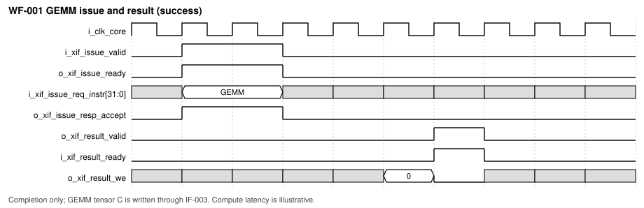
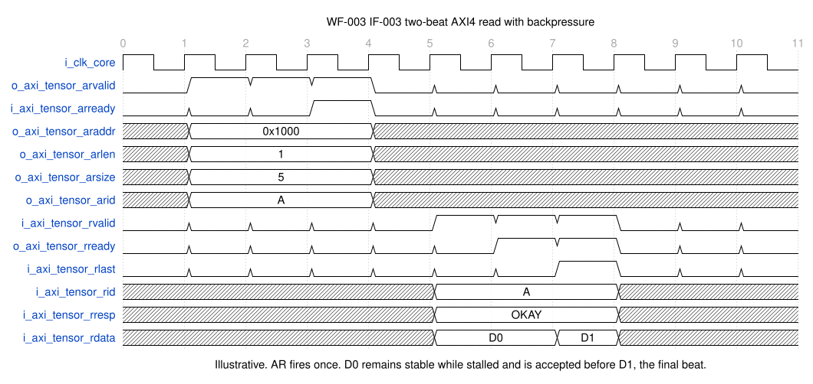
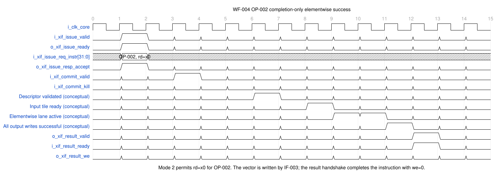
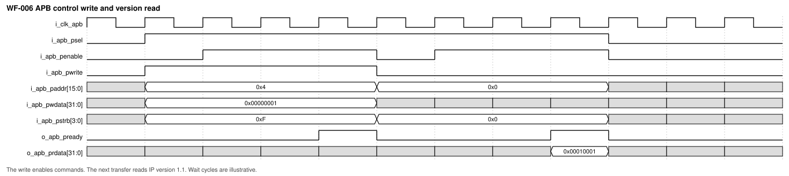
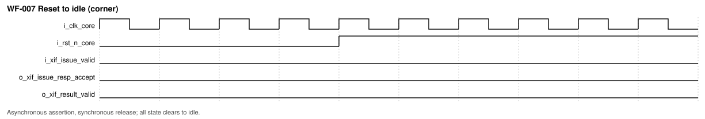
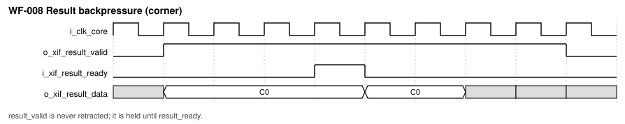
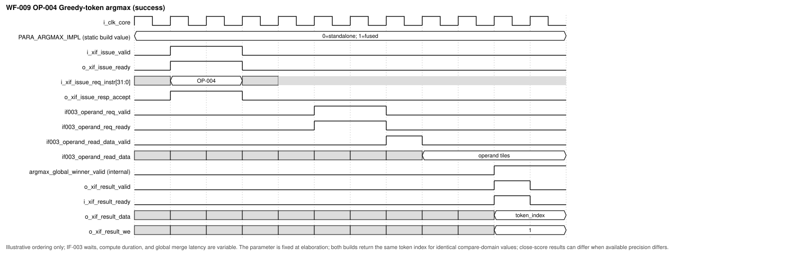
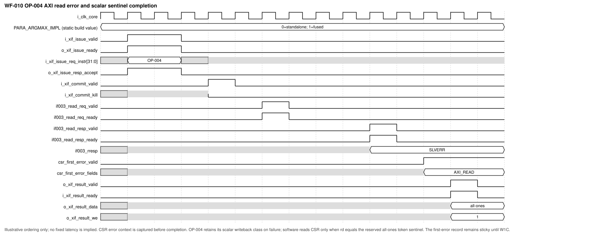
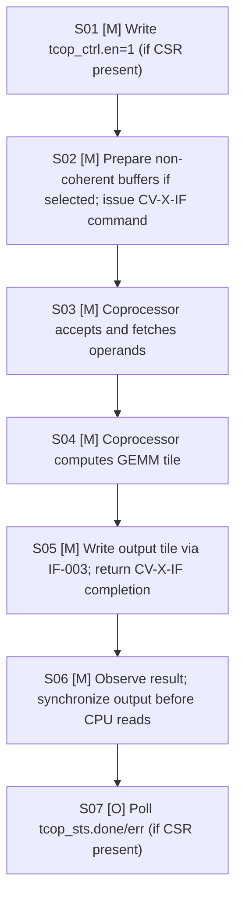

# Tensor Coprocessor Design Specification

> **Purpose:** Normative design contract for architecture, RTL, verification, DFT, and physical integration of this IP.
>
> Requirement terms: **shall** = mandatory and testable; **should** = recommended; **may** = optional. Give every mandatory requirement a stable REQ-<AREA>-<NNN> identifier and a verification method.

## Document map

1. [Purpose, scope, and product context](#1-purpose-scope-and-product-context)
2. [Normative references and precedence](#2-normative-references-and-precedence)
3. [Requirements and traceability](#3-requirements-and-traceability)
4. [Features and configurations](#4-features-and-configurations)
5. [Architecture](#5-architecture)
6. [External interfaces and ports](#6-external-interfaces-and-ports)
7. [Clock, reset, and power](#7-clock-reset-and-power)
8. [Parameters and elaboration configurations](#8-parameters-and-elaboration-configurations)
9. [Data representation and arithmetic](#9-data-representation-and-arithmetic)
10. [Detailed functional behavior](#10-detailed-functional-behavior)
11. [Register and programming model (CSR from workbook)](#11-register-and-programming-model)
12. [Error handling and recovery](#12-error-handling-and-recovery)
13. [Performance, power, and area](#13-performance-power-and-area)
14. [RTL implementation contract](#14-rtl-implementation-contract)
15. [Verification specification](#15-verification-specification)
16. [DFT and testability](#16-dft-and-testability)
17. [Physical design and timing integration](#17-physical-design-and-timing-integration)
18. [Security, safety, and reliability](#18-security-safety-and-reliability)
19. [Requirement-to-verification traceability](#19-requirement-to-verification-traceability)
20. [Assumptions, dependencies, and decisions](#20-assumptions-dependencies-and-decisions)
21. [Glossary](#21-glossary)
22. [References used to shape this template](#22-references-used-to-shape-this-template)

## 1. Purpose, scope, and product context

### 1.1 Purpose and scope

This IP is a parameterized tensor coprocessor for high-throughput, low-latency transformer inference. It accelerates dense tiled general matrix-matrix multiplication (GEMM), exact and approximate/linear attention, stable softmax and layer normalization, fused residual/bias/activation epilogues, structured sparse GEMM, and a low-latency vector/decode path. It attaches to a CVA6 RISC-V core through the OpenHW Core-V eXtension Interface (CV-X-IF). Compile-time parameters select the hardware capability mask and individual pipeline-register boundaries; each accepted command selects its compute mode at runtime, and a following command may use a different mode while the prior command executes. Pipeline placement remains fixed for each synthesized build.

**Included:** CV-X-IF issue/register/commit/result sub-interfaces; a systolic-array multiply-accumulate (MAC) datapath; per-command operation/algorithm selection; optional exact and approximate attention, normalization, epilogue, structured-sparse, and vector/decode capabilities; independently configurable elaboration-time pipeline cuts; the selected non-coherent AXI4 burst DMA plus banked local SRAM path (detailed port sizing remains open); an optional APB4 control and status register (CSR) block; clock and reset handling for the core domain and optional asynchronous APB domain.

**Excluded:** The host RISC-V core (CVA6) and its pipeline; the L1/L2 cache and coherence fabric (Culsans ACE); DRAM controller and PHY; instruction decode of standard RISC-V instructions; the software compiler and runtime that generate the custom tensor instructions; the OS scheduler and memory allocator. This IP executes offloaded operations only; it does not fetch or decode instructions on its own.

### 1.2 Deployment assumptions

| Item | Specification |
|---|---|
| Target SoC / product class | Edge inference SoC for on-device LLM and vision transformer (see 1.4) |
| Technology / library assumptions | Synthesizable SystemVerilog, IEEE 1800-2017; technology-independent RTL with SRAM/macro wrappers |
| Operating modes and workload | Host runtime dispatches prefill/decode tensor commands with different per-command modes; batch = 1 to small batch inference; target shapes and accuracy/latency envelope remain open |
| Security / privilege context | Unprivileged custom extension executed in M/S/U mode as signaled by the issue request |
| External dependencies | CVA6 core with CV-X-IF; clock/reset controller; optional APB manager; memory system per selected access path |

### 1.3 Feature summary

| Feature ID | Feature | Required / optional | Configuration condition | Requirements |
|---|---|---|---|---|
| FEAT-001 | GEMM offload via CV-X-IF custom instructions | Required | Always present | REQ-FUNC-001, REQ-IF-001 |
| FEAT-002 | Parameterized systolic-array MAC datapath | Required | Always present | REQ-FUNC-002, REQ-PARAM-001 |
| FEAT-003 | Configurable precision (INT8 only, or INT8 + BF16/FP16) | Optional | PARA_DATA_PREC | REQ-FUNC-003, REQ-PARAM-002 |
| FEAT-004 | Element-wise and epilogue operations (residual, bias, scale, activation) | Optional | `PARA_ALGORITHM_MASK[3]` | REQ-FUNC-004, REQ-PARAM-003 |
| FEAT-005 | Stable softmax and layer normalization | Optional | `PARA_ALGORITHM_MASK[2]` | REQ-FUNC-005, REQ-PARAM-003 |
| FEAT-006 | Non-coherent AXI4 burst DMA feeding banked local SRAM; SRAM-only configuration may be retained | Required for external tensors | PARA_MEM_PATH | REQ-FUNC-006, REQ-PARAM-004 |
| FEAT-007 | Optional APB CSR block (version/control/status/config) | Optional | PARA_CTRL_MODE | REQ-REG-001, REQ-IF-002 |
| FEAT-008 | Elaboration-time selection of datapath pipeline boundaries | Required capability; selected cuts are configurable | Pipeline configuration in §8 | REQ-PARAM-005, REQ-PERF-002 |
| FEAT-009 | Runtime selection among dense GEMM, exact and approximate/linear attention, normalization, epilogues, structured sparse GEMM, and low-latency vector/decode modes, including greedy-token `ARGMAX` | Required capability; each family is independently enabled at elaboration | `PARA_ALGORITHM_MASK`; per-command mode selection; `PARA_ARGMAX_IMPL` selects its elaborated implementation | REQ-FUNC-007..012, REQ-FUNC-014, REQ-PARAM-003, REQ-PARAM-006, REQ-PARAM-010 |

### 1.4 Real-world applications of the features

| Feature ID | Real-world application (named system, example product) | What the application needs from the feature | Typical values | Consequence if missing or wrong | Requirements | Source |
|---|---|---|---|---|---|---|
| FEAT-001 | On-device LLM decode loop, e.g. a Llama-1B/3B chat assistant on an edge accelerator | Attention and MLP projections are matrix multiplies; offloading them keeps the in-order CVA6 free | GEMM of (seq × hidden) with hidden = 2048–4096; per-token latency target < 50 ms | Token generation stalls; throughput collapses to the scalar core's matmul rate | REQ-FUNC-001, REQ-IF-001 | User answer 2026-11-15 |
| FEAT-002 | Same LLM MLP/attention plus ViT patch embedding on a vision SoC | Replicated systolic arrays provide parallel tile throughput; a count parameter selects the compute scale | A 32×32 array peaks at 2.048 TOPS at 1 GHz or 4.096 TOPS at 2 GHz; 16 arrays at 2 GHz yield an ideal 65.536 TOPS under the two-operations-per-INT8-MAC convention, before memory/area losses | Area, power, and memory bandwidth can prevent theoretical peak from being sustained | REQ-FUNC-002, REQ-PARAM-001, REQ-PARAM-008 | User answer 2026-11-15; ideal arithmetic ceiling calculated from array count/dimensions/frequency |
| FEAT-003 | Quantized edge LLM (INT8) vs higher-accuracy FP layers | INT8 for weights/activations; BF16/FP16 for sensitive layers to bound accuracy loss | INT8 with INT32 accumulate; BF16/FP16 with FP32 accumulate | Quantization error makes outputs wrong, or FP-only costs 2–4× area/energy | REQ-FUNC-003, REQ-PARAM-002 | User answer 2026-11-15 |
| FEAT-004 | Residual, bias, scale, and activation path of a transformer block | Selectable standalone or fused epilogues avoid host round-trips around projections and MLP operations | Hidden dimensions 2048–4096; candidate ReLU, tanh-approximate GELU, SiLU, and SwiGLU in §10.2.2; numeric error budget TBD | Extra issue/result round-trips dominate batch-one latency; incorrect fusion changes rounding and model outputs | REQ-FUNC-004, REQ-PARAM-003 | User answer 2026-11-15; numerical contract open in §20 |
| FEAT-005 | Attention softmax and layer normalization | Stable normalization should be available as a runtime mode when enabled by the build | Sequence lengths 128–2048 from current workload context; exp/reciprocal/square-root accuracy targets TBD | Missing normalization forces host work or creates overflow/accuracy failures | REQ-FUNC-005, REQ-PARAM-003 | User answer 2026-11-15; numerical contract open in §20 |
| FEAT-006 | Integration into the SoC tensor-data hierarchy | Non-coherent AXI4 burst transport with banked SRAM selected in DEC-004; local SRAM holds reusable tiles | Candidate 32×32 × 16-array × 2-GHz build needs up to 2.048 TB/s aggregate on-chip operand injection before output/metadata; external bandwidth depends on tile reuse and remains TBD | A non-coherent path without cache maintenance/ownership handoff can return stale operands; an under-sized path can starve the arrays | REQ-FUNC-006, REQ-PARAM-004 | User selected AXI4 burst + banked SRAM on 2026-11-15; detailed interface and injection sizing remain open |
| FEAT-007 | Edge inference SoC driver, e.g. a Linux driver for a Llama-1B accelerator card | The driver must read the version register to bind, and poll busy/done/err to schedule and timeout each operation | 32-bit APB registers; offset 0x0 = version (1.0) | The driver cannot bind, reset, or detect a hung operation | REQ-REG-001, REQ-IF-002 | User answer 2026-11-15 |
| FEAT-008 | Edge inference SoC running batch-one decode and multi-token prefill | Integrators need to choose pipeline cuts that meet the selected clock target while measuring the added cycles and area; the actual latency and area budgets are unresolved | Existing clock context is 1–2 GHz at §7.1; legal cut locations and per-build latency are TBD | An unbalanced or overly deep pipeline can miss timing, lower utilization, or exceed the allowed operation latency | REQ-PARAM-005, REQ-PERF-002 | User request 2026-11-15; target envelope open in §20 |
| FEAT-009 | LLM and vision-transformer inference on an edge SoC, with prefill and decode phases | The runtime should select a mode per operation/tile from dense tiled GEMM, exact tiled attention, optional approximate/linear attention, stable softmax/layer norm, residual/bias/activation epilogues, optional structured 2:4 sparse GEMM, low-latency vector/decode, and greedy-token argmax; `PARA_ARGMAX_IMPL` chooses standalone or fused implementation in the build | Hidden dimensions 2048–4096 and sequence lengths 128–2048 are existing examples; vocabulary-vector length and decode latency target remain workload-specific and TBD | Without a capability superset and runtime dispatcher, the host performs more operations and memory round-trips; without argmax, greedy decode must move logits to the CPU or use a separate reduction; approximate attention may change model accuracy, while enabling every specialized block may exceed area/power limits | REQ-FUNC-007..012, REQ-FUNC-014, REQ-PARAM-003, REQ-PARAM-006, REQ-PARAM-010, REQ-PERF-002 | User request 2026-11-15 and scalar-result selection 2026-11-16; complete workload envelope open in §20 |

## 2. Normative references and precedence

### 2.1 Normative references

| Ref ID | Document and revision | Applicable clauses | Authority / notes |
|---|---|---|---|
| REF-001 | OpenHW Group, "Core-V eXtension interface (CV-X-IF)", Release v1.0.1-dev.0 (Development), 2024-05-23 (changelog includes v1.0.0 Ratified Release) | §5 (eXtension Interface), §5.2 parameters, §5.5 interfaces, §5.6 dependencies, §5.7 handshake rules, §5.8 signal dependencies, §5.9 deadlock avoidance | Protocol authority; converted verbatim to `_spec_work/md_doc/vlsit_cvxif_openhw_core_v_xif_v1_0_0.md` |
| REF-002 | VLSIT RISC-V CPU cluster architecture proposal (`VLSIT_RISCV_CPU_Cluster_Architecture.md`) | §4 configuration model | Product context (CVA6-based 2/4-core cluster) |
| REF-003 | VLSIT RTL Design Rules v2, `VLSIT_RTL_Design_Rule.md` | All applicable rules | Mandatory RTL coding, hierarchy, reset, CDC, naming baseline |
| REF-004 | IEEE 1800-2017 SystemVerilog | Synthesizable subset | Subject to REF-003 and selected frontend support |
| REF-005 | VLSIT CSR Specification Template workbook, `VLSIT_CSR_Specification_Template.xlsx` | Configuration and register definition sheets | Sole authority for the register interface (Section 11) |
| REF-006 | Dao et al., *FlashAttention: Fast and Memory-Efficient Exact Attention with IO-Awareness*, NeurIPS 2022 | Exact attention tiling and online softmax, non-normative algorithm background | Supports algorithm trade-off analysis; does not define this IP's interface or numerical contract |
| REF-007 | Dao, *FlashAttention-2: Faster Attention with Better Parallelism and Work Partitioning*, ICLR 2024 | Attention work partitioning, non-normative algorithm background | Supports parallelism/workload analysis; does not define this IP's interface or numerical contract |
| REF-008 | Gale et al., *Accelerating Sparse Deep Neural Networks*, arXiv:2104.08378, 2021 | 2:4 structured sparsity and sparse matrix-math background | Non-normative algorithm reference; its peak results do not imply the same speedup for this IP |
| REF-009 | Katharopoulos et al., *Transformers are RNNs: Fast Autoregressive Transformers with Linear Attention*, ICML 2020 | Linear-attention formulation and autoregressive state | Non-normative algorithm reference; this formulation is not bit-equivalent to standard softmax attention |
| REF-010 | Choromanski et al., *Rethinking Attention with Performers*, ICLR 2021, arXiv:2009.14794 | FAVOR+ positive orthogonal random features for softmax-kernel approximation | Non-normative approximation reference; feature count and projection cost must be evaluated for this IP |

### 2.2 Source-of-truth and conflict handling

1. The selected CV-X-IF revision (REF-001) defines protocol behavior for the declared interface profile.
2. Approved product requirements and decisions define product-specific behavior.
3. This specification defines the IP contract and shall remain consistent with REF-001 and REF-003.
4. REF-003 is the mandatory RTL coding, hierarchy, reset, CDC, and naming baseline.
5. REF-005 is the only place where CSRs are specified. No register table is declared in this document.
6. The exact protocol revision, role, and optional-signal configuration is recorded in §2.3.
7. Resolve conflicts through an explicit product decision; do not guess or weaken a requirement.

**Naming rule:** default naming rule of `vlsit-rtl-generator`, `VLSIT_RTL_Design_Rule.md` v2, section 2, path `reference/templates/VLSIT_RTL_Design_Rule.md`, version 2 (rule R-026).

### 2.3 Compliance declaration

| Standard | Revision / profile | Role implemented | Options | Deviations |
|---|---|---|---|---|
| CV-X-IF (Core-V eXtension Interface) | v1.0.1-dev.0 (contains v1.0.0 ratified) | Coprocessor (extension side) | Issue + register + commit + result; the referenced revision does not include memory request/response or memory-result interfaces (REF-001 §5.5.9–§5.5.10) | Bulk tensor data uses the separate IF-003 path; see DEC-004 |
| AMBA APB4 (CSR block, optional) | Arm IHI 0024 | APB subordinate | 32-bit data, 16-bit address; only when PARA_CTRL_MODE = 2 | None |

## 3. Requirements and traceability

| ID | Requirement using shall/should/may | Source | Applies to | Verification method |
|---|---|---|---|---|
| REQ-FUNC-001 | The IP shall accept an offloaded custom tensor instruction on the CV-X-IF issue interface, decode it, and return exactly one result transaction for each accepted instruction that is committed and not killed, as required by the result interface contract. | REF-001 §5.5.6, §5.5.8, §5.5.11 | All configurations | Simulation / protocol checker |
| REQ-FUNC-002 | The IP shall compute a GEMM $C = A \cdot B + C$ over the operand tile sizes implied by the systolic-array dimensions. | REF-002 §4 | All configurations | Simulation / formal |
| REQ-FUNC-003 | The IP shall support INT8 datapath always, and BF16/FP16 datapath when PARA_DATA_PREC selects it, with the accumulator width of §9. | user answer 2026-11-15 | PARA_DATA_PREC | Simulation |
| REQ-FUNC-004 | When enabled by the elaborated capability mask, the IP shall execute the selected residual, bias, scale, or activation epilogue on a vector/tile using the operation order and numerical behavior selected in §9 and §10.2.2. | User request 2026-11-15 | `PARA_ALGORITHM_MASK[3]` | Simulation against a bit-accurate reference |
| REQ-FUNC-005 | When enabled by the elaborated capability mask, the IP shall provide stable softmax and layer-normalization modes using the equations and numerical behavior selected in §9 and §10.2.2. | User request 2026-11-15 | `PARA_ALGORITHM_MASK[2]` | Directed/random simulation and numerical error analysis |
| REQ-FUNC-006 | The IP shall obtain operands and write results through exactly the access path selected by PARA_MEM_PATH. | user answer 2026-11-15 | All configurations | Simulation |
| REQ-IF-001 | The IP shall obey the CV-X-IF handshake rules of REF-001 §5.7: a transaction is accepted when both valid and ready are high on the sampling edge; valid from the coprocessor shall not be retracted. | REF-001 §5.7 | All configurations | Protocol checker |
| REQ-IF-002 | When the CSR block is present, the IP shall answer APB4 reads/writes to the register block defined by the CSR workbook. | REF-005 | PARA_CTRL_MODE = 2 | Simulation |
| REQ-IF-003 | In descriptor mode, the descriptor pointer shall be a 64-bit DMA-visible byte address. On RV32, its low word shall come from the CV-X-IF register value selected by instruction `rs1`, and its high word from the value selected by `rs2`; on RV64, it shall come from the value selected by `rs1`, with `rs2` unused. Descriptor-command runtime flags shall reside in the descriptor. The pointer shall be captured in that command's context; an out-of-range pointer shall complete with the DEC-010 error status without issuing a malformed AXI request. | User decision 2026-11-16; DEC-002 | Descriptor commands; RV32 and RV64 host variants | Operand/descriptor-fetch simulation and address-range assertions |
| REQ-IF-004 | `rd=x0` shall be rejected at issue in mode 0 and for every scalar-result opcode. In mode 2, a tensor/status opcode may use `rd=x0`; the command still returns its required CV-X-IF completion transaction with `issue_resp.writeback=0` and `result.we=0`, and accepted-command errors are reported by the sticky CSR record. The result class and writeback request shall be determined entirely from the instruction at issue; a fetched descriptor shall not change them. For all accepted commands, `result.we` shall match the writeback declaration made at issue. | User decision 2026-11-16; DEC-010; REF-001 §5.5.11 | CV-X-IF command/result | Issue-decode and writeback-consistency simulation/assertions |
| REQ-CLK-001 | The IP shall operate on a single core clock domain for the datapath; the optional CSR block shall use an asynchronous APB clock with an approved synchronizer. | REF-003 CLK-01 | All configurations | CDC analysis |
| REQ-RESET-001 | The IP shall asynchronously assert and synchronously deassert reset per receiving domain, and clear all control/valid state to a defined idle value. | REF-003 RST-02 | All configurations | Reset test |
| REQ-REG-001 | When the CSR block is present, offset 0x0 shall be the read-only version register with major[31:16] and minor[15:0]. | REF-005 | PARA_CTRL_MODE = 2 | Simulation |
| REQ-PARAM-001 | The systolic-array dimensions shall be elaboration-time parameters restricted to the legal set of §8. | user answer 2026-11-15 | All configurations | Elaboration/lint |
| REQ-PARAM-002 | The precision capability shall be an elaboration-time parameter; `PARA_DATA_PREC=0` shall support INT8 only and `=1` shall include INT8, BF16, and FP16. In a multi-precision build, each command shall latch one supported precision in its own metadata and use it consistently for all of that command's tiles. Illegal parameter values or unsupported per-command precision requests shall be rejected as defined in §12. | user answer 2026-11-15; runtime precision behavior proposed for transformer dispatch | `PARA_DATA_PREC` | Elaboration/lint and per-command mixed-precision simulation |
| REQ-PARAM-003 | The algorithm capability mask shall independently include or exclude the defined operation families at elaboration; illegal dependencies shall be rejected, and a runtime request for a disabled family shall return the specified unsupported-mode error. | User request 2026-11-15 | All configurations | Elaboration checks and runtime mode/error simulation |
| REQ-PARAM-004 | The bulk tensor-data implementation shall be selected at elaboration; each released implementation shall expose the fixed protocol-specific ports for that build, and the selected path shall preserve operand/result ownership and ordering. CV-X-IF memory ports shall not be assumed for REF-001 v1.0.1-dev.0. | user answer 2026-11-15; REF-001 §5.5.9–§5.5.10 | `PARA_MEM_PATH` | Elaboration/lint and path-specific protocol verification |
| REQ-PARAM-005 | The IP shall provide elaboration-time configuration for five pipeline boundaries: operand capture, multiplier/product-combine output to accumulator input, accumulator-to-epilogue, post-processing output, and memory response. PE forwarding and accumulator feedback remain fixed. Every legal configuration shall preserve arithmetic results, transaction ordering, and handshake behavior. Legal values/configurations shall be enumerated in §8 before RTL freeze. | User request 2026-11-15 | Five pipeline cut parameters | Elaboration, equivalence, protocol checks, and static timing analysis |
| REQ-ERR-001 | The IP shall reject an unknown opcode at issue and shall complete every accepted, committed, non-killed command even when it encounters an illegal operand configuration or execution error; the observable error encoding shall follow DEC-010, and another queued command shall not be corrupted. | REF-001 §5.5.11; product behavior | All configurations | Simulation / fault injection |
| REQ-ERR-002 | When APB CSR is present, the first accepted, committed, non-killed command error shall atomically capture `hartid`, CV-X-IF `id`, and status in a one-entry sticky CSR record. The failed command shall still complete; after it is safely retired, the scheduler shall not start a younger queued command until software clears the record with W1C and the clear has crossed into `CLK-CORE`. The record shall remain unchanged while valid. Issue may continue until the command queue is full, with normal backpressure and ordering. | User decision 2026-11-16; DEC-010 | `PARA_CTRL_MODE=2` | Queued error injection, record-retention, W1C/CDC and resume simulation |
| REQ-PERF-001 | For dense INT8 GEMM, every active PE across the selected arrays shall sustain one MAC result per cycle after pipeline fill. For valid INT8 2:4 sparse commands, the paired-MAC datapath shall accept two selected nonzero products per assigned PE per cycle after pipeline fill. Other sparse precisions shall have separately reported throughput. Memory, metadata, backpressure, and legal-configuration stalls shall be reported separately. | User answer 2026-11-15; paired sparse lanes selected 2026-11-15 | Dense and 2:4 sparse INT8 configurations | Simulation / analysis |
| REQ-FUNC-007 | Each accepted command shall latch its operation/algorithm mode from its own command metadata. The command queue shall be able to accept a following command with a different mode while an earlier command executes, when queue space is available; mode and all associated metadata shall remain isolated per command. The selected mode is immutable from command acceptance through completion; mode changes occur between commands only. A request for an unsupported mode shall follow the error behavior selected in DEC-002 without corrupting another command. | User request 2026-11-15 | Runtime-selectable modes | Directed/constrained-random simulation with different modes queued and in flight |
| REQ-PERF-002 | For every released configuration, the design team shall specify and report accept-to-result latency and sustained throughput by operation, tensor shape, precision, pipeline configuration, and memory path under explicit traffic and backpressure assumptions. | User request 2026-11-15 | All released configurations | Cycle-accurate simulation, bandwidth analysis, and static timing analysis |
| REQ-FUNC-008 | When enabled, the IP shall execute exact tiled attention with per-tile softmax state and the causal/non-causal masking behavior defined in §9–10, without writing the full score matrix to external memory. | User request 2026-11-15; algorithm approach supported by REF-006/007 | `PARA_ALGORITHM_MASK[1]` | Simulation against an exact reference and memory-traffic analysis |
| REQ-FUNC-009 | When enabled for a precision supported by the sparse implementation, the IP shall execute structured 2:4 sparse matrix multiplication using paired MAC lanes that select two nonzero products per group of four and combine them before the accumulator update. It shall validate metadata and report malformed encodings as an error. | User request 2026-11-15; paired lanes selected 2026-11-15; REF-008 | `PARA_ALGORITHM_MASK[4]`; precision coverage in DEC-007 | Directed/random simulation and malformed-metadata fault tests |
| REQ-FUNC-010 | When enabled, the IP shall execute low-latency vector/decode operations with the selected precision and result contract equivalent to the corresponding mathematical operation. The family includes matrix-vector/small-M projection and OP-004 greedy-token selection using the elaborated implementation defined by REQ-FUNC-014/REQ-PARAM-010; the operation ID fixes its scalar result class at issue. | User request 2026-11-15; scalar greedy-token operation selected 2026-11-16 | `PARA_ALGORITHM_MASK[5]` | Simulation and batch-one latency benchmark |
| REQ-FUNC-011 | The runtime shall be able to select dense tiled GEMM independently of fused attention and structured sparse GEMM; these modes shall report distinct latency and throughput results. | User request 2026-11-15 | `PARA_ALGORITHM_MASK[0]` and related families | Directed simulation and mode-specific benchmarks |
| REQ-PARAM-006 | The elaboration-time algorithm capability mask shall gate synthesis of optional algorithm hardware; all defined families shall be selectable when enabled, while unselected families shall not be accepted at runtime. | User request 2026-11-15 | `PARA_ALGORITHM_MASK` | Elaboration, synthesis hierarchy review, and runtime error simulation |
| REQ-FUNC-012 | When enabled, the IP shall provide the selected approximate/linear attention mode with an explicitly specified approximation policy, supported sequence/shape range, and accuracy criterion; its result shall not be presented as bit-exact standard softmax attention. | User request 2026-11-15; REF-009 | `PARA_ALGORITHM_MASK[6]` | Simulation against the approved approximate reference and model-level accuracy analysis |
| REQ-PARAM-007 | The command-context capacity shall be an elaboration-time parameter with a minimum of two outstanding descriptors, counting the active command: one command may execute while at least one following command with a different mode waits in the queue. Queue-full behavior shall apply backpressure without losing, reordering, or mixing commands. | User request 2026-11-15; queueing recommendation in §10.2.1 | `PARA_CMD_QUEUE_DEPTH` | Elaboration and queue-full/backpressure simulation |
| REQ-PARAM-008 | The number of systolic-array instances shall be selected by an elaboration-time parameter from the legal set in §8; the generated hierarchy and ideal peak-throughput calculation shall match the selected count. | User request 2026-11-15 | `PARA_ARRAY_COUNT` | Elaboration, hierarchy inspection, synthesis resource count, and analytical peak calculation |
| REQ-PARAM-009 | An operation ID whose successful result is written as scalar data to an integer GPR shall be supported only when `PARA_CTRL_MODE=2` includes APB CSR and shall require `rd!=x0`. This includes OP-003 REDUCE and OP-004 greedy-token index. Such IDs shall be rejected at issue in mode 0 or when `rd=x0`. For an accepted OP-004 failure, `rd` shall receive `TC_INVALID_TOKEN_INDEX` (all ones at XLEN), and the sticky CSR shall capture `hartid`, CV-X-IF `id`, and detailed status before completion; the maximum legal vocabulary length shall exclude the sentinel. Software may use non-sentinel OP-004 results immediately and shall read the matching CSR record only on the sentinel path. For an accepted OP-003 failure, `rd` shall receive zero and the sticky CSR shall capture the error before completion; because zero can be a valid REDUCE result, software shall check the matching CSR record before using `rd`. Error-record retention and command-boundary pause follow REQ-ERR-002; CSR register offsets and polling details remain open in DEC-010. | User decisions 2026-11-16; DEC-010 | Scalar-result operation IDs; `PARA_CTRL_MODE`; OP-004 index range | Build/issue checks and queued-command error simulation |
| REQ-FUNC-013 | The scheduler shall assign independent output tiles or attention heads to available arrays and preserve each command's mode, precision, transaction ID, and result ownership. GEMM K-reduction and attention online-softmax state shall remain attached to the owning output tile; any cross-array reduction shall follow the operation's defined arithmetic order and rounding rules. | User request 2026-11-15; multi-array implementation requirement | `PARA_ARRAY_COUNT > 1` | Multi-array simulation against a tiled reference and transaction-order assertions |
| REQ-FUNC-014 | When enabled, the IP shall support greedy-token selection (`ARGMAX`) over a completed logits vector, using the implementation selected at elaboration by `PARA_ARGMAX_IMPL`: standalone logits-vector reduction when `=0`, or fused final vocabulary projection plus argmax when `=1`. Both variants shall return the unsigned index of a maximum-valued element through the same scalar-result operation ID, require `PARA_CTRL_MODE=2` and `rd!=x0`, and use the sticky CSR error path on failure. Compare each candidate at the highest precision still available at the argmax input: standalone compares the exact values decoded from the descriptor-declared storage format without another lossy conversion; fused projection compares the `PARA_ACCUM_W` result after model projection bias and before output-format rounding or storage. At every lane/tile/array merge, update the winner when the candidate score is greater, or when scores are exactly equal in that compare representation and the candidate token index is smaller; do not use an epsilon or completion-arrival order. No softmax is computed for argmax. The descriptor shall identify the selected input schema and be rejected if it disagrees with the built implementation. The maximum legal vocabulary length shall be less than `2^XLEN`, reserving `TC_INVALID_TOKEN_INDEX = {XLEN{1'b1}}` for accepted execution errors; the error record shall be written before the scalar completion. Bit-identical compare-domain scores shall produce the same token index across implementations; if storage and fused accumulator precisions differ, a close-score winner may differ because standalone cannot recover bits already rounded away. Runtime application-supplied logit bias is deferred; if added later, the descriptor shall name its vector/sparse-list format and IF-003 address, and the adjustment shall be added before the same comparator. This operation does not implement top-k/top-p or stochastic sampling; NaN handling remains open in DEC-005. | User decisions 2026-11-16; DEC-005/010; tie/precision method selected 2026-11-16 | `PARA_ALGORITHM_MASK[5]`, `PARA_ARGMAX_IMPL`, `PARA_ACCUM_W`, `XLEN` | Reference simulation across compare formats, lane/tile/array ties, sentinel boundary, and accepted read faults |
| REQ-PARAM-010 | `PARA_ARGMAX_IMPL` shall select one greedy-token implementation at elaboration: `0=standalone logits-vector ARGMAX`, `1=fused final vocabulary projection plus ARGMAX`. The parameter shall not be writable at runtime. Both builds shall use the fixed highest-available-precision comparator and lower-index exact-tie rule in REQ-FUNC-014; no user-selectable tie-policy or compare-precision parameter is present in this release. Standalone compare precision is derived from the command/descriptor-declared logits format; fused compare width is `PARA_ACCUM_W`. When the selected feature is present, only the matching descriptor input schema shall be accepted; descriptor mode mismatch shall return the defined descriptor-mode error. Application logit bias is deferred to a later ABI extension. | User decision 2026-11-16; performance trade-off recorded in DEC-005; comparator rule selected 2026-11-16 | `PARA_ARGMAX_IMPL`, command precision, `PARA_ACCUM_W` | Elaborate both values, inspect generated hierarchy, test matching/mismatching descriptors, and compare against path-specific numeric references |

## 4. Features and configurations

| Configuration ID | Enabled features | Disabled features | Interfaces / widths | Intended use | Verification target |
|---|---|---|---|---|---|
| CFG-BASE | FEAT-001, FEAT-002, FEAT-003 (INT8), FEAT-006 (external tensor-data path TBD), FEAT-008, FEAT-009 (GEMM mode only) | Other algorithm-mask bits, FEAT-005, FEAT-007 | CV-X-IF command/result + selected tensor-data path, 8×8 INT8 | Minimal GEMM-only build | Simulation + lint |
| CFG-FULL | FEAT-001..FEAT-009; `PARA_ALGORITHM_MASK=32'h0000_007F` | none | CV-X-IF command/result + selected tensor-data path, APB CSR, 16×16, INT8+BF16/FP16; pipeline cuts are a released-build selection | Full algorithm capability set with per-command mode selection | Simulation + CDC + formal + workload PPA |
| CFG-64TOPS | Full algorithm capability set; `PARA_ARRAY_COUNT=16` | none | CV-X-IF command/result + selected high-bandwidth tensor-data path, APB CSR, 32×32, INT8; 2 GHz core constraint | Candidate 64 TOPS ideal GEMM/prefill peak; decode is evaluated separately by latency and tokens/s | Analytical only; physical and interface feasibility TBD |

The algorithm capability mask removes or excludes unselected optional logic at elaboration. At runtime, each command selects one operation/algorithm and, in a multi-precision build, one precision from the enabled capabilities; a disabled selection is rejected according to DEC-002. Pipeline parameters choose register cuts for the entire built variant and are not runtime controls. The top-level port set must be provided by a fixed interface or explicit wrapper variants (DEC-004); a parameter alone does not remove ports from a SystemVerilog module declaration. Algorithm-mask dependencies and unsupported combinations are elaboration-time errors.

## 5. Architecture

### 5.1 Overview and block responsibilities

The coprocessor is a tightly coupled accelerator: the host CVA6 issues custom tensor commands on CV-X-IF; a command queue captures each mode and its metadata; the scheduler routes dense, attention, sparse, normalization, epilogue, or vector/decode work to shared compute resources; and the separate tensor-data path feeds operand tiles and writes output tiles. CV-X-IF issue carries the instruction word and transaction identity; source-register values arrive on the CV-X-IF register sub-interface. The FSM in §10.1 sequences the active command; queue entries retain subsequent commands and their independent modes.

| Block | Responsibility | Inputs / outputs | Clock/reset domain | State or storage |
|---|---|---|---|---|
| m_tensor_copro | Structural top: ports, parameters, submodule instances | CV-X-IF command/result + selected tensor-data path + optional APB | CLK-CORE / CLK-APB | none (wrapper) |
| m_cvxif_adapter | CV-X-IF handshake and struct flattening; decode, per-command mode latch, command queue, and dispatch | issue/register/commit/result | CLK-CORE | command descriptors, accepted-id scoreboard |
| m_systolic_array | Dense/vector MAC datapath plus paired multiplier lanes and product adder for 2:4 sparse mode; replicated `PARA_ARRAY_COUNT` times | operand tiles, sparse index metadata, partial sums, mode metadata | CLK-CORE | PE registers, partial-sum regs, sparse select state |
| m_accum | Accumulator with optional bias and precision handling | MAC outputs, bias | CLK-CORE | accumulator regs |
| m_elemwise | Residual, bias, scale, and activation epilogues (optional) | vector/tile data and mode | CLK-CORE | optional pipeline / tile buffer |
| m_reduce | Max/exp/sum softmax, Welford layer-normalization statistics, pipelined piecewise special functions, attention normalization, and indexed argmax compare-reduction (optional) | vector tiles, running exact/linear attention statistics, vector indices | CLK-CORE | reduction tree, Welford state, row/head statistics, nonlinear arithmetic state, value/index winners |
| m_mem_path | Non-coherent AXI4 burst DMA, banked SRAM access, and operand/result/attention-context buffering | IF-003 AXI4 manager plus internal SRAM ports (width/banking TBD) | CLK-CORE | SRAM banks, command/operand/result buffers |
| m_csr | APB CSR block (optional, generated) | APB4 ports | CLK-APB | register file |

### 5.2 Block diagram


```json
{
  "page_name": "BLOCK_DIAGRAM",
  "out_name": "tensor_copro_block_diagram_runtime.drawio",
  "table_suffix": "",
  "layout": {
    "gap_h": 100,
    "gap_v": 90,
    "margin": 40,
    "block_h": 80
  },
  "top": {
    "frame_label": [
      "TOP",
      "(m_tensor_copro)"
    ],
    "block_label": [
      "TOP",
      "(m_tensor_copro)"
    ],
    "block_row": [
      "TOP (m_tensor_copro)",
      "Structural top.",
      "Section 14.2"
    ]
  },
  "frame_row": [
    "TOP (m_tensor_copro) frame",
    "Structural top.",
    "Section 14.2"
  ],
  "frame_interfaces": [
    "XIF",
    "RES",
    "MEM",
    "APB",
    "CRCLK"
  ],
  "blocks": [
    {
      "key": "U_CVXIF_ADAPTER",
      "label": [
        "u_cvxif_adapter",
        "(m_cvxif_adapter)"
      ],
      "width": 200,
      "row": 0,
      "col": 0,
      "row_name": "u_cvxif_adapter (m_cvxif_adapter)",
      "function": "CV-X-IF handshake, decode, per-command mode latch, queue, scoreboard, and dispatch",
      "source": "Section 14.2"
    },
    {
      "key": "U_SYSTOLIC_ARRAY",
      "label": [
        "u_systolic_array",
        "(m_systolic_array)"
      ],
      "width": 220,
      "row": 0,
      "col": 1,
      "row_name": "u_systolic_array (m_systolic_array)",
      "function": "Dense/vector MAC datapath plus paired 2:4 sparse MAC lanes; replicated PARA_ARRAY_COUNT times for active-command tile scheduling",
      "source": "Section 14.2"
    },
    {
      "key": "U_ACCUM",
      "label": [
        "u_accum",
        "(m_accum)"
      ],
      "width": 120,
      "row": 0,
      "col": 2,
      "row_name": "u_accum (m_accum)",
      "function": "Accumulator",
      "source": "Section 14.2"
    },
    {
      "key": "U_ELEMWISE",
      "label": [
        "u_elemwise",
        "(m_elemwise)"
      ],
      "width": 160,
      "row": 1,
      "col": 0,
      "row_name": "u_elemwise (m_elemwise)",
      "function": "Residual/bias/scale/activation epilogue (optional)",
      "source": "Section 14.2"
    },
    {
      "key": "U_REDUCE",
      "label": [
        "u_reduce",
        "(m_reduce)"
      ],
      "width": 140,
      "row": 1,
      "col": 1,
      "row_name": "u_reduce (m_reduce)",
      "function": "Max/exp/sum softmax, Welford layer norm, pipelined piecewise special functions, attention normalization (optional)",
      "source": "Section 14.2"
    },
    {
      "key": "U_MEM_PATH",
      "label": [
        "u_mem_path",
        "(m_mem_path)"
      ],
      "width": 160,
      "row": 1,
      "col": 2,
      "row_name": "u_mem_path (m_mem_path)",
      "function": "Non-coherent AXI4 burst DMA plus banked local SRAM and operand/result buffering",
      "source": "Section 14.2"
    },
    {
      "key": "U_CSR",
      "label": [
        "u_csr",
        "(m_csr)"
      ],
      "width": 100,
      "row": 2,
      "col": 0,
      "row_name": "u_csr (m_csr)",
      "function": "Generated CSR (optional)",
      "source": "Section 14.2"
    }
  ],
  "connectors": [
    {
      "id": "ISS",
      "src": "U_CVXIF_ADAPTER",
      "src_side": "B",
      "dst": "U_SYSTOLIC_ARRAY",
      "dst_side": "T"
    },
    {
      "id": "OPR",
      "src": "U_MEM_PATH",
      "src_side": "B",
      "dst": "U_SYSTOLIC_ARRAY",
      "dst_side": "R"
    },
    {
      "id": "PSM",
      "src": "U_SYSTOLIC_ARRAY",
      "src_side": "R",
      "dst": "U_ACCUM",
      "dst_side": "L"
    },
    {
      "id": "ACC",
      "src": "U_ACCUM",
      "src_side": "R",
      "dst": "U_ELEMWISE",
      "dst_side": "L"
    },
    {
      "id": "VEC",
      "src": "U_ELEMWISE",
      "src_side": "R",
      "dst": "U_REDUCE",
      "dst_side": "L"
    },
    {
      "id": "ATN",
      "src": "U_REDUCE",
      "src_side": "T",
      "dst": "U_SYSTOLIC_ARRAY",
      "dst_side": "B"
    },
    {
      "id": "STO",
      "src": "U_REDUCE",
      "src_side": "R",
      "dst": "U_MEM_PATH",
      "dst_side": "L"
    }
  ],
  "externals": [
    {
      "id": "XIF",
      "block": "U_CVXIF_ADAPTER",
      "side": "L",
      "dir": "in",
      "pos": 0,
      "text": [
        "CV-X-IF INPUTS",
        "issue + register + commit"
      ]
    },
    {
      "id": "RES",
      "block": "U_CVXIF_ADAPTER",
      "side": "T",
      "dir": "out",
      "pos": 0,
      "text": [
        "CV-X-IF result / completion"
      ]
    },
    {
      "id": "MEM",
      "block": "U_MEM_PATH",
      "side": "B",
      "dir": "out",
      "pos": 0,
      "text": [
        "IF-003 AXI4 BURST + SRAM",
        "read/write requests out; data/responses in"
      ]
    },
    {
      "id": "APB",
      "block": "U_CSR",
      "side": "B",
      "dir": "in",
      "pos": 0,
      "text": [
        "APB",
        "APB4 register access"
      ]
    },
    {
      "id": "CRCLK",
      "block": "U_SYSTOLIC_ARRAY",
      "side": "T",
      "dir": "in",
      "pos": 0,
      "text": [
        "CRCLK",
        "core and APB clock/reset domains"
      ]
    }
  ],
  "nets": [],
  "interfaces": [
    {
      "id": "XIF",
      "name": "CV-X-IF issue/register/commit input sub-interfaces",
      "category": "handshake",
      "active": "host -> coprocessor",
      "signals": "issue_valid, issue_req.instr/hartid/id; register_valid, register.hartid/id/rs[]/rs_valid; commit_valid, commit.hartid/id/commit_kill; issue_ready and register_ready return from coprocessor"
    },
    {
      "id": "RES",
      "name": "CV-X-IF issue response and result sub-interfaces",
      "category": "handshake",
      "active": "coprocessor -> host",
      "signals": "issue_resp.accept/writeback/register_read; result_valid, result.hartid/id/data/rd/we; result_ready supplied by host"
    },
    {
      "id": "MEM",
      "name": "IF-003 non-coherent AXI4 burst DMA plus banked local SRAM",
      "category": "custom",
      "active": "mixed: coprocessor requests/outputs; memory system returns operands/responses",
      "signals": "Non-coherent AXI4 AR/AW/W/R/B channels plus local SRAM banks selected; widths, IDs, burst limits, and SRAM timing TBD in DEC-004"
    },
    {
      "id": "APB",
      "name": "APB4 CSR access",
      "category": "custom",
      "active": "SoC -> CSR subordinate",
      "signals": "PSEL, PENABLE, PWRITE, PADDR, PWDATA; PRDATA, PREADY, PSLVERR returned"
    },
    {
      "id": "CRCLK",
      "name": "Clock and reset",
      "category": "custom",
      "active": "SoC -> tensor coprocessor",
      "signals": "i_clk_core, i_rst_n_core; optional i_clk_apb, i_rst_n_apb"
    },
    {
      "id": "ISS",
      "name": "Queued operation and mode",
      "category": "custom",
      "active": "u_cvxif_adapter -> u_systolic_array",
      "signals": "command mode, precision, shape, tile metadata"
    },
    {
      "id": "OPR",
      "name": "Operand tiles",
      "category": "custom",
      "active": "u_mem_path -> u_systolic_array",
      "signals": "operand tiles and sparse metadata"
    },
    {
      "id": "PSM",
      "name": "Partial sums",
      "category": "custom",
      "active": "u_systolic_array -> u_accum",
      "signals": "partial sums and tile coordinates"
    },
    {
      "id": "ACC",
      "name": "Accumulator result",
      "category": "custom",
      "active": "u_accum -> u_elemwise",
      "signals": "accumulated tile and precision"
    },
    {
      "id": "VEC",
      "name": "Epilogue vector",
      "category": "custom",
      "active": "u_elemwise -> u_reduce",
      "signals": "post-processed vector tile"
    },
    {
      "id": "ATN",
      "name": "Attention softmax feedback",
      "category": "custom",
      "active": "u_reduce -> u_systolic_array",
      "signals": "on-chip attention state and next matrix phase"
    },
    {
      "id": "STO",
      "name": "Post-processed output tile",
      "category": "custom",
      "active": "u_reduce -> u_mem_path",
      "signals": "result tile and completion metadata"
    }
  ],
  "legend_note": "The enclosing frame is the top module; blocks inside are its instances."
}
```

*Figure 5-1. Block diagram showing CV-X-IF command/result, tensor-data, APB, clock/reset, and internal datapath connections. Source: `figures/tensor_copro_block_diagram_runtime.drawio` (draw.io, VLSIT library, drawn by `vlsit_spec_diagram.py`).*

**Diagram scope.** The CV-X-IF input stub groups the issue, register, and commit packets; `RES` returns the issue response and instruction completion/result. `MEM` is a conceptual non-coherent AXI4 burst/DMA path: requests and output writes leave the IP, while operand data and write responses return through the local SRAM/buffer path. For the SRAM-only build, external AXI ports are replaced by the SRAM wrapper and its separate loading path. The CV-X-IF result carries a scalar status or an opcode-defined scalar register result, plus instruction completion; it never carries a tensor tile. The host instruction memory, SoC memory fabric, and internal command-done return from the operation controller to `m_cvxif_adapter` are not drawn. See §6.2 for packet fields; burst/width/banking details remain open in DEC-004 and result/error details in DEC-010.

### 5.3 Transaction and dataflow

1. The processor fetches the custom instruction from its normal instruction memory/cache and sends its 32-bit instruction word and transaction identity to `m_cvxif_adapter` on CV-X-IF issue. CV-X-IF register transactions separately provide source-register values; these values can carry scalar parameters or tensor/descriptor addresses, not an entire large tensor.
2. The host/runtime chooses a mode using shape, precision, prefill/decode phase, and model metadata; only a mode enabled by `PARA_ALGORITHM_MASK` is legal for the built variant. The exact instruction and descriptor encoding remains open in DEC-002/DEC-004.
3. The coprocessor latches each command into its queue and may accept a different next mode while an earlier command executes. After the command is committed and not killed, `m_mem_path` fetches tensor operand tiles from the selected bulk-data path and routes them through local buffers to the shared systolic array and any enabled normalization/epilogue path.
4. Exact attention may iterate across tiles while updating on-chip softmax statistics; approximate/linear attention uses its separately defined state and accuracy contract.
5. The coprocessor writes tensor outputs to the command's output address through `m_mem_path`. Separately, CV-X-IF returns one instruction-completion transaction. Per the selected DEC-010 policy, an opcode defined to return a scalar register result places that value in `data/rd/we`; other opcodes place completion status there when `rd!=x0`. In mode 2, a tensor/status opcode may use `rd=x0` and complete with `we=0`; accepted-command errors are reported through the sticky CSR record. The result never carries a tensor tile. Scalar-result opcodes require APB CSR and a nonzero destination. Pipeline-cut parameters remain fixed for the synthesized build.

### 5.4 Invariants

- Each accepted instruction is handled according to the CV-X-IF commit/kill contract; commit transactions may cover multiple instructions, and killed instructions shall not produce a result.
- Each accepted instruction that is committed and not killed produces exactly one CV-X-IF result transaction; that transaction may complete without a scalar register write-back (`we=0`).
- `result_valid` is never retracted once asserted (REF-001 §5.7).
- Transaction IDs distinguish accepted commands; each ID has at most one result, and the supported outstanding count is bounded by the command queue / scoreboard capacity (DEC-006).
- Each command latches its own operation mode, precision, dimensions, and memory metadata. The active command's mode and precision remain fixed until completion; a queued command may carry a different selection.
- `PARA_CMD_QUEUE_DEPTH` counts accepted, not-yet-completed command contexts including the active command. With the minimum depth of two, one command executes while one different-mode command waits. The first-release scheduler owns all arrays with one active command and distributes that command's independent tiles across the arrays; normally it hands off to the next queued command when the active command completes. In mode 2, a valid sticky first-error CSR record pauses that handoff until W1C is synchronized into `CLK-CORE`; issue may continue until the queue is full. Cross-command array interleaving is a later optimization and requires per-array context, arbitration, and result-order analysis (DEC-006).

## 6. External interfaces and ports

### 6.1 Interface inventory

| Interface ID | Type and revision | Role | Direction at IP boundary | Clock domain | Required / optional | Configurations |
|---|---|---|---|---|---|---|
| IF-001 | CV-X-IF, OpenHW v1.0.1-dev.0 | Coprocessor | Mixed sub-interfaces: issue/register/commit into the IP; issue response/result out | CLK-CORE | Required | All |
| IF-002 | AMBA APB4 (IHI 0024) | Subordinate | Address/control/write data in; read data/ready/error out | CLK-APB | Optional | `PARA_CTRL_MODE = 2` |
| IF-003 | Non-coherent AXI4 burst DMA plus banked local SRAM | AXI4 manager; local SRAM is accelerator-owned storage | AXI4 read/write requests toward memory; operand data and write responses return to the IP; local SRAM ports feed the arrays | CLK-CORE (or wrapper CDC if required) | Required for external tensor payloads; SRAM-only profile is supported only when data are preloaded | `PARA_MEM_PATH`; DEC-004 |

CV-X-IF transfers the instruction and scalar register operands/control only. The cited CV-X-IF revision does not define memory request/response or memory-result sub-interfaces (REF-001 §5.5.9–§5.5.10), so IF-003 is a separate integration path. APB accesses the CSR block only. DEC-004 selects non-coherent AXI4 burst DMA plus banked local SRAM. Exact AXI signal widths, IDs, burst limits, arbitration, SRAM capacity/bank count, loading path, and transaction/error rules remain open.

**Selected IF-003 for the current repository:** non-coherent AXI4 burst DMA feeding banked local SRAM/double buffers (user selected option A on 2026-11-15). The repository's `m_vlsit_riscv_cluster_axi_top` exposes an AXI4 external-memory manager path; `m_vlsit_axi_llc` connects a CPU-side AXI4+ATOP request interface to the external AXI4+ATOP manager; and `m_vlsit_riscv_coh_fabric` manages MESI ownership/probes among CPU harts. These modules do not expose a tensor-facing ACE snoop port, so ACE would require new coherent-master and snoop integration rather than a direct connection. Explicit buffer ownership and cache maintenance are required whenever CPU and accelerator share non-coherent buffers.

| Candidate | Main benefit | Main cost / constraint | Fit for this tensor IP |
|---|---|---|---|
| Non-coherent AXI4 bursts + banked SRAM | Burst DMA, double buffering, and local operand reuse give a predictable feed to the arrays without cache-line snoops on every tile transfer | Needs AXI arbitration/port integration and explicit buffer ownership/cache maintenance: clean CPU-written inputs/descriptors before DMA reads; before DMA output writes, clean/invalidate dirty CPU lines or use dedicated cache-line-aligned output buffers; after completion, invalidate output lines before CPU reads; no simultaneous CPU/DMA access to the same buffer | **Selected by user** for high throughput and scalable `PARA_ARRAY_COUNT` |
| ACE coherent master | CPU and accelerator can share cacheable buffers with hardware coherence; reduces explicit cache-maintenance steps and helps workloads that exchange small shared structures | Current repo has no accelerator ACE endpoint; requires snoop/fabric integration, coherence deadlock/order verification, QoS analysis, and additional area/routing. Coherence itself does not raise tensor compute bandwidth | Choose if transparent shared-buffer semantics are a hard SoC requirement and the target fabric already has a qualified ACE port |
| Internal SRAM only | Lowest and most deterministic local access latency, with simple local timing | Requires a defined preload path and capacity for weights/state; without bulk ingress/egress it cannot serve large model tensors or general output buffers | Useful as a local buffer tier, not a complete data path for this target |

The 64-TOPS compute target is not a requirement for 64 TOPS of external-memory bandwidth: systolic operand reuse reduces off-chip traffic, while the local SRAM banking and injection network must sustain each array's boundary feed. The current theoretical candidate's aggregate on-chip operand injection is about 2.048 TB/s for 16 32×32 INT8 arrays at 2 GHz; this is an internal feed figure, not an external AXI bandwidth target. Burst length, outstanding depth, bus width, SRAM bank count, arbitration, and the achieved utilization remain to be sized in DEC-004/005.

#### Preliminary IF-003 sizing candidate (not frozen)

| Design item | Initial candidate | Rationale and remaining check |
|---|---|---|
| SoC topology | Expose the tensor DMA as a second AXI4 manager on the system memory interconnect; keep CV-X-IF/APB paths separate | `m_vlsit_riscv_cluster_axi_top` currently exposes the CPU/LLC memory manager. A multi-manager interconnect or explicit arbitration point is required; the DMA is not directly connected as a port on that CPU-only top. |
| Address/data width | 64-bit DMA-visible address; 256-bit AXI data as the first target build, with a width adapter if the memory controller is narrower | 256 bits matches the largest `PARA_AXI_MEM_DATA_W` value in the current cluster top. At 2 GHz this has a theoretical 64 GB/s per direction before protocol/clock/memory losses. AXI and descriptor addresses must be system physical addresses or IOVAs translated by an SoC IOMMU; the IP does not translate CPU virtual addresses. Whether the target memory system can sustain that rate is unverified. |
| Burst policy | AXI4 INCR bursts; 64 beats preferred, split at 4-KiB boundaries; aligned bulk buffers with byte enables for tails | At 256-bit width a 64-beat burst is 2 KiB. Longer bursts may be allowed up to AXI4 limits when they do not cross a 4-KiB boundary and latency/QoS measurements support them. |
| Outstanding work | Start with 16 read and 8 write transactions, IDs retained through response and mapped to command/tile/buffer context | 16 × 2-KiB reads expose up to 32 KiB of read data in flight. Reorder storage and ID width must be derived from the selected outstanding counts; increase only from latency/bandwidth measurements. |
| Operand banking | Separate, striped A and B operand banks, preferably distributed near each array; two tile slots per operand class for ping-pong prefetch/compute | Each 32×32 INT8 array consumes up to 32 A bytes plus 32 B bytes per cycle. Sixteen arrays therefore need 1,024 bytes/cycle (8,192 bits/cycle) at the array boundary at 2 GHz. Avoid a single centralized narrow SRAM port. |
| First tile-capacity point | For 16 arrays arranged as a 4×4 grid of 32×32 arrays, evaluate an output tile `Mt=Nt=128` and reduction tile `Kt=128`. A and B tiles are 16 KiB each; ping-pong A/B storage is 64 KiB total; a 128×128 INT32 result/accumulator tile is 64 KiB. Budget at least 128 KiB for those buffers, plus write staging, metadata, sparse indices, descriptors, and attention state. | This is a sizing example, not a fixed tile or SRAM macro size. Exact dataflow, accumulator placement, write overlap, attention/KV/linear state residency, and prefill/decode traffic must be modeled before the capacity is selected. |

This sizing candidate is intended to hide memory latency and keep operands local; it does not claim that one 256-bit AXI port sustains 64 TOPS for every workload. `PARA_ARRAY_COUNT` may be increased only in released configurations whose DMA channels, SRAM banks, tile reuse, and external memory supply meet the selected throughput/utilization target.

### 6.2 Current port list and interface completion status

| Port | Direction | Width | Meaning (function) | Clock domain | Signal type | Reset / idle value | Timing / sampling | Configurations |
|---|---|---|---:|---|---|---|---|---|
| i_clk_core | Input | 1 | Core datapath clock | CLK-CORE | clock | — | rising edge | All |
| i_rst_n_core | Input | 1 | Active-low core reset | CLK-CORE | reset | 0 during reset | async assert / sync release | All |
| i_clk_apb | Input | 1 | APB CSR clock | CLK-APB | clock | — | rising edge | PARA_CTRL_MODE = 2 |
| i_rst_n_apb | Input | 1 | Active-low APB reset | CLK-APB | reset | 0 during reset | async assert / sync release | PARA_CTRL_MODE = 2 |
| i_xif_issue_valid | Input | 1 | Host wants to offload an instruction | CLK-CORE | level | 0 | sampled with i_xif_issue_ready | All |
| o_xif_issue_ready | Output | 1 | Coprocessor accepts the issue request | CLK-CORE | level | 0 | combinational from acceptance | All |
| i_xif_issue_req_instr | Input | 32 | Offloaded instruction word | CLK-CORE | data (valid with i_xif_issue_valid) | — | stable while valid | All |
| i_xif_issue_req_hartid | Input | `X_HARTID_WIDTH` | Hart identity associated with the instruction | CLK-CORE | data (valid with i_xif_issue_valid) | — | stable while valid | All |
| i_xif_issue_req_id | Input | `X_ID_WIDTH` | Transaction identity | CLK-CORE | data (valid with i_xif_issue_valid) | — | stable while valid | All |
| o_xif_issue_resp_accept | Output | 1 | Coprocessor accepts this instruction | CLK-CORE | level | 0 | valid while issue accepted | All |
| o_xif_issue_resp_writeback | Output | `[X_DUALWRITE:0]` | Declares the result register write-back lane(s), decoded from instruction result class and `rd`; descriptor fields cannot change this decision | CLK-CORE | data | 0 | valid during issue handshake | All |
| o_xif_issue_resp_src_rd | Output | `[X_NUM_RS+X_DUALREAD-1:0]` | CV-X-IF `issue_resp.register_read`, declaring which source-register operand(s) the instruction needs | CLK-CORE | data | 0 | valid during issue handshake | All |
| i_xif_register_valid | Input | 1 | Host provides register contents | CLK-CORE | level | 0 | sampled with ready | All |
| o_xif_register_ready | Output | 1 | Coprocessor accepts register data | CLK-CORE | level | 0 | combinational | All |
| i_xif_register_hartid | Input | `X_HARTID_WIDTH` | Hart identity associated with the register operands | CLK-CORE | data (valid with i_xif_register_valid) | — | stable while valid | All |
| i_xif_register_id | Input | `X_ID_WIDTH` | Instruction identity associated with the register operands | CLK-CORE | data (valid with i_xif_register_valid) | — | stable while valid | All |
| i_xif_register_rs | Input | `[X_NUM_RS-1:0][X_RFR_WIDTH-1:0]` | Source-register values; may carry scalar arguments, addresses, or descriptor pointers | CLK-CORE | data (valid with i_xif_register_valid and matching rs_valid bit) | — | stable while valid for each asserted rs_valid bit | All |
| i_xif_register_rs_valid | Input | `[X_NUM_RS+X_DUALREAD-1:0]` | Validity of each source-register value/lane | CLK-CORE | data (valid with i_xif_register_valid) | 0 | sampled with valid | All |
| i_xif_commit_valid | Input | 1 | Host commits or kills the instruction | CLK-CORE | pulse (one cycle) | 0 | sampled; no ready signal | All |
| i_xif_commit_hartid | Input | `X_HARTID_WIDTH` | Hart identity for the commit/kill packet | CLK-CORE | data (valid with i_xif_commit_valid) | — | sampled with valid | All |
| i_xif_commit_id | Input | `X_ID_WIDTH` | Instruction identity for the commit/kill packet | CLK-CORE | data (valid with i_xif_commit_valid) | — | sampled with valid | All |
| i_xif_commit_kill | Input | 1 | Marks the instruction and younger commands for cancellation when asserted | CLK-CORE | data (valid with i_xif_commit_valid) | 0 | sampled with valid | All |
| o_xif_result_valid | Output | 1 | Coprocessor has a result | CLK-CORE | level | 0 | never retracted | All |
| i_xif_result_ready | Input | 1 | Host accepts the result | CLK-CORE | level | 0 | sampled | All |
| o_xif_result_hartid | Output | `X_HARTID_WIDTH` | Hart identity associated with the completed instruction | CLK-CORE | data (valid with o_xif_result_valid) | 0 | stable while valid | All |
| o_xif_result_id | Output | `X_ID_WIDTH` | Completed instruction identity | CLK-CORE | data (valid with o_xif_result_valid) | 0 | stable while valid | All |
| o_xif_result_data | Output | `X_RFW_WIDTH` | Opcode-defined scalar register result or DEC-010 completion status when write-back is enabled; never carries a tensor tile | CLK-CORE | data (valid with o_xif_result_valid) | 0 | stable while valid | All |
| o_xif_result_rd | Output | 5 | Integer-register destination for the opcode-defined scalar result or DEC-010 status write-back | CLK-CORE | data (valid with o_xif_result_valid) | 0 | stable while valid | All |
| o_xif_result_we | Output | `[X_DUALWRITE:0]` | Register write-enable lane(s), matching issue-response writeback | CLK-CORE | data (valid with o_xif_result_valid) | 0 | stable while valid | All |
| i_apb_psel | Input | 1 | APB select | CLK-APB | level | 0 | sampled with penable | PARA_CTRL_MODE = 2 |
| i_apb_penable | Input | 1 | APB enable phase | CLK-APB | level | 0 | sampled | PARA_CTRL_MODE = 2 |
| i_apb_pwrite | Input | 1 | APB write/read | CLK-APB | level | 0 | sampled | PARA_CTRL_MODE = 2 |
| i_apb_paddr | Input | 16 | APB address | CLK-APB | data (valid during access) | 0 | sampled with penable | PARA_CTRL_MODE = 2 |
| i_apb_pwdata | Input | 32 | APB write data | CLK-APB | data (valid on write) | 0 | sampled with penable | PARA_CTRL_MODE = 2 |
| o_apb_pready | Output | 1 | APB ready | CLK-APB | level | 0 | — | PARA_CTRL_MODE = 2 |
| o_apb_prdata | Output | 32 | APB read data | CLK-APB | data (valid with pready) | 0 | — | PARA_CTRL_MODE = 2 |
| o_apb_pslverr | Output | 1 | APB error response | CLK-APB | level | 0 | — | PARA_CTRL_MODE = 2 |

#### IF-003 AXI4 manager ports (proposed names)

The tensor DMA is a separate non-coherent AXI4 manager. AXI signals are in `CLK-CORE`; exact widths are set by the sizing parameters and must match the SoC interconnect. Read and write address/data/response channels are independently handshaken. An `AxID` remains associated with its command, tile, and local-buffer slot until the response is consumed. These are proposed port names; the initial widths and burst limits remain candidates, not sign-off requirements.

| Port | Direction | Width | Meaning (function) | Clock domain | Signal type | Reset / idle value | Timing / sampling | Configurations |
|---|---|---|---|---|---|---|---|---|
| o_axi_tensor_arid | Output | `PARA_TENSOR_AXI_ID_W` | Read transaction ID | CLK-CORE | data | 0 | stable while `arvalid && !arready` | AXI wrapper, `PARA_MEM_PATH=0` |
| o_axi_tensor_araddr | Output | 64 | Read start DMA-visible byte address | CLK-CORE | data (address) | 0 | stable while `arvalid && !arready` | AXI wrapper, `PARA_MEM_PATH=0` |
| o_axi_tensor_arlen | Output | 8 | Read burst beats minus one | CLK-CORE | data | 0 | stable while `arvalid && !arready` | AXI wrapper, `PARA_MEM_PATH=0` |
| o_axi_tensor_arsize | Output | 3 | Log2(bytes per beat) | CLK-CORE | data | 0 | stable while `arvalid && !arready` | AXI wrapper, `PARA_MEM_PATH=0` |
| o_axi_tensor_arburst | Output | 2 | Burst type; INCR for tensor tiles | CLK-CORE | data (control) | 0 | stable while `arvalid && !arready` | AXI wrapper, `PARA_MEM_PATH=0` |
| o_axi_tensor_arlock | Output | 1 | Exclusive access; tied low in first release | CLK-CORE | data (control) | 0 | stable while `arvalid && !arready` | AXI wrapper, `PARA_MEM_PATH=0` |
| o_axi_tensor_arcache | Output | 4 | Memory/cache attribute; exact value TBD | CLK-CORE | data (control) | 0 | stable while `arvalid && !arready` | AXI wrapper, `PARA_MEM_PATH=0` |
| o_axi_tensor_arprot | Output | 3 | Protection attribute; exact value TBD | CLK-CORE | data (control) | 0 | stable while `arvalid && !arready` | AXI wrapper, `PARA_MEM_PATH=0` |
| o_axi_tensor_arqos | Output | 4 | Read QoS class; policy TBD | CLK-CORE | data (control) | 0 | stable while `arvalid && !arready` | AXI wrapper, `PARA_MEM_PATH=0` |
| o_axi_tensor_arregion | Output | 4 | Region attribute; tie to 0 unless fabric needs mapping | CLK-CORE | data (control) | 0 | stable while `arvalid && !arready` | AXI wrapper, `PARA_MEM_PATH=0` |
| o_axi_tensor_arvalid | Output | 1 | Read address/control valid | CLK-CORE | level | 0 | held until `arready` | AXI wrapper, `PARA_MEM_PATH=0` |
| i_axi_tensor_arready | Input | 1 | Read address accepted | CLK-CORE | level | — | sampled with `arvalid` | AXI wrapper, `PARA_MEM_PATH=0` |
| i_axi_tensor_rid | Input | `PARA_TENSOR_AXI_ID_W` | Read response transaction ID | CLK-CORE | data | — | valid with `rvalid` | AXI wrapper, `PARA_MEM_PATH=0` |
| i_axi_tensor_rdata | Input | `PARA_TENSOR_AXI_DATA_W` | Read response data beat | CLK-CORE | data | — | stable while `rvalid && !rready` | AXI wrapper, `PARA_MEM_PATH=0` |
| i_axi_tensor_rresp | Input | 2 | Read response status | CLK-CORE | data (control) | — | valid with `rvalid` | AXI wrapper, `PARA_MEM_PATH=0` |
| i_axi_tensor_rlast | Input | 1 | Final read beat marker | CLK-CORE | data (control) | — | valid with `rvalid` | AXI wrapper, `PARA_MEM_PATH=0` |
| i_axi_tensor_rvalid | Input | 1 | Read data/response valid | CLK-CORE | level | 0 | held by manager until `rready` | AXI wrapper, `PARA_MEM_PATH=0` |
| o_axi_tensor_rready | Output | 1 | Read response acceptance | CLK-CORE | level | 0 | may deassert when response buffer is full | AXI wrapper, `PARA_MEM_PATH=0` |
| o_axi_tensor_awid | Output | `PARA_TENSOR_AXI_ID_W` | Write transaction ID | CLK-CORE | data | 0 | stable while `awvalid && !awready` | AXI wrapper, `PARA_MEM_PATH=0` |
| o_axi_tensor_awaddr | Output | 64 | Write start DMA-visible byte address | CLK-CORE | data (address) | 0 | stable while `awvalid && !awready` | AXI wrapper, `PARA_MEM_PATH=0` |
| o_axi_tensor_awlen | Output | 8 | Write burst beats minus one | CLK-CORE | data | 0 | stable while `awvalid && !awready` | AXI wrapper, `PARA_MEM_PATH=0` |
| o_axi_tensor_awsize | Output | 3 | Log2(bytes per beat) | CLK-CORE | data | 0 | stable while `awvalid && !awready` | AXI wrapper, `PARA_MEM_PATH=0` |
| o_axi_tensor_awburst | Output | 2 | Burst type; INCR for tensor tiles | CLK-CORE | data (control) | 0 | stable while `awvalid && !awready` | AXI wrapper, `PARA_MEM_PATH=0` |
| o_axi_tensor_awlock | Output | 1 | Exclusive access; tied low in first release | CLK-CORE | data (control) | 0 | stable while `awvalid && !awready` | AXI wrapper, `PARA_MEM_PATH=0` |
| o_axi_tensor_awcache | Output | 4 | Memory/cache attribute; exact value TBD | CLK-CORE | data (control) | 0 | stable while `awvalid && !awready` | AXI wrapper, `PARA_MEM_PATH=0` |
| o_axi_tensor_awprot | Output | 3 | Protection attribute; exact value TBD | CLK-CORE | data (control) | 0 | stable while `awvalid && !awready` | AXI wrapper, `PARA_MEM_PATH=0` |
| o_axi_tensor_awqos | Output | 4 | Write QoS class; policy TBD | CLK-CORE | data (control) | 0 | stable while `awvalid && !awready` | AXI wrapper, `PARA_MEM_PATH=0` |
| o_axi_tensor_awregion | Output | 4 | Region attribute; tie to 0 unless fabric needs mapping | CLK-CORE | data (control) | 0 | stable while `awvalid && !awready` | AXI wrapper, `PARA_MEM_PATH=0` |
| o_axi_tensor_awvalid | Output | 1 | Write address/control valid | CLK-CORE | level | 0 | held until `awready` | AXI wrapper, `PARA_MEM_PATH=0` |
| i_axi_tensor_awready | Input | 1 | Write address accepted | CLK-CORE | level | — | sampled with `awvalid` | AXI wrapper, `PARA_MEM_PATH=0` |
| o_axi_tensor_wdata | Output | `PARA_TENSOR_AXI_DATA_W` | Write data beat | CLK-CORE | data | 0 | stable while `wvalid && !wready` | AXI wrapper, `PARA_MEM_PATH=0` |
| o_axi_tensor_wstrb | Output | `PARA_TENSOR_AXI_DATA_W/8` | Per-byte write enable | CLK-CORE | data (control) | 0 | stable while `wvalid && !wready` | AXI wrapper, `PARA_MEM_PATH=0` |
| o_axi_tensor_wlast | Output | 1 | Final write beat marker | CLK-CORE | data (control) | 0 | stable while `wvalid && !wready` | AXI wrapper, `PARA_MEM_PATH=0` |
| o_axi_tensor_wvalid | Output | 1 | Write data valid | CLK-CORE | level | 0 | held until `wready` | AXI wrapper, `PARA_MEM_PATH=0` |
| i_axi_tensor_wready | Input | 1 | Write data accepted | CLK-CORE | level | — | sampled with `wvalid` | AXI wrapper, `PARA_MEM_PATH=0` |
| i_axi_tensor_bid | Input | `PARA_TENSOR_AXI_ID_W` | Write response transaction ID | CLK-CORE | data | — | valid with `bvalid` | AXI wrapper, `PARA_MEM_PATH=0` |
| i_axi_tensor_bresp | Input | 2 | Write response status | CLK-CORE | data (control) | — | valid with `bvalid` | AXI wrapper, `PARA_MEM_PATH=0` |
| i_axi_tensor_bvalid | Input | 1 | Write response valid | CLK-CORE | level | 0 | held by manager until `bready` | AXI wrapper, `PARA_MEM_PATH=0` |
| o_axi_tensor_bready | Output | 1 | Write response acceptance | CLK-CORE | level | 0 | may deassert when response buffer is full | AXI wrapper, `PARA_MEM_PATH=0` |

`MEM-001` SRAM bank ports are internal to the IP, not host or CV-X-IF ports. The SRAM wrapper/compiler determines macro pins and read latency. AXI4 user signals are not exposed; lock is tied low, and region is tied to 0 unless the target fabric requires region mapping. Narrow/unaligned transfer policy, exact `AxCACHE/AxPROT/AxQOS` values, QoS arbitration, response timeout policy, and transaction error codes remain integration decisions in DEC-004. The initial DMA topology uses one manager port; if workload measurements show the 256-bit path cannot supply the arrays, scale with additional independent memory channels or a wider fabric endpoint rather than raising `PARA_ARRAY_COUNT` alone.

> Note: CV-X-IF packet fields are flattened into individual packed-vector ports. Widths are derived from the selected CV-X-IF parameters (`X_HARTID_WIDTH`, `X_ID_WIDTH`, `X_NUM_RS`, `X_RFR_WIDTH`, `X_RFW_WIDTH`, `X_DUALREAD`, and `X_DUALWRITE`) and must be bound to the CVA6 integration configuration. The register packet, not the issue packet, carries source-register values. REF-001 §5.5.9–§5.5.10 explicitly says that memory request/response and memory-result interfaces are not included in this revision; no CV-X-IF memory ports are defined here. IF-003 uses non-coherent AXI4 burst DMA plus banked SRAM; its exact ports/wrapper remain incomplete until DEC-004 sizing is finalized.

### 6.3 Protocol behavior

| Case | Legal behavior | Illegal / unsupported case | IP response | Requirement IDs |
|---|---|---|---|---|
| Issue acceptance | Accept a supported operation/mode when an ID and queue entry are available; decode result class/writeback from the instruction | Unknown opcode, mask-disabled mode, invalid `rd=x0` class, or full queue | Unknown opcode and invalid `rd=x0` class are rejected at issue; a full queue applies issue backpressure; descriptor contents cannot change result class after acceptance; behavior for a mask-disabled mode is open in DEC-002 | REQ-IF-001, REQ-IF-004, REQ-ERR-001, REQ-FUNC-007 |
| Result return | Return one stable result transaction for each accepted instruction that is committed and not killed; `result.we` equals the issue-response writeback declaration; status/tensor opcodes in mode 2 may complete with `rd=x0` and `we=0` | Result before commit, for a killed instruction, or with inconsistent write-enable | Not performed; hold result fields stable until `result_ready` | REQ-IF-001, REQ-IF-004 |
| Bulk tensor-data access (IF-003) | Read input/weight/descriptor tiles through non-coherent AXI4 DMA into banked local SRAM; write complete output tiles through the DMA to destination memory | Tensor-data address alignment/range, ordering, arbitration, burst behavior, and AXI response error behavior are not finalized | Check every `RRESP`/`BRESP`, response ID, and `RLAST`; do not complete a command until all output-write `B` responses have been accepted. On an AXI error, drain/retire the command after outstanding traffic is made safe. Detailed mapping and timeout recovery remain open in DEC-004/010. The cited CV-X-IF memory sub-interface cannot be assumed | REQ-FUNC-006, REQ-ERR-001 |
| APB access | OKAY for register reads/writes | Unmapped address, partial strobe, misaligned | PSLVERR per generator (see 11.4) | REQ-IF-002 |

### 6.4 Interrupts and events

| Signal/event | Polarity | Assert condition | Clear/deassert condition | Mask/priority | Crossing | Reset state |
|---|---|---|---|---|---|---|
| Command scalar result/status | CV-X-IF result `data/rd/we` | Accepted, committed, non-killed command completes. Successful scalar-result opcodes return their scalar value; other opcodes return `0` on success and a nonzero DEC-010 status on failure when `rd!=x0`. In mode 2 a tensor/status opcode may use `rd=x0` with `we=0` | Result handshake retires the command. Scalar-result opcodes require APB CSR and nonzero `rd`; sticky error status/detail marks their scalar result invalid on failure. Mode-2 `rd=x0` errors are reported by CSR | No dedicated interrupt; one-entry first-error record holds `hartid/id/status` until W1C; after the failed command retires, scheduler pauses before the next command until W1C is synchronized to `CLK-CORE` | CLK-CORE; CSR required for scalar-result opcodes in CLK-APB | Reset clears record/hold state |
| CSR first-error record | APB `tcop_sts` and error-detail registers | First accepted-command error in mode 2 captures `hartid`, CV-X-IF `id`, and status | W1C clears the record after synchronization into `CLK-CORE`; a later command error cannot overwrite the record before clear | Single-entry, first-error retention; queued younger commands remain ordered and wait | Error detail crosses core-to-APB; W1C acknowledgment crosses APB-to-core | Clear and resume state reset |

No dedicated interrupt output is provided. CV-X-IF `x_result_t` has register-writeback fields but no error bit (REF-001 §5.5.11). The user selected opcode-dependent `data/rd/we` semantics: scalar-result opcodes return their scalar result; other opcodes return zero on success or a nonzero DEC-010 status on failure when `rd!=x0`. Mode 2 permits `rd=x0` for tensor/status commands; those complete with `we=0`, and errors are read through CSR. Mode 0 and scalar-result commands require a nonzero `rd`. Scalar-result opcodes require APB CSR. On accepted failure, OP-003 writes zero and OP-004 writes `TC_INVALID_TOKEN_INDEX`; each uses its defined software check in DEC-010, while the CSR retains detailed error status. In mode 2, the first accepted-command error captures `hartid`, CV-X-IF `id`, and status in a one-entry sticky record. After the failed command retires, the scheduler holds at the command boundary until software W1C is synchronized into `CLK-CORE`; younger commands may remain queued, and issue backpressures normally if the queue fills. The 32-bit status enumeration is defined in §12.1; remaining custom operation encodings and CSR software polling details are open. The former `o_xif_result_err` label is not a standard CV-X-IF port and is not retained.

## 7. Clock, reset, and power

### 7.1 Clock domains

| Domain | Clock port | Edge | Frequency range | Source | Relationship to other clocks | Gating policy |
|---|---|---|---|---|---|---|
| CLK-CORE | i_clk_core | Rising | Host CVA6 core clock (nominal 1–2 GHz) | SoC clock | — | No internal gating |
| CLK-APB | i_clk_apb | Rising | APB bus clock | SoC clock | Asynchronous to CLK-CORE | No internal gating |

### 7.2 CDC and RDC

| Crossing ID | From → to | Signals | Structure | Reset handling | Constraints / verification |
|---|---|---|---|---|---|
| CDC-001 | CLK-APB → CLK-CORE | CSR control fields (enable/mode) | 2-flop synchronizer, level | i_rst_n_core | set_clock_groups async; CDC check |
| CDC-002 | CLK-CORE → CLK-APB | Status fields (busy/done/err) | 2-flop synchronizer, level | i_rst_n_apb | set_clock_groups async; CDC check |

### 7.3 Reset domains and sequencing

| Reset ID | Port | Polarity / assertion | Sync or async | Scope | Deassertion | Reset value |
|---|---|---|---|---|---|---|
| RST-CORE | i_rst_n_core | Active-low | Async assert / sync release | Datapath + CV-X-IF | Synchronized to CLK-CORE | Idle, no in-flight work |
| RST-APB | i_rst_n_apb | Active-low | Async assert / sync release | CSR block | Synchronized to CLK-APB | Workbook reset values |

### 7.4 Power intent (if applicable)

**Not required (confirmed by user, 2026-11-15):** no power domains, isolation, retention, or UPF intent is defined for this IP; it shares the host core's power domain.

## 8. Parameters and elaboration configurations

| Parameter | Purpose | Default | Legal values / range | Dependencies / invalid combinations | Effect |
|---|---|---|---|---|---|
| PARA_MAC_ROW | Systolic array rows (M dimension) | 16 | 8, 16, 32 | — | Array area and GEMM tile height |
| PARA_MAC_COL | Systolic array columns (N dimension) | 16 | 8, 16, 32 | — | Array area and GEMM tile width |
| PARA_ARRAY_COUNT | Number of generated systolic-array instances | 1 | 1, 2, 4, 8, 16, 32, 64, 128 | Shared scheduler, local buffers, interconnect, and memory path must feed the selected count; PPA scales with count | Independent tile engines; ideal peak scales linearly before utilization and physical limits |
| PARA_DATA_PREC | Elaboration-time precision capability set | 0 | 0 = INT8 only; 1 = INT8, BF16, and FP16 supported | A multi-precision build requires a per-command precision selector; unsupported selectors are errors | Datapath width and FP units; the selected precision is latched per command |
| PARA_ALGORITHM_MASK | Compile-time capability mask; bit 0 dense/tiled GEMM, bit 1 exact tiled attention, bit 2 softmax/layer norm, bit 3 residual/bias/activation epilogue, bit 4 structured 2:4 sparse GEMM, bit 5 low-latency vector/decode, bit 6 approximate/linear attention | `32'h0000_007F` (all proposed families) | Bit 0 shall be one; any subset of bits [6:1]; all higher bits shall be zero | Bit 1 requires bits 0 and 2; bit 4 requires bit 0; other fusion dependencies shall be specified before RTL freeze | Generate only selected hardware; runtime commands may select only enabled modes |
| PARA_ARGMAX_IMPL | Elaboration-time implementation selected for OP-004 greedy-token argmax | 1 (fused candidate for lower decode latency) | 0 = standalone logits-vector ARGMAX; 1 = fused final vocabulary projection plus ARGMAX | Effective only when algorithm-mask bit 5 is enabled and scalar-result commands are supported; scalar OP-004 still requires `PARA_CTRL_MODE=2` and `rd!=x0`; parameter is static and cannot change at runtime; descriptor input-schema ID must match the build; both implementations use highest available compare precision and fixed lower-index tie resolution, selected automatically from declared input precision / `PARA_ACCUM_W` | Value 0 reads the completed logits vector and reduces it; value 1 compares projection accumulators before output rounding, then folds tile winners without materializing the full logits vector |
| PARA_CMD_QUEUE_DEPTH | Maximum accepted, not-yet-completed command contexts (active command included) | 2 (proposed) | 2, 4, 8 | Must be at least 2 so one command can execute while a different-mode command waits; actual host outstanding capacity may be lower | More queue/context storage can hide dispatch latency; it does not reduce a single operation's intrinsic latency |
| PARA_MEM_PATH | Bulk tensor-data path selector | 0 | 0 = non-coherent AXI4 burst DMA feeding banked SRAM (selected); 1 = AXI4-Lite low-rate/control transfers only, not a full tensor-feed profile; 2 = internal SRAM-only with a separate preload path | AXI4 burst + banked SRAM is selected. Exact AXI widths/IDs/burst limits, DMA arbitration/outstanding depth, SRAM size/banks/ports, cache ownership protocol, and preload path remain open in DEC-004. AXI4-Lite cannot sustain the target tensor feed | Operand/result transport |
| PARA_TENSOR_AXI_DATA_W | Tensor DMA AXI4 data width | 256 (candidate) | 64, 128, 256; wider builds require a fabric-width extension | Match the connected interconnect or provide a width converter; the candidate matches the current SoC top's maximum memory width | Burst bandwidth, routing and port area |
| PARA_TENSOR_AXI_ID_W | Tensor DMA AXI4 ID width | 4 (candidate) | 4, 5, 6 | Must provide enough independent IDs for the released read/write outstanding limits and context tracking | Reordering/concurrency storage |
| PARA_MEM_RD_OUTSTANDING | Maximum in-flight AXI4 read transactions | 16 (candidate) | 4, 8, 16, 32 | Read IDs, return-buffer capacity, and command/tile tracking must support the selected count | Hides read latency; uses response buffering |
| PARA_MEM_WR_OUTSTANDING | Maximum in-flight AXI4 write transactions | 8 (candidate) | 2, 4, 8, 16 | Write IDs and response tracking must support the selected count | Hides write-response latency; uses tracking storage |
| PARA_MEM_BURST_MAX_BEATS | Maximum beats per AXI4 INCR burst | 64 (candidate) | 16, 32, 64, 128, subject to the 4-KiB boundary rule | Split transactions at 4-KiB boundaries; burst size and outstanding depth must fit the local buffers | Amortizes address/ arbitration overhead; affects latency and fairness |
| PARA_CTRL_MODE | Control/interface mode | 2 | 0 = CV-X-IF command/result only; 1 = reserved/illegal; 2 = CV-X-IF plus APB CSR | User confirmed mode 1 reserved/illegal; all commands enter through CV-X-IF. APB is optional for status-result builds, but scalar-GPR-result operation IDs require mode 2 (DEC-010/011) | APB CSR presence and legal operation IDs |
| PARA_ACCUM_W | Accumulator width | 32 | 32, 48, 64 | must exceed data width | Accumulation precision |
| PARA_PIPELINE_INPUT_EN | Operand capture / format-conversion boundary | TBD | 0 = bypass; 1 = insert one registered stage | Carry operand, precision, tile position, ID, and valid together | Input timing/latency |
| PARA_PIPELINE_MUL_EN | Multiplier or paired-product-combine output to accumulator input | TBD | 0 = bypass; 1 = insert one registered stage | Product(s), partial sum, precision, and control remain aligned; resulting initiation interval must be verified | MAC timing/latency |
| PARA_PIPELINE_EPILOGUE_EN | Accumulator to element-wise/reduction epilogue boundary | TBD | 0 = bypass; 1 = insert one registered stage | Keep operation, precision, rounding, tile position, and status aligned | Epilogue timing/latency |
| PARA_PIPELINE_POST_EN | Post-processing to result/memory-write boundary | TBD | 0 = bypass; 1 = insert one registered stage | Keep result data and error/status metadata stable through backpressure | Result timing/latency |
| PARA_PIPELINE_MEM_EN | Memory response to operand buffer boundary | TBD | 0 = bypass; 1 = insert one registered stage | Preserve request identity, response ordering, and backpressure | Memory timing/overlap |

### 8.1 Pipeline-boundary configuration analysis

Pipeline placement is an elaboration-time choice for a built hardware variant. The selected five binary controls are operand capture, multiplier/product-combine output to accumulator input, accumulator-to-epilogue, post-processing output, and memory response. PE forwarding and accumulator feedback remain fixed, with no user parameter. The five controls yield 32 raw cut combinations; crossed with the seven-bit algorithm-mask encoding, there are 4,096 raw encodings before legality dependencies and array size/count, precision, queue depth, memory path, and clock are included. Each parameter shall select a generate-time register insertion or bypass, with no run-time bypass mux. Physical signoff is required for every released build; an unqualified parameter combination shall not be released. Default values and the first characterized set remain open in DEC-001. No latency value is normative until those decisions are resolved.

| Candidate boundary | Parameter | Potential benefit | Latency / area cost | Required correctness condition | Status |
|---|---|---|---|---|
| Operand capture / format conversion to array input | `PARA_PIPELINE_INPUT_EN` | Shortens input-to-array and conversion paths | Adds cycles and operand registers | Operand data, precision, tile coordinates, transaction ID, and valid state advance together; backpressure must not drop or duplicate a tile | Proposed |
| Multiplier / paired-product-combine output to accumulator input | `PARA_PIPELINE_MUL_EN` | Splits the multiply-accumulate combinational path | Adds a cycle and pipeline state per active lane | Dense products or the combined sparse product pair, partial sums, and control remain aligned; initiation interval (II) must be stated | Proposed |
| Systolic processing-element forwarding boundary | Fixed in RTL; no parameter | Could reduce long row/column wire and logic paths | Changing it can alter wavefront fill/drain and array schedule | Preserve the A/B skew, data-stationary schedule, and one-result-per-processing-element-per-cycle target | Fixed per user decision; review timing internally |
| Accumulator feedback loop | Fixed in RTL; no parameter | Could address a recurrence-limited critical path | Registering it may increase II or require interleaved / replicated accumulators | A single accumulator cannot accept a dependent update faster than its feedback latency without a proven bypass or interleaving scheme | Fixed per user decision; avoid this throughput risk |
| Accumulator to element-wise / reduction unit | `PARA_PIPELINE_EPILOGUE_EN` | Separates accumulation from post-processing | Adds result buffering and cycles | Operation, precision, rounding mode, and tile position remain attached to each result | Proposed |
| Post-processing to result / memory write path | `PARA_PIPELINE_POST_EN` | Shortens output formatting and write-control paths | Adds output latency and storage | Result data and error/status metadata remain stable through backpressure | Proposed |
| Memory response to operand buffer / array input | `PARA_PIPELINE_MEM_EN` | Allows buffering and load/compute overlap | Adds buffer area; end-to-end latency depends on memory response | Outstanding request identity, response ordering, and buffer-full behavior must be defined | Proposed; memory protocol details open |

Any implementation shall balance pipeline stages across all associated data and control signals. Pipeline tuning must be evaluated separately for timing, first-result latency, tile completion latency, steady-state II, area, power, and utilization. Adding registers alone does not guarantee higher sustained throughput, particularly when the accumulator recurrence, memory bandwidth, or backpressure is limiting. The selected configuration method is individual boundary parameters. Before release, enumerate the pipeline parameter combinations that have passed elaboration, equivalence, and timing signoff; do not assume every possible combination has been qualified.

| Configuration | Parameter overrides | Features/interfaces | Expected hierarchy | Elaboration/lint/synthesis target |
|---|---|---|---|---|
| CFG-BASE | PARA_MAC_ROW=8, PARA_MAC_COL=8, PARA_DATA_PREC=0, PARA_ALGORITHM_MASK=32'h0000_0001, PARA_ARGMAX_IMPL=0, PARA_MEM_PATH=0, PARA_CTRL_MODE=0, PARA_ACCUM_W=32 | FEAT-001/002/003/006/008/009 (GEMM capability only) | m_tensor_copro → m_cvxif_adapter, m_systolic_array, m_accum, m_mem_path with non-coherent AXI4 DMA + banked SRAM | Elaborates with expected hierarchy; lint clean |
| CFG-FULL | PARA_MAC_ROW=16, PARA_MAC_COL=16, PARA_DATA_PREC=1, PARA_ALGORITHM_MASK=32'h0000_007F, PARA_ARGMAX_IMPL=1, PARA_MEM_PATH=0, PARA_CTRL_MODE=2, PARA_ACCUM_W=32; pipeline cuts selected per release build | FEAT-001..009 | + enabled algorithm units and m_csr; non-coherent AXI4 DMA + banked SRAM | Elaborates; CDC + formal targets; PPA measured for each released pipeline configuration |
| CFG-64TOPS | PARA_MAC_ROW=32, PARA_MAC_COL=32, PARA_ARRAY_COUNT=16, PARA_DATA_PREC=0, PARA_ALGORITHM_MASK=32'h0000_007F, PARA_ARGMAX_IMPL=1, PARA_CMD_QUEUE_DEPTH=4; all five `PARA_PIPELINE_*_EN=1` as an initial timing-oriented candidate; core clock = 2 GHz (system constraint, not an RTL parameter) | All algorithm families, 16 arrays | 16 dense INT8 array engines; area, local-feed bandwidth, interconnect, and package power are major constraints | Ideal peak = 65.536 TOPS; pipeline settings and physical feasibility are unverified |

Illegal parameter encodings are rejected at elaboration. `PARA_ALGORITHM_MASK` values with bit 0 clear or any bits above bit 6 set are illegal. Exact attention requires dense GEMM and normalization capabilities; structured sparse GEMM requires the base matrix engine. `PARA_ARGMAX_IMPL` selects one implementation for the lifetime of the built variant; it does not add a runtime mode bit. With algorithm-mask bit 5 disabled, OP-004 hardware is absent. With bit 5 enabled, the descriptor must identify the selected standalone/fused schema and the command must satisfy the scalar-result CSR rules. The AXI4 manager and SRAM port widths, plus any wrapper variants for `PARA_MEM_PATH`, still require definition in DEC-004; a parameter alone does not remove ports from a SystemVerilog module declaration.

## 9. Data representation and arithmetic

| Quantity | Width | Encoding / range | Extension / truncation | Overflow / invalid behavior |
|---|---:|---|---|---|
| INT8 operand | 8 | two's-complement, -128..127 | sign-extended to accumulator | — |
| BF16 operand | 16 | 1 sign + 8 exp + 7 mantissa | — | IEEE-style rounding |
| FP16 operand | 16 | 1 sign + 5 exp + 10 mantissa | — | IEEE-style rounding |
| INT8 accumulator | 32 | two's-complement | — | wraps modulo 2^32 (saturate optional) |
| FP accumulator | 32 | IEEE single | — | IEEE rounding |
| Result payload | 64 | XLEN=64 integer or FP per op | — | — |
| Error code | 4 | 0 = none; others per §12 | — | — |

Packed hardware data is unsigned 4-state `logic` vectors per REF-003 (TYP-01); two's-complement and IEEE meanings are mathematical interpretations defined here, and RTL shall use explicit bit-level extension/comparison without signed declarations or casts (P22).

## 10. Detailed functional behavior

### 10.1 Modes and state transitions

<!-- FSM-DIAGRAM:ctrl -->


```json
{
  "page_name": "FSM_CTRL",
  "out_name": "ctrl_fsm.drawio",
  "function": "ctrl",
  "initial": "ENUM_ST_IDLE",
  "state_pattern": "^ENUM_ST_[A-Z0-9_]+$",
  "states": [
    {
      "name": "ENUM_ST_IDLE"
    },
    {
      "name": "ENUM_ST_DECODE"
    },
    {
      "name": "ENUM_ST_FETCH"
    },
    {
      "name": "ENUM_ST_COMPUTE"
    },
    {
      "name": "ENUM_ST_POST"
    },
    {
      "name": "ENUM_ST_WRITEBACK"
    },
    {
      "name": "ENUM_ST_ERROR"
    }
  ],
  "transitions": [
    {
      "src": "ENUM_ST_IDLE",
      "dst": "ENUM_ST_DECODE",
      "label": "issue_valid and accept"
    },
    {
      "src": "ENUM_ST_DECODE",
      "dst": "ENUM_ST_FETCH",
      "label": "decode done"
    },
    {
      "src": "ENUM_ST_DECODE",
      "dst": "ENUM_ST_ERROR",
      "label": "illegal op"
    },
    {
      "src": "ENUM_ST_FETCH",
      "dst": "ENUM_ST_COMPUTE",
      "label": "operands ready"
    },
    {
      "src": "ENUM_ST_COMPUTE",
      "dst": "ENUM_ST_POST",
      "label": "tile complete"
    },
    {
      "src": "ENUM_ST_POST",
      "dst": "ENUM_ST_WRITEBACK",
      "label": "post done"
    },
    {
      "src": "ENUM_ST_WRITEBACK",
      "dst": "ENUM_ST_IDLE",
      "label": "result_ready"
    },
    {
      "src": "ENUM_ST_ERROR",
      "dst": "ENUM_ST_IDLE",
      "label": "result_ready"
    }
  ],
  "layout": {
    "margin": 40
  }
}
```

*Figure 10-1. FSM state diagram of the tensor coprocessor control. Source: `figures/ctrl_fsm.drawio` (draw.io, VLSIT library, generated by `vlsit_fsm_diagram.py`).*
<!-- /FSM-DIAGRAM:ctrl -->

The control FSM below tracks the active command only; the front-end queue retains later commands and their independent mode fields. Attention algorithms may iterate through fetch, matrix compute, and normalization phases for each tile before completing the command. Unused state encodings recover to IDLE.

| Mode/state | Entry condition | Behavior | Exit condition | Outputs / side effects |
|---|---|---|---|---|
| ENUM_ST_IDLE | reset, or completion | Wait for issue_valid | issue_valid & accept | none |
| ENUM_ST_DECODE | issue accepted | Decode op, latch operands | decode done | select datapath unit |
| ENUM_ST_FETCH | decode done | Fetch operand tiles via mem path | operands ready | mem requests |
| ENUM_ST_COMPUTE | operands ready | Stream into systolic array, accumulate | tile complete | MAC activity |
| ENUM_ST_POST | compute phase or tile done | Selected attention/normalization/epilogue phase; may update online statistics and loop to fetch/compute for the next tile | operation/tile post done | datapath result or updated attention state |
| ENUM_ST_WRITEBACK | post done | Write result, drive result_valid | result_ready | result transaction |
| ENUM_ST_ERROR | execution error detected | Drive completion/status per DEC-010 | result_ready | completion/status according to DEC-010 |

### 10.2 Operations

| Operation ID | Inputs / preconditions | Processing semantics | Result / completion | Latency / ordering |
|---|---|---|---|---|
| OP-001 GEMM | A (M×K), B (K×N) tiles resident | $C_{i,j} = \sum_k A_{i,k} B_{k,j} + C_{i,j}$ | C tile written through IF-003; CV-X-IF result class is status, with completion-only `we=0` allowed for mode-2 `rd=x0` | First-result latency, tile completion latency, and steady-state II are TBD per shape and pipeline configuration; in-order |
| OP-002 ELEMWISE | vector tile + opcode | add/scale/activation element-wise | vector written through IF-003; CV-X-IF result class is status, with completion-only `we=0` allowed for mode-2 `rd=x0` | fixed; in-order |
| OP-003 REDUCE | vector tile + opcode | sum or maximum value over elements | Successful scalar value in `rd`; accepted execution failure writes zero with `result.we=1` and captures detailed status in CSR. Since zero may be a valid result, software checks the matching CSR record before using `rd`. Requires `PARA_CTRL_MODE=2` and `rd!=x0`; result class is fixed as scalar at issue | log depth; in-order |
| OP-004 ARGMAX / GREEDY_TOKEN | Input schema selected by `PARA_ARGMAX_IMPL`: logits vector address/length/stride when `=0`; projection activation, vocabulary-weight matrix, optional model projection bias, and dimensions when `=1` | Both compute the maximum over candidate logits. Standalone compares the exact values decoded from storage format; fused computes $z_j=\sum_k x_k W_{k,j}+b_j$ and compares the `PARA_ACCUM_W` accumulator before output rounding. Each lane/tile/array emits `(score,index)`; every merge keeps the greater score, then the smaller index on exact equality. The same compare function is used at every level, so scheduling order does not affect ties. No softmax or application logit bias is applied in this release; bias extension is specified in REQ-FUNC-014 | Same scalar token-index class for both builds; requires `PARA_CTRL_MODE=2`, `rd!=x0`, and matching descriptor schema. Accepted errors write `TC_INVALID_TOKEN_INDEX` to `rd` and report detail through CSR. The vocabulary length excludes the all-ones XLEN sentinel. Identical compare-domain values yield identical winners; differing quantization domains can change close-score winners | In-order; standalone includes logits read + reduction; fused includes projection plus cross-tile winner merge |

### 10.2.1 Runtime algorithm selection and transformer workload coverage

The elaboration-time feature set defines which hardware is present; runtime selection chooses an operation/algorithm that this build supports. `PARA_ALGORITHM_MASK`, `PARA_DATA_PREC`, `PARA_ARRAY_COUNT`, `PARA_ARGMAX_IMPL`, and the five pipeline-cut parameters are static synthesis/elaboration controls. `PARA_ARGMAX_IMPL` selects exactly one OP-004 datapath for a build; it is not a runtime mode, while the host may still switch between OP-004 and other supported Transformer operations between commands. In a multi-precision build, command metadata selects one precision from the built set. Operation mode and precision are latched with each accepted command and remain immutable through completion. The queue counts the active context and can retain at least one following command with a different mode while the active command runs. The first-release scheduler distributes the active command's tiles across available arrays, then starts the next queued command without CSR reconfiguration unless a mode-2 sticky error record is valid; that record pauses execution until W1C is synchronized to the core. Exact selector/descriptor fields remain open in DEC-002; queue depth and cross-command overlap remain open in DEC-006.

#### Runtime selection mechanism trade-off

| Mechanism | Dispatch performance | Flexibility / cost | Assessment |
|---|---|---|---|
| Per-command mode in instruction and/or CV-X-IF source operands | Lowest configuration overhead; mode arrives with the command and different queued commands can differ | Limited bits for dimensions, strides, precision, mask, and addresses; needs a well-defined packed descriptor | Recommended primary path; avoid one CSR write per operation |
| Per-command descriptor in memory | Carries large tensor metadata and allows software-defined shapes | Requires descriptor fetch and storage; adds latency unless prefetched or queued | Use when instruction/register payload capacity is insufficient; prefetch descriptors to hide the added read |
| Global mode in CSR | Simple control implementation | APB/clock-domain crossing cost, shared mutable state, and hazards if software changes it while old commands are in flight | Not recommended for per-operation dispatch; useful only for infrequent global policy controls |
| Hardware auto-selection from shape/metadata | Removes a software choice for each mode | Needs a hardware cost model, accuracy policy, fallback rules, and predictable worst-case latency; extra control can outweigh small-op savings | Optional future layer above explicit command modes, not the baseline |

**Selected policy:** keep hardware capability selection at elaboration, and let the host runtime select the mode per command from shape, prefill/decode phase, supported precision, accuracy requirement, and model metadata. Use a compact command header with an operation/algorithm ID, precision ID when enabled, and descriptor pointer or inline operands; the descriptor carries dimensions, strides, addresses, masks, and algorithm-specific fields. Latch the instruction and register payload at CV-X-IF acceptance; for pointer commands, copy the descriptor into its command context before execution and require software to keep it and its referenced buffers stable until completion. This gives low dispatch overhead, deterministic mode choice, and runtime switching without APB reprogramming. Define `PARA_CMD_QUEUE_DEPTH` as accepted outstanding contexts including the active command; depth two is sufficient to queue one different-mode successor. Start that successor directly from the queue when the current command completes. Deeper queues hide host dispatch gaps, while cross-command execution overlap should be added only if workload measurements show array bubbles that within-command tiling cannot fill (DEC-006).

#### Proposed compact command and descriptor contract (not frozen)

| Field/carrier | Proposed meaning | Dispatch impact / constraint |
|---|---|---|
| 32-bit instruction `opcode` | One implementation-reserved RISC-V custom opcode; exact opcode value is assigned by the ISA integration | CVA6 fetches it through the normal instruction path and sends the word through CV-X-IF issue; it does not travel over IF-003 |
| `funct7[6:0]` | `operation_id`, naming a concrete operation/result class; each ID maps to one `PARA_ALGORITHM_MASK` family and fixes scalar-result vs status/no-writeback behavior at issue | Operation is explicit, so hardware need not run an unpredictable cost model. IDs and reserved values remain open; descriptors may set shapes/strides/algorithm data but cannot change result class |
| `funct3[2]` | `payload_mode`: `0` = inline register operands, `1` = descriptor-pointer command | Inline mode avoids descriptor-read latency for small vector/element operations; descriptor mode supports full tensor metadata |
| `funct3[1:0]` | `precision_id`: candidate `0=INT8`, `1=BF16`, `2=FP16`, `3=reserved` | Checked against `PARA_DATA_PREC` at issue; unsupported precision is rejected before acceptance when visible in the instruction |
| `rd` | Opcode-defined integer-register destination: scalar-result opcodes return their scalar value; other opcodes return completion status per DEC-010 | Mode 0 requires `rd!=x0`; mode 2 permits `rd=x0` for tensor/status opcodes with `we=0`; scalar-result opcodes require mode 2 and `rd!=x0`. Result class is assigned per operation ID |
| `rs1`, `rs2` values | Inline scalar/address operands in payload mode 0. In descriptor mode on RV32, the low 32 bits of the value selected by instruction `rs1` and high 32 bits of the value selected by `rs2` form the 64-bit DMA-visible descriptor byte address; on RV64, the value selected by `rs1` carries the address and `rs2` is unused. Descriptor-mode flags and limits reside in the descriptor. | The CV-X-IF register packet supplies values separately from the issue instruction; combining the two RV32 source values adds no command or bus transaction. Use system physical DMA addresses or IOVAs translated by an SoC IOMMU, never implicit CPU virtual addresses. The pointer must fit the implemented AXI address range; invalid range/alignment is reported through DEC-010 before descriptor data is consumed. |
| Descriptor header | Candidate fixed 128-byte, 64-byte-aligned little-endian record with version, byte length, flags, addresses, dimensions, strides, output format, and algorithm-specific union fields | At the candidate 256-bit AXI width, the header takes four data beats. A two-entry descriptor buffer can prefetch the next queued command while the active command computes, hiding most steady-state setup latency |

**Selected ABI architecture:** use the hybrid path: keep operation and precision selectors in the instruction, use inline operands for genuinely small/low-latency operations, and use a versioned descriptor for GEMM/attention/sparse commands whose addresses, shapes, strides, masks, or state pointers exceed the register payload. This keeps dispatch compact for small commands while carrying full tensor metadata without overloading the CV-X-IF register payload. The accelerator latches the instruction and register values first, then copies a pointed-to descriptor into its command context before execution. The descriptor pointer and every tensor-buffer pointer must be DMA-visible addresses, not CPU virtual addresses; use physical DMA mappings or IOVAs translated by an SoC IOMMU. Software must keep that descriptor and its tensor buffers unchanged until the command completes; descriptor fetch errors occur after acceptance and use the DEC-010 completion status. For OP-004, a descriptor implementation ID shall match the static `PARA_ARGMAX_IMPL` value; the standalone and fused descriptor input schemas are build-specific but return the same scalar token-index class. Reject unknown operation IDs, build-disabled families, and unsupported precision at issue when they are detectable there. The hybrid architecture and RV32/RV64 descriptor-pointer convention are selected; exact instruction-bit allocation, descriptor layout/size and field offsets, and tensor-address range/security mapping remain open (DEC-002). OP-003 and OP-004 scalar-error payload rules are selected in DEC-010.

Do not allow the five pipeline-cut choices to change at runtime. They are elaboration parameters fixed in the synthesized netlist; use constant generate branches so a bypassed stage does not leave a run-time mux on the critical path. A run-time bypass mux can negate the frequency gain and complicate valid/data alignment. Provide timing-qualified builds for different latency/frequency targets. The recommended command contract changes mode between queued commands only; changing an algorithm inside one accepted command would require tile-boundary checkpointing and context save/restore and is out of scope.

**Per-command dataflow policy:** the active command owns the array set; the tile scheduler assigns independent output tiles across arrays. For GEMM, split independent M/N output tiles first and keep the K accumulation with the owning output tile where possible. For exact attention, split query blocks and/or heads while keeping each block's online-softmax state with its owner; K/V tile updates for that block follow the required order. For structured sparse GEMM, partition work with validated 2:4 metadata and account for load imbalance. For batch-one decode with small M, partition N/output channels or independent heads across arrays instead of waiting to assemble a large M tile; account for weight and KV-cache traffic. For vector, normalization, and epilogue modes, partition independent elements or rows. This reuses one compute fabric across modes without mixing command state. Cross-command array interleaving can improve occupancy when the active command exposes too few tiles, but it needs a separate per-array context and fairness/error-order contract and is not required for the first release.

| Candidate runtime mode | Transformer use | Extra hardware / dataflow needed | Decision status |
|---|---|---|---|
| Dense tiled GEMM | Q/K/V and output projections, feed-forward network, and attention matrix products | Tile scheduler, operand reuse, accumulator, scratchpad/buffering, dimension/stride support | Core mode; tile order and descriptor fields TBD |
| Exact tiled attention with online softmax | Fuses $QK^T$, scale/mask, numerically stable softmax statistics, and $PV$ while retaining intermediate tiles on-chip | Online row maximum and exponential sum state, exponent/reciprocal approximation or exact unit, causal-mask handling, and attention tile storage | In requested scope; numerical and storage details open; see REF-006 and REF-007 |
| Softmax and layer normalization | Attention normalization and transformer normalization | Stable max-subtract-exp-sum-normalize path; layer normalization additionally requires sum, sum-of-squares or variance, epsilon, and reciprocal-square-root behavior | In requested scope; equations and numeric rules open |
| Residual, bias, scale, and activation epilogue | Residual add and MLP/attention activation around matrix products | Fused or standalone element-wise path, with defined activation functions and rounding | In requested scope; exact functions and rounding points open |
| Structured sparse GEMM | Models with matching structured-pruning metadata | Sparse metadata decode, load balancing, zero-skip control, and software/model constraints | In requested scope; enable with mask bit 4; area and model compatibility open; REF-008 |
| Low-latency vector / decode mode | Batch-one token decode, where matrix shapes can underfill a large array; OP-004 turns vocabulary logits into a token index without returning the full vector to the CPU | Vector-friendly dispatch, weight/KV-cache bandwidth, short command setup, and low fill/drain overhead; standalone and fused dataflow are mutually selected at elaboration | In requested scope; enable with mask bit 5; `PARA_ARGMAX_IMPL` selects the OP-004 implementation; the scalar result requires mode 2 |
| Approximate / linear attention | Workloads whose model/runtime accepts a non-exact attention formulation | Explicit algorithm definition, sequence/state representation, approximation metadata, and model-level accuracy budget | In requested scope; enable with mask bit 6; never silently substitute for exact attention; REF-009 |

#### Algorithm trade-off and runtime dispatch policy

| Mode family | Main performance opportunity | Main cost or limitation | Recommended runtime selection rule |
|---|---|---|---|
| Dense tiled GEMM | Reuses operands across the systolic array and preserves standard matrix semantics; preferred for projections and MLP layers | Large tiles can underfill during batch-one decode; memory reuse depends on local buffers and shape | Select for large projection/MLP tiles and exact dense products; tune tile shape separately for prefill and decode |
| Exact tiled attention | Keeps score/probability tiles on-chip and updates online softmax statistics, reducing external intermediate traffic [4][5] | Needs local attention storage, stable max/exp/sum/normalization units, and more controller state | Select when standard softmax attention semantics are required and the on-chip tile fits the storage budget |
| Approximate / linear attention | Some formulations reduce sequence-dependent work or state traffic for compatible models [7] | Changes the attention formulation and may reduce model quality; cannot be substituted transparently | Select only when the model/runtime explicitly declares the approximation and its measured accuracy budget is accepted |
| Structured 2:4 sparse GEMM | Skips the constrained zero entries when weights carry the required pattern; sparse math units can raise peak arithmetic rate [6] | Requires compatible trained/pruned weights and metadata; decode, load, and utilization overhead may erase gains | Select only for validated 2:4 weights; precompute/check metadata and benchmark end-to-end latency |
| Low-latency vector/decode | Avoids treating a very short query like a large prefill matrix and can reduce array fill/setup overhead | Often constrained by weight/KV-cache movement and cannot reach peak array occupancy | Select for batch-one decode or small M shapes; measure cycles/token and memory stalls |
| OP-004 implementation, elaboration parameter | Lets one build choose between general standalone logits reduction and fused final-projection token selection | Exactly one hardware path is generated; the choice cannot change between commands, and software/descriptor schema must match the built parameter | Use `PARA_ARGMAX_IMPL=1` fused for decode latency/bandwidth priority; select `=0` standalone when a reusable arbitrary-logits reducer and simpler projection timing matter |
| Softmax, layer norm, residual/activation epilogues | Fusing with the producer can avoid intermediate memory writes and extra command round-trips | Adds nonlinear arithmetic, storage, and rounding-order constraints; exact fusion can affect area and timing | Fuse when intermediate data remains on-chip and bit-accurate/numerical behavior is defined; otherwise issue a separate mode |

##### OP-004 implementation impact

Let $V$ be vocabulary size, $b$ bytes per logit, and $K$ the hidden dimension of the final vocabulary projection.

| Impact | Standalone (`PARA_ARGMAX_IMPL=0`) | Fused projection (`PARA_ARGMAX_IMPL=1`) |
|---|---|---|
| Command sequence | Projection writes logits, then OP-004 reads and reduces them | One OP-004 command computes the final projection and reduces its output tiles |
| Intermediate traffic | About $2Vb$ bytes through the intermediate buffer when logits are written once and read once | Avoids materializing/re-reading the full logits vector; still reads projection weights and the hidden-state vector |
| Illustrative size | For $V=32768$ and BF16 ($b=2$), logits occupy 64 KiB; a write plus a later read moves about 128 KiB through the intermediate path | Can avoid that approximate 128 KiB intermediate movement and one command dispatch, subject to output reuse requirements |
| Hardware fit | General compare-reduction accepts logits from any producer; simpler isolation from GEMM timing | Shares the systolic projection engine and needs local `(value,index)` winners plus a cross-tile/array merge |
| Latency limit | IF-003/SRAM read service, reducer lane count, and an extra command boundary | Projection compute and weight traffic remain; global winner merge and result timing must meet the projection tile schedule |
| Best fit | Existing logits, reusable vector reductions, debug/reference flows, or any later consumer that still needs the logits | Batch-one greedy decode when only the token index is needed and the final vocabulary projection is computed by this IP |

The 128-KiB example is intermediate-buffer traffic, not a claim about external DRAM traffic or a guaranteed cycle reduction. If another operation needs the full logits vector, the fused mode must either store it and lose part of its traffic advantage or be unsuitable; OP-004 as specified returns only the winning index. The fused mode is the recommended performance-oriented build, while the parameter preserves the standalone build option for generality and simpler timing closure.

**Batch-one array-occupancy risk:** the final projection is mathematically $1\times K$ by $K\times V$. On a conventional output-stationary 32×32 mapping without K-splitting, a single decode token activates one of 32 PE rows (3.125% row occupancy) per array. The fused argmax still saves the logits-buffer pass and command boundary, but it does not by itself raise MAC utilization. To improve compute latency, the design may need a vector-dot-product mapping, output-channel packing, or split-K partial sums with a cross-array reduction. Those options add datapath or reduction state and may alter rounding order; size and sign off them from the actual decode workload rather than the 64-TOPS prefill peak (DEC-003/005/009).

**Recommended hardware organization:** share the systolic array for dense GEMM, the matrix products inside attention, and sparse/vector MACs where their operand formats permit; provide dedicated online-softmax/normalization and metadata-control paths where reuse cannot meet throughput. Use `PARA_ALGORITHM_MASK` to compile optional families in/out. At runtime, the host dispatcher selects a family and, in a multi-precision build, precision per command from workload shape, prefill/decode phase, model-supported formats, accuracy constraints, and metadata. The selected family is immutable for that command; a later queued command may switch modes while the accelerator is active. Host selection is the best first-release balance: it avoids CSR setup per op, keeps latency predictable, and preserves model/accuracy policy in software. Hardware auto-selection may be added later if profiling proves host dispatch overhead is material and the hardware cost model can choose deterministically.

Algorithm diversity alone does not ensure high Transformer performance. Prefill and decode have different tensor shapes, array utilization, data-reuse patterns, and memory traffic, so each needs its own latency and throughput characterization. Runtime mode selection must be explicit for each command and consider dimensions, precision, phase, model metadata, and accuracy constraints. Fused exact attention is a useful mode because IO-aware tiling can avoid materializing the full attention score matrix and update softmax statistics per tile [4]; the required local storage and parallel partitioning depend on the workload [5]. Approximate/linear attention is a separate mode with a separate accuracy contract [7].

### 10.2.2 Algorithm-level behavior and logic design

This section defines the proposed first-release datapath and sequencing for each enabled algorithm family. The equations define mathematical intent; finite-precision rounding, approximation tolerances, tile sizes, and exact command encodings remain subject to DEC-005 and DEC-007..009. A runtime `operation_id` selects one family (and a sub-operation such as activation kind); `PARA_ALGORITHM_MASK` only determines whether its hardware is present in the synthesized build.

#### Dense tiled GEMM

For each output tile, the array computes:

$$C_{tile} \leftarrow C_{tile} + A_{tile} B_{tile}, \qquad C_{i,j}=\sum_{k=0}^{K-1} A_{i,k}B_{k,j}+C^{initial}_{i,j}.$$

- **Logic path:** command validator checks dimensions, precision, addresses, and tile bounds; `m_mem_path` fetches A/B tiles into ping-pong operand buffers; the tile scheduler primes the A/B wavefront; the replicated systolic arrays perform signed multiply-accumulate; `m_accum` retains partial sums across K tiles; optional epilogue and output stages write C and return completion.
- **Array mapping:** split independent M/N output tiles over available arrays first. Keep the K reduction with its owning output tile to avoid an inter-array reduction when possible. `Tk` and tile-buffer capacity are implementation choices still open in DEC-004/005.
- **Transformer use:** Q/K/V/O projections, MLP up/gate/down projections, and the QK or PV matrix products used by attention. Large MLP and prefill tiles are the primary high-occupancy workloads; decode may require output-channel splitting.
- **Performance limit:** operand reuse and local storage determine utilization. The critical paths include multiplier/accumulator timing, operand delivery, and partial-sum storage. The fixed accumulator-feedback path must sustain the required initiation interval.

#### Exact tiled attention

For each query row or query block, maintain a running maximum `m`, softmax denominator `l`, and weighted-value accumulator `o`. Initialize `m=-infinity`, `l=0`, and `o=0`. For each K/V tile, calculate scaled and masked scores `s = Q K^T / sqrt(d_k)`, then update:

$$m' = \max(m, \operatorname{rowmax}(s)),$$
$$p = \exp(s-m'), \quad \alpha = \exp(m-m'),$$
$$l' = \alpha l + \operatorname{rowsum}(p), \quad o' = \alpha o + pV.$$

After all K/V tiles, output `o/l`. Causal masking excludes future positions; non-causal masking follows the command's supplied mask policy. The recurrence is exact softmax attention in real arithmetic; finite-precision exp and accumulation introduce the separately specified numerical error.

- **Logic path:** shared systolic arrays execute QK and PV phases; score scaling and mask precede row max; `m_reduce` holds per-row `m/l` and performs the online rescaling; probabilities multiply the matching V tile; `m_mem_path` retains only current Q/K/V and required output/state tiles, not the full score matrix. The attention context stays owned by its query tile until completion.
- **Transformer use:** standard causal decoder attention and non-causal encoder/ViT attention when model semantics require softmax attention. It is selected instead of separate QK, full score write, softmax, and PV commands when the on-chip tile/context storage is sufficient.
- **Performance limit:** QK/PV array work is only one part of latency; `m_reduce` exp/max/sum throughput, state-buffer bandwidth, and K/V movement can stall the arrays. Query blocks/heads are the safe primary parallel partition. Exact numerical equivalence is bounded by the approved precision and approximation of elementary functions.

#### Row softmax

For a row `x`, calculate `m=max(x)`, `e_i=exp(x_i-m)`, `z=sum(e_i)`, and `y_i=e_i/z`.

- **Logic path:** row buffer feeds a max-reduction tree; subtract `m`; a pipelined piecewise-polynomial exp unit produces `e_i`; a sum tree calculates `z`; a pipelined reciprocal and multiply normalize the row. The same max/exp/sum state is reused by exact attention, while standalone softmax writes its normalized row to memory.
- **Transformer use:** attention normalization when attention is not fused, and optional final-token vocabulary probability processing. Most attention workloads should select fused exact tiled attention to avoid storing a complete score/probability matrix.
- **Performance limit:** exp/reciprocal throughput and row-buffer bandwidth, not MAC count, set rate. Exponential approximation, overflow/underflow handling, and output rounding remain DEC-009.

#### Layer normalization

For a feature row of length `D`, calculate `mu=(1/D) sum(x_i)`, `var=(1/D) sum((x_i-mu)^2)`, and `y_i=((x_i-mu)/sqrt(var+epsilon))*gamma_i+beta_i`.

- **Logic path:** buffer the row and gamma/beta; each reduction lane forms a partial `(n, mu, M2)` Welford state; a merge tree combines two states A and B using `delta=mu_B-mu_A`, `n=n_A+n_B`, `mu=mu_A+delta*n_B/n`, and `M2=M2_A+M2_B+delta^2*n_A*n_B/n`. The proposed LayerNorm contract uses population variance `M2/D`; confirm it against the target model before RTL freeze. Then apply epsilon, pipelined reciprocal square root, affine scale/shift, and output conversion. Welford is the selected reduction architecture and avoids subtracting two large raw-moment values.
- **Transformer use:** pre-attention and pre-MLP normalization in pre-LN models, plus any model-defined post-LN path. The command supplies normalized axis length, epsilon, and gamma/beta addresses.
- **Performance limit:** row width, state/buffer capacity, reduction-tree throughput, and rsqrt latency. Define population versus sample variance (recommend population variance), epsilon representation, and precision/rounding before bit-accurate verification (DEC-009).

#### Residual, bias, scale, and activation epilogue

The epilogue consumes the completed GEMM output tile and applies only the operations selected by its `epilogue_id`. A common sequence is `z = GEMM(A,B) + bias`, optional residual addition, activation, then scale/quantize; the exact order is model-specific and must be encoded explicitly rather than inferred by hardware.

- **Logic path:** vector lanes perform bias/residual add and scale; activation submodes include ReLU, tanh-approximate GELU, SiLU, and SwiGLU gated multiply as candidate Transformer functions; output rounding/saturation follows the selected precision. Register the submode and all operands with each tile. The epilogue can be fused with GEMM while the tile remains on-chip or issued as a standalone vector command.
- **Transformer use:** residual paths, linear-layer bias, GELU in MLPs, and SiLU/SwiGLU in gated MLPs. Fuse when it avoids an intermediate write/read without violating the model's prescribed order.
- **Performance limit:** lane count, activation function throughput, extra residual/bias reads, and rounding points. Exact GELU versus tanh approximation and activation-specific tolerances are open (DEC-009).

#### Structured 2:4 sparse GEMM

Each consecutive group of four weight elements contains two selected nonzero values. The selected datapath uses two multiplier lanes per assigned PE. A 3-bit metadata code is the proposed encoding for one of the six legal position pairs; reserved codes and inconsistent payloads are rejected. For every group, decode the two positions, gather the corresponding activation values, multiply by the two packed weights, add the products, and perform one accumulator update for the owning output tile. The fixed accumulator-feedback loop therefore receives one combined update per cycle.

- **Logic path:** sparse tile loader fetches packed values plus metadata; metadata validator checks each group; index decoder controls activation selection; paired multiplier lanes feed a local adder that combines both products; if `PARA_PIPELINE_MUL_EN=1`, that combined partial product and its aligned control are registered before the accumulator update. The accumulator still receives one update per cycle; output uses the same epilogue/store path as dense GEMM.
- **Transformer use:** only linear layers whose checkpoint was pruned/trained and stored in the supported 2:4 pattern. The runtime must validate model metadata and must not silently apply this mode to dense weights.
- **Selected datapath:** paired MAC lanes consume both nonzeros per group per cycle and target two nonzero products per assigned PE per cycle. This adds multiplier, selector, adder, routing, and activation-feed bandwidth; it does not guarantee 2× end-to-end speedup because metadata decode, load balance, accumulator timing, and memory traffic still matter (DEC-007).
- **Packed-weight traffic estimate:** under INT8 and the proposed tightly packed 3-bit metadata code, each four-weight group stores 16 value bits plus 3 metadata bits, or 19 bits versus 32 dense bits. This is a theoretical 40.6% weight-bit reduction before alignment, block headers, and activation-gather traffic; it is not automatically a 50% reduction in total memory traffic.

#### Low-latency vector and decode path

This mode is a scheduling/dataflow profile for matrix-vector or small-M workloads, not a different mathematical operator. A projection remains `y = W x + b`, with dimensions and precision unchanged. OP-004 `ARGMAX/GREEDY_TOKEN` returns an unsigned token index through the scalar-result class fixed by its instruction. `PARA_ARGMAX_IMPL` selects which input/dataflow architecture exists in the elaborated build; software cannot switch it at runtime.

- **Projection logic path:** bypass large-tile fill thresholds; stream/broadcast the token vector; partition output channels or independent heads across arrays; keep each output channel's K reduction local; apply an optional fused epilogue; prioritize short setup and early result. The controller reports memory stalls separately from compute cycles.
- **Standalone argmax logic path (`PARA_ARGMAX_IMPL=0`):** `m_mem_path` reads the completed logits vector into the banked SRAM/vector buffer and uses the descriptor-declared element format. Each compare lane decodes a valid element without another lossy conversion and carries `(score, token_index, valid)` through its local reduction tree. The comparison can use no more precision than the stored input contains; widening a BF16/FP16 value for comparison preserves its value but cannot restore bits rounded away before the DMA read. Padding lanes are excluded using `valid`.
- **Fused projection-plus-argmax logic path (`PARA_ARGMAX_IMPL=1`):** `m_mem_path` streams the hidden-state vector and vocabulary weights to the systolic arrays. For each vocabulary channel, compute $z_j=\sum_k x_k W_{k,j}+b_j$, with $b_j=0$ when the model has no trained output-projection bias; add `b_j` in the accumulator domain and tap the `PARA_ACCUM_W` result before conversion or rounding to the output tensor format. Each valid output lane carries `(score, token_index, valid)`; the local comparator, tile merge, and cross-array merge use the identical winner function. The full logits vector is never written to SRAM or external memory. This mode may retain distinctions lost by a stored low-precision logits vector; exact standalone/fused agreement is guaranteed when both receive the same compare-domain scores, while close-score outputs can differ if their available precisions differ.
- **Winner comparator and tie rule:** for candidate `c` and current winner `b`, accept `c` when `c.valid` and either `b.valid` is false, `c.score > b.score`, or `c.score == b.score` and `c.token_index < b.token_index`. Equality is exact in the selected compare representation; there is no epsilon band. Apply this lexicographic comparison at every lane, tile, and array merge. This makes the result independent of tile/array completion order. If two logits are exactly equal at the highest precision available, the model scores them equally; the lower token index is the deterministic fallback. NaN treatment remains open in DEC-005.
- **Score transformation and softmax:** the base OP-004 score is the raw logit (including the trained projection bias in fused mode); no application-supplied preference is inferred from the logits. Softmax is not computed because it is monotonic and cannot break equal logits. A later runtime-bias extension would add a descriptor field containing an optional bias-vector address and format; `m_mem_path` would fetch bias values alongside each logit tile and compute `adjusted_score = raw_logit + application_bias[token_index]` before the same winner comparator. A sparse `(token_index, bias)` list is an alternative for a small set of overrides but needs lookup logic. Both forms add memory traffic and change decoding policy, so application logit bias is deferred from this release and disabled in the base ABI.
- **Non-finite score policy (open in DEC-005):** FP16/BF16 logits can contain NaN or infinity. The recommended behavior is to treat any NaN as a numeric execution error; ignore `-Inf` as a masked candidate; allow `+Inf` to outrank finite values and resolve multiple `+Inf` winners with the lower-index tie rule; and report a no-valid-token error if all candidates are `-Inf`. Candidate hardware logic performs format-specific `isNaN`/`isInf` classification beside each compare lane, OR-reduces a command-local `nan_seen` flag, and tracks whether any non-`-Inf` candidate was seen. If `nan_seen` is set, stop launching unstarted tiles, finish/drain already accepted memory and array work, capture a numeric error in CSR, and return `TC_INVALID_TOKEN_INDEX` with `result.we=1`; if no valid candidate remains, return a distinct no-valid-token status the same way. This catches corrupted arithmetic instead of silently choosing an unrelated token, while preserving common `-Inf` masking. Alternatives are to ignore NaNs when finite candidates exist (more tolerant, but can hide numerical failure) or to use raw comparator behavior (result may depend on lane initialization and merge topology). No numeric status codes are allocated until this policy is confirmed.
- **Transformer use:** batch-one autoregressive token decode, small-batch projection, greedy token selection from final vocabulary logits, and small row-wise vector/reduction work. Standalone argmax does not return the vector to the CPU but reads it internally; fused argmax also avoids materializing the logits vector and saves a command round-trip. Neither path implements top-k/top-p or stochastic sampling. Attention state/KV-cache updates remain model- and interface-specific; this mode does not itself define KV-cache format.
- **Performance/area trade-off:** standalone path has a shorter integration path and accepts arbitrary logits tensors, while requiring logits SRAM traffic and a second command after projection. Fused path avoids a full logits write/read and one command dispatch, which benefits batch-one decode, while adding cross-array winner state/merge control and coupling argmax to the final projection descriptor/rounding. It can increase the projection-to-result critical path and needs its own STA and full-vocabulary reference test. The parameter permits only one path per build; benchmark each elaboration across token shapes, vocabulary sizes, memory stalls, and array counts. Neither option removes weight/KV-cache traffic.

#### Approximate and linear attention

The user selected kernelized causal linear attention as the first-release bit-6 submode. With positive feature map `phi`, it maintains `S_t = S_{t-1} + phi(k_t) v_t^T` and `z_t = z_{t-1} + phi(k_t)`, then calculates `y_t = (phi(q_t)^T S_t)/(phi(q_t)^T z_t)`. Prefill reduces K/V contributions into these states; decode updates state once per token. The recommended concrete first feature-map candidate is `phi(x)=ELU(x)+1`, used by the selected linear-attention formulation in REF-009. For ELU alpha=1, the feature unit computes `x+1` for nonnegative x and `exp(x)` for negative x; it needs no random projection matrix and remains deterministic, but the model must be trained or validated with this exact map. An alternative is FAVOR+, which approximates the softmax kernel with positive orthogonal random features; it adds query/key projections, feature-count/state storage, and random-basis configuration, while targeting closer softmax-kernel behavior [8]. Neither map may be substituted into a checkpoint without model-quality validation. The exact feature map remains open in DEC-008.

- **Logic path:** feature-map unit transforms Q/K; systolic MACs update/read the S state; vector reduction computes numerator and denominator; normalization produces output; causal state remains associated with head and sequence. State must be saved/restored or addressed through memory between decode commands.
- **Transformer use:** only models explicitly trained or validated for the selected feature map/approximation. The runtime must select this mode from model metadata and its approved quality budget; it is never a transparent fallback for standard softmax attention.
- **Performance limit:** feature dimension, state traffic/capacity, normalization, and model accuracy. The feature map, non-causal semantics, state layout, supported sequence length, and accuracy acceptance threshold remain open (DEC-008).

The causal state contains `d_phi*d_v` values for `S` plus `d_phi` values for `z` per head. For an illustrative `d_phi=d_v=128`, 16 heads, and BF16 state, this is 528,384 bytes (516 KiB) per layer; FP32 state is about 1.01 MiB per layer. Each token updates and reads state proportional to `d_phi*d_v` per head. These are examples, not selected dimensions; DEC-004/008 must determine whether state is banked on-chip, stored in SRAM, or spilled, and include save/restore bandwidth in decode latency.

| Feature-map option | Hardware effect | Model/accuracy implication | Recommendation |
|---|---|---|---|
| `ELU(x)+1` deterministic map | Scalar ELU path; negative inputs use the selected piecewise exp resource; no projection matrix | Defines a specific linear-attention kernel and requires compatible training/checkpoint; it is not standard softmax | First-release default candidate for low control/state overhead; confirm on target models [7] |
| FAVOR+ positive orthogonal random features | Adds query/key random projections, stored or generated basis, and a configurable feature dimension; shares MAC and exp resources | Approximates the softmax kernel, with quality and cost dependent on feature count and model evaluation | Use only if softmax-like behavior is a product requirement and its extra projection work is justified [8] |

Both options retain linear causal state updates, but they do not share identical model semantics or descriptor/state requirements. Keep the feature-map ID, basis version/seed where applicable, feature dimension, and state layout explicit in the model/command metadata. Do not change the map at runtime within an existing sequence state.

#### Common command and datapath control

The proposed command path is: validate operation/precision/shape and enabled capability; latch the complete descriptor; fetch or prefetch tiles; schedule the selected algorithm's tile phases; wait for the owning accumulators/reduction/epilogue state; write output tiles through IF-003; then complete the CV-X-IF instruction with the selected scalar write-back/status behavior. `m_cvxif_adapter` owns queue and command ID, `m_tensor_copro` selects the algorithm controller, `m_systolic_array` provides shared MAC tiles, `m_reduce` performs row/head reductions and nonlinear functions, `m_elemwise` handles vector epilogues, and `m_mem_path` supplies data and context buffers. Every pipeline cut carries data, mode, precision, tile coordinates, masks, valid/ready, and transaction ID together.

The selected numeric architecture is mergeable Welford for layer-normalization statistics and pipelined piecewise-polynomial exp/reciprocal/rsqrt units. Polynomial coefficients, domains, error bounds, rounding, and lane count remain open. Use one shared resource only if its measured service rate sustains the selected array count; otherwise replicate or bank nonlinear lanes. This is an area-versus-stall trade-off. Likewise, select tile sizes from the SRAM capacity and bandwidth model, not only `PARA_MAC_ROW/COL`. These are open architecture items in DEC-004/009.

### 10.3 Cycle-level behavior

**Waveform plan (rule R-024).** The initial 8-waveform plan was confirmed by the user on 2026-11-15. The user approved two OP-004 waveforms on 2026-11-16: successful scalar token-index completion and accepted operand-read error with CSR reporting. Both cover the selected `PARA_ARGMAX_IMPL` elaborations at the abstract transaction level; variant-specific internal compute phases remain annotated in the WaveJSON.

| Waveform ID | Function / operation | Scenario (success / error / corner) | Signals shown | Figure | Confirmed by user |
|---|---|---|---|---|---|
| WF-001 | OP-001 GEMM issue+result | success | issue_valid/ready, result_valid/ready | figures/wf001_gemm_success.svg | 2026-11-15 |
| WF-002 | OP-001 GEMM unsupported op | error | issue_valid, issue_resp.accept | figures/wf002_gemm_error.svg | 2026-11-15 |
| WF-003 | IF-003 AXI4 burst/DMA plus local-buffer handshake (illustrative pending exact channel widths) | success | Generic request/ready and read-data/response abstraction; it is not a pin-level AXI4 waveform | figures/wf003_mem_handshake.svg | 2026-11-15 |
| WF-004 | OP-002 element-wise | success | issue_valid/ready, result | figures/wf004_elemwise.svg | 2026-11-15 |
| WF-005 | OP-003 scalar reduction sum/max | success (illustrative only) | issue_valid/ready, scalar result data, result_valid/ready | figures/wf005_reduce.svg | 2026-11-15 |
| WF-006 | APB register write/read | success | psel/penable/pwrite/pready/prdata | figures/wf006_apb.svg | 2026-11-15 |
| WF-007 | Reset to idle | corner | i_rst_n_core, issue_valid | figures/wf007_reset.svg | 2026-11-15 |
| WF-008 | Result backpressure | corner | result_valid, result_ready | figures/wf008_backpressure.svg | 2026-11-15 |
| WF-009 | OP-004 ARGMAX/GREEDY_TOKEN success (`PARA_ARGMAX_IMPL=0/1` elaborations) | success | issue/accept, IF-003 operand read, internal winner-valid, scalar `result.data/rd/we` | figures/wf009_argmax_success.svg | 2026-11-16 |
| WF-010 | OP-004 operand AXI read error and scalar-result CSR report (`PARA_ARGMAX_IMPL=0/1` elaborations) | error | issue/accept, IF-003 read response/status, CSR first-error valid, scalar result transaction with all-ones invalid token sentinel and `we=1` | figures/wf010_argmax_read_error.svg | 2026-11-16 |



```wavedrom
{"signal":[{"name":"i_clk_core","wave":"p........."},{"name":"i_xif_issue_valid","wave":"01.0......"},{"name":"o_xif_issue_ready","wave":"01.0......"},{"name":"i_xif_issue_req_instr[31:0]","wave":"x=.xxxxxxx","data":["GEMM"]},{"name":"o_xif_issue_resp_accept","wave":"01.0......"},{"name":"o_xif_result_valid","wave":"0.....10.."},{"name":"i_xif_result_ready","wave":"0.....10.."},{"name":"o_xif_result_we","wave":"xxxxx=0xxx","data":["0"]}]}
```


```wavedrom
{"signal":[{"name":"i_clk_core","wave":"p........."},{"name":"i_xif_issue_valid","wave":"01.0......"},{"name":"o_xif_issue_ready","wave":"01.0......"},{"name":"i_xif_issue_req_instr[31:0]","wave":"x=.xxxxxxx","data":["BAD"]},{"name":"o_xif_issue_resp_accept","wave":"00.0......"}]}
```



```wavedrom
{"signal":[{"name":"i_clk_core","wave":"p........."},{"name":"if003_req_valid","wave":"01.0......"},{"name":"if003_req_ready","wave":"01.0......"},{"name":"if003_req_addr","wave":"x=.xxxxxxx","data":["0x1000"]},{"name":"if003_read_data_valid","wave":"0....10..."},{"name":"if003_read_data","wave":"xxxxx=.xx.","data":["D0"]}]}
```



```wavedrom
{"signal":[{"name":"i_clk_core","wave":"p........."},{"name":"i_xif_issue_valid","wave":"01.0......"},{"name":"o_xif_issue_ready","wave":"01.0......"},{"name":"i_xif_issue_req_instr[31:0]","wave":"x=.xxxxxxx","data":["ELEM"]},{"name":"o_xif_issue_resp_accept","wave":"01.0......"},{"name":"o_xif_result_valid","wave":"0.....10.."},{"name":"i_xif_result_ready","wave":"0.....10.."},{"name":"o_xif_result_we","wave":"xxxxx=0xxx","data":["0"]}]}
```


WF-005 illustrates a successful scalar value directly in CV-X-IF result data. WF-010 shows the OP-004 accepted-read-error path and sentinel result. On accepted OP-003 failure, `rd` receives zero; software checks the matching CSR record before using it, as defined in DEC-010.

```wavedrom
{"signal":[{"name":"i_clk_core","wave":"p........."},{"name":"i_xif_issue_valid","wave":"01.0......"},{"name":"o_xif_issue_ready","wave":"01.0......"},{"name":"i_xif_issue_req_instr[31:0]","wave":"x=.xxxxxxx","data":["RED"]},{"name":"o_xif_issue_resp_accept","wave":"01.0......"},{"name":"o_xif_result_valid","wave":"0.....10.."},{"name":"i_xif_result_ready","wave":"0.....10.."},{"name":"o_xif_result_data","wave":"xxxxx=.xxx","data":["s"]}]}
```



```wavedrom
{"signal":[{"name":"i_clk_apb","wave":"p........."},{"name":"i_apb_psel","wave":"01.0......"},{"name":"i_apb_penable","wave":"0.10......"},{"name":"i_apb_pwrite","wave":"01.0......"},{"name":"i_apb_paddr[15:0]","wave":"x=.xxxxxxx","data":["0x4"]},{"name":"i_apb_pwdata[31:0]","wave":"x=.xxxxxxx","data":["1"]},{"name":"o_apb_pready","wave":"0.10......"},{"name":"o_apb_prdata[31:0]","wave":"xxxxx=.xx.","data":["ver"]}]}
```



```wavedrom
{"signal":[{"name":"i_clk_core","wave":"p........."},{"name":"i_rst_n_core","wave":"0...111111"},{"name":"i_xif_issue_valid","wave":"0........."},{"name":"o_xif_issue_resp_accept","wave":"0........."},{"name":"o_xif_result_valid","wave":"0........."}]}
```



```wavedrom
{"signal":[{"name":"i_clk_core","wave":"p........."},{"name":"o_xif_result_valid","wave":"01.111...0"},{"name":"i_xif_result_ready","wave":"0...10...."},{"name":"o_xif_result_data","wave":"x=...=.xxx","data":["C0","C0"]}]}
```



```wavedrom
{"head":{"text":"WF-009 OP-004 Greedy-token argmax (success)"},"signal":[{"name":"i_clk_core","wave":"p..........."},{"name":"PARA_ARGMAX_IMPL (static build value)","wave":"=...........","data":["0=standalone; 1=fused"]},{"name":"i_xif_issue_valid","wave":"01.0........"},{"name":"o_xif_issue_ready","wave":"01.0........"},{"name":"i_xif_issue_req_instr[31:0]","wave":"x=.x........","data":["OP-004"]},{"name":"o_xif_issue_resp_accept","wave":"01.0........"},{"name":"if003_operand_req_valid","wave":"0...01.0...."},{"name":"if003_operand_req_ready","wave":"0...01.0...."},{"name":"if003_operand_read_data_valid","wave":"0......10..."},{"name":"if003_operand_read_data","wave":"xxxxxxxx=...","data":["operand tiles"]},{"name":"argmax_global_winner_valid (internal)","wave":"0........01."},{"name":"o_xif_result_valid","wave":"0.........10"},{"name":"i_xif_result_ready","wave":"0.........10"},{"name":"o_xif_result_data","wave":"xxxxxxxxxx=.","data":["token_index"]},{"name":"o_xif_result_we","wave":"xxxxxxxxxx=.","data":["1"]}],"foot":{"text":"Illustrative ordering only; IF-003 waits, compute duration, and global merge latency are variable. The parameter is fixed at elaboration; both builds return the same token index for identical compare-domain values; close-score results can differ when available precision differs."},"config":{"hscale":2}}
```



```wavedrom
{"head":{"text":"WF-010 OP-004 AXI read error and scalar sentinel completion"},"signal":[{"name":"i_clk_core","wave":"p.............."},{"name":"PARA_ARGMAX_IMPL (static build value)","wave":"=..............","data":["0=standalone; 1=fused"]},{"name":"i_xif_issue_valid","wave":"01.0..........."},{"name":"o_xif_issue_ready","wave":"01.0..........."},{"name":"i_xif_issue_req_instr[31:0]","wave":"x=.x...........","data":["OP-004"]},{"name":"o_xif_issue_resp_accept","wave":"01.0..........."},{"name":"i_xif_commit_valid","wave":"0...10........."},{"name":"i_xif_commit_kill","wave":"x...0..........","data":["0=committed"]},{"name":"if003_read_req_valid","wave":"0.....10......."},{"name":"if003_read_req_ready","wave":"0.....10......."},{"name":"if003_read_resp_valid","wave":"0.........10..."},{"name":"if003_read_resp_ready","wave":"0.........10..."},{"name":"if003_rresp","wave":"x.........=....","data":["SLVERR"]},{"name":"csr_first_error_valid","wave":"0...........1.."},{"name":"csr_first_error_fields","wave":"x...........=..","data":["AXI_READ"]},{"name":"o_xif_result_valid","wave":"0............10"},{"name":"i_xif_result_ready","wave":"0............10"},{"name":"o_xif_result_data","wave":"x............=.","data":["all-ones"]},{"name":"o_xif_result_we","wave":"x............=.","data":["1"]}],"foot":{"text":"Illustrative ordering only; no fixed latency is implied. CSR error context is captured before completion. OP-004 retains its scalar writeback class on failure; software reads CSR only when rd equals the reserved all-ones token sentinel. The first-error record remains sticky until W1C."},"config":{"hscale":2}}
```

| Cycle / event | Input condition | State/action | Output condition |
|---|---|---|---|
| t0 | issue_valid=1, issue_ready=1 | accept, move to DECODE | issue_resp.accept=1 |
| t1..tK | operands ready | stream MAC rows | partial sums |
| tK+1 | tile done | drive result_valid | result_ready→done |

### 10.4 Arbitration, buffering, and throughput

Each accepted command retains its own mode and metadata in the queue/scoreboard. The architecture accepts a next command with a different mode while the active command executes when queue space is available. In the first release, one command owns the arrays until completion; the scheduler parallelizes independent tiles of that command across the selected arrays, then hands off to the next queued command. Results therefore retire in acceptance order. Fetch/compute/writeback overlap and cross-command array interleaving remain optional optimizations that require the memory protocol, per-resource context, and measured utilization to justify them (DEC-006). The array target remains one MAC per PE per cycle after fill for steady dense GEMM, with stalls and mode-specific utilization reported separately. Backpressure is honored at every queue and interface boundary.

### 10.5 Memories and storage

| Storage ID | Kind | Depth × width | Ports | Read latency | Write mask | Reset/init | ECC/parity | Implementation |
|---|---|---|---|---|---|---|---|---|
| MEM-001 | SRAM (weights) | configurable × 32 | 1 | 1 | byte | none | optional | macro/wrapper |
| MEM-002 | Partial-sum regs | PARA_MAC_COL × PARA_ACCUM_W | — | — | — | cleared | none | flops |

Read-during-write for MEM-001 is write-first; SRAM mode only (PARA_MEM_PATH=2). Memory compiler and wrapper follow REF-003 HIE-06/HIE-07.

## 11. Register and programming model

### 11.1 CSR specification source

| Item | Specification |
|---|---|
| CSR workbook file | `tensor_coprocessor/TENSOR_COPROCESSOR_CSR.xlsx` |
| Sheet used for this IP | `TCop` |
| Workbook revision / date | 2026-11-15 |
| CSR generator | APB-CSR-Generator, latest |
| CSR module name | `m_vlsit_csr_tcop` |
| Register prefix | `tcop` |
| IP version | 1.0 |
| Asynchronous | 1 (APB clock i_clk_apb and register clock i_clk_core differ) |
| APB clock and register clock | i_clk_apb drives i_clk_apb; i_clk_core drives i_clk_reg |
| Source of `i_protect_en` and `i_slverr_en` | IP input ports tied constant after reset |

The CSR block is present only when PARA_CTRL_MODE = 2; the register map, fields, access types, and reset values are declared solely in the workbook (REF-005). Register names/fields referenced below use workbook names only.

### 11.2 Software sequences

The primary programming path is instruction offload; the CSR block (when present) augments it with enable/status/config. Flow below covers the GEMM offload use.



| No. | Step | Option (M/O) | Interface | CSR | Description |
|---|---|---|---|---|---|
| S01 | Enable the coprocessor | M | APB write | tcop_ctrl.en = 1 | Gates the datapath on; only required when CSR present |
| S02 | Prepare buffers and issue the tensor instruction | M | Cache maintenance/fence, then CV-X-IF issue + register | N/A (no CSR dependency; cache operations apply to selected non-coherent DMA) | Host offloads the 32-bit instruction; source-register values arrive separately and may carry scalar arguments or addresses, not the full tensor payload. Clean CPU-produced inputs/descriptors and fence before issue; before device output writes, clean/invalidate dirty CPU lines or use dedicated cache-line-aligned output buffers |
| S03 | Fetch operands | M | IF-003 AXI4 burst/DMA + banked SRAM | N/A (instruction-driven; CSR block optional) | `m_mem_path` fetches descriptor/operand tiles through the non-coherent AXI4 DMA into banked local SRAM; the SRAM supplies the array during compute. A preloaded SRAM-only profile uses its separate preload path |
| S04 | Compute GEMM | M | internal | N/A (instruction-driven; CSR block optional) | Systolic array produces the result tile |
| S05 | Write tensor output and complete command | M | IF-003 write path + CV-X-IF result | N/A (instruction-driven; CSR block optional except scalar-result opcodes) | Tensor output is written through `m_mem_path`; CV-X-IF result completes the instruction and carries the opcode-defined scalar result or status. Scalar-result opcodes require APB CSR, which records an attributable first error and marks the result invalid on failure; the CSR offsets and polling sequence remain open in DEC-010 |
| S06 | Observe completion and synchronize output | M | CV-X-IF result; cache maintenance/fence if required by IF-003 | No CSR dependency; cache operations apply only to non-coherent IF-003 | Result handshake returns status and marks command completion; for non-coherent DMA, fence and invalidate output lines before the CPU reads them |
| S07 | Poll sticky error detail | O | APB read | tcop_sts.done / tcop_sts.err | Optional CSR visibility; the CV-X-IF result handshake remains the per-command completion path |

### 11.3 CSR connection to the design

| Workbook register.field | Direction at the CSR | Design signal | Clock domain of the signal | Behavior notes |
|---|---|---|---|---|
| tcop_ctrl.en | control out | w_csr_enable | CLK-APB → CLK-CORE (CDC-001) | level enable |
| tcop_sts.busy | status in | w_dpath_busy | CLK-CORE → CLK-APB (CDC-002) | high while a tile is active |
| tcop_sts.done | status in | w_dpath_done | CLK-CORE → CLK-APB (CDC-002) | one-cycle pulse per completion |
| tcop_sts.err | status in | w_dpath_err | CLK-CORE → CLK-APB (CDC-002) | held until cleared (w1c) |

### 11.4 APB access behavior of the CSR

| Case | Behavior |
|---|---|
| Normal read or write | PREADY after the asynchronous handshake; software waits for PREADY (Asynchronous = 1) |
| Write with PSTRB not all ones | PSLVERR and no change when `i_slverr_en` = 1 |
| Address not word aligned | PSLVERR when `i_slverr_en` = 1 |
| Aligned address that is not a register | OKAY; read returns 0; write is ignored |
| Reserved bits | read as 0; write ignored |
| Reset | registers take workbook reset values; async assert, sync release to CLK-APB |

## 12. Error handling and recovery

### 12.1 Runtime status ABI

Post-acceptance errors use a stable unsigned 32-bit enumeration. For a status-result opcode, `0` means success and a nonzero code means failure; the value is zero-extended into `x_result.data` on RV64. The same 32-bit code is captured in the mode-2 first-error CSR record. CSR detail registers may add the failing address, AXI ID, or descriptor field without changing the status ABI. Scalar-result opcodes (including OP-003 scalar reduction and OP-004 `ARGMAX/GREEDY_TOKEN`) return scalar data on success; on failure the scalar result is invalid and the status code is available through the required CSR. Issue-time rejects (unknown opcode, disabled operation family, unsupported instruction precision, or illegal `rd`) do not produce a result transaction or runtime status code.

| Status code | Symbol | Meaning |
|---:|---|---|
| `0x0000_0000` | `TC_STATUS_OK` | Accepted command completed successfully; used for status-result opcodes |
| `0x0000_0001` | `TC_ERR_DESCRIPTOR_FORMAT` | Descriptor version, byte length, or reserved header field is invalid |
| `0x0000_0002` | `TC_ERR_DESCRIPTOR_MODE` | Descriptor contains an unsupported or illegal algorithm-specific mode/flag not detectable at issue |
| `0x0000_0010` | `TC_ERR_SHAPE` | Dimensions, strides, tile bounds, or operation-specific shape constraints are invalid |
| `0x0000_0011` | `TC_ERR_ADDRESS` | Descriptor or tensor DMA address is misaligned, out of range, or otherwise invalid |
| `0x0000_0020` | `TC_ERR_AXI_READ` | AXI read response reports an error, including descriptor fetch `RRESP` |
| `0x0000_0021` | `TC_ERR_AXI_WRITE` | AXI write response reports an error (`BRESP`) |
| `0x0000_0022` | `TC_ERR_AXI_PROTOCOL` | AXI response ID, `RLAST`, or response sequencing is inconsistent |
| `0x0000_0030` | `TC_ERR_SPARSE_METADATA` | Structured sparse metadata is malformed or violates the selected 2:4 encoding |

Unknown instruction opcodes and instruction-visible unsupported modes are rejected at issue and are not assigned a post-acceptance status code. Timeout status and recovery remain open in DEC-004 until timeout detection and reset/drain policy are selected.

| Error ID | Detection condition | Observable response/status | Interrupt | Clear/recovery | Reset behavior |
|---|---|---|---|---|---|
| ERR-001 | Unsupported opcode on issue | issue_resp.accept = 0; host illegal-instruction | none | host handles | clears |
| ERR-002 | Misaligned/out-of-range tensor-data address | `TC_ERR_ADDRESS` | none | Host handles; in mode 2 clear sticky first-error record with W1C | result code is per-command; CSR detail clears by W1C/reset |
| ERR-003 | Illegal operand configuration (bad dimensions/strides) | `TC_ERR_SHAPE` | none | Host handles; in mode 2 clear sticky first-error record with W1C | result code is per-command; CSR detail clears by W1C/reset |
| ERR-004 | Runtime mode is disabled by `PARA_ALGORITHM_MASK`, precision is not built by `PARA_DATA_PREC`, or instruction metadata is unsupported | Reject before acceptance when detectable at issue; malformed descriptor mode discovered after acceptance returns `TC_ERR_DESCRIPTOR_MODE` | none | Host handles; no accepted command may hang or alter another command's state | Result code for accepted error; rejected issue produces no result |
| ERR-005 | AXI4 `RRESP`/`BRESP` error, response ID mismatch, or read `RLAST` mismatch | `TC_ERR_AXI_READ`, `TC_ERR_AXI_WRITE`, or `TC_ERR_AXI_PROTOCOL`, respectively | none | Stop new requests for the failed command, safely drain/retire accepted transactions, then pause the scheduler until W1C; timeout policy remains open in DEC-004 | CSR first-error record clears by W1C/reset |
| ERR-006 | Descriptor header version, byte length, or reserved field is invalid | `TC_ERR_DESCRIPTOR_FORMAT` | none | Host fixes descriptor; in mode 2 clear sticky first-error record with W1C | result code is per-command; CSR detail clears by W1C/reset |
| ERR-007 | Structured 2:4 sparse metadata is malformed | `TC_ERR_SPARSE_METADATA` | none | Host fixes metadata; in mode 2 clear sticky first-error record with W1C | result code is per-command; CSR detail clears by W1C/reset |

An accepted, committed, non-killed command that encounters an execution error must complete and release its command context; it does not hang. A status-result opcode returns the corresponding nonzero code from §12.1 when `rd!=x0`; with mode-2 `rd=x0`, or for a scalar-result opcode, the code is captured in the first-error CSR record. Unknown opcodes and instruction-visible unsupported modes are rejected at issue. After a mode-2 failure, no younger command starts until W1C is synchronized into the core domain. Simultaneous errors within one command follow the severity precedence; later commands cannot overwrite the first-error record before acknowledgment. Timeout status and recovery remain open in DEC-004.

### 12.2 Scalar-result failures and software-visible payload

The application-level contract for OP-004 is `token_index = argmax(logits)`, with a successful result in the instruction's `rd`. A descriptor fetch, logits read, or projection read can fail after the instruction has been accepted, in which case no valid token index exists. The failure must still complete the accepted instruction and preserve the result class selected at issue. Under CV-X-IF, `result.we` must equal the issue-time `issue_resp.writeback`; an accepted, committed instruction also produces a result transaction even when no register writeback is requested (REF-001 §5.5.11). Therefore, an OP-004 execution failure cannot change `rd` into a status-result class or withdraw a writeback that was declared at issue. The `rd` payload is invalid on failure; CSR is the source of the detailed status and error context.

| Failure payload policy | Application behavior | Benefits | Costs and risks | Assessment |
|---|---|---|---|---|
| Write zero to `rd`; CSR is authoritative | Software checks the matching first-error CSR record before using the scalar result; ignore `rd` if that record identifies this command | Smallest datapath and simplest fixed payload; no status-versus-data encoding; works for arbitrary scalar reductions | Zero can be a valid reduction result. OP-003 software must check CSR before consuming every result, adding CSR/CDC latency to this scalar path | **Selected for OP-003:** write zero on accepted failure; CSR is authoritative |
| Write the nonzero error status code to `rd`; also capture it in CSR | Software can inspect `rd` for an error and then read CSR for address/ID detail | Potentially detects failures without a CSR read on every success, if the error encoding cannot be a valid scalar result | Error codes can overlap valid token indices and arbitrary reduction values. A collision can look like a valid result; this policy needs a reserved disjoint encoding and explicit result-domain limits | Do not use as a generic scalar policy. Could be considered for OP-004 only with a proven disjoint code range |
| Write an opcode-specific invalid sentinel to `rd`; CSR retains status | For bounded index results, compare `rd` against the reserved sentinel; use the token immediately on the normal path and read CSR only on the sentinel path | Preserves scalar writeback, gives a fast success path without a CSR read per token, and provides unambiguous failure detection when the sentinel is outside the valid index domain | Requires a documented maximum vocabulary length and RV32/RV64 encoding; cannot be applied blindly to an unbounded sum/reduction result | **Selected for OP-004:** `TC_INVALID_TOKEN_INDEX = {XLEN{1'b1}}`, and legal vocabulary length shall be less than `2^XLEN`; keep OP-003 scalar reduction policy separate |
| Suppress writeback (`result.we=0`) on failure | Destination register keeps its previous value | Avoids writing a placeholder | Violates the issue-time writeback declaration for scalar-result commands and leaves software with a stale, plausible-looking value | Not permitted by the selected CV-X-IF contract |

For OP-004, `TC_INVALID_TOKEN_INDEX` is the all-ones XLEN value, and the descriptor's vocabulary-length field shall be constrained so no valid index can equal it. On a post-acceptance OP-004 error, complete with `result.we=1` and the sentinel; atomically capture `hartid`, CV-X-IF `id`, and the 32-bit error status in the sticky CSR before completion. Software may use a non-sentinel token result without a CSR access; when it sees the sentinel, it reads the matching CSR record, handles the error, and clears the record with W1C before resuming queued tensor work. OP-003 REDUCE writes zero to `rd` on an accepted error and captures the error in CSR before completion. Since zero may be a valid sum or maximum, software must check the matching CSR record before using the result. This path is simpler than reserving a value range or extending the writeback ABI, with a CSR round trip on the OP-003 result path. The current operation table defines OP-003 and OP-004; no OP-005 is defined yet. If OP-005 is intended to be a separate scalar-result command, its result domain and error contract must be added explicitly.

## 13. Performance, power, and area

| Metric ID | Metric | Target / limit | Conditions | Measurement method | Hard / goal |
|---|---|---|---|---|---|
| PPA-001 | Maximum frequency | ≥ 1 GHz general goal; 2 GHz required by the CFG-64TOPS theoretical point | SS corner, core clock, with explicit array count | STA with delivered SDC | goal; 2 GHz unverified |
| PPA-002 | Area | Scales with `PARA_ARRAY_COUNT × PARA_MAC_ROW × PARA_MAC_COL`, paired sparse multiplier/selector lanes, precision and special-function units, scratchpad, and queues | target PDK, utilization, memory macros, array placement | synthesis cell area and placed area | goal; numeric limit open |
| PPA-003 | Power | datapath-active only | activity, corner | power analysis | goal |
| PPA-004 | Dense peak arithmetic throughput | User-selected ideal peak target: 64 TOPS per IP for dense GEMM/prefill configurations; for INT8 with one MAC/PE/cycle and two operations/MAC, ideal peak is $2 \times PARA\_ARRAY\_COUNT \times PARA\_MAC\_ROW \times PARA\_MAC\_COL \times f_{core}$ operations/s | All selected arrays fully occupied; no memory or host stalls; one multiply and one add count as two operations. This is not a decode throughput requirement | Analytical ceiling, then confirm mapped resources and STA frequency | ideal peak goal; area/bandwidth feasibility open |
| PPA-005 | First-result and tile-completion latency | TBD by operation, shape, pipeline configuration, and memory path; decode first-token latency is reported separately from prefill tile completion | Report issue acceptance to first valid result and to final tile completion separately; include memory/backpressure assumptions | Cycle-accurate simulation and analytical model | hard definition; numeric target open |
| PPA-006 | Sustained throughput, utilization, and decode service | Prefill reports sustained operations/s and array utilization. Decode reports time-to-first-token, inter-token latency/cycles per token, and tokens/s at selected batch/sequence lengths; numeric targets remain TBD | Report achieved MAC/cycle, utilization, and host/memory stalls. Do not infer decode efficiency from the dense peak TOPS target | Workload microbenchmarks and cycle counters | hard definition; workload points and numeric target open |
| PPA-007 | Memory bandwidth and local storage | Selected path: non-coherent AXI4 burst DMA plus banked SRAM. Initial 256-bit/16-read/8-write candidate in §6.1.1; final BW/storage targets remain TBD by prefill and decode workload | Include operand reads, result writes, buffer capacity, ports, SRAM latency, and outstanding transactions | Traffic model plus memory-system simulation | hard definition; detailed sizing open |
| PPA-008 | Nonlinear/reduction service rate | TBD rows/s or rows/cycle for softmax, layer norm, exact attention, and activation at each released array count | Compare max/exp/sum/reciprocal/rsqrt service rate with rows produced by active arrays; report stalls at the MAC-array boundary | Per-mode cycle model and workload measurements | hard definition; numeric target open |
| PPA-009 | INT8 2:4 sparse nonzero-product rate | Target after pipeline fill: $2 \times PARA\_ARRAY\_COUNT \times PARA\_MAC\_ROW \times PARA\_MAC\_COL \times f_{core}$ nonzero MAC/s for paired lanes | Valid 2:4 metadata, both multiplier lanes occupied, no memory or backpressure stalls; this is a sparse-mode product rate and shall not be reported as dense TOPS or end-to-end speedup | Analytical lane ceiling, mapped-resource count, then per-model benchmark | selected architecture target; physical feasibility open |
| PERF-001 | Throughput | 1 MAC/PE/cycle sustained | steady GEMM | simulation / analysis | hard |

For one array, a 16×16 configuration at 1 GHz has an ideal ceiling of 0.512 TOPS and a 32×32 configuration at 1 GHz has 2.048 TOPS, assuming two operations per INT8 MAC and perfect utilization. At 2 GHz those ceilings are 1.024 TOPS and 4.096 TOPS. A 32×32 array count of 16 at 2 GHz, or 32 at 1 GHz, gives an ideal 65.536 TOPS; a 16×16 array count of 64 at 2 GHz or 128 at 1 GHz gives the same ideal peak. CFG-64TOPS records one candidate point, not a timing, area, bandwidth, or power result (DEC-003/004/006). At the 32×32 × 16 × 2 GHz candidate point, each array consumes up to 32 INT8 A values plus 32 INT8 B values per cycle at its input edge; aggregate on-chip operand injection is therefore 2.048 TB/s before output, metadata, and other traffic. This is an internal operand-feed requirement, not a claim that DRAM must deliver that raw rate: systolic reuse and local buffering reduce external traffic, but the buffer banks and interconnect must still sustain array injection to reach peak. The ceiling does not predict realized throughput; memory supply, utilization, interconnect, queueing, and control overhead must be measured.

Memory demand also differs sharply between prefill and decode. For an illustrative INT8 GEMM with `C[M,N]=A[M,K]×B[K,N]`, one read of each operand, and an INT32 output write, traffic is approximately `M×K + K×N + 4×M×N` bytes and work is `2×M×N×K` operations. For batch-one decode (`M=1`, `N=K=4096`), this is about 16.8 MB for 33.6 M operations, roughly 2 operations/byte if weights are fetched for every command; at 64 GB/s the memory roof is only about 0.13 TOPS. For prefill (`M=1024`, `N=K=4096`), the same model gives about 37.7 MB for 34.4 G operations, roughly 910 operations/byte; 64 GB/s gives a theoretical memory roof near 58 TOPS before real protocol, controller, and compute losses. These examples exclude cache reuse, compression, quantized output, and attention traffic. They show why one static `PARA_ARRAY_COUNT` does not guarantee the same efficiency in decode and prefill: decode needs strong weight reuse/cache capacity or more memory channels, while prefill benefits greatly from tile reuse. Final target points require representative model shapes and a memory-system model (DEC-003..006).

Pipeline choices must be compared in both cycles and time. An inserted stage can increase first-result/tile latency in cycles while raising the clock enough to reduce elapsed time; it preserves steady-state throughput only when every stage and the fixed accumulator feedback sustain the required initiation interval. For batch-one decode, compare measured accept-to-result nanoseconds/cycles-per-token; for prefill, compare sustained operations/s and array utilization. Do not select `PARA_PIPELINE_*_EN` values by frequency alone.

No timing closure is claimed from RTL synthesis alone (REF-003 §11). Compare pipeline configurations using the same library, corner, SDC, workload, and memory assumptions; record both STA slack/frequency and cycle latency, because improving frequency can add cycles to a batch-one operation.

## 14. RTL implementation contract

### 14.1 Required coding baseline

The VLSIT RTL Design Rules v2 (REF-003) is the mandatory coding authority. One synthesizable module per `.sv` file with matching names; structural top `m_tensor_copro`; ANSI ports (`input wire`, `output logic`); unsigned 4-state `logic` vectors; `always_comb`/`always_ff` only; named connections; overridable parameters declared as `parameter logic [31:0]` with the three PAR-02 comment lines; dedicated synchronizer modules for CDC; reset control in wrappers.

### 14.2 RTL hierarchy

| Module | Responsibility | Parent / instance | Clock/reset domains | Interface |
|---|---|---|---|---|
| m_tensor_copro | Structural top | top / u_tensor_copro | CLK-CORE, CLK-APB | CV-X-IF + non-coherent AXI4 burst DMA/banked SRAM + optional APB |
| m_cvxif_adapter | CV-X-IF handshake, decode, per-command mode latch, queue, scoreboard, and dispatch | m_tensor_copro / u_cvxif_adapter | CLK-CORE | CV-X-IF |
| m_systolic_array | Dense/vector PE array plus paired 2:4 sparse multiplier lanes | m_tensor_copro / u_systolic_array | CLK-CORE | mode-tagged tiles and sparse indices → partial sums |
| m_accum | Accumulator | m_tensor_copro / u_accum | CLK-CORE | partial sums → result |
| m_elemwise | Residual/bias/scale/activation epilogue (optional) | m_tensor_copro / u_elemwise | CLK-CORE | vector/tile data and mode |
| m_reduce | Softmax, Welford layer norm, piecewise exp/reciprocal/rsqrt, attention normalization (optional) | m_tensor_copro / u_reduce | CLK-CORE | vector tiles and running exact/linear attention statistics |
| m_mem_path | Non-coherent AXI4 burst DMA, banked SRAM, and local operand/result buffering | m_tensor_copro / u_mem_path | CLK-CORE | AXI4 manager + SRAM ports; sizing TBD |
| m_csr | Generated CSR (optional) | m_tensor_copro / u_csr | CLK-APB | APB4 |

### 14.3 Synthesis assumptions

| Item | Value / source |
|---|---|
| Top / source file list | m_tensor_copro.sv + child modules |
| Frontend version and options | selected synthesis frontend, IEEE 1800-2017 subset |
| Parameters/configuration | CFG-BASE or CFG-FULL per §4 |
| Libraries/corners | target PDK; SRAM macro for MEM-001 |
| Memory flow | macro wrapper per REF-003 HIE-06 |
| Lint rule configuration | REF-003 checker |

## 15. Verification specification

### 15.1 Scope and strategy

Block simulation (directed + constrained-random), CV-X-IF protocol compliance, integration with CVA6, CDC analysis (CLK-APB ↔ CLK-CORE), lint, synthesis checks. Reproducible seeds; all configurations of §4.

### 15.2 Requirement-based test plan

| Test ID | Requirements | Scenario / stimulus | Expected result | Test type | Configuration |
|---|---|---|---|---|---|
| TEST-001 | REQ-FUNC-001, REQ-IF-001 | Issue a GEMM instruction | accept + one result | Directed | CFG-BASE |
| TEST-002 | REQ-FUNC-002 | Random GEMM tiles vs reference | C = A·B + C | Random | CFG-BASE |
| TEST-003 | REQ-FUNC-003 | INT8 and BF16/FP16 GEMM | correct accumulate | Directed | CFG-FULL |
| TEST-004 | REQ-FUNC-004/005 | element-wise + reduce | correct vectors/scalars | Directed | CFG-FULL |
| TEST-005 | REQ-ERR-001 | unsupported opcode | accept=0, no hang | Directed | CFG-BASE |
| TEST-006 | REQ-RESET-001 | reset mid-transaction | idle, no stale result | Directed | CFG-BASE |
| TEST-007 | REQ-CLK-001 | CDC crossing of CSR control/status | synchronized, no metastability | Directed + CDC | CFG-FULL |
| TEST-008 | REQ-REG-001 | read tcop_version at reset | major=1, minor=0 | Directed | CFG-FULL |
| TEST-009 | REQ-PARAM-001..004, REQ-PARAM-006 | elaborate each legal parameter value/mask; reject illegal dependencies and mask bits; exercise per-command precision selection in multi-precision builds | legal elaborates, illegal fails; disabled modes absent/rejected; precision and operands stay aligned | Elaboration/lint + simulation | CFG-BASE/CFG-FULL |
| TEST-010 | REQ-FUNC-007..012, REQ-PARAM-002 | issue each enabled algorithm mode, queue a different next mode while busy, and try unsupported selector/precision values | mode-specific reference result or defined error; no state corruption or metadata mixing | Directed + constrained-random | every legal feature configuration |
| TEST-011 | REQ-PARAM-005 | elaborate each approved pipeline configuration and compare result/handshake behavior | equivalent architectural results and stable valid/ready behavior; timing report recorded | Elaboration, equivalence, protocol checks, STA | every approved pipeline configuration |
| TEST-012 | REQ-PERF-002 | measure prefill and decode workloads across shapes, precision, paths, and pipeline configurations | latency, II, throughput, utilization, and traffic reported under fixed assumptions | Workload benchmark | release configurations |
| TEST-013 | REQ-PARAM-007 | elaborate supported command-queue depths and fill to capacity | queue accepts the legal count, applies backpressure at full, and retains each command mode/ID | Elaboration and simulation | queue-depth configurations |
| TEST-014 | REQ-PARAM-008, REQ-FUNC-013 | elaborate array counts and issue independent tiles across replicated arrays | hierarchy count matches parameter; each tile has one correct result and no cross-command metadata mixing | Elaboration, synthesis hierarchy, and simulation | array-count configurations |
| TEST-015 | REQ-IF-003 | Issue descriptor commands on RV32 and RV64; vary rs1/rs2 register values and test a pointer beyond the implemented AXI address range | Correct 64-bit pointer captured per command; RV64 does not consume rs2; invalid range returns DEC-010 status and emits no malformed AXI request | Directed simulation | RV32 and RV64 variants |
| TEST-016 | REQ-PARAM-009 | Reject OP-003/OP-004 under mode 0; for each operation separately, run mode 2, inject a post-acceptance execution error, and queue a younger command | Mode 0 requests are rejected; mode 2 OP-003 failure writes zero to `rd`, OP-004 failure writes the all-ones sentinel, both set `result.we=1` and record attributable CSR status before completion, and queued younger work remains paused until W1C | Elaboration and directed simulation | `PARA_CTRL_MODE=0/2`; OP-003/OP-004; queue-depth variants |
| TEST-017 | REQ-ERR-002 | Queue multiple commands; inject an error in the active command, hold W1C, then acknowledge from APB across the CDC boundary | First `hartid/id/status` record remains stable; failed command completes; younger command does not start before synchronized W1C and then starts once in order | Directed + CDC simulation | `PARA_CTRL_MODE=2`; queue-depth variants |
| TEST-018 | REQ-IF-004 | Exercise `rd=x0` on mode-0 status opcode, mode-2 status opcode, and scalar-result opcode; vary descriptor fields after issue decode | Mode 0 and scalar-result `rd=x0` requests are rejected; mode-2 status/tensor `rd=x0` completes with `we=0`; descriptor data cannot alter result class; every accepted result `we` matches issue response | Directed simulation | `PARA_CTRL_MODE=0/2`; RV32/RV64 |
| TEST-019 | REQ-ERR-001, REQ-ERR-002 | Inject descriptor format/mode, shape, address, AXI read/write/protocol, and sparse-metadata errors after acceptance; also issue an unknown or build-disabled opcode | Accepted faults return the exact §12.1 code through `rd` or the CSR first-error record by result class; issue rejects produce no result; each mode-2 failure pauses younger execution until W1C | Directed fault injection | `PARA_CTRL_MODE=0/2`; relevant algorithm-mask builds |
| TEST-020 | REQ-FUNC-014, REQ-PARAM-009, REQ-PARAM-010 | Run OP-004 with `PARA_ARGMAX_IMPL=0` using logits vectors and with `=1` using projection operands; cover unique maxima, exact ties within a tile and across tiles/arrays, pairs distinguishable before output rounding, NaN, `+Inf`, mixed finite/`-Inf`, all-`-Inf`, mode/`rd` rejection, post-acceptance operand read fault, descriptor implementation-ID mismatch, and sentinel exclusion at the maximum legal vocabulary length | Each path matches a reference using its defined compare domain; exact ties choose the lowest token index at lane/tile/array merges; non-finite cases follow the selected DEC-005 policy; accepted errors write the all-ones sentinel and record CSR status before completion | Directed + randomized reference simulation | Both `PARA_ARGMAX_IMPL` values; `PARA_CTRL_MODE=2`; algorithm mask bit 5; supported precision builds |
| TEST-021 | REQ-PARAM-010 | Elaborate values 0 and 1, inspect hierarchy to ensure only the selected input/compute path is generated, and verify bit-5-off behavior | Value 0 has standalone logits-vector reduction only; value 1 has fused projection/winner merge only; bit-5-off builds contain no OP-004 hardware | Elaboration, hierarchy inspection, synthesis comparison | `PARA_ALGORITHM_MASK[5]=0/1` |

### 15.3 Assertions and coverage

| Property / coverage ID | Intent | Requirements | Checker / source set | Acceptance criterion |
|---|---|---|---|---|
| SVA-001 | result_valid never retracted | REQ-IF-001 | Verification | no violation |
| SVA-002 | one result per accept | REQ-FUNC-001 | Verification | no violation |
| SVA-003 | descriptor pointer uses the selected source-register values and stays attached to its command; out-of-range pointers do not issue AXI requests | REQ-IF-003 | CV-X-IF/AXI protocol assertions | no violation |
| SVA-004 | sticky first-error `hartid/id/status` remains stable while valid; no younger command launches until synchronized W1C, then the oldest queued command launches once | REQ-ERR-002 | CSR/core CDC and command-scheduler assertions | no violation |
| SVA-005 | accepted command result write-enable matches issue-response writeback; result class is instruction-derived; illegal `rd=x0` classes are rejected and legal mode-2 `rd=x0` commands complete without register writes | REQ-IF-004 | CV-X-IF issue/result assertions | no violation |
| COV-001 | operation/algorithm mode × result class × precision × path × pipeline configuration × array count cross | REQ-FUNC-001..014, REQ-IF-004, REQ-PARAM-003, REQ-PARAM-005..008, REQ-PARAM-010 | Verification | 100% defined legal points |
| COV-002 | prefill/decode × tensor shape × precision × memory path × queue occupancy × array utilization | REQ-PERF-002, REQ-PARAM-007..008 | Verification | Every agreed workload point measured |
| COV-003 | accepted fault source × status code × opcode/result class × scalar failure payload policy (OP-003 zero, OP-004 sentinel) × CSR presence | REQ-ERR-001, REQ-ERR-002, REQ-PARAM-009 | Verification | Every defined runtime code and scalar failure payload observed; issue rejects have no result |
| COV-004 | OP-004 implementation parameter × logits/projection shape × storage/accumulator precision × unique maximum/exact tie × tie location (lane/tile/array) × close pre-round scores × non-finite pattern (NaN/+Inf/mixed -Inf/all -Inf) × memory stall × result readiness × accepted-error sentinel detection | REQ-FUNC-014, REQ-PARAM-009..010, REQ-PERF-002 | Verification | Both elaboration paths, path-specific compare domains, lower-index tie resolution at every merge level, selected non-finite policy, sentinel exclusion at maximum vocabulary length, and accepted-error CSR ordering covered |

### 15.4 Formal, CDC, and RDC

| Analysis | Scope | Assumptions / constraints | Evaluation method |
|---|---|---|---|
| Formal | GEMM datapath equivalence vs reference | fixed tile sizes | property checking |
| CDC / RDC | CDC-001, CDC-002 | async clock groups | CDC tool report clean |

## 16. DFT and testability

| Topic | Requirement / decision |
|---|---|
| Scan architecture and scan eligibility | Scan-insertable; no latches/combloops/internal tri-state |
| Scan/test clocks, controls, reset behavior | test reset override in wrapper (REF-003 RST-04) |
| Test-mode entry/exit and safe state | idle safe state on test enable |
| MBIST, memory repair, LBIST | MBIST for MEM-001 SRAM; no LBIST |
| Test access, wrappers, test points | SRAM wrapper test hooks (REF-003 HIE-06) |
| Clock-gating test enable | no internal ICG; N/A (no clock gating is used) |
| ATPG constraints and exclusions | provided by DFT team |

## 17. Physical design and timing integration

### 17.1 Timing constraints and budgets

The IP delivers an SDC with the SoC integrator; placeholders below describe required content.

#### 17.1.1 Clock and analysis scenarios

| Clock ID | Port / source object | Primary/generated and master | Period, waveform, phase / ratio | Latency / uncertainty / transition | Clock group / mode | Constraint source |
|---|---|---|---|---|---|---|
| CLK-CORE | i_clk_core | primary | host period | per flow | CLK-CORE group | SDC |
| CLK-APB | i_clk_apb | primary | APB period | per flow | CLK-APB group (async to CORE) | SDC |

#### 17.1.2 Interface timing budgets

| Interface / port group | Direction | Reference clock | External min / max delay | Input transition / output load | IP timing budget | Mode / condition | Constraint source |
|---|---|---|---|---|---|---|---|
| CV-X-IF | Input/Output | CLK-CORE | integrator | integrator | shared | functional | SDC |
| IF-003 tensor-data path | Input/Output | CLK-CORE / wrapper-selected | AXI4 manager + local SRAM | TBD | burst and width TBD | Protocol family selected in DEC-004; pin widths, bursts, outstanding requests, arbitration and SRAM timing TBD | SDC after port sizing |
| APB | Input/Output | CLK-APB | integrator | integrator | shared | functional | SDC |

#### 17.1.3 Timing exception inventory

| Exception ID | Type / SDC command | From | Through | To | Value | Mode / condition | Technical rationale |
|---|---|---|---|---|---|---|---|
| EXC-001 | set_clock_groups -asynchronous | CLK-CORE | — | CLK-APB | — | always | independent domains, CDC-synchronized |

### 17.2 Physical assumptions

| Topic | Requirement / assumption |
|---|---|
| Hard/memory macros and views | SRAM macro for MEM-001 |
| Floorplan, placement region, pin placement | near host core for CV-X-IF |
| Utilization/congestion target | MAC-array bounded |
| Power intent, clock/reset trees | share host domain |
| Delivery form: RTL/netlist/hardened layout | soft RTL |

## 18. Security, safety, and reliability

| Topic | Requirement / rationale | Verification method / expected behavior |
|---|---|---|
| Security boundary and threat assumptions | N/A (compute accelerator; no secret data) | — |
| Access control / privilege | executes in the mode signaled by the issue request | simulation |
| Secure clearing / zeroization | N/A (no secret data to clear) | — |
| Information leakage / side channels | N/A (no security data) | — |
| ECC/parity and fault detection | optional parity on MEM-001 | simulation |
| Safety goal / integrity level | N/A (not safety-rated) | — |
| Diagnostics, fail-safe state, recovery | error result + idle recovery (§12) | fault injection |

## 19. Requirement-to-verification traceability

| Requirement ID | RTL module/location | Test/property | Verification method / analysis | Configuration |
|---|---|---|---|---|
| REQ-FUNC-001 | m_cvxif_adapter | TEST-001 | simulation | CFG-BASE |
| REQ-FUNC-002 | m_systolic_array, m_accum | TEST-002 | simulation | CFG-BASE |
| REQ-FUNC-003 | m_accum | TEST-003 | simulation | CFG-FULL |
| REQ-FUNC-004 | m_elemwise | TEST-004 | simulation | CFG-FULL |
| REQ-FUNC-005 | m_reduce | TEST-004 | simulation | CFG-FULL |
| REQ-FUNC-006 | m_mem_path | TEST-001 | simulation | CFG-BASE |
| REQ-IF-001 | m_cvxif_adapter | SVA-001 | protocol checker | CFG-BASE |
| REQ-IF-002 | m_csr | TEST-001 | simulation | CFG-FULL |
| REQ-IF-003 | m_cvxif_adapter, m_mem_path | TEST-015, SVA-003 | RV32/RV64 operand capture, descriptor fetch and AXI address-range simulation/assertions | RV32 and RV64 variants |
| REQ-IF-004 | m_cvxif_adapter | TEST-018, SVA-005 | `rd=x0` legality and issue/result writeback consistency | RV32/RV64; `PARA_CTRL_MODE=0/2` |
| REQ-ERR-002 | m_csr, command scheduler, error context | TEST-017, TEST-019, SVA-004 | first-error retention, status-code capture, W1C CDC, queue pause/resume simulation/assertions | `PARA_CTRL_MODE=2`; queue-depth variants |
| REQ-CLK-001 | m_csr | TEST-007 | CDC | CFG-FULL |
| REQ-RESET-001 | all | TEST-006 | reset test | CFG-BASE |
| REQ-REG-001 | m_csr | TEST-008 | simulation | CFG-FULL |
| REQ-PARAM-001 | m_tensor_copro | TEST-009 | elaboration/lint | CFG-BASE |
| REQ-PARAM-002 | m_tensor_copro, command context | TEST-009, TEST-010 | elaboration/lint and per-command precision simulation | CFG-FULL |
| REQ-PARAM-003 | m_tensor_copro | TEST-009 | elaboration/lint | CFG-FULL |
| REQ-PARAM-004 | m_tensor_copro | TEST-009 | elaboration/lint | CFG-BASE/CFG-FULL |
| REQ-PARAM-005 | m_tensor_copro, m_systolic_array, m_accum | TEST-011 | elaboration, equivalence, protocol checks, STA | approved pipeline configurations |
| REQ-PARAM-006 | m_tensor_copro, operation units | TEST-009 | elaboration, synthesis hierarchy, runtime mode rejection | algorithm-mask configurations |
| REQ-PARAM-007 | m_cvxif_adapter | TEST-013 | elaboration and queue/backpressure simulation | queue-depth configurations |
| REQ-PARAM-008 | m_tensor_copro | TEST-014 | elaboration, hierarchy inspection, synthesis resource count | array-count configurations |
| REQ-PARAM-009 | m_cvxif_adapter, m_csr, command context | TEST-016 | mode dependency, CSR error attribution, and queued-command simulation | `PARA_CTRL_MODE=0/2`; queue-depth variants |
| REQ-ERR-001 | m_cvxif_adapter, m_mem_path, error classifier | TEST-005, TEST-019 | issue rejection and post-accept status-code fault injection | `PARA_CTRL_MODE=0/2`; relevant algorithm masks |
| REQ-PERF-001 | m_systolic_array, sparse paired-MAC lanes | — | simulation/analysis | CFG-BASE dense; CFG-FULL INT8 sparse |
| REQ-FUNC-007 | m_cvxif_adapter, operation dispatcher | TEST-010 | directed/constrained-random simulation with a different mode queued behind the active command | every legal feature configuration |
| REQ-PERF-002 | m_tensor_copro and workload testbench | TEST-012 | cycle-accurate benchmark, bandwidth model, STA | release configurations |
| REQ-FUNC-008 | m_systolic_array, m_reduce, attention schedule | TEST-010 | exact-reference simulation and memory-traffic analysis | algorithm mask bit 1 |
| REQ-FUNC-009 | m_systolic_array, sparse metadata decoder | TEST-010 | valid/invalid metadata tests | algorithm mask bit 4 |
| REQ-FUNC-010 | m_systolic_array, m_cvxif_adapter, m_reduce | TEST-010, TEST-012, TEST-020 | mode simulation, batch-one benchmark, and argmax reference comparison | algorithm mask bit 5 |
| REQ-FUNC-011 | m_systolic_array, operation dispatcher | TEST-010, TEST-012 | mode correctness and separate PPA measurements | algorithm mask bit 0 |
| REQ-FUNC-012 | attention schedule and m_reduce | TEST-010 | approximate-reference simulation and model-level accuracy analysis | algorithm mask bit 6 |
| REQ-FUNC-013 | m_cvxif_adapter, m_systolic_array, m_accum | TEST-014 | multi-array tiled simulation and transaction-order assertions | `PARA_ARRAY_COUNT > 1` |
| REQ-FUNC-014 | m_mem_path, m_reduce, m_systolic_array, m_cvxif_adapter, m_csr | TEST-020 | standalone/fused argmax reference, scalar-result ABI and accepted-error simulation | algorithm mask bit 5; `PARA_CTRL_MODE=2`; both `PARA_ARGMAX_IMPL` values |
| REQ-PARAM-010 | m_tensor_copro, m_mem_path, m_reduce, m_systolic_array | TEST-020, TEST-021 | elaboration-time generate selection, hierarchy exclusion, descriptor-schema guard | `PARA_ARGMAX_IMPL=0/1`; bit-5 dependency |

## 20. Assumptions, dependencies, and decisions

### 20.1 Detailed architecture review

| Review ID / priority | Finding in the current draft | Technical consequence | Required follow-up |
|---|---|---|---|
| RV-001 / Critical | The user selected 64 TOPS as the ideal dense GEMM/prefill peak for one IP and selected an array-count parameter; decode is judged separately by latency and tokens/s. The candidate point `32×32 × 16 arrays × 2 GHz` is 65.536 ideal INT8 TOPS, but remains unverified. | This requires 16,384 MACs per cycle, 2 GHz timing, substantial placement/interconnect, and high local operand bandwidth; area, power, memory supply, and utilization may prevent the peak. Decode may remain memory-bound even when this peak is met. | Treat CFG-64TOPS as an analytical prefill/GEMM candidate only. Measure synthesis/physical area, STA, local-buffer bandwidth, power, prefill utilization, and decode latency/tokens/s before claiming target attainment (DEC-003/004/006). |
| RV-002 / Critical | The prior latency formula (“pipeline depth + K/row cycles”) was incomplete; the revised contract now separates first-result latency, tile completion latency, and steady-state II, but numeric targets remain TBD. | The design still cannot show that it meets a low-latency goal, and a deeper pipeline may improve frequency while worsening cycles-to-result. | Supply numeric targets by mode, shape, and build; then measure them under fixed memory/backpressure assumptions (REQ-PERF-002, DEC-003). |
| RV-003 / High | Queue capacity is now defined to include one active command; first-release scheduling assigns all arrays to that command and starts the next queued mode at completion. Cross-command array interleaving and fetch/compute/writeback overlap remain open. | This provides deterministic mode switching and tile parallelism, but a small active command may leave arrays idle even when other commands are queued. | Measure prefill/decode occupancy. Add per-array multi-command context only if the measured gain justifies arbitration, storage, fairness, and result-order complexity (DEC-006). |
| RV-004 / Critical | The cited CV-X-IF revision explicitly omits memory request/response and memory-result interfaces, but the previous draft assigned them to CV-X-IF. It also placed source values in the issue packet even though REF-001 carries them in the register packet. The result packet is a scalar register-writeback/completion path, not a tensor-tile path. | The former port list could not be connected to the cited CVA6/CV-X-IF profile; tensor ingress/egress, coherence, and error handling could not be integrated or benchmarked. | CV-X-IF remains command/control/register operands/completion only. DEC-004 now selects non-coherent AXI4 burst DMA plus banked SRAM; complete burst/outstanding behavior, alignment, SRAM sizing, buffering, cache ownership and errors before making utilization claims (DEC-004/010). |
| RV-005 / High | §10.2.2 now records proposed equations, dataflow, and logic for every requested algorithm family. Paired sparse MAC, kernelized causal linear attention, and Welford/pipelined piecewise special functions are selected, but tile/shape limits, metadata layout, feature map, numerical tolerances, and lane replication remain open. | The organization is reviewable, but synthesis sizing and bit-accurate verification still depend on the remaining details. | Close DEC-005 and DEC-007..009 using representative prefill/decode shapes and accuracy/performance budgets before RTL freeze. Exact tiled attention is grounded in IO-aware tiling and online-softmax literature [4][5]. |
| RV-006 / High | A parameter cannot conditionally remove ports from one module declaration, and `PARA_CTRL_MODE=1` was described as CSR-only even though CV-X-IF command issue is mandatory. | The module boundary and legal configuration model are not implementable as written; a CSR-only configuration would have no command-submission path. | Mode 1 is now confirmed reserved/illegal; keep CV-X-IF mandatory and use fixed top-level wrapper variants for optional interfaces (DEC-004, DEC-011). |
| RV-007 / High | The document selects the hybrid ABI and defines the RV32/RV64 descriptor-pointer convention, but operation IDs, precision bits, inline-versus-descriptor encoding, descriptor fields, and tensor-address range/security mapping are not finalized. | Instruction/operand packing, descriptor-fetch overhead, and address translation can materially change dispatch latency, software complexity, and integration behavior. | Finalize the instruction fields, descriptor version/layout, and DMA address contract before RTL generation; keep the selected 64-bit pointer convention consistent with the AXI port range (DEC-002/004). |
| RV-008 / High | SRAM capacity, number of banks/ports, tile sizes beyond PE dimensions, dataflow, and required read/write bandwidth are not specified. | It is not possible to predict utilization or sustain one MAC/PE/cycle with the selected AXI4-plus-SRAM architecture. | Define tile/buffer capacity and traffic for prefill and decode, then size the memory path against the measured compute demand (DEC-004, DEC-005). |
| RV-009 / Medium | The exact accumulator overflow, saturation, rounding, NaN/Inf, exponent/reciprocal, and normalization rules are not complete for all advertised precision and Transformer modes. | Bit-accurate results and algorithm equivalence cannot be verified, especially when fused operations change rounding points. | Define numerical behavior for each mode before adding it to the runtime selector (DEC-005). |
| RV-010 / High | The error contract still does not distinguish an unsupported opcode rejected at issue from a supported opcode whose requested algorithm bit is disabled by the build mask. | Host exception behavior and CV-X-IF result/error behavior could disagree; result-count assertions may also be ambiguous. | Choose whether disabled modes are refused before acceptance or accepted and completed with an error result, then align §6, §12, and the verification plan (DEC-002). |
| RV-011 / Medium | Five pipeline cut bits and seven algorithm capability bits expose up to 4,096 raw cut/mask encodings before other parameters; legal dependencies reduce the usable set but do not remove the PPA matrix. | Exhaustive physical timing signoff across every cut, array-count/size, precision, and memory combination is expensive and can delay release. | Keep all five requested controls, but release only build combinations that pass elaboration, equivalence, and STA; report the supported configuration matrix and reject unsupported combinations (DEC-001). |
| RV-012 / Critical | `PARA_ARRAY_COUNT` scales MAC lanes, but the required service rate and replication of `m_reduce` exp/max/sum/reciprocal/rsqrt logic are not sized against the arrays. | Attention or normalization may stall a large MAC array even when memory bandwidth is sufficient, making the 64-TOPS MAC ceiling irrelevant for those modes. | Derive cycles/row and rows/cycle for each mode; size or replicate nonlinear/reduction lanes to meet the chosen utilization target, then report per-mode bottlenecks (DEC-004/009). |
| RV-013 / High | Algorithm mask bits select broad families, while activation submodes, sparse metadata packing, and approximate-attention feature maps still need explicit operation/submode IDs and descriptor fields. | Software and hardware can disagree about which math or data layout a command requests, or silently use an incompatible model format. | Finalize mode/submode encodings, descriptor validation, and fallback/error behavior before freezing the command interface (DEC-002, DEC-007..009). |
| RV-014 / High | The former draft exposed `o_xif_result_err`, but that is not a field in the referenced CV-X-IF `x_result_t`; the result packet carries write-back data, destination, and write-enable. | Opcode-dependent results use standard `data/rd/we`; scalar-result opcodes require CSR. A single sticky record could otherwise be overwritten by a younger command error. | Resolved by a first-error record containing `hartid/id/status` and pausing younger execution until W1C; verify APB-to-core clear synchronization and recovery. A missing W1C stalls queued work but does not affect the no-error fast path. |
| RV-015 / High | The control-mode encoding offered “CSR only” although no APB command descriptor/start path is specified and the accelerator requires CV-X-IF issue. | That build would expose configuration/status registers but no defined way to launch a tensor command. | User confirmed mode 1 reserved/illegal; no APB command-start path is implied (DEC-011). |
| RV-016 / Critical | OP-004's fused batch-one final projection has shape $1\times K$ by $K\times V$. If mapped directly to a conventional 32-row output-stationary array without K-splitting, only one PE row is active (3.125% row occupancy). | Fusing avoids logits-buffer traffic and one command, but the long K reduction and low row occupancy can still dominate cycles/token; increasing `PARA_ARRAY_COUNT` on N/V tiles alone may not improve MAC utilization. Split-K or a vector-dot-product mode adds partial-sum merge, storage, and numeric-order/timing requirements. | Benchmark a real decode shape. Select and characterize the fused dataflow (direct array, split-K, or vector lanes), merge latency, and buffer traffic for both `PARA_ARGMAX_IMPL` builds before claiming low-latency performance (DEC-003/005/009). |

### 20.2 Decisions required to close the architecture

| ID | Type | Assumption / dependency / unresolved decision | Technical impact / version / configuration | Resolution / status |
|---|---|---|---|---|
| ASM-001 | Assumption | The custom tensor instruction encoding is IP-defined (opcode + funct fields in the 32-bit instruction word); the exact encoding is finalized by the RTL generator | decode logic | open |
| ASM-002 | Assumption | CV-X-IF struct payloads are flattened into packed-vector ports (REF-003 P11) | port list §6.2 | open |
| ASM-003 | Assumption | Accumulator width default 32; wider is a parameter (user answer 2026-11-15) | §8 PARA_ACCUM_W | resolved |
| ASM-004 | Assumption | No dedicated interrupt output. CV-X-IF result is opcode-dependent: it carries scalar data for scalar-result opcodes and status for other opcodes. Scalar-result opcodes, including OP-003 reduction and OP-004 greedy-token argmax, require APB CSR; mode 2 stores first `hartid/id/status` and pauses younger execution until W1C reaches the core domain. OP-004's scalar semantics are identical for both `PARA_ARGMAX_IMPL` values; the build chooses its input schema and datapath. | §6.4, DEC-010, REQ-PARAM-010 | completion channel, current scalar-result classes, 32-bit status encoding, and first-error retention policy selected; future result classes and CSR software polling details remain open |
| DEC-001 | Decision | User selected five individually parameterized boundaries: operand capture, multiplier/product-combine output to accumulator input, accumulator-to-epilogue, post-processing output, and memory response. PE forwarding and accumulator feedback remain fixed. Set defaults and identify STA-qualified combinations | §8.1, §13, REQ-PARAM-005; impacts timing, latency, area, and verification matrix | Boundary set resolved; defaults and characterized builds open |
| DEC-002 | Decision | Runtime mode changes occur between commands. Selected hybrid ABI architecture in §10.2.1: operation ID and precision selector in the instruction; inline source-register payload for small operations; versioned descriptor pointer for full tensor commands; prefetch the next queued descriptor while the active command computes. Descriptor pointer is a 64-bit DMA-visible byte address: RV32 takes the low word from the value selected by `rs1` and the high word from the value selected by `rs2`; RV64 uses the value selected by `rs1`, with `rs2` unused. Descriptor-mode flags reside in the descriptor. `operation_id` in the instruction fixes the result class/writeback behavior at issue; descriptors cannot change it. `PARA_ARGMAX_IMPL` is an elaboration-time input-schema/datapath selector for OP-004 and cannot change at runtime; descriptor implementation ID must match it. `rd` returns scalar data for OP-003 reduction and OP-004 greedy-token argmax, and status for other defined opcodes. Mode 0 and scalar-result commands require `rd!=x0`; mode 2 permits `rd=x0` for tensor/status opcodes with no GPR writeback. Scalar-result opcodes require `PARA_CTRL_MODE=2`. In mode 2, the first error captures `hartid/id/status` and pauses younger execution until W1C reaches the core domain. Finalize custom instruction fields, descriptor size/field offsets, tensor-address range/security mapping, CSR register map/polling, and fallback behavior; OP-003/OP-004 failure payloads are selected. | §3, §6, §8, §10.2.1, §12; impacts ISA, dispatch latency, software, and errors | Hybrid ABI, RV32/RV64 descriptor-pointer convention, OP-003/OP-004 scalar-result classes, elaboration-time argmax implementation selection, opcode-dependent `rd`/`x0` policy, CSR dependency and first-error pause policy selected; instruction fields, descriptor contract, tensor-address policy, CSR register map, and fallback behavior remain open |
| DEC-003 | Decision | User selected 64 TOPS as the ideal dense GEMM/prefill peak target for one IP and `PARA_ARRAY_COUNT` as a build parameter. Decode is evaluated by latency and tokens/s, not by the 64-TOPS peak. Candidate: 16 × 32×32 INT8 arrays at 2 GHz = 65.536 ideal TOPS. Set actual clock, prefill/decode workload shapes, decode latency/tokens/s acceptance, area, power, utilization, and local-feed targets. | §1.4, §8, §13; benchmark and PPA acceptance criteria | Metric split resolved by user; physical, workload, and numeric acceptance targets remain open |
| DEC-004 | Decision | User selected non-coherent AXI4 burst DMA feeding banked local SRAM/double buffers. CV-X-IF memory request/response is unavailable in REF-001 §5.5.9–§5.5.10. Selected path fits the repo's AXI4/AXI4+ATOP memory path; its CPU-hart MESI fabric has no tensor-facing ACE snoop port. Require explicit buffer ownership, cache clean/invalidate and fences for shared buffers. Define AXI widths/IDs/burst limits, DMA arbitration/outstanding depth, SRAM capacity/banks/ports, preload path, bandwidth/tiling, address-translation/security policy, alignment and error rules before RTL freeze. | §4, §6, §8, §10.5, §17; impacts coherence, integration, and achievable utilization | Resolved at protocol-family level by user: non-coherent AXI4 bursts + banked SRAM; detailed port/buffer/performance/address policy remains open |
| DEC-005 | Decision | Support all proposed operation families through the capability mask, as requested. User selected a build-time `PARA_ARGMAX_IMPL` to choose one OP-004 architecture: `0=standalone logits-vector reduction`, `1=fused final vocabulary projection plus argmax`. Both preserve the same instruction result class. Standalone compares decoded stored logits without another lossy conversion; fused compares `PARA_ACCUM_W` logits after trained projection bias and before output rounding. At every lane/tile/array merge, exact equal scores select the lower token index; no epsilon or arrival-order tie rule is used. Matching compare-domain scores must return matching indices; different available precisions may change near-tie results. Softmax is omitted from argmax. Application logit bias is deferred; a future descriptor extension would add a bias vector/sparse-list pointer and add each bias before the comparator, with memory-traffic and policy costs. Value 1 remains a candidate for batch-one latency and SRAM-traffic reduction; value 0 accepts arbitrary logits. Recommended non-finite candidate in §10.2.2 is NaN→numeric error, `-Inf`→masked candidate, `+Inf`→highest score, and all-`-Inf`→no-valid-token error; alternatives are to ignore NaNs when other candidates exist or retain raw comparator behavior. Await user selection. Finalize released-build default, vector/projection limits, workload shapes, and accuracy criteria. | §1.3–1.4, §8–10, §15; impacts hardware, numeric behavior, software ABI, area, latency, and timing | Implementation choice, compare-precision method, deterministic tie rule, no-softmax rule, and deferred-bias policy selected; non-finite policy requires user confirmation; default, workload and PPA limits remain open |
| DEC-006 | Decision | Queue depth counts active plus queued, with minimum two contexts. First release schedules one active command across arrays, retires commands in acceptance order, and hands off to the next queued mode at completion; decide deeper capacity and whether measured workloads justify cross-command array overlap and fetch/compute/writeback overlap | §5.4, §8, §10.2.1, §10.4, §13; impacts latency hiding, throughput, storage, and transaction ordering | Minimum capacity and first-release ownership/ordering recorded; optional overlap open |
| DEC-007 | Decision | User selected paired MAC lanes for the 2:4 sparse datapath. Finalize supported precisions (recommend INT8 first), the 3-bit/six-pair metadata code, packed word layout, activation gather network, product-adder timing, and malformed-metadata behavior | §3, §8 `PARA_ALGORITHM_MASK[4]`, §10.2.2, §12–13; impacts area, timing, bandwidth, and sparse throughput | Paired-lane architecture selected; precision coverage, metadata format, and PPA/signoff open |
| DEC-008 | Decision | User selected kernelized causal linear attention as the first-release bit-6 submode. Recommended feature map is `ELU(x)+1` for deterministic low-overhead feature generation; compare FAVOR+ only if softmax-kernel fidelity justifies projection cost. Finalize the map, state format/persistence, prefill semantics, sequence range, and model-quality threshold | §3, §8 `PARA_ALGORITHM_MASK[6]`, §10.2.2; impacts state bandwidth, software/model compatibility, accuracy, and sequence scaling | Submode selected; feature map recommendation recorded; map approval and quality contract open |
| DEC-009 | Decision | User selected mergeable Welford variance and pipelined piecewise-polynomial exp/reciprocal/rsqrt as the numeric architecture. Finalize coefficients/domains, error bounds, per-precision rounding, variance/epsilon rules, activation functions/order, and special-function lane count | §9, §10.2.2, §13; impacts numerical error, area, Fmax, and reduction throughput | Numeric architecture selected; coefficients, precision contracts, and service-rate signoff open |
| DEC-010 | Decision | User selected opcode-dependent result use in standard CV-X-IF `data/rd/we`: successful scalar-result opcodes return their scalar value; other opcodes return zero on success and a nonzero status on failure when `rd!=x0`. OP-004 remains scalar-result in both `PARA_ARGMAX_IMPL` builds. Scalar-result opcodes (OP-003 scalar reduction and OP-004 greedy-token index) are legal only with `PARA_CTRL_MODE=2` and require `rd!=x0`; mode 2 permits `rd=x0` for tensor/status opcodes with `we=0`, while mode 0 rejects `rd=x0`. Result class and writeback are instruction-derived at issue; `result.we` shall match `issue_resp.writeback`, so a scalar-result failure still returns a scalar-class completion with writeback enabled. User selected `TC_INVALID_TOKEN_INDEX = {XLEN{1'b1}}` for accepted OP-004 failures; the legal vocabulary length excludes this sentinel, and software reads the matching CSR record only on the sentinel path. On accepted OP-003 failure, `rd` receives zero; software checks the matching sticky CSR record before using `rd`. In mode 2, one first-error record captures `hartid/id/status` and is held until W1C synchronized into the core domain; the scheduler does not launch a younger command while it is valid. Post-acceptance result status is the stable 32-bit enum in §12.1; issue-time rejects produce no status result. No custom error sideband is added. CSR register map/polling details remain open. | §6.2–§6.4, §8, §10.2.1, §11.2, §12, §15; impacts software ABI, completion, and error verification | Opcode-dependent result policy, OP-004 sentinel and result class, CSR dependency, first-error hold behavior, conditional `rd=x0` rule, instruction-derived result class, and status-code enum selected; CSR software protocol remains open |
| DEC-011 | Decision | User confirmed `PARA_CTRL_MODE=1` is reserved/illegal; all commands enter through CV-X-IF, and APB is CSR-only when mode 2 is built. | §6, §8, §11, §14; impacts legal builds, ports, command queue, and software sequence | Resolved; mode 0 is CV-X-IF without APB; mode 1 is illegal; mode 2 is CV-X-IF plus APB CSR |
| DEP-001 | Dependency | CVA6 core with CV-X-IF integration (issue/register/commit/result); AXI4 memory fabric/arbiter, non-coherent tensor DMA, and banked SRAM wrapper | host / memory subsystem | external; protocol family selected, port/buffer integration details open |
| DEP-002 | Dependency | SRAM macro compiler for MEM-001 (SRAM path) | physical | external |
| DEP-003 | Dependency | The fetched CV-X-IF document is the Development v1.0.1-dev.0 build (the "v1.0.0" download URL serves it); the v1.0.0 ratified signal set is a subset | §2.1 REF-001 | open — confirm ratified v1.0.0 if required |

## 21. Glossary

| Term / acronym | Definition |
|---|---|
| CV-X-IF | Core-V eXtension Interface (OpenHW) — tightly coupled coprocessor interface |
| GEMM | General matrix-matrix multiply |
| PE | Processing element of the systolic array |
| MAC | Multiply-accumulate |
| BF16 | bfloat16 (8-bit exponent, 7-bit mantissa) |
| CVA6 | OpenHW 6-stage in-order RISC-V core |
| CSR | Control and status register |

## 22. References used to shape this template

1. OpenHW Group, *Core-V eXtension interface (CV-X-IF)*, v1.0.1-dev.0 — converted to `_spec_work/md_doc/vlsit_cvxif_openhw_core_v_xif_v1_0_0.md`.
2. Arm, *Introducing the Arm architecture*. <https://developer.arm.com/-/media/Arm%20Developer%20Community/PDF/Learn%20the%20Architecture/Introducing%20the%20Arm%20architecture.pdf>
3. Synopsys, *What Is Static Timing Analysis?*. https://www.synopsys.com/glossary/what-is-static-timing-analysis.html
4. Tri Dao et al., *FlashAttention: Fast and Memory-Efficient Exact Attention with IO-Awareness*, NeurIPS 2022. [Paper](https://arxiv.org/abs/2205.14135). Non-normative algorithm reference.
5. Tri Dao, *FlashAttention-2: Faster Attention with Better Parallelism and Work Partitioning*, ICLR 2024. [Paper](https://arxiv.org/abs/2307.08691). Non-normative algorithm reference.
6. William Gale et al., *Accelerating Sparse Deep Neural Networks*, arXiv:2104.08378. [Paper](https://arxiv.org/abs/2104.08378). Non-normative 2:4 sparsity reference.
7. Angelos Katharopoulos et al., *Transformers are RNNs: Fast Autoregressive Transformers with Linear Attention*, ICML 2020. [Paper](https://proceedings.mlr.press/v119/katharopoulos20a.html). Non-normative attention-algorithm reference.
8. Krzysztof Choromanski et al., *Rethinking Attention with Performers*, ICLR 2021. [Paper](https://arxiv.org/abs/2009.14794). Non-normative positive random-feature softmax approximation reference.

