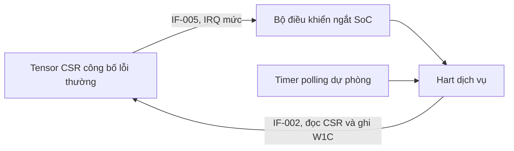

# Tensor diagrams and waveforms / Sơ đồ và waveform tensor

Editable block/FSM diagrams and waveform examples for the tensor coprocessor HDS.

Sơ đồ khối/FSM có thể chỉnh sửa và các waveform ví dụ cho HDS tensor coprocessor.

- Block diagram / Sơ đồ khối: [SVG](tensor_copro_block_diagram_runtime.svg) · [draw.io](tensor_copro_block_diagram_runtime.drawio) · [JSON](tensor_copro_block_diagram_runtime.json).
- Control FSM / FSM điều khiển: [SVG](ctrl_fsm.svg) · [draw.io](ctrl_fsm.drawio) · [JSON](ctrl_fsm.json).

## Các đầu nối của tensor coprocessor

| Nhãn trên sơ đồ | Nối đến đâu | Nội dung truyền |
|---|---|---|
| XIF | CVA6 phát lệnh, qua IF-001 đến `u_cvxif_adapter` | Lệnh custom-0, giá trị thanh ghi chứa địa chỉ descriptor và commit/kill. Tensor trả tín hiệu sẵn sàng để bắt tay. |
| RES | Từ `u_cvxif_adapter` về cùng CVA6 qua IF-001 | Phản hồi nhận lệnh và completion. `rd` nhận status hoặc kết quả scalar theo opcode. `result_ready` đi từ CVA6 về tensor. |
| MEM | `u_mem_path` nối master AXI4 IF-003 qua firewall vào fabric bộ nhớ SoC | Tensor đọc descriptor và operand, ghi tensor đầu ra. Hệ thống bộ nhớ trả dữ liệu đọc và phản hồi ghi. Hướng mũi tên trên sơ đồ đánh dấu phía mở giao dịch. |
| APB | APB4 manager của SoC nối IF-002 đến `u_csr` khi build ở Mode 2 | Truy cập thanh ghi cấu hình, trạng thái và lỗi, ví dụ đọc bản ghi lỗi hoặc ghi W1C. |
| CRCLK | Nguồn clock và reset của SoC | Clock/reset của core và miền APB nếu có. |
| QREQ, QACK | Reset controller của SoC nối IF-004 | Yêu cầu ngừng nhận lệnh mới và xác nhận khi các giao dịch cũ đã hoàn tất trước functional reset. |

**SRAM cục bộ (IF-006).** Mỗi bank của buffer lớn có cổng đọc/ghi riêng. Wrapper nối đến SRAM macro hoặc RAM nội bộ. Đường MEM vẫn là AXI4 đến bộ nhớ SoC.

**IRQ báo lỗi Mode 2 (DEC-076).** Đường IF-005 bổ sung cho sơ đồ khối gốc. Hart dịch vụ vẫn đọc bản ghi và ghi W1C qua APB. Timer dự phòng kích hoạt cùng routine khi IRQ bị trì hoãn hoặc bị che.

**Lệnh nằm ở đâu?** Lệnh 32 bit nằm trong mã chương trình mà CVA6 fetch. CVA6 chuyển mã lệnh qua XIF, cùng giá trị thanh ghi trỏ đến descriptor. Sau non-kill commit, tensor mới đọc descriptor qua MEM. Descriptor chứa shape, stride và địa chỉ các tensor. SRAM banked giữ các tile đang xử lý.

**Kết quả đi đâu?** Ví dụ GEMM ghi ma trận đầu ra đến địa chỉ đích trong descriptor qua MEM, đợi phản hồi ghi rồi trả status qua RES. REDUCE và ARGMAX trả giá trị scalar qua RES theo quy tắc của từng opcode. 

| Đường nội bộ | Từ → đến | Nội dung |
|---|---|---|
| ISS | Adapter → systolic array | Mode, precision và thông tin tile của lệnh đang chạy. |
| OPR | Memory path → systolic array | Tile operand và metadata 2:4 khi có. |
| PSM | Systolic array → accumulator | Tổng từng phần và tọa độ tile. |
| ACC | Accumulator → elementwise | Giá trị đã tích lũy để xử lý bias, scale hoặc activation nếu lệnh yêu cầu. |
| VEC | Elementwise → reduce | Vector hoặc tile sau bước xử lý từng phần tử. |
| ATN | Reduce → systolic array | Dữ liệu attention phục vụ pha nhân ma trận tiếp theo. |
| STO | Reduce → memory path | Tile kết quả và thông tin để ghi ra đích. |

[HDS](../VLSIT_TENSOR_COPROCESSOR_HDS.md) · [Tập lệnh](../TENSOR_COPROCESSOR_INSTRUCTION_SET.md)

| ID | Scenario / Kịch bản | View / Xem | Source / Nguồn |
|---|---|---|---|
| WF-001 | GEMM success / GEMM thành công | [SVG](wf001_gemm_success.svg) | [JSON](wf001_gemm_success.json) |
| WF-002 | Unsupported instruction / Lệnh không được hỗ trợ | [SVG](wf002_gemm_error.svg) · [HTML](wf002_gemm_error.html) | [JSON](wf002_gemm_error.json) |
| WF-003 | AXI read with backpressure / Đọc AXI khi đầu nhận chờ | [SVG](wf003_mem_handshake.svg) · [HTML](wf003_mem_handshake.html) | [JSON](wf003_mem_handshake.json) |
| WF-004 | Element-wise operation / Phép toán từng phần tử | [SVG](wf004_elemwise.svg) · [HTML](wf004_elemwise.html) | [JSON](wf004_elemwise.json) |
| WF-005 | Valid zero reduction / Kết quả reduction bằng 0 | [SVG](wf005_reduce.svg) · [HTML](wf005_reduce.html) | [JSON](wf005_reduce.json) |
| WF-006 | APB register access / Truy cập thanh ghi APB | [SVG](wf006_apb.svg) | [JSON](wf006_apb.json) |
| WF-007 | Reset / Đặt lại | [SVG](wf007_reset.svg) | [JSON](wf007_reset.json) |
| WF-008 | Result backpressure / Giữ kết quả khi phía nhận chờ | [SVG](wf008_backpressure.svg) | [JSON](wf008_backpressure.json) |
| WF-009 | Argmax success / Argmax thành công | [SVG](wf009_argmax_success.svg) · [HTML](wf009_argmax_success.html) | [JSON](wf009_argmax_success.json) |
| WF-010 | Argmax AXI read error / Lỗi đọc AXI của argmax | [SVG](wf010_argmax_read_error.svg) · [HTML](wf010_argmax_read_error.html) | [JSON](wf010_argmax_read_error.json) · DEC-072 detail [HTML](dec072_csr_publish.html) / [JSON](dec072_csr_publish.json) |
| WF-011 | Exact attention / Attention chính xác | [SVG](wf011_exact_attention.svg) · [HTML](wf011_exact_attention.html) | [JSON](wf011_exact_attention.json) |
| WF-012 | Row softmax / Softmax theo hàng | [SVG](wf012_row_softmax.svg) · [HTML](wf012_row_softmax.html) | [JSON](wf012_row_softmax.json) |
| WF-013 | Layer normalization / Chuẩn hóa theo lớp | [SVG](wf013_layer_norm.svg) · [HTML](wf013_layer_norm.html) | [JSON](wf013_layer_norm.json) |
| WF-014 | Sparse GEMM / GEMM thưa | [SVG](wf014_sparse_gemm.svg) · [HTML](wf014_sparse_gemm.html) | [JSON](wf014_sparse_gemm.json) |
| WF-015 | Linear attention / Attention tuyến tính | [SVG](wf015_linear_attention.svg) · [HTML](wf015_linear_attention.html) | [JSON](wf015_linear_attention.json) |
| WF-016 | Delayed commit with descriptor overlap / Commit trễ và đọc descriptor chồng lấp | [SVG](wf016_delayed_commit_overlap.svg) · [HTML](wf016_delayed_commit_overlap.html) | [JSON](wf016_delayed_commit_overlap.json) |
| WF-017 | Older exception kills before DMA / Exception cũ hủy trước DMA | [SVG](wf017_commit_kill_no_dma.svg) · [HTML](wf017_commit_kill_no_dma.html) | [JSON](wf017_commit_kill_no_dma.json) |

WF-001–017 show illustrative ordering. `python -B scripts/check_tensor_spec.py` checks selected handshake, overlap, completion, sparse validation, CSR publication, reset and kill ordering in their WaveJSON sources. It also checks stable result fields in WF-008, the scalar error sentinel in WF-010, descriptor ownership in WF-016, and the oldest affected command ID in WF-017. Open an HTML link in a browser for the offline viewer or use its matching JSON as the editable source.

Open HTML locally for the interactive view, or SVG for a static figure. WF-007 and WF-011 through WF-017 use illustrative cycle placement and overlap; they do not define a latency contract. These figures describe specified behavior, not measured RTL results. / Mở HTML để xem tương tác hoặc SVG để xem hình tĩnh. WF-007 và WF-011 đến WF-017 chỉ minh họa chu kỳ và overlap, không quy định latency. Hình mô tả đặc tả, chưa phải kết quả đo từ RTL.

[Specification / Đặc tả](../VLSIT_TENSOR_COPROCESSOR_HDS.md) · [CSR](../TENSOR_COPROCESSOR_CSR.xlsx) · [Block diagram / Sơ đồ khối](tensor_copro_block_diagram_runtime.svg) · [FSM](ctrl_fsm.svg) · [Waveforms / Dạng sóng](README.md)
