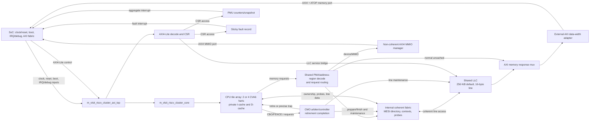

# VLSIT RISC-V CPU Cluster Architecture Specification
# Kiến trúc cluster CPU RISC-V VLSIT

**Revision:** 0.4 — detailed, source-aligned architecture specification 
**Updated:** 2026-11-16 
**Authority:** This guide explains the implemented AXI profile. Normative requirements and signal contracts remain in [HDS v0.29](../specification/VLSIT_RISCV_DUAL_QUAD_CPU_CLUSTER_HDS.md). If a summary here differs from the HDS or pinned RTL, follow the HDS and report the mismatch.

**Phiên bản:** 0.4 — đặc tả kiến trúc chi tiết, bám theo source 
**Cập nhật:** 2026-11-16 
**Nguồn chuẩn:** Tài liệu này giải thích profile AXI đang triển khai. Requirement và hợp đồng tín hiệu chuẩn nằm trong [HDS v0.29](../specification/VLSIT_RISCV_DUAL_QUAD_CPU_CLUSTER_HDS.md). Nếu nội dung tóm tắt khác HDS hoặc RTL đã pin, áp dụng HDS và báo lại điểm không khớp.

## 1. Purpose and scope / Mục đích và phạm vi

This companion architecture specification describes the cluster block by block: each block's purpose, responsibilities, state ownership, interfaces, request/data flow, control FSMs, approved waveforms, implementation method, and evidence limits. The HDS remains normative for requirements, port timing, CSR behavior, and unresolved decisions. It replaces the earlier proposal that presented APB, external ACE, 64-byte lines, a configurable shared L2, a power controller and a flight recorder as selected features.

Đặc tả kiến trúc bổ trợ này mô tả cluster theo từng block: mục đích, trách nhiệm, state do block quản lý, interface, luồng request/data, FSM, waveform đã duyệt, phương pháp thiết kế và giới hạn bằng chứng. HDS vẫn là nguồn chuẩn cho requirement, timing port, hành vi CSR và quyết định còn mở. Tài liệu thay bản đề xuất cũ vốn nêu APB, ACE ngoài, line 64 byte, L2 chia sẻ cấu hình được, power controller và flight recorder như tính năng đã chọn.

The implemented top is `m_vlsit_riscv_cluster_axi_top`. `non_coherence_cluster` describes the **external** AXI profile: private D-caches are coherent with each other, but outside DMA/peripheral agents do not snoop them. Software/SoC must synchronize non-coherent DMA with cache maintenance. There is no external ACE RTL top. The internal tagged probe interface does not imply external ACE support.

TOP hiện tại là `m_vlsit_riscv_cluster_axi_top`. `non_coherence_cluster` mô tả profile AXI **bên ngoài**: D-cache riêng coherent với nhau, nhưng DMA/peripheral ngoài không snoop cache. Software/SoC phải đồng bộ DMA non-coherent bằng cache maintenance. Chưa có RTL TOP ACE ngoài. Interface probe có tag nội bộ không có nghĩa hỗ trợ ACE ở cổng ngoài.

The default configuration has four harts; `PARA_CPU_NUM` supports 2 or 4. LLC data width is 64 bits. External memory data width is parameterized as 32/64/128/256 bits, but CPU end-to-end qualification is recorded at 64 bits only. No FCLK, IPC, power or area target is claimed.

Cấu hình mặc định có bốn hart; `PARA_CPU_NUM` nhận 2 hoặc 4. Độ rộng dữ liệu LLC là 64 bit. Độ rộng memory ngoài có thể cấu hình 32/64/128/256 bit, nhưng CPU end-to-end mới có bằng chứng ở 64 bit. Chưa có cam kết FCLK, IPC, công suất hay diện tích.

## 2. Terminology / Thuật ngữ

| Term | Meaning here |
|---|---|
| Hart | One RISC-V hardware thread; one CVA6 per hart. |
| CPU tile | CVA6, private caches and the adapters that connect them to the cluster. |
| CCU | Cache Coherence Unit; coordinates ownership, probes and line serialization. |
| Sharer directory | Non-inclusive metadata that tracks which private D-caches may hold each line. |
| MESI | Modified, Exclusive, Shared and Invalid private D-cache line states. |
| PREPARE / COMMIT / ABORT | Prepare locks and gathers obligations; exactly one terminal phase commits or restores prior stable state. |
| LLC | Shared Last-Level Cache connected to external memory. |
| CMO | Cache-management operation, including the selected RISC-V `CBO.*` operations. |
| PMU | Performance Monitoring Unit for selected event counts and overflow interrupt. |

| Thuật ngữ | Nghĩa trong tài liệu |
|---|---|
| Hart | Một hardware thread RISC-V; mỗi hart có một CVA6. |
| CPU tile | CVA6, cache riêng và adapter nối chúng vào cluster. |
| CCU | Cache Coherence Unit; quản lý ownership, probe và tuần tự hóa line. |
| Sharer directory | Metadata non-inclusive theo dõi D-cache nào có thể giữ line. |
| MESI | Trạng thái line D-cache riêng: Modified, Exclusive, Shared, Invalid. |
| PREPARE / COMMIT / ABORT | Prepare khóa và thu nghĩa vụ; đúng một pha cuối commit hoặc khôi phục state ổn định cũ. |
| LLC | Last-Level Cache dùng chung, kết nối bộ nhớ ngoài. |
| CMO | Cache-management operation, gồm các lệnh RISC-V `CBO.*` được chọn. |
| PMU | Performance Monitoring Unit đếm event đã chọn và báo overflow. |

## 3. Topology and data flow / Cấu trúc và luồng dữ liệu

### Cluster block diagram / Sơ đồ khối cluster

The following top-level diagram is embedded directly in this specification. The linked SVG and Draw.io source below provide the detailed, editable drawing.

Sơ đồ TOP dưới đây được nhúng trực tiếp trong đặc tả này. SVG và Draw.io được liên kết bên dưới để xem chi tiết và chỉnh sửa.

External ACE snoop ports are intentionally absent: this is the AXI profile with coherence inside the cluster only. The CCU/probe arrows are internal interfaces, not an external ACE interface.

Sơ đồ không có cổng snoop ACE ngoài: đây là profile AXI, chỉ có coherence bên trong cluster. Các mũi tên CCU/probe là interface nội bộ, không phải ACE ngoài.

[Editable TOP diagram](../specification/figures/post_a06/m_vlsit_riscv_cluster_axi_top.drawio) · [TOP component detail](../specification/figures/post_a06/m_vlsit_riscv_cluster_core.svg)

The structural top contains the cluster core and a memory-width adapter. The core integrates the CPU tile array, address routing, CCU, LLC, maintenance arbitration/controller, AXI4-Lite control, PMU and fault record. External clock/reset, boot, interrupt/debug, control, MMIO and memory ports are specified in HDS Section 6.

TOP cấu trúc gồm cluster core và adapter đổi độ rộng memory. Core tích hợp CPU tile array, định tuyến địa chỉ, CCU, LLC, arbiter/controller maintenance, AXI4-Lite control, PMU và fault record. Clock/reset, boot, interrupt/debug, control, MMIO và memory ngoài được quy định tại Mục 6 HDS.

[Editable data-flow diagram](../specification/figures/post_a06/CLUSTER_DATA_FLOW.drawio)

The shared address-region table classifies a physical address before routing. Cacheable traffic uses the private D-cache and CCU; normal-uncached traffic bypasses the LLC; device/MMIO traffic uses a separate AXI4 output; an unmapped region returns a local access error. PMA classification and routing use the same table.

Bảng vùng địa chỉ dùng chung phân loại physical address trước khi định tuyến. Traffic cacheable dùng D-cache riêng và CCU; normal-uncached bypass LLC; device/MMIO đi cổng AXI4 riêng; vùng không map trả local access error. PMA và router dùng cùng bảng.

| Request | Data path / Đường dữ liệu |
|---|---|
| Cacheable load hit | CVA6 → local D-cache; no CCU transaction if line and permissions are valid. / CVA6 → D-cache cục bộ; không cần CCU nếu line/quyền hợp lệ. |
| Cacheable miss/upgrade | Tile adapter → tagged CCU context and line lock → directory → PREPARE probes → optional owner writeback → matching response/B → COMMIT or ABORT → directory update → grant/refill. / Adapter → context/tag và line lock CCU → directory → probe PREPARE → writeback owner nếu cần → response/B đúng giao dịch → COMMIT/ABORT → cập nhật directory → grant/refill. |
| Normal-uncached | Bypass cache allocation and LLC; AXI response returns to the originating hart/request. / Bypass cache và LLC; AXI response về đúng hart/request. |
| MMIO | Forward on the separate non-coherent AXI4 manager port; the external SoC fabric decodes peripherals. / Chuyển qua cổng AXI4 manager non-coherent riêng; fabric SoC ngoài decode peripheral. |
| Cached AMO/LR-SC | Execute on the coherent L1 line under CCU ownership/line-lock rules; uncached atomic uses AXI4+ATOP. / Chạy trên line L1 coherent theo quyền CCU/line lock; atomic uncached dùng AXI4+ATOP. |
| Non-coherent DMA | Software/SoC must order DMA against CPU cache state and use the specified CMO sequence. There is no external snoop in this profile. / Software/SoC đồng bộ DMA với cache CPU bằng CMO; profile này không snoop ngoài. |

An accepted AXI beat is not a completion. Dirty data is retained until the matching successful B response and required coherence terminal phase complete.

Nhận một beat AXI chưa phải hoàn tất. Dữ liệu dirty phải được giữ đến khi B response đúng giao dịch thành công và pha coherence cuối hoàn tất.

## 4. Block-by-block design / Thiết kế từng block

Status labels: **NEW** = VLSIT RTL; **MODIFY** = license-preserving upstream copy with local changes; **REUSE** = upstream source retained unchanged; **GENERATED** = generated from the reviewed CSR workbook. A file in a filelist is not proof that every feature is active or verified.

Nhãn: **NEW** = RTL VLSIT; **MODIFY** = bản upstream sửa local, giữ license; **REUSE** = source upstream giữ nguyên; **GENERATED** = sinh từ CSR workbook đã duyệt. File có trong filelist không chứng minh mọi tính năng đã hoạt động hay được verify.

### 4.1 Structural TOP and cluster core / TOP cấu trúc và cluster core

**RTL / Source:** `rtl/non_coherence_cluster/m_vlsit_riscv_cluster_axi_top.sv`, `m_vlsit_riscv_cluster_core.sv` — **NEW**. 
**Diagrams:** [TOP](../specification/figures/post_a06/m_vlsit_riscv_cluster_axi_top.svg) · [core](../specification/figures/post_a06/m_vlsit_riscv_cluster_core.svg) · [draw.io](../specification/figures/post_a06/m_vlsit_riscv_cluster_axi_top.drawio).

The top exposes one cluster clock/reset, shared 64-bit boot address, per-hart interrupt/debug, one 32-bit AXI4-Lite subordinate, separate non-coherent AXI4 MMIO manager, and parameterized AXI4+ATOP memory manager. The core composes functional blocks and does not duplicate their state. `PARA_CPU_NUM` is 2 or 4, default 4. SoC holds `i_boot_addr` through reset release and supplies synchronous reset deassertion. All buses are synchronous to `i_clk_cluster`; add CDC bridges outside the cluster if needed.

TOP đưa ra clock/reset, boot address 64-bit dùng chung, interrupt/debug từng hart, AXI4-Lite subordinate 32-bit, AXI4 MMIO manager non-coherent và AXI4+ATOP memory manager có độ rộng tham số. Core ghép block, không nhân đôi state. `PARA_CPU_NUM` là 2 hoặc 4, mặc định 4. SoC giữ `i_boot_addr` ổn định khi reset nhả và đồng bộ deassert reset. Bus cùng clock `i_clk_cluster`; nếu cần CDC thì đặt bên ngoài cluster.

### 4.2 CPU tile and tile array / CPU tile và tile array

**RTL:** `m_vlsit_riscv_cpu_tile_array`, `m_vlsit_riscv_cpu_tile` — **NEW**; selected CVA6 and HPDcache integration copies — **MODIFY**; unchanged native leaves — **REUSE**. 
**Diagrams:** [tile array](../specification/figures/post_a06/m_vlsit_riscv_cpu_tile_array.svg) · [tile](../specification/figures/post_a06/m_vlsit_riscv_cpu_tile.svg) · [CVA6](../specification/figures/post_a06/cva6.svg) · [HPDcache subsystem](../specification/figures/post_a06/cva6_hpdcache_subsystem.svg).

Each active tile contains one CVA6 hart, private I-cache and write-back D-cache. The modified HPDcache path obtains permission before refill, carries hart/request identity, services tagged probes, and holds line state through writeback/terminal response. A local CVA6 configuration disables CVXIF; pristine upstream sources remain available. I-cache is not snooped. Software must run `FENCE.I` on each hart that will execute changed code.

Mỗi tile có một hart CVA6, I-cache và D-cache write-back riêng. HPDcache đã sửa xin quyền trước refill, giữ hart/request identity, xử lý probe có tag và giữ state line đến writeback/terminal response. Config CVA6 local tắt CVXIF; source upstream nguyên bản được giữ. I-cache không snoop; software phải chạy `FENCE.I` ở từng hart sẽ thực thi code vừa sửa.

The D-cache owns its data array and stable MESI state. CCU owns transaction sequencing and directory updates. Responses must match transaction tag and hart before changing state.

D-cache quản lý data array và MESI ổn định. CCU quản lý thứ tự transaction và cập nhật directory. Response phải khớp tag và hart trước khi đổi state.

### 4.3 CCU, MESI and directory / CCU, MESI và directory

**RTL:** `m_vlsit_riscv_coh_tile_array`, `m_vlsit_riscv_coh_fabric`, `m_vlsit_riscv_coh_txn_table`, `m_vlsit_riscv_sharer_directory`, `m_vlsit_riscv_probe_scheduler`, `m_vlsit_riscv_hpd_probe_engine`, `m_vlsit_riscv_tile_coh_adapter`, `m_vlsit_riscv_cache_line_locks` — **NEW**; HPDcache probe/state integration — **MODIFY**. Culsans is an architecture reference, not copied CCU RTL.

**Diagrams:** [coherence tile array](../specification/figures/post_a06/m_vlsit_riscv_coh_tile_array.svg) · [fabric](../specification/figures/post_a06/m_vlsit_riscv_coh_fabric.svg) · [transaction table](../specification/figures/post_a06/m_vlsit_riscv_coh_txn_table.svg) · [directory](../specification/figures/post_a06/m_vlsit_riscv_sharer_directory.svg) · [probe scheduler](../specification/figures/post_a06/m_vlsit_riscv_probe_scheduler.svg) · [probe engine](../specification/figures/post_a06/m_vlsit_riscv_hpd_probe_engine.svg).

The directory is independent and non-inclusive with the LLC. It has four banks and eight ways: 4,096 entries for two harts and 8,192 for four. The holder set is conservative: a stale-positive bit costs an extra probe; a false negative can expose stale data and is forbidden. LLC eviction alone does not evict L1. Directory replacement waits until recorded holders and dirty-owner data have been handled.

Directory độc lập, non-inclusive với LLC; có bốn bank và tám way: 4.096 entry cho 2 hart, 8.192 cho 4 hart. Holder set theo hướng bảo thủ: holder dư chỉ tốn thêm probe; thiếu holder có thể lộ dữ liệu cũ nên bị cấm. LLC eviction không tự evict L1. Thay entry directory phải chờ xử lý holder và dữ liệu dirty owner.

`PARA_COH_TXN_NUM` defaults to 8 and supports 2–16. A context stores requester, line, tag, phase, expected ACKs, lock and pending obligations. One credit is reserved for victim work; default root concurrency is at most seven. Each of four banks accepts one eligible operation per cycle; each cache services one probe at a time.

`PARA_COH_TXN_NUM` mặc định 8, nhận 2–16. Context giữ requester, line, tag, phase, ACK dự kiến, lock và nghĩa vụ đang chờ. Một credit dành cho victim; root concurrency mặc định tối đa bảy. Mỗi bank nhận một thao tác đủ điều kiện mỗi chu kỳ; mỗi cache xử lý một probe tại một thời điểm.

**PREPARE:** lock the line and probe only possible holders. Stable MESI/directory state does not change. A dirty M owner writes the full 16-byte line to LLC on its existing HPDcache AXI path (two 64-bit W beats) and waits for matching B. **COMMIT:** after all required ACKs and data obligations succeed, change MESI/directory state, then grant. **ABORT:** on pre-commit error, preserve the old stable state. All three phases have no ACK timeout; a missing ACK retains context/lock until ACK or reset.

**PREPARE:** khóa line, probe holder có thể giữ line, không đổi MESI/directory ổn định. Owner M dirty ghi line 16 byte vào LLC qua AXI HPDcache sẵn có (hai beat W 64-bit) rồi chờ B đúng giao dịch. **COMMIT:** khi đủ ACK và nghĩa vụ dữ liệu thành công thì đổi MESI/directory rồi mới grant. **ABORT:** lỗi trước commit thì giữ state cũ. Cả ba pha không timeout ACK; mất ACK giữ context/lock đến ACK hoặc reset.

Directory arbitration checks eligibility before selecting a slot. A blocked non-owner request cannot occupy the bank; reservation-owner UPDATE/CANCEL has an escape path. This breaks the documented same-set wait cycle, but does not bound progress when an external response or ACK is absent.

Arbitration directory kiểm tra eligibility trước khi chọn slot. Request không sở hữu reservation nếu bị chặn không chiếm bank; UPDATE/CANCEL của owner có lối thoát. Điều này phá vòng chờ cùng set đã ghi nhận, nhưng không bảo đảm tiến triển hữu hạn khi thiếu ACK/response ngoài.

### 4.4 Address map and AXI routing / Address map và định tuyến AXI

**RTL:** `m_vlsit_riscv_addr_decode`, `m_vlsit_riscv_axi_route`, `m_vlsit_riscv_axi_mem_mux`, `m_vlsit_riscv_axi_mmio`, width adapter — **NEW**; selected PULP AXI primitives — **REUSE** after configuration checks. 
**Diagrams:** [decoder](../specification/figures/post_a06/m_vlsit_riscv_addr_decode.svg) · [route](../specification/figures/post_a06/m_vlsit_riscv_axi_route.svg) · [memory mux](../specification/figures/post_a06/m_vlsit_riscv_axi_mem_mux.svg) · [MMIO](../specification/figures/post_a06/m_vlsit_riscv_axi_mmio.svg) · [width adapter](../specification/figures/post_a06/m_vlsit_riscv_axi_dw_adapter.svg).

One compile-time address-region table is shared by PMA classification and router. Default cacheable range is `0x80000000–0xBFFFFFFF`; other entries classify normal-uncached or MMIO. Active entries must be aligned, non-overlapping and within the physical-address range. Unmapped/invalid routes return a local error. The external SoC fabric decodes peripherals. The memory mux preserves response identity. The LLC side remains 64-bit; the outer adapter changes only external beat width.

Bảng vùng địa chỉ compile-time dùng chung cho PMA và router. Vùng cacheable mặc định `0x80000000–0xBFFFFFFF`; vùng khác chọn normal-uncached hoặc MMIO. Entry phải aligned, không overlap và trong physical-address range. Địa chỉ không map/sai trả local error. Fabric SoC ngoài decode peripheral. Memory mux giữ response identity. Phía LLC vẫn 64-bit; adapter ngoài chỉ đổi độ rộng beat.

### 4.5 Shared LLC / LLC dùng chung

**RTL:** `m_vlsit_axi_llc` — **NEW wrapper**; licensed PULP `axi_llc` hierarchy — **MODIFY** with its license/history retained; ASIC SRAM integration remains an implementation task. 
**Diagrams:** [VLSIT LLC wrapper](../specification/figures/post_a06/m_vlsit_axi_llc.svg) · [LLC hierarchy](../specification/figures/post_a06/axi_llc_top.svg) · [tag store](../specification/figures/post_a06/axi_llc_tag_store.svg).

Default geometry is 4 ways × 4,096 lines × 16 bytes = 256 KiB. Its native data bus is 64 bits, so one line uses two beats. LLC owns tags, data and refill/writeback descriptors; the sharer directory is independent. For dirty eviction or line clean, retain valid tag and dirty data until matching memory B succeeds. On `SLVERR`/`DECERR`, preserve the data and report the fault; do not mark clean or reuse the way. LLC service uses the AXI4-Lite control path and AXI4-Lite-to-RegBus bridge; runtime SPM reconfiguration is disabled.

Geometry mặc định 4 way × 4.096 line × 16 byte = 256 KiB. Data bus native 64-bit nên một line cần hai beat. LLC quản lý tag, data và descriptor refill/writeback; directory holder độc lập. Với dirty eviction hoặc clean line, giữ tag valid và data dirty đến khi B đúng giao dịch thành công. Khi `SLVERR`/`DECERR`, giữ data và báo lỗi; không mark clean hay tái sử dụng way. Service LLC dùng AXI4-Lite và cầu AXI4-Lite-to-RegBus; không bật SPM runtime.

### 4.6 CMO and FENCE.I / CMO và FENCE.I

**RTL:** `m_vlsit_riscv_cmo_arbiter`, `m_vlsit_riscv_cmo_controller` — **NEW**; CVA6 retirement/store buffer and HPDcache flush path — **MODIFY**; CCU/LLC endpoints service the command. 
**Diagrams:** [retirement–CCU–LLC flow](../specification/figures/post_a06/CLUSTER_CMO_FLOW.svg) · [CMO FSM](../specification/figures/post_a06/CMO_CONTROLLER.svg) · [HPD flush capture](../specification/figures/post_a06/HPD_FLUSH_CAPTURE.svg) · CCU [prepare](../specification/figures/post_a06/CCU_PREPARE_CMO.svg), [commit](../specification/figures/post_a06/CCU_COMMIT_RELEASE.svg), [abort](../specification/figures/post_a06/CCU_ABORT_RELEASE.svg).

The arbiter selects one hart's command while keeping its identity. The controller holds CBO or `FENCE.I` at retirement until terminal completion; younger instructions do not retire past it. CLEAN/FLUSH may write dirty L1 data to LLC and then require LLC-to-memory completion. `FENCE.I` cleans dirty D-cache data to the shared LLC, then invalidates the local I-cache/fetch state; it does not wait for LLC-to-DRAM. Software must arrange `FENCE.I` on every hart that will execute modified code.

Arbiter chọn lệnh của một hart và giữ identity. Controller giữ CBO/`FENCE.I` ở retirement đến khi hoàn tất; lệnh trẻ không retire vượt qua. CLEAN/FLUSH có thể ghi data L1 dirty xuống LLC rồi cần LLC-to-memory hoàn tất. `FENCE.I` clean data D-cache dirty tới LLC rồi invalidate I-cache/fetch cục bộ; không chờ LLC ghi DRAM. Software phải chạy `FENCE.I` trên mỗi hart sẽ dùng code đã sửa.

Writeback error on CBO waits for ABORT ACKs then raises precise Store/AMO access fault cause 7 before retirement. L1-to-LLC B error on `FENCE.I` waits for ABORT ACKs then raises precise custom maintenance cause 24. Ordinary eviction error is fatal/asynchronous because the store may already have retired; its record and interrupt report the failure. No timeout is invented for a missing ACK.

Lỗi writeback CBO chờ ABORT ACK rồi phát Store/AMO access fault cause 7 chính xác trước retirement. Lỗi B L1-to-LLC của `FENCE.I` chờ ABORT ACK rồi phát custom maintenance cause 24 chính xác. Lỗi eviction thường là fatal/bất đồng bộ vì store có thể đã retire; fault record và interrupt báo lỗi. Không tự đặt timeout khi thiếu ACK.

### 4.7 AXI4-Lite control and CSR / Điều khiển AXI4-Lite và CSR

**RTL:** `m_vlsit_riscv_axil_decode`, `m_vlsit_axil_reg_bridge` — **NEW**; `m_vlsit_cpucl_csr` — **GENERATED** from the canonical workbook; selected PULP bus blocks — **REUSE**. 
**Diagrams:** [AXI4-Lite decode](../specification/figures/post_a06/m_vlsit_riscv_axil_decode.svg) · [RegBus bridge](../specification/figures/post_a06/m_vlsit_axil_reg_bridge.svg) · [CSR](../specification/figures/post_a06/m_vlsit_cpucl_csr.svg) · [AXIL–RegBus FSM](../specification/figures/post_a06/AXIL_REGBUS.svg).

One 32-bit AXI4-Lite subordinate port routes to cluster CSR and LLC service windows. The workbook is the register-map authority. The decoder retains AW/W association, routes mapped regions, responds to unmapped/misaligned accesses, and uses the configured single read and single write queue. Do not create a second register map in this document.

Một cổng AXI4-Lite subordinate 32-bit định tuyến tới CSR cluster và vùng service LLC. Workbook là nguồn chuẩn register map. Decoder giữ quan hệ AW/W, định tuyến vùng hợp lệ, trả response cho truy cập unmapped/misaligned và dùng queue một read/một write theo cấu hình. Không tạo register map thứ hai trong tài liệu.

### 4.8 PMU / Bộ đo hiệu năng

**RTL:** `m_vlsit_riscv_pmu` and event-select, aggregate, counter-bank, snapshot, IRQ submodules — **NEW**. 
**Diagrams:** [PMU](../specification/figures/post_a06/m_vlsit_riscv_pmu.svg) · [event selector](../specification/figures/post_a06/m_vlsit_pmu_event_select.svg) · [counter bank](../specification/figures/post_a06/m_vlsit_pmu_counter_bank.svg) · [snapshot](../specification/figures/post_a06/m_vlsit_pmu_snapshot.svg).

Default is 16 programmable counters, legal 1–32; width is 32 or 64 bits, default 64. Scope selects hart 0–3, aggregate active harts, or cluster events. Aggregate counts sum event occurrences; stall/full events count cycles according to the event catalog. Snapshot provides consistent low/high reads on the 32-bit control bus. One aggregate level interrupt reports enabled overflow causes. Functional/software qualification remains open, so PMU output is not yet IPC evidence.

Mặc định 16 counter, hợp lệ 1–32; độ rộng 32 hoặc 64 bit, mặc định 64. Scope chọn hart 0–3, tổng hart hoạt động hoặc event cluster. Aggregate cộng số lần event; stall/full đếm chu kỳ theo event catalog. Snapshot giữ nhất quán khi đọc low/high qua bus 32-bit. Một interrupt level tổng hợp báo overflow đã enable. Qualification phần mềm/chức năng còn mở nên PMU chưa là bằng chứng IPC.

### 4.9 Fault record, interrupt and debug / Fault record, interrupt và debug

**RTL:** `m_vlsit_riscv_fault_record` — **NEW**; native per-hart debug execution integration — **REUSE/MODIFY**; system Debug Module/JTAG transport — **outside the cluster**. 
**Diagrams:** [fault record](../specification/figures/post_a06/m_vlsit_riscv_fault_record.svg) · [CVA6 boundary](../specification/figures/post_a06/cva6.svg).

The first fatal L1/LLC writeback record is held until reset; later fatal events set a multiple flag. L1 records identify the hart; shared LLC records use `hart_valid=0`. Address, source and AXI response are retained. `o_int_fault` is a level output. Clearing a separate diagnostic W1C bit does not repair cache state or lost progress; reset is the specified recovery boundary. Interrupts/debug are per hart; the full debug module/JTAG block is external. A pending maintenance operation cannot lose retirement metadata to an interrupt/debug flush; admission is deferred until it retires or traps.

Giữ record fatal writeback L1/LLC đầu tiên đến reset; lỗi fatal sau đặt cờ multiple. L1 ghi đúng hart; LLC dùng chung đặt `hart_valid=0`. Record giữ address, source và AXI response. `o_int_fault` là output level. Xóa diagnostic W1C riêng không phục hồi cache hay tiến trình; reset là ranh giới recovery đã chọn. Interrupt/debug theo từng hart; Debug Module/JTAG đầy đủ nằm ngoài cluster. Maintenance đang chờ không được mất retirement metadata do flush interrupt/debug; hoãn nhận đến khi retire hoặc trap.

### 4.10 External ACE extension / Mở rộng ACE ngoài

`rtl/coherence_cluster/filelist.f` is a status marker; no ACE top/proxy RTL is implemented. External ACE requires an approved coherent proxy, exact ACE subset, snoop/data ordering, LLC/home responsibilities, credits, error recovery and external-agent verification. Existing proposal drawings are not implementation contracts.

`rtl/coherence_cluster/filelist.f` chỉ đánh dấu trạng thái; chưa có ACE top/proxy RTL. ACE ngoài cần coherent proxy được duyệt, chốt ACE subset, thứ tự snoop/data, trách nhiệm LLC/home, credit, recovery lỗi và verify agent ngoài. Sơ đồ đề xuất hiện có không phải hợp đồng implementation.

## 5. FSMs / Máy trạng thái

The project has six explicit enum controllers and ten FSM figures. The CCU has one complete graph and four phase views of that same FSM; these are not five separate controllers. State names below follow the HDS FSM source exactly. The listed order is the enum/diagram order, not a promise that every FSM follows a single linear path. Full transitions and guards are in HDS Section 10.1.

Dự án có sáu controller enum và mười hình FSM. CCU có một graph đầy đủ cùng bốn view pha của cùng FSM, không phải năm controller. Bảng state/guard đầy đủ ở Mục 10.1 HDS.

| FSM | Exact states and transition contract | Diagram |
|---|---|---|
| CMO controller | `ENUM_ST_CMO_IDLE → ENUM_ST_CMO_BEGIN → ENUM_ST_CMO_PREPARE → ENUM_ST_CMO_MAINT_REQ → ENUM_ST_CMO_MAINT_WAIT → ENUM_ST_CMO_FINISH_REQ → ENUM_ST_CMO_FINISH_WAIT → ENUM_ST_CMO_RESP`. From PREPARE, an error or FENCE.I skips LLC-to-DRAM maintenance and requests CCU finish; successful CBO requests maintenance. If a ready response is not yet done, the controller waits. RESP is one cycle, then IDLE. | [CMO_CONTROLLER.svg](../specification/figures/post_a06/CMO_CONTROLLER.svg) · [draw.io](../specification/figures/post_a06/CMO_CONTROLLER.drawio) |
| CCU transaction context | `ENUM_ST_IDLE`, `ENUM_ST_DIR_REQ`, `ENUM_ST_DIR_WAIT`, `ENUM_ST_EVICT_ALLOC`, `ENUM_ST_EVICT_WAIT`, `ENUM_ST_OWNER`, `ENUM_ST_PREP_START`, `ENUM_ST_PREP_WAIT`, `ENUM_ST_COMMIT_START`, `ENUM_ST_COMMIT_WAIT`, `ENUM_ST_ABORT_START`, `ENUM_ST_ABORT_WAIT`, `ENUM_ST_DIR_UPDATE`, `ENUM_ST_DIR_CANCEL`, `ENUM_ST_GNT`, `ENUM_ST_GNT_WAIT`, `ENUM_ST_CMO_PREPARED`, `ENUM_ST_CMO_FINISH`, `ENUM_ST_RETRY_CANCEL`. Root requests look up the directory; victim work may allocate a child context. PREPARE success proceeds to COMMIT; an error proceeds to ABORT. Directory publication/cancel and requester grant/release occur only after their required phase handshakes. Each allocated context retains its tag and line lock until its terminal release. | [full graph](../specification/figures/post_a06/CCU_CONTEXT.svg) · [victim](../specification/figures/post_a06/CCU_LOOKUP_VICTIM.svg) · [prepare](../specification/figures/post_a06/CCU_PREPARE_CMO.svg) · [commit](../specification/figures/post_a06/CCU_COMMIT_RELEASE.svg) · [abort](../specification/figures/post_a06/CCU_ABORT_RELEASE.svg) |
| HPD probe engine | `ENUM_ST_IDLE`, `ENUM_ST_LOOKUP_REQ`, `ENUM_ST_LOOKUP_WAIT`, `ENUM_ST_FLUSH_REQ`, `ENUM_ST_FLUSH_WAIT`, `ENUM_ST_PREPARE_RSP`, `ENUM_ST_TERMINAL_WAIT`, `ENUM_ST_UPDATE_REQ`, `ENUM_ST_TERMINAL_RSP`, `ENUM_ST_ERR_RSP`, `ENUM_ST_STRAY_RSP`. A matching PREPARE looks up the line; dirty M hit may flush. A terminal COMMIT updates only a validated hit; ABORT or validated absence can terminate without that update. Tag, line, target and phase must match before state change; errors retain prepared context until the error response is consumed. | [HPD_PROBE.svg](../specification/figures/post_a06/HPD_PROBE.svg) |
| AXI4-Lite–RegBus bridge | `ENUM_ST_IDLE`, `ENUM_ST_WR_REQ`, `ENUM_ST_RD_REQ`. IDLE selects a legal complete write or queued read. The bridge holds the chosen downstream request until RegBus request and response are ready, then returns to IDLE. | [AXIL_REGBUS.svg](../specification/figures/post_a06/AXIL_REGBUS.svg) |
| HPD miss permission | `MISS_REQ_IDLE`, `MISS_REQ_OWN_REQ`, `MISS_REQ_OWN_WAIT`, `MISS_REQ_SEND`, `MISS_REQ_OWN_ERROR`. MSHR allocation starts ownership acquisition; refill is sent only for a matching, error-free grant with legal permission. Mismatch/error produces a failed response instead of refill. | [HPD_MISS_PERMISSION.svg](../specification/figures/post_a06/HPD_MISS_PERMISSION.svg) |
| HPD flush capture | `FLUSH_IDLE`, `FLUSH_SEND`. An accepted flush allocation captures the first word and routing metadata; the payload is sent while the resizer is ready. Returning to IDLE means payload capture/send completed, not that AXI B succeeded; the retained descriptor and matching B independently determine completion. | [HPD_FLUSH_CAPTURE.svg](../specification/figures/post_a06/HPD_FLUSH_CAPTURE.svg) |

CMO safety: hold the instruction at retirement; on pre-commit error send ABORT; do not report a precise trap until required ABORT ACKs arrive. CCU safety: keep lock/context until matching terminal ACKs, do not publish directory state during incomplete phases, and never grant before COMMIT. These guards—not a guessed cycle count—define the FSM contract.

An toàn CMO: giữ lệnh ở retirement; lỗi trước commit thì gửi ABORT; chỉ trap chính xác sau khi đủ ABORT ACK. An toàn CCU: giữ lock/context đến terminal ACK khớp, không publish directory khi phase chưa xong, không grant trước COMMIT. Guard trạng thái—not số chu kỳ phỏng đoán—định nghĩa hợp đồng FSM.

## 6. Approved waveforms / Waveform đã duyệt

The HDS waveform plan is approved. The following figures illustrate the selected event ordering; aliases and spacing are not cycle-accurate latency promises. Pending cases remain marked pending in HDS.

Kế hoạch waveform HDS đã được duyệt. Các hình dưới minh họa thứ tự sự kiện; alias và khoảng cách không phải cam kết latency theo chu kỳ. Case pending vẫn được đánh dấu trong HDS.

| Operation | Shown behavior | Figure |
|---|---|---|
| Dirty-owner read sharing | PREPARE → owner writes 16-byte line (two W beats) → matching B → COMMIT(S) → directory/grant. |  · [WaveJSON](../specification/figures/waveforms/WF-002_mesi_dirty_owner.json) |
| AXI MMIO and stalls | AW/W/B and AR/R handshake; payload stability under VALID/READY backpressure. | [WF-003](../specification/figures/waveforms/WF-003_axi_mmio_read_write.svg) · [WF-004](../specification/figures/waveforms/WF-004_axi_mmio_backpressure.svg) |
| Missing acknowledgements | PREPARE/COMMIT/ABORT wait, retained lock/context and reset recovery. | [WF-015](../specification/figures/waveforms/WF-015_commit_ack_wait.svg) · [WF-016](../specification/figures/waveforms/WF-016_prepare_ack_wait.svg) · [WF-017](../specification/figures/waveforms/WF-017_abort_ack_wait.svg) |
| CBO writeback error | SLVERR → hold retirement → ABORT ACKs → cause-7 trap. |  · [WaveJSON](../specification/figures/waveforms/WF-018_cbo_writeback_fault.json) |
| FENCE.I | Success to LLC and local fetch invalidate; separate failure preserves M/directory, ABORTs, then cause 24. |  · [WaveJSON](../specification/figures/waveforms/WF-019_fence_i_sync.json) |
| Directory deadlock escape | Blocked T1 update stays valid while T2 owner cancel proceeds; T1 continues after release. | [WF-020](../specification/figures/waveforms/WF-020_directory_cancel_escape.svg) · [WF-022 detail](../specification/figures/waveforms/WF-022_directory_cancel_escape_detail.svg) |
| Address routing | Separate cacheable, normal-uncached, MMIO and unmapped examples; not a latency trace. |  · [WaveJSON](../specification/figures/waveforms/WF-021_address_region_routing.json) |

LLC BIST, complete DMA software sequence, PMU snapshot/overflow, LLC flush, exact Debug Module timing and outstanding-traffic reset remain pending where noted by HDS. External ACE waveforms are deferred.

BIST LLC, trình tự DMA software đầy đủ, PMU snapshot/overflow, LLC flush, timing Debug Module và reset khi traffic còn pending theo HDS. Waveform ACE ngoài được hoãn.

## 7. Interface and parameter summary / Tóm tắt interface và parameter

| Boundary | Contract |
|---|---|
| Clock/reset/boot | One `i_clk_cluster`, `i_rst_n_cluster`, shared 64-bit `i_boot_addr`; SoC synchronizes reset deassertion. |
| Interrupt/debug | Per-hart interrupt/debug vectors; aggregate level `o_int_pmu` and `o_int_fault`; system Debug Module/JTAG external. |
| AXI4-Lite | One 32-bit control subordinate; workbook defines CSRs; byte strobes honored. |
| AXI4 MMIO | Separate non-coherent manager egress; external fabric decodes devices. |
| AXI4+ATOP memory | Memory manager egress; native LLC data bus 64-bit, outer data width parameterized. |
| Internal coherence | Tagged ownership, directory lookup/update/cancel, probes and PREPARE/COMMIT/ABORT. Not an external ACE port. |

| Biên | Hợp đồng |
|---|---|
| Clock/reset/boot | Một `i_clk_cluster`, `i_rst_n_cluster`, `i_boot_addr` 64-bit dùng chung; SoC đồng bộ reset deassertion. |
| Interrupt/debug | Vector interrupt/debug từng hart; `o_int_pmu`, `o_int_fault` level tổng hợp; Debug Module/JTAG ngoài. |
| AXI4-Lite | Một control subordinate 32-bit; CSR theo workbook; honor byte strobe. |
| AXI4 MMIO | Manager egress non-coherent riêng; fabric ngoài decode device. |
| AXI4+ATOP memory | Memory manager egress; data LLC native 64-bit, độ rộng ngoài cấu hình được. |
| Coherence nội bộ | Ownership có tag, directory lookup/update/cancel, probe và PREPARE/COMMIT/ABORT. Không phải ACE port ngoài. |

| Parameter | Default/legal | Qualification boundary |
|---|---|---|
| `PARA_CPU_NUM` | 4; 2 or 4 | Recorded CPU tests and TOP lint at 2/4. |
| `PARA_COH_TXN_NUM` | 8; 2–16 | Focused 2/8/16 checks; one victim credit is reserved. |
| `PARA_AXI_MEM_DATA_W` | 64; 32/64/128/256 | Only 64-bit CPU end-to-end recorded. |
| LLC geometry | 4 ways × 4,096 lines × 16 bytes | Default 256 KiB; line width remains 16 bytes. |
| `PARA_PMU_COUNTER_NUM/W` | 16 × 64-bit; 1–32 and 32/64-bit | Functional PMU/software qualification pending. |
| Address regions | Default cacheable `0x80000000–0xBFFFFFFF`; up to 16 entries | Normal-uncached/MMIO CPU integration still needs qualification. |

| Parameter | Mặc định/hợp lệ | Ranh giới qualification |
|---|---|---|
| `PARA_CPU_NUM` | 4; nhận 2 hoặc 4 | Có báo cáo CPU test và TOP lint 2/4. |
| `PARA_COH_TXN_NUM` | 8; 2–16 | Unit check 2/8/16; dành một credit cho victim. |
| `PARA_AXI_MEM_DATA_W` | 64; 32/64/128/256 | CPU end-to-end mới ghi nhận 64-bit. |
| LLC geometry | 4 way × 4.096 line × 16 byte | Mặc định 256 KiB; line 16 byte. |
| `PARA_PMU_COUNTER_NUM/W` | 16 × 64-bit; 1–32 và 32/64-bit | Qualification chức năng/software PMU còn pending. |
| Address region | Cacheable mặc định `0x80000000–0xBFFFFFFF`; tối đa 16 entry | Tích hợp CPU normal-uncached/MMIO cần qualification. |

## 8. Design method / Phương pháp thiết kế

1. **Freeze source of truth:** start from HDS requirements, selected CVA6 config, CSR workbook and pinned source/protocol revisions. Record unknowns as dependencies. 
   **Chốt nguồn chuẩn:** bắt đầu từ requirement HDS, config CVA6, CSR workbook và revision source/protocol đã pin; ghi điểm chưa rõ thành dependency.
2. **Assign state ownership:** CVA6/HPDcache own per-hart pipeline/cache state; CCU owns transaction/directory state; LLC owns tags/data/writeback; workbook/generator owns CSR shape; SoC owns external decode/clock/debug module. 
   **Giao quyền sở hữu state:** CVA6/HPDcache giữ pipeline/cache từng hart; CCU giữ transaction/directory; LLC giữ tag/data/writeback; workbook/generator định nghĩa CSR; SoC quản lý decode/clock/debug module ngoài.
3. **Define each handshake:** producer/consumer, valid-ready stability, transaction ID/tag, backpressure, reset and response/error behavior. Request acceptance is not completion. 
   **Định nghĩa handshake:** producer/consumer, ổn định valid-ready, transaction ID/tag, backpressure, reset và response/lỗi. Nhận request chưa phải hoàn tất.
4. **Order shared resources:** allocate one unique line context/lock; release array ports between operations; let reservation-owner UPDATE/CANCEL escape blocked arbitration; do not hold cache resources needed by a refill while waiting for that refill. 
   **Sắp thứ tự tài nguyên:** cấp context/lock line duy nhất; nhả array port giữa thao tác; cho UPDATE/CANCEL của reservation owner vượt qua arbitration đang bị chặn; không giữ tài nguyên cache mà refill cần trong lúc chờ refill.
5. **Preserve state on errors:** pre-commit failure uses ABORT and preserves prior MESI/directory; failed B preserves dirty line/tag; precise instruction faults are reported before retirement, while post-retirement eviction errors use retained asynchronous diagnostics. 
   **Giữ state khi lỗi:** lỗi trước commit dùng ABORT và giữ MESI/directory cũ; B lỗi giữ line/tag dirty; fault instruction chính xác phát trước retirement, lỗi eviction sau retirement dùng diagnostic bất đồng bộ.
6. **Derive diagrams and tests from contracts:** keep hierarchy/data-flow separate from FSM; use exact state guards; draw only confirmed waveform behavior and label abstract timing. Derive tests from requirements, protocol/ISA rules and independent reference models. 
   **Sinh sơ đồ/test từ hợp đồng:** tách hierarchy/data-flow khỏi FSM; dùng guard state chính xác; chỉ vẽ waveform đã duyệt và ghi rõ timing trừu tượng. Sinh test từ requirement, chuẩn protocol/ISA và reference model độc lập.
7. **Close verification in layers:** directed block simulation, real-instruction CPU tests, lint, assertions/formal, CDC/RDC, then synthesis/STA/PPA with actual library, SRAM and constraints. A passing lint/test alone is not physical signoff. 
   **Hoàn tất verify theo lớp:** mô phỏng block, CPU instruction thật, lint, assertion/formal, CDC/RDC, sau đó synthesis/STA/PPA với library, SRAM và constraint thực. Lint/test pass không phải physical signoff.

## 9. Worst-case performance / Hiệu năng trường hợp xấu

No finite latency bound exists without bounded ACK and AXI response times. A dirty-owner transfer waits on the slowest required holder and matching write response. Same-line writers serialize; directory bank/set conflicts serialize; one cache services probes sequentially; full contexts stall new misses/upgrades/CMOs. Four banks and more contexts increase possible concurrency only when the target banks, caches and downstream queues are independent.

Không có bound latency hữu hạn nếu ACK và AXI response không bị giới hạn. Dirty-owner transfer chờ holder chậm nhất và write response khớp. Writer cùng line tuần tự; xung đột bank/set directory tuần tự; mỗi cache xử lý probe lần lượt; hết context làm miss/upgrade/CMO mới phải chờ. Bốn bank và nhiều context chỉ tăng concurrency khi bank/cache/queue phía sau độc lập.

| Worst case | Effect |
|---|---|
| Missing PREPARE/COMMIT/ABORT ACK | Retain lock/context indefinitely; reset is the specified recovery. |
| All CCU contexts allocated | New CCU-dependent work stalls; N contexts allow at most N−1 roots due to victim reserve. |
| Same bank/reserved set | One accepted operation per bank/cycle; same-set conflicts wait for owner terminal operation. |
| Many probes to one hart | One probe service at a time per cache; later probes queue. |
| Dirty victim or AXI backpressure | B/R response latency extends lock and refill; no fixed maximum. |
| Full directory with live holders | Victim entry cannot be reused until invalidation and dirty writeback complete. |
| External width increased | Beat count changes; CCU/directory/LLC bottlenecks remain. |

| Trường hợp xấu | Ảnh hưởng |
|---|---|
| Mất PREPARE/COMMIT/ABORT ACK | Giữ lock/context vô hạn; reset là recovery đã định nghĩa. |
| Cấp hết context CCU | Công việc mới cần CCU bị stall; N context cho tối đa N−1 root do dành victim. |
| Cùng bank/set reservation | Mỗi bank nhận một thao tác/chu kỳ; cùng set chờ thao tác cuối của owner. |
| Nhiều probe vào một hart | Mỗi cache phục vụ một probe; probe sau xếp hàng. |
| Dirty victim/AXI backpressure | B/R response kéo dài lock và refill; không có max cố định. |
| Directory đầy, holder còn | Chưa tái sử dụng victim đến khi invalidate và writeback dirty xong. |
| Tăng width bus ngoài | Thay số beat; bottleneck CCU/directory/LLC vẫn còn. |

Measure IPC only after PMU event mapping is validated. Report workload, active versus wall-clock cycles, memory response latency, cache geometry, hart count and backpressure. Current results do not substantiate an IPC, frequency or PPA target.

Chỉ đo IPC sau khi xác nhận PMU event map. Báo cáo workload, active/wall-clock cycles, latency memory, geometry cache, số hart và backpressure. Kết quả hiện tại chưa chứng minh target IPC, tần số hoặc PPA.

## 10. Implementation evidence and open work / Bằng chứng triển khai và việc còn mở

Existing project reports record CBO, FENCE.I, cached AMO/LR-SC, dirty-eviction retention, directory-holder reconciliation, victim-credit escape and first-fatal diagnostics. The A-06 package records 58 CPU cases and 98 evidence entries. TOP lint at 2/4 harts is recorded clean. This document update did not rerun those results.

Báo cáo hiện có ghi nhận CBO, FENCE.I, AMO/LR-SC cached, giữ dirty eviction, đồng bộ directory holder, victim-credit escape và first-fatal diagnostic. Gói A-06 ghi 58 CPU case và 98 evidence entry. Lint TOP 2/4 hart được ghi nhận sạch. Lần cập nhật tài liệu này không chạy lại các kết quả đó.

| Item | Status |
|---|---|
| A-01–A-06 and TOP lint | See [post-A-06 audit](../reports/post_a06_cluster_audit/README.md), [A-06 report](../reports/fault_record_a06/README.md). |
| CBO / FENCE.I | See [CBO](../reports/cmo_end_to_end/README.md) and [FENCE.I](../reports/fence_i/README.md) reports. |
| Cached AMO/LR-SC | See [atomic report](../reports/atomic_coherence/README.md). |
| External ACE top/proxy | Not implemented. |
| Full CPU normal-uncached/MMIO routing | Requires integration qualification; routing leaf/waveform is not full-core evidence. |
| 32/128/256-bit CPU end-to-end | Not qualified; recorded CPU end-to-end is 64-bit. |
| PMU software/event behavior | Functional qualification pending. |
| Formal coherence proof, CDC/RDC, ASIC SRAM, STA/PPA | Not demonstrated by current directed tests or lint. |

| Hạng mục | Trạng thái |
|---|---|
| A-01–A-06 và lint TOP | Xem [audit sau A-06](../reports/post_a06_cluster_audit/README.md), [báo cáo A-06](../reports/fault_record_a06/README.md). |
| CBO / FENCE.I | Xem báo cáo [CBO](../reports/cmo_end_to_end/README.md) và [FENCE.I](../reports/fence_i/README.md). |
| AMO/LR-SC cached | Xem [báo cáo atomic](../reports/atomic_coherence/README.md). |
| TOP/proxy ACE ngoài | Chưa triển khai. |
| Định tuyến CPU normal-uncached/MMIO đầy đủ | Cần qualification tích hợp; routing leaf/waveform chưa chứng minh full-core. |
| CPU end-to-end 32/128/256-bit | Chưa qualification; CPU e2e đã ghi nhận là 64-bit. |
| PMU event/software | Qualification chức năng còn pending. |
| Formal coherence, CDC/RDC, SRAM ASIC, STA/PPA | Test directed/lint hiện tại chưa chứng minh. |

## 11. Source and licensing / Source và license

VLSIT-authored logic is under `rtl/common/vlsit` and the AXI-private top under `rtl/non_coherence_cluster`. Modified CVA6/HPDcache/LLC copies are under `rtl/common/modified`; pristine upstream sources are under `rtl/common/third_party`. Keep upstream license headers and change history. Do not restyle pristine reuse to VLSIT naming rules. CSR RTL is regenerated from the canonical workbook, not hand-edited. See HDS Sections 14.2–14.5 and [third-party provenance](../provenance/THIRD_PARTY_SOURCES.md).

Logic do VLSIT viết nằm trong `rtl/common/vlsit`, TOP AXI riêng nằm ở `rtl/non_coherence_cluster`. Bản CVA6/HPDcache/LLC đã sửa nằm trong `rtl/common/modified`; source upstream nguyên bản ở `rtl/common/third_party`. Giữ header license và lịch sử thay đổi upstream. Không sửa style source reuse nguyên bản để ép naming VLSIT. CSR RTL sinh từ workbook chuẩn, không sửa tay. Xem Mục 14.2–14.5 HDS và [nguồn gốc third-party](../provenance/THIRD_PARTY_SOURCES.md).

## 12. References / Tài liệu tham chiếu

- [Normative cluster HDS v0.29](../specification/VLSIT_RISCV_DUAL_QUAD_CPU_CLUSTER_HDS.md) — requirements, interfaces, registers, FSMs, waveform plan and open decisions.
- [Component/FSM diagram package](../specification/figures/post_a06/README.md) — 117 component compositions, two working/data flows and ten FSM figures for six controllers.
- [Project directory guide](../PROJECT_LAYOUT.md) and [implementation audit](../reports/post_a06_cluster_audit/README.md).
- [Third-party revisions and licenses](../provenance/THIRD_PARTY_SOURCES.md).

- [HDS chuẩn v0.29](../specification/VLSIT_RISCV_DUAL_QUAD_CPU_CLUSTER_HDS.md) — requirement, interface, CSR, FSM, waveform và quyết định còn mở.
- [Bộ sơ đồ component/FSM](../specification/figures/post_a06/README.md) — 117 sơ đồ component, hai luồng data/working và mười hình FSM của sáu controller.
- [Cấu trúc thư mục dự án](../PROJECT_LAYOUT.md) và [audit implementation](../reports/post_a06_cluster_audit/README.md).
- [Revision và license third-party](../provenance/THIRD_PARTY_SOURCES.md).

### Revision history / Lịch sử sửa đổi

| Revision | Change |
|---|---|
| 0.2 | Preliminary research proposal, including APB and external ACE alternatives. |
| 0.3 | Rewritten from HDS v0.29 and current source; clarified AXI/internal-coherence boundary, block ownership, 16-byte line, actual FSM/waveforms, status and deferred ACE. |
| 0.4 | Expanded the companion specification, added exact FSM state sequences and transition responsibilities, and clarified which HDS clauses remain normative. |

| Phiên bản | Thay đổi |
|---|---|
| 0.2 | Bản đề xuất sơ bộ từ nghiên cứu, gồm phương án APB và ACE ngoài. |
| 0.3 | Viết lại theo HDS v0.29/source; làm rõ AXI ngoài/coherence nội bộ, quyền sở hữu block, line 16 byte, FSM/waveform thật, trạng thái và ACE để sau. |
| 0.4 | Mở rộng đặc tả bổ trợ, ghi chính xác chuỗi state FSM và trách nhiệm chuyển trạng thái, làm rõ điều khoản HDS nào là chuẩn. |
