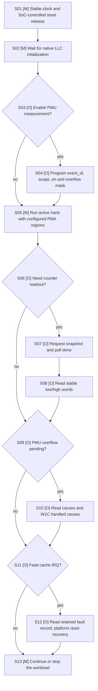

# VLSIT RISC-V Dual/Quad CPU Cluster Design Specification

# Đặc tả chi tiết cluster CPU RISC-V 2/4 hart VLSIT

**Revision 0.30, 2026-11-17.** Adds a complete direct-child component composition diagram for `m_vlsit_riscv_cluster_core`; the existing structural TOP and Section 14 component diagrams remain unchanged. The prior revision and historical appendices are preserved in [the pre-rewrite snapshot](../../project_support/specification/revision_history/pre_detail_rewrite_20261116/VLSIT_RISCV_DUAL_QUAD_CPU_CLUSTER_HDS.md).

This document states the approved design contract, explains its current RTL realization and separately identifies validation status. Source inspection is not a golden verification model. Conflicts and unqualified declarations remain explicit review items in Section 20; no RTL, register ABI, licensing notice or new waveform timing is changed by this rewrite.

Bản này hợp nhất hợp đồng thiết kế, cách RTL hiện thực và trạng thái verify; không biến source đang có thành bằng chứng thiết kế đúng. Có sơ đồ TOP/từng component, chức năng, interface, FSM và data flow. Các mâu thuẫn/phần chưa verify ghi ở Section 20; không sửa RTL hoặc map CSR.

## Document map

| Sections | Use |
|---|---|
| 1–4 | Scope, precedence, approved requirements and configurations |
| 5–9 | Architecture, TOP, interfaces, reset and data/configuration representation |
| 10–13 | Actual FSMs, operations, working flows, software use, errors and worst-case performance |
| 14 | Every new/generated component and selected modified source; adjacent diagram/interface/function/change contract |
| 15–22 | Verification, ASIC/security constraints, traceability, decisions and references |

## 1. Purpose, scope, and product context

### 1.1 Purpose and scope

The IP integrates two or four identical 64-bit application-class CVA6 harts into one internally cache-coherent cluster. Each hart has private L1 caches; the D-caches participate in a MESI domain coordinated by the cluster coherence controller (CCU). D-cache misses and ownership requests flow through the CCU to the shared LLC, and LLC misses use the pinned PULP AXI4 interface with its six-bit AWATOP extension preserved (not full AXI5). Non-cacheable peripheral traffic bypasses the coherent cache path over ordinary AXI4. Software configuration uses AXI4-Lite; the cluster also provides PMU facilities and per-hart debug control/status connections to an external RISC-V Debug Module.

The current delivery has one structural AXI top. It exposes PULP AXI4 memory traffic with AWATOP extension and does not snoop external agents; external DMA therefore requires a software/system cache-maintenance contract. Non-cacheable peripheral traffic uses ordinary AXI4. A future ACE top may add external-agent coherence after a separate specification and approval. It is not a runtime mode and is not included in this RTL phase.

Included in the current RTL phase: two/four-hart elaboration; selected CVA6/HPDcache integration; internal MESI D-cache coherence; shared LLC; one PULP AXI4 memory boundary with AWATOP extension; non-coherent AXI4 peripheral access; 32-bit AXI4-Lite configuration with LLC RegBus bridge; cluster PMU; per-hart debug request/status connections; reset and integration contracts. The external ACE profile is future work and is not part of the current RTL hierarchy or port plan.

Excluded: DRAM controller/PHY; complete SoC interconnect and interrupt controller; external Debug Transport Module/Debug Module; runtime LLC capacity changes; runtime scratchpad (SPM) mode; CPU hot-add; cache coherence across the AXI-only boundary; power gating, retention, and DVFS; guaranteed frequency, area, or power targets.

Giai đoạn RTL hiện tại gồm cluster CVA6 hai hoặc bốn hart, coherence MESI cho D-cache, LLC chia sẻ tĩnh, biên bộ nhớ PULP AXI4 với mở rộng AWATOP, ngoại vi AXI4 không coherence, AXI4-Lite có bridge RegBus cho LLC, PMU và debug từng hart. Profile ACE coherence với agent ngoài là phần mở rộng tương lai, chưa thuộc hierarchy/port plan hiện tại.

Giai đoạn hiện tại có một top cấu trúc AXI. Top này đưa traffic bộ nhớ AXI4 thông thường và không snoop agent ngoài. Nếu bổ sung top ACE trong tương lai, top đó phải là module cổng cố định riêng và cần đặc tả/phê duyệt riêng; không có chuyển profile lúc chạy.

### 1.2 Deployment assumptions

| Item | Specification |
|---|---|
| Target SoC / product class | Candidate Linux-capable industrial edge gateway; proposed application, not a user-confirmed product |
| Workload | Linux SMP packet filtering, protocol handling, and security services; representative workload to be supplied by system integration |
| Technology / library | ASIC standard-cell library and SRAM macros not yet selected |
| Security / privilege | CVA6 application profile with machine/supervisor/user execution; system protection policy is owned by SoC |
| External dependencies | Upstream CVA6, modified HPDcache, Culsans coherence reference, axi_llc, AXI fabric, clock/reset controller, external RISC-V Debug Module; ACE fabric is future scope |
| Evidence status | Public FPGA/simulation evidence exists for reference projects; this exact upstream combination has not been demonstrated |

Ứng dụng dự kiến là gateway công nghiệp chạy Linux SMP để lọc gói, xử lý giao thức và dịch vụ bảo mật. Đây là ứng dụng đề xuất vì người dùng chưa cung cấp sản phẩm/workload cụ thể. Library ASIC, SRAM macro và số liệu workload thực tế do tích hợp SoC cung cấp.

### 1.3 Feature summary

| Feature ID | Feature | Required / optional | Configuration condition | Requirements |
|---|---|---|---|---|
| FEAT-001 | Two- or four-hart CVA6 cluster | Required | PARA_CPU_NUM is 2 or 4 | REQ-SYS-001 |
| FEAT-002 | Internal MESI coherence for active harts' D-caches | Required | AXI profile, 2/4 harts | REQ-MEM-001 |
| FEAT-003 | Non-coherent AXI4 peripheral manager | Required | Current AXI phase | REQ-IF-002 |
| FEAT-004 | AXI-only memory profile | Required profile | AXI structural top | REQ-IF-003 |
| FEAT-005 | External ACE coherent memory profile | Deferred | Future separate phase | REQ-IF-004 |
| FEAT-006 | Static shared LLC | Required | Current AXI phase; default 256 KiB | REQ-MEM-002 |
| FEAT-007 | Cluster PMU and aggregate interrupt | Required | Current AXI phase | REQ-PMU-001 |
| FEAT-008 | External Debug Module connection | Required integration | Current AXI phase; DM/DTM outside | REQ-DBG-001 |
| FEAT-009 | AXI4-Lite management and LLC service access | Required | Current AXI phase | REQ-IF-001 |
| FEAT-010 | System-wide Zicbom CBO clean/flush/invalidate with precise writeback faults | Required | Zicbom enabled; per-line LLC service; CVA6 commit integration | REQ-MEM-015–017 |
| FEAT-011 | Local FENCE.I instruction-fetch synchronization through the shared LLC | Required | DcacheFlushOnFenceI=1; local I-cache is not coherent | REQ-MEM-007, REQ-MEM-018 |

### 1.4 Real-world applications of the features

Values below are proposal baselines from this specification, not measured workload limits. The system owner must replace them when a product workload is known.

Các giá trị dưới đây là cấu hình đề xuất của đặc tả, không phải giới hạn workload đã đo. Chủ hệ thống cần thay thế khi có workload sản phẩm.

| Feature ID | Real-world application | What the application needs | Proposed measurable values | Consequence if missing or wrong | Requirements | Source |
|---|---|---|---|---|---|---|
| FEAT-001 | Linux industrial edge gateway handling packet filtering and encryption | SMP execution capacity and software-compatible virtual memory | 2 or 4 harts; 64-bit XLEN | Linux cannot use the configured hart count or the cluster lacks capacity for parallel services | REQ-SYS-001 | ASM-001 |
| FEAT-002 | Gateway workers sharing packet descriptors and queues in normal memory | CPU harts must observe coherent ownership/data for shared cacheable lines | 2 or 4 harts; 16-byte L1 line | Stale descriptors or duplicate ownership can corrupt packet processing | REQ-MEM-001 | ASM-001, REF-004 |
| FEAT-003 | Gateway UART, timer, watchdog, and network-control registers | Device accesses must use a non-cacheable path with AXI handshake | 64-bit AXI4 data/address baseline | Cached or reordered device accesses can lose commands or misread status | REQ-IF-002 | ASM-001, REF-001 |
| FEAT-004 | Gateway whose DMA/network agent uses explicit software cache maintenance | AXI-only memory egress must be identified as non-coherent with external agents | AXI4 profile; 64-bit data; explicit cache-maintenance contract | DMA may observe old memory or overwrite dirty cache data | REQ-IF-003 | ASM-001, ASM-003 |
| FEAT-005 | Future gateway sharing buffers with an ACE-capable DMA/accelerator | A future external ACE profile would route snoops to a dirty cache owner | Deferred ACE phase; 2 or 4 harts | External DMA can consume stale data if the future snoop proxy is incomplete | REQ-IF-004 | ASM-001, DEP-002 |
| FEAT-006 | Linux gateway retaining shared code/data close to the cores | LLC capacity and cache-line geometry must be fixed before synthesis | 4 ways × 4096 lines/way × 16 bytes = 256 KiB | Wrong geometry or failed writeback can lose data or reduce hit rate | REQ-MEM-002 | User decision, 2026-11-06 |
| FEAT-007 | Gateway performance diagnosis under packet bursts | Software must count selected cluster events and identify overflow | 16 counters default, maximum 32; counter width 32 or 64 bits | Bottlenecks remain hidden or counters silently wrap without status | REQ-PMU-001, REQ-PMU-002 | User decision, 2026-11-06 |
| FEAT-008 | Field debug of a multi-hart Linux gateway | Debugger must identify and stop/resume individual active harts | 2 or 4 hart debug request/status bits | A failure cannot be isolated to one hart or recovered safely | REQ-DBG-001 | User decision, 2026-11-06 |
| FEAT-009 | Firmware configuration of PMU and LLC service functions | One compact control bus must reach both cluster CSRs and LLC control | AXI4-Lite, 32-bit address and data | Firmware requires a second control fabric or cannot inspect cache service state | REQ-IF-001 | User decision, 2026-11-06 |
| FEAT-010 | Network/DMA buffer handoff to non-coherent agents | Software needs per-line CLEAN/FLUSH/INVAL operations and an architectural fault on failed required writeback | 16-byte cache-block operations; precise Store/AMO fault after ABORT ACKs | DMA may read stale memory, or failed writeback may be reported as success | REQ-MEM-015–017 | User decision, 2026-11-07 |
| FEAT-011 | Hart-local self-modifying-code execution in the Linux gateway | A later instruction fetch by the executing hart must see prior stores to code | DcacheFlushOnFenceI=1; dirty D-cache data reaches LLC before local I-cache/fetch invalidation | The hart may execute stale instructions | REQ-MEM-007, REQ-MEM-018 | RISC-V Zifencei REF-013; DEC-030 |

## 2. Normative references and precedence

### 2.1 Normative references

| Ref ID | Document and revision | Applicable clauses | Authority / notes |
|---|---|---|---|
| REF-001 | Arm AMBA AXI and ACE Protocol Specification, IHI 0022H | AXI4-Lite Part B/B1; AXI4 Part A; ACE Part D, especially channels and sequencing | Official Arm PDF read on the web; the user approved use without a local converted copy. No local md_doc conversion exists. |
| REF-002 | IEEE 1800-2017 SystemVerilog | Synthesizable RTL subset | Subject to VLSIT RTL rules and selected frontend support |
| REF-003 | VLSIT RTL Design Rule v2, VLSIT_RTL_Design_Rule.md | All applicable rules | User-selected default rule; source path recorded in Section 20 |
| REF-004 | OpenHW CVA6 configuration cv64a6_imafdc_sv39_hpdcache_wb_config_pkg.sv | Selected configuration values | Exact package name; upstream branch URL in Section 22; source commit must be pinned before RTL integration |
| REF-005 | OpenHW HPDcache User Guide v1.0.1 | Static configuration, cache-line width, interfaces | HPDcache settings are compile-time parameters |
| REF-006 | RISC-V ISA specifications implemented by the selected CVA6 configuration | Privileged and unprivileged architecture behavior; see the official [Machine Interrupt `mip`/`mie` specification](https://docs.riscv.org/reference/isa/priv/machine.html) for writable SSIP/STIP state and external pending-source behavior | Exact ratified revision and enabled extension list must be pinned with the RTL commit |
| REF-007 | RISC-V Debug Specification 0.13.2 | External DM-to-hart integration concepts | DTM/DM implementation is outside this IP |
| REF-008 | PULP axi_llc architecture document | Static geometry, AXI4-Lite service interface, BIST/flush/counters | Runtime SPM controls shall be disabled by this IP |
| REF-009 | CSR_Generation.py v3.4, commit c40f319 | AXI4-Lite CSR generation and field behavior | Local repository C:\HQuan\102_MyGithub\APB-CSR-Generator; canonical bus behavior is generator source/spec, not stale APB-only skill note |
| REF-010 | PULP Culsans repository, current public master as observed 2026-11-06 | CVA6 coherence reference implementation | Pins a PlanV CVA6 fork; not proof of compatibility with upstream CVA6 + HPDcache |
| REF-011 | OpenHW CVA6 CSR performance-counter documentation | Candidate per-hart event names and event IDs | Event availability must be rechecked against the exact selected CVA6 configuration and commit; not a cluster selector map |
| REF-012 | RISC-V Unprivileged ISA, 2024-04-11, CMO Sections 19.3.2, 19.4.2, 19.4, 19.6, 19.7.1–19.7.3 | Clean/flush/invalidate semantics, coherent-agent scope, CBIE behavior, Store/AMO exception class and faulting effective address | [Official RISC-V specification PDF](https://docs.riscv.org/reference/isa/v20240411/_attachments/riscv-unprivileged.pdf) |
| REF-013 | RISC-V Zifencei Extension, Version 2.0, Section 4.1 | Local instruction-fetch synchronization semantics of `FENCE.I` | Official RISC-V ISA documentation; no local converted copy; [official specification](https://docs.riscv.org/reference/isa/unpriv/zifencei.html) |
| REF-014 | RISC-V Privileged Architecture, Machine-Level ISA, Exception Causes | Exception cause codes 24–31 are reserved for custom use; the cluster assigns synchronous exception code 24 to a failed FENCE.I maintenance transfer | [Official RISC-V specification](https://docs.riscv.org/reference/isa/priv/machine.html) |
| REF-015 | PULP AXI width-converter sources `axi_dw_converter.sv`, `axi_dw_upsizer.sv`, and `axi_dw_downsizer.sv` at the pinned local revision | Candidate external 32/64/128/256-bit conversion; source comments document burst limitations | Source is in `rtl/common/third_party/axi/src`; see Section 22, item 13. Pin and verify the exact revision before signoff. It is implementation evidence, not a protocol guarantee. |

### 2.2 Source-of-truth and conflict handling

Protocol behavior follows REF-001 for the named AXI4, AXI4-Lite, and ACE profiles. Core behavior follows the selected upstream CVA6 configuration and exact pinned source revision. Product-specific behavior follows this specification and explicit user decisions. REF-003 governs newly authored VLSIT RTL; third-party source is retained under its own license and coding conventions rather than silently rewritten. The workbook in Section 11 is the sole authority for software-visible CSR fields and reset values. No register offsets or reset values are defined in this Markdown file.

The ACE standard was approved for web-based use, not local conversion. Therefore protocol clause references in this draft are based on the official PDF source and still require a later controlled-document review before signoff.

**Language:** This specification is bilingual English–Vietnamese per the user’s project-wide instruction for documents. This intentionally overrides skill rule R-005, which otherwise requires English-only specifications; the RTL source and agent skills remain English-only.

**Naming rule:** VLSIT RTL Design Rule v2, selected by the user; path C:\HQuan\102_MyGithub\VLSIT_RTL_Generator_AI_Model\spec_template\VLSIT_RTL_Design_Rule.md; names use m_ module prefix, i_/o_ port prefix, protocol tags such as axi, axil, and ace, PARA_ parameters, and zero-based indices.

Protocol tuân thủ theo REF-001. Hành vi core theo cấu hình CVA6 và commit sẽ được pin. Yêu cầu sản phẩm theo đặc tả này và quyết định của người dùng. REF-003 áp dụng cho RTL VLSIT mới; mã nguồn bên thứ ba giữ license và coding convention riêng, không tự sửa. Workbook ở Mục 11 là nguồn duy nhất cho CSR. Tài liệu ACE được duyệt dùng bản PDF chính thức trên web, chưa chuyển đổi cục bộ; cần kiểm soát tài liệu trước signoff.

### 2.3 Compliance declaration

| Standard | Revision / profile | Role implemented | Options | Deviations |
|---|---|---|---|---|
| AMBA AXI4 and PULP AXI4 with AWATOP extension | IHI 0022H Part A A3–A6; AWATOP semantics in Part E E1.1 | Manager on memory/peripheral egress | 64-bit address/data; native CVA6 ID 4 bits; MMIO ID 6 bits after fixed four-way mux; LLC memory ID 7 bits; 6-bit AWATOP on memory egress; no USER signals in selected profile | Normal traffic follows AXI4. AWATOP behavior is limited to the pinned PULP subset and is not full AXI5 conformance |
| AMBA AXI4-Lite | IHI 0022H, B1 | Subordinate for software control | 32-bit address/data; 4 byte strobes; single clock | Internal address windows and outstanding depths are project-defined |
| AMBA ACE | IHI 0022H, D | Internal local-probe subset only; no external ACE boundary in current phase | Read-shared, read-unique/invalidate, and clean-invalidate outcomes; AC/CR/CD-style channels | Exact packed-field mapping is pinned with source integration; external ACE is deferred |
| RISC-V ISA | Selected CVA6 package | Two/four application harts | XLEN=64, Sv39 configuration, enabled extensions as defined by pinned package | No ISA extension is added by cluster wrapper |

## 3. Requirements and traceability

### 3.1 Normative requirements

| ID | Requirement | Source | Applies to | Verification method |
|---|---|---|---|---|
| REQ-SYS-001 | The cluster shall elaborate with PARA_CPU_NUM equal to 2 or 4, default to 4, and assign active hart indices contiguously from zero. | User decision; DEC-019; Section 8 | Both profiles | Elaboration and hierarchy check |
| REQ-SYS-002 | Every active tile shall use the selected cv64a6_imafdc_sv39_hpdcache_wb configuration unless a new approved spec revision changes it. | User decision; REF-004 | Both profiles | Configuration/package comparison |
| REQ-SYS-003 | The cluster shall provide one shared 64-bit `i_boot_addr` input and connect it to `boot_addr_i` of every active CVA6 hart. The SoC shall hold the value stable while reset is asserted and through reset release. All harts begin at that address; boot software may branch on `mhartid` for per-hart startup. | User decision; DEC-021 | Both profiles | Boot-address fanout and two/four-hart startup test |
| REQ-SYS-004 | The cluster's license-preserving local CVA6 configuration copy shall set `CVA6ConfigCvxifEn=0`. The cluster shall expose no CVXIF accelerator ports; if the pinned source signature retains native CVXIF pins, the licensed integration boundary shall leave them inactive. The pristine upstream configuration shall remain unchanged. | User decision; DEC-022 | Both profiles | Config comparison, elaboration, and inactive-native-pin check |
| REQ-MEM-001 | Every active hart's D-cache shall participate in one internal MESI coherence domain for cacheable shared memory. The current implementation phase shall provide the AXI profile only. | User decisions; DEC-007, DEC-008 | AXI profile, 2/4 harts | MESI state-transition tests, multi-hart litmus, dirty-owner tests, and formal invariants |
| REQ-MEM-005 | The CCU shall use a per-line sharer directory to target only D-caches recorded as possible holders; it shall collect tagged probe status responses and complete every required owner AXI writeback before granting E/S/M. It shall not broadcast every request to all active harts. | User decisions; DEC-007, DEC-013, DEC-027 | AXI profile | Directory-targeting tests, tagged probe/writeback scoreboard, and MESI state checks |
| REQ-MEM-006 | Coherence arbitration shall lock only the target physical cache line: same-line CPU requests shall wait until the current probe/refill transaction resolves; unrelated lines shall remain eligible subject to directory, cache-bank, port, MSHR, CCU, LLC, and AXI resource conflicts. | User decisions; DEC-008, DEC-013 | AXI profile | Same-line collision and independent-line progress tests |
| REQ-MEM-007 | D-cache coherence shall not snoop I-caches. Software that modifies executable memory shall perform the platform-required inter-hart notification and each executing hart shall execute `FENCE.I` before fetching the changed instructions. `FENCE.I` synchronizes only the executing hart's instruction stream; it shall not be treated as a remote-hart broadcast. | User decision; DEC-009; REF-013 | AXI profile | Self-modifying-code integration and per-hart FENCE.I test |
| REQ-MEM-008 | The directory shall never omit an active D-cache that may hold a line. Successful clean/dirty L1 eviction and failed post-grant refill may leave stale-positive holder bits. An error-free matching PREPARE-I shall prove absence; successful COMMIT shall prune that holder, while ABORT shall preserve conservative metadata. An absent cache shall ACK COMMIT with I without allocating S/E/M, and an empty committed mask shall become I. A stale extra sharer bit may cause a harmless probe, which shall be reconciled; a missing sharer bit shall not permit stale data or conflicting ownership. Directory metadata shall be committed only with the corresponding cache-state transition. | User decision; DEC-013; exact update handshakes are implementation detail | AXI profile | Directory invariant assertions and cache/directory refinement checks |
| REQ-MEM-009 | The CCU shall support `PARA_COH_TXN_NUM` active coherence transactions, default 8 and legal from 2 through 16. The total includes victim children; CPU/CMO roots shall require two free entries so one credit remains available exclusively to non-recursive victim work (at most N-1 roots). Root admission shall not gate terminal completion/release. Each child allocation and each per-hart grant load/release shall affect only its selected context tag. Every active transaction shall have a slot-derived tag unique among active entries. Probe/response traffic shall carry that tag and target hart identity; a tag shall not be reused until all prepare/commit/abort responses for the previous use have drained. | User decisions; DEC-013, DEC-015 | AXI profile | 2/8/16-slot elaboration, tag reuse, backpressure, and response-reordering tests |
| REQ-MEM-010 | The sharer directory shall be independent of and non-inclusive with the LLC, use four banks and eight ways, and contain `PARA_CPU_NUM × 2,048` entries: 4,096 for two harts and 8,192 for four harts. LLC eviction alone shall not invalidate a private D-cache line. A directory replacement with active holders shall prepare targeted invalidations and complete any M-owner writeback before replacing the entry. | User decisions; DEC-014, DEC-027 | AXI profile | Directory geometry, LLC-eviction independence, full-set replacement, owner-writeback and dirty-victim tests |
| REQ-MEM-011 | The directory shall select one of four banks using the two least-significant bits of the line address, equivalent to physical-address bits `[5:4]` for the selected 16-byte line (`line_addr[1:0] = physical_address[5:4]`); each bank shall arbitrate one operation per cycle, allowing different-bank operations to proceed concurrently and serializing same-bank conflicts. Each private D-cache shall queue up to `PARA_COH_TXN_NUM` probes and service one probe at a time. | User decisions; DEC-014, DEC-015 | AXI profile | Bank-conflict, cross-bank overlap, and per-cache probe queue tests |
| REQ-MEM-012 | A coherence probe shall use two phases. PREPARE locks the target line, waits for same-line miss/refill completion, and reports the stable MESI state without changing stable MESI state. If the target is M, it shall write the complete 16-byte line to the LLC through that hart's existing HPDcache AXI path; the cache shall retain M and the line lock until COMMIT or ABORT. PREPARE ACK shall wait for the matching LLC B response. A B error fails PREPARE, triggers ABORT for every prepared target, and shall not update the directory or grant the requester. The probe response carries writeback completion/status, not the 128-bit line payload. After all required PREPARE responses and data obligations succeed, COMMIT applies the target state to resident lines and returns an acknowledgement; a cache proved absent in PREPARE remains I and performs no allocation or RAM update. The CCU shall update directory metadata and grant permission only after every required COMMIT acknowledgement. A permission grant admits the requester's normal HPDcache refill; CPU completion follows refill. | User decisions; DEC-016, DEC-027 | AXI profile | Prepare-state invariants, owner AXI writeback/B response, B-error ABORT, commit ordering, and concurrent-line tests |
| REQ-MEM-013 | PREPARE, COMMIT, and ABORT have no acknowledgement timeout. The CCU shall retain the line lock and transaction slot until every required phase ACK arrives or reset occurs. During PREPARE wait, stable cache MESI and directory metadata remain unchanged; no COMMIT, requester grant, or directory update may occur. A pre-COMMIT error sends ABORT to every targeted cache; caches release their local line locks only after accepting ABORT and preserve their pre-transaction stable state. During COMMIT wait, no rollback is allowed; the directory remains unchanged and the requester is not granted until all COMMIT ACKs arrive. A missing ACK can stall that line indefinitely. Independent lines may progress only with independent slots and resources. Reset clears cache and directory valid state and is the only recovery. Repeated COMMIT with the same tag is idempotent. | User decisions; DEC-016, DEC-018; reset contract | AXI profile | Missing PREPARE/COMMIT/ABORT ACK, independent-line progress, and reset-recovery tests |
| REQ-MEM-014 | Each directory bank shall select only eligible transaction slots using round-robin arbitration and expose a registered `valid/ready` grant that remains stable while not ready. An ineligible request shall not occupy that grant. A matching reservation-owner terminal update/cancel shall not be blocked by another slot's ineligible request, as detailed in REQ-MEM-019. The priority pointer resets to slot 0 and advances to the slot after an accepted grant. Each bank accepts at most one grant per cycle; independent banks may grant concurrently. Each 8-way set stores seven tree-PLRU bits, reset to zero; victim-walk bit 0 selects the left child and bit 1 the right child. A committed access/allocation updates each traversed bit away from the accessed way. Select the lowest-index invalid way before replacement; a full set follows the seven-bit tree. If the victim is locked/reserved or cannot obtain a transaction context, keep that request pending and allow other eligible bank operations to proceed. If another active context locks the victim line, cancel the parent reservation before retrying directory lookup; do not retain that reservation while waiting for the conflicting context to access the set. | User decision; DEC-020/032 | AXI profile | Round-robin fairness, stable eligible grant under backpressure, owner terminal escape, PLRU and cross-bank tests |
| REQ-MEM-015 | Zicbom cache-block operations shall be routed through the cluster CMO controller and serialized by the shared CCU line lock. `CBO.CLEAN` shall write any dirty L1 owner line through the owner's HPDcache AXI path, then clean the matching LLC line to external memory; retain valid copies and change the sole M owner to E only after both writebacks succeed. `CBO.FLUSH` shall perform the same clean-to-memory sequence, then invalidate all matching L1 D-cache copies and the LLC copy only after successful memory B response. `CBO.INVAL` shall follow CVA6's CBIE-decoded operation: a true invalidate locks and invalidates matching L1 and LLC copies without writeback, including discarding dirty copies at commit; when decoded as flush, it follows `CBO.FLUSH`. True-invalidate PREPARE shall not issue owner writeback. An LLC CMO miss shall not allocate/refill a line. | User decisions; DEC-028; RISC-V CMO rules REF-012 | AXI profile | All op × L1/LLC hit-state × dirty-state combinations, DMA-visibility sequence, per-line lock and MESI/directory refinement |
| REQ-MEM-016 | The LLC shall provide a per-line maintenance service with tag lookup, same-line exclusion, clean, and invalidate operations. A clean shall retain the valid tag and clear dirty only after successful full-line AXI writeback; invalidate shall clear the tag only at its specified commit point. Any non-OKAY memory B response shall be returned to the CMO controller and shall leave the LLC valid/dirty/tag state unchanged. If the L1 M owner has already supplied the line to the LLC, that owner shall retain M and its line lock until CMO commit/abort; a later memory error shall not update the directory or invalidate the L1 copy. | User decision; DEC-028; pinned `axi_llc` source audit | AXI profile | AXI B error injection at owner and LLC writeback; tag/data preservation; no premature invalidation; retry test |
| REQ-MEM-017 | A CBO instruction shall remain at the CVA6 retirement head until the complete CMO succeeds or its error recovery finishes; younger instructions shall not retire past it. On success, retire the CBO exactly once. If a writeback-required operation (`CBO.CLEAN`, `CBO.FLUSH`, or `CBO.INVAL` decoded as flush) receives an owner/LLC writeback error, preserve recoverable cache state, wait for every required ABORT acknowledgement, suppress CBO retirement, and raise a precise synchronous Store/AMO access-fault exception (`mcause/scause` exception code 7) with the CBO's original effective address in `mtval`/`stval` and its instruction PC in `mepc`/`sepc`. A true invalidate does not write back and has no writeback B-error path. The local CVA6 integration shall propagate CMO completion/error to commit logic; it shall not treat request acceptance as completion. | User decision; DEC-029; RISC-V CMO trap rules REF-012 | AXI profile | Delayed success/error, no-younger-retire, exact-once retirement, exception cause/PC/tval, ABORT completion, and retry-state checks |
| REQ-MEM-018 | With `DcacheFlushOnFenceI=1`, a local `FENCE.I` shall remain at the retirement head and block younger retirement while the hart's D-cache is scanned. Each dirty M line shall be locked and written through its HPDcache AXI path into the shared LLC; the CCU shall commit the owner from M to E only after successful LLC acceptance and keep the directory holder consistent. `FENCE.I` shall not request LLC-to-external-memory writeback solely for instruction-fetch synchronization. After all required L1-to-LLC transfers complete, invalidate the executing hart's I-cache and fetch pipeline before retiring `FENCE.I`. If an L1-to-LLC B response is non-OKAY, preserve the failed line's M state and directory holder, send ABORT, and wait for every required ABORT acknowledgement without timeout; do not invalidate the local I-cache/fetch pipeline or retire `FENCE.I`. After ABORT completes, raise a precise synchronous custom maintenance exception (exception code 24, `REF-014`) at the `FENCE.I` PC; write the failed physical line's aligned base address to `mtval` or `stval` according to the selected trap privilege. The handler may correct the cause and return to the faulting PC to retry `FENCE.I`. | User decisions; DEC-030/031; selected CVA6 configuration; REF-013/014 | AXI profile | Success and B-error FENCE.I tests; check no younger retirement, ABORT completion before trap, cause/PC/aligned physical line address, failed M/directory preservation, no local fetch invalidation on error, and no LLC-to-DRAM write request |
| REQ-MEM-019 | Each directory bank shall determine whether lookup/update/cancel requests are eligible before arbitration. An update or cancel matching the active set-reservation owner is a terminal operation and shall have an escape path that cannot be blocked by a valid but ineligible request from another transaction. A matching owner cancel shall be accepted and clear that reservation even if another transaction's update remains valid; a matching owner update shall commit and release the reservation. Only one directory operation may be accepted per bank per cycle. Round-robin arbitration shall be fair among continuously eligible transaction slots; when the bank accepts one operation per cycle, a continuously eligible slot shall be selected within one full round of eligible slots. | Review finding CC-01; v0.19 directory liveness contract; DEC-032 | AXI profile | Exact CC-01 reproducer; same-set update/cancel escape; eligible-slot fairness assertions; WF-020 |
| REQ-MEM-020 | The CCU, directory, caches, and AXI writeback path shall obey the resource-ordering contract in Section 10.2.4: no directory bank port or cache tag/data-array port may be held while waiting for an ACK/B response that requires that resource; line locks and transaction contexts may remain held as specified by DEC-018. A cache must not wait for new CCU permission to complete a refill that is itself blocking the probe needed for that permission. | Review finding CC-01; v0.19 resource wait-graph analysis | AXI profile | Formal wait-for graph review; same-line refill/probe stress; resource ownership assertions |
| REQ-MEM-021 | A response receiver shall accept each transport-valid internal probe ACK when its response buffer can accept it, independent of whether its tag/line/phase matches an active context. Only a unique expected response may update transaction state. Stale, duplicate, unknown-tag, wrong-hart, wrong-line, or wrong-phase responses shall be consumed and discarded, shall not modify any transaction/cache/directory state, and shall set the coherence-protocol diagnostic. | Review finding CC-02; v0.19 response-drain contract; DEC-033 | AXI profile | Duplicate/stale/mismatched ACK drain test; confirm a following valid ACK is accepted; diagnostic status test |
| REQ-MEM-022 | Each per-slot bank request shall represent one pending operation token. A bank arbiter shall consume an accepted token exactly once and disarm that slot until it samples `i_req_valid[slot]=0`; a later assertion rearms the slot for a new token. This prevents a delayed VALID deassertion from receiving a duplicate grant. While a grant is stalled, its valid and slot identity shall remain stable, and the request's bank and operation payload shall remain stable. Each bank still accepts at most one token per cycle; different slots may be accepted in adjacent cycles. | Review finding CC-03; v0.19 request-token contract; DEC-035 | AXI profile | Delayed-deassertion/duplicate-grant test; stable grant and rearm assertions |
| REQ-MEM-023 | An active transaction context shall retain its tag, line, requester/owner, transaction kind, target MESI state, phase, expected/received ACK masks, owner-writeback completion/status, and LLC/AXI completion/status until commit/abort is complete and all required responses drain. Starting a new phase shall not clear fields required by later phases. A probe scheduler shall use state associated with the matching context, not an uncorrelated live value. The owner-data obligation is satisfied only by a matching successful B for actual dirty M when writeback is required, or by validated no-data-needed E/I proof. An actual M writeback success shall never be inferred from stale directory metadata; COMMIT shall not proceed after a writeback error. | Review finding CC-03; v0.19 context-retention contract; DEC-027/035 | AXI profile | PREPARE-to-COMMIT/ABORT context-retention test; target-state and B-response association checks |
| REQ-MEM-002 | The shared LLC shall default to 4 ways, 4096 lines per way, 2 64-bit blocks per line, and 16 bytes per line, for 256 KiB total capacity. | User decision; REF-008 | Both profiles | Parameter/elaboration check |
| REQ-MEM-003 | LLC geometry shall be static after synthesis; software shall not change total capacity or enable SPM mode. | User decision; REF-008 | Both profiles | CSR access test and RTL inspection |
| REQ-MEM-004 | LLC BIST and flush requests shall follow the selected axi_llc behavior; traffic shall not be treated as usable until the applicable BIST-ready condition is met. | REF-008 | Both profiles | BIST/flush sequence simulation |
| REQ-IF-001 | The cluster shall expose one 32-bit-address, 32-bit-data AXI4-Lite Subordinate port for cluster CSR and LLC service windows. | User decision; REF-001 | Both profiles | AXI4-Lite protocol checker |
| REQ-IF-002 | The cluster shall expose a non-coherent AXI4 Manager interface for peripheral/device traffic. | User requirement; REF-001 | Both profiles | AXI4 protocol checker and address-attribute tests |
| REQ-IF-003 | The AXI memory profile shall expose the pinned PULP AXI4 interface with its 6-bit AWATOP extension, without external snoop channels; software/SoC shall maintain cache visibility for external DMA. The AWATOP extension does not make the port a full AMBA AXI5 interface. | User decision; DEC-023, DEC-042; REF-001 | AXI top only | AWATOP pass-through/atomic response test and DMA visibility review |
| REQ-IF-004 | A future ACE profile may expose external coherent-memory channels after a separate ACE boundary specification and approval; it is not part of the current RTL phase. | Deferred scope decision | Future ACE phase only | Future ACE protocol checker and snoop tests |
| REQ-IF-005 | AXI and ACE source payloads shall remain stable while VALID is high and READY is low, and responses shall be accepted only on VALID and READY handshakes. | REF-001 | Applicable interfaces | Protocol assertions |
| REQ-IF-006 | The current delivery shall expose one fixed-port AXI structural top. Any future ACE top shall be a separate fixed-port module and requires a new approved specification phase. | User scope decision; VLSIT PRT-03 | Current AXI phase | Port-list/elaboration audit |
| REQ-IF-007 | AXI4-Lite writes shall honor WSTRB; aligned unmapped CSR addresses shall return DECERR and reads shall return zero. | REF-009; user-selected CSR generator v3.5 | Both profiles | Generated-CSR protocol simulation |
| REQ-IF-008 | The cluster-local AXI4-Lite aperture shall contain five 4-KiB CSR groups at offsets `0x0000–0x4FFF` and a 4-KiB LLC-service window at `0x5000–0x5FFF`; the absolute SoC base is integration-defined and at least 4-KiB aligned. Unassigned offsets are reserved: reads return zero with DECERR and writes have no side effect with DECERR. | Approved CSR workbook; DEC-017 | AXI profile | Window boundary, reserved-offset, and base-alignment tests |
| REQ-IF-009 | The memory egress shall preserve the six-bit AWATOP field and all standard AXI4 transaction fields from the LLC. Uncached LR/SC shall use AXI4 exclusive-access signaling (`ARLOCK`/`AWLOCK`); uncached AMO shall use only the AWATOP encodings generated by the pinned HPDcache/PULP AXI sources. The SoC integration shall connect the port to a target/fabric implementing both required mechanisms, or place a verified atomic-service bridge before a fabric that lacks them. The bridge shall execute each supported atomic operation at the memory serialization point and preserve ID/response/error association. A filter that returns SLVERR is not an atomic bridge. AWATOP follows the applicable AMBA 5 E1.1 atomic semantics for this supported subset; the cluster does not claim full AXI5 conformance. | User decision; DEC-023, DEC-042; pinned PULP `axi_llc`, AXI package and HPDcache sources | AXI profile | TEST-036, TEST-047; LR/SC and AMO end-to-end atomicity; unsupported-fabric integration check |
| REQ-IF-010 | LLC-service accesses in local window `0x5000–0x5FFF` shall pass through a new VLSIT AXI4-Lite-to-RegBus bridge to the unchanged pinned LLC register interface. AXI AW and W may handshake independently; the bridge shall issue one complete write only after both are captured and shall return the matching response. | User decision; DEC-024; `axi_llc_reg_wrap` source audit | AXI profile | Independent AW/W order, backpressure, response association, and error tests |
| REQ-IF-011 | One synthesis-time address-region table shall be the source of truth for both the cluster router and CVA6 PMA attributes. The adapter shall derive CVA6 `CachedRegion*` entries only from class `00` and `NonIdempotent*` entries only from class `10`; class `01` remains idempotent and uncached by being outside both lists. It shall support one cacheable normal-memory entry (default base `0x80000000`, size 1 GiB), plus configurable normal-uncached and MMIO entries, up to 16 total. Cacheable and normal-uncached requests shall use the memory path; normal-uncached traffic shall bypass LLC allocation. MMIO shall bypass CCU/LLC. Entries shall be non-overlapping, 16-byte aligned, and confined to PLEN=56. Unmatched or boundary-crossing accesses shall receive a local error without external AXI traffic. The default table shall contain only the cacheable entry; the SoC supplies uncached/MMIO entries. | User decision; DEC-037; selected CVA6 PMA capacity and LLC mapping | AXI profile | TEST-051, PMA/router parity, overlap/boundary/error tests |
| REQ-IF-012 | `PARA_AXI_MEM_DATA_W` shall select external memory data width from `{32,64,128,256}` bits. The native CVA6/HPDcache/LLC datapath remains 64-bit; the adapter shall preserve byte addresses, IDs, responses, strobes, ordering and the 16-byte coherence-line contract for every supported width. MMIO remains 64-bit and AXI4-Lite remains 32-bit. | User decision; DEC-034 | AXI profile | TEST-047, width elaboration, transfer and error matrix |
| REQ-PMU-001 | The cluster PMU shall support PARA_PMU_COUNTER_NUM counters, legal range 1–32 and default 16. | User decision, 2026-11-06 | Both profiles | Parameter-boundary elaboration |
| REQ-PMU-002 | PMU counter width shall be configurable as 32 or 64 bits; the proposed default is 64 bits. Counters shall wrap modulo 2^W. | User decision; default tracked in Section 20 | Both profiles | Counter boundary simulation |
| REQ-PMU-003 | An accepted software snapshot request shall atomically capture all PMU counters and keep the snapshot stable until the next accepted request or reset. `snapshot_done` is sticky: hardware sets it when capture completes, and software must clear it by W1C before issuing the next snapshot request. A request does not clear the previous `snapshot_done` value. | User decision, 2026-11-06; clarified 2026-11-16 | Both profiles | Snapshot, concurrent increment, sticky-done, W1C rearm, and second-request tests |
| REQ-PMU-004 | PMU overflow causes shall be sticky and software-visible; one aggregate level interrupt shall remain asserted while any enabled pending cause remains. | User decision, 2026-11-06 | Both profiles | Overflow, mask, clear, and interrupt tests |
| REQ-PMU-005 | Every PMU counter shall select either one active hart (scope 0–3), all active harts (scope 4), or a cluster-global event (scope 5); scopes 6–7 are reserved. | User decision, 2026-11-06 | Both profiles | Scope encoding, 2/4-hart and event-source tests |
| REQ-PMU-006 | Aggregate per-hart events shall add the number of occurrences across active harts in each cycle; simultaneous events from four harts increment the selected counter by four. | User decision, 2026-11-06 | Both profiles | Multi-hart simultaneous-event scoreboard |
| REQ-PMU-007 | The 16-bit `event_id` shall use the fixed source ranges and complete source mapping in workbook `Event_Map`: CVA6 `0x0001–0x0016`, HPDcache `0x0100–0x010F`, LLC `0x0200–0x0217` and `0x0240–0x0243`, and VLSIT CCU `0x0300–0x030B`. The workbook is the selector-code source of truth. Unknown/reserved IDs, disabled SPM events, unavailable sources, and invalid scope/source combinations shall contribute zero. | User decision; DEC-025; pinned source audit | AXI profile | Exact ID/source scoreboard; reserved and unavailable ID tests |
| REQ-PMU-008 | Per-hart event sources shall expose one sampled indicator per hart; scope 0–3 selects one active hart and scope 4 sums indicators across active harts. For scope 5, CCU transaction/handshake IDs `0x0300–0x0307` and `0x030B` shall count actual occurrences each cycle, up to four, using 3-bit taps. CCU stall IDs `0x0308–0x030A` shall count one per cycle while asserted. Each single-instance LLC event field contributes one when `.active` is high; `.num_bytes` is not accumulated. CVA6 sources that OR-reduce commit ports contribute at most one per hart per cycle. | User decision; DEC-026; pinned CVA6, HPDcache, and LLC source semantics | AXI profile | Multi-occurrence CCU, held-stall, descriptor, aggregate, counter increment, and wrap tests |
| REQ-DBG-001 | The cluster shall expose per-hart debug request and debug-mode/status connections; the DTM and Debug Module shall remain outside the cluster. | User decision; REF-007 | Both profiles | Hart-by-hart debug integration test |
| REQ-IRQ-001 | Platform interrupt inputs shall be level-sensitive and routed only to the addressed active hart; inputs for absent harts shall be ignored. | Proposed interface contract; ASM-004 | Both profiles | Directed interrupt routing tests |
| REQ-IRQ-002 | For each active hart, `i_int_ssip` and `i_int_stip` shall be ORed with the corresponding software-writable `mip` state to form the effective pending view used by interrupt logic and CSR reads. External levels shall not be copied into software-writable state by CSR read-modify-write operations. Gate SSIP with `RVS && SoftwareInterruptEn` and STIP with `RVS`. | REF-006; selected CVA6 configuration | Both profiles | Assert/deassert each external level; verify MIP/SIP visibility, interrupt delivery, software clear/set, and no sticky state after external deassertion |
| REQ-CLK-001 | All cluster AXI/ACE/AXI4-Lite ports and internal active harts shall use the cluster clock unless a separately specified CDC bridge is inserted outside the cluster. | Integration assumption | Both profiles | CDC analysis and clock-domain lint |
| REQ-RST-001 | Reset shall clear cluster valid/control state, coherence/cache valid state, in-flight internal tags, and generated CSR fields to workbook reset values. The SoC shall provide asynchronous assertion if used and synchronized deassertion to the cluster clock. When resetting with transactions in flight, the SoC shall reset the connected AXI fabric/target transaction state and internal coherence agents as one coordinated reset event; no response to a pre-reset request may be delivered after cluster reset deassertion. Backing-memory contents are not cleared, but an externally accepted transaction may have committed before reset and its outcome is not reported across reset; software shall reinitialize affected data. | User decision; DEC-041; ASM-005 | AXI profile | TEST-014 reset injection, stale-response exclusion, and post-reset recovery |
| REQ-ERR-001 | AXI/ACE error responses shall be returned to the originating request path without changing the transaction ID or fabricating successful data. | REF-001 | Applicable interfaces | Error injection and response association tests |
| REQ-ERR-002 | An unsupported or malformed internal address/control request shall not silently alter architectural cache or CSR state. | Product requirement | Both profiles | Negative tests and assertions |
| REQ-ERR-003 | An ordinary dirty-eviction writeback failure shall preserve recoverable dirty data and retain the affected transaction/line lock until reset. It shall assert a sticky asynchronous `o_int_fault` and expose a reset-only first-fatal CSR record under DEC-039/040, including actual victim line address, source, exact AXI B response, L1 hart identity or LLC hart_valid=0, and a later/simultaneous-event multiple flag. Already issued AXI responses shall still be drained; no successful completion, automatic retry or retroactive precise exception at an already retired store shall be fabricated. Reset is the recovery. CBO and FENCE.I retain REQ-MEM-017/018. | User selected asynchronous fault, DEC-036 | AXI profile | TEST-050 |
| REQ-PD-001 | The cluster shall not claim a frequency, area, or power limit until a library, PVT corner, SDC, and activity workload are supplied. | User decision | Both profiles | Review of constraints and reports |
| REQ-VER-001 | Verification shall derive expected behavior from this specification, RISC-V architectural models, and the applicable protocol standards; generated RTL shall not be the golden reference. | User direction from prior verification-flow decision | Both profiles | Verification-plan review |
| REQ-VER-002 | Each supported CPU-count/profile combination shall have an independent reproducible test target and saved command/log manifest. | Project verification policy | Both profiles | Build-flow audit |

### 3.2 Requirement change control

A change to core package, line size, memory profile, CSR behavior, or supported ACE subset requires a new spec version and traceability review. Requirements that depend on an unproven adapter remain conditional until the adapter architecture is verified; they are not evidence that such an adapter already exists.

Nếu thay core package, line size, memory profile, CSR behavior hoặc tập ACE hỗ trợ thì phải tăng version và rà soát truy vết. Yêu cầu phụ thuộc adapter chưa được chứng minh sẽ giữ trạng thái có điều kiện, không được hiểu là adapter đã tồn tại.

## 4. Features and configurations

| Configuration ID | Enabled features | Disabled features | Interfaces / widths | Intended use | Verification target |
|---|---|---|---|---|---|
| CFG-AXI-2 | 2 CVA6 harts; internal coherence; LLC; PMU; debug hooks | External snoop/coherence; SPM | AXI4 mem 64/64, AXI4 MMIO 64/64, AXI4-Lite 32/32 | Two-hart Linux SMP with software DMA cache maintenance | 2-hart AXI profile |
| CFG-AXI-4 | 4 CVA6 harts; internal coherence; LLC; PMU; debug hooks | External snoop/coherence; SPM | Same fixed widths and port names | Four-hart Linux SMP with software DMA cache maintenance | 4-hart AXI profile |
| CFG-ACE-2 | 2 CVA6 harts; internal coherence; LLC; ACE external coherence; PMU | SPM; runtime profile switch | ACE memory 64/64 plus AXI4 MMIO 64/64 and AXI4-Lite 32/32 | Two-hart cluster sharing cacheable memory with external ACE agents | 2-hart ACE profile |
| CFG-ACE-4 | 4 CVA6 harts; internal coherence; LLC; ACE external coherence; PMU | SPM; runtime profile switch | Same fixed widths and port names | Four-hart cluster sharing cacheable memory with external ACE agents | 4-hart ACE profile |

The two top module port lists are structurally distinct: the AXI top has an AXI4 memory port and no ACE snoop ports; the ACE top has one ACE memory port and no parallel AXI memory port. The AXI4 MMIO and AXI4-Lite control ports are present in both. CPU-count selection changes the number of synthesized tiles, not top-level port names; interrupt/debug vectors stay four bits wide and bits 3:2 are ignored in a two-hart build.

Hai profile bộ nhớ là các top module riêng có port list cố định: top AXI có AXI4 memory và không có cổng snoop ACE; top ACE có một ACE memory và không có AXI memory song song. AXI4 MMIO và AXI4-Lite có trong cả hai. Cấu hình số hart chỉ đổi số tile synthesis; vector interrupt/debug luôn rộng bốn bit, bit 3:2 không dùng khi build hai hart.

## 5. Architecture

### 5.1 Overview and block responsibilities

The current implementation is the AXI-only profile. Two or four CVA6 harts have private instruction caches and modified HPDcache write-back D-caches. The cluster makes D-cache ownership coherent with a shared directory and tagged two-phase probes. The instruction caches are not snooped: software must arrange local `FENCE.I` on each hart that will execute modified code. Culsans is an architectural reference; the active CCU is the new VLSIT fabric, not an unchanged Culsans integration.

Phiên bản hiện tại là profile AXI. Hai/bốn hart có I-cache riêng và HPDcache D-cache write-back đã sửa. CCU VLSIT quản lý coherence của D-cache bằng directory và probe có tag. I-cache không snoop; phần mềm phải thực hiện `FENCE.I` tại từng hart chạy code mới. Không mô tả CCU mới là RTL Culsans reuse nguyên trạng.

| Component group | Responsibility | State/data owner | Boundary |
|---|---|---|---|
| Structural TOP | Connect the core and external memory width conversion | No independent execution state | Boot, IRQ/debug, control AXI4-Lite, MMIO AXI4, PULP AXI4 memory with AWATOP extension |
| CPU tile array | Execute instructions and route per-hart requests/events | Native pipeline, MMU, I-cache and HPDcache | Per-hart AXI, tagged ownership/probe/query/lock, retirement maintenance |
| CCU | Serialize conflicting line ownership while allowing independent contexts | Directory, transaction metadata, probe phase/ACKs and locks | Custom tagged ownership/PREPARE/COMMIT/ABORT interfaces |
| Data routing | Apply shared PMA/router regions and preserve AXI response identity | Native route/mux outstanding transaction state | Cached memory, normal-uncached bypass and separate MMIO |
| Maintenance service | Join retirement, CCU preparation and LLC terminal result | Selected instruction metadata, retained tag and error | Hart command/completion, CCU begin/prepare/finish, LLC command/done |
| LLC | Cache shared memory and implement the approved memory-visibility service | Tag/data arrays, pending descriptors and writeback/refill queues | Upstream AXI, memory AXI, RegBus service, per-line maintenance |
| CSR/PMU | Configure observation, snapshot counters and expose causes | Generated controls, counters/snapshots, sticky IRQ and fatal record | AXI4-Lite and level interrupts |

The source hierarchy and all component interfaces are specified in Section 14. An instantiated component is not automatically a functionally verified component. Section 15 names the activated test scope.

### 5.2 Block diagram


```json
{"page_name":"BLOCK_DIAGRAM","out_name":"m_vlsit_riscv_cluster_axi_top.drawio","layout":{"gap_h":120,"gap_v":110,"margin":80,"block_h":60},"top":{"frame_label":["Component composition","(m_vlsit_riscv_cluster_axi_top)"]},"frame_row":["m_vlsit_riscv_cluster_axi_top","Expose one synchronous cluster boundary and adapt the fixed 64-bit LLC memory interface to the selected external data width.","rtl/non_coherence_cluster/m_vlsit_riscv_cluster_axi_top.sv"],"frame_interfaces":["AXIL","MMIO","MEM"],"blocks":[{"key":"B0","label":["u_vlsit_riscv_cluster_core","(m_vlsit_riscv_cluster_core)"],"width":340,"row":0,"col":0,"row_name":"u_vlsit_riscv_cluster_core (m_vlsit_riscv_cluster_core)","function":"Integrate CPUs, coherence control, memory/MMIO routing, maintenance, shared LLC, PMU and software diagnostics.","source":"NEW; rtl/non_coherence_cluster/m_vlsit_riscv_cluster_core.sv"},{"key":"B1","label":["u_vlsit_riscv_axi_dw_adapter","(m_vlsit_riscv_axi_dw_adapter)"],"width":360,"row":1,"col":0,"row_name":"u_vlsit_riscv_axi_dw_adapter (m_vlsit_riscv_axi_dw_adapter)","function":"Convert the fixed 64-bit memory-side LLC bus to synthesis-selected external AXI data width.","source":"NEW; rtl/non_coherence_cluster/m_vlsit_riscv_axi_dw_adapter.sv"}],"connectors":[{"id":"AXI64","src":"B0","src_side":"B","dst":"B1","dst_side":"T"}],"externals":[{"id":"AXIL","block":"B0","side":"L","dir":"in","pos":0,"text":["AXIL","AXI"]},{"id":"MMIO","block":"B0","side":"R","dir":"out","pos":0,"text":["MMIO","AXI"]},{"id":"MEM","block":"B1","side":"R","dir":"out","pos":0,"text":["MEM","AXI"]}],"interfaces":[{"id":"AXI64","name":"Fixed 64-bit LLC memory interface","category":"handshake","active":"core -> adapter","signals":"w_axi_llc_awid, w_axi_llc_awatop, w_axi_llc_awaddr, w_axi_llc_awlen, w_axi_llc_awsize, w_axi_llc_awburst, w_axi_llc_awlock, w_axi_llc_awcache, w_axi_llc_awprot, w_axi_llc_awqos, w_axi_llc_awregion, w_axi_llc_awvalid, w_axi_llc_awready, w_axi_llc_wdata, w_axi_llc_wstrb, w_axi_llc_wlast, w_axi_llc_wvalid, w_axi_llc_wready, w_axi_llc_bid, w_axi_llc_bresp, w_axi_llc_bvalid, w_axi_llc_bready, w_axi_llc_arid, w_axi_llc_araddr, w_axi_llc_arlen, w_axi_llc_arsize, w_axi_llc_arburst, w_axi_llc_arlock, w_axi_llc_arcache, w_axi_llc_arprot, w_axi_llc_arqos, w_axi_llc_arregion, w_axi_llc_arvalid, w_axi_llc_arready, w_axi_llc_rid, w_axi_llc_rdata, w_axi_llc_rresp, w_axi_llc_rlast, w_axi_llc_rvalid, w_axi_llc_rready, w_axi_llc_awid, w_axi_llc_awatop, w_axi_llc_awaddr, w_axi_llc_awlen, w_axi_llc_awsize"},{"id":"AXIL","name":"AXIL boundary","category":"handshake","active":"in","signals":"i_axil_awaddr, i_axil_awprot, i_axil_awvalid, o_axil_awready, i_axil_wdata, i_axil_wstrb, i_axil_wvalid, o_axil_wready, o_axil_bresp, o_axil_bvalid, i_axil_bready, i_axil_araddr, i_axil_arprot, i_axil_arvalid, o_axil_arready, o_axil_rdata, o_axil_rresp, o_axil_rvalid, i_axil_rready"},{"id":"MMIO","name":"MMIO boundary","category":"handshake","active":"out","signals":"o_axi_mmio_awid, o_axi_mmio_awaddr, o_axi_mmio_awlen, o_axi_mmio_awsize, o_axi_mmio_awburst, o_axi_mmio_awlock, o_axi_mmio_awcache, o_axi_mmio_awprot, o_axi_mmio_awqos, o_axi_mmio_awregion, o_axi_mmio_awvalid, i_axi_mmio_awready, o_axi_mmio_wdata, o_axi_mmio_wstrb, o_axi_mmio_wlast, o_axi_mmio_wvalid, i_axi_mmio_wready, i_axi_mmio_bid, i_axi_mmio_bresp, i_axi_mmio_bvalid, o_axi_mmio_bready, o_axi_mmio_arid, o_axi_mmio_araddr, o_axi_mmio_arlen, o_axi_mmio_arsize, o_axi_mmio_arburst, o_axi_mmio_arlock, o_axi_mmio_arcache, o_axi_mmio_arprot, o_axi_mmio_arqos, o_axi_mmio_arregion, o_axi_mmio_arvalid, i_axi_mmio_arready, i_axi_mmio_rid, i_axi_mmio_rdata, i_axi_mmio_rresp, i_axi_mmio_rlast, i_axi_mmio_rvalid, o_axi_mmio_rready"},{"id":"MEM","name":"MEM boundary","category":"handshake","active":"out","signals":"o_axi_mem_awid, o_axi_mem_awatop, o_axi_mem_awaddr, o_axi_mem_awlen, o_axi_mem_awsize, o_axi_mem_awburst, o_axi_mem_awlock, o_axi_mem_awcache, o_axi_mem_awprot, o_axi_mem_awqos, o_axi_mem_awregion, o_axi_mem_awvalid, i_axi_mem_awready, o_axi_mem_wdata, o_axi_mem_wstrb, o_axi_mem_wlast, o_axi_mem_wvalid, i_axi_mem_wready, i_axi_mem_bid, i_axi_mem_bresp, i_axi_mem_bvalid, o_axi_mem_bready, o_axi_mem_arid, o_axi_mem_araddr, o_axi_mem_arlen, o_axi_mem_arsize, o_axi_mem_arburst, o_axi_mem_arlock, o_axi_mem_arcache, o_axi_mem_arprot, o_axi_mem_arqos, o_axi_mem_arregion, o_axi_mem_arvalid, i_axi_mem_arready, i_axi_mem_rid, i_axi_mem_rdata, i_axi_mem_rresp, i_axi_mem_rlast, i_axi_mem_rvalid, o_axi_mem_rready"}],"nets":[],"legend_note":"Source-grounded structural TOP. AXI64 request/response bundle joins the core and width adapter; arrow denotes request initiator, responses return on the same bundle. Boot, IRQ/debug and common clock/reset are fully listed in Section 6 rather than duplicated as unconnected pads.","library_sha256":"15DFB183E267D2A94F8CAB316E01EB3D2E9D2F9C006DC816790A394F4123506C"}
```

[Editable draw.io](figures/post_a06/m_vlsit_riscv_cluster_axi_top.drawio) · [Figure source](figures/post_a06/m_vlsit_riscv_cluster_axi_top.json).

The structural TOP diagram above expands here to show every direct child instance of `m_vlsit_riscv_cluster_core`. This core-level view contains all 12 modules listed in Section 14.2. It groups per-hart boot, interrupt and debug ports at the boundary and emphasizes the main data, control, maintenance and CSR paths. The signal-level port definitions and secondary PMU/fault-source connections remain in Sections 6, 6.3 and 14.


```json
{
  "page_name": "BLOCK_DIAGRAM",
  "out_name": "CLUSTER_FULL_COMPONENTS.drawio",
  "table_suffix": "",
  "layout": {
    "gap_h": 120,
    "gap_v": 110,
    "margin": 250,
    "block_h": 80
  },
  "top": {
    "frame_label": [
      "2/4-HART CLUSTER CORE",
      "(m_vlsit_riscv_cluster_core)"
    ]
  },
  "frame_row": [
    "m_vlsit_riscv_cluster_core",
    "Complete direct-child composition of the implemented AXI cluster core. Internal D-cache coherence is inside the CPU tile array; external memory and MMIO use AXI interfaces.",
    "Section 14.2; rtl/non_coherence_cluster/m_vlsit_riscv_cluster_core.sv"
  ],
  "frame_interfaces": [
    "AXIL",
    "MMIO",
    "MEM",
    "HART",
    "PIRQ",
    "FIRQ",
    "CRCLK"
  ],
  "blocks": [
    {
      "key": "B0",
      "label": [
        "u_vlsit_axi_llc",
        "(m_vlsit_axi_llc)"
      ],
      "width": 200,
      "row": 0,
      "col": 3,
      "row_name": "u_vlsit_axi_llc (m_vlsit_axi_llc)",
      "function": "Wrap the licensed native LLC with VLSIT AXI/service/maintenance and fault-event ports.",
      "source": "NEW; rtl/common/vlsit/cache/m_vlsit_axi_llc.sv"
    },
    {
      "key": "B1",
      "label": [
        "u_vlsit_axil_reg_bridge",
        "(m_vlsit_axil_reg_bridge)"
      ],
      "width": 300,
      "row": 1,
      "col": 3,
      "row_name": "u_vlsit_axil_reg_bridge (m_vlsit_axil_reg_bridge)",
      "function": "Translate AXI4-Lite LLC-service accesses into the pinned PULP RegBus request/response form.",
      "source": "NEW; rtl/common/vlsit/control/m_vlsit_axil_reg_bridge.sv"
    },
    {
      "key": "B2",
      "label": [
        "u_vlsit_cpucl_csr",
        "(m_vlsit_cpucl_csr)"
      ],
      "width": 220,
      "row": 2,
      "col": 2,
      "row_name": "u_vlsit_cpucl_csr (m_vlsit_cpucl_csr)",
      "function": "Implement workbook-defined AXI4-Lite PMU controls, snapshot words, IRQ/diagnostic status and read-only fatal records.",
      "source": "GENERATED; rtl/common/vlsit/csr/RTL/m_vlsit_cpucl_csr.sv"
    },
    {
      "key": "B3",
      "label": [
        "u_vlsit_riscv_axi_mem_mux",
        "(m_vlsit_riscv_axi_mem_mux)"
      ],
      "width": 320,
      "row": 0,
      "col": 2,
      "row_name": "u_vlsit_riscv_axi_mem_mux (m_vlsit_riscv_axi_mem_mux)",
      "function": "Arbitrate per-hart memory traffic while preserving source identity and response routing.",
      "source": "NEW; rtl/common/vlsit/interconnect/m_vlsit_riscv_axi_mem_mux.sv"
    },
    {
      "key": "B4",
      "label": [
        "u_vlsit_riscv_axi_mmio",
        "(m_vlsit_riscv_axi_mmio)"
      ],
      "width": 280,
      "row": 1,
      "col": 0,
      "row_name": "u_vlsit_riscv_axi_mmio (m_vlsit_riscv_axi_mmio)",
      "function": "Provide a separate non-coherent AXI4 device egress for active harts.",
      "source": "NEW; rtl/common/vlsit/interconnect/m_vlsit_riscv_axi_mmio.sv"
    },
    {
      "key": "B5",
      "label": [
        "u_vlsit_riscv_axi_route",
        "(m_vlsit_riscv_axi_route)"
      ],
      "width": 300,
      "row": 0,
      "col": 1,
      "row_name": "u_vlsit_riscv_axi_route (m_vlsit_riscv_axi_route)",
      "function": "Classify and route one hart slot to cacheable memory, normal-uncached bypass, device MMIO or a local error response. Four generated slots are indexed 0 to 3; two- and four-hart builds activate the configured slots.",
      "source": "NEW; rtl/common/vlsit/interconnect/m_vlsit_riscv_axi_route.sv"
    },
    {
      "key": "B6",
      "label": [
        "u_vlsit_riscv_axil_decode",
        "(m_vlsit_riscv_axil_decode)"
      ],
      "width": 320,
      "row": 2,
      "col": 3,
      "row_name": "u_vlsit_riscv_axil_decode (m_vlsit_riscv_axil_decode)",
      "function": "Decode one external AXI4-Lite control port into cluster CSR and LLC service targets.",
      "source": "NEW; rtl/common/vlsit/control/m_vlsit_riscv_axil_decode.sv"
    },
    {
      "key": "B7",
      "label": [
        "u_vlsit_riscv_cmo_arbiter",
        "(m_vlsit_riscv_cmo_arbiter)"
      ],
      "width": 320,
      "row": 1,
      "col": 1,
      "row_name": "u_vlsit_riscv_cmo_arbiter (m_vlsit_riscv_cmo_arbiter)",
      "function": "Select one hart's retirement-blocking maintenance request and preserve its completion destination.",
      "source": "NEW; rtl/common/vlsit/maintenance/m_vlsit_riscv_cmo_arbiter.sv"
    },
    {
      "key": "B8",
      "label": [
        "u_vlsit_riscv_cmo_controller",
        "(m_vlsit_riscv_cmo_controller)"
      ],
      "width": 360,
      "row": 1,
      "col": 2,
      "row_name": "u_vlsit_riscv_cmo_controller (m_vlsit_riscv_cmo_controller)",
      "function": "Sequence CCU preparation, optional per-line LLC maintenance, terminal COMMIT/ABORT and the hart completion response.",
      "source": "NEW; rtl/common/vlsit/maintenance/m_vlsit_riscv_cmo_controller.sv"
    },
    {
      "key": "B9",
      "label": [
        "u_vlsit_riscv_cpu_tile_array",
        "(m_vlsit_riscv_cpu_tile_array)"
      ],
      "width": 360,
      "row": 0,
      "col": 0,
      "row_name": "u_vlsit_riscv_cpu_tile_array (m_vlsit_riscv_cpu_tile_array)",
      "function": "Replicate two or four active CVA6 tiles; coordinate the internal MESI D-cache directory, tagged probes, address classification, maintenance retirement and event capture.",
      "source": "NEW; rtl/common/vlsit/cpu/m_vlsit_riscv_cpu_tile_array.sv"
    },
    {
      "key": "B10",
      "label": [
        "u_vlsit_riscv_fault_record",
        "(m_vlsit_riscv_fault_record)"
      ],
      "width": 340,
      "row": 2,
      "col": 1,
      "row_name": "u_vlsit_riscv_fault_record (m_vlsit_riscv_fault_record)",
      "function": "Capture the first fatal ordinary L1 or shared LLC writeback error until reset.",
      "source": "NEW; rtl/common/vlsit/diagnostics/m_vlsit_riscv_fault_record.sv"
    },
    {
      "key": "B11",
      "label": [
        "u_vlsit_riscv_pmu",
        "(m_vlsit_riscv_pmu)"
      ],
      "width": 220,
      "row": 2,
      "col": 0,
      "row_name": "u_vlsit_riscv_pmu (m_vlsit_riscv_pmu)",
      "function": "Integrate source event packing, scope selection, counters, atomic snapshots and aggregate overflow interrupt.",
      "source": "NEW; rtl/common/vlsit/pmu/m_vlsit_riscv_pmu.sv"
    }
  ],
  "connectors": [
    {
      "id": "TAXI",
      "src": "B9",
      "src_side": "R",
      "dst": "B5",
      "dst_side": "L"
    },
    {
      "id": "MREQ",
      "src": "B5",
      "src_side": "R",
      "dst": "B3",
      "dst_side": "L"
    },
    {
      "id": "DAXI",
      "src": "B5",
      "src_side": "B",
      "dst": "B4",
      "dst_side": "R"
    },
    {
      "id": "AXI",
      "src": "B3",
      "src_side": "R",
      "dst": "B0",
      "dst_side": "L"
    },
    {
      "id": "REG",
      "src": "B1",
      "src_side": "T",
      "dst": "B0",
      "dst_side": "B"
    },
    {
      "id": "CSR",
      "src": "B6",
      "src_side": "L",
      "dst": "B2",
      "dst_side": "R"
    },
    {
      "id": "LLCR",
      "src": "B6",
      "src_side": "T",
      "dst": "B1",
      "dst_side": "B"
    },
    {
      "id": "CMOR",
      "src": "B9",
      "src_side": "R",
      "dst": "B7",
      "dst_side": "T"
    },
    {
      "id": "CMOA",
      "src": "B7",
      "src_side": "R",
      "dst": "B8",
      "dst_side": "L"
    },
    {
      "id": "CCU",
      "src": "B8",
      "src_side": "L",
      "dst": "B9",
      "dst_side": "B"
    },
    {
      "id": "MAINT",
      "src": "B8",
      "src_side": "T",
      "dst": "B0",
      "dst_side": "B"
    },
    {
      "id": "FCSR",
      "src": "B10",
      "src_side": "R",
      "dst": "B2",
      "dst_side": "L"
    }
  ],
  "externals": [
    {
      "id": "AXIL",
      "block": "B6",
      "side": "R",
      "dir": "in",
      "pos": 0,
      "text": [
        "AXIL",
        "control"
      ]
    },
    {
      "id": "MMIO",
      "block": "B4",
      "side": "L",
      "dir": "out",
      "pos": 0,
      "text": [
        "MMIO",
        "AXI4 device"
      ]
    },
    {
      "id": "MEM",
      "block": "B0",
      "side": "R",
      "dir": "out",
      "pos": 0,
      "text": [
        "MEM",
        "AXI4+ATOP"
      ]
    },
    {
      "id": "PIRQ",
      "block": "B11",
      "side": "L",
      "dir": "out",
      "pos": 0,
      "text": [
        "PMU IRQ",
        "aggregate"
      ]
    },
    {
      "id": "FIRQ",
      "block": "B2",
      "side": "B",
      "dir": "out",
      "pos": 0,
      "text": [
        "FAULT IRQ",
        "aggregate"
      ]
    },
    {
      "id": "CRCLK",
      "block": "B9",
      "side": "T",
      "dir": "in",
      "pos": 0,
      "text": [
        "CLOCK/RESET",
        "cluster"
      ]
    },
    {
      "id": "HART",
      "block": "B9",
      "side": "L",
      "dir": "in",
      "pos": 0,
      "text": [
        "HART CTRL",
        "boot / IRQ / debug"
      ]
    }
  ],
  "nets": [],
  "interfaces": [
    {
      "id": "TAXI",
      "name": "Per-hart AXI request/response and address attributes",
      "category": "handshake",
      "active": "u_vlsit_riscv_cpu_tile_array -> u_vlsit_riscv_axi_route; response signals return on the same bundle",
      "signals": "w_route_arready [3:0]; w_route_awready [3:0]; w_route_bid [3:0] [3:0]; w_route_bresp [3:0] [1:0]; w_route_bvalid [3:0]; w_route_rdata [3:0] [63:0]; w_route_rid [3:0] [3:0]; w_route_rlast [3:0]; w_route_rresp [3:0] [1:0]; w_route_rvalid [3:0]; w_route_wready [3:0]; w_tile_axi_ar_region_err [3:0]; w_tile_axi_ar_region_match [3:0]; w_tile_axi_ar_region_type [3:0][1:0]; w_tile_axi_araddr [3:0][63:0]; w_tile_axi_arburst [3:0][1:0]; w_tile_axi_arcache [3:0][3:0]; w_tile_axi_arid [3:0][3:0]; w_tile_axi_arlen [3:0][7:0]; w_tile_axi_arlock [3:0]; w_tile_axi_arprot [3:0][2:0]; w_tile_axi_arqos [3:0][3:0]; w_tile_axi_arregion [3:0][3:0]; w_tile_axi_arsize [3:0][2:0]; w_tile_axi_arvalid [3:0]; w_tile_axi_aw_region_err [3:0]; w_tile_axi_aw_region_match [3:0]; w_tile_axi_aw_region_type [3:0][1:0]; w_tile_axi_awaddr [3:0][63:0]; w_tile_axi_awatop [3:0][5:0]; w_tile_axi_awburst [3:0][1:0]; w_tile_axi_awcache [3:0][3:0]; w_tile_axi_awid [3:0][3:0]; w_tile_axi_awlen [3:0][7:0]; w_tile_axi_awlock [3:0]; w_tile_axi_awprot [3:0][2:0]; w_tile_axi_awqos [3:0][3:0]; w_tile_axi_awregion [3:0][3:0]; w_tile_axi_awsize [3:0][2:0]; w_tile_axi_awvalid [3:0]; w_tile_axi_bready [3:0]; w_tile_axi_rready [3:0]; w_tile_axi_wdata [3:0][63:0]; w_tile_axi_wlast [3:0]; w_tile_axi_wstrb [3:0][7:0]; w_tile_axi_wvalid [3:0]"
    },
    {
      "id": "MREQ",
      "name": "Normal memory AXI request/response bundle",
      "category": "handshake",
      "active": "u_vlsit_riscv_axi_route -> u_vlsit_riscv_axi_mem_mux; response signals return on the same bundle",
      "signals": "w_mem_mux_src_arready [3:0]; w_mem_mux_src_awready [3:0]; w_mem_mux_src_bid [3:0][3:0]; w_mem_mux_src_bresp [3:0][1:0]; w_mem_mux_src_bvalid [3:0]; w_mem_mux_src_rdata [3:0][63:0]; w_mem_mux_src_rid [3:0][3:0]; w_mem_mux_src_rlast [3:0]; w_mem_mux_src_rresp [3:0][1:0]; w_mem_mux_src_rvalid [3:0]; w_mem_mux_src_wready [3:0]; w_route_mem_araddr [3:0] [63:0]; w_route_mem_arburst [3:0] [1:0]; w_route_mem_arcache [3:0] [3:0]; w_route_mem_arid [3:0] [3:0]; w_route_mem_arlen [3:0] [7:0]; w_route_mem_arlock [3:0]; w_route_mem_arprot [3:0] [2:0]; w_route_mem_arqos [3:0] [3:0]; w_route_mem_arregion [3:0] [3:0]; w_route_mem_arsize [3:0] [2:0]; w_route_mem_arvalid [3:0]; w_route_mem_awaddr [3:0] [63:0]; w_route_mem_awatop [3:0] [5:0]; w_route_mem_awburst [3:0] [1:0]; w_route_mem_awcache [3:0] [3:0]; w_route_mem_awid [3:0] [3:0]; w_route_mem_awlen [3:0] [7:0]; w_route_mem_awlock [3:0]; w_route_mem_awprot [3:0] [2:0]; w_route_mem_awqos [3:0] [3:0]; w_route_mem_awregion [3:0] [3:0]; w_route_mem_awsize [3:0] [2:0]; w_route_mem_awvalid [3:0]; w_route_mem_bready [3:0]; w_route_mem_rready [3:0]; w_route_mem_wdata [3:0] [63:0]; w_route_mem_wlast [3:0]; w_route_mem_wstrb [3:0] [7:0]; w_route_mem_wvalid [3:0]"
    },
    {
      "id": "DAXI",
      "name": "Device MMIO AXI request/response bundle",
      "category": "handshake",
      "active": "u_vlsit_riscv_axi_route -> u_vlsit_riscv_axi_mmio; response signals return on the same bundle",
      "signals": "w_mmio_mux_src_arready [3:0]; w_mmio_mux_src_awready [3:0]; w_mmio_mux_src_bid [3:0][3:0]; w_mmio_mux_src_bresp [3:0][1:0]; w_mmio_mux_src_bvalid [3:0]; w_mmio_mux_src_rdata [3:0][63:0]; w_mmio_mux_src_rid [3:0][3:0]; w_mmio_mux_src_rlast [3:0]; w_mmio_mux_src_rresp [3:0][1:0]; w_mmio_mux_src_rvalid [3:0]; w_mmio_mux_src_wready [3:0]; w_route_mmio_araddr [3:0] [63:0]; w_route_mmio_arburst [3:0] [1:0]; w_route_mmio_arcache [3:0] [3:0]; w_route_mmio_arid [3:0] [3:0]; w_route_mmio_arlen [3:0] [7:0]; w_route_mmio_arlock [3:0]; w_route_mmio_arprot [3:0] [2:0]; w_route_mmio_arqos [3:0] [3:0]; w_route_mmio_arregion [3:0] [3:0]; w_route_mmio_arsize [3:0] [2:0]; w_route_mmio_arvalid [3:0]; w_route_mmio_awaddr [3:0] [63:0]; w_route_mmio_awburst [3:0] [1:0]; w_route_mmio_awcache [3:0] [3:0]; w_route_mmio_awid [3:0] [3:0]; w_route_mmio_awlen [3:0] [7:0]; w_route_mmio_awlock [3:0]; w_route_mmio_awprot [3:0] [2:0]; w_route_mmio_awqos [3:0] [3:0]; w_route_mmio_awregion [3:0] [3:0]; w_route_mmio_awsize [3:0] [2:0]; w_route_mmio_awvalid [3:0]; w_route_mmio_bready [3:0]; w_route_mmio_rready [3:0]; w_route_mmio_wdata [3:0] [63:0]; w_route_mmio_wlast [3:0]; w_route_mmio_wstrb [3:0] [7:0]; w_route_mmio_wvalid [3:0]"
    },
    {
      "id": "AXI",
      "name": "LLC-side AXI request/response bundle",
      "category": "handshake",
      "active": "u_vlsit_riscv_axi_mem_mux -> u_vlsit_axi_llc; response signals return on the same bundle",
      "signals": "w_llc_axi_req_araddr [63:0]; w_llc_axi_req_arburst [1:0]; w_llc_axi_req_arcache [3:0]; w_llc_axi_req_arid [5:0]; w_llc_axi_req_arlen [7:0]; w_llc_axi_req_arlock; w_llc_axi_req_arprot [2:0]; w_llc_axi_req_arqos [3:0]; w_llc_axi_req_arregion [3:0]; w_llc_axi_req_arsize [2:0]; w_llc_axi_req_arvalid; w_llc_axi_req_awaddr [63:0]; w_llc_axi_req_awatop [5:0]; w_llc_axi_req_awburst [1:0]; w_llc_axi_req_awcache [3:0]; w_llc_axi_req_awid [5:0]; w_llc_axi_req_awlen [7:0]; w_llc_axi_req_awlock; w_llc_axi_req_awprot [2:0]; w_llc_axi_req_awqos [3:0]; w_llc_axi_req_awregion [3:0]; w_llc_axi_req_awsize [2:0]; w_llc_axi_req_awvalid; w_llc_axi_req_bready; w_llc_axi_req_rready; w_llc_axi_req_wdata [63:0]; w_llc_axi_req_wlast; w_llc_axi_req_wstrb [7:0]; w_llc_axi_req_wvalid; w_llc_axi_rsp_arready; w_llc_axi_rsp_awready; w_llc_axi_rsp_bid [5:0]; w_llc_axi_rsp_bresp [1:0]; w_llc_axi_rsp_bvalid; w_llc_axi_rsp_rdata [63:0]; w_llc_axi_rsp_rid [5:0]; w_llc_axi_rsp_rlast; w_llc_axi_rsp_rresp [1:0]; w_llc_axi_rsp_rvalid; w_llc_axi_rsp_wready"
    },
    {
      "id": "REG",
      "name": "LLC service RegBus request/response",
      "category": "handshake",
      "active": "u_vlsit_axil_reg_bridge -> u_vlsit_axi_llc; response signals return on the same bundle",
      "signals": "w_llc_reg_req_addr [6:0]; w_llc_reg_req_valid; w_llc_reg_req_wdata [31:0]; w_llc_reg_req_wr; w_llc_reg_req_wstrb [3:0]; w_llc_reg_rsp_err; w_llc_reg_rsp_rdata [31:0]; w_llc_reg_rsp_ready"
    },
    {
      "id": "CSR",
      "name": "AXI4-Lite CSR target 0",
      "category": "handshake",
      "active": "u_vlsit_riscv_axil_decode -> u_vlsit_cpucl_csr; response signals return on the same bundle",
      "signals": "w_axil_target_araddr[0] [1:0][31:0]; w_axil_target_arprot[0] [1:0][2:0]; w_axil_target_arready[0] [1:0]; w_axil_target_arvalid[0] [1:0]; w_axil_target_awaddr[0] [1:0][31:0]; w_axil_target_awprot[0] [1:0][2:0]; w_axil_target_awready[0] [1:0]; w_axil_target_awvalid[0] [1:0]; w_axil_target_bready[0] [1:0]; w_axil_target_bresp[0] [1:0][1:0]; w_axil_target_bvalid[0] [1:0]; w_axil_target_rdata[0] [1:0][31:0]; w_axil_target_rready[0] [1:0]; w_axil_target_rresp[0] [1:0][1:0]; w_axil_target_rvalid[0] [1:0]; w_axil_target_wdata[0] [1:0][31:0]; w_axil_target_wready[0] [1:0]; w_axil_target_wstrb[0] [1:0][3:0]; w_axil_target_wvalid[0] [1:0]"
    },
    {
      "id": "LLCR",
      "name": "AXI4-Lite LLC service target 1",
      "category": "handshake",
      "active": "u_vlsit_riscv_axil_decode -> u_vlsit_axil_reg_bridge; response signals return on the same bundle",
      "signals": "w_axil_target_araddr[1] [1:0][31:0]; w_axil_target_arprot[1] [1:0][2:0]; w_axil_target_arready[1] [1:0]; w_axil_target_arvalid[1] [1:0]; w_axil_target_awaddr[1] [1:0][31:0]; w_axil_target_awprot[1] [1:0][2:0]; w_axil_target_awready[1] [1:0]; w_axil_target_awvalid[1] [1:0]; w_axil_target_bready[1] [1:0]; w_axil_target_bresp[1] [1:0][1:0]; w_axil_target_bvalid[1] [1:0]; w_axil_target_rdata[1] [1:0][31:0]; w_axil_target_rready[1] [1:0]; w_axil_target_rresp[1] [1:0][1:0]; w_axil_target_rvalid[1] [1:0]; w_axil_target_wdata[1] [1:0][31:0]; w_axil_target_wready[1] [1:0]; w_axil_target_wstrb[1] [1:0][3:0]; w_axil_target_wvalid[1] [1:0]"
    },
    {
      "id": "CMOR",
      "name": "Per-hart retirement maintenance request and completion",
      "category": "handshake",
      "active": "u_vlsit_riscv_cpu_tile_array -> u_vlsit_riscv_cmo_arbiter; response signals return on the same bundle",
      "signals": "w_cmo_req_op [3:0][1:0]; w_cmo_req_pa_line [3:0][51:0]; w_cmo_req_pc [3:0][63:0]; w_cmo_req_ready [3:0]; w_cmo_req_vaddr [3:0][63:0]; w_cmo_req_valid [3:0]; w_cmo_rsp_done [3:0]; w_cmo_rsp_err [3:0]"
    },
    {
      "id": "CMOA",
      "name": "Selected maintenance request and response",
      "category": "handshake",
      "active": "u_vlsit_riscv_cmo_arbiter -> u_vlsit_riscv_cmo_controller; response signals return on the same bundle",
      "signals": "w_cmo_done; w_cmo_error; w_cmo_hart [1:0]; w_cmo_op [1:0]; w_cmo_pa_line [51:0]; w_cmo_pc [63:0]; w_cmo_ready; w_cmo_vaddr [63:0]; w_cmo_valid"
    },
    {
      "id": "CCU",
      "name": "Tagged CCU maintenance begin, prepare and terminal handshake",
      "category": "handshake",
      "active": "u_vlsit_riscv_cmo_controller -> u_vlsit_riscv_cpu_tile_array; response signals return on the same bundle",
      "signals": "w_cmo_ccu_begin_hart [1:0]; w_cmo_ccu_begin_op [1:0]; w_cmo_ccu_begin_pa_line [51:0]; w_cmo_ccu_begin_ready; w_cmo_ccu_begin_valid; w_cmo_ccu_begin_wback_en; w_cmo_ccu_finish_commit; w_cmo_ccu_finish_done; w_cmo_ccu_finish_ready; w_cmo_ccu_finish_tag [$clog2(PARA_COH_TXN_NUM)-1:0]; w_cmo_ccu_finish_valid; w_cmo_ccu_prepare_err; w_cmo_ccu_prepare_ready; w_cmo_ccu_prepare_tag [$clog2(PARA_COH_TXN_NUM)-1:0]; w_cmo_ccu_prepare_valid"
    },
    {
      "id": "MAINT",
      "name": "Per-line LLC maintenance request and completion",
      "category": "handshake",
      "active": "u_vlsit_riscv_cmo_controller -> u_vlsit_axi_llc; response signals return on the same bundle",
      "signals": "w_maint_done; w_maint_error; w_maint_op [1:0]; w_maint_pa_line [51:0]; w_maint_ready; w_maint_valid"
    },
    {
      "id": "FCSR",
      "name": "First-fatal status, information and address words",
      "category": "custom",
      "active": "u_vlsit_riscv_fault_record -> u_vlsit_cpucl_csr; response signals return on the same bundle",
      "signals": "w_fault_addr_hi [31:0]; w_fault_addr_lo [31:0]; w_fault_info [31:0]; w_fault_sts [31:0]"
    },
    {
      "id": "AXIL",
      "name": "External AXI4-Lite CSR/LLC control",
      "category": "handshake",
      "active": "SoC manager -> cluster",
      "signals": "i_axil_awaddr [31:0]; i_axil_awprot [2:0]; i_axil_awvalid; o_axil_awready; i_axil_wdata [31:0]; i_axil_wstrb [3:0]; i_axil_wvalid; o_axil_wready; o_axil_bresp [1:0]; o_axil_bvalid; i_axil_bready; i_axil_araddr [31:0]; i_axil_arprot [2:0]; i_axil_arvalid; o_axil_arready; o_axil_rdata [31:0]; o_axil_rresp [1:0]; o_axil_rvalid; i_axil_rready"
    },
    {
      "id": "MMIO",
      "name": "External non-coherent AXI4 MMIO",
      "category": "handshake",
      "active": "Cluster -> SoC subordinate; responses return to cluster",
      "signals": "o_axi_mmio_awid [5:0]; o_axi_mmio_awaddr [63:0]; o_axi_mmio_awlen [7:0]; o_axi_mmio_awsize [2:0]; o_axi_mmio_awburst [1:0]; o_axi_mmio_awlock; o_axi_mmio_awcache [3:0]; o_axi_mmio_awprot [2:0]; o_axi_mmio_awqos [3:0]; o_axi_mmio_awregion [3:0]; o_axi_mmio_awvalid; i_axi_mmio_awready; o_axi_mmio_wdata [63:0]; o_axi_mmio_wstrb [7:0]; o_axi_mmio_wlast; o_axi_mmio_wvalid; i_axi_mmio_wready; i_axi_mmio_bid [5:0]; i_axi_mmio_bresp [1:0]; i_axi_mmio_bvalid; o_axi_mmio_bready; o_axi_mmio_arid [5:0]; o_axi_mmio_araddr [63:0]; o_axi_mmio_arlen [7:0]; o_axi_mmio_arsize [2:0]; o_axi_mmio_arburst [1:0]; o_axi_mmio_arlock; o_axi_mmio_arcache [3:0]; o_axi_mmio_arprot [2:0]; o_axi_mmio_arqos [3:0]; o_axi_mmio_arregion [3:0]; o_axi_mmio_arvalid; i_axi_mmio_arready; i_axi_mmio_rid [5:0]; i_axi_mmio_rdata [63:0]; i_axi_mmio_rresp [1:0]; i_axi_mmio_rlast; i_axi_mmio_rvalid; o_axi_mmio_rready"
    },
    {
      "id": "MEM",
      "name": "External AXI4+AWATOP memory",
      "category": "handshake",
      "active": "Cluster -> SoC memory; responses return to cluster",
      "signals": "o_axi_mem_awid [6:0]; o_axi_mem_awatop [5:0]; o_axi_mem_awaddr [63:0]; o_axi_mem_awlen [7:0]; o_axi_mem_awsize [2:0]; o_axi_mem_awburst [1:0]; o_axi_mem_awlock; o_axi_mem_awcache [3:0]; o_axi_mem_awprot [2:0]; o_axi_mem_awqos [3:0]; o_axi_mem_awregion [3:0]; o_axi_mem_awvalid; i_axi_mem_awready; o_axi_mem_wdata [63:0]; o_axi_mem_wstrb [7:0]; o_axi_mem_wlast; o_axi_mem_wvalid; i_axi_mem_wready; i_axi_mem_bid [6:0]; i_axi_mem_bresp [1:0]; i_axi_mem_bvalid; o_axi_mem_bready; o_axi_mem_arid [6:0]; o_axi_mem_araddr [63:0]; o_axi_mem_arlen [7:0]; o_axi_mem_arsize [2:0]; o_axi_mem_arburst [1:0]; o_axi_mem_arlock; o_axi_mem_arcache [3:0]; o_axi_mem_arprot [2:0]; o_axi_mem_arqos [3:0]; o_axi_mem_arregion [3:0]; o_axi_mem_arvalid; i_axi_mem_arready; i_axi_mem_rid [6:0]; i_axi_mem_rdata [63:0]; i_axi_mem_rresp [1:0]; i_axi_mem_rlast; i_axi_mem_rvalid; o_axi_mem_rready"
    },
    {
      "id": "PIRQ",
      "name": "Aggregated PMU level interrupt",
      "category": "custom",
      "active": "PMU -> SoC",
      "signals": "o_int_pmu"
    },
    {
      "id": "FIRQ",
      "name": "Aggregated fatal/coherence diagnostic interrupt",
      "category": "custom",
      "active": "Cluster -> SoC",
      "signals": "w_cpucl_coh_fault; reg_l1_evict_fault; o_int_fault"
    },
    {
      "id": "CRCLK",
      "name": "Cluster clock and active-low reset",
      "category": "custom",
      "active": "SoC -> all active cluster components",
      "signals": "i_clk_cluster; i_rst_n_cluster (active-low reset, distributed to every direct child)"
    },
    {
      "id": "HART",
      "name": "Per-hart boot, interrupt and debug boundary",
      "category": "custom",
      "active": "SoC/debug module -> cluster; debug-mode status returns",
      "signals": "i_boot_addr [63:0]; i_int_msip [3:0]; i_int_mtip [3:0]; i_int_meip [3:0]; i_int_ssip [3:0]; i_int_stip [3:0]; i_int_seip [3:0]; i_hart_debug_req [3:0]; o_hart_debug_mode [3:0]"
    }
  ],
  "legend_note": "All 12 direct child instances of m_vlsit_riscv_cluster_core are shown. The top row shows the per-hart AXI route, normal-memory mux and LLC; the middle row shows device egress, maintenance control and LLC service bridge; the bottom row shows PMU, fault record and AXI4-Lite control. Arrows show primary data/control paths and the fault-record CSR path. For legibility, secondary PMU event-source and LLC/L1 fault-source bundles are detailed in HDS Sections 6 and 14 and are not separate arrows here. The route generates four hart slots indexed 0..3; PARA_CPU_NUM activates two or four. Nested CVA6/HPDcache/MESI and internal CCU hierarchy is expanded in Section 14 component diagrams. Signal names and block provenance for shown paths are listed on BLOCK_INFORMATION. Responses return on the same protocol bundle.",
  "library_sha256": "15DFB183E267D2A94F8CAB316E01EB3D2E9D2F9C006DC816790A394F4123506C"
}
```

[Editable two-tab draw.io](figures/post_a06/CLUSTER_FULL_COMPONENTS.drawio) · [Machine-readable figure source](figures/post_a06/CLUSTER_FULL_COMPONENTS.json) · [Authoring diagram specification](figures/post_a06/CLUSTER_FULL_COMPONENTS_spec.json).

*Figure 5-2. Complete direct-child component composition of the cluster core. The block information tab records component functions, source status and shown interfaces. Nested tile, CCU and cache structure is expanded in Section 14.*

*Hình 5-2. Sơ đồ đầy đủ các module con trực tiếp của cluster core. Tab thông tin ghi chức năng, trạng thái nguồn và các giao tiếp được minh họa. Cấu trúc tile, CCU và cache nằm trong các sơ đồ chi tiết ở Section 14.*


Each component diagram is embedded beside its Section 14 contract, with its editable two-tab draw.io and JSON source. Containment diagrams show real source-referenced children; leaf diagrams show only the leaf boundary. They do not add fictitious internal modules. The request/data-flow relationships that are not evident from containment are stated explicitly below and in each component contract.

Mỗi component có sơ đồ trong Section 14, kèm draw.io chỉnh sửa được và JSON. Hình phân cấp không tự suy ra liên kết dữ liệu; các luồng được mô tả riêng dưới đây. Diagram không thay bằng chứng mô phỏng.

### 5.3 Transaction and dataflow


```json
{"page_name":"BLOCK_DIAGRAM","out_name":"CLUSTER_DATA_FLOW.drawio","layout":{"gap_h":120,"gap_v":110,"margin":80,"block_h":60},"top":{"frame_label":["CLUSTER DATA FLOW","(m_vlsit_riscv_cluster_core)"]},"frame_row":["m_vlsit_riscv_cluster_core","Integrate CPUs, coherence control, memory/MMIO routing, maintenance, shared LLC, PMU and software diagnostics.","rtl/non_coherence_cluster/m_vlsit_riscv_cluster_core.sv"],"frame_interfaces":[],"blocks":[{"key":"B0","label":["u_vlsit_riscv_cpu_tile_array","(m_vlsit_riscv_cpu_tile_array)"],"width":360,"row":0,"col":0,"row_name":"u_vlsit_riscv_cpu_tile_array (m_vlsit_riscv_cpu_tile_array)","function":"Replicate active CPU tiles and connect their ownership, query, lock and tagged-probe channels to one shared coherence tile array.","source":"NEW; rtl/common/vlsit/cpu/m_vlsit_riscv_cpu_tile_array.sv"},{"key":"B1","label":["u_vlsit_riscv_axi_route","(m_vlsit_riscv_axi_route)"],"width":300,"row":0,"col":1,"row_name":"u_vlsit_riscv_axi_route (m_vlsit_riscv_axi_route)","function":"Route one tile's AXI transactions to cached memory, normal-uncached bypass, device MMIO or a local error responder.","source":"NEW; rtl/common/vlsit/interconnect/m_vlsit_riscv_axi_route.sv"},{"key":"B2","label":["u_vlsit_axi_llc","(m_vlsit_axi_llc)"],"width":200,"row":1,"col":0,"row_name":"u_vlsit_axi_llc (m_vlsit_axi_llc)","function":"Wrap the licensed native LLC with VLSIT AXI/service/maintenance and fault-event ports.","source":"NEW; rtl/common/vlsit/cache/m_vlsit_axi_llc.sv"},{"key":"B3","label":["u_vlsit_riscv_axi_mem_mux","(m_vlsit_riscv_axi_mem_mux)"],"width":320,"row":1,"col":1,"row_name":"u_vlsit_riscv_axi_mem_mux (m_vlsit_riscv_axi_mem_mux)","function":"Arbitrate per-hart memory traffic while preserving source identity and response routing.","source":"NEW; rtl/common/vlsit/interconnect/m_vlsit_riscv_axi_mem_mux.sv"}],"connectors":[{"id":"CPU","src":"B0","src_side":"R","dst":"B1","dst_side":"L"},{"id":"ROUTE","src":"B1","src_side":"B","dst":"B3","dst_side":"T"},{"id":"LLC","src":"B3","src_side":"L","dst":"B2","dst_side":"R"}],"externals":[],"interfaces":[{"id":"CPU","name":"CPU request and response bundle","category":"handshake","active":"B0 -> B1","signals":"w_tile_axi_ar_region_err, w_tile_axi_ar_region_match, w_tile_axi_ar_region_type, w_tile_axi_araddr, w_tile_axi_arburst, w_tile_axi_arcache, w_tile_axi_arid, w_tile_axi_arlen, w_tile_axi_arlock, w_tile_axi_arprot, w_tile_axi_arqos, w_tile_axi_arregion, w_tile_axi_arsize, w_tile_axi_arvalid, w_tile_axi_aw_region_err, w_tile_axi_aw_region_match, w_tile_axi_aw_region_type, w_tile_axi_awaddr, w_tile_axi_awatop, w_tile_axi_awburst, w_tile_axi_awcache, w_tile_axi_awid, w_tile_axi_awlen, w_tile_axi_awlock, w_tile_axi_awprot, w_tile_axi_awqos, w_tile_axi_awregion, w_tile_axi_awsize, w_tile_axi_awvalid, w_tile_axi_bready, w_tile_axi_rready, w_tile_axi_wdata, w_tile_axi_wlast, w_tile_axi_wstrb, w_tile_axi_wvalid, w_tile_cmo_entry_op, w_tile_cmo_entry_pa_line, w_tile_cmo_entry_vaddr, w_tile_cmo_entry_valid, w_tile_coh_access_locked, w_tile_coh_lock_diag_event, w_tile_coh_proto_diag_event, w_tile_coh_victim_locked, w_tile_dcache_flush_ack_err, w_tile_dcache_flush_ack_nline, w_tile_dcache_flush_ack_origin, w_tile_dcache_flush_ack_valid, w_tile_flush_rsp_invalid, w_tile_hpdcache_perf_event, w_tile_perf_event"},{"id":"ROUTE","name":"ROUTE request and response bundle","category":"handshake","active":"B1 -> B3","signals":"w_route_mem_ar_route_class, w_route_mem_araddr, w_route_mem_arburst, w_route_mem_arcache, w_route_mem_arid, w_route_mem_arlen, w_route_mem_arlock, w_route_mem_arprot, w_route_mem_arqos, w_route_mem_arregion, w_route_mem_arsize, w_route_mem_arvalid, w_route_mem_aw_route_class, w_route_mem_awaddr, w_route_mem_awatop, w_route_mem_awburst, w_route_mem_awcache, w_route_mem_awid, w_route_mem_awlen, w_route_mem_awlock, w_route_mem_awprot, w_route_mem_awqos, w_route_mem_awregion, w_route_mem_awsize, w_route_mem_awvalid, w_route_mem_bready, w_route_mem_rready, w_route_mem_wdata, w_route_mem_wlast, w_route_mem_wstrb, w_route_mem_wvalid"},{"id":"LLC","name":"LLC request and response bundle","category":"handshake","active":"B3 -> B2","signals":"w_llc_axi_req_araddr, w_llc_axi_req_arburst, w_llc_axi_req_arcache, w_llc_axi_req_arid, w_llc_axi_req_arlen, w_llc_axi_req_arlock, w_llc_axi_req_arprot, w_llc_axi_req_arqos, w_llc_axi_req_arregion, w_llc_axi_req_arsize, w_llc_axi_req_arvalid, w_llc_axi_req_awaddr, w_llc_axi_req_awatop, w_llc_axi_req_awburst, w_llc_axi_req_awcache, w_llc_axi_req_awid, w_llc_axi_req_awlen, w_llc_axi_req_awlock, w_llc_axi_req_awprot, w_llc_axi_req_awqos, w_llc_axi_req_awregion, w_llc_axi_req_awsize, w_llc_axi_req_awvalid, w_llc_axi_req_bready, w_llc_axi_req_rready, w_llc_axi_req_wdata, w_llc_axi_req_wlast, w_llc_axi_req_wstrb, w_llc_axi_req_wvalid, w_llc_axi_rsp_arready, w_llc_axi_rsp_awready, w_llc_axi_rsp_bid, w_llc_axi_rsp_bresp, w_llc_axi_rsp_bvalid, w_llc_axi_rsp_rdata, w_llc_axi_rsp_rid, w_llc_axi_rsp_rlast, w_llc_axi_rsp_rresp, w_llc_axi_rsp_rvalid, w_llc_axi_rsp_wready"}],"nets":[],"legend_note":"Focused working-flow view of actual core child instances. Arrows indicate request initiation; completion/data responses return in the same bundle. Only the named path is shown: other core children remain in the full composition diagram. The route block represents the source generate replication across active harts. Complete qualifiers and ordering are in Sections 6.3 and 10.5.","library_sha256":"15DFB183E267D2A94F8CAB316E01EB3D2E9D2F9C006DC816790A394F4123506C"}
```

[Editable draw.io](figures/post_a06/CLUSTER_DATA_FLOW.drawio) · [Figure source](figures/post_a06/CLUSTER_DATA_FLOW.json).


```json
{"page_name":"BLOCK_DIAGRAM","out_name":"CLUSTER_CMO_FLOW.drawio","layout":{"gap_h":120,"gap_v":110,"margin":80,"block_h":60},"top":{"frame_label":["CLUSTER CMO FLOW","(m_vlsit_riscv_cluster_core)"]},"frame_row":["m_vlsit_riscv_cluster_core","Integrate CPUs, coherence control, memory/MMIO routing, maintenance, shared LLC, PMU and software diagnostics.","rtl/non_coherence_cluster/m_vlsit_riscv_cluster_core.sv"],"frame_interfaces":[],"blocks":[{"key":"B0","label":["u_vlsit_riscv_cpu_tile_array","(m_vlsit_riscv_cpu_tile_array)"],"width":360,"row":0,"col":0,"row_name":"u_vlsit_riscv_cpu_tile_array (m_vlsit_riscv_cpu_tile_array)","function":"Replicate active CPU tiles and connect their ownership, query, lock and tagged-probe channels to one shared coherence tile array.","source":"NEW; rtl/common/vlsit/cpu/m_vlsit_riscv_cpu_tile_array.sv"},{"key":"B1","label":["u_vlsit_riscv_cmo_arbiter","(m_vlsit_riscv_cmo_arbiter)"],"width":320,"row":0,"col":1,"row_name":"u_vlsit_riscv_cmo_arbiter (m_vlsit_riscv_cmo_arbiter)","function":"Select one hart's retirement-blocking maintenance request and preserve its completion destination.","source":"NEW; rtl/common/vlsit/maintenance/m_vlsit_riscv_cmo_arbiter.sv"},{"key":"B2","label":["u_vlsit_axi_llc","(m_vlsit_axi_llc)"],"width":200,"row":1,"col":0,"row_name":"u_vlsit_axi_llc (m_vlsit_axi_llc)","function":"Wrap the licensed native LLC with VLSIT AXI/service/maintenance and fault-event ports.","source":"NEW; rtl/common/vlsit/cache/m_vlsit_axi_llc.sv"},{"key":"B3","label":["u_vlsit_riscv_cmo_controller","(m_vlsit_riscv_cmo_controller)"],"width":360,"row":1,"col":1,"row_name":"u_vlsit_riscv_cmo_controller (m_vlsit_riscv_cmo_controller)","function":"Sequence CCU preparation, optional per-line LLC maintenance, terminal COMMIT/ABORT and the hart completion response.","source":"NEW; rtl/common/vlsit/maintenance/m_vlsit_riscv_cmo_controller.sv"}],"connectors":[{"id":"CMD","src":"B0","src_side":"R","dst":"B1","dst_side":"L"},{"id":"TAKE","src":"B1","src_side":"B","dst":"B3","dst_side":"T"},{"id":"MAINT","src":"B3","src_side":"L","dst":"B2","dst_side":"R"},{"id":"CCU","src":"B3","src_side":"T","dst":"B0","dst_side":"B"}],"externals":[],"interfaces":[{"id":"CMD","name":"CMD request and response bundle","category":"handshake","active":"B0 -> B1","signals":"w_cmo_ccu_begin_hart, w_cmo_ccu_begin_op, w_cmo_ccu_begin_pa_line, w_cmo_ccu_begin_ready, w_cmo_ccu_begin_valid, w_cmo_ccu_begin_wback_en, w_cmo_ccu_finish_commit, w_cmo_ccu_finish_done, w_cmo_ccu_finish_ready, w_cmo_ccu_finish_tag, w_cmo_ccu_finish_valid, w_cmo_ccu_prepare_err, w_cmo_ccu_prepare_ready, w_cmo_ccu_prepare_tag, w_cmo_ccu_prepare_valid, w_cmo_done, w_cmo_error, w_cmo_hart, w_cmo_op, w_cmo_pa_line, w_cmo_pc, w_cmo_ready, w_cmo_req_op, w_cmo_req_pa_line, w_cmo_req_pc, w_cmo_req_ready, w_cmo_req_vaddr, w_cmo_req_valid, w_cmo_rsp_done, w_cmo_rsp_err, w_cmo_vaddr, w_cmo_valid"},{"id":"TAKE","name":"TAKE request and response bundle","category":"handshake","active":"B1 -> B3","signals":"w_cmo_ccu_begin_hart, w_cmo_ccu_begin_op, w_cmo_ccu_begin_pa_line, w_cmo_ccu_begin_ready, w_cmo_ccu_begin_valid, w_cmo_ccu_begin_wback_en, w_cmo_ccu_finish_commit, w_cmo_ccu_finish_done, w_cmo_ccu_finish_ready, w_cmo_ccu_finish_tag, w_cmo_ccu_finish_valid, w_cmo_ccu_prepare_err, w_cmo_ccu_prepare_ready, w_cmo_ccu_prepare_tag, w_cmo_ccu_prepare_valid, w_cmo_done, w_cmo_error, w_cmo_hart, w_cmo_op, w_cmo_pa_line, w_cmo_pc, w_cmo_ready, w_cmo_req_op, w_cmo_req_pa_line, w_cmo_req_pc, w_cmo_req_ready, w_cmo_req_vaddr, w_cmo_req_valid, w_cmo_rsp_done, w_cmo_rsp_err, w_cmo_vaddr, w_cmo_valid"},{"id":"MAINT","name":"MAINT request and response bundle","category":"handshake","active":"B3 -> B2","signals":"w_maint_done, w_maint_error, w_maint_op, w_maint_pa_line, w_maint_ready, w_maint_valid"},{"id":"CCU","name":"CCU request and response bundle","category":"handshake","active":"B3 -> B0","signals":"w_ccu_evt_count"}],"nets":[],"legend_note":"Focused working-flow view of actual core child instances. Arrows indicate request initiation; completion/data responses return in the same bundle. Only the named path is shown: other core children remain in the full composition diagram. The route block represents the source generate replication across active harts. Complete qualifiers and ordering are in Sections 6.3 and 10.5.","library_sha256":"15DFB183E267D2A94F8CAB316E01EB3D2E9D2F9C006DC816790A394F4123506C"}
```

[Editable draw.io](figures/post_a06/CLUSTER_CMO_FLOW.drawio) · [Figure source](figures/post_a06/CLUSTER_CMO_FLOW.json).


| Flow | Ordered control/data path | Completion and backpressure |
|---|---|---|
| Private read hit | CPU → HPDcache tag/data lookup → native CPU response | No CCU transaction for an already permitted hit; array/resource conflicts can still stall it |
| Read miss | HPDcache MSHR → ownership request → CCU directory/probes → grant → native AXI refill → tag/data publication → CPU response | No refill before legal permission; failed grant/refill cannot install a valid owned line |
| Shared write | CPU store/atomic → ownership upgrade → peer PREPARE → dirty-owner writeback if required → COMMIT/invalidation → grant → local update | Same-line CPU/probe exclusion survives through terminal phase; store E→M may be silent locally |
| Dirty-owner sharing | Requester asks for a shared copy → CCU identifies recorded owner → owner writes back through its existing AXI path into LLC → matching successful B → terminal transition → requester refill | CCU does not transport a 128-bit data payload; owner writeback is the data path |
| Directory victim | Parent reserves set → victim child probes old holders → preserves dirty data → terminal child completion → parent publishes replacement | A reserved credit admits the child; a locked victim makes parent cancel its reservation before retry |
| Ordinary dirty L1 eviction | Capture victim data/tag/context → native AW/W → wait for matching B → replace/refill only on success | B error retains victim/controller context and reset-only fatal IRQ; W1C cannot resume it |
| CBO | Retirement head → arbiter → controller → CCU PREPARE/owner writeback → LLC per-line operation → COMMIT or ABORT ACKs → CPU retire or precise trap | Instruction metadata is retained; no completion on request acceptance alone |
| FENCE.I | Drain older stores → scan/clean local dirty lines into LLC with CCU protection → local fetch/I-cache synchronization → retirement | No mandatory LLC-to-DRAM clean; failed L1-to-LLC B waits for ABORT then cause 24 |
| Device access | CPU PMA classification → per-hart route → MMIO mux → external SoC peripheral fabric → B/R → originating hart | No directory/LLC access for MMIO; external fabric owns peripheral decode |
| PMU snapshot | Native event taps → packing/selection → enabled counters → common snapshot edge → stable CSR low/high reads | Explicit snapshot command; reading low alone does not create a snapshot |
| Fatal diagnostic | Matching failed ordinary L1 B or non-maintenance LLC B → first-fault capture → RO CSR + level fault IRQ | Retain first payload to reset; later errors set multiple without overwriting |

The table specifies ordering, not a fixed number of cycles. A request handshake reserves work; completion is a separate obligation whenever the interface has an ACK/done/result.

Luồng dirty data đi qua AXI hiện có của owner đến LLC, không đi qua payload của CCU. Mọi thao tác có completion phải chờ completion thật, không hoàn tất ngay khi nhận request. Các bước trên xác định thứ tự, không đặt latency chưa đo.

### 5.4 Invariants

1. A physical line may have one writer or multiple shared readers, never conflicting writers. Native E may become M silently; directory metadata is refined by actual PREPARE observations.
2. A conservative extra holder is reconciled by validated absence. A false-negative holder is unsafe. Directory publication occurs only after the required terminal operation succeeds.
3. Dirty data/tag/descriptor identity remains recoverable until its matching successful AXI B. A write address or last W beat is not proof of successful writeback.
4. Context tag, physical line, phase and destination hart remain associated through stalls, error handling and tag reuse. Invalid responses cannot complete an unrelated transaction.
5. Root allocation preserves a victim escape credit. A requester cannot wait for another context while retaining the set reservation that prevents that context from completing.
6. PREPARE, COMMIT and ABORT have no ACK timeout. Safety is maintained by retention; eventual progress requires eventual legal responses or reset.
7. After acceptance of a retirement-blocking maintenance command, interrupt/debug entry is deferred to its terminal completion. Cache/probe/AXI work remains enabled so the command can finish.
8. Reset is the only recovery for ordinary fatal dirty-eviction retention. The fault record does not undo an externally visible write or make in-flight reset safe.

### 5.5 Component provenance

`NEW` means VLSIT logic designed for this cluster; `MODIFY` means a licensed native local copy with recorded changes; `REUSE` means a pristine upstream source; `GENERATED` means byte-exact CSR tool output. Native names are deliberately preserved inside licensed components. The VLSIT coding rule applies to new wrappers/components, not as an instruction to rename pristine reuse. A source-file classification does not imply that every conditional module/branch in that file elaborates in the selected profile.

NEW là logic mới; MODIFY là bản native có sửa và history; REUSE giữ nguyên source; GENERATED là output generator không sửa tay. Không đánh đồng có tên trong filelist với đã instantiate hoặc đã kích hoạt trong mô phỏng.

## 6. External interfaces and ports

### 6.1 Interface inventory

All current external interfaces share `i_clk_cluster`. The SoC supplies asynchronous reset assertion and synchronized deassertion at `i_rst_n_cluster`. There is no APB port in the current cluster.

| Interface | Cluster role | Payload / identity | State owner and use |
|---|---|---|---|
| AXI4-Lite control | Subordinate | 32-bit address/data; independent read and write channels | Decoder queues → generated CSR or native LLC RegBus service |
| AXI4 MMIO | Manager | 64-bit address/data, 6-bit extended ID | Per-hart routing/mux; external fabric decodes peripherals |
| PULP AXI4 memory + AWATOP extension | Manager | 64-bit address; 7-bit ID; 32/64/128/256-bit external data parameter | Native LLC/bypass/mux/width-converter association; SoC supplies atomic service |
| Boot | Input | Shared 64-bit boot address; zero-based hart IDs are internally assigned | Held stable through reset release under SoC integration contract |
| Per-hart interrupts | Inputs | Fixed four-slot vectors; only active harts are used | CVA6 privilege/trap logic; external interrupt controllers are SoC-owned |
| Debug | Per-hart request/status | External DM requests; hart reports debug mode | Native CVA6; no integrated JTAG/DMI DM/DTM |
| PMU/fatal IRQ | Level outputs | Aggregate PMU pending; reset-only fatal retention | PMU raw/enabled cause and fatal cache state respectively |

The ACE external profile is deferred and has no implemented current TOP. Do not connect an external coherent DMA agent to the AXI memory boundary and assume snoop service. Internal tagged two-phase interfaces are custom source-defined channels; their semantic relationship to the earlier ACE-subset architecture must not be advertised as literal AC/CR/CD wire compatibility without a separate mapping review.

Profile ACE ngoài được hoãn. AXI ngoài không snoop cache. Các kênh tagged PREPARE/COMMIT/ABORT hiện tại là interface nội bộ có định nghĩa riêng; không tuyên bố chúng tương thích chân ACE chỉ từ tên kiến trúc ban đầu.

### 6.2 Complete AXI-profile port list

| Port | Direction | Width | Signal type | Clock domain | Meaning / function |
|---|---|---|---|---|---|
| `i_clk_cluster` | input | `1` | clock | CLK-CLUSTER | Common rising-edge clock for CPU, cache, buses and control. |
| `i_rst_n_cluster` | input | `1` | reset | CLK-CLUSTER | Active-low reset: asynchronous assertion, SoC-synchronized deassertion. |
| `i_boot_addr` | input | `[63:0]` | static: stable through reset release | CLK-CLUSTER | Shared boot entry, held through reset release; hart identity selects software startup. |
| `i_int_msip` | input | `[3:0]` | level | CLK-CLUSTER | Per-hart MSIP interrupt input; inactive slots ignored. |
| `i_int_mtip` | input | `[3:0]` | level | CLK-CLUSTER | Per-hart MTIP interrupt input; inactive slots ignored. |
| `i_int_meip` | input | `[3:0]` | level | CLK-CLUSTER | Per-hart MEIP interrupt input; inactive slots ignored. |
| `i_int_ssip` | input | `[3:0]` | level | CLK-CLUSTER | Per-hart SSIP interrupt input; inactive slots ignored. |
| `i_int_stip` | input | `[3:0]` | level | CLK-CLUSTER | Per-hart STIP interrupt input; inactive slots ignored. |
| `i_int_seip` | input | `[3:0]` | level | CLK-CLUSTER | Per-hart SEIP interrupt input; inactive slots ignored. |
| `i_hart_debug_req` | input | `[3:0]` | level | CLK-CLUSTER | Per-hart external Debug Module request; active maintenance defers admission. |
| `o_hart_debug_mode` | output | `[3:0]` | level | CLK-CLUSTER | Per-hart native debug-mode status. |
| `o_int_pmu` | output | `1` | level | CLK-CLUSTER | Aggregate enabled PMU overflow level. |
| `o_int_fault` | output | `1` | level | CLK-CLUSTER | Retained fatal cache-writeback level; diagnostic W1C does not clear it. |
| `i_axil_awaddr` | input | `[31:0]` | data: qualified by the corresponding channel VALID/READY | CLK-CLUSTER | AW channel: Byte address. Preserve the matching channel identity through stalls. |
| `i_axil_awprot` | input | `[2:0]` | data: qualified by the corresponding channel VALID/READY | CLK-CLUSTER | AW channel: Protection attribute. Preserve the matching channel identity through stalls. |
| `i_axil_awvalid` | input | `1` | level | CLK-CLUSTER | AW channel: Producer has valid payload. Preserve the matching channel identity through stalls. |
| `o_axil_awready` | output | `1` | level | CLK-CLUSTER | AW channel: Consumer can accept payload. Preserve the matching channel identity through stalls. |
| `i_axil_wdata` | input | `[31:0]` | data: qualified by the corresponding channel VALID/READY | CLK-CLUSTER | W channel: Data payload. Preserve the matching channel identity through stalls. |
| `i_axil_wstrb` | input | `[3:0]` | data: qualified by the corresponding channel VALID/READY | CLK-CLUSTER | W channel: Byte write strobes. Preserve the matching channel identity through stalls. |
| `i_axil_wvalid` | input | `1` | level | CLK-CLUSTER | W channel: Producer has valid payload. Preserve the matching channel identity through stalls. |
| `o_axil_wready` | output | `1` | level | CLK-CLUSTER | W channel: Consumer can accept payload. Preserve the matching channel identity through stalls. |
| `o_axil_bresp` | output | `[1:0]` | data: qualified by the corresponding channel VALID/READY | CLK-CLUSTER | B channel: Response status. Preserve the matching channel identity through stalls. |
| `o_axil_bvalid` | output | `1` | level | CLK-CLUSTER | B channel: Producer has valid payload. Preserve the matching channel identity through stalls. |
| `i_axil_bready` | input | `1` | level | CLK-CLUSTER | B channel: Consumer can accept payload. Preserve the matching channel identity through stalls. |
| `i_axil_araddr` | input | `[31:0]` | data: qualified by the corresponding channel VALID/READY | CLK-CLUSTER | AR channel: Byte address. Preserve the matching channel identity through stalls. |
| `i_axil_arprot` | input | `[2:0]` | data: qualified by the corresponding channel VALID/READY | CLK-CLUSTER | AR channel: Protection attribute. Preserve the matching channel identity through stalls. |
| `i_axil_arvalid` | input | `1` | level | CLK-CLUSTER | AR channel: Producer has valid payload. Preserve the matching channel identity through stalls. |
| `o_axil_arready` | output | `1` | level | CLK-CLUSTER | AR channel: Consumer can accept payload. Preserve the matching channel identity through stalls. |
| `o_axil_rdata` | output | `[31:0]` | data: qualified by the corresponding channel VALID/READY | CLK-CLUSTER | R channel: Data payload. Preserve the matching channel identity through stalls. |
| `o_axil_rresp` | output | `[1:0]` | data: qualified by the corresponding channel VALID/READY | CLK-CLUSTER | R channel: Response status. Preserve the matching channel identity through stalls. |
| `o_axil_rvalid` | output | `1` | level | CLK-CLUSTER | R channel: Producer has valid payload. Preserve the matching channel identity through stalls. |
| `i_axil_rready` | input | `1` | level | CLK-CLUSTER | R channel: Consumer can accept payload. Preserve the matching channel identity through stalls. |
| `o_axi_mmio_awid` | output | `[5:0]` | data: qualified by the corresponding channel VALID/READY | CLK-CLUSTER | AW channel: Transaction/source identity. Preserve the matching channel identity through stalls. |
| `o_axi_mmio_awaddr` | output | `[63:0]` | data: qualified by the corresponding channel VALID/READY | CLK-CLUSTER | AW channel: Byte address. Preserve the matching channel identity through stalls. |
| `o_axi_mmio_awlen` | output | `[7:0]` | data: qualified by the corresponding channel VALID/READY | CLK-CLUSTER | AW channel: Burst length encoding. Preserve the matching channel identity through stalls. |
| `o_axi_mmio_awsize` | output | `[2:0]` | data: qualified by the corresponding channel VALID/READY | CLK-CLUSTER | AW channel: Bytes-per-transfer encoding. Preserve the matching channel identity through stalls. |
| `o_axi_mmio_awburst` | output | `[1:0]` | data: qualified by the corresponding channel VALID/READY | CLK-CLUSTER | AW channel: Burst type. Preserve the matching channel identity through stalls. |
| `o_axi_mmio_awlock` | output | `1` | data: qualified by the corresponding channel VALID/READY | CLK-CLUSTER | AW channel: Exclusive-access attribute. Preserve the matching channel identity through stalls. |
| `o_axi_mmio_awcache` | output | `[3:0]` | data: qualified by the corresponding channel VALID/READY | CLK-CLUSTER | AW channel: Memory attribute. Preserve the matching channel identity through stalls. |
| `o_axi_mmio_awprot` | output | `[2:0]` | data: qualified by the corresponding channel VALID/READY | CLK-CLUSTER | AW channel: Protection attribute. Preserve the matching channel identity through stalls. |
| `o_axi_mmio_awqos` | output | `[3:0]` | data: qualified by the corresponding channel VALID/READY | CLK-CLUSTER | AW channel: Quality-of-service attribute. Preserve the matching channel identity through stalls. |
| `o_axi_mmio_awregion` | output | `[3:0]` | data: qualified by the corresponding channel VALID/READY | CLK-CLUSTER | AW channel: Region attribute. Preserve the matching channel identity through stalls. |
| `o_axi_mmio_awvalid` | output | `1` | level | CLK-CLUSTER | AW channel: Producer has valid payload. Preserve the matching channel identity through stalls. |
| `i_axi_mmio_awready` | input | `1` | level | CLK-CLUSTER | AW channel: Consumer can accept payload. Preserve the matching channel identity through stalls. |
| `o_axi_mmio_wdata` | output | `[63:0]` | data: qualified by the corresponding channel VALID/READY | CLK-CLUSTER | W channel: Data payload. Preserve the matching channel identity through stalls. |
| `o_axi_mmio_wstrb` | output | `[7:0]` | data: qualified by the corresponding channel VALID/READY | CLK-CLUSTER | W channel: Byte write strobes. Preserve the matching channel identity through stalls. |
| `o_axi_mmio_wlast` | output | `1` | data: qualified by the corresponding channel VALID/READY | CLK-CLUSTER | W channel: Last transfer marker. Preserve the matching channel identity through stalls. |
| `o_axi_mmio_wvalid` | output | `1` | level | CLK-CLUSTER | W channel: Producer has valid payload. Preserve the matching channel identity through stalls. |
| `i_axi_mmio_wready` | input | `1` | level | CLK-CLUSTER | W channel: Consumer can accept payload. Preserve the matching channel identity through stalls. |
| `i_axi_mmio_bid` | input | `[5:0]` | data: qualified by the corresponding channel VALID/READY | CLK-CLUSTER | B channel: Transaction/source identity. Preserve the matching channel identity through stalls. |
| `i_axi_mmio_bresp` | input | `[1:0]` | data: qualified by the corresponding channel VALID/READY | CLK-CLUSTER | B channel: Response status. Preserve the matching channel identity through stalls. |
| `i_axi_mmio_bvalid` | input | `1` | level | CLK-CLUSTER | B channel: Producer has valid payload. Preserve the matching channel identity through stalls. |
| `o_axi_mmio_bready` | output | `1` | level | CLK-CLUSTER | B channel: Consumer can accept payload. Preserve the matching channel identity through stalls. |
| `o_axi_mmio_arid` | output | `[5:0]` | data: qualified by the corresponding channel VALID/READY | CLK-CLUSTER | AR channel: Transaction/source identity. Preserve the matching channel identity through stalls. |
| `o_axi_mmio_araddr` | output | `[63:0]` | data: qualified by the corresponding channel VALID/READY | CLK-CLUSTER | AR channel: Byte address. Preserve the matching channel identity through stalls. |
| `o_axi_mmio_arlen` | output | `[7:0]` | data: qualified by the corresponding channel VALID/READY | CLK-CLUSTER | AR channel: Burst length encoding. Preserve the matching channel identity through stalls. |
| `o_axi_mmio_arsize` | output | `[2:0]` | data: qualified by the corresponding channel VALID/READY | CLK-CLUSTER | AR channel: Bytes-per-transfer encoding. Preserve the matching channel identity through stalls. |
| `o_axi_mmio_arburst` | output | `[1:0]` | data: qualified by the corresponding channel VALID/READY | CLK-CLUSTER | AR channel: Burst type. Preserve the matching channel identity through stalls. |
| `o_axi_mmio_arlock` | output | `1` | data: qualified by the corresponding channel VALID/READY | CLK-CLUSTER | AR channel: Exclusive-access attribute. Preserve the matching channel identity through stalls. |
| `o_axi_mmio_arcache` | output | `[3:0]` | data: qualified by the corresponding channel VALID/READY | CLK-CLUSTER | AR channel: Memory attribute. Preserve the matching channel identity through stalls. |
| `o_axi_mmio_arprot` | output | `[2:0]` | data: qualified by the corresponding channel VALID/READY | CLK-CLUSTER | AR channel: Protection attribute. Preserve the matching channel identity through stalls. |
| `o_axi_mmio_arqos` | output | `[3:0]` | data: qualified by the corresponding channel VALID/READY | CLK-CLUSTER | AR channel: Quality-of-service attribute. Preserve the matching channel identity through stalls. |
| `o_axi_mmio_arregion` | output | `[3:0]` | data: qualified by the corresponding channel VALID/READY | CLK-CLUSTER | AR channel: Region attribute. Preserve the matching channel identity through stalls. |
| `o_axi_mmio_arvalid` | output | `1` | level | CLK-CLUSTER | AR channel: Producer has valid payload. Preserve the matching channel identity through stalls. |
| `i_axi_mmio_arready` | input | `1` | level | CLK-CLUSTER | AR channel: Consumer can accept payload. Preserve the matching channel identity through stalls. |
| `i_axi_mmio_rid` | input | `[5:0]` | data: qualified by the corresponding channel VALID/READY | CLK-CLUSTER | R channel: Transaction/source identity. Preserve the matching channel identity through stalls. |
| `i_axi_mmio_rdata` | input | `[63:0]` | data: qualified by the corresponding channel VALID/READY | CLK-CLUSTER | R channel: Data payload. Preserve the matching channel identity through stalls. |
| `i_axi_mmio_rresp` | input | `[1:0]` | data: qualified by the corresponding channel VALID/READY | CLK-CLUSTER | R channel: Response status. Preserve the matching channel identity through stalls. |
| `i_axi_mmio_rlast` | input | `1` | data: qualified by the corresponding channel VALID/READY | CLK-CLUSTER | R channel: Last transfer marker. Preserve the matching channel identity through stalls. |
| `i_axi_mmio_rvalid` | input | `1` | level | CLK-CLUSTER | R channel: Producer has valid payload. Preserve the matching channel identity through stalls. |
| `o_axi_mmio_rready` | output | `1` | level | CLK-CLUSTER | R channel: Consumer can accept payload. Preserve the matching channel identity through stalls. |
| `o_axi_mem_awid` | output | `[6:0]` | data: qualified by the corresponding channel VALID/READY | CLK-CLUSTER | AW channel: Transaction/source identity. Preserve the matching channel identity through stalls. |
| `o_axi_mem_awatop` | output | `[5:0]` | data: qualified by the corresponding channel VALID/READY | CLK-CLUSTER | AW channel: Native atomic operation encoding. Preserve the matching channel identity through stalls. |
| `o_axi_mem_awaddr` | output | `[63:0]` | data: qualified by the corresponding channel VALID/READY | CLK-CLUSTER | AW channel: Byte address. Preserve the matching channel identity through stalls. |
| `o_axi_mem_awlen` | output | `[7:0]` | data: qualified by the corresponding channel VALID/READY | CLK-CLUSTER | AW channel: Burst length encoding. Preserve the matching channel identity through stalls. |
| `o_axi_mem_awsize` | output | `[2:0]` | data: qualified by the corresponding channel VALID/READY | CLK-CLUSTER | AW channel: Bytes-per-transfer encoding. Preserve the matching channel identity through stalls. |
| `o_axi_mem_awburst` | output | `[1:0]` | data: qualified by the corresponding channel VALID/READY | CLK-CLUSTER | AW channel: Burst type. Preserve the matching channel identity through stalls. |
| `o_axi_mem_awlock` | output | `1` | data: qualified by the corresponding channel VALID/READY | CLK-CLUSTER | AW channel: Exclusive-access attribute. Preserve the matching channel identity through stalls. |
| `o_axi_mem_awcache` | output | `[3:0]` | data: qualified by the corresponding channel VALID/READY | CLK-CLUSTER | AW channel: Memory attribute. Preserve the matching channel identity through stalls. |
| `o_axi_mem_awprot` | output | `[2:0]` | data: qualified by the corresponding channel VALID/READY | CLK-CLUSTER | AW channel: Protection attribute. Preserve the matching channel identity through stalls. |
| `o_axi_mem_awqos` | output | `[3:0]` | data: qualified by the corresponding channel VALID/READY | CLK-CLUSTER | AW channel: Quality-of-service attribute. Preserve the matching channel identity through stalls. |
| `o_axi_mem_awregion` | output | `[3:0]` | data: qualified by the corresponding channel VALID/READY | CLK-CLUSTER | AW channel: Region attribute. Preserve the matching channel identity through stalls. |
| `o_axi_mem_awvalid` | output | `1` | level | CLK-CLUSTER | AW channel: Producer has valid payload. Preserve the matching channel identity through stalls. |
| `i_axi_mem_awready` | input | `1` | level | CLK-CLUSTER | AW channel: Consumer can accept payload. Preserve the matching channel identity through stalls. |
| `o_axi_mem_wdata` | output | `[PARA_AXI_MEM_DATA_W-1:0]` | data: qualified by the corresponding channel VALID/READY | CLK-CLUSTER | W channel: Data payload. Preserve the matching channel identity through stalls. |
| `o_axi_mem_wstrb` | output | `[PARA_AXI_MEM_DATA_W/8-1:0]` | data: qualified by the corresponding channel VALID/READY | CLK-CLUSTER | W channel: Byte write strobes. Preserve the matching channel identity through stalls. |
| `o_axi_mem_wlast` | output | `1` | data: qualified by the corresponding channel VALID/READY | CLK-CLUSTER | W channel: Last transfer marker. Preserve the matching channel identity through stalls. |
| `o_axi_mem_wvalid` | output | `1` | level | CLK-CLUSTER | W channel: Producer has valid payload. Preserve the matching channel identity through stalls. |
| `i_axi_mem_wready` | input | `1` | level | CLK-CLUSTER | W channel: Consumer can accept payload. Preserve the matching channel identity through stalls. |
| `i_axi_mem_bid` | input | `[6:0]` | data: qualified by the corresponding channel VALID/READY | CLK-CLUSTER | B channel: Transaction/source identity. Preserve the matching channel identity through stalls. |
| `i_axi_mem_bresp` | input | `[1:0]` | data: qualified by the corresponding channel VALID/READY | CLK-CLUSTER | B channel: Response status. Preserve the matching channel identity through stalls. |
| `i_axi_mem_bvalid` | input | `1` | level | CLK-CLUSTER | B channel: Producer has valid payload. Preserve the matching channel identity through stalls. |
| `o_axi_mem_bready` | output | `1` | level | CLK-CLUSTER | B channel: Consumer can accept payload. Preserve the matching channel identity through stalls. |
| `o_axi_mem_arid` | output | `[6:0]` | data: qualified by the corresponding channel VALID/READY | CLK-CLUSTER | AR channel: Transaction/source identity. Preserve the matching channel identity through stalls. |
| `o_axi_mem_araddr` | output | `[63:0]` | data: qualified by the corresponding channel VALID/READY | CLK-CLUSTER | AR channel: Byte address. Preserve the matching channel identity through stalls. |
| `o_axi_mem_arlen` | output | `[7:0]` | data: qualified by the corresponding channel VALID/READY | CLK-CLUSTER | AR channel: Burst length encoding. Preserve the matching channel identity through stalls. |
| `o_axi_mem_arsize` | output | `[2:0]` | data: qualified by the corresponding channel VALID/READY | CLK-CLUSTER | AR channel: Bytes-per-transfer encoding. Preserve the matching channel identity through stalls. |
| `o_axi_mem_arburst` | output | `[1:0]` | data: qualified by the corresponding channel VALID/READY | CLK-CLUSTER | AR channel: Burst type. Preserve the matching channel identity through stalls. |
| `o_axi_mem_arlock` | output | `1` | data: qualified by the corresponding channel VALID/READY | CLK-CLUSTER | AR channel: Exclusive-access attribute. Preserve the matching channel identity through stalls. |
| `o_axi_mem_arcache` | output | `[3:0]` | data: qualified by the corresponding channel VALID/READY | CLK-CLUSTER | AR channel: Memory attribute. Preserve the matching channel identity through stalls. |
| `o_axi_mem_arprot` | output | `[2:0]` | data: qualified by the corresponding channel VALID/READY | CLK-CLUSTER | AR channel: Protection attribute. Preserve the matching channel identity through stalls. |
| `o_axi_mem_arqos` | output | `[3:0]` | data: qualified by the corresponding channel VALID/READY | CLK-CLUSTER | AR channel: Quality-of-service attribute. Preserve the matching channel identity through stalls. |
| `o_axi_mem_arregion` | output | `[3:0]` | data: qualified by the corresponding channel VALID/READY | CLK-CLUSTER | AR channel: Region attribute. Preserve the matching channel identity through stalls. |
| `o_axi_mem_arvalid` | output | `1` | level | CLK-CLUSTER | AR channel: Producer has valid payload. Preserve the matching channel identity through stalls. |
| `i_axi_mem_arready` | input | `1` | level | CLK-CLUSTER | AR channel: Consumer can accept payload. Preserve the matching channel identity through stalls. |
| `i_axi_mem_rid` | input | `[6:0]` | data: qualified by the corresponding channel VALID/READY | CLK-CLUSTER | R channel: Transaction/source identity. Preserve the matching channel identity through stalls. |
| `i_axi_mem_rdata` | input | `[PARA_AXI_MEM_DATA_W-1:0]` | data: qualified by the corresponding channel VALID/READY | CLK-CLUSTER | R channel: Data payload. Preserve the matching channel identity through stalls. |
| `i_axi_mem_rresp` | input | `[1:0]` | data: qualified by the corresponding channel VALID/READY | CLK-CLUSTER | R channel: Response status. Preserve the matching channel identity through stalls. |
| `i_axi_mem_rlast` | input | `1` | data: qualified by the corresponding channel VALID/READY | CLK-CLUSTER | R channel: Last transfer marker. Preserve the matching channel identity through stalls. |
| `i_axi_mem_rvalid` | input | `1` | level | CLK-CLUSTER | R channel: Producer has valid payload. Preserve the matching channel identity through stalls. |
| `o_axi_mem_rready` | output | `1` | level | CLK-CLUSTER | R channel: Consumer can accept payload. Preserve the matching channel identity through stalls. |

### 6.3 Internal interface contracts

| Interface | Initiator → service | Payload and qualifiers | Retained obligation / failure |
|---|---|---|---|
| Ownership request/grant | HPDcache/tile → CCU → requesting tile | Native source request ID, physical line, access kind; grant permission/error | Request/grant stable through ready stalls; refill/atomic update waits for a legal matching grant |
| Busy/line query | Tile adapter → native HPDcache | Physical line compared with MSHR, refill, pipeline and atomic/victim activity | Query does not reserve or modify cache data; actual probe admission and array ownership are separate |
| Tagged probe | Scheduler → selected hart | Slot tag, line, phase, target MESI, writeback enable; response state/error/writeback result | One active service per cache; prepared identity remains through matching COMMIT/ABORT |
| Directory lookup | Bank arbiter → directory | Tag/source, physical line, set/bank and access intent | Response/reservation belongs to that tag; held victim requires replacement service |
| Directory UPDATE/CANCEL | Context owner → reserved set | Matching tag/reservation and committed holder/owner/state | Owner CANCEL must remain eligible while another UPDATE is blocked |
| Owner writeback | Probe/flush controller → native AXI → LLC | Origin-tagged descriptor, way/set/data/ID; matching accepted B | Keep dirty state/data on error; source-specific ACK determines precise versus fatal handling |
| Retirement CMO | CVA6 hart → arbiter/controller → hart | Operation, physical line, effective VA, PC and selected hart | Accepted instruction cannot be lost by interrupt/debug/flush; response only after terminal cleanup |
| CCU CMO service | Controller ↔ fabric | Begin request, prepared tag/error, retained finish commit/abort and done | Controller waits for preparation; finish done means terminal ACKs/context service completed |
| Native LLC per-line service | Controller → LLC | Operation and 52-bit 16-byte physical line index; valid/ready, done/error | One retained service descriptor; dirty/tag transition waits for successful B |
| Native LLC software service | AXI4-Lite bridge → RegBus | Native offset, write direction/data/strobes; request valid/response ready/data/error | Hold request until ready and then AXI response until consumed; runtime SPM writes rejected |
| Event taps | CVA6/HPDcache/LLC/CCU → PMU | Source catalog indicators or explicit occurrence counts | Source units are preserved; count unavailable/reserved selections as zero |
| Fatal record event | Accepted L1/LLC failed writeback → record | Exact victim address, source, raw response; hart valid only for L1 | Event pulse, not sticky IRQ level; later events cannot replace first payload |

Section 14 lists the exact declarations at every component boundary, preserving native type parameters where applicable. Interface names in this table describe bundles rather than new invented RTL ports. Request and response directions can differ within the same bundle. All stateful channels follow the appropriate source-defined ready/valid or pulse-completion contract; there is no universal ACK-ready signal.

### 6.4 Interrupt and debug obligations

`o_int_pmu` is the level reduction of enabled raw overflow causes. Software clears handled causes through the generated CSR's documented priority rules. `o_int_fault` includes retained fatal ordinary cache writeback state and cannot be recovered by diagnostic W1C. External per-hart IRQ/debug inputs are wired to native CVA6 but their full operational qualification remains open. Once CMO is accepted, selected interrupt/debug deferral policy A applies until success or a precise terminal error; a missing downstream response may therefore defer that hart indefinitely.

IRQ PMU có thể xóa qua CSR theo đúng priority. Fault fatal chỉ phục hồi bằng reset. Trì hoãn IRQ/debug khi CMO đã nhận là quyết định đã duyệt; không được hứa bound hữu hạn khi chính sách ACK không timeout.

## 7. Clock, reset, and power

### 7.1 Clock domains

| Domain | Clock port | Edge | Frequency range | Source | Relationship to other clocks | Gating policy |
|---|---|---|---|---|---|---|
| CLK-CLUSTER | i_clk_cluster | Rising | No numeric limit supplied | SoC clock controller | One synchronous domain for core, AXI, ACE, AXI4-Lite | Clock gating only by SoC-approved integrated clock-gating cells; not part of functional CSR |

The AXI4/ACE/AXI4-Lite peers shall be synchronous to CLK-CLUSTER in this version. If a peer uses another clock, the SoC inserts a protocol-compliant CDC bridge outside the cluster and verifies it separately.

### 7.2 CDC and RDC

| Crossing ID | From → to | Signals | Structure | Reset handling | Constraints / verification |
|---|---|---|---|---|---|
| CDC-001 | External AXI/ACE fabric ↔ cluster | AXI/ACE channels | Same-clock assumption; otherwise external CDC bridge | Bridge owns reset sequencing | CDC analysis on SoC wrapper |
| CDC-002 | External Debug Module ↔ cluster | Per-hart debug request/status | Same-clock level interface or SoC synchronizer; exact DM clock relation is DEP-006 | No unsynchronized pulse crossing | CDC review |
| CDC-003 | Platform interrupt source → hart | Six interrupt vectors | Source synchronized before cluster boundary | Platform reset contract | CDC/RDC and interrupt tests |
| RDC-001 | SoC reset controller → cluster | i_rst_n_cluster | Synchronous deassertion supplied by SoC | Active-low assertion | Reset-domain analysis |

No internal asynchronous clock domain is defined. DTM TCK and DMI are outside this IP.

### 7.3 Reset domains and sequencing

| Reset ID | Port | Polarity / assertion | Sync or async | Scope | Deassertion | Reset value |
|---|---|---|---|---|---|---|
| RST-CLUSTER | i_rst_n_cluster | Active-low assertion | Asynchronous assertion permitted | All harts, coherence state, LLC control, CSR, PMU, adapters | SoC guarantees deassertion synchronous to CLK-CLUSTER | Valid/control state zero; generated fields use workbook values |

The reset controller shall hold the cluster in reset until CLK-CLUSTER is stable. Software shall wait for the axi_llc BIST-ready state before using memory paths that the LLC blocks during BIST. For a reset with outstanding traffic, the SoC shall reset the connected AXI fabric/target transaction state and internal coherence agents as one coordinated event, and shall not release the cluster while a pre-reset response can still reach it. Backing-memory contents are not cleared; a request accepted before reset may already have committed, so software must reinitialize affected data after reset.

Reset controller giữ IP reset tới khi CLK-CLUSTER ổn định. Software chờ trạng thái BIST-ready của axi_llc trước khi dùng memory path bị BIST chặn. Reset hủy transaction đang chạy theo hợp đồng reset AXI/ACE của SoC; SoC phải reset hoặc drain các agent ngoài nhất quán.

### 7.4 Power intent

No power gating, retention, isolation, or DVFS is included in v1. The implementation may use technology-approved clock gating after the clock/reset and scan methodology are supplied. WFI/power-state behavior must be checked against the pinned CVA6 integration. Power intent is owned by the SoC.

Không có power gating, retention, isolation hoặc DVFS trong v1. Có thể dùng clock gating theo cell/methodology đã duyệt của công nghệ sau khi có clock/reset và scan flow. Hành vi WFI phải đối chiếu với CVA6 commit được pin. SoC sở hữu power intent.

## 8. Parameters and elaboration configurations

### 8.1 Current RTL defaults and qualification limits

| Parameter | Current RTL default / legal declaration | Qualification boundary |
|---|---|---|
| `PARA_CPU_NUM` | 4; 2 or 4 | Both real CPU campaigns and native TOP lint |
| `PARA_COH_TXN_NUM` | 8; 2 through 16 | Root admission reserves one victim credit; focused 2/8/16 units; not a whole-system matrix |
| `PARA_LLC_WAY_NUM`, `PARA_LLC_NO_LINES` | 4 and 4096 | Default 256-KiB TOP lint; CPU campaigns use reduced geometry |
| `PARA_LLC_BLOCK_NUM` | 2; RTL declares larger powers of two | Keep 16-byte baseline for qualified maintenance; larger-line behavior remains review work |
| `PARA_AXI_MEM_DATA_W` | 64; 32/64/128/256 | Four leaf widths, only 64-bit real CPU end-to-end |
| `PARA_PMU_COUNTER_NUM`, `PARA_PMU_COUNTER_W` | 16 and 64; 1–32 counters, 32/64 bits | Functional PMU/software matrix pending |
| `PARA_AXIL_BASE_ADDR` | 0; aligned base up to 0xFFFFA000 | Twenty-four KiB aperture with six 4-KiB regions; group/base units pass |
| `PARA_ADDR_REGION_*` | One cacheable 0x80000000–0xBFFFFFFF region | Shared PMA/router table; normal-uncached/MMIO are configurable but need CPU integration tests |

The table describes the present declaration and evidence; it does not silently approve extra configurations. Native width/type parameters belong to the pinned dependency configuration.

### 8.2 Address arrays, identity and line representation

The BASE_LO/BASE_HI and SIZE_LO/SIZE_HI region parameters are sixteen-entry arrays of 32-bit words; TYPE is a sixteen-entry word array and NUM selects active entries. Active entries are aligned, nonzero in size, non-overlapping and within PLEN=56. Entry zero is the sole cacheable region in this native LLC integration; other active entries classify normal-uncached or MMIO. TYPE low bits encode the three defined classes; reserved upper/type bits invalidate the table. Exact defaults and checks are visible at the TOP/decoder contracts.

Native CPU AXI IDs are four bits, MMIO egress IDs six bits and memory egress IDs seven bits after source extension. CCU context/scheduler tag width is max(1, clog2(PARA_COH_TXN_NUM)): three bits by default and one through four over the legal range. The native HPDcache probe endpoint uses a fixed four-bit tag field; its wrapper adapts the width while retaining the valid slot value. Physical line indices are 52 bits with four byte-offset bits omitted. LLC native data stays 64-bit; external memory width alone is parameterized. / Phải phân biệt native ID, ID sau mux, tag CCU và tag endpoint; không dùng một độ rộng cho mọi boundary.

## 9. Data representation and arithmetic

| Quantity | Width | Encoding / range | Extension / truncation | Overflow / invalid behavior |
|---|---:|---|---|---|
| Hart index | 2-bit vector index | 0 through PARA_CPU_NUM−1; zero-based | No extension at cluster vectors | Bits beyond active count ignored |
| CVA6 physical address | 56 | Unsigned byte address (`PLEN=56`) | Zero-extend to 64-bit AXI address; no truncation | Address decode is SoC map dependent |
| AXI data | 64 | Unsigned data; byte lane 0 is bits [7:0] | WSTRB has 8 lanes | Bus response reports failure |
| AXI4-Lite data | 32 | Unsigned CSR word; little-endian byte lanes | WSTRB has 4 lanes | Misaligned/invalid access follows Section 6.3 |
| Cache line | 128 bits | 16 bytes; two 64-bit beats | Address alignment is 16 bytes | Coherence identity is full physical line address |
| PMU counter | 32 or 64 | Unsigned modulo counter | Event adds one count per qualified event | Wrap sets sticky overflow cause |
| AXI/ACE response | 2 bits AXI; 4-bit ACE RRESP | Protocol-defined response encoding | No reinterpretation | Error passed to originator |

All signals are unsigned bit vectors in the VLSIT RTL. The selected memory system uses little-endian byte lanes. No signed RTL arithmetic is permitted. A 64-bit PMU read requires a prior snapshot; the low and high words then represent the same captured count.

Mọi tín hiệu là vector unsigned theo rule VLSIT; byte lane theo little-endian. Không dùng signed arithmetic trong RTL. Khi counter 64 bit, phần mềm yêu cầu snapshot trước, rồi low/high biểu diễn cùng giá trị đã chụp.

## 10. Detailed functional behavior

### 10.1 Modes and state transitions

These are the exact explicit enum controllers introduced by the cluster. Waiting states hold until the stated handshake/completion. Diagrams show event order, not numeric latency. Native queue/flag lifecycles and retained retirement are specified separately; do not invent enum states for them. / Đây là các FSM enum thực; chờ đúng handshake/completion, không đặt latency giả.

#### CMO-CONTROLLER

Retain one hart command from acceptance through CCU preparation, optional LLC service and terminal completion. Every unspecified guard holds the state; errors are retained until the CPU response. FENCE.I bypasses LLC-to-DRAM service after preparation.


```json
{"page_name":"CMO_CONTROLLER","out_name":"CMO_CONTROLLER.drawio","function":"CMO_CONTROLLER","initial":"ENUM_ST_CMO_IDLE","state_pattern":"^[A-Z][A-Z0-9_]+$","states":[{"name":"ENUM_ST_CMO_IDLE"},{"name":"ENUM_ST_CMO_BEGIN"},{"name":"ENUM_ST_CMO_PREPARE"},{"name":"ENUM_ST_CMO_MAINT_REQ"},{"name":"ENUM_ST_CMO_MAINT_WAIT"},{"name":"ENUM_ST_CMO_FINISH_REQ"},{"name":"ENUM_ST_CMO_FINISH_WAIT"},{"name":"ENUM_ST_CMO_RESP"}],"transitions":[{"src":"ENUM_ST_CMO_IDLE","dst":"ENUM_ST_CMO_BEGIN","label":"w_cmd_take"},{"src":"ENUM_ST_CMO_BEGIN","dst":"ENUM_ST_CMO_PREPARE","label":"i_ccu_begin_ready"},{"src":"ENUM_ST_CMO_PREPARE","dst":"ENUM_ST_CMO_FINISH_REQ","label":"w_prepare_take and (prepare error or FENCE.I)"},{"src":"ENUM_ST_CMO_PREPARE","dst":"ENUM_ST_CMO_MAINT_REQ","label":"w_prepare_take and successful CBO"},{"src":"ENUM_ST_CMO_MAINT_REQ","dst":"ENUM_ST_CMO_FINISH_REQ","label":"i_maint_ready and i_maint_done"},{"src":"ENUM_ST_CMO_MAINT_REQ","dst":"ENUM_ST_CMO_MAINT_WAIT","label":"i_maint_ready and not i_maint_done"},{"src":"ENUM_ST_CMO_MAINT_WAIT","dst":"ENUM_ST_CMO_FINISH_REQ","label":"i_maint_done"},{"src":"ENUM_ST_CMO_FINISH_REQ","dst":"ENUM_ST_CMO_RESP","label":"i_ccu_finish_ready and i_ccu_finish_done"},{"src":"ENUM_ST_CMO_FINISH_REQ","dst":"ENUM_ST_CMO_FINISH_WAIT","label":"i_ccu_finish_ready and not i_ccu_finish_done"},{"src":"ENUM_ST_CMO_FINISH_WAIT","dst":"ENUM_ST_CMO_RESP","label":"i_ccu_finish_done"},{"src":"ENUM_ST_CMO_RESP","dst":"ENUM_ST_CMO_IDLE","label":"next edge after one-cycle response"}],"layout":{"margin":50}}
```

[Editable draw.io](figures/post_a06/CMO_CONTROLLER.drawio) · [Figure source](figures/post_a06/CMO_CONTROLLER.json).

| Transition | Current state | Guard / event | Next state |
|---|---|---|---|
| T01 | `ENUM_ST_CMO_IDLE` | w_cmd_take | `ENUM_ST_CMO_BEGIN` |
| T02 | `ENUM_ST_CMO_BEGIN` | i_ccu_begin_ready | `ENUM_ST_CMO_PREPARE` |
| T03 | `ENUM_ST_CMO_PREPARE` | w_prepare_take and (prepare error or FENCE.I) | `ENUM_ST_CMO_FINISH_REQ` |
| T04 | `ENUM_ST_CMO_PREPARE` | w_prepare_take and successful CBO | `ENUM_ST_CMO_MAINT_REQ` |
| T05 | `ENUM_ST_CMO_MAINT_REQ` | i_maint_ready and i_maint_done | `ENUM_ST_CMO_FINISH_REQ` |
| T06 | `ENUM_ST_CMO_MAINT_REQ` | i_maint_ready and not i_maint_done | `ENUM_ST_CMO_MAINT_WAIT` |
| T07 | `ENUM_ST_CMO_MAINT_WAIT` | i_maint_done | `ENUM_ST_CMO_FINISH_REQ` |
| T08 | `ENUM_ST_CMO_FINISH_REQ` | i_ccu_finish_ready and i_ccu_finish_done | `ENUM_ST_CMO_RESP` |
| T09 | `ENUM_ST_CMO_FINISH_REQ` | i_ccu_finish_ready and not i_ccu_finish_done | `ENUM_ST_CMO_FINISH_WAIT` |
| T10 | `ENUM_ST_CMO_FINISH_WAIT` | i_ccu_finish_done | `ENUM_ST_CMO_RESP` |
| T11 | `ENUM_ST_CMO_RESP` | next edge after one-cycle response | `ENUM_ST_CMO_IDLE` |

All unspecified guards hold the current legal state in the full FSM. Reset enters `ENUM_ST_CMO_IDLE`; a phase-view entry is not a new hardware reset state. Invalid-encoding behavior follows the source and is not a normal software recovery path. / Điều kiện chưa thỏa giữ state theo FSM đầy đủ; điểm vào phase không phải reset state mới.

#### CCU-CONTEXT

One instance of this state lifecycle exists per transaction slot, not one global serialized CCU. Allocation selects DIR_REQ for a root, OWNER for a victim child, or GNT for an immediately rejected request. Parent wakeup on child completion is an inter-context transition. Matching tag/phase guards apply to every phase handshake. COMMIT/ABORT errors retain the context; no phase timeout exists.


```json
{"page_name":"CCU_CONTEXT","out_name":"CCU_CONTEXT.drawio","function":"CCU_CONTEXT","initial":"ENUM_ST_IDLE","state_pattern":"^[A-Z][A-Z0-9_]+$","states":[{"name":"ENUM_ST_IDLE"},{"name":"ENUM_ST_DIR_REQ"},{"name":"ENUM_ST_DIR_WAIT"},{"name":"ENUM_ST_EVICT_ALLOC"},{"name":"ENUM_ST_EVICT_WAIT"},{"name":"ENUM_ST_OWNER"},{"name":"ENUM_ST_PREP_START"},{"name":"ENUM_ST_PREP_WAIT"},{"name":"ENUM_ST_COMMIT_START"},{"name":"ENUM_ST_COMMIT_WAIT"},{"name":"ENUM_ST_ABORT_START"},{"name":"ENUM_ST_ABORT_WAIT"},{"name":"ENUM_ST_DIR_UPDATE"},{"name":"ENUM_ST_DIR_CANCEL"},{"name":"ENUM_ST_GNT"},{"name":"ENUM_ST_GNT_WAIT"},{"name":"ENUM_ST_CMO_PREPARED"},{"name":"ENUM_ST_CMO_FINISH"},{"name":"ENUM_ST_RETRY_CANCEL"}],"transitions":[{"src":"ENUM_ST_IDLE","dst":"ENUM_ST_DIR_REQ","label":"T01: alloc root","guard":"root allocation accepted"},{"src":"ENUM_ST_IDLE","dst":"ENUM_ST_OWNER","label":"T02: alloc victim","guard":"victim child allocation accepted"},{"src":"ENUM_ST_IDLE","dst":"ENUM_ST_GNT","label":"T03: reject","guard":"rejected request allocation accepted"},{"src":"ENUM_ST_DIR_REQ","dst":"ENUM_ST_DIR_WAIT","label":"T04: lookup","guard":"selected bank lookup accepted"},{"src":"ENUM_ST_DIR_WAIT","dst":"ENUM_ST_EVICT_ALLOC","label":"T05: held victim","guard":"lookup miss and victim has holders; not CMO"},{"src":"ENUM_ST_DIR_WAIT","dst":"ENUM_ST_OWNER","label":"T06: lookup result","guard":"matching lookup; no held-victim service needed"},{"src":"ENUM_ST_EVICT_ALLOC","dst":"ENUM_ST_RETRY_CANCEL","label":"T07: victim busy","guard":"victim line already locked by another context"},{"src":"ENUM_ST_RETRY_CANCEL","dst":"ENUM_ST_DIR_REQ","label":"T08: cancel retry","guard":"matching owner CANCEL accepted"},{"src":"ENUM_ST_EVICT_ALLOC","dst":"ENUM_ST_EVICT_WAIT","label":"T09: alloc child","guard":"matching victim child allocated"},{"src":"ENUM_ST_EVICT_WAIT","dst":"ENUM_ST_DIR_UPDATE","label":"T10: child commit","guard":"child COMMIT completes"},{"src":"ENUM_ST_EVICT_WAIT","dst":"ENUM_ST_DIR_CANCEL","label":"T11: child abort","guard":"child ABORT completes"},{"src":"ENUM_ST_OWNER","dst":"ENUM_ST_PREP_START","label":"T12: owner capture","guard":"matching owner metadata captured"},{"src":"ENUM_ST_PREP_START","dst":"ENUM_ST_PREP_WAIT","label":"T13: prepare start","guard":"matching PREPARE phase accepted"},{"src":"ENUM_ST_PREP_WAIT","dst":"ENUM_ST_CMO_PREPARED","label":"T14: CMO prepared","guard":"all PREPARE responses; source is CMO"},{"src":"ENUM_ST_PREP_WAIT","dst":"ENUM_ST_ABORT_START","label":"T15: prepare error","guard":"PREPARE complete with error or missing dirty obligation"},{"src":"ENUM_ST_PREP_WAIT","dst":"ENUM_ST_COMMIT_START","label":"T16: prepare OK","guard":"PREPARE complete and dirty obligation satisfied"},{"src":"ENUM_ST_CMO_PREPARED","dst":"ENUM_ST_CMO_FINISH","label":"T17: CMO report","guard":"i_ccu_prepare_ready"},{"src":"ENUM_ST_CMO_FINISH","dst":"ENUM_ST_COMMIT_START","label":"T18: finish commit","guard":"matching finish accepted; commit and no retained error"},{"src":"ENUM_ST_CMO_FINISH","dst":"ENUM_ST_ABORT_START","label":"T19: finish abort","guard":"matching finish accepted; abort or retained error"},{"src":"ENUM_ST_COMMIT_START","dst":"ENUM_ST_COMMIT_WAIT","label":"T20: commit start","guard":"matching COMMIT phase accepted"},{"src":"ENUM_ST_COMMIT_WAIT","dst":"ENUM_ST_IDLE","label":"T21: victim release","guard":"victim COMMIT ACKs and immediate release"},{"src":"ENUM_ST_COMMIT_WAIT","dst":"ENUM_ST_GNT_WAIT","label":"T22: victim hold","guard":"victim COMMIT ACKs; deferred release"},{"src":"ENUM_ST_COMMIT_WAIT","dst":"ENUM_ST_DIR_CANCEL","label":"T23: CMO cancel","guard":"CMO COMMIT ACKs; no directory hit"},{"src":"ENUM_ST_COMMIT_WAIT","dst":"ENUM_ST_DIR_UPDATE","label":"T24: publish","guard":"root COMMIT ACKs; publish metadata"},{"src":"ENUM_ST_ABORT_START","dst":"ENUM_ST_ABORT_WAIT","label":"T25: abort start","guard":"matching ABORT phase accepted"},{"src":"ENUM_ST_ABORT_WAIT","dst":"ENUM_ST_IDLE","label":"T26: victim release","guard":"victim ABORT ACKs and immediate release"},{"src":"ENUM_ST_ABORT_WAIT","dst":"ENUM_ST_GNT_WAIT","label":"T27: victim hold","guard":"victim ABORT ACKs; deferred release"},{"src":"ENUM_ST_ABORT_WAIT","dst":"ENUM_ST_DIR_CANCEL","label":"T28: cancel owner","guard":"root ABORT ACKs and reservation retained"},{"src":"ENUM_ST_ABORT_WAIT","dst":"ENUM_ST_GNT","label":"T29: error grant","guard":"root ABORT ACKs without reservation"},{"src":"ENUM_ST_DIR_UPDATE","dst":"ENUM_ST_GNT","label":"T30: update","guard":"matching bank UPDATE accepted"},{"src":"ENUM_ST_DIR_CANCEL","dst":"ENUM_ST_GNT","label":"T31: cancel","guard":"no reservation or matching CANCEL accepted"},{"src":"ENUM_ST_GNT","dst":"ENUM_ST_GNT_WAIT","label":"T32: grant load","guard":"matching CPU grant loaded"},{"src":"ENUM_ST_GNT","dst":"ENUM_ST_IDLE","label":"T33: CMO release","guard":"CMO response release accepted"},{"src":"ENUM_ST_GNT_WAIT","dst":"ENUM_ST_IDLE","label":"T34: release","guard":"matching release accepted"}],"layout":{"margin":50,"node_gap":220,"rank_gap":220,"max_columns":4}}
```

[Editable draw.io](figures/post_a06/CCU_CONTEXT.drawio) · [Figure source](figures/post_a06/CCU_CONTEXT.json).

| Transition | Current state | Guard / event | Next state |
|---|---|---|---|
| T01 | `ENUM_ST_IDLE` | root allocation accepted | `ENUM_ST_DIR_REQ` |
| T02 | `ENUM_ST_IDLE` | victim child allocation accepted | `ENUM_ST_OWNER` |
| T03 | `ENUM_ST_IDLE` | rejected request allocation accepted | `ENUM_ST_GNT` |
| T04 | `ENUM_ST_DIR_REQ` | selected bank lookup accepted | `ENUM_ST_DIR_WAIT` |
| T05 | `ENUM_ST_DIR_WAIT` | lookup miss and victim has holders; not CMO | `ENUM_ST_EVICT_ALLOC` |
| T06 | `ENUM_ST_DIR_WAIT` | matching lookup; no held-victim service needed | `ENUM_ST_OWNER` |
| T07 | `ENUM_ST_EVICT_ALLOC` | victim line already locked by another context | `ENUM_ST_RETRY_CANCEL` |
| T08 | `ENUM_ST_RETRY_CANCEL` | matching owner CANCEL accepted | `ENUM_ST_DIR_REQ` |
| T09 | `ENUM_ST_EVICT_ALLOC` | matching victim child allocated | `ENUM_ST_EVICT_WAIT` |
| T10 | `ENUM_ST_EVICT_WAIT` | child COMMIT completes | `ENUM_ST_DIR_UPDATE` |
| T11 | `ENUM_ST_EVICT_WAIT` | child ABORT completes | `ENUM_ST_DIR_CANCEL` |
| T12 | `ENUM_ST_OWNER` | matching owner metadata captured | `ENUM_ST_PREP_START` |
| T13 | `ENUM_ST_PREP_START` | matching PREPARE phase accepted | `ENUM_ST_PREP_WAIT` |
| T14 | `ENUM_ST_PREP_WAIT` | all PREPARE responses; source is CMO | `ENUM_ST_CMO_PREPARED` |
| T15 | `ENUM_ST_PREP_WAIT` | PREPARE complete with error or missing dirty obligation | `ENUM_ST_ABORT_START` |
| T16 | `ENUM_ST_PREP_WAIT` | PREPARE complete and dirty obligation satisfied | `ENUM_ST_COMMIT_START` |
| T17 | `ENUM_ST_CMO_PREPARED` | i_ccu_prepare_ready | `ENUM_ST_CMO_FINISH` |
| T18 | `ENUM_ST_CMO_FINISH` | matching finish accepted; commit and no retained error | `ENUM_ST_COMMIT_START` |
| T19 | `ENUM_ST_CMO_FINISH` | matching finish accepted; abort or retained error | `ENUM_ST_ABORT_START` |
| T20 | `ENUM_ST_COMMIT_START` | matching COMMIT phase accepted | `ENUM_ST_COMMIT_WAIT` |
| T21 | `ENUM_ST_COMMIT_WAIT` | victim COMMIT ACKs and immediate release | `ENUM_ST_IDLE` |
| T22 | `ENUM_ST_COMMIT_WAIT` | victim COMMIT ACKs; deferred release | `ENUM_ST_GNT_WAIT` |
| T23 | `ENUM_ST_COMMIT_WAIT` | CMO COMMIT ACKs; no directory hit | `ENUM_ST_DIR_CANCEL` |
| T24 | `ENUM_ST_COMMIT_WAIT` | root COMMIT ACKs; publish metadata | `ENUM_ST_DIR_UPDATE` |
| T25 | `ENUM_ST_ABORT_START` | matching ABORT phase accepted | `ENUM_ST_ABORT_WAIT` |
| T26 | `ENUM_ST_ABORT_WAIT` | victim ABORT ACKs and immediate release | `ENUM_ST_IDLE` |
| T27 | `ENUM_ST_ABORT_WAIT` | victim ABORT ACKs; deferred release | `ENUM_ST_GNT_WAIT` |
| T28 | `ENUM_ST_ABORT_WAIT` | root ABORT ACKs and reservation retained | `ENUM_ST_DIR_CANCEL` |
| T29 | `ENUM_ST_ABORT_WAIT` | root ABORT ACKs without reservation | `ENUM_ST_GNT` |
| T30 | `ENUM_ST_DIR_UPDATE` | matching bank UPDATE accepted | `ENUM_ST_GNT` |
| T31 | `ENUM_ST_DIR_CANCEL` | no reservation or matching CANCEL accepted | `ENUM_ST_GNT` |
| T32 | `ENUM_ST_GNT` | matching CPU grant loaded | `ENUM_ST_GNT_WAIT` |
| T33 | `ENUM_ST_GNT` | CMO response release accepted | `ENUM_ST_IDLE` |
| T34 | `ENUM_ST_GNT_WAIT` | matching release accepted | `ENUM_ST_IDLE` |

All unspecified guards hold the current legal state in the full FSM. Reset enters `ENUM_ST_IDLE`; a phase-view entry is not a new hardware reset state. Invalid-encoding behavior follows the source and is not a normal software recovery path. / Điều kiện chưa thỏa giữ state theo FSM đầy đủ; điểm vào phase không phải reset state mới.

#### HPD-PROBE

Lookup and any required dirty writeback belong to PREPARE. Actual metadata changes occur only at a validated COMMIT. A malformed terminal request returns ERR_RSP and resumes TERMINAL_WAIT rather than discarding the legitimate prepared context. Absence remains I without line allocation.


```json
{"page_name":"HPD_PROBE","out_name":"HPD_PROBE.drawio","function":"HPD_PROBE","initial":"ENUM_ST_IDLE","state_pattern":"^[A-Z][A-Z0-9_]+$","states":[{"name":"ENUM_ST_IDLE"},{"name":"ENUM_ST_LOOKUP_REQ"},{"name":"ENUM_ST_LOOKUP_WAIT"},{"name":"ENUM_ST_FLUSH_REQ"},{"name":"ENUM_ST_FLUSH_WAIT"},{"name":"ENUM_ST_PREPARE_RSP"},{"name":"ENUM_ST_TERMINAL_WAIT"},{"name":"ENUM_ST_UPDATE_REQ"},{"name":"ENUM_ST_TERMINAL_RSP"},{"name":"ENUM_ST_ERR_RSP"},{"name":"ENUM_ST_STRAY_RSP"}],"transitions":[{"src":"ENUM_ST_IDLE","dst":"ENUM_ST_LOOKUP_REQ","label":"accepted PREPARE"},{"src":"ENUM_ST_IDLE","dst":"ENUM_ST_STRAY_RSP","label":"accepted non-PREPARE without context"},{"src":"ENUM_ST_STRAY_RSP","dst":"ENUM_ST_IDLE","label":"response consumed"},{"src":"ENUM_ST_LOOKUP_REQ","dst":"ENUM_ST_LOOKUP_WAIT","label":"lookup accepted"},{"src":"ENUM_ST_LOOKUP_WAIT","dst":"ENUM_ST_FLUSH_REQ","label":"lookup matches dirty M hit; writeback enabled"},{"src":"ENUM_ST_LOOKUP_WAIT","dst":"ENUM_ST_PREPARE_RSP","label":"lookup error, absence, or no writeback required"},{"src":"ENUM_ST_FLUSH_REQ","dst":"ENUM_ST_FLUSH_WAIT","label":"native flush accepted"},{"src":"ENUM_ST_FLUSH_WAIT","dst":"ENUM_ST_PREPARE_RSP","label":"native flush ACK received"},{"src":"ENUM_ST_PREPARE_RSP","dst":"ENUM_ST_TERMINAL_WAIT","label":"PREPARE response consumed"},{"src":"ENUM_ST_TERMINAL_WAIT","dst":"ENUM_ST_ERR_RSP","label":"terminal tag/line/target/phase mismatch or bad COMMIT"},{"src":"ENUM_ST_TERMINAL_WAIT","dst":"ENUM_ST_TERMINAL_RSP","label":"matching ABORT or COMMIT of validated absence"},{"src":"ENUM_ST_TERMINAL_WAIT","dst":"ENUM_ST_UPDATE_REQ","label":"matching good COMMIT of actual hit"},{"src":"ENUM_ST_UPDATE_REQ","dst":"ENUM_ST_TERMINAL_RSP","label":"state update accepted"},{"src":"ENUM_ST_ERR_RSP","dst":"ENUM_ST_TERMINAL_WAIT","label":"error response consumed; retain prepared context"},{"src":"ENUM_ST_TERMINAL_RSP","dst":"ENUM_ST_IDLE","label":"terminal response consumed"}],"layout":{"margin":50}}
```

[Editable draw.io](figures/post_a06/HPD_PROBE.drawio) · [Figure source](figures/post_a06/HPD_PROBE.json).

| Transition | Current state | Guard / event | Next state |
|---|---|---|---|
| T01 | `ENUM_ST_IDLE` | accepted PREPARE | `ENUM_ST_LOOKUP_REQ` |
| T02 | `ENUM_ST_IDLE` | accepted non-PREPARE without context | `ENUM_ST_STRAY_RSP` |
| T03 | `ENUM_ST_STRAY_RSP` | response consumed | `ENUM_ST_IDLE` |
| T04 | `ENUM_ST_LOOKUP_REQ` | lookup accepted | `ENUM_ST_LOOKUP_WAIT` |
| T05 | `ENUM_ST_LOOKUP_WAIT` | lookup matches dirty M hit; writeback enabled | `ENUM_ST_FLUSH_REQ` |
| T06 | `ENUM_ST_LOOKUP_WAIT` | lookup error, absence, or no writeback required | `ENUM_ST_PREPARE_RSP` |
| T07 | `ENUM_ST_FLUSH_REQ` | native flush accepted | `ENUM_ST_FLUSH_WAIT` |
| T08 | `ENUM_ST_FLUSH_WAIT` | native flush ACK received | `ENUM_ST_PREPARE_RSP` |
| T09 | `ENUM_ST_PREPARE_RSP` | PREPARE response consumed | `ENUM_ST_TERMINAL_WAIT` |
| T10 | `ENUM_ST_TERMINAL_WAIT` | terminal tag/line/target/phase mismatch or bad COMMIT | `ENUM_ST_ERR_RSP` |
| T11 | `ENUM_ST_TERMINAL_WAIT` | matching ABORT or COMMIT of validated absence | `ENUM_ST_TERMINAL_RSP` |
| T12 | `ENUM_ST_TERMINAL_WAIT` | matching good COMMIT of actual hit | `ENUM_ST_UPDATE_REQ` |
| T13 | `ENUM_ST_UPDATE_REQ` | state update accepted | `ENUM_ST_TERMINAL_RSP` |
| T14 | `ENUM_ST_ERR_RSP` | error response consumed; retain prepared context | `ENUM_ST_TERMINAL_WAIT` |
| T15 | `ENUM_ST_TERMINAL_RSP` | terminal response consumed | `ENUM_ST_IDLE` |

All unspecified guards hold the current legal state in the full FSM. Reset enters `ENUM_ST_IDLE`; a phase-view entry is not a new hardware reset state. Invalid-encoding behavior follows the source and is not a normal software recovery path. / Điều kiện chưa thỏa giữ state theo FSM đầy đủ; điểm vào phase không phải reset state mới.

#### AXIL-REGBUS

Independent AXI address/data/read queues are separate from this service FSM. Local invalid-access responses do not enter RegBus request states. B/R responses have independent valid registers and remain stable until consumed.


```json
{"page_name":"AXIL_REGBUS","out_name":"AXIL_REGBUS.drawio","function":"AXIL_REGBUS","initial":"ENUM_ST_IDLE","state_pattern":"^[A-Z][A-Z0-9_]+$","states":[{"name":"ENUM_ST_IDLE"},{"name":"ENUM_ST_WR_REQ"},{"name":"ENUM_ST_RD_REQ"}],"transitions":[{"src":"ENUM_ST_IDLE","dst":"ENUM_ST_WR_REQ","label":"selected legal complete write"},{"src":"ENUM_ST_IDLE","dst":"ENUM_ST_RD_REQ","label":"selected legal queued read"},{"src":"ENUM_ST_WR_REQ","dst":"ENUM_ST_IDLE","label":"RegBus request and response ready"},{"src":"ENUM_ST_RD_REQ","dst":"ENUM_ST_IDLE","label":"RegBus request and response ready"}],"layout":{"margin":50}}
```

[Editable draw.io](figures/post_a06/AXIL_REGBUS.drawio) · [Figure source](figures/post_a06/AXIL_REGBUS.json).

| Transition | Current state | Guard / event | Next state |
|---|---|---|---|
| T01 | `ENUM_ST_IDLE` | selected legal complete write | `ENUM_ST_WR_REQ` |
| T02 | `ENUM_ST_IDLE` | selected legal queued read | `ENUM_ST_RD_REQ` |
| T03 | `ENUM_ST_WR_REQ` | RegBus request and response ready | `ENUM_ST_IDLE` |
| T04 | `ENUM_ST_RD_REQ` | RegBus request and response ready | `ENUM_ST_IDLE` |

All unspecified guards hold the current legal state in the full FSM. Reset enters `ENUM_ST_IDLE`; a phase-view entry is not a new hardware reset state. Invalid-encoding behavior follows the source and is not a normal software recovery path. / Điều kiện chưa thỏa giữ state theo FSM đầy đủ; điểm vào phase không phải reset state mới.

#### HPD-MISS-PERMISSION

Native miss-request controller extended for permission-before-refill. The request ID, line and requested permission remain retained while CCU is stalled. OWN_ERROR returns a precise synthetic failed response rather than issuing a memory read. Refill data acceptance and directory publication are a separate native controller, not hidden in the OWN_WAIT transition.


```json
{"page_name":"HPD_MISS_PERMISSION","out_name":"HPD_MISS_PERMISSION.drawio","function":"HPD_MISS_PERMISSION","initial":"MISS_REQ_IDLE","state_pattern":"^[A-Z][A-Z0-9_]+$","states":[{"name":"MISS_REQ_IDLE"},{"name":"MISS_REQ_OWN_REQ"},{"name":"MISS_REQ_OWN_WAIT"},{"name":"MISS_REQ_SEND"},{"name":"MISS_REQ_OWN_ERROR"}],"transitions":[{"src":"MISS_REQ_IDLE","dst":"MISS_REQ_OWN_REQ","label":"MSHR allocation accepted"},{"src":"MISS_REQ_OWN_REQ","dst":"MISS_REQ_OWN_WAIT","label":"coh_own_req_ready_i"},{"src":"MISS_REQ_OWN_WAIT","dst":"MISS_REQ_SEND","label":"matching valid grant; no error; legal permission"},{"src":"MISS_REQ_OWN_WAIT","dst":"MISS_REQ_OWN_ERROR","label":"grant received but mismatch, error or illegal permission"},{"src":"MISS_REQ_SEND","dst":"MISS_REQ_IDLE","label":"mem_req_ready_i"},{"src":"MISS_REQ_OWN_ERROR","dst":"MISS_REQ_IDLE","label":"failed response consumed with last"}],"layout":{"margin":50}}
```

[Editable draw.io](figures/post_a06/HPD_MISS_PERMISSION.drawio) · [Figure source](figures/post_a06/HPD_MISS_PERMISSION.json).

| Transition | Current state | Guard / event | Next state |
|---|---|---|---|
| T01 | `MISS_REQ_IDLE` | MSHR allocation accepted | `MISS_REQ_OWN_REQ` |
| T02 | `MISS_REQ_OWN_REQ` | coh_own_req_ready_i | `MISS_REQ_OWN_WAIT` |
| T03 | `MISS_REQ_OWN_WAIT` | matching valid grant; no error; legal permission | `MISS_REQ_SEND` |
| T04 | `MISS_REQ_OWN_WAIT` | grant received but mismatch, error or illegal permission | `MISS_REQ_OWN_ERROR` |
| T05 | `MISS_REQ_SEND` | mem_req_ready_i | `MISS_REQ_IDLE` |
| T06 | `MISS_REQ_OWN_ERROR` | failed response consumed with last | `MISS_REQ_IDLE` |

All unspecified guards hold the current legal state in the full FSM. Reset enters `MISS_REQ_IDLE`; a phase-view entry is not a new hardware reset state. Invalid-encoding behavior follows the source and is not a normal software recovery path. / Điều kiện chưa thỏa giữ state theo FSM đầy đủ; điểm vào phase không phải reset state mới.

#### HPD-FLUSH-CAPTURE

Native SRAM capture/sending FSM; returning to FLUSH_IDLE means payload capture is complete, not that AXI B succeeded. Retained flush descriptors and accepted matching B independently determine the origin-tagged completion ACK. Dirty-tag/state mutation waits for that ACK under the cluster contract.


```json
{"page_name":"HPD_FLUSH_CAPTURE","out_name":"HPD_FLUSH_CAPTURE.drawio","function":"HPD_FLUSH_CAPTURE","initial":"FLUSH_IDLE","state_pattern":"^[A-Z][A-Z0-9_]+$","states":[{"name":"FLUSH_IDLE"},{"name":"FLUSH_SEND"}],"transitions":[{"src":"FLUSH_IDLE","dst":"FLUSH_SEND","label":"flush_alloc_i and flush_alloc_ready_o; read first word"},{"src":"FLUSH_SEND","dst":"FLUSH_IDLE","label":"flush_resizer_wok and flush_eol"}],"layout":{"margin":50}}
```

[Editable draw.io](figures/post_a06/HPD_FLUSH_CAPTURE.drawio) · [Figure source](figures/post_a06/HPD_FLUSH_CAPTURE.json).

| Transition | Current state | Guard / event | Next state |
|---|---|---|---|
| T01 | `FLUSH_IDLE` | flush_alloc_i and flush_alloc_ready_o; read first word | `FLUSH_SEND` |
| T02 | `FLUSH_SEND` | flush_resizer_wok and flush_eol | `FLUSH_IDLE` |

All unspecified guards hold the current legal state in the full FSM. Reset enters `FLUSH_IDLE`; a phase-view entry is not a new hardware reset state. Invalid-encoding behavior follows the source and is not a normal software recovery path. / Điều kiện chưa thỏa giữ state theo FSM đầy đủ; điểm vào phase không phải reset state mới.

#### CCU-LOOKUP-VICTIM

Readable phase view of the same per-context CCU FSM, not an additional controller. Entry is ENUM_ST_IDLE. The underlying reset is ENUM_ST_IDLE; omitted transitions continue in the other views/full graph. Original T numbers preserve full-graph identity.


```json
{"page_name":"CCU_LOOKUP_VICTIM","out_name":"CCU_LOOKUP_VICTIM.drawio","function":"CCU_LOOKUP_VICTIM","initial":"ENUM_ST_IDLE","state_pattern":"^[A-Z][A-Z0-9_]+$","states":[{"name":"ENUM_ST_DIR_CANCEL"},{"name":"ENUM_ST_DIR_REQ"},{"name":"ENUM_ST_DIR_UPDATE"},{"name":"ENUM_ST_DIR_WAIT"},{"name":"ENUM_ST_EVICT_ALLOC"},{"name":"ENUM_ST_EVICT_WAIT"},{"name":"ENUM_ST_GNT"},{"name":"ENUM_ST_IDLE"},{"name":"ENUM_ST_OWNER"},{"name":"ENUM_ST_PREP_START"},{"name":"ENUM_ST_RETRY_CANCEL"}],"transitions":[{"src":"ENUM_ST_IDLE","dst":"ENUM_ST_DIR_REQ","label":"T01: alloc root","guard":"root allocation accepted"},{"src":"ENUM_ST_IDLE","dst":"ENUM_ST_OWNER","label":"T02: alloc victim","guard":"victim child allocation accepted"},{"src":"ENUM_ST_IDLE","dst":"ENUM_ST_GNT","label":"T03: reject","guard":"rejected request allocation accepted"},{"src":"ENUM_ST_DIR_REQ","dst":"ENUM_ST_DIR_WAIT","label":"T04: lookup","guard":"selected bank lookup accepted"},{"src":"ENUM_ST_DIR_WAIT","dst":"ENUM_ST_EVICT_ALLOC","label":"T05: held victim","guard":"lookup miss and victim has holders; not CMO"},{"src":"ENUM_ST_DIR_WAIT","dst":"ENUM_ST_OWNER","label":"T06: lookup result","guard":"matching lookup; no held-victim service needed"},{"src":"ENUM_ST_EVICT_ALLOC","dst":"ENUM_ST_RETRY_CANCEL","label":"T07: victim busy","guard":"victim line already locked by another context"},{"src":"ENUM_ST_RETRY_CANCEL","dst":"ENUM_ST_DIR_REQ","label":"T08: cancel retry","guard":"matching owner CANCEL accepted"},{"src":"ENUM_ST_EVICT_ALLOC","dst":"ENUM_ST_EVICT_WAIT","label":"T09: alloc child","guard":"matching victim child allocated"},{"src":"ENUM_ST_EVICT_WAIT","dst":"ENUM_ST_DIR_UPDATE","label":"T10: child commit","guard":"child COMMIT completes"},{"src":"ENUM_ST_EVICT_WAIT","dst":"ENUM_ST_DIR_CANCEL","label":"T11: child abort","guard":"child ABORT completes"},{"src":"ENUM_ST_OWNER","dst":"ENUM_ST_PREP_START","label":"T12: owner capture","guard":"matching owner metadata captured"},{"src":"ENUM_ST_DIR_UPDATE","dst":"ENUM_ST_GNT","label":"T30: update","guard":"matching bank UPDATE accepted"},{"src":"ENUM_ST_DIR_CANCEL","dst":"ENUM_ST_GNT","label":"T31: cancel","guard":"no reservation or matching CANCEL accepted"},{"src":"ENUM_ST_GNT","dst":"ENUM_ST_IDLE","label":"T33: CMO release","guard":"CMO response release accepted"}],"layout":{"margin":50,"node_gap":220,"rank_gap":220,"max_columns":3}}
```

[Editable draw.io](figures/post_a06/CCU_LOOKUP_VICTIM.drawio) · [Figure source](figures/post_a06/CCU_LOOKUP_VICTIM.json).

| Transition | Current state | Guard / event | Next state |
|---|---|---|---|
| T01 | `ENUM_ST_IDLE` | root allocation accepted | `ENUM_ST_DIR_REQ` |
| T02 | `ENUM_ST_IDLE` | victim child allocation accepted | `ENUM_ST_OWNER` |
| T03 | `ENUM_ST_IDLE` | rejected request allocation accepted | `ENUM_ST_GNT` |
| T04 | `ENUM_ST_DIR_REQ` | selected bank lookup accepted | `ENUM_ST_DIR_WAIT` |
| T05 | `ENUM_ST_DIR_WAIT` | lookup miss and victim has holders; not CMO | `ENUM_ST_EVICT_ALLOC` |
| T06 | `ENUM_ST_DIR_WAIT` | matching lookup; no held-victim service needed | `ENUM_ST_OWNER` |
| T07 | `ENUM_ST_EVICT_ALLOC` | victim line already locked by another context | `ENUM_ST_RETRY_CANCEL` |
| T08 | `ENUM_ST_RETRY_CANCEL` | matching owner CANCEL accepted | `ENUM_ST_DIR_REQ` |
| T09 | `ENUM_ST_EVICT_ALLOC` | matching victim child allocated | `ENUM_ST_EVICT_WAIT` |
| T10 | `ENUM_ST_EVICT_WAIT` | child COMMIT completes | `ENUM_ST_DIR_UPDATE` |
| T11 | `ENUM_ST_EVICT_WAIT` | child ABORT completes | `ENUM_ST_DIR_CANCEL` |
| T12 | `ENUM_ST_OWNER` | matching owner metadata captured | `ENUM_ST_PREP_START` |
| T30 | `ENUM_ST_DIR_UPDATE` | matching bank UPDATE accepted | `ENUM_ST_GNT` |
| T31 | `ENUM_ST_DIR_CANCEL` | no reservation or matching CANCEL accepted | `ENUM_ST_GNT` |
| T33 | `ENUM_ST_GNT` | CMO response release accepted | `ENUM_ST_IDLE` |

All unspecified guards hold the current legal state in the full FSM. Reset enters `ENUM_ST_IDLE`; a phase-view entry is not a new hardware reset state. Invalid-encoding behavior follows the source and is not a normal software recovery path. / Điều kiện chưa thỏa giữ state theo FSM đầy đủ; điểm vào phase không phải reset state mới.

#### CCU-PREPARE-CMO

Readable phase view of the same per-context CCU FSM, not an additional controller. Entry is ENUM_ST_PREP_START. The underlying reset is ENUM_ST_IDLE; omitted transitions continue in the other views/full graph. Original T numbers preserve full-graph identity.


```json
{"page_name":"CCU_PREPARE_CMO","out_name":"CCU_PREPARE_CMO.drawio","function":"CCU_PREPARE_CMO","initial":"ENUM_ST_PREP_START","state_pattern":"^[A-Z][A-Z0-9_]+$","states":[{"name":"ENUM_ST_ABORT_START"},{"name":"ENUM_ST_CMO_FINISH"},{"name":"ENUM_ST_CMO_PREPARED"},{"name":"ENUM_ST_COMMIT_START"},{"name":"ENUM_ST_PREP_START"},{"name":"ENUM_ST_PREP_WAIT"}],"transitions":[{"src":"ENUM_ST_PREP_START","dst":"ENUM_ST_PREP_WAIT","label":"T13: prepare start","guard":"matching PREPARE phase accepted"},{"src":"ENUM_ST_PREP_WAIT","dst":"ENUM_ST_CMO_PREPARED","label":"T14: CMO prepared","guard":"all PREPARE responses; source is CMO"},{"src":"ENUM_ST_PREP_WAIT","dst":"ENUM_ST_ABORT_START","label":"T15: prepare error","guard":"PREPARE complete with error or missing dirty obligation"},{"src":"ENUM_ST_PREP_WAIT","dst":"ENUM_ST_COMMIT_START","label":"T16: prepare OK","guard":"PREPARE complete and dirty obligation satisfied"},{"src":"ENUM_ST_CMO_PREPARED","dst":"ENUM_ST_CMO_FINISH","label":"T17: CMO report","guard":"i_ccu_prepare_ready"},{"src":"ENUM_ST_CMO_FINISH","dst":"ENUM_ST_COMMIT_START","label":"T18: finish commit","guard":"matching finish accepted; commit and no retained error"},{"src":"ENUM_ST_CMO_FINISH","dst":"ENUM_ST_ABORT_START","label":"T19: finish abort","guard":"matching finish accepted; abort or retained error"}],"layout":{"margin":50,"node_gap":220,"rank_gap":220,"max_columns":3}}
```

[Editable draw.io](figures/post_a06/CCU_PREPARE_CMO.drawio) · [Figure source](figures/post_a06/CCU_PREPARE_CMO.json).

| Transition | Current state | Guard / event | Next state |
|---|---|---|---|
| T13 | `ENUM_ST_PREP_START` | matching PREPARE phase accepted | `ENUM_ST_PREP_WAIT` |
| T14 | `ENUM_ST_PREP_WAIT` | all PREPARE responses; source is CMO | `ENUM_ST_CMO_PREPARED` |
| T15 | `ENUM_ST_PREP_WAIT` | PREPARE complete with error or missing dirty obligation | `ENUM_ST_ABORT_START` |
| T16 | `ENUM_ST_PREP_WAIT` | PREPARE complete and dirty obligation satisfied | `ENUM_ST_COMMIT_START` |
| T17 | `ENUM_ST_CMO_PREPARED` | i_ccu_prepare_ready | `ENUM_ST_CMO_FINISH` |
| T18 | `ENUM_ST_CMO_FINISH` | matching finish accepted; commit and no retained error | `ENUM_ST_COMMIT_START` |
| T19 | `ENUM_ST_CMO_FINISH` | matching finish accepted; abort or retained error | `ENUM_ST_ABORT_START` |

All unspecified guards hold the current legal state in the full FSM. Reset enters `ENUM_ST_IDLE`; a phase-view entry is not a new hardware reset state. Invalid-encoding behavior follows the source and is not a normal software recovery path. / Điều kiện chưa thỏa giữ state theo FSM đầy đủ; điểm vào phase không phải reset state mới.

#### CCU-COMMIT-RELEASE

Readable phase view of the same per-context CCU FSM, not an additional controller. Entry is ENUM_ST_COMMIT_START. The underlying reset is ENUM_ST_IDLE; omitted transitions continue in the other views/full graph. Original T numbers preserve full-graph identity.


```json
{"page_name":"CCU_COMMIT_RELEASE","out_name":"CCU_COMMIT_RELEASE.drawio","function":"CCU_COMMIT_RELEASE","initial":"ENUM_ST_COMMIT_START","state_pattern":"^[A-Z][A-Z0-9_]+$","states":[{"name":"ENUM_ST_COMMIT_START"},{"name":"ENUM_ST_COMMIT_WAIT"},{"name":"ENUM_ST_DIR_CANCEL"},{"name":"ENUM_ST_DIR_UPDATE"},{"name":"ENUM_ST_GNT"},{"name":"ENUM_ST_GNT_WAIT"},{"name":"ENUM_ST_IDLE"}],"transitions":[{"src":"ENUM_ST_COMMIT_START","dst":"ENUM_ST_COMMIT_WAIT","label":"T20: commit start","guard":"matching COMMIT phase accepted"},{"src":"ENUM_ST_COMMIT_WAIT","dst":"ENUM_ST_IDLE","label":"T21: victim release","guard":"victim COMMIT ACKs and immediate release"},{"src":"ENUM_ST_COMMIT_WAIT","dst":"ENUM_ST_GNT_WAIT","label":"T22: victim hold","guard":"victim COMMIT ACKs; deferred release"},{"src":"ENUM_ST_COMMIT_WAIT","dst":"ENUM_ST_DIR_CANCEL","label":"T23: CMO cancel","guard":"CMO COMMIT ACKs; no directory hit"},{"src":"ENUM_ST_COMMIT_WAIT","dst":"ENUM_ST_DIR_UPDATE","label":"T24: publish","guard":"root COMMIT ACKs; publish metadata"},{"src":"ENUM_ST_DIR_UPDATE","dst":"ENUM_ST_GNT","label":"T30: update","guard":"matching bank UPDATE accepted"},{"src":"ENUM_ST_DIR_CANCEL","dst":"ENUM_ST_GNT","label":"T31: cancel","guard":"no reservation or matching CANCEL accepted"},{"src":"ENUM_ST_GNT","dst":"ENUM_ST_GNT_WAIT","label":"T32: grant load","guard":"matching CPU grant loaded"},{"src":"ENUM_ST_GNT","dst":"ENUM_ST_IDLE","label":"T33: CMO release","guard":"CMO response release accepted"},{"src":"ENUM_ST_GNT_WAIT","dst":"ENUM_ST_IDLE","label":"T34: release","guard":"matching release accepted"}],"layout":{"margin":50,"node_gap":220,"rank_gap":220,"max_columns":3}}
```

[Editable draw.io](figures/post_a06/CCU_COMMIT_RELEASE.drawio) · [Figure source](figures/post_a06/CCU_COMMIT_RELEASE.json).

| Transition | Current state | Guard / event | Next state |
|---|---|---|---|
| T20 | `ENUM_ST_COMMIT_START` | matching COMMIT phase accepted | `ENUM_ST_COMMIT_WAIT` |
| T21 | `ENUM_ST_COMMIT_WAIT` | victim COMMIT ACKs and immediate release | `ENUM_ST_IDLE` |
| T22 | `ENUM_ST_COMMIT_WAIT` | victim COMMIT ACKs; deferred release | `ENUM_ST_GNT_WAIT` |
| T23 | `ENUM_ST_COMMIT_WAIT` | CMO COMMIT ACKs; no directory hit | `ENUM_ST_DIR_CANCEL` |
| T24 | `ENUM_ST_COMMIT_WAIT` | root COMMIT ACKs; publish metadata | `ENUM_ST_DIR_UPDATE` |
| T30 | `ENUM_ST_DIR_UPDATE` | matching bank UPDATE accepted | `ENUM_ST_GNT` |
| T31 | `ENUM_ST_DIR_CANCEL` | no reservation or matching CANCEL accepted | `ENUM_ST_GNT` |
| T32 | `ENUM_ST_GNT` | matching CPU grant loaded | `ENUM_ST_GNT_WAIT` |
| T33 | `ENUM_ST_GNT` | CMO response release accepted | `ENUM_ST_IDLE` |
| T34 | `ENUM_ST_GNT_WAIT` | matching release accepted | `ENUM_ST_IDLE` |

All unspecified guards hold the current legal state in the full FSM. Reset enters `ENUM_ST_IDLE`; a phase-view entry is not a new hardware reset state. Invalid-encoding behavior follows the source and is not a normal software recovery path. / Điều kiện chưa thỏa giữ state theo FSM đầy đủ; điểm vào phase không phải reset state mới.

#### CCU-ABORT-RELEASE

Readable phase view of the same per-context CCU FSM, not an additional controller. Entry is ENUM_ST_ABORT_START. The underlying reset is ENUM_ST_IDLE; omitted transitions continue in the other views/full graph. Original T numbers preserve full-graph identity.


```json
{"page_name":"CCU_ABORT_RELEASE","out_name":"CCU_ABORT_RELEASE.drawio","function":"CCU_ABORT_RELEASE","initial":"ENUM_ST_ABORT_START","state_pattern":"^[A-Z][A-Z0-9_]+$","states":[{"name":"ENUM_ST_ABORT_START"},{"name":"ENUM_ST_ABORT_WAIT"},{"name":"ENUM_ST_DIR_CANCEL"},{"name":"ENUM_ST_GNT"},{"name":"ENUM_ST_GNT_WAIT"},{"name":"ENUM_ST_IDLE"}],"transitions":[{"src":"ENUM_ST_ABORT_START","dst":"ENUM_ST_ABORT_WAIT","label":"T25: abort start","guard":"matching ABORT phase accepted"},{"src":"ENUM_ST_ABORT_WAIT","dst":"ENUM_ST_IDLE","label":"T26: victim release","guard":"victim ABORT ACKs and immediate release"},{"src":"ENUM_ST_ABORT_WAIT","dst":"ENUM_ST_GNT_WAIT","label":"T27: victim hold","guard":"victim ABORT ACKs; deferred release"},{"src":"ENUM_ST_ABORT_WAIT","dst":"ENUM_ST_DIR_CANCEL","label":"T28: cancel owner","guard":"root ABORT ACKs and reservation retained"},{"src":"ENUM_ST_ABORT_WAIT","dst":"ENUM_ST_GNT","label":"T29: error grant","guard":"root ABORT ACKs without reservation"},{"src":"ENUM_ST_DIR_CANCEL","dst":"ENUM_ST_GNT","label":"T31: cancel","guard":"no reservation or matching CANCEL accepted"},{"src":"ENUM_ST_GNT","dst":"ENUM_ST_GNT_WAIT","label":"T32: grant load","guard":"matching CPU grant loaded"},{"src":"ENUM_ST_GNT","dst":"ENUM_ST_IDLE","label":"T33: CMO release","guard":"CMO response release accepted"},{"src":"ENUM_ST_GNT_WAIT","dst":"ENUM_ST_IDLE","label":"T34: release","guard":"matching release accepted"}],"layout":{"margin":50,"node_gap":220,"rank_gap":220,"max_columns":3}}
```

[Editable draw.io](figures/post_a06/CCU_ABORT_RELEASE.drawio) · [Figure source](figures/post_a06/CCU_ABORT_RELEASE.json).

| Transition | Current state | Guard / event | Next state |
|---|---|---|---|
| T25 | `ENUM_ST_ABORT_START` | matching ABORT phase accepted | `ENUM_ST_ABORT_WAIT` |
| T26 | `ENUM_ST_ABORT_WAIT` | victim ABORT ACKs and immediate release | `ENUM_ST_IDLE` |
| T27 | `ENUM_ST_ABORT_WAIT` | victim ABORT ACKs; deferred release | `ENUM_ST_GNT_WAIT` |
| T28 | `ENUM_ST_ABORT_WAIT` | root ABORT ACKs and reservation retained | `ENUM_ST_DIR_CANCEL` |
| T29 | `ENUM_ST_ABORT_WAIT` | root ABORT ACKs without reservation | `ENUM_ST_GNT` |
| T31 | `ENUM_ST_DIR_CANCEL` | no reservation or matching CANCEL accepted | `ENUM_ST_GNT` |
| T32 | `ENUM_ST_GNT` | matching CPU grant loaded | `ENUM_ST_GNT_WAIT` |
| T33 | `ENUM_ST_GNT` | CMO response release accepted | `ENUM_ST_IDLE` |
| T34 | `ENUM_ST_GNT_WAIT` | matching release accepted | `ENUM_ST_IDLE` |

All unspecified guards hold the current legal state in the full FSM. Reset enters `ENUM_ST_IDLE`; a phase-view entry is not a new hardware reset state. Invalid-encoding behavior follows the source and is not a normal software recovery path. / Điều kiện chưa thỏa giữ state theo FSM đầy đủ; điểm vào phase không phải reset state mới.

### 10.2 Operations

| Operation ID | Operation | Preconditions | Observable result | Latency / throughput contract |
|---|---|---|---|---|
| OP-001 | Cluster reset and boot | Stable cluster clock; reset controller releases reset | Active harts leave reset with unique zero-based IDs; software boot sequence is SoC-owned | No boot latency target specified |
| OP-002 | Cacheable memory access | LLC ready; request addresses normal memory | Internal coherence, then private/shared cache or selected external profile services request | No numeric latency target |
| OP-003 | Non-coherent peripheral access | Address decoded as device/MMIO region | AXI4 MMIO transaction and associated response | AXI backpressure permitted; no fixed latency |
| OP-004 | External DMA shared-memory access in AXI profile | Software/SoC performs required cache maintenance | PULP AXI4 memory traffic with AWATOP extension with no external snoop service | Correctness depends on system maintenance sequence |
| OP-005 | Future external coherent access | Future ACE profile approved and externally verified | ACE snoop/request/response path preserves latest permitted data | Deferred; not a current AXI-phase operation |
| OP-006 | PMU event counting and snapshot | Event source is implemented; counter is enabled | Counter increments, snapshot freezes a consistent read image | One capture edge when the stored request is observed; software bus latency is variable |
| OP-007 | LLC BIST and flush | Software uses LLC control target; no prohibited concurrent reconfiguration | Status reports busy/done/error; SPM remains disabled | BIST/flush duration depends on macro geometry |
| OP-008 | Per-hart debug | External Debug Module is connected and target hart exists | Requested hart enters debug and reports mode; other harts are unaffected | Debug timing depends on CVA6 and DM integration |
| OP-009 | Zicbom cache-block maintenance | CBO is permitted by CVA6 privilege/CBIE controls; target memory is stable against concurrent non-coherent DMA for the operation interval | CLEAN writes dirty data through LLC to memory; FLUSH cleans then invalidates; INVAL follows the CBIE-decoded invalidate/flush behavior; writeback errors fault before CBO retirement | Waits for probes, AXI responses, and backpressure; no fixed latency |
| OP-010 | Hart-local `FENCE.I` instruction-fetch synchronization | Older stores have reached the local cache hierarchy; the executing hart is not being reset | On success, dirty local D-cache lines reach the shared LLC, then local I-cache/fetch state is invalidated and the fence retires; on L1-to-LLC B error, preserve the failed M line/directory holder, finish ABORT, raise synchronous cause 24 with the aligned physical line base, and suppress fence retirement and local fetch invalidation; no LLC-to-DRAM writeback | Success or fault waits for the D-cache scan, owner B responses, and any ABORT acknowledgements; no fixed latency |

Operations are defined from the IP contract and standards, not from generated RTL. Latency values not yet measured are intentionally left open.

### 10.2.1 Internal D-cache MESI protocol

The current cluster keeps I-caches outside the coherence domain and applies MESI to each private D-cache. The selected design uses a sharer directory and tagged local probe transactions. The directory stores a conservative set of active D-caches that may hold each physical line; the CCU targets only those recorded holders, not every active hart. A stale extra holder bit is safe only if the probe resolves it; a missing holder bit is forbidden because it can expose stale data or conflicting ownership.

| Stable state | Meaning | Read hit | Write/AMO hit |
|---|---|---|---|
| I — Invalid | This cache has no usable line copy. | Read miss; request shared access. | Write miss; request unique ownership and line data. |
| S — Shared | Clean copy; the LLC contains the current line. Other caches may also hold S. | Return locally; remain S. | Request unique ownership; invalidate all peer copies, then enter M before committing the store/AMO. |
| E — Exclusive | Clean copy; no other D-cache holds the line. The LLC is current. | Return locally; remain E. | Change locally to M and commit; no peer probe is needed. |
| M — Modified | Sole owner; this copy may be newer than the LLC and external memory. | Return locally; remain M. | Return/update locally; remain M. |
| Request / event | Peer action | Data source and completion condition | Requester / owner stable state after completion |
|---|---|---|---|
| Read miss, directory has no holder | No peer probe is issued. | Grant E permission; the requester's HPDcache obtains all 16 bytes from LLC, using AXI4 on an LLC miss. The CPU load completes after refill. | Requester is recorded as a possible E holder at grant |
| Read miss, one or more clean holders have S/E | Probe only recorded holders with the transaction tag; E owner downgrades to S; S holders remain S. | Grant S permission after matching responses and COMMIT; the requester's HPDcache refills from current LLC data and then completes the CPU load. | Requester is recorded as a possible S holder at grant; existing holders S |
| Read miss, a recorded holder has M | PREPARE the recorded owner. Owner writes the latest 16-byte line to LLC through its own AXI writeback path; after successful B response, COMMIT changes the owner M→S. The requester then refills from LLC through its normal HPDcache AXI path. | Grant S permission only after owner writeback and COMMIT ACK. The CPU load completes after the requester's refill; a probe arriving during refill waits for the same-line miss to stabilize. A B error fails PREPARE and triggers ABORT. | Requester is recorded as a possible S holder at grant; former M owner S |
| Write miss / AMO miss | PREPARE and invalidate only the recorded holders other than the requester. An M holder first writes its latest line through its own AXI path. After all COMMIT ACKs, the requester receives M permission and refills through its normal HPDcache AXI path. | Grant unique permission only after successful owner writeback and matching invalidation COMMIT acknowledgements. A same-line probe waits for an admitted refill to stabilize; the CPU operation completes after refill. | Requester is recorded as a possible M holder at grant; all other holders I |
| S-to-M upgrade / AMO hit in S | Invalidate only recorded holders other than the requester. DEC-038 retains the clean S copy while awaiting unique permission, then performs a preparatory refill; older probes may complete before that grant. | Grant unique ownership after all matching invalidation responses. Hold same-line serialization through refill/replay and the AMO update/response. | Requester M; all other holders I |
| E-to-M store | No peer probe. | Local state transition, then store commits. | Owner M |
| Dirty M eviction / explicit clean-invalidate | Owner sends the full line to the LLC and invalidates only after LLC accepts the writeback; the matching directory holder bit is then cleared. | Two 64-bit data beats for the 16-byte line; external AXI writeback occurs if the LLC later evicts it. | Owner I; LLC has current data; directory no longer lists the owner |

The local probe subset is limited to the read-sharing, unique-ownership/invalidation, and clean-invalidate behaviors needed above. DVM and external ACE transactions are outside the current AXI RTL phase. The exact packed port records and response encodings must be mapped to the pinned source revision before RTL generation; protocol-level outcomes in this table are normative even if an internal port uses different record names.

### 10.2.3 System-wide Zicbom maintenance

The selected CVA6 configuration enables Zicbom. CBO operations shall not use HPDcache's local per-line CMO path because that path would bypass other L1 D-cache holders, the CCU directory, and dirty data in the LLC. CVA6 resolves privilege and CBIE behavior before a legal operation reaches the CMO controller; the cluster shall preserve the resolved operation. For enabled lower-privilege execution, CBIE=01 selects FLUSH behavior and CBIE=11 selects invalidate unless an enclosing privilege setting requires FLUSH; CBIE=00 disables the operation at that privilege level, and reserved encodings are not accepted as configuration. A true resolved invalidate locks and invalidates matching copies without writeback, so dirty data may be discarded; software must clean first when those bytes must be preserved. A resolved FLUSH follows the writeback path. RISC-V permits an implementation to flush instead of invalidating; this design selects true invalidation when the resolved operation is invalidate. RISC-V defines clean as transferring modified data to another cache or memory, flush as clean followed by invalidate, and invalidate as deallocating copies. CLEAN/FLUSH operations cover the coherent cache hierarchy to the common point used by non-coherent agents. The selected cluster treats external memory as that common point. [REF-012](#22-references-used-to-shape-this-template)

| Operation reaching the CMO controller | L1 D-cache action | LLC action | Completion condition |
|---|---|---|---|
| `CBO.CLEAN` | Lock the line; if an M owner exists, write all 16 bytes through that owner's normal HPDcache AXI writeback path. Keep M and the line lock until commit. On success, M becomes E; clean S/E copies remain valid. | Per-line lookup without refill. If valid and dirty, write all 16 bytes to memory. Keep the tag valid and clear dirty only on successful memory B; a miss or clean hit is a no-op. | Owner-to-LLC B and LLC-to-memory B succeed, then cache state and directory commit. |
| `CBO.FLUSH` | Lock and prepare every directory holder. Write back an M owner as above. Invalidate all L1 D-cache copies only after the LLC reports successful clean-to-memory. | Per-line lookup without refill. Write dirty data to memory; invalidate the LLC tag only after successful B. A miss is a no-op. | All required probes and writebacks succeed, L1 invalidations commit, and directory holder metadata is updated. |
| `CBO.INVAL` decoded as invalidate | Lock and prepare every holder without owner writeback; invalidate all L1 D-cache copies only at COMMIT. Dirty data may be discarded under true-invalidate semantics. | Invalidate a matching LLC tag without writeback; do not refill. | All required probe acknowledgements and LLC invalidation complete; directory becomes empty for the line. No memory B response is required. |
| `CBO.INVAL` decoded as flush by CBIE | Same behavior as `CBO.FLUSH`. | Same behavior as `CBO.FLUSH`. | Same behavior as `CBO.FLUSH`. |

For CLEAN/FLUSH and INVAL-as-FLUSH, the CCU first prepares the line and retains its line lock. A dirty L1 M owner writes the full line to LLC; the CCU waits for that exact owner B response. The LLC then performs its per-line memory writeback and returns status. Only after both stages succeed may the CCU send COMMIT and update L1/directory state. If either B response is an error, the CCU sends ABORT to all prepared L1 holders, keeps their prior stable MESI states, and does not grant another requester. If the owner writeback reached LLC but the later DRAM write failed, the L1 owner remains M and the LLC must retain its updated dirty line; those copies may temporarily contain identical data, with M remaining authoritative. For true INVAL, PREPARE only locks and records the holders; an M owner keeps its dirty line without writing it back, and COMMIT invalidates L1 and LLC copies. This path has no writeback B response. Software must clean data first when it must preserve dirty bytes before true invalidation.

The CCU must serialize CMO with CPU coherence activity for the same physical line. Different lines may continue subject to the existing transaction, bank, cache, LLC, and AXI limits. The external DMA interface is non-coherent: the SoC/software must stop or order concurrent DMA accesses to the target line while CMO is in progress. CBO completion provides the visibility operation; it does not arbitrate a non-coherent agent that bypasses the cluster.

The selected CVA6 configuration sets `DcacheFlushOnFenceI=1` because the separate I-cache is not coherent with the D-cache. A local `FENCE.I` scans that hart's D-cache and uses the CCU to transfer each dirty M line through the owner's HPDcache AXI path into the shared LLC. The CCU waits for the successful L1-to-LLC B response, then commits the owner from M to E while retaining the directory holder. It shall not request an LLC-to-external-memory writeback for this instruction-fetch synchronization; the latest line must be available at the LLC refill point. After the D-cache walk completes, invalidate the executing hart's I-cache and fetch pipeline, then complete `FENCE.I`. This operation is local to one hart; software must notify every other hart that will execute the modified code and have each one execute its own `FENCE.I`. On a non-OKAY L1-to-LLC B response, preserve the failed line's M/directory state, complete ABORT, and raise the precise cause-24 maintenance exception defined in REQ-MEM-018/DEC-031; do not retire the fence or invalidate local fetch state. The trap-path implementation remains DEP-021. No latency bound is defined.

Precise CBO failure handling is part of the architectural contract. The commit stage holds the CBO at the retirement head while older stores reach the cache hierarchy and the CMO transaction runs. The CBO itself cannot retire on request acceptance. For CLEAN, FLUSH, and INVAL-as-FLUSH, an owner or LLC writeback error returns a completion error to CVA6; commit logic waits for all required ABORT acknowledgements, then raises the Store/AMO access fault before retirement and uses the retained CBO PC/effective address for trap state. True INVAL does not perform writeback and cannot take this writeback-error path. This maps the cluster's reported CMO writeback failure to the Store/AMO access-fault exception; the CMO operation and faulting effective address follow REF-012. For example, hart 2 executes `CBO.CLEAN` at PC `0x8020_1040` using effective address `0x9000_0007`; after owner writeback succeeds but the LLC receives `SLVERR`, the cluster holds that CBO, waits for all ABORT ACKs, then traps with Store/AMO access fault code 7, `mepc/sepc=0x8020_1040`, and `mtval/stval=0x9000_0007`. No CBO or younger instruction retires, and the dirty owner line remains recoverable. The error path must not issue the same CBO twice after exception entry.

FENCE.I failure is distinct from a CBO fault. Its success path waits only for L1-to-LLC acceptance, not for LLC-to-DRAM completion. If an L1-to-LLC B response is non-OKAY, the owner line remains dirty and the fence cannot retire. The CCU sends ABORT and waits for all required acknowledgements with no timeout; it preserves the failed line's M state and directory holder. Only after ABORT completes does CVA6 raise a precise synchronous maintenance exception with exception code 24 in `mcause` or `scause`, according to the selected trap privilege. The corresponding `mepc` or `sepc` shall contain the faulting `FENCE.I` PC; the corresponding `mtval` or `stval` shall contain the aligned physical base address of the failed line. No younger instruction retires, and local I-cache/fetch invalidation is not performed for the failed fence. The handler may resolve the underlying write-path error and return to the saved PC to retry. Exception code 24 is a cluster-defined use of the custom exception range (REF-014); the address value and recovery sequence are product-specific contracts, not behavior prescribed by the ISA.

**Directory correctness and geometry.** A directory lookup uses the physical cache-line address and returns a conservative holder bitmap. The directory is independent of and non-inclusive with the LLC. It has eight ways and four banks. The total set counts across all banks are 512 for two harts and 1,024 for four harts, giving 4,096 and 8,192 total entries; each bank therefore has 128 or 256 sets, respectively. The bank is selected by the two least-significant line-address bits; for a 16-byte line, `line_addr[1:0]` is physical-address `[5:4]` (not physical-address `[1:0]`). Each bank accepts at most one eligible lookup/update/cancel operation per cycle; different banks may progress concurrently, and same-bank conflicts serialize. Each bank uses round-robin arbitration across eligible transaction slots; a valid but ineligible slot does not consume a grant or hold the array port. Each set stores seven tree-PLRU bits, reset to zero; bit 0 selects the left child and bit 1 the right child on a victim walk. A successful committed lookup/allocation updates each traversed bit to point away from the accessed way. Select the lowest-index invalid way before replacement; for a full set, follow the seven bits from root to leaf. If that victim is locked/reserved or its holder transaction cannot obtain a context, keep the request pending and continue serving other eligible operations in the bank. The holder bitmap is set when a permission grant commits, so an admitted but incomplete refill is conservatively tracked as a possible holder; it is cleared only after the matching cache transition commits. A stale positive indication may cause an extra probe, but a false negative is forbidden. LLC eviction alone shall not invalidate a private D-cache line or remove its directory entry. On directory set replacement, the selected victim entry remains allocated while every recorded holder is prepared for invalidation, any M owner completes writeback through its AXI path, and all cache invalidations commit; only then may the directory reuse that way. Replacement shall not lose a holder or dirty data.

**Tính đúng đắn và hình học directory.** Lookup dùng địa chỉ cache-line vật lý và trả bitmap holder theo hướng bảo thủ. Directory độc lập, không bao hàm trong LLC. Cấu hình có tám way và bốn bank. Tổng số set trên bốn bank là 512 ở cấu hình hai hart và 1.024 ở cấu hình bốn hart, tương ứng 4.096 và 8.192 entry; mỗi bank có 128 hoặc 256 set. Bank được chọn bằng hai bit thấp nhất của địa chỉ line; với line 16 byte, `line_addr[1:0] = physical_address[5:4]`, không phải bit địa chỉ vật lý `[1:0]`. Mỗi bank cấp tối đa một thao tác đủ điều kiện mỗi chu kỳ bằng bộ phân xử round-robin trên các slot transaction đang hoạt động; sau mỗi lần cấp, con trỏ chuyển sang slot kế tiếp. Các bank khác nhau có thể tiến song song, còn xung đột cùng bank được phân xử công bằng theo thứ tự vòng. Mỗi set lưu bảy bit tree-PLRU, khởi tạo bằng 0; khi lần theo cây chọn victim, bit 0 chọn nhánh trái và bit 1 chọn nhánh phải. Access/cấp phát đã commit cập nhật từng bit trên đường đi để trỏ ra xa way vừa truy cập. Trước khi dùng PLRU, chọn way invalid có index thấp nhất; nếu cả tám way hợp lệ thì lần theo bảy bit từ gốc tới lá. Nếu victim đang bị khóa/đặt trước hoặc chưa lấy được transaction context, request vẫn chờ và thao tác đủ điều kiện khác trong bank có thể tiếp tục. Bitmap holder chỉ được set khi cache grant commit và chỉ được clear sau khi transition cache tương ứng commit. Holder thừa có thể gây probe dư nhưng không được bỏ sót holder. LLC eviction không được invalidate D-cache riêng hoặc xóa entry directory. Khi thay set, giữ entry victim cho tới khi mọi holder được prepare để invalidate, dữ liệu M được LLC chấp nhận và mọi invalidate cache đã commit; sau đó mới tái sử dụng way. Không được làm mất holder hoặc dirty data khi thay thế.

**Tagged concurrency.** The CCU shall maintain `PARA_COH_TXN_NUM` contexts, default 8 and legal from 2 through 16. The tag is the allocated context slot index; its width is `max(1, ceil(log2(PARA_COH_TXN_NUM)))`. A slot/tag cannot be reused until all responses from its prior use have drained. Every context tracks the physical line lock, requester, target-holder mask, prepare mask, commit/abort mask, dirty-owner writeback status, owner AXI B-response status, LLC/refill status, and completion/error status. The tag and target hart index associate each probe response. Internal tags are separate from external AXI IDs. Same-line requests serialize and re-check the directory after the prior transaction finishes. Independent lines may overlap subject to the four directory banks, cache resources, LLC, and AXI.

**Two-phase probe and recovery.** PREPARE reserves the target line in each selected cache and waits for an accepted same-line miss/refill to reach a stable point. The cache reports its stable MESI state and status, not line data. If the target is M, its existing flush engine reads the complete 16-byte line from the cache array as two 64-bit words and writes them through that hart's existing AXI path; PREPARE completes only after the matching B response. Stable MESI remains M and the owner line stays locked through COMMIT or ABORT. The CCU may begin COMMIT only after all targeted PREPARE responses and required writebacks succeed. COMMIT names the target stable state (`S` for read sharing, `I` for invalidation); a cache applies it and acknowledges. The CCU waits for all acknowledgements, commits the directory holder set, grants permission to the requester, and releases the transaction line lock. A grant is permission for the requester's existing HPDcache miss path to refill from LLC; it is not the CPU load/store completion. The requester is recorded as a possible holder at grant, so a later same-line probe waits for an admitted refill to become stable before responding. COMMIT is idempotent so a delayed acknowledgement cannot cause a second state transition. If an owner B response or another operation fails before COMMIT, the CCU reports a failed transaction, sends ABORT to every selected target and waits for all ABORT acknowledgements; targets release their locks with their original stable states intact. In particular, an M owner remains the authoritative copy after a failed writeback. There is no acknowledgement timeout in any phase. Until all targeted PREPARE ACKs arrive, the CCU holds the line lock and transaction slot, leaves the directory unchanged, and sends neither COMMIT nor requester grant. Before COMMIT, an error sends ABORT to every targeted cache; the CCU retains the lock and slot until all ABORT ACKs arrive, while each cache that accepts ABORT releases its local lock and preserves its old stable MESI state. After COMMIT begins, rollback is prohibited. Until all COMMIT ACKs arrive, the CCU keeps the lock and slot, leaves directory metadata unchanged, and withholds the requester grant. A missing ACK in PREPARE, COMMIT, or ABORT may stall that line indefinitely; different-line transactions may progress only with independent slots and resources. Cluster reset is the only recovery. Cluster reset clears all private-cache valid bits and directory valid bits, so no dirty state is claimed to survive reset.

**Same-line arbitration and refill races.** The CCU locks the physical cache-line address for an accepted ownership transaction. A cache shall finish or cancel its already accepted miss/refill for that line before servicing the tagged probe; the CCU shall not grant a competing request for the locked line. After the cache reports the line stable, the probe is serviced and new same-line CPU requests remain blocked until the matching response and, for an M owner, the owner AXI writeback B response complete. The CCU shall collect exactly one status response from every targeted cache for that transaction tag. A missing response holds the transaction; it is never treated as an implicit miss.

**Probe concurrency.** Up to `PARA_COH_TXN_NUM` distinct-line transactions can own contexts concurrently. A per-cache probe queue can hold one probe for each active context, but each D-cache services only one probe at a time because its shared tag/data-array path is single-probe. Probes to different lines may queue without globally freezing unrelated CPU hits that do not conflict with cache resources. The lock is line-specific. Four directory banks allow work on different banks to proceed concurrently; same-bank conflicts serialize. Cache-bank conflicts, MSHR pressure, LLC arbitration, and AXI backpressure may also serialize progress. Slot count is a concurrency ceiling, not an IPC or requests-per-cycle guarantee.

**Reset and instruction visibility.** Reset clears coherence transient state but does not preserve dirty D-cache contents. If normal-memory contents must survive a warm cluster reset, software/SoC must quiesce the harts and complete cache clean/flush before asserting reset. I-cache lines are not probed. For self-modifying code, the writer publishes the new bytes, sends the platform-required inter-hart notification, and each executing hart performs `FENCE.I` before fetching the modified address, as required by the RISC-V software contract.

Giao thức hiện tại chỉ coherence các D-cache; I-cache không nhận probe. Directory độc lập với LLC, có 8 way và 4 bank: 4.096 entry cho hai hart, 8.192 entry cho bốn hart. Mỗi bank xử lý tối đa một thao tác lookup/update mỗi chu kỳ; bank khác có thể tiến đồng thời. `PARA_COH_TXN_NUM` mặc định 8, cho phép 2–16 context; tag là chỉ số slot và không được tái sử dụng khi response cũ chưa kết thúc. PREPARE khóa line tại cache đích, chờ miss/refill cùng line hoàn tất và trả MESI hiện tại cùng status, không đổi trạng thái stable. Nếu line ở M, owner giữ M và line lock, ghi đủ 16 byte qua AXI writeback path HPDcache hiện có, rồi chỉ trả PREPARE completion sau B response tương ứng; probe không mang payload dữ liệu. Sau khi mọi PREPARE và writeback cần thiết thành công, COMMIT yêu cầu cache chuyển sang S hoặc I; cache trả ACK sau khi áp dụng. CCU chỉ commit directory, cấp quyền requester và nhả line lock sau mọi COMMIT ACK. Lỗi trước COMMIT phát ABORT và đợi toàn bộ ACK; cache giữ nguyên state trước transaction. Không phase nào có timeout ACK. Trong lúc chờ PREPARE ACK, CCU giữ line lock và transaction slot, không đổi directory, không gửi COMMIT và không cấp quyền requester. Lỗi trước COMMIT gửi ABORT tới mọi cache đích; CCU tiếp tục giữ lock và slot đến khi đủ ABORT ACK. Cache nhận ABORT nhả lock cục bộ và giữ stable MESI cũ. Sau khi COMMIT bắt đầu, không rollback; CCU giữ lock/slot, không đổi directory và không cấp quyền requester đến khi đủ COMMIT ACK. Thiếu ACK ở PREPARE, COMMIT hoặc ABORT có thể làm line bị chặn vô thời hạn. Line khác chỉ tiến khi dùng slot và tài nguyên độc lập. COMMIT lặp cùng tag là idempotent. Reset xóa valid state của cache riêng và directory.

Directory giữ bitmap holder bảo thủ theo physical cache line: bit thừa chỉ tạo thêm probe; thiếu holder bị cấm. Directory không inclusive với LLC; LLC eviction không xóa directory entry hoặc invalidate line ở L1. Khi thay entry directory đang có holder, phải PREPARE invalidate holder, ghi dữ liệu M cần thiết về LLC, COMMIT invalidation và chỉ sau đó mới dùng lại way. Probe response ghép theo (tag, hart index). Request cùng line bị khóa; line khác có thể tiến nếu không tranh chấp bank, cache array, MSHR, LLC hoặc AXI. Cấu hình không cam kết IPC hoặc latency cố định. Reset xóa valid state; muốn giữ memory qua reset, SoC/software phải quiesce và clean/flush trước. Với mã tự sửa đổi, phần mềm thông báo các hart liên quan và chạy `FENCE.I` trước khi thực thi code mới.

**Example 1 — Missing COMMIT ACK.** In a four-hart build, harts 0 and 1 hold line X in S while hart 2 requests M. PREPARE succeeds for both holders. The CCU sends COMMIT(I); hart 0 acknowledges and hart 1 does not. The directory remains conservatively `{hart 0, hart 1}`, hart 2 receives no grant, and X's lock and transaction slot remain allocated. A request for line Y may complete through a different free slot if directory, cache, LLC, and AXI resources do not conflict. Reset clears cache and directory valid state and releases X's context; software must clean/flush before a warm reset if dirty contents must survive.

**Ví dụ 1 — Thiếu COMMIT ACK.** Trong cấu hình bốn hart, hart 0 và hart 1 giữ line X ở S, còn hart 2 yêu cầu M. PREPARE thành công với cả hai holder. CCU gửi COMMIT(I); hart 0 ACK nhưng hart 1 không ACK. Directory vẫn giữ bitmap bảo thủ `{hart 0, hart 1}`, hart 2 không được cấp quyền, còn line lock và transaction slot của X vẫn được giữ. Request line Y có thể hoàn tất qua slot trống khác nếu không xung đột tài nguyên directory, cache, LLC và AXI. Reset xóa valid state cache/directory và giải phóng context của X; software phải clean/flush trước warm reset nếu cần giữ dữ liệu dirty.

### 10.2.2 Coherence performance and IPC evaluation

| Scenario | Expected hardware work | Expected performance effect; not a numeric guarantee |
|---|---|---|
| D-cache read hit in S/E/M | Tag/data lookup and local response; no CCU probe, directory lookup, LLC access, or AXI traffic. | Lowest-latency path; the directory does not sit on an L1 hit. A hit to another line may continue during a probe if cache-array resources do not conflict. |
| Store hit in M or E | Local update; E changes to M. | No coherence round trip. MESI avoids an upgrade for a private line first read into E. |
| Store hit in S | Directory lookup and tagged invalidation probes only to recorded peer holders; wait for all required responses. | Same-line store stalls through ownership grant. Sharer count, not total hart count alone, controls probe work; write ping-pong and false sharing can still reduce IPC. |
| D-cache miss, LLC hit, no holder | Directory lookup, then LLC tag/data service and a 16-byte refill; no peer probe. | Directory lookup adds work to the miss path, while avoiding unnecessary fanout. A dependent load waits; independent instructions may overlap according to core and MSHR behavior. |
| D-cache miss, LLC hit, with holders | Directory lookup, tagged probes to recorded holders, required owner AXI writeback/B response, then requester HPDcache refill from LLC. | Latency depends on actual holder count, dirty-owner writeback, directory/LLC ports, and backpressure; no fixed cycle reduction is claimed. |
| D-cache miss, LLC miss | Above plus an external AXI4 line fetch; 16 bytes require two 64-bit data beats. | DRAM/interconnect latency and AXI backpressure usually dominate; exact effect requires the selected memory model and workload. |
| Read miss with peer M | Probe the recorded owner; owner writes the full line through its existing AXI path; wait for the matching B response; read current line from LLC and supply requester. | Adds owner writeback plus LLC-read work. The line remains locked until writeback and coherence commit complete; exact latency depends on AXI/LLC/cache-array contention. |
| Independent line transactions overlap | At least two line transactions can be active with distinct tags; directory, probe, LLC and AXI work may proceed concurrently. | Overlap is limited by directory lookup/update ports, per-cache probe service, bank conflicts, MSHRs, LLC capacity and AXI arbitration. Measure occupancy and overlap; do not infer throughput from slot count. |
| Two-hart versus four-hart directory probe | Probe only the recorded sharer set: zero to one target for two harts, zero to three for four harts. | A private line can require no probe in either configuration. More harts increase potential sharer count and metadata, not an unconditional probe count. |
| Directory storage estimate | Four-hart geometry has 8,192 entries; two-hart geometry has 4,096. Each entry includes its physical tag, valid bit, 4-bit maximum holder bitmap, and replacement metadata. | The entry count is selected; SRAM bit count/area depends on physical-address width, ECC, implementation, and macro mapping. Directory capacity is independent of LLC capacity. |
| Same-bank arbitration and directory replacement | Round-robin arbitration serves eligible transaction slots; tree-PLRU chooses a victim only when all eight ways are valid. | Same-bank contention is serialized fairly; replacement may take longer while holders are invalidated or dirty data is written back. Different banks can continue when resources allow. Measure grant wait, bank occupancy, victim-resolution cycles, and IPC under same-bank conflicts; no numerical speedup is guaranteed. |

IPC is measured, not inferred: `IPC_hart = retired instructions for hart h / elapsed cluster clock cycles`; `IPC_cluster = sum(retired instructions for active harts) / the same elapsed cycles`. Also report per-hart CPI, completed workload units/second, D-cache hit/miss class, S-to-M upgrades, directory holder count/fanout, directory stalls, transaction-table occupancy, tagged-probe wait cycles, dirty-owner writeback count and B-response wait cycles, LLC hit/miss, AXI wait cycles, and cycles in which two independent line transactions make progress concurrently. Use identical software, compiler, cache geometry, AXI/DRAM model, clock, and run length when comparing 2 versus 4 harts or a private-data baseline versus shared-line workloads. Include warm-cache private reads, cold misses, LLC hits/misses, producer-consumer sharing, read-mostly sharing, write ping-pong/false sharing, dirty-owner forwarding, and randomized memory backpressure. Report both per-hart and aggregate IPC; do not present IPC gain as proportional to hart count.

The selected upstream config sets `SuperscalarEn=0` and declares `NrCommitPorts=2`; the latter alone is not a dual-issue or 2-IPC guarantee. No IPC target or percentage improvement is claimed until an executable build, representative benchmark, and timing/memory model are available. PMU counters can support this evaluation only after the event dictionary is pinned; simulation traces and independent performance models remain required meanwhile.

IPC phải được đo: `IPC_hart = số lệnh đã retire của hart h / tổng chu kỳ clock`; `IPC_cluster = tổng lệnh retire của các hart hoạt động / cùng số chu kỳ`. Báo cáo thêm CPI từng hart, throughput workload, nhóm hit/miss D-cache, số lần S-to-M, số sharer mỗi transaction, probe wait, directory stall, mức sử dụng transaction table, số dirty-owner writeback và thời gian đợi B response, LLC hit/miss, AXI wait và số chu kỳ hai transaction line khác nhau cùng tiến triển. So sánh 2/4 hart với cùng chương trình, compiler, cache, mô hình AXI/DRAM, clock và thời gian chạy. Bao gồm private read nóng, cold miss, LLC hit/miss, producer-consumer, read-mostly, write ping-pong/false sharing, dirty owner và backpressure ngẫu nhiên. Báo cáo IPC từng hart và toàn cluster; không giả định IPC tăng tuyến tính theo số hart.

Trong cấu hình upstream đã chọn, `SuperscalarEn=0` và `NrCommitPorts=2`; không thể suy ra dual-issue hay 2 IPC chỉ từ `NrCommitPorts`. Chưa có mục tiêu IPC hoặc phần trăm tăng hiệu năng; cần build chạy được, benchmark đại diện và mô hình timing/bộ nhớ. PMU chỉ hỗ trợ đo sau khi chốt event dictionary; trước đó vẫn cần trace mô phỏng và performance model độc lập.

### 10.2.4 Deadlock avoidance, forward progress, and worst-case stalls / Tránh deadlock, bảo đảm tiến triển và stall xấu nhất

#### Directory reservation escape / Lối thoát reservation directory

The reviewed CC-01 failure is a circular wait, not ordinary same-set serialization. Transaction T2 misses in a set and reserves it. T1 had already hit another line in that set and then presents an update. T1's update is correctly ineligible while T2 owns the reservation, but the old channel-priority logic lets the blocked T1 update suppress T2's valid cancel. T1 holds `VALID` until `READY`, so neither transaction can release the set.

Lỗi CC-01 trong bản review là chờ vòng, không phải tuần tự hóa cùng set thông thường. T2 miss và đặt reservation trên một set. T1 đã hit một line khác trong set rồi gửi update. Update của T1 không đủ điều kiện khi T2 giữ reservation; tuy nhiên logic ưu tiên channel cũ để update bị chặn của T1 ngăn cancel hợp lệ của T2. T1 phải giữ `VALID` đến khi có `READY`, nên cả hai giao dịch đều không thể nhả set.

The directory contract in this revision is:

1. Compute eligibility using bank, set, tag, reservation ownership, and operation type **before** choosing a request. An ineligible request may remain `VALID`, but it shall not occupy a registered grant, consume an arbitration turn, or hold the directory array port.
2. While a set is reserved by tag T2, a lookup/update for that set from another tag is ineligible. Requests to other sets remain eligible, subject to the bank's one-operation-per-cycle limit.
3. A matching reservation-owner `UPDATE` or pre-COMMIT `CANCEL` is terminal and must be serviceable independently of a blocked non-owner update. Accepting `CANCEL(T2)` clears only T2's reservation; it does not change MESI or holder state. The waiting T1 update remains asserted and may be accepted after the reservation clears. A matching `UPDATE(T2)` commits its directory state and releases the reservation.
4. Each bank accepts at most one operation per cycle. Round-robin arbitration advances only after an accepted operation and rotates across eligible transaction slots. A continuously eligible slot is selected within one full round if the bank continues accepting one operation per cycle. The arbitration guarantee does not cover a held downstream response or reset.
5. A producer shall assert exactly one terminal action for a reservation. If the owner presents `UPDATE` and `CANCEL` for the same reservation concurrently, this is a protocol fault: preserve directory state and reservation, latch the diagnostic, and require system-level recovery; do not guess commit versus abort.

Hợp đồng directory trong phiên bản này:

1. Xác định điều kiện hợp lệ dựa trên bank, set, tag, chủ reservation và loại thao tác **trước** khi chọn request. Request không hợp lệ có thể vẫn giữ `VALID`, nhưng không được chiếm grant đã đăng ký, dùng lượt phân xử hoặc giữ cổng mảng directory.
2. Khi tag T2 giữ reservation của một set, lookup/update từ tag khác vào set đó không hợp lệ. Request sang set khác vẫn đủ điều kiện, theo giới hạn một thao tác mỗi chu kỳ của bank.
3. `UPDATE` hoặc `CANCEL` trước COMMIT của đúng chủ reservation là thao tác kết thúc và phải được phục vụ độc lập với update bị chặn của transaction khác. Nhận `CANCEL(T2)` chỉ xóa reservation T2, không đổi MESI hay holder. Update T1 vẫn giữ VALID và có thể được nhận sau khi reservation nhả. `UPDATE(T2)` commit trạng thái directory rồi nhả reservation.
4. Mỗi bank nhận tối đa một thao tác mỗi chu kỳ. Round-robin chỉ tăng sau thao tác được nhận và quay vòng qua các slot đủ điều kiện. Slot liên tục đủ điều kiện được chọn trong một vòng nếu bank liên tục nhận một thao tác mỗi chu kỳ. Bảo đảm phân xử không áp dụng khi response phía sau bị giữ hoặc reset đang hoạt động.
5. Producer chỉ được phát một terminal action cho mỗi reservation. Nếu owner đồng thời phát `UPDATE` và `CANCEL` cùng reservation, đây là lỗi giao thức: giữ nguyên directory và reservation, chốt diagnostic, chờ recovery cấp hệ thống; không tự đoán commit hay abort.

#### Resource ordering and wait-for graph / Thứ tự tài nguyên và đồ thị chờ

| Resource | May remain held while waiting | Must be released or independently serviceable | Deadlock control |
|---|---|---|---|
| Transaction context and physical-line lock | Yes, through PREPARE/COMMIT/ABORT under DEC-018 | Do not acquire the same line in a second active context; different lines use other free contexts | Unique active tag and line lock; no timeout behavior is unchanged |
| Directory set reservation | Yes, until matching owner UPDATE/CANCEL | Physical bank array port is released immediately after each accepted operation; owner terminal operation bypasses blocked requests | Eligibility-aware bank arbitration and cancellation escape |
| Cache line lock | Yes, while preserving MESI across a probe | Do not hold a global tag/data-array port or unrelated MSHR while waiting on AXI or another cache | Line-specific locking; refill must not wait on a probe that is waiting for that refill's new permission |
| Probe/ACK channel | A valid expected ACK may wait for response-buffer space | Stale/duplicate/mismatched ACKs are drained when accepted and cannot block later responses | Response matching is performed after channel acceptance; only the first expected ACK updates the context |
| AXI ID and writeback state | Yes, until the matching B response | AXI B/R response routing remains independent of new AW/AR arbitration | Keep the owner M and line lock until response; do not hold directory/cache-array ports over B wait |
| Directory replacement victim | Yes, while holders are resolved | Bank array port is released between lookup/update operations | Victim stays allocated until all holder transitions and dirty data complete |

Forward-progress claims are conditional. Assume reset is deasserted, the clock runs, each cache eventually services a queued probe, AXI sources eventually see `READY`, and every accepted AXI transaction eventually receives its response. Under these assumptions and fair arbitration, the design shall not create an internal resource wait cycle or indefinitely starve an eligible request. The specification does **not** give a finite latency bound. If a PREPARE/COMMIT/ABORT ACK or AXI response never arrives, DEC-018 intentionally retains the transaction slot and line lock without timeout. Once all 8 default (or 16 maximum) contexts are occupied, new CCU-dependent misses/CMOs can stop cluster-wide; independent L1 hits may continue where no line/cache resource conflict exists. Reset clears cache valid state and can discard dirty data, so reset is not a safe data-preserving recovery for a warm system.

Các cam kết tiến triển có điều kiện. Giả định reset đã nhả, clock chạy, mỗi cache xử lý probe đang chờ, nguồn AXI cuối cùng thấy `READY` và mỗi AXI transaction được chấp nhận cuối cùng có response. Với các giả định đó và phân xử công bằng, thiết kế không tạo vòng chờ tài nguyên nội bộ hoặc bỏ đói request đủ điều kiện vô thời hạn. Đặc tả **không** cam kết latency tối đa. Nếu một ACK PREPARE/COMMIT/ABORT hoặc AXI response không bao giờ đến, DEC-018 vẫn giữ transaction slot và line lock, không timeout. Khi cả 8 context mặc định (hoặc 16 context tối đa) đều bị chiếm, miss/CMO cần CCU mới có thể dừng trên toàn cluster; L1 hit độc lập vẫn có thể chạy nếu không xung đột line/cache. Reset xóa valid state cache và có thể làm mất dữ liệu dirty, vì vậy reset không phải cách recovery an toàn để bảo toàn dữ liệu khi hệ thống đang chạy.

#### Worst-case performance envelope / Giới hạn hiệu năng trong trường hợp xấu nhất

| Worst case | Work serialized or contended | Performance consequence and bound |
|---|---|---|
| Four-hart miss with three recorded peer holders | Up to three targeted probe responses; each target cache services one probe at a time. If the authoritative owner is M, it writes 16 bytes over two 64-bit W beats and the CCU waits for the matching B response before COMMIT/grant. | One slow target/owner controls the phase completion. An LLC miss adds an external line fetch and the requester refill. No finite cycle bound exists without response-latency limits. |
| Same-line write ping-pong or false sharing | Each alternating writer must obtain M and invalidate other holders; 16-byte lines make unrelated words in one line contend. | Stores that would otherwise hit locally can become serial coherence transactions. Throughput can approach one ownership transfer at a time for that line; dependent CPU progress waits for the grant/refill. |
| Same directory set conflict | The set reservation lasts for the complete coherence transaction, including holder probes, dirty-owner B wait, and terminal directory update/cancel. All other lookups to that set stall even when they target another way/tag. | This is intentional set-level serialization and can dominate adversarial conflict traffic. The escape rule prevents deadlock but does not make same-set requests parallel. Other sets may use the bank one accepted operation per cycle. |
| Same-bank contention | One directory operation is accepted per bank per cycle. Up to 8 contexts by default (16 maximum) can map to one bank. | Fair service takes a full arbitration round for a continuously eligible slot when the bank accepts every cycle; each remote probe/AXI stall extends wall-clock wait beyond that arbitration bound. Other banks can progress independently only if downstream resources are free. |
| One cache receives many probes | Queue depth is up to `PARA_COH_TXN_NUM`; service is one probe at a time per cache. | A slow first probe causes head-of-line delay for later probes to that cache. Other harts/caches and unrelated L1 hits can continue only when their ports/MSHRs are independent. |
| All transaction contexts occupied | Default 8 and maximum 16 global contexts are shared by all harts; there is no fixed per-hart quota. | New misses, upgrades, directory replacements, and CMOs requiring a context wait. A stalled ACK can retain a slot forever by design; a high slot count increases concurrency capacity but does not guarantee higher IPC. |
| Full 8-way directory set with live holders | PLRU selects a victim; the entry cannot be reused until each recorded holder is invalidated and any M-owner data reaches LLC. | Directory replacement latency includes probe service and dirty-owner writeback; repeated address conflicts can cause extra back-invalidation and refills. Stale-positive holders add probes but preserve correctness. |
| External AXI backpressure/error | AW/W/AR READY may stall; B/R may be delayed or return an error. The cluster has no bus timeout in this specification. | AXI wait can dominate any coherence latency; B error triggers the specified ABORT/fault path. A missing response leaves the affected context allocated indefinitely. |
| Local `FENCE.I`, all D-cache lines dirty | A 32-KiB D-cache with 16-byte lines has 2,048 lines. Transferring every dirty line through the native 64-bit path requires two W beats and one B response per line, in addition to the tag scan and local I-cache/fetch invalidation. | Up to 4,096 owner W data beats plus 2,048 B responses are required in this all-dirty envelope; actual cycles depend on cache service and AXI timing and are unbounded under backpressure. |

For measurement, decompose a miss as `T_miss = T_dir_wait + T_probe_queue + T_prepare + T_owner_W/B + T_commit + T_LLC + T_external (if LLC miss) + T_refill`. `T_prepare` and peer probes may overlap across different harts; the slowest required target controls that phase, while requests queued to the same cache serialize. The equation is an accounting model, not a cycle-accurate additive timing contract. For external data width W and clock frequency f, the peak data-channel rate is `W/8 × f` bytes/s per direction. Effective bandwidth is bounded by the minimum of that bus peak, LLC/cache service rate, outstanding-line capacity divided by average latency, and the SoC memory target. A 64-bit bus carries at most 8 data bytes per beat; read and write channels may progress concurrently, but this does not imply a guaranteed aggregate rate.

Để đo, phân rã miss theo `T_miss = T_dir_wait + T_probe_queue + T_prepare + T_owner_W/B + T_commit + T_LLC + T_external (nếu LLC miss) + T_refill`. Probe tới các hart khác nhau có thể chạy song song; target chậm nhất quyết định hoàn tất phase, còn probe trong cùng cache phải tuần tự. Công thức là mô hình phân tích, không phải hợp đồng cộng chu kỳ chính xác. Với độ rộng dữ liệu ngoài W và tần số f, tốc độ dữ liệu đỉnh là `W/8 × f` byte/s cho mỗi chiều. Băng thông thực tế bị giới hạn bởi giá trị nhỏ nhất giữa bus peak, tốc độ phục vụ LLC/cache, số line outstanding chia latency trung bình và khả năng memory của SoC. Bus 64-bit mang tối đa 8 byte dữ liệu mỗi beat; kênh đọc/ghi có thể hoạt động đồng thời nhưng không đảm bảo thông lượng tổng cụ thể.

### 10.3 Waveform plan

The user approved the original 14 waveform topics. WF-015 shows a missing COMMIT ACK; WF-016 and WF-017 add missing PREPARE and ABORT ACKs under the same all-phase no-timeout contract. WF-018 shows a writeback-required CBO error, ABORT completion, and the precise trap before retirement. WF-019 shows a successful local FENCE.I and a separate failed FENCE.I with ABORT, preserved M/directory state, and the custom cause-24 trap. WF-020 illustrates the CC-01 escape: an ineligible T1 update remains VALID, the reservation owner's T2 cancel handshakes, the reservation clears, and T1 update can then be accepted. WF-020 shows only the ordering contract; its spacing is not a cycle-latency guarantee. These diagrams show the retained lock/slot, unchanged directory and requester grant during missing-ACK waits, independent-line progress only when resources permit, and reset recovery. Probe and retirement-control names are logical aliases unless a figure points to an existing RTL port.

Người dùng đã duyệt 14 chủ đề waveform. WF-015 mô tả thiếu COMMIT ACK; WF-016/017 bổ sung thiếu PREPARE/ABORT ACK theo cùng hợp đồng không timeout ở mọi phase. Các hình thể hiện lock/slot được giữ, directory và quyền requester không đổi, line độc lập chỉ tiến khi tài nguyên cho phép, và reset để recovery. WF-002 mô tả tra directory, gửi probe tới holder, ghép trạng thái theo tag giao dịch và hart index, owner writeback qua AXI hiện có (hai beat W 64-bit), nhận B response, COMMIT, cập nhật directory rồi cấp shared. Tín hiệu probe là alias logic, không phải port RTL. Trình tự chỉ giải thích thứ tự; khoảng cách chu kỳ là minh họa, không cam kết latency/throughput.

WF-020 minh họa lối thoát CC-01: update T1 không đủ điều kiện vẫn giữ VALID; cancel T2 của chủ reservation bắt tay; reservation được xóa; sau đó update T1 có thể được nhận. Hình chỉ thể hiện thứ tự hợp đồng, không cam kết latency theo chu kỳ.

WF-022 gives a close-up of the same escape: T1 holds UPDATE VALID while READY is low; reservation-owner T2 CANCEL handshakes independently; the reservation releases; then T1 UPDATE handshakes. Each column is an abstract event phase, not a clock cycle.

WF-022 là sơ đồ cận cảnh cùng luồng: UPDATE của T1 giữ VALID khi READY thấp; CANCEL của T2, chủ reservation, bắt tay độc lập; reservation được giải phóng; sau đó UPDATE T1 bắt tay. Các cột là pha sự kiện theo thứ tự, không phải chu kỳ clock hay cam kết latency.

| Waveform ID | Function / operation | Scenario | Signals shown | Figure | Confirmed by user |
|---|---|---|---|---|---|
| WF-001 | OP-001 Reset/boot and LLC BIST | Reset release, BIST busy then done | reset, clock, BIST busy/done, ready | ; [offline status card](figures/waveforms/WF-001_pending_status.html) |Plan approved; BIST/status field and ready timing are pending|
| WF-002 | OP-002 Internal MESI read sharing | Hart 1 requests X held M by hart 0; PREPARE locks and reports M; hart 0 writes X through its existing AXI path; matching B response completes PREPARE; COMMIT(S) ACK precedes directory update and shared grant | Abstract request, directory lookup, tagged PREPARE/COMMIT response `(tag, hart)`, owner AXI AW/W/B, MESI state | ; [WaveJSON source](figures/waveforms/WF-002_mesi_dirty_owner.json); [offline SVG viewer](figures/waveforms/WF-002_mesi_dirty_owner.html) |Approved ordering illustration; aliases, not RTL ports; cycle spacing is not a latency/throughput contract|
| WF-003 | OP-003 AXI4 MMIO read/write | Successful read and write response | AW/W/B and AR/R handshakes | ; [offline viewer](figures/waveforms/WF-003_axi_mmio_read_write.html) |Plan approved; WaveDrom trace; timing is not a bound|
| WF-004 | OP-003 AXI4 backpressure | AW/W/R/B stall and stable payload | VALID/READY and payload | ; [offline viewer](figures/waveforms/WF-004_axi_mmio_backpressure.html) |Plan approved; WaveDrom trace; timing is not a bound|
| WF-005 | OP-004 AXI-only DMA visibility | Correct cache-maintenance sequence | clean/invalidate event, AXI write/read completion | ; [offline status card](figures/waveforms/WF-005_pending_status.html) |Plan approved; platform software sequence is pending|
| WF-006 | OP-005 future ACE read snoop | External read hits a dirty local owner | AC/CR/CD, AR/R, RACK | ; [offline status card](figures/waveforms/WF-006_pending_status.html) |Deferred with external ACE profile|
| WF-007 | OP-005 future ACE write/invalidate snoop | External write needs ownership transition | AC/CR/CD, AW/W/B, WACK | ; [offline status card](figures/waveforms/WF-007_pending_status.html) |Deferred with external ACE profile|
| WF-008 | OP-005 future ACE response ordering | Snoop overlaps outstanding same-line request | AC/CR, R/B response, IDs | ; [offline status card](figures/waveforms/WF-008_pending_status.html) |Deferred with external ACE profile|
| WF-009 | OP-006 PMU snapshot | Counter increments during snapshot and two-word read | snapshot command/done, count low/high | ; [offline status card](figures/waveforms/WF-009_pending_status.html) |Plan approved; CSR command/done field timing is pending|
| WF-010 | OP-006 PMU overflow IRQ | Counter wraps and cause is cleared | event, counter, raw/en/status, o_int_pmu | ; [offline status card](figures/waveforms/WF-010_pending_status.html) |Plan approved; event encoding and cause-clear sequence are pending|
| WF-011 | OP-007 LLC flush | Flush request under traffic and completion | flush request, AXI traffic, busy/done/error | ; [offline status card](figures/waveforms/WF-011_pending_status.html) |Plan approved; CSR/source-level sequencing is pending|
| WF-012 | OP-008 Hart debug | Halt/resume one hart only | debug request/mode vectors | ; [offline status card](figures/waveforms/WF-012_pending_status.html) |Plan approved; exact source/DM timing is pending|
| WF-013 | IF-AXIL Error response | Misaligned and unmapped CSR access | AW/AR, WSTRB, BRESP/RRESP | ; [offline viewer](figures/waveforms/WF-013_axil_error_responses.html) |Plan approved; WaveDrom trace; timing is not a bound|
| WF-014 | Reset/error recovery | Reset with outstanding AXI/internal-probe activity | reset, VALID/READY, response state | ; [offline status card](figures/waveforms/WF-014_pending_status.html) |Plan approved; outstanding-transaction reset response is pending|
| WF-015 | REQ-MEM-013 post-COMMIT missing acknowledgement | One of two invalidation targets ACKs COMMIT; the other does not; an independent line may complete; reset clears the stalled context | COMMIT ACKs, directory holder set, requester grant, line lock, transaction slot, independent-line completion, reset | ; [WaveJSON source](figures/waveforms/WF-015_commit_ack_wait.json); [offline viewer](figures/waveforms/WF-015_commit_ack_wait.html) |User-selected no-timeout behavior, DEC-018; abstract ordering, not a cycle-latency contract|
| WF-016 | REQ-MEM-013 missing PREPARE acknowledgement | One recorded holder ACKs PREPARE; another does not; no COMMIT or requester grant occurs; reset clears the stalled context | PREPARE requests/ACKs, stable MESI, directory holders, requester grant, line lock, transaction slot, reset | ; [WaveJSON source](figures/waveforms/WF-016_prepare_ack_wait.json); [offline viewer](figures/waveforms/WF-016_prepare_ack_wait.html) |All-phase no-timeout decision, DEC-018; logical aliases and illustrative spacing|
| WF-017 | REQ-MEM-013 missing ABORT acknowledgement | A pre-COMMIT error sends ABORT to two holders; one ACKs/releases its local lock, the other does not; reset clears the stalled context | Error, ABORT requests/ACKs, stable MESI, local/CCU line locks, directory, transaction slot, reset | ; [WaveJSON source](figures/waveforms/WF-017_abort_ack_wait.json); [offline viewer](figures/waveforms/WF-017_abort_ack_wait.html) |All-phase no-timeout decision, DEC-018; logical aliases and illustrative spacing|
| WF-018 | OP-009, REQ-MEM-017 precise CBO writeback-error trap | An M-owner writeback succeeds; LLC B returns SLVERR; the CBO remains at retirement head while ABORT ACKs arrive; trap follows all ACKs | CBO held at retirement head, owner/LLC B status, ABORT request/ACKs, dirty MESI state, CBO/younger retirement, fault valid, trap PC/address | ; [WaveJSON source](figures/waveforms/WF-018_cbo_writeback_fault.json); [offline viewer](figures/waveforms/WF-018_cbo_writeback_fault.html) |DEC-029; contract event order only; aliases are not RTL ports, spacing is illustrative and not a latency bound|
| WF-019 | OP-010, REQ-MEM-018 local FENCE.I success and L1-to-LLC error trap | First operation succeeds after dirty-line LLC acceptance and local fetch synchronization; a separate later operation fails with B=SLVERR, completes ABORT, then raises cause 24 | FENCE.I retirement hold/retire, owner AXI AW/W/B, M→E success transition, local I-cache/fetch invalidate, LLC external-memory AW, ABORT request/ACKs, preserved failed M/directory state, exception cause/PC/mtval or stval | ; [WaveJSON source](figures/waveforms/WF-019_fence_i_sync.json); [offline viewer](figures/waveforms/WF-019_fence_i_sync.html) |User approved both cases, 2026-11-08; DEC-030/031; two separate illustrative transactions, aliases are not RTL ports, spacing is not a latency contract|
| WF-020 | REQ-MEM-019 directory reservation cancel escape | T2 owns a set reservation; T1 update is held valid but ineligible; T2 cancel is accepted despite T1; reservation clears; T1 update then handshakes | Existing bank-0 ports `i_update_valid[0]`, `o_update_ready[0]`, `i_cancel_valid[0]`, `o_cancel_ready[0]`; `reg_dir_resv_valid` is an internal state label | ; [WaveJSON source](figures/waveforms/WF-020_directory_cancel_escape.json); [offline waveform viewer](figures/waveforms/WF-020_directory_cancel_escape.html) |User selected signal set A; abstract event spacing, no cycle-latency claim; RTL unchanged|
| WF-021 | REQ-IF-011 address-region classification | Separate illustrative requests show cacheable, normal-uncached, MMIO, and unmapped destinations; the last is rejected locally | Physical address/class, route class, memory-bypass request, MMIO request, local access-error response | ; [WaveJSON source](figures/waveforms/WF-021_address_region_routing.json); [offline viewer](figures/waveforms/WF-021_address_region_routing.html) |Approved 2026-11-14; independent cases, not cycles; standalone route leaf exists, full-core wiring remains pending|
| WF-022 | REQ-MEM-019 directory reservation cancel escape detail | T1 UPDATE remains valid but ineligible; reservation-owner T2 CANCEL handshakes; reservation releases; T1 UPDATE handshakes | Existing bank-0 ports `i_update_valid[0]`, `o_update_ready[0]`, `i_cancel_valid[0]`, `o_cancel_ready[0]`; internal `reg_dir_resv_valid` | ; [WaveJSON source](figures/waveforms/WF-022_directory_cancel_escape_detail.json); [offline viewer](figures/waveforms/WF-022_directory_cancel_escape_detail.html) |Approved 2026-11-14; columns are abstract event phases, not clock cycles or latency promises|

### 10.4 Timing boundaries

No deterministic AXI/ACE latency or maximum snoop response time is claimed. For internal PREPARE, COMMIT, and ABORT, the cluster has no ACK timeout: a missing ACK keeps the line lock and transaction slot allocated until all required ACKs arrive or cluster reset occurs; no requester grant or directory update occurs while waiting. A system that requires a bounded timeout must define timeout ownership, termination response, and data-safety behavior in a future approved interface contract. AXI/ACE backpressure remains legal for an unbounded interval unless the integration system states otherwise.

Không cam kết latency AXI/ACE cố định hoặc thời gian snoop tối đa. PREPARE, COMMIT và ABORT nội bộ đều không có timeout ACK: nếu thiếu ACK, line lock và transaction slot được giữ đến khi nhận đủ ACK hoặc reset cluster; trong thời gian chờ không cập nhật directory và không cấp quyền requester. Backpressure AXI/ACE được phép kéo dài nếu hợp đồng tích hợp không quy định giới hạn.


### 10.5 End-to-end working flows and storage ownership

#### 10.5.1 Cache hit, miss, refill and upgrade

1. CPU translation/PMA identifies the operation's physical class. A permitted L1 hit reads/writes native arrays. E→M is a local dirty transition; S→M needs ownership upgrade.
2. A miss captures its source identity in an MSHR. The miss-request FSM requests CCU permission before issuing external refill traffic. A denied or mismatched grant returns an error, not a speculative install.
3. CCU allocates a context, reserves/looks up the directory set and identifies potential holders. Recorded holder metadata is conservative; PREPARE checks actual state and absence.
4. If an owner is dirty and the operation requires clean/shared visibility, that owner's native flush path reads the real SRAM data and writes it to LLC over AXI. PREPARE waits for the matching B outcome.
5. COMMIT publishes permitted state and holder changes only after all required successful observations. ABORT preserves the old recoverable state. A requester grant uses retained request identity.
6. After permission, native refill writes data and then valid/exclusive metadata only under the error contract. An unsuccessful refill may leave a conservative extra directory holder; a later valid PREPARE-I reconciles it without creating a cache line.

Cache hit không có nghĩa luôn chạy song song với probe: CPU hit khác line chỉ tiếp tục nếu không tranh chấp tag/data array, replay, refill hoặc flush. Miss có thể chờ ownership và dữ liệu owner trước khi bắt đầu refill. Không dùng số transaction context để suy ra IPC tăng tương ứng.

#### 10.5.2 Ordinary eviction and asynchronous fatal error

1. Choose/capture a dirty victim and retain its original tag/way/set and data.
2. Send native writeback AW/W while preserving descriptor identity.
3. On accepted matching B=OKAY, permit the replacement/refill/tag transition.
4. On failed B, preserve victim SRAM/tag/context and assert retained fatal status; drain already issued responses but do not retry or free the failed controller context automatically.
5. Capture first-fault metadata from the real transaction. LLC reconstructs the victim address from the evicted tag plus retained set index, not the incoming refill address. Shared LLC does not invent a hart owner.
6. Firmware reads diagnostics before SoC-controlled recovery/reset. In-flight external traffic must be handled by the SoC reset contract; the record alone provides no recovery mechanism.

#### 10.5.3 CBO retirement, success and precise fault

1. A decoded/translated CBO reaches retirement head with PC/effective VA/line/op retained. Older LSU stores and native cache activity drain to the approved point.
2. The arbiter accepts exactly one selected hart command and retains its completion destination. Interrupt/debug entry for that active operation is deferred.
3. The controller allocates/prepares a CCU context. Native cache PREPARE and owner writeback preserve the original data on failure.
4. On successful preparation, issue the requested per-line native LLC maintenance. When memory visibility is required, completion waits for actual downstream writeback B.
5. Select COMMIT on success or ABORT on error. Keep context/locks until all expected terminal ACKs and cleanup complete.
6. Return the final result to the selected hart. Success retires the CBO; failure takes the approved precise synchronous trap before that instruction retires. Younger architectural effects remain blocked.

#### 10.5.4 FENCE.I clean-to-LLC and cause 24

1. Retain the fence at retirement and drain prior stores. The local cache's scan/flush progress must not be confused with a completed instruction.
2. Clean local dirty data into shared LLC with directory/owner exclusion. This operation does not require writing LLC contents out to DRAM.
3. For each failed L1-to-LLC B preserve dirty state, perform required ABORT and wait for all ACKs. Then trap at the fence PC with custom cause 24 and aligned physical line value under DEC-031; do not retire or perform success-only fetch synchronization.
4. Only after successful clean completion invalidate/synchronize local I-cache/fetch state and retire. Other harts need their own software-triggered `FENCE.I` before executing modified instructions.

#### 10.5.5 Atomic execution and reservation

Cached AMO/LR-SC executes in native L1 with CCU-protected ownership/reservation semantics. A shared LR does not acquire permanent write ownership; SC/AMO must obtain the required exclusive permission and preserve reservation/probe interactions. The result is the old value or architectural SC success/failure, not an arbitrary AXI response. Cached tests cannot qualify normal-uncached atomics: the latter retain the approved PULP AXI4 interface with AWATOP for AMOs and exclusive signaling for LR/SC and require a SoC atomic-capable target. A response filter that returns SLVERR is not an atomic implementation.

#### 10.5.6 Directory replacement and escape progress

A root requires enough free slots to preserve a victim child credit. The parent may reserve a set while selecting its directory victim. If another context already locks that victim line, the parent releases its own reservation with CANCEL and retries rather than blocking the other transaction's UPDATE. Once child service starts, child/tag and parent association must survive PREPARE/COMMIT/ABORT and delayed grant release. At default N=8 at most seven roots are admitted; a full-context directed pass does not prove every possible wait-for cycle absent.

#### 10.5.7 PMU measurement path

Native event expressions retain their real units. Per-hart indicators are summed across active harts for aggregate scope; CCU transaction counts preserve simultaneous occurrences, while stall/full indicators count active cycles. A per-hart OR-reduced native category cannot be relabeled as exact multi-issue instruction count. Counters update modulo their configured width. Snapshot captures the pre-edge live bank on one edge and remains stable until the next command/reset; increments on that edge affect the subsequent live value. Software uses explicit snapshot/done and then low/high words. Use independently validated architectural `instret` and `cycle` when reporting IPC.

### 10.6 Native non-enum lifecycles

| Lifecycle | Retained state | Legal advance | Error / stall |
|---|---|---|---|
| LLC per-line service | `maint_pending_q`, `maint_busy_q`, retained descriptor | Accept valid/ready; enqueue descriptor; terminal done clears busy | No premature tag/dirty update; failed writeback preserves data |
| L1 flush completion | Descriptor valid, origin, line/ID and B association | SRAM capture FSM can finish before B; only matching B creates completion ACK | Invalid B/ID is diagnostic; ordinary failure retains fatal state |
| Retirement maintenance | Retained PC/VA/op, active command/completion/error | Issue once; consume terminal result; retire or trap | No interrupt/debug flush may discard accepted work |
| Probe scheduler | Per-hart request/active/ACK and phase-owner flags | Request handshake → matching response → ACK consumption; terminal phase releases owner | Hold payload on stall; mismatch drains diagnostic without completing context |
| CSR queues | Independent AW/W/read entries and response valid bits | Complete queued write/read selected; response consumed | Stable B/R under backpressure; preserve documented hardware/software priority |
| First-fatal record | Valid, payload and multiple | First event captures; later events set multiple; reset clears | No software-clear transition |

These are stateful contracts even when there is no enum variable. They are not new RTL modules or invented state names. Native optional ECC/scrub, MMU, FPU and protocol helper FSMs retain their source-owned behavior; conditional branch qualification remains a Section 15 integration task.

Các lifecycle trên có trạng thái lưu giữ dù không dùng enum. Không tạo state giả để làm sơ đồ. Các nhánh native tùy chọn phải được verify theo cấu hình thực, không mặc nhiên PASS vì file được compile.


## 11. Register and programming model

### 11.1 Canonical workbook and generator

The sole register-layout source is VLSIT_RISCV_CPU_Cluster_CSR.xlsx, sheet AXIL_QUEUED. The current output is CSR_Generation.py v3.5, module m_vlsit_cpucl_csr, synchronous 32-bit AXI4-Lite with one queued read and one queued write and WSTRB=HONOR. Exact workbook/generator/output hashes are recorded in [A-06 generation provenance](../../verification/non_coherence_cluster/reports/fault_record_a06/csr_generation.json); the old v3.4 commit is not the current generated baseline. No APB port is used.

Control/IRQ, selector, count-low, count-high and fatal-record groups are separated by 4 KiB; native LLC service follows the five CSR groups in the 24-KiB aperture. CSR relative offsets retain the full group index. Native LLC service is translated to its own pinned RegBus register map. The native LLC wrapper is a locally modified licensed copy, not a claim of unchanged reuse.

The actual workbook names are pmu_ctrl, pmu_evt, pmu_count_lo, pmu_count_hi, irq_en, irq_raw, irq_sts, cpucl_coh and the four cpucl_fault words. Do not add a nonexistent cpucl_ prefix to the legacy PMU names in software documentation. This naming deviation from the earlier prefix intent is recorded in Section 20; the rewrite changes no register or generated port.

Catalog ranges are CVA6 0x0001–0x0016, HPDcache 0x0100–0x010F, LLC 0x0200–0x0217 and 0x0240–0x0243, CCU 0x0300–0x030B. Native event expressions/units remain subject to the event-by-event qualification in Section 15. An event indicator is not automatically an instruction-retirement count.

### 11.2 Software programming and use flow

M means mandatory for the shown operating path; O means optional/conditional. The canonical AXIL_QUEUED workbook defines field layout, reset and access; the sequence below uses its exact cluster field names. Native LLC status is a separate upstream service map, not generated cluster CSR.



| No. | Step | Option (M/O) | Interface | CSR | Description |
|---|---|---|---|---|---|
| S01 | Stable clock and reset release | M | SoC clock/reset pins | N/A: reset is not a CSR | Release the one-domain cluster only under the reset contract |
| S02 | Wait for native LLC initialization | M | AXI4-Lite native LLC service status | N/A: native LLC RegBus map; BIST/status source is the pinned LLC register wrapper | Do not assume cache service before its native initialization completes; software service tests remain open |
| S03 | Select PMU use | O | Software branch, if measurement required | N/A: software decision | Skip PMU programming when no observation is requested |
| S04 | Configure observation | O | AXI4-Lite writes before measurement | `pmu_evt[k].event_id`, `.scope`, `.en`; `irq_en.overflow_en` | Select implemented source/scope and enable intended counters/overflow masks |
| S05 | Run software | M | Boot input and native instruction execution | N/A: not a CSR-controlled hart-start mechanism | Execute the workload on zero-based active harts with shared PMA/router regions |
| S06 | Select snapshot | O | Software branch if readout needed | N/A: decision | Choose a coherent snapshot rather than assuming low-read capture |
| S07 | Snapshot | O | AXI4-Lite command and polling | W1C `pmu_ctrl.snapshot_done` before each new `snapshot_req`; poll `.snapshot_done` after the request | Capture one consistent bank; a new request does not clear an old sticky done |
| S08 | Read snapshot | O | AXI4-Lite reads | `pmu_count_lo[k].value`, `pmu_count_hi[k].value` | Reconstruct the captured value; high reads are zero for 32-bit counter profile |
| S09 | Test overflow | O | `o_int_pmu` and software status | Read `irq_sts.overflow_pending` | Determine whether an enabled overflow cause needs handling |
| S10 | Clear handled overflow | O | AXI4-Lite read/write | Read `irq_raw.overflow`; W1C handled bits | Respect hardware-first collision priority; do not clear unhandled causes blindly |
| S11 | Test fatal IRQ | O | `o_int_fault` level | Read `cpucl_fault_sts.value` if IRQ asserted | Distinguish reset-only fatal state from diagnostic W1C |
| S12 | Preserve diagnostics and recover | O | AXI4-Lite read plus SoC reset policy, only if fatal | Read `cpucl_fault_sts.value`, `cpucl_fault_info.value`, `cpucl_fault_lo.value`, `cpucl_fault_hi.value`; no record clear command | Record first source/address/response and hart-valid; coordinate platform recovery instead of retrying retained cache state |
| S13 | Continue or stop | M | Software execution/platform control | N/A: processor operation | Continue only when the selected path permits; fatal recovery is not transparent workload continuation |

VI: Dùng đúng field workbook; snapshot là lệnh riêng, done sticky cần phân biệt lệnh cũ/mới. Fault fatal chỉ phục hồi theo reset của SoC, không phải W1C. Trình tự phần mềm là hợp đồng mong muốn; PMU và native LLC service còn cần verify đầu-cuối.

### 11.3 Field connections and storage ownership

| Workbook register.field | Design consumer/producer | Connection contract |
|---|---|---|
| `pmu_evt[k].event_id`, `.scope`, `.en` | Event selector and counter bank | Program the catalog/scope before measurement; invalid source/scope counts zero |
| `pmu_ctrl.snapshot_req` | Snapshot capture and hardware clear | Stored command is cleared by hardware at capture; no read-triggered snapshot |
| `pmu_ctrl.snapshot_done` | Snapshot hardware set and software W1C | Done remains sticky until W1C or reset; software clears old done before issuing another command; a request does not auto-clear done |
| `pmu_count_lo[k].value`, `pmu_count_hi[k].value` | Snapshot bank RO data | Both words observe one captured bank; high word is zero in 32-bit profile |
| `irq_en.overflow_en` | IRQ masking | Mask raw causes to derive pending/aggregate level |
| `irq_raw.overflow` | Counter overflow hardware update and software W1C | Hardware update wins according to the generated full-field priority |
| `irq_sts.overflow_pending` | PMU combinational status | RO raw AND enable |
| `cpucl_coh.fault` | Coherence diagnostic events | Separate sticky W1C diagnostic; not a fatal-record or cache-recovery clear |
| `cpucl_fault_sts.value`, `cpucl_fault_info.value`, `cpucl_fault_lo.value`, `cpucl_fault_hi.value` | First-fatal record | RO payload retained to reset; multiple may rise later |

There is no generated irq_inj register in this workbook. Do not describe one as implemented. All active connections use CLK-CLUSTER; optional asynchronous generator collateral is not a second cluster clock domain.

### 11.4 Access and update behavior

Mapped aligned generated-CSR accesses return OKAY; writes to RO data are ignored under the generator policy. Misaligned accesses return SLVERR without field side effects. Reserved/unmapped accesses return DECERR; reads return zero, writes have no side effects. Zero strobes do not modify fields. AW/W and reads are queued separately, and B/R remain stable until accepted. Hardware clear wins for the snapshot request; hardware update wins for generated W1C status. Native LLC service has its own decoded legal offsets and rejects prohibited writes, including runtime SPM controls. No fixed software-visible wait count is promised.

VI: Dùng tên field thực trong workbook, không tự thêm prefix hoặc irq_inj. RO write không làm thay đổi dữ liệu; reserved/misaligned có response riêng. Snapshot done đang sticky đến W1C; mô tả auto-clear trong workbook chưa khớp RTL và được ghi rõ để review, không tự sửa hành vi.


### 11.5 ABI preservation in this documentation revision

The approved CSR workbook and generated RTL are unchanged. Cluster controls occupy the first group, PMU selector/count groups follow at 4-KiB spacing, fatal records use the next group and native LLC service follows. The present ABI lacks a cluster version register at offset zero; newer skill rule R-067 would require one. Record this as an open ABI/versioning decision rather than silently relocating the approved control register. The native LLC version service is not a substitute for a cluster identification register.

## 12. Error handling and recovery

| Error class | Architectural/software result | Data/state preservation | Recovery |
|---|---|---|---|
| CBO preparation or LLC maintenance failure | Precise synchronous failure before CBO retirement, approved Store/AMO access-fault path | Keep original recoverable dirty metadata; complete ABORT ACKs first | Software trap handler; retry only after platform handles the cause |
| FENCE.I L1-to-LLC writeback failure | Custom synchronous cause 24 at the fence PC; physical aligned failing line under DEC-031 | Failed dirty line/directory state preserved; no success-only I-cache completion | Trap handler and platform-specific repair/retry |
| Cached atomic permission/refill/owner failure | Native precise architectural error with original request identity | No false valid/exclusive installation or conflicting ownership | Native trap handling; reservation rules preserved |
| Ordinary L1 dirty eviction failed B | Sticky fatal IRQ and first-fault source/address/raw response with exact hart | Hold victim data/tag/context; drain issued responses; no automatic retry | Reset-only fatal recovery contract |
| Non-maintenance LLC failed writeback B | Sticky fatal state and first-fault source/address/raw response; `hart_valid=0` | Keep dirty victim and descriptor; do not publish destructive replacement/clean state | Reset-only fatal recovery contract |
| Invalid probe/ACK/update/cancel identity | Separate sticky diagnostic status, W1C under its defined CSR rules | Do not let malformed work complete/release an unrelated context | Drain/reject only as defined by source; retained legitimate context remains |
| Invalid control or memory access | Source-specific AXI error response | Do not issue unsupported work or alias another CSR bank | Firmware corrects address/operation; not a cache recovery command |
| Missing legal downstream B/R/phase ACK | No timeout fabricated | Hold association/lock/context; drain other legal work where resources permit | Eventual legal response or SoC reset |

DEC-039 retains the first fatal ordinary writeback record to reset. Later independent events set `multiple`; simultaneous priority is lowest active L1 hart then LLC. DEC-040 gives valid hart attribution only to L1. An LLC record with zero hart bits and `hart_valid=0` does not implicate hart 0. Precise atomic/CBO/FENCE errors do not automatically populate the ordinary fatal record. The workbook is authoritative for field layout and software access.

Diagnostic W1C does not clear a fatal dirty-cache condition or release retained cache/CCU state. Successful response draining does not imply the interrupted workload can continue after fatal retention. Hot reset with in-flight external traffic remains a SoC integration obligation.

Lỗi precise chỉ báo sau cleanup/ABORT đúng thứ tự; lỗi eviction thông thường là fatal bất đồng bộ và giữ dữ liệu đến reset. Không dùng W1C để giả phục hồi cache. Không suy ra LLC hart owner từ giá trị zero.

## 13. Performance, power, and area

No FCLK, area, power or IPC target has been supplied with a library/corner, SRAM and workload. Logical concurrency is not a PPA guarantee. Report measured cycles and assumptions before comparing configurations.

| Case | Critical work and serialization | Worst-case interpretation |
|---|---|---|
| Permitted private hit | Native tag/data access; no CCU ownership transaction | Array conflict, replay/flush/atomic activity may stall it; no guaranteed hit-under-all-probes |
| Cold clean miss | Permission request, bank lookup, optional holder probes, AXI refill | Sum of control and refill service plus queueing; not merely DRAM latency |
| Shared upgrade | Line lock and peer invalidation/terminal ACKs before write | Cost grows with the slowest required holder, resource contention and terminal service |
| Dirty-owner transfer | Owner SRAM capture, AXI writeback into LLC, matching B, terminal transition, requester refill | No grant on AW/W acceptance; stalled owner B blocks that line/context |
| Ordinary dirty replacement | One resident native replacement context waits for B before refill | A-03 correctness-first controller pause includes B round trip; failed B can stop that cache controller to reset |
| Directory capacity conflict | Eight-way victim selection, victim context, holder service, parent update | N=8 has seven root credits; selected victim locked elsewhere requires cancel/relookup |
| Probe throughput | One active service per cache; prepared owner association spans terminal phase | More CCU contexts cannot bypass one cache's array/probe bottleneck |
| Four directory banks | Independent eligible requests may use different banks | Same-bank/set/reservation conflicts serialize; four banks do not guarantee four grants per cycle |
| Full memory/response queues | Native mux/LLC/adapter backpressure preserves ordering | Arbitrary external stall produces no finite global latency bound |
| Missing ACK / fatal error | Retain safe state rather than infer completion | Worst-case latency is unbounded by approved policy; interrupt/debug can be deferred for the active CMO |
| Wider external memory | More payload bits per accepted beat; internal LLC remains 64-bit | Does not widen the CPU datapath or eliminate bank/ownership/packing bottlenecks; TOP width matrix not yet functionally closed |
| PMU measurement | Event IDs/scopes/units and snapshot window must be correct | Current PMU integration is not yet a validated source of IPC/bandwidth claims |

For a bounded environment, express a miss/service time as measured components rather than inventing cycle constants:

$$T_{miss}=T_{queue}+T_{permission}+T_{owner\,writeback}+T_{terminal}+T_{refill}+T_{publication}.$$

Some terms are absent for a private clean case and some can overlap; report the observed critical path, not the sum as an unconditional equality of independent pipeline stages. For useful work over an agreed measurement window:

$$IPC=\frac{\Delta instret}{\Delta cycle},\qquad BW=\frac{bytes\ transferred}{elapsed\ time}.$$

Use actual retired instructions, not an OR-reduced load/store category. Measure 2/4 harts, hit/miss/shared/dirty/conflict mixes and stalls separately. Fault/error recovery cases describe lost progress, not peak throughput. Power gating, retention and DVFS are excluded; native WFI and technology-approved clock gating still need SoC qualification.

Chưa có cơ sở tuyên bố IPC, tần số hoặc công suất đạt mục tiêu. Phải đo đúng workload, SRAM/library/corner và điều kiện backpressure. Thêm context/bank/bit bus không tự bảo đảm throughput tăng tương ứng. ACK mất làm worst case không có bound hữu hạn theo quyết định đã duyệt.

## 14. RTL implementation contract

### 14.1 Required coding baseline

New VLSIT modules use the approved VLSIT_RTL_Design_Rule.md v2. Pristine reuse retains original source, ports, headers and license notices. Modified native copies retain notices and dated history by Quan Nguyen and Codex - VLSI Technology page. Generated CSR is regenerated from the canonical workbook, never hand-edited. Native package/signed/type names are deliberate licensed-source exceptions, not instructions to restyle third-party RTL.

Logic module, component, source-file and source-reference are different units. A selected file can declare optional/inactive modules; selection is not activation or coverage. / Module, component và file source không đồng nghĩa; compile không chứng minh nhánh chức năng đã hoạt động.

### 14.2 Current source hierarchy and component inventory

| Component | Class | Source | Direct source-referenced children |
|---|---|---|---|
| `m_csr_async_fifo` | GENERATED | `rtl/common/vlsit/csr/RTL/models/m_csr_async_fifo.sv` | Leaf / no child instance |
| `m_csr_sync_fifo` | GENERATED | `rtl/common/vlsit/csr/RTL/models/m_csr_sync_fifo.sv` | Leaf / no child instance |
| `m_vlsit_axi_llc` | NEW | `rtl/common/vlsit/cache/m_vlsit_axi_llc.sv` | `axi_llc_reg_wrap` |
| `m_vlsit_axil_reg_bridge` | NEW | `rtl/common/vlsit/control/m_vlsit_axil_reg_bridge.sv` | Leaf / no child instance |
| `m_vlsit_cpucl_csr` | GENERATED | `rtl/common/vlsit/csr/RTL/m_vlsit_cpucl_csr.sv` | `m_csr_async_fifo`, `m_csr_async_fifo`, `m_csr_async_fifo`, `m_csr_async_fifo`, `m_csr_sync_fifo`, `m_csr_sync_fifo`, `m_csr_sync_fifo`, `m_csr_sync_fifo` |
| `m_vlsit_pmu_aggregate` | NEW | `rtl/common/vlsit/pmu/m_vlsit_pmu_aggregate.sv` | Leaf / no child instance |
| `m_vlsit_pmu_cluster_evt` | NEW | `rtl/common/vlsit/pmu/m_vlsit_pmu_cluster_evt.sv` | Leaf / no child instance |
| `m_vlsit_pmu_counter_bank` | NEW | `rtl/common/vlsit/pmu/m_vlsit_pmu_counter_bank.sv` | Leaf / no child instance |
| `m_vlsit_pmu_event_select` | NEW | `rtl/common/vlsit/pmu/m_vlsit_pmu_event_select.sv` | Leaf / no child instance |
| `m_vlsit_pmu_hart_evt` | NEW | `rtl/common/vlsit/pmu/m_vlsit_pmu_hart_evt.sv` | Leaf / no child instance |
| `m_vlsit_pmu_irq` | NEW | `rtl/common/vlsit/pmu/m_vlsit_pmu_irq.sv` | Leaf / no child instance |
| `m_vlsit_pmu_snapshot` | NEW | `rtl/common/vlsit/pmu/m_vlsit_pmu_snapshot.sv` | Leaf / no child instance |
| `m_vlsit_riscv_addr_decode` | NEW | `rtl/common/vlsit/address_map/m_vlsit_riscv_addr_decode.sv` | Leaf / no child instance |
| `m_vlsit_riscv_axi_dw_adapter` | NEW | `rtl/non_coherence_cluster/m_vlsit_riscv_axi_dw_adapter.sv` | `axi_dw_converter` |
| `m_vlsit_riscv_axi_mem_mux` | NEW | `rtl/common/vlsit/interconnect/m_vlsit_riscv_axi_mem_mux.sv` | `axi_mux` |
| `m_vlsit_riscv_axi_mmio` | NEW | `rtl/common/vlsit/interconnect/m_vlsit_riscv_axi_mmio.sv` | `axi_mux` |
| `m_vlsit_riscv_axi_route` | NEW | `rtl/common/vlsit/interconnect/m_vlsit_riscv_axi_route.sv` | `axi_demux`, `axi_err_slv` |
| `m_vlsit_riscv_axil_decode` | NEW | `rtl/common/vlsit/control/m_vlsit_riscv_axil_decode.sv` | Leaf / no child instance |
| `m_vlsit_riscv_cache_line_locks` | NEW | `rtl/common/vlsit/coherence/m_vlsit_riscv_cache_line_locks.sv` | Leaf / no child instance |
| `m_vlsit_riscv_cluster_axi_top` | NEW | `rtl/non_coherence_cluster/m_vlsit_riscv_cluster_axi_top.sv` | `m_vlsit_riscv_axi_dw_adapter`, `m_vlsit_riscv_cluster_core` |
| `m_vlsit_riscv_cluster_core` | NEW | `rtl/non_coherence_cluster/m_vlsit_riscv_cluster_core.sv` | `m_vlsit_axi_llc`, `m_vlsit_axil_reg_bridge`, `m_vlsit_cpucl_csr`, `m_vlsit_riscv_axi_mem_mux`, `m_vlsit_riscv_axi_mmio`, `m_vlsit_riscv_axi_route`, `m_vlsit_riscv_axil_decode`, `m_vlsit_riscv_cmo_arbiter`, `m_vlsit_riscv_cmo_controller`, `m_vlsit_riscv_cpu_tile_array`, `m_vlsit_riscv_fault_record`, `m_vlsit_riscv_pmu` |
| `m_vlsit_riscv_cmo_arbiter` | NEW | `rtl/common/vlsit/maintenance/m_vlsit_riscv_cmo_arbiter.sv` | Leaf / no child instance |
| `m_vlsit_riscv_cmo_controller` | NEW | `rtl/common/vlsit/maintenance/m_vlsit_riscv_cmo_controller.sv` | Leaf / no child instance |
| `m_vlsit_riscv_coh_bank_arb` | NEW | `rtl/common/vlsit/coherence/m_vlsit_riscv_coh_bank_arb.sv` | Leaf / no child instance |
| `m_vlsit_riscv_coh_fabric` | NEW | `rtl/common/vlsit/coherence/m_vlsit_riscv_coh_fabric.sv` | `m_vlsit_riscv_coh_bank_arb`, `m_vlsit_riscv_coh_txn_table`, `m_vlsit_riscv_probe_scheduler`, `m_vlsit_riscv_sharer_directory` |
| `m_vlsit_riscv_coh_tile_array` | NEW | `rtl/common/vlsit/coherence/m_vlsit_riscv_coh_tile_array.sv` | `m_vlsit_riscv_coh_fabric`, `m_vlsit_riscv_tile_coh_adapter` |
| `m_vlsit_riscv_coh_txn_table` | NEW | `rtl/common/vlsit/coherence/m_vlsit_riscv_coh_txn_table.sv` | Leaf / no child instance |
| `m_vlsit_riscv_cpu_tile` | NEW | `rtl/common/vlsit/cpu/m_vlsit_riscv_cpu_tile.sv` | `cva6`, `m_vlsit_riscv_addr_decode`, `m_vlsit_riscv_addr_decode` |
| `m_vlsit_riscv_cpu_tile_array` | NEW | `rtl/common/vlsit/cpu/m_vlsit_riscv_cpu_tile_array.sv` | `m_vlsit_riscv_coh_tile_array`, `m_vlsit_riscv_cpu_tile` |
| `m_vlsit_riscv_fault_record` | NEW | `rtl/common/vlsit/diagnostics/m_vlsit_riscv_fault_record.sv` | Leaf / no child instance |
| `m_vlsit_riscv_hpd_probe_engine` | NEW | `rtl/common/vlsit/coherence/m_vlsit_riscv_hpd_probe_engine.sv` | Leaf / no child instance |
| `m_vlsit_riscv_pmu` | NEW | `rtl/common/vlsit/pmu/m_vlsit_riscv_pmu.sv` | `m_vlsit_pmu_aggregate`, `m_vlsit_pmu_cluster_evt`, `m_vlsit_pmu_counter_bank`, `m_vlsit_pmu_event_select`, `m_vlsit_pmu_hart_evt`, `m_vlsit_pmu_irq`, `m_vlsit_pmu_snapshot` |
| `m_vlsit_riscv_probe_scheduler` | NEW | `rtl/common/vlsit/coherence/m_vlsit_riscv_probe_scheduler.sv` | Leaf / no child instance |
| `m_vlsit_riscv_sharer_directory` | NEW | `rtl/common/vlsit/coherence/m_vlsit_riscv_sharer_directory.sv` | Leaf / no child instance |
| `m_vlsit_riscv_tile_coh_adapter` | NEW | `rtl/common/vlsit/coherence/m_vlsit_riscv_tile_coh_adapter.sv` | `m_vlsit_riscv_cache_line_locks` |

### 14.3 Shared implementation rules and figure interpretation

Each component section records function, working/data flow, storage owner, interface, error/backpressure constraints and verification scope. A no-enum wrapper can contain stateful child controllers; a combinational selector does not require an invented FSM. Block figures show actual containment; exact port declarations and the flow contracts carry the connectivity detail. Native replicated/conditional instances retain their source conditions.

### 14.4 New and generated component contracts / Component mới và sinh tự động


#### 14.4.1 `m_csr_async_fifo` — GENERATED

Source: [rtl/common/vlsit/csr/RTL/models/m_csr_async_fifo.sv](../../rtl/common/vlsit/csr/RTL/models/m_csr_async_fifo.sv). Selected production source: **True**.

**Function.** Provide the generator's optional dual-clock request/response FIFO implementation.

**Working/data flow.** Maintain binary/Gray pointers, synchronize pointers across the two domains and expose full/empty-qualified transfers in asynchronous configurations.

**State and storage ownership.** Payload memory, pointers and synchronizer state.

**Safety, timing and error constraints.** The current cluster ties CSR clocks to the same cluster domain; optional asynchronous generator branches are not evidence of a required cluster CDC path. Do not claim CDC qualification from TOP lint.

**Verification boundary.** Generated collateral is included; asynchronous configuration is outside current cluster functional evidence.

The figure shows actual child composition; a leaf shows its own boundary. It does not invent intermediate RTL modules. / Hình thể hiện phân cấp source; leaf chỉ có symbol ranh giới, không tạo module giả.


```json
{"page_name":"BLOCK_DIAGRAM","out_name":"m_csr_async_fifo.drawio","layout":{"gap_h":120,"gap_v":110,"margin":80,"block_h":60},"top":{"frame_label":["Component composition","(m_csr_async_fifo)"]},"frame_row":["m_csr_async_fifo","Provide the generator's optional dual-clock request/response FIFO implementation.","rtl/common/vlsit/csr/RTL/models/m_csr_async_fifo.sv"],"frame_interfaces":["IN","OUT"],"blocks":[{"key":"B0","label":["component_boundary","(m_csr_async_fifo)"],"width":220,"row":0,"col":0,"row_name":"component_boundary (m_csr_async_fifo)","function":"Provide the generator's optional dual-clock request/response FIFO implementation.","source":"GENERATED; rtl/common/vlsit/csr/RTL/models/m_csr_async_fifo.sv"}],"connectors":[],"externals":[{"id":"IN","block":"B0","side":"L","dir":"in","pos":0,"text":["IN","ports"]},{"id":"OUT","block":"B0","side":"R","dir":"out","pos":0,"text":["OUT","ports"]}],"interfaces":[{"id":"IN","name":"Parent in ports","category":"custom","active":"in","signals":"i_clk_wr, i_rst_n_wr, i_w_valid, i_w_data, i_clk_rd, i_rst_n_rd, i_r_ready"},{"id":"OUT","name":"Parent out ports","category":"custom","active":"out","signals":"o_w_ready, o_r_valid, o_r_data"}],"nets":[],"legend_note":"A single boundary symbol denotes a leaf: internal equations/registers are described in its function/dataflow contract, not invented child modules. NEW/MODIFY/REUSE/GENERATED provenance is listed in the block table. Clock/reset follow the common synchronous contract. Complete parent port declarations are in the component section.","library_sha256":"15DFB183E267D2A94F8CAB316E01EB3D2E9D2F9C006DC816790A394F4123506C"}
```

[Editable draw.io](figures/post_a06/m_csr_async_fifo.drawio) · [Figure source](figures/post_a06/m_csr_async_fifo.json).

**Interface contract.** All synchronous ports use the common cluster clock; the probe engine cache clock is the same domain in this cluster. A valid/ready payload is accepted only on the corresponding handshake and held through backpressure. Pulsed completion/ACK interfaces are described by the operation/FSM contract; they must not be treated as independent ready/valid channels.

| Direction | Exact source declaration |
|---|---|
| input | `wire i_clk_wr` |
| input | `wire i_rst_n_wr` |
| input | `wire i_w_valid` |
| output | `logic o_w_ready` |
| input | `wire [PARA_DATA_W-1:0] i_w_data` |
| input | `wire i_clk_rd` |
| input | `wire i_rst_n_rd` |
| output | `logic o_r_valid` |
| input | `wire i_r_ready` |
| output | `logic [PARA_DATA_W-1:0] o_r_data` |

**FSM:** No new enum controller is declared by this module. Its combinational mapping, queue/valid-bit lifecycle, or instantiated child FSMs implement the behavior above. This is not a claim that the entire subtree is stateless.

#### 14.4.2 `m_csr_sync_fifo` — GENERATED

Source: [rtl/common/vlsit/csr/RTL/models/m_csr_sync_fifo.sv](../../rtl/common/vlsit/csr/RTL/models/m_csr_sync_fifo.sv). Selected production source: **True**.

**Function.** Provide the generated CSR's synchronous queued request/response storage.

**Working/data flow.** Accept a write only when space exists, expose the oldest payload when nonempty and advance read/write/count state on actual handshakes.

**State and storage ownership.** Fixed-depth payload array, pointers and count.

**Safety, timing and error constraints.** Simultaneous enqueue/dequeue and response stalls must preserve ordering. The cluster uses the synchronous CSR path; asynchronous models remain generator collateral.

**Verification boundary.** Exercised by A-06 AXI4-Lite operations; exhaustive standalone FIFO parameter coverage is not claimed.

The figure shows actual child composition; a leaf shows its own boundary. It does not invent intermediate RTL modules. / Hình thể hiện phân cấp source; leaf chỉ có symbol ranh giới, không tạo module giả.


```json
{"page_name":"BLOCK_DIAGRAM","out_name":"m_csr_sync_fifo.drawio","layout":{"gap_h":120,"gap_v":110,"margin":80,"block_h":60},"top":{"frame_label":["Component composition","(m_csr_sync_fifo)"]},"frame_row":["m_csr_sync_fifo","Provide the generated CSR's synchronous queued request/response storage.","rtl/common/vlsit/csr/RTL/models/m_csr_sync_fifo.sv"],"frame_interfaces":["IN","OUT"],"blocks":[{"key":"B0","label":["component_boundary","(m_csr_sync_fifo)"],"width":220,"row":0,"col":0,"row_name":"component_boundary (m_csr_sync_fifo)","function":"Provide the generated CSR's synchronous queued request/response storage.","source":"GENERATED; rtl/common/vlsit/csr/RTL/models/m_csr_sync_fifo.sv"}],"connectors":[],"externals":[{"id":"IN","block":"B0","side":"L","dir":"in","pos":0,"text":["IN","ports"]},{"id":"OUT","block":"B0","side":"R","dir":"out","pos":0,"text":["OUT","ports"]}],"interfaces":[{"id":"IN","name":"Parent in ports","category":"custom","active":"in","signals":"i_clk_bus, i_rst_n_bus, i_w_valid, i_w_data, i_r_ready"},{"id":"OUT","name":"Parent out ports","category":"custom","active":"out","signals":"o_w_ready, o_r_valid, o_r_data"}],"nets":[],"legend_note":"A single boundary symbol denotes a leaf: internal equations/registers are described in its function/dataflow contract, not invented child modules. NEW/MODIFY/REUSE/GENERATED provenance is listed in the block table. Clock/reset follow the common synchronous contract. Complete parent port declarations are in the component section.","library_sha256":"15DFB183E267D2A94F8CAB316E01EB3D2E9D2F9C006DC816790A394F4123506C"}
```

[Editable draw.io](figures/post_a06/m_csr_sync_fifo.drawio) · [Figure source](figures/post_a06/m_csr_sync_fifo.json).

**Interface contract.** All synchronous ports use the common cluster clock; the probe engine cache clock is the same domain in this cluster. A valid/ready payload is accepted only on the corresponding handshake and held through backpressure. Pulsed completion/ACK interfaces are described by the operation/FSM contract; they must not be treated as independent ready/valid channels.

| Direction | Exact source declaration |
|---|---|
| input | `wire i_clk_bus` |
| input | `wire i_rst_n_bus` |
| input | `wire i_w_valid` |
| output | `logic o_w_ready` |
| input | `wire [PARA_DATA_W-1:0] i_w_data` |
| output | `logic o_r_valid` |
| input | `wire i_r_ready` |
| output | `logic [PARA_DATA_W-1:0] o_r_data` |

**FSM:** No new enum controller is declared by this module. Its combinational mapping, queue/valid-bit lifecycle, or instantiated child FSMs implement the behavior above. This is not a claim that the entire subtree is stateless.

#### 14.4.3 `m_vlsit_axi_llc` — NEW

Source: [rtl/common/vlsit/cache/m_vlsit_axi_llc.sv](../../rtl/common/vlsit/cache/m_vlsit_axi_llc.sv). Selected production source: **True**.

**Function.** Wrap the licensed native LLC with VLSIT AXI/service/maintenance and fault-event ports.

**Working/data flow.** Translate flat ports into native AXI and RegBus records, service CPU/memory requests and forward per-line maintenance. Route native completion/error/events back to the cluster and forward a pulse plus victim address/raw B response for fatal non-maintenance writeback errors.

**State and storage ownership.** Native LLC owns tag/data SRAMs, descriptor queues and pending writeback/refill state. The wrapper changes naming/types, not cache policy.

**Safety, timing and error constraints.** Default 4 ways x 4096 lines x 2 blocks x 8 bytes = 256 KiB. The reference maintenance contract uses 16-byte lines. Larger PARA_LLC_BLOCK_NUM values are not functionally qualified. Runtime SPM is blocked.

**Verification boundary.** Native LLC units and reduced-geometry CPU tests pass; default 256-KiB system stress and native CSR BIST/flush remain open.

The figure shows actual child composition; a leaf shows its own boundary. It does not invent intermediate RTL modules. / Hình thể hiện phân cấp source; leaf chỉ có symbol ranh giới, không tạo module giả.


```json
{"page_name":"BLOCK_DIAGRAM","out_name":"m_vlsit_axi_llc.drawio","layout":{"gap_h":120,"gap_v":110,"margin":80,"block_h":60},"top":{"frame_label":["Component composition","(m_vlsit_axi_llc)"]},"frame_row":["m_vlsit_axi_llc","Wrap the licensed native LLC with VLSIT AXI/service/maintenance and fault-event ports.","rtl/common/vlsit/cache/m_vlsit_axi_llc.sv"],"frame_interfaces":[],"blocks":[{"key":"B0","label":["u_dont_touch_axi_llc_reg_wrap","(axi_llc_reg_wrap)"],"width":340,"row":0,"col":0,"row_name":"u_dont_touch_axi_llc_reg_wrap (axi_llc_reg_wrap)","function":"Native LLC software wrapper","source":"MODIFY; rtl/common/modified/axi_llc/src/axi_llc_reg_wrap.sv"}],"connectors":[],"externals":[],"interfaces":[],"nets":[],"legend_note":"Exact source-referenced children; generate multiplicity and active branches are specified in the component text. Containment denotes hierarchy, not invented signal connectivity. NEW/MODIFY/REUSE/GENERATED provenance is listed in the block table. Clock/reset follow the common synchronous contract. Complete parent port declarations are in the component section.","library_sha256":"15DFB183E267D2A94F8CAB316E01EB3D2E9D2F9C006DC816790A394F4123506C"}
```

[Editable draw.io](figures/post_a06/m_vlsit_axi_llc.drawio) · [Figure source](figures/post_a06/m_vlsit_axi_llc.json).

**Interface contract.** All synchronous ports use the common cluster clock; the probe engine cache clock is the same domain in this cluster. A valid/ready payload is accepted only on the corresponding handshake and held through backpressure. Pulsed completion/ACK interfaces are described by the operation/FSM contract; they must not be treated as independent ready/valid channels.

| Direction | Exact source declaration |
|---|---|
| input | `wire i_clk_cluster` |
| input | `wire i_rst_n_cluster` |
| input | `wire i_test_en` |
| input | `wire [63:0] i_cached_start_addr` |
| input | `wire [63:0] i_cached_end_addr` |
| input | `wire [5:0] i_axi_cpu_awid` |
| input | `wire [5:0] i_axi_cpu_awatop` |
| input | `wire [63:0] i_axi_cpu_awaddr` |
| input | `wire [7:0] i_axi_cpu_awlen` |
| input | `wire [2:0] i_axi_cpu_awsize` |
| input | `wire [1:0] i_axi_cpu_awburst` |
| input | `wire i_axi_cpu_awlock` |
| input | `wire [3:0] i_axi_cpu_awcache` |
| input | `wire [2:0] i_axi_cpu_awprot` |
| input | `wire [3:0] i_axi_cpu_awqos` |
| input | `wire [3:0] i_axi_cpu_awregion` |
| input | `wire i_axi_cpu_awvalid` |
| output | `logic o_axi_cpu_awready` |
| input | `wire [63:0] i_axi_cpu_wdata` |
| input | `wire [7:0] i_axi_cpu_wstrb` |
| input | `wire i_axi_cpu_wlast` |
| input | `wire i_axi_cpu_wvalid` |
| output | `logic o_axi_cpu_wready` |
| output | `logic [5:0] o_axi_cpu_bid` |
| output | `logic [1:0] o_axi_cpu_bresp` |
| output | `logic o_axi_cpu_bvalid` |
| input | `wire i_axi_cpu_bready` |
| input | `wire [5:0] i_axi_cpu_arid` |
| input | `wire [63:0] i_axi_cpu_araddr` |
| input | `wire [7:0] i_axi_cpu_arlen` |
| input | `wire [2:0] i_axi_cpu_arsize` |
| input | `wire [1:0] i_axi_cpu_arburst` |
| input | `wire i_axi_cpu_arlock` |
| input | `wire [3:0] i_axi_cpu_arcache` |
| input | `wire [2:0] i_axi_cpu_arprot` |
| input | `wire [3:0] i_axi_cpu_arqos` |
| input | `wire [3:0] i_axi_cpu_arregion` |
| input | `wire i_axi_cpu_arvalid` |
| output | `logic o_axi_cpu_arready` |
| output | `logic [5:0] o_axi_cpu_rid` |
| output | `logic [63:0] o_axi_cpu_rdata` |
| output | `logic [1:0] o_axi_cpu_rresp` |
| output | `logic o_axi_cpu_rlast` |
| output | `logic o_axi_cpu_rvalid` |
| input | `wire i_axi_cpu_rready` |
| output | `logic [6:0] o_axi_mem_awid` |
| output | `logic [5:0] o_axi_mem_awatop` |
| output | `logic [63:0] o_axi_mem_awaddr` |
| output | `logic [7:0] o_axi_mem_awlen` |
| output | `logic [2:0] o_axi_mem_awsize` |
| output | `logic [1:0] o_axi_mem_awburst` |
| output | `logic o_axi_mem_awlock` |
| output | `logic [3:0] o_axi_mem_awcache` |
| output | `logic [2:0] o_axi_mem_awprot` |
| output | `logic [3:0] o_axi_mem_awqos` |
| output | `logic [3:0] o_axi_mem_awregion` |
| output | `logic o_axi_mem_awvalid` |
| input | `wire i_axi_mem_awready` |
| output | `logic [63:0] o_axi_mem_wdata` |
| output | `logic [7:0] o_axi_mem_wstrb` |
| output | `logic o_axi_mem_wlast` |
| output | `logic o_axi_mem_wvalid` |
| input | `wire i_axi_mem_wready` |
| input | `wire [6:0] i_axi_mem_bid` |
| input | `wire [1:0] i_axi_mem_bresp` |
| input | `wire i_axi_mem_bvalid` |
| output | `logic o_axi_mem_bready` |
| output | `logic [6:0] o_axi_mem_arid` |
| output | `logic [63:0] o_axi_mem_araddr` |
| output | `logic [7:0] o_axi_mem_arlen` |
| output | `logic [2:0] o_axi_mem_arsize` |
| output | `logic [1:0] o_axi_mem_arburst` |
| output | `logic o_axi_mem_arlock` |
| output | `logic [3:0] o_axi_mem_arcache` |
| output | `logic [2:0] o_axi_mem_arprot` |
| output | `logic [3:0] o_axi_mem_arqos` |
| output | `logic [3:0] o_axi_mem_arregion` |
| output | `logic o_axi_mem_arvalid` |
| input | `wire i_axi_mem_arready` |
| input | `wire [6:0] i_axi_mem_rid` |
| input | `wire [63:0] i_axi_mem_rdata` |
| input | `wire [1:0] i_axi_mem_rresp` |
| input | `wire i_axi_mem_rlast` |
| input | `wire i_axi_mem_rvalid` |
| output | `logic o_axi_mem_rready` |
| input | `wire i_maint_valid` |
| output | `logic o_maint_ready` |
| input | `wire [1:0] i_maint_op` |
| input | `wire [51:0] i_maint_pa_line` |
| output | `logic o_maint_done` |
| output | `logic o_maint_error` |
| input | `wire i_reg_req_valid` |
| input | `wire i_reg_req_wr` |
| input | `wire [6:0] i_reg_req_addr` |
| input | `wire [31:0] i_reg_req_wdata` |
| input | `wire [3:0] i_reg_req_wstrb` |
| output | `logic o_reg_rsp_ready` |
| output | `logic [31:0] o_reg_rsp_rdata` |
| output | `logic o_reg_rsp_err` |
| output | `logic o_wb_fault` |
| output | `logic o_wb_fault_event` |
| output | `logic [63:0] o_wb_fault_addr` |
| output | `logic [1:0] o_wb_fault_resp` |
| output | `logic [27:0] o_llc_events` |

**FSM:** No new enum controller is declared by this module. Its combinational mapping, queue/valid-bit lifecycle, or instantiated child FSMs implement the behavior above. This is not a claim that the entire subtree is stateless.

#### 14.4.4 `m_vlsit_axil_reg_bridge` — NEW

Source: [rtl/common/vlsit/control/m_vlsit_axil_reg_bridge.sv](../../rtl/common/vlsit/control/m_vlsit_axil_reg_bridge.sv). Selected production source: **True**.

**Function.** Translate AXI4-Lite LLC-service accesses into the pinned PULP RegBus request/response form.

**Working/data flow.** Queue AW and W independently and arbitrate a complete write against a queued read. Decode legal native LLC offsets, reject forbidden writes including runtime SPM control, hold one RegBus request until ready, then retain AXI B/R through backpressure.

**State and storage ownership.** One read and one write entry, retained RegBus request, response registers and three-state FSM.

**Safety, timing and error constraints.** A request ready handshake is the RegBus response point; no APB converter exists. WSTRB must reach the native target. Read-only/unmapped/misaligned accesses must follow this bridge's documented response, distinct from generated CSR behavior.

**Verification boundary.** Connected and lint-clean from TOP; native BIST/flush/status and concurrent software traffic still need active integration tests.

The figure shows actual child composition; a leaf shows its own boundary. It does not invent intermediate RTL modules. / Hình thể hiện phân cấp source; leaf chỉ có symbol ranh giới, không tạo module giả.


```json
{"page_name":"BLOCK_DIAGRAM","out_name":"m_vlsit_axil_reg_bridge.drawio","layout":{"gap_h":120,"gap_v":110,"margin":80,"block_h":60},"top":{"frame_label":["Component composition","(m_vlsit_axil_reg_bridge)"]},"frame_row":["m_vlsit_axil_reg_bridge","Translate AXI4-Lite LLC-service accesses into the pinned PULP RegBus request/response form.","rtl/common/vlsit/control/m_vlsit_axil_reg_bridge.sv"],"frame_interfaces":["IN","OUT"],"blocks":[{"key":"B0","label":["component_boundary","(m_vlsit_axil_reg_bridge)"],"width":300,"row":0,"col":0,"row_name":"component_boundary (m_vlsit_axil_reg_bridge)","function":"Translate AXI4-Lite LLC-service accesses into the pinned PULP RegBus request/response form.","source":"NEW; rtl/common/vlsit/control/m_vlsit_axil_reg_bridge.sv"}],"connectors":[],"externals":[{"id":"IN","block":"B0","side":"L","dir":"in","pos":0,"text":["IN","ports"]},{"id":"OUT","block":"B0","side":"R","dir":"out","pos":0,"text":["OUT","ports"]}],"interfaces":[{"id":"IN","name":"Parent in ports","category":"custom","active":"in","signals":"i_clk_cluster, i_rst_n_cluster, i_axil_awaddr, i_axil_awprot, i_axil_awvalid, i_axil_wdata, i_axil_wstrb, i_axil_wvalid, i_axil_bready, i_axil_araddr, i_axil_arprot, i_axil_arvalid, i_axil_rready, i_reg_rsp_ready, i_reg_rsp_rdata, i_reg_rsp_err"},{"id":"OUT","name":"Parent out ports","category":"custom","active":"out","signals":"o_axil_awready, o_axil_wready, o_axil_bresp, o_axil_bvalid, o_axil_arready, o_axil_rdata, o_axil_rresp, o_axil_rvalid, o_reg_req_valid, o_reg_req_wr, o_reg_req_addr, o_reg_req_wdata, o_reg_req_wstrb"}],"nets":[],"legend_note":"A single boundary symbol denotes a leaf: internal equations/registers are described in its function/dataflow contract, not invented child modules. NEW/MODIFY/REUSE/GENERATED provenance is listed in the block table. Clock/reset follow the common synchronous contract. Complete parent port declarations are in the component section.","library_sha256":"15DFB183E267D2A94F8CAB316E01EB3D2E9D2F9C006DC816790A394F4123506C"}
```

[Editable draw.io](figures/post_a06/m_vlsit_axil_reg_bridge.drawio) · [Figure source](figures/post_a06/m_vlsit_axil_reg_bridge.json).

**Interface contract.** All synchronous ports use the common cluster clock; the probe engine cache clock is the same domain in this cluster. A valid/ready payload is accepted only on the corresponding handshake and held through backpressure. Pulsed completion/ACK interfaces are described by the operation/FSM contract; they must not be treated as independent ready/valid channels.

| Direction | Exact source declaration |
|---|---|
| input | `wire i_clk_cluster` |
| input | `wire i_rst_n_cluster` |
| input | `wire [31:0] i_axil_awaddr` |
| input | `wire [2:0] i_axil_awprot` |
| input | `wire i_axil_awvalid` |
| output | `logic o_axil_awready` |
| input | `wire [31:0] i_axil_wdata` |
| input | `wire [3:0] i_axil_wstrb` |
| input | `wire i_axil_wvalid` |
| output | `logic o_axil_wready` |
| output | `logic [1:0] o_axil_bresp` |
| output | `logic o_axil_bvalid` |
| input | `wire i_axil_bready` |
| input | `wire [31:0] i_axil_araddr` |
| input | `wire [2:0] i_axil_arprot` |
| input | `wire i_axil_arvalid` |
| output | `logic o_axil_arready` |
| output | `logic [31:0] o_axil_rdata` |
| output | `logic [1:0] o_axil_rresp` |
| output | `logic o_axil_rvalid` |
| input | `wire i_axil_rready` |
| output | `logic o_reg_req_valid` |
| output | `logic o_reg_req_wr` |
| output | `logic [6:0] o_reg_req_addr` |
| output | `logic [31:0] o_reg_req_wdata` |
| output | `logic [3:0] o_reg_req_wstrb` |
| input | `wire i_reg_rsp_ready` |
| input | `wire [31:0] i_reg_rsp_rdata` |
| input | `wire i_reg_rsp_err` |

**FSM:** [AXIL_REGBUS](#axil-regbus). See Section 10.1 for every transition and retained obligation.

#### 14.4.5 `m_vlsit_cpucl_csr` — GENERATED

Source: [rtl/common/vlsit/csr/RTL/m_vlsit_cpucl_csr.sv](../../rtl/common/vlsit/csr/RTL/m_vlsit_cpucl_csr.sv). Selected production source: **True**.

**Function.** Implement workbook-defined AXI4-Lite PMU controls, snapshot words, IRQ/diagnostic status and read-only fatal records.

**Working/data flow.** Accept queued AXI4-Lite operations, apply byte write masks and workbook access rules, perform hardware/software field priority, and return stable registered responses. Supply configuration outputs to PMU and sample hardware read-only inputs from counters and first-fault record.

**State and storage ownership.** Generated register fields and request/response queues. All generator outputs remain byte-identical to provenance; never hand-edit generated RTL.

**Safety, timing and error constraints.** Canonical AXIL_QUEUED workbook and recorded v3.5 generator define field names and semantics. Hardware writes win for generated W1C fields. A mandatory version-at-zero rule in the newer skill conflicts with the approved existing ABI; do not silently move the control register or add a register during this documentation rewrite.

**Verification boundary.** A-06 verifies RO fault words, writes, strobes, reserved accesses and reset; active PMU/snapshot/IRQ operation remains to qualify.

The figure shows actual child composition; a leaf shows its own boundary. It does not invent intermediate RTL modules. / Hình thể hiện phân cấp source; leaf chỉ có symbol ranh giới, không tạo module giả.


```json
{"page_name":"BLOCK_DIAGRAM","out_name":"m_vlsit_cpucl_csr.drawio","layout":{"gap_h":120,"gap_v":110,"margin":80,"block_h":60},"top":{"frame_label":["Component composition","(m_vlsit_cpucl_csr)"]},"frame_row":["m_vlsit_cpucl_csr","Implement workbook-defined AXI4-Lite PMU controls, snapshot words, IRQ/diagnostic status and read-only fatal records.","rtl/common/vlsit/csr/RTL/m_vlsit_cpucl_csr.sv"],"frame_interfaces":[],"blocks":[{"key":"B0","label":["u_axi_rd_cmd_fifo","(m_csr_async_fifo)"],"width":220,"row":0,"col":0,"row_name":"u_axi_rd_cmd_fifo (m_csr_async_fifo)","function":"Provide the generator's optional dual-clock request/response FIFO implementation.","source":"GENERATED; rtl/common/vlsit/csr/RTL/models/m_csr_async_fifo.sv"},{"key":"B1","label":["u_axi_rd_rsp_fifo","(m_csr_async_fifo)"],"width":220,"row":0,"col":1,"row_name":"u_axi_rd_rsp_fifo (m_csr_async_fifo)","function":"Provide the generator's optional dual-clock request/response FIFO implementation.","source":"GENERATED; rtl/common/vlsit/csr/RTL/models/m_csr_async_fifo.sv"},{"key":"B2","label":["u_axi_wr_cmd_fifo","(m_csr_async_fifo)"],"width":220,"row":1,"col":0,"row_name":"u_axi_wr_cmd_fifo (m_csr_async_fifo)","function":"Provide the generator's optional dual-clock request/response FIFO implementation.","source":"GENERATED; rtl/common/vlsit/csr/RTL/models/m_csr_async_fifo.sv"},{"key":"B3","label":["u_axi_wr_rsp_fifo","(m_csr_async_fifo)"],"width":220,"row":1,"col":1,"row_name":"u_axi_wr_rsp_fifo (m_csr_async_fifo)","function":"Provide the generator's optional dual-clock request/response FIFO implementation.","source":"GENERATED; rtl/common/vlsit/csr/RTL/models/m_csr_async_fifo.sv"},{"key":"B4","label":["u_axi_rd_cmd_fifo","(m_csr_sync_fifo)"],"width":200,"row":2,"col":0,"row_name":"u_axi_rd_cmd_fifo (m_csr_sync_fifo)","function":"Provide the generated CSR's synchronous queued request/response storage.","source":"GENERATED; rtl/common/vlsit/csr/RTL/models/m_csr_sync_fifo.sv"},{"key":"B5","label":["u_axi_rd_rsp_fifo","(m_csr_sync_fifo)"],"width":200,"row":2,"col":1,"row_name":"u_axi_rd_rsp_fifo (m_csr_sync_fifo)","function":"Provide the generated CSR's synchronous queued request/response storage.","source":"GENERATED; rtl/common/vlsit/csr/RTL/models/m_csr_sync_fifo.sv"},{"key":"B6","label":["u_axi_wr_cmd_fifo","(m_csr_sync_fifo)"],"width":200,"row":3,"col":0,"row_name":"u_axi_wr_cmd_fifo (m_csr_sync_fifo)","function":"Provide the generated CSR's synchronous queued request/response storage.","source":"GENERATED; rtl/common/vlsit/csr/RTL/models/m_csr_sync_fifo.sv"},{"key":"B7","label":["u_axi_wr_rsp_fifo","(m_csr_sync_fifo)"],"width":200,"row":3,"col":1,"row_name":"u_axi_wr_rsp_fifo (m_csr_sync_fifo)","function":"Provide the generated CSR's synchronous queued request/response storage.","source":"GENERATED; rtl/common/vlsit/csr/RTL/models/m_csr_sync_fifo.sv"}],"connectors":[],"externals":[],"interfaces":[],"nets":[],"legend_note":"Exact source-referenced children; generate multiplicity and active branches are specified in the component text. Containment denotes hierarchy, not invented signal connectivity. NEW/MODIFY/REUSE/GENERATED provenance is listed in the block table. Clock/reset follow the common synchronous contract. Complete parent port declarations are in the component section.","library_sha256":"15DFB183E267D2A94F8CAB316E01EB3D2E9D2F9C006DC816790A394F4123506C"}
```

[Editable draw.io](figures/post_a06/m_vlsit_cpucl_csr.drawio) · [Figure source](figures/post_a06/m_vlsit_cpucl_csr.json).

**Interface contract.** All synchronous ports use the common cluster clock; the probe engine cache clock is the same domain in this cluster. A valid/ready payload is accepted only on the corresponding handshake and held through backpressure. Pulsed completion/ACK interfaces are described by the operation/FSM contract; they must not be treated as independent ready/valid channels.

| Direction | Exact source declaration |
|---|---|
| input | `wire i_clk_axi` |
| input | `wire i_rst_n_axi` |
| input | `wire i_clk_reg` |
| input | `wire i_rst_n_reg` |
| input | `wire i_axi_awvalid` |
| output | `logic o_axi_awready` |
| input | `wire [LPARA_ADDR_W-1:0] i_axi_awaddr` |
| input | `wire [2:0] i_axi_awprot` |
| input | `wire i_axi_wvalid` |
| output | `logic o_axi_wready` |
| input | `wire [LPARA_DATA_W-1:0] i_axi_wdata` |
| input | `wire [LPARA_STRB_W-1:0] i_axi_wstrb` |
| output | `logic o_axi_bvalid` |
| input | `wire i_axi_bready` |
| output | `logic [1:0] o_axi_bresp` |
| input | `wire i_axi_arvalid` |
| output | `logic o_axi_arready` |
| input | `wire [LPARA_ADDR_W-1:0] i_axi_araddr` |
| input | `wire [2:0] i_axi_arprot` |
| output | `logic o_axi_rvalid` |
| input | `wire i_axi_rready` |
| output | `logic [LPARA_DATA_W-1:0] o_axi_rdata` |
| output | `logic [1:0] o_axi_rresp` |
| output | `logic o_pmu_ctrl_snapshot_req` |
| input | `wire i_hw_clr_pmu_ctrl_snapshot_req` |
| output | `logic o_pmu_ctrl_snapshot_done` |
| input | `wire i_hw_wdata_pmu_snap_done` |
| input | `wire i_hw_we_pmu_ctrl_snapshot_done` |
| output | `logic [31:0] o_irq_en_overflow_en` |
| output | `logic [31:0] o_irq_raw_overflow` |
| input | `wire [31:0] i_hw_wdata_irq_raw_overflow` |
| input | `wire i_hw_we_irq_raw_overflow` |
| input | `wire [31:0] i_irq_sts_overflow_pending` |
| output | `logic o_cpucl_coh_fault` |
| input | `wire i_hw_wdata_cpucl_coh_fault` |
| input | `wire i_hw_we_cpucl_coh_fault` |
| output | `logic [PARA_PMU_EVT_COUNT-1:0][15:0] o_pmu_evt_event_id` |
| output | `logic [PARA_PMU_EVT_COUNT-1:0][2:0] o_pmu_evt_scope` |
| output | `logic [PARA_PMU_EVT_COUNT-1:0] o_pmu_evt_en` |
| input | `wire [PARA_PMU_COUNT_LO_COUNT-1:0][31:0] i_pmu_count_lo_value` |
| input | `wire [PARA_PMU_COUNT_HI_COUNT-1:0][31:0] i_pmu_count_hi_value` |
| input | `wire [31:0] i_cpucl_fault_sts_value` |
| input | `wire [31:0] i_cpucl_fault_info_value` |
| input | `wire [31:0] i_cpucl_fault_lo_value` |
| input | `wire [31:0] i_cpucl_fault_hi_value` |

**FSM:** No new enum controller is declared by this module. Its combinational mapping, queue/valid-bit lifecycle, or instantiated child FSMs implement the behavior above. This is not a claim that the entire subtree is stateless.

#### 14.4.6 `m_vlsit_pmu_aggregate` — NEW

Source: [rtl/common/vlsit/pmu/m_vlsit_pmu_aggregate.sv](../../rtl/common/vlsit/pmu/m_vlsit_pmu_aggregate.sv). Selected production source: **True**.

**Function.** Sum the same event indicator across active harts without discarding simultaneous occurrences.

**Working/data flow.** Mask inactive harts and add the selected bit from each active hart into a three-bit count for every per-hart catalog position.

**State and storage ownership.** Combinational sums; counter storage is downstream.

**Safety, timing and error constraints.** Four simultaneous hart indicators produce four, not one. This cannot recover multiplicity already lost inside one native source indicator.

**Verification boundary.** RTL is present and linted; independent source-to-counter checks are pending.

The figure shows actual child composition; a leaf shows its own boundary. It does not invent intermediate RTL modules. / Hình thể hiện phân cấp source; leaf chỉ có symbol ranh giới, không tạo module giả.


```json
{"page_name":"BLOCK_DIAGRAM","out_name":"m_vlsit_pmu_aggregate.drawio","layout":{"gap_h":120,"gap_v":110,"margin":80,"block_h":60},"top":{"frame_label":["Component composition","(m_vlsit_pmu_aggregate)"]},"frame_row":["m_vlsit_pmu_aggregate","Sum the same event indicator across active harts without discarding simultaneous occurrences.","rtl/common/vlsit/pmu/m_vlsit_pmu_aggregate.sv"],"frame_interfaces":["IN","OUT"],"blocks":[{"key":"B0","label":["component_boundary","(m_vlsit_pmu_aggregate)"],"width":280,"row":0,"col":0,"row_name":"component_boundary (m_vlsit_pmu_aggregate)","function":"Sum the same event indicator across active harts without discarding simultaneous occurrences.","source":"NEW; rtl/common/vlsit/pmu/m_vlsit_pmu_aggregate.sv"}],"connectors":[],"externals":[{"id":"IN","block":"B0","side":"L","dir":"in","pos":0,"text":["IN","ports"]},{"id":"OUT","block":"B0","side":"R","dir":"out","pos":0,"text":["OUT","ports"]}],"interfaces":[{"id":"IN","name":"Parent in ports","category":"custom","active":"in","signals":"i_hart_active, i_hart_evt"},{"id":"OUT","name":"Parent out ports","category":"custom","active":"out","signals":"o_evt_cnt"}],"nets":[],"legend_note":"A single boundary symbol denotes a leaf: internal equations/registers are described in its function/dataflow contract, not invented child modules. NEW/MODIFY/REUSE/GENERATED provenance is listed in the block table. Clock/reset follow the common synchronous contract. Complete parent port declarations are in the component section.","library_sha256":"15DFB183E267D2A94F8CAB316E01EB3D2E9D2F9C006DC816790A394F4123506C"}
```

[Editable draw.io](figures/post_a06/m_vlsit_pmu_aggregate.drawio) · [Figure source](figures/post_a06/m_vlsit_pmu_aggregate.json).

**Interface contract.** All synchronous ports use the common cluster clock; the probe engine cache clock is the same domain in this cluster. A valid/ready payload is accepted only on the corresponding handshake and held through backpressure. Pulsed completion/ACK interfaces are described by the operation/FSM contract; they must not be treated as independent ready/valid channels.

| Direction | Exact source declaration |
|---|---|
| input | `wire [PARA_CPU_NUM-1:0] i_hart_active` |
| input | `wire [PARA_CPU_NUM-1:0][LPARA_HART_EVT_NUM-1:0] i_hart_evt` |
| output | `logic [LPARA_HART_EVT_NUM-1:0][2:0] o_evt_cnt` |

**FSM:** No new enum controller is declared by this module. Its combinational mapping, queue/valid-bit lifecycle, or instantiated child FSMs implement the behavior above. This is not a claim that the entire subtree is stateless.

#### 14.4.7 `m_vlsit_pmu_cluster_evt` — NEW

Source: [rtl/common/vlsit/pmu/m_vlsit_pmu_cluster_evt.sv](../../rtl/common/vlsit/pmu/m_vlsit_pmu_cluster_evt.sv). Selected production source: **True**.

**Function.** Pack LLC single-bit indicators and CCU three-bit same-cycle occurrence counts into cluster event slots.

**Working/data flow.** Zero-extend each LLC indicator and preserve each CCU count without OR-reducing it. Place LLC slots before the twelve CCU event slots according to the catalog.

**State and storage ownership.** Combinational mapping.

**Safety, timing and error constraints.** Transaction events and stall-cycle events have different units. A single-bit LLC signal may indicate one source event or activity; software meaning must agree with the actual tap.

**Verification boundary.** CCU count tap units exist; complete native LLC event semantics and software readout remain unqualified.

The figure shows actual child composition; a leaf shows its own boundary. It does not invent intermediate RTL modules. / Hình thể hiện phân cấp source; leaf chỉ có symbol ranh giới, không tạo module giả.


```json
{"page_name":"BLOCK_DIAGRAM","out_name":"m_vlsit_pmu_cluster_evt.drawio","layout":{"gap_h":120,"gap_v":110,"margin":80,"block_h":60},"top":{"frame_label":["Component composition","(m_vlsit_pmu_cluster_evt)"]},"frame_row":["m_vlsit_pmu_cluster_evt","Pack LLC single-bit indicators and CCU three-bit same-cycle occurrence counts into cluster event slots.","rtl/common/vlsit/pmu/m_vlsit_pmu_cluster_evt.sv"],"frame_interfaces":["IN","OUT"],"blocks":[{"key":"B0","label":["component_boundary","(m_vlsit_pmu_cluster_evt)"],"width":300,"row":0,"col":0,"row_name":"component_boundary (m_vlsit_pmu_cluster_evt)","function":"Pack LLC single-bit indicators and CCU three-bit same-cycle occurrence counts into cluster event slots.","source":"NEW; rtl/common/vlsit/pmu/m_vlsit_pmu_cluster_evt.sv"}],"connectors":[],"externals":[{"id":"IN","block":"B0","side":"L","dir":"in","pos":0,"text":["IN","ports"]},{"id":"OUT","block":"B0","side":"R","dir":"out","pos":0,"text":["OUT","ports"]}],"interfaces":[{"id":"IN","name":"Parent in ports","category":"custom","active":"in","signals":"i_llc_evt, i_ccu_evt_count"},{"id":"OUT","name":"Parent out ports","category":"custom","active":"out","signals":"o_cluster_evt_count"}],"nets":[],"legend_note":"A single boundary symbol denotes a leaf: internal equations/registers are described in its function/dataflow contract, not invented child modules. NEW/MODIFY/REUSE/GENERATED provenance is listed in the block table. Clock/reset follow the common synchronous contract. Complete parent port declarations are in the component section.","library_sha256":"15DFB183E267D2A94F8CAB316E01EB3D2E9D2F9C006DC816790A394F4123506C"}
```

[Editable draw.io](figures/post_a06/m_vlsit_pmu_cluster_evt.drawio) · [Figure source](figures/post_a06/m_vlsit_pmu_cluster_evt.json).

**Interface contract.** All synchronous ports use the common cluster clock; the probe engine cache clock is the same domain in this cluster. A valid/ready payload is accepted only on the corresponding handshake and held through backpressure. Pulsed completion/ACK interfaces are described by the operation/FSM contract; they must not be treated as independent ready/valid channels.

| Direction | Exact source declaration |
|---|---|
| input | `wire [27:0] i_llc_evt` |
| input | `wire [11:0][2:0] i_ccu_evt_count` |
| output | `logic [LPARA_CLUSTER_EVT_NUM-1:0][2:0] o_cluster_evt_count` |

**FSM:** No new enum controller is declared by this module. Its combinational mapping, queue/valid-bit lifecycle, or instantiated child FSMs implement the behavior above. This is not a claim that the entire subtree is stateless.

#### 14.4.8 `m_vlsit_pmu_counter_bank` — NEW

Source: [rtl/common/vlsit/pmu/m_vlsit_pmu_counter_bank.sv](../../rtl/common/vlsit/pmu/m_vlsit_pmu_counter_bank.sv). Selected production source: **True**.

**Function.** Accumulate enabled event occurrence counts modulo the configured counter width and emit carry/overflow events.

**Working/data flow.** Zero-extend the current value and event count, compute a width-plus-one sum, update an enabled nonzero count on the clock edge and expose the carry as the corresponding overflow event.

**State and storage ownership.** PARA_PMU_CNT_NUM live counters, each 32 or 64 bits.

**Safety, timing and error constraints.** Counts wrap modulo 2^W; saturation is not implemented. Carries can coincide with software IRQ clear or snapshot and need explicit integration tests.

**Verification boundary.** Connected/linted; true wrap, enable, multiplicity and same-edge snapshot tests remain pending.

The figure shows actual child composition; a leaf shows its own boundary. It does not invent intermediate RTL modules. / Hình thể hiện phân cấp source; leaf chỉ có symbol ranh giới, không tạo module giả.


```json
{"page_name":"BLOCK_DIAGRAM","out_name":"m_vlsit_pmu_counter_bank.drawio","layout":{"gap_h":120,"gap_v":110,"margin":80,"block_h":60},"top":{"frame_label":["Component composition","(m_vlsit_pmu_counter_bank)"]},"frame_row":["m_vlsit_pmu_counter_bank","Accumulate enabled event occurrence counts modulo the configured counter width and emit carry/overflow events.","rtl/common/vlsit/pmu/m_vlsit_pmu_counter_bank.sv"],"frame_interfaces":["IN","OUT"],"blocks":[{"key":"B0","label":["component_boundary","(m_vlsit_pmu_counter_bank)"],"width":300,"row":0,"col":0,"row_name":"component_boundary (m_vlsit_pmu_counter_bank)","function":"Accumulate enabled event occurrence counts modulo the configured counter width and emit carry/overflow events.","source":"NEW; rtl/common/vlsit/pmu/m_vlsit_pmu_counter_bank.sv"}],"connectors":[],"externals":[{"id":"IN","block":"B0","side":"L","dir":"in","pos":0,"text":["IN","ports"]},{"id":"OUT","block":"B0","side":"R","dir":"out","pos":0,"text":["OUT","ports"]}],"interfaces":[{"id":"IN","name":"Parent in ports","category":"custom","active":"in","signals":"i_clk_cluster, i_rst_n_cluster, i_pmu_cnt_en, i_evt_cnt"},{"id":"OUT","name":"Parent out ports","category":"custom","active":"out","signals":"o_pmu_cnt_val, o_pmu_cnt_ovf"}],"nets":[],"legend_note":"A single boundary symbol denotes a leaf: internal equations/registers are described in its function/dataflow contract, not invented child modules. NEW/MODIFY/REUSE/GENERATED provenance is listed in the block table. Clock/reset follow the common synchronous contract. Complete parent port declarations are in the component section.","library_sha256":"15DFB183E267D2A94F8CAB316E01EB3D2E9D2F9C006DC816790A394F4123506C"}
```

[Editable draw.io](figures/post_a06/m_vlsit_pmu_counter_bank.drawio) · [Figure source](figures/post_a06/m_vlsit_pmu_counter_bank.json).

**Interface contract.** All synchronous ports use the common cluster clock; the probe engine cache clock is the same domain in this cluster. A valid/ready payload is accepted only on the corresponding handshake and held through backpressure. Pulsed completion/ACK interfaces are described by the operation/FSM contract; they must not be treated as independent ready/valid channels.

| Direction | Exact source declaration |
|---|---|
| input | `wire i_clk_cluster` |
| input | `wire i_rst_n_cluster` |
| input | `wire [PARA_PMU_CNT_NUM-1:0] i_pmu_cnt_en` |
| input | `wire [PARA_PMU_CNT_NUM-1:0][LPARA_EVT_COUNT_W-1:0] i_evt_cnt` |
| output | `logic [PARA_PMU_CNT_NUM-1:0][PARA_PMU_CNT_W-1:0] o_pmu_cnt_val` |
| output | `logic [PARA_PMU_CNT_NUM-1:0] o_pmu_cnt_ovf` |

**FSM:** No new enum controller is declared by this module. Its combinational mapping, queue/valid-bit lifecycle, or instantiated child FSMs implement the behavior above. This is not a claim that the entire subtree is stateless.

#### 14.4.9 `m_vlsit_pmu_event_select` — NEW

Source: [rtl/common/vlsit/pmu/m_vlsit_pmu_event_select.sv](../../rtl/common/vlsit/pmu/m_vlsit_pmu_event_select.sv). Selected production source: **True**.

**Function.** Decode each software event ID and scope into an occurrence count for one counter.

**Working/data flow.** For per-hart scope select an existing active hart; for aggregate scope select the precomputed active-hart sum; for cluster scope select LLC/CCU slots. Unknown IDs, absent harts and unsupported source/scope pairs yield zero.

**State and storage ownership.** Combinational selector; programming fields are stored in generated CSR.

**Safety, timing and error constraints.** Do not interpret scope values as unrestricted array indices. Keep software catalog ranges synchronized with native sources and reserved IDs.

**Verification boundary.** TOP lint only for full software use; boundary ID/scope and invalid-selection tests are required.

The figure shows actual child composition; a leaf shows its own boundary. It does not invent intermediate RTL modules. / Hình thể hiện phân cấp source; leaf chỉ có symbol ranh giới, không tạo module giả.


```json
{"page_name":"BLOCK_DIAGRAM","out_name":"m_vlsit_pmu_event_select.drawio","layout":{"gap_h":120,"gap_v":110,"margin":80,"block_h":60},"top":{"frame_label":["Component composition","(m_vlsit_pmu_event_select)"]},"frame_row":["m_vlsit_pmu_event_select","Decode each software event ID and scope into an occurrence count for one counter.","rtl/common/vlsit/pmu/m_vlsit_pmu_event_select.sv"],"frame_interfaces":["IN","OUT"],"blocks":[{"key":"B0","label":["component_boundary","(m_vlsit_pmu_event_select)"],"width":300,"row":0,"col":0,"row_name":"component_boundary (m_vlsit_pmu_event_select)","function":"Decode each software event ID and scope into an occurrence count for one counter.","source":"NEW; rtl/common/vlsit/pmu/m_vlsit_pmu_event_select.sv"}],"connectors":[],"externals":[{"id":"IN","block":"B0","side":"L","dir":"in","pos":0,"text":["IN","ports"]},{"id":"OUT","block":"B0","side":"R","dir":"out","pos":0,"text":["OUT","ports"]}],"interfaces":[{"id":"IN","name":"Parent in ports","category":"custom","active":"in","signals":"i_hart_active, i_hart_evt, i_hart_agg_evt_count, i_cluster_evt_count, i_pmu_evt_id, i_pmu_evt_scope"},{"id":"OUT","name":"Parent out ports","category":"custom","active":"out","signals":"o_pmu_evt_count"}],"nets":[],"legend_note":"A single boundary symbol denotes a leaf: internal equations/registers are described in its function/dataflow contract, not invented child modules. NEW/MODIFY/REUSE/GENERATED provenance is listed in the block table. Clock/reset follow the common synchronous contract. Complete parent port declarations are in the component section.","library_sha256":"15DFB183E267D2A94F8CAB316E01EB3D2E9D2F9C006DC816790A394F4123506C"}
```

[Editable draw.io](figures/post_a06/m_vlsit_pmu_event_select.drawio) · [Figure source](figures/post_a06/m_vlsit_pmu_event_select.json).

**Interface contract.** All synchronous ports use the common cluster clock; the probe engine cache clock is the same domain in this cluster. A valid/ready payload is accepted only on the corresponding handshake and held through backpressure. Pulsed completion/ACK interfaces are described by the operation/FSM contract; they must not be treated as independent ready/valid channels.

| Direction | Exact source declaration |
|---|---|
| input | `wire [PARA_CPU_NUM-1:0] i_hart_active` |
| input | `wire [PARA_CPU_NUM-1:0][LPARA_HART_EVT_NUM-1:0] i_hart_evt` |
| input | `wire [LPARA_HART_EVT_NUM-1:0][2:0] i_hart_agg_evt_count` |
| input | `wire [LPARA_CLUSTER_EVT_NUM-1:0][2:0] i_cluster_evt_count` |
| input | `wire [PARA_PMU_CNT_NUM-1:0][15:0] i_pmu_evt_id` |
| input | `wire [PARA_PMU_CNT_NUM-1:0][2:0] i_pmu_evt_scope` |
| output | `logic [PARA_PMU_CNT_NUM-1:0][2:0] o_pmu_evt_count` |

**FSM:** No new enum controller is declared by this module. Its combinational mapping, queue/valid-bit lifecycle, or instantiated child FSMs implement the behavior above. This is not a claim that the entire subtree is stateless.

#### 14.4.10 `m_vlsit_pmu_hart_evt` — NEW

Source: [rtl/common/vlsit/pmu/m_vlsit_pmu_hart_evt.sv](../../rtl/common/vlsit/pmu/m_vlsit_pmu_hart_evt.sv). Selected production source: **True**.

**Function.** Pack CVA6 and HPDcache source indicators into a stable per-hart catalog order.

**Working/data flow.** Concatenate 22 CVA6 and 16 HPDcache source bits for each active hart; preserve each source's pulse/level meaning for the selector.

**State and storage ownership.** Combinational packing only.

**Safety, timing and error constraints.** A source indicator may mean active cycles rather than instruction occurrences. OR-reduced native event sources must not be advertised as arbitrary multi-issue popcounts.

**Verification boundary.** Source wiring inspected and hierarchy linted; complete event-by-event functional mapping is pending.

The figure shows actual child composition; a leaf shows its own boundary. It does not invent intermediate RTL modules. / Hình thể hiện phân cấp source; leaf chỉ có symbol ranh giới, không tạo module giả.


```json
{"page_name":"BLOCK_DIAGRAM","out_name":"m_vlsit_pmu_hart_evt.drawio","layout":{"gap_h":120,"gap_v":110,"margin":80,"block_h":60},"top":{"frame_label":["Component composition","(m_vlsit_pmu_hart_evt)"]},"frame_row":["m_vlsit_pmu_hart_evt","Pack CVA6 and HPDcache source indicators into a stable per-hart catalog order.","rtl/common/vlsit/pmu/m_vlsit_pmu_hart_evt.sv"],"frame_interfaces":["IN","OUT"],"blocks":[{"key":"B0","label":["component_boundary","(m_vlsit_pmu_hart_evt)"],"width":260,"row":0,"col":0,"row_name":"component_boundary (m_vlsit_pmu_hart_evt)","function":"Pack CVA6 and HPDcache source indicators into a stable per-hart catalog order.","source":"NEW; rtl/common/vlsit/pmu/m_vlsit_pmu_hart_evt.sv"}],"connectors":[],"externals":[{"id":"IN","block":"B0","side":"L","dir":"in","pos":0,"text":["IN","ports"]},{"id":"OUT","block":"B0","side":"R","dir":"out","pos":0,"text":["OUT","ports"]}],"interfaces":[{"id":"IN","name":"Parent in ports","category":"custom","active":"in","signals":"i_cva6_evt, i_hpdcache_evt"},{"id":"OUT","name":"Parent out ports","category":"custom","active":"out","signals":"o_hart_evt"}],"nets":[],"legend_note":"A single boundary symbol denotes a leaf: internal equations/registers are described in its function/dataflow contract, not invented child modules. NEW/MODIFY/REUSE/GENERATED provenance is listed in the block table. Clock/reset follow the common synchronous contract. Complete parent port declarations are in the component section.","library_sha256":"15DFB183E267D2A94F8CAB316E01EB3D2E9D2F9C006DC816790A394F4123506C"}
```

[Editable draw.io](figures/post_a06/m_vlsit_pmu_hart_evt.drawio) · [Figure source](figures/post_a06/m_vlsit_pmu_hart_evt.json).

**Interface contract.** All synchronous ports use the common cluster clock; the probe engine cache clock is the same domain in this cluster. A valid/ready payload is accepted only on the corresponding handshake and held through backpressure. Pulsed completion/ACK interfaces are described by the operation/FSM contract; they must not be treated as independent ready/valid channels.

| Direction | Exact source declaration |
|---|---|
| input | `wire [PARA_CPU_NUM-1:0][LPARA_CVA6_EVT_NUM-1:0] i_cva6_evt` |
| input | `wire [PARA_CPU_NUM-1:0][LPARA_HPD_EVT_NUM-1:0] i_hpdcache_evt` |
| output | `logic [PARA_CPU_NUM-1:0][LPARA_HART_EVT_NUM-1:0] o_hart_evt` |

**FSM:** No new enum controller is declared by this module. Its combinational mapping, queue/valid-bit lifecycle, or instantiated child FSMs implement the behavior above. This is not a claim that the entire subtree is stateless.

#### 14.4.11 `m_vlsit_pmu_irq` — NEW

Source: [rtl/common/vlsit/pmu/m_vlsit_pmu_irq.sv](../../rtl/common/vlsit/pmu/m_vlsit_pmu_irq.sv). Selected production source: **True**.

**Function.** Merge newly overflowing counters into retained raw causes and drive one aggregate level interrupt.

**Working/data flow.** Compute pending as raw AND enable. If any new overflow occurs, reload the hardware update word with old raw causes OR new causes. Generated W1C fields apply their documented hardware-first priority.

**State and storage ownership.** No local flops; raw causes/enables are stored by generated CSR.

**Safety, timing and error constraints.** A new overflow in one counter can coincide with software clearing a different counter; test the actual full-word reload priority. Do not silently promise independent bitwise clear/set semantics that the generated field cannot provide.

**Verification boundary.** Connected/linted; overflow/W1C/new-event collision and masked IRQ behavior need active tests.

The figure shows actual child composition; a leaf shows its own boundary. It does not invent intermediate RTL modules. / Hình thể hiện phân cấp source; leaf chỉ có symbol ranh giới, không tạo module giả.


```json
{"page_name":"BLOCK_DIAGRAM","out_name":"m_vlsit_pmu_irq.drawio","layout":{"gap_h":120,"gap_v":110,"margin":80,"block_h":60},"top":{"frame_label":["Component composition","(m_vlsit_pmu_irq)"]},"frame_row":["m_vlsit_pmu_irq","Merge newly overflowing counters into retained raw causes and drive one aggregate level interrupt.","rtl/common/vlsit/pmu/m_vlsit_pmu_irq.sv"],"frame_interfaces":["IN","OUT"],"blocks":[{"key":"B0","label":["component_boundary","(m_vlsit_pmu_irq)"],"width":220,"row":0,"col":0,"row_name":"component_boundary (m_vlsit_pmu_irq)","function":"Merge newly overflowing counters into retained raw causes and drive one aggregate level interrupt.","source":"NEW; rtl/common/vlsit/pmu/m_vlsit_pmu_irq.sv"}],"connectors":[],"externals":[{"id":"IN","block":"B0","side":"L","dir":"in","pos":0,"text":["IN","ports"]},{"id":"OUT","block":"B0","side":"R","dir":"out","pos":0,"text":["OUT","ports"]}],"interfaces":[{"id":"IN","name":"Parent in ports","category":"custom","active":"in","signals":"i_irq_raw, i_irq_en, i_pmu_cnt_ovf"},{"id":"OUT","name":"Parent out ports","category":"custom","active":"out","signals":"o_irq_raw_wdata, o_irq_raw_we, o_irq_pending, o_int_pmu"}],"nets":[],"legend_note":"A single boundary symbol denotes a leaf: internal equations/registers are described in its function/dataflow contract, not invented child modules. NEW/MODIFY/REUSE/GENERATED provenance is listed in the block table. Clock/reset follow the common synchronous contract. Complete parent port declarations are in the component section.","library_sha256":"15DFB183E267D2A94F8CAB316E01EB3D2E9D2F9C006DC816790A394F4123506C"}
```

[Editable draw.io](figures/post_a06/m_vlsit_pmu_irq.drawio) · [Figure source](figures/post_a06/m_vlsit_pmu_irq.json).

**Interface contract.** All synchronous ports use the common cluster clock; the probe engine cache clock is the same domain in this cluster. A valid/ready payload is accepted only on the corresponding handshake and held through backpressure. Pulsed completion/ACK interfaces are described by the operation/FSM contract; they must not be treated as independent ready/valid channels.

| Direction | Exact source declaration |
|---|---|
| input | `wire [LPARA_IRQ_FIELD_W-1:0] i_irq_raw` |
| input | `wire [LPARA_IRQ_FIELD_W-1:0] i_irq_en` |
| input | `wire [PARA_PMU_CNT_NUM-1:0] i_pmu_cnt_ovf` |
| output | `logic [LPARA_IRQ_FIELD_W-1:0] o_irq_raw_wdata` |
| output | `logic o_irq_raw_we` |
| output | `logic [LPARA_IRQ_FIELD_W-1:0] o_irq_pending` |
| output | `logic o_int_pmu` |

**FSM:** No new enum controller is declared by this module. Its combinational mapping, queue/valid-bit lifecycle, or instantiated child FSMs implement the behavior above. This is not a claim that the entire subtree is stateless.

#### 14.4.12 `m_vlsit_pmu_snapshot` — NEW

Source: [rtl/common/vlsit/pmu/m_vlsit_pmu_snapshot.sv](../../rtl/common/vlsit/pmu/m_vlsit_pmu_snapshot.sv). Selected production source: **True**.

**Function.** Capture every live counter atomically and expose stable software low/high read words.

**Working/data flow.** When the hardware observes the stored snapshot request, capture all live values on that edge, request clearing the command and set sticky done through generated CSR. Retain the captured image until the next command or reset. A 32-bit counter profile drives zero in each high word.

**State and storage ownership.** One full-width snapshot register per counter.

**Safety, timing and error constraints.** Software uses the explicit snapshot command; there is no read-low auto-snapshot feature. The captured value is the pre-edge live counter value under nonblocking sequential semantics; concurrent increments belong to the next live value.

**Verification boundary.** RTL inspected and linted; software-visible command/done/stability tests are pending.

The figure shows actual child composition; a leaf shows its own boundary. It does not invent intermediate RTL modules. / Hình thể hiện phân cấp source; leaf chỉ có symbol ranh giới, không tạo module giả.


```json
{"page_name":"BLOCK_DIAGRAM","out_name":"m_vlsit_pmu_snapshot.drawio","layout":{"gap_h":120,"gap_v":110,"margin":80,"block_h":60},"top":{"frame_label":["Component composition","(m_vlsit_pmu_snapshot)"]},"frame_row":["m_vlsit_pmu_snapshot","Capture every live counter atomically and expose stable software low/high read words.","rtl/common/vlsit/pmu/m_vlsit_pmu_snapshot.sv"],"frame_interfaces":["IN","OUT"],"blocks":[{"key":"B0","label":["component_boundary","(m_vlsit_pmu_snapshot)"],"width":260,"row":0,"col":0,"row_name":"component_boundary (m_vlsit_pmu_snapshot)","function":"Capture every live counter atomically and expose stable software low/high read words.","source":"NEW; rtl/common/vlsit/pmu/m_vlsit_pmu_snapshot.sv"}],"connectors":[],"externals":[{"id":"IN","block":"B0","side":"L","dir":"in","pos":0,"text":["IN","ports"]},{"id":"OUT","block":"B0","side":"R","dir":"out","pos":0,"text":["OUT","ports"]}],"interfaces":[{"id":"IN","name":"Parent in ports","category":"custom","active":"in","signals":"i_clk_cluster, i_rst_n_cluster, i_snapshot_req, i_pmu_cnt_val"},{"id":"OUT","name":"Parent out ports","category":"custom","active":"out","signals":"o_pmu_cnt_lo_value, o_pmu_cnt_hi_value, o_snapshot_req_clear, o_snapshot_done_wdata, o_snapshot_done_we"}],"nets":[],"legend_note":"A single boundary symbol denotes a leaf: internal equations/registers are described in its function/dataflow contract, not invented child modules. NEW/MODIFY/REUSE/GENERATED provenance is listed in the block table. Clock/reset follow the common synchronous contract. Complete parent port declarations are in the component section.","library_sha256":"15DFB183E267D2A94F8CAB316E01EB3D2E9D2F9C006DC816790A394F4123506C"}
```

[Editable draw.io](figures/post_a06/m_vlsit_pmu_snapshot.drawio) · [Figure source](figures/post_a06/m_vlsit_pmu_snapshot.json).

**Interface contract.** All synchronous ports use the common cluster clock; the probe engine cache clock is the same domain in this cluster. A valid/ready payload is accepted only on the corresponding handshake and held through backpressure. Pulsed completion/ACK interfaces are described by the operation/FSM contract; they must not be treated as independent ready/valid channels.

| Direction | Exact source declaration |
|---|---|
| input | `wire i_clk_cluster` |
| input | `wire i_rst_n_cluster` |
| input | `wire i_snapshot_req` |
| input | `wire [PARA_PMU_CNT_NUM-1:0][PARA_PMU_CNT_W-1:0] i_pmu_cnt_val` |
| output | `logic [PARA_PMU_CNT_NUM-1:0][LPARA_CSR_WORD_W-1:0] o_pmu_cnt_lo_value` |
| output | `logic [PARA_PMU_CNT_NUM-1:0][LPARA_CSR_WORD_W-1:0] o_pmu_cnt_hi_value` |
| output | `logic o_snapshot_req_clear` |
| output | `logic o_snapshot_done_wdata` |
| output | `logic o_snapshot_done_we` |

**FSM:** No new enum controller is declared by this module. Its combinational mapping, queue/valid-bit lifecycle, or instantiated child FSMs implement the behavior above. This is not a claim that the entire subtree is stateless.

#### 14.4.13 `m_vlsit_riscv_addr_decode` — NEW

Source: [rtl/common/vlsit/address_map/m_vlsit_riscv_addr_decode.sv](../../rtl/common/vlsit/address_map/m_vlsit_riscv_addr_decode.sv). Selected production source: **True**.

**Function.** Classify a complete physical access against a shared compile-time region table.

**Working/data flow.** Validate region alignment/size/type/non-overlap; compare the full requested address window, not only its first byte. Return matched region index/class or an error. Classes distinguish cacheable normal memory, normal uncached memory and device MMIO.

**State and storage ownership.** Combinational decode; no outstanding transaction state.

**Safety, timing and error constraints.** An access crossing the selected region boundary must not acquire the attributes of only its starting byte. Unmapped/invalid/reserved configurations fail closed. MMIO atomic operations are not silently forwarded as ordinary accesses.

**Verification boundary.** Classifier and classifier/router leaf tests pass; CPU-originated MMIO/normal-uncached behavior remains unqualified.

The figure shows actual child composition; a leaf shows its own boundary. It does not invent intermediate RTL modules. / Hình thể hiện phân cấp source; leaf chỉ có symbol ranh giới, không tạo module giả.


```json
{"page_name":"BLOCK_DIAGRAM","out_name":"m_vlsit_riscv_addr_decode.drawio","layout":{"gap_h":120,"gap_v":110,"margin":80,"block_h":60},"top":{"frame_label":["Component composition","(m_vlsit_riscv_addr_decode)"]},"frame_row":["m_vlsit_riscv_addr_decode","Classify a complete physical access against a shared compile-time region table.","rtl/common/vlsit/address_map/m_vlsit_riscv_addr_decode.sv"],"frame_interfaces":["IN","OUT"],"blocks":[{"key":"B0","label":["component_boundary","(m_vlsit_riscv_addr_decode)"],"width":320,"row":0,"col":0,"row_name":"component_boundary (m_vlsit_riscv_addr_decode)","function":"Classify a complete physical access against a shared compile-time region table.","source":"NEW; rtl/common/vlsit/address_map/m_vlsit_riscv_addr_decode.sv"}],"connectors":[],"externals":[{"id":"IN","block":"B0","side":"L","dir":"in","pos":0,"text":["IN","ports"]},{"id":"OUT","block":"B0","side":"R","dir":"out","pos":0,"text":["OUT","ports"]}],"interfaces":[{"id":"IN","name":"Parent in ports","category":"custom","active":"in","signals":"i_phys_addr, i_access_bytes, i_atomic"},{"id":"OUT","name":"Parent out ports","category":"custom","active":"out","signals":"o_config_valid, o_region_match, o_region_idx, o_region_type, o_access_err"}],"nets":[],"legend_note":"A single boundary symbol denotes a leaf: internal equations/registers are described in its function/dataflow contract, not invented child modules. NEW/MODIFY/REUSE/GENERATED provenance is listed in the block table. Clock/reset follow the common synchronous contract. Complete parent port declarations are in the component section.","library_sha256":"15DFB183E267D2A94F8CAB316E01EB3D2E9D2F9C006DC816790A394F4123506C"}
```

[Editable draw.io](figures/post_a06/m_vlsit_riscv_addr_decode.drawio) · [Figure source](figures/post_a06/m_vlsit_riscv_addr_decode.json).

**Interface contract.** All synchronous ports use the common cluster clock; the probe engine cache clock is the same domain in this cluster. A valid/ready payload is accepted only on the corresponding handshake and held through backpressure. Pulsed completion/ACK interfaces are described by the operation/FSM contract; they must not be treated as independent ready/valid channels.

| Direction | Exact source declaration |
|---|---|
| input | `wire [63:0] i_phys_addr` |
| input | `wire [11:0] i_access_bytes` |
| input | `wire i_atomic` |
| output | `logic o_config_valid` |
| output | `logic o_region_match` |
| output | `logic [3:0] o_region_idx` |
| output | `logic [1:0] o_region_type` |
| output | `logic o_access_err` |

**FSM:** No new enum controller is declared by this module. Its combinational mapping, queue/valid-bit lifecycle, or instantiated child FSMs implement the behavior above. This is not a claim that the entire subtree is stateless.

#### 14.4.14 `m_vlsit_riscv_axi_dw_adapter` — NEW

Source: [rtl/non_coherence_cluster/m_vlsit_riscv_axi_dw_adapter.sv](../../rtl/non_coherence_cluster/m_vlsit_riscv_axi_dw_adapter.sv). Selected production source: **True**.

**Function.** Convert the fixed 64-bit memory-side LLC bus to synthesis-selected external AXI data width.

**Working/data flow.** Pack VLSIT fields into the pinned native width-converter records. Split or merge W/R transfers while preserving addresses, sizes, IDs, strobes, last and response/ATOP metadata. Return data to the original LLC request context.

**State and storage ownership.** Native converter read/write packing and outstanding-transfer buffers.

**Safety, timing and error constraints.** Supported declared external widths are 32, 64, 128 and 256 bits, selected before synthesis. Metadata passage does not prove an atomic target executes the requested operation.

**Verification boundary.** Four leaf-width tests pass. Only 64-bit external memory is exercised by the current real CPU regression.

The figure shows actual child composition; a leaf shows its own boundary. It does not invent intermediate RTL modules. / Hình thể hiện phân cấp source; leaf chỉ có symbol ranh giới, không tạo module giả.


```json
{"page_name":"BLOCK_DIAGRAM","out_name":"m_vlsit_riscv_axi_dw_adapter.drawio","layout":{"gap_h":120,"gap_v":110,"margin":80,"block_h":60},"top":{"frame_label":["Component composition","(m_vlsit_riscv_axi_dw_adapter)"]},"frame_row":["m_vlsit_riscv_axi_dw_adapter","Convert the fixed 64-bit memory-side LLC bus to synthesis-selected external AXI data width.","rtl/non_coherence_cluster/m_vlsit_riscv_axi_dw_adapter.sv"],"frame_interfaces":[],"blocks":[{"key":"B0","label":["u_dont_touch_axi_dw_converter","(axi_dw_converter)"],"width":340,"row":0,"col":0,"row_name":"u_dont_touch_axi_dw_converter (axi_dw_converter)","function":"Native component","source":"REUSE; rtl/common/third_party/axi_llc_locked/axi/src/axi_dw_converter.sv"}],"connectors":[],"externals":[],"interfaces":[],"nets":[],"legend_note":"Exact source-referenced children; generate multiplicity and active branches are specified in the component text. Containment denotes hierarchy, not invented signal connectivity. NEW/MODIFY/REUSE/GENERATED provenance is listed in the block table. Clock/reset follow the common synchronous contract. Complete parent port declarations are in the component section.","library_sha256":"15DFB183E267D2A94F8CAB316E01EB3D2E9D2F9C006DC816790A394F4123506C"}
```

[Editable draw.io](figures/post_a06/m_vlsit_riscv_axi_dw_adapter.drawio) · [Figure source](figures/post_a06/m_vlsit_riscv_axi_dw_adapter.json).

**Interface contract.** All synchronous ports use the common cluster clock; the probe engine cache clock is the same domain in this cluster. A valid/ready payload is accepted only on the corresponding handshake and held through backpressure. Pulsed completion/ACK interfaces are described by the operation/FSM contract; they must not be treated as independent ready/valid channels.

| Direction | Exact source declaration |
|---|---|
| input | `wire i_clk_cluster` |
| input | `wire i_rst_n_cluster` |
| input | `wire [LPARA_AXI_ID_W-1:0] i_axi_llc_awid` |
| input | `wire [5:0] i_axi_llc_awatop` |
| input | `wire [LPARA_AXI_ADDR_W-1:0] i_axi_llc_awaddr` |
| input | `wire [7:0] i_axi_llc_awlen` |
| input | `wire [2:0] i_axi_llc_awsize` |
| input | `wire [1:0] i_axi_llc_awburst` |
| input | `wire i_axi_llc_awlock` |
| input | `wire [3:0] i_axi_llc_awcache` |
| input | `wire [2:0] i_axi_llc_awprot` |
| input | `wire [3:0] i_axi_llc_awqos` |
| input | `wire [3:0] i_axi_llc_awregion` |
| input | `wire i_axi_llc_awvalid` |
| output | `logic o_axi_llc_awready` |
| input | `wire [LPARA_AXI_LLC_DATA_W-1:0] i_axi_llc_wdata` |
| input | `wire [LPARA_AXI_LLC_DATA_W/8-1:0] i_axi_llc_wstrb` |
| input | `wire i_axi_llc_wlast` |
| input | `wire i_axi_llc_wvalid` |
| output | `logic o_axi_llc_wready` |
| output | `logic [LPARA_AXI_ID_W-1:0] o_axi_llc_bid` |
| output | `logic [1:0] o_axi_llc_bresp` |
| output | `logic o_axi_llc_bvalid` |
| input | `wire i_axi_llc_bready` |
| input | `wire [LPARA_AXI_ID_W-1:0] i_axi_llc_arid` |
| input | `wire [LPARA_AXI_ADDR_W-1:0] i_axi_llc_araddr` |
| input | `wire [7:0] i_axi_llc_arlen` |
| input | `wire [2:0] i_axi_llc_arsize` |
| input | `wire [1:0] i_axi_llc_arburst` |
| input | `wire i_axi_llc_arlock` |
| input | `wire [3:0] i_axi_llc_arcache` |
| input | `wire [2:0] i_axi_llc_arprot` |
| input | `wire [3:0] i_axi_llc_arqos` |
| input | `wire [3:0] i_axi_llc_arregion` |
| input | `wire i_axi_llc_arvalid` |
| output | `logic o_axi_llc_arready` |
| output | `logic [LPARA_AXI_ID_W-1:0] o_axi_llc_rid` |
| output | `logic [LPARA_AXI_LLC_DATA_W-1:0] o_axi_llc_rdata` |
| output | `logic [1:0] o_axi_llc_rresp` |
| output | `logic o_axi_llc_rlast` |
| output | `logic o_axi_llc_rvalid` |
| input | `wire i_axi_llc_rready` |
| output | `logic [LPARA_AXI_ID_W-1:0] o_axi_mem_awid` |
| output | `logic [5:0] o_axi_mem_awatop` |
| output | `logic [LPARA_AXI_ADDR_W-1:0] o_axi_mem_awaddr` |
| output | `logic [7:0] o_axi_mem_awlen` |
| output | `logic [2:0] o_axi_mem_awsize` |
| output | `logic [1:0] o_axi_mem_awburst` |
| output | `logic o_axi_mem_awlock` |
| output | `logic [3:0] o_axi_mem_awcache` |
| output | `logic [2:0] o_axi_mem_awprot` |
| output | `logic [3:0] o_axi_mem_awqos` |
| output | `logic [3:0] o_axi_mem_awregion` |
| output | `logic o_axi_mem_awvalid` |
| input | `wire i_axi_mem_awready` |
| output | `logic [PARA_AXI_MEM_DATA_W-1:0] o_axi_mem_wdata` |
| output | `logic [PARA_AXI_MEM_DATA_W/8-1:0] o_axi_mem_wstrb` |
| output | `logic o_axi_mem_wlast` |
| output | `logic o_axi_mem_wvalid` |
| input | `wire i_axi_mem_wready` |
| input | `wire [LPARA_AXI_ID_W-1:0] i_axi_mem_bid` |
| input | `wire [1:0] i_axi_mem_bresp` |
| input | `wire i_axi_mem_bvalid` |
| output | `logic o_axi_mem_bready` |
| output | `logic [LPARA_AXI_ID_W-1:0] o_axi_mem_arid` |
| output | `logic [LPARA_AXI_ADDR_W-1:0] o_axi_mem_araddr` |
| output | `logic [7:0] o_axi_mem_arlen` |
| output | `logic [2:0] o_axi_mem_arsize` |
| output | `logic [1:0] o_axi_mem_arburst` |
| output | `logic o_axi_mem_arlock` |
| output | `logic [3:0] o_axi_mem_arcache` |
| output | `logic [2:0] o_axi_mem_arprot` |
| output | `logic [3:0] o_axi_mem_arqos` |
| output | `logic [3:0] o_axi_mem_arregion` |
| output | `logic o_axi_mem_arvalid` |
| input | `wire i_axi_mem_arready` |
| input | `wire [LPARA_AXI_ID_W-1:0] i_axi_mem_rid` |
| input | `wire [PARA_AXI_MEM_DATA_W-1:0] i_axi_mem_rdata` |
| input | `wire [1:0] i_axi_mem_rresp` |
| input | `wire i_axi_mem_rlast` |
| input | `wire i_axi_mem_rvalid` |
| output | `logic o_axi_mem_rready` |

**FSM:** No new enum controller is declared by this module. Its combinational mapping, queue/valid-bit lifecycle, or instantiated child FSMs implement the behavior above. This is not a claim that the entire subtree is stateless.

#### 14.4.15 `m_vlsit_riscv_axi_mem_mux` — NEW

Source: [rtl/common/vlsit/interconnect/m_vlsit_riscv_axi_mem_mux.sv](../../rtl/common/vlsit/interconnect/m_vlsit_riscv_axi_mem_mux.sv). Selected production source: **True**.

**Function.** Arbitrate per-hart memory traffic while preserving source identity and response routing.

**Working/data flow.** Pack native AXI requests, mask inactive hart slots, arbitrate accepted requests and extend IDs with source identity. Route B/R responses back by the retained encoded source. Preserve AWATOP and write payload/last semantics.

**State and storage ownership.** Native AXI mux/ordering registers; does not execute atomics or store cache lines.

**Safety, timing and error constraints.** A source ID extension is not a coherence grant. Upstream cached atomics use the L1/CCU path; uncached ATOP still needs a functional SoC atomic target.

**Verification boundary.** 2/4-hart leaf transport tests plus CPU memory traffic pass. Uncached atomic execution is not demonstrated by metadata forwarding.

The figure shows actual child composition; a leaf shows its own boundary. It does not invent intermediate RTL modules. / Hình thể hiện phân cấp source; leaf chỉ có symbol ranh giới, không tạo module giả.


```json
{"page_name":"BLOCK_DIAGRAM","out_name":"m_vlsit_riscv_axi_mem_mux.drawio","layout":{"gap_h":120,"gap_v":110,"margin":80,"block_h":60},"top":{"frame_label":["Component composition","(m_vlsit_riscv_axi_mem_mux)"]},"frame_row":["m_vlsit_riscv_axi_mem_mux","Arbitrate per-hart memory traffic while preserving source identity and response routing.","rtl/common/vlsit/interconnect/m_vlsit_riscv_axi_mem_mux.sv"],"frame_interfaces":[],"blocks":[{"key":"B0","label":["u_dont_touch_axi_mux","(axi_mux)"],"width":240,"row":0,"col":0,"row_name":"u_dont_touch_axi_mux (axi_mux)","function":"Native component","source":"REUSE; rtl/common/third_party/axi_llc_locked/axi/src/axi_mux.sv"}],"connectors":[],"externals":[],"interfaces":[],"nets":[],"legend_note":"Exact source-referenced children; generate multiplicity and active branches are specified in the component text. Containment denotes hierarchy, not invented signal connectivity. NEW/MODIFY/REUSE/GENERATED provenance is listed in the block table. Clock/reset follow the common synchronous contract. Complete parent port declarations are in the component section.","library_sha256":"15DFB183E267D2A94F8CAB316E01EB3D2E9D2F9C006DC816790A394F4123506C"}
```

[Editable draw.io](figures/post_a06/m_vlsit_riscv_axi_mem_mux.drawio) · [Figure source](figures/post_a06/m_vlsit_riscv_axi_mem_mux.json).

**Interface contract.** All synchronous ports use the common cluster clock; the probe engine cache clock is the same domain in this cluster. A valid/ready payload is accepted only on the corresponding handshake and held through backpressure. Pulsed completion/ACK interfaces are described by the operation/FSM contract; they must not be treated as independent ready/valid channels.

| Direction | Exact source declaration |
|---|---|
| input | `wire i_clk_cluster` |
| input | `wire i_rst_n_cluster` |
| input | `wire [3:0][3:0] i_axi_src_awid` |
| input | `wire [3:0][5:0] i_axi_src_awatop` |
| input | `wire [3:0][63:0] i_axi_src_awaddr` |
| input | `wire [3:0][7:0] i_axi_src_awlen` |
| input | `wire [3:0][2:0] i_axi_src_awsize` |
| input | `wire [3:0][1:0] i_axi_src_awburst` |
| input | `wire [3:0] i_axi_src_awlock` |
| input | `wire [3:0][3:0] i_axi_src_awcache` |
| input | `wire [3:0][2:0] i_axi_src_awprot` |
| input | `wire [3:0][3:0] i_axi_src_awqos` |
| input | `wire [3:0][3:0] i_axi_src_awregion` |
| input | `wire [3:0] i_axi_src_awvalid` |
| output | `logic [3:0] o_axi_src_awready` |
| input | `wire [3:0][63:0] i_axi_src_wdata` |
| input | `wire [3:0][7:0] i_axi_src_wstrb` |
| input | `wire [3:0] i_axi_src_wlast` |
| input | `wire [3:0] i_axi_src_wvalid` |
| output | `logic [3:0] o_axi_src_wready` |
| output | `logic [3:0][3:0] o_axi_src_bid` |
| output | `logic [3:0][1:0] o_axi_src_bresp` |
| output | `logic [3:0] o_axi_src_bvalid` |
| input | `wire [3:0] i_axi_src_bready` |
| input | `wire [3:0][3:0] i_axi_src_arid` |
| input | `wire [3:0][63:0] i_axi_src_araddr` |
| input | `wire [3:0][7:0] i_axi_src_arlen` |
| input | `wire [3:0][2:0] i_axi_src_arsize` |
| input | `wire [3:0][1:0] i_axi_src_arburst` |
| input | `wire [3:0] i_axi_src_arlock` |
| input | `wire [3:0][3:0] i_axi_src_arcache` |
| input | `wire [3:0][2:0] i_axi_src_arprot` |
| input | `wire [3:0][3:0] i_axi_src_arqos` |
| input | `wire [3:0][3:0] i_axi_src_arregion` |
| input | `wire [3:0] i_axi_src_arvalid` |
| output | `logic [3:0] o_axi_src_arready` |
| output | `logic [3:0][3:0] o_axi_src_rid` |
| output | `logic [3:0][63:0] o_axi_src_rdata` |
| output | `logic [3:0][1:0] o_axi_src_rresp` |
| output | `logic [3:0] o_axi_src_rlast` |
| output | `logic [3:0] o_axi_src_rvalid` |
| input | `wire [3:0] i_axi_src_rready` |
| output | `logic [5:0] o_axi_llc_awid` |
| output | `logic [5:0] o_axi_llc_awatop` |
| output | `logic [63:0] o_axi_llc_awaddr` |
| output | `logic [7:0] o_axi_llc_awlen` |
| output | `logic [2:0] o_axi_llc_awsize` |
| output | `logic [1:0] o_axi_llc_awburst` |
| output | `logic o_axi_llc_awlock` |
| output | `logic [3:0] o_axi_llc_awcache` |
| output | `logic [2:0] o_axi_llc_awprot` |
| output | `logic [3:0] o_axi_llc_awqos` |
| output | `logic [3:0] o_axi_llc_awregion` |
| output | `logic o_axi_llc_awvalid` |
| input | `wire i_axi_llc_awready` |
| output | `logic [63:0] o_axi_llc_wdata` |
| output | `logic [7:0] o_axi_llc_wstrb` |
| output | `logic o_axi_llc_wlast` |
| output | `logic o_axi_llc_wvalid` |
| input | `wire i_axi_llc_wready` |
| input | `wire [5:0] i_axi_llc_bid` |
| input | `wire [1:0] i_axi_llc_bresp` |
| input | `wire i_axi_llc_bvalid` |
| output | `logic o_axi_llc_bready` |
| output | `logic [5:0] o_axi_llc_arid` |
| output | `logic [63:0] o_axi_llc_araddr` |
| output | `logic [7:0] o_axi_llc_arlen` |
| output | `logic [2:0] o_axi_llc_arsize` |
| output | `logic [1:0] o_axi_llc_arburst` |
| output | `logic o_axi_llc_arlock` |
| output | `logic [3:0] o_axi_llc_arcache` |
| output | `logic [2:0] o_axi_llc_arprot` |
| output | `logic [3:0] o_axi_llc_arqos` |
| output | `logic [3:0] o_axi_llc_arregion` |
| output | `logic o_axi_llc_arvalid` |
| input | `wire i_axi_llc_arready` |
| input | `wire [5:0] i_axi_llc_rid` |
| input | `wire [63:0] i_axi_llc_rdata` |
| input | `wire [1:0] i_axi_llc_rresp` |
| input | `wire i_axi_llc_rlast` |
| input | `wire i_axi_llc_rvalid` |
| output | `logic o_axi_llc_rready` |

**FSM:** No new enum controller is declared by this module. Its combinational mapping, queue/valid-bit lifecycle, or instantiated child FSMs implement the behavior above. This is not a claim that the entire subtree is stateless.

#### 14.4.16 `m_vlsit_riscv_axi_mmio` — NEW

Source: [rtl/common/vlsit/interconnect/m_vlsit_riscv_axi_mmio.sv](../../rtl/common/vlsit/interconnect/m_vlsit_riscv_axi_mmio.sv). Selected production source: **True**.

**Function.** Provide a separate non-coherent AXI4 device egress for active harts.

**Working/data flow.** Pack each hart's selected device request, arbitrate through the native mux and return B/R by hart-extended ID. The external SoC fabric performs peripheral address decoding after the cluster selects this egress.

**State and storage ownership.** Mux transaction/ID state; no device register file or duplicate peripheral address map.

**Safety, timing and error constraints.** The egress data width is fixed at 64 bits in this profile. It does not acquire MESI ownership or bypass an unsupported atomic into a device.

**Verification boundary.** TOP lint establishes connection. No complete CPU-to-device model program campaign has been found; classify peripheral behavior as unqualified.

The figure shows actual child composition; a leaf shows its own boundary. It does not invent intermediate RTL modules. / Hình thể hiện phân cấp source; leaf chỉ có symbol ranh giới, không tạo module giả.


```json
{"page_name":"BLOCK_DIAGRAM","out_name":"m_vlsit_riscv_axi_mmio.drawio","layout":{"gap_h":120,"gap_v":110,"margin":80,"block_h":60},"top":{"frame_label":["Component composition","(m_vlsit_riscv_axi_mmio)"]},"frame_row":["m_vlsit_riscv_axi_mmio","Provide a separate non-coherent AXI4 device egress for active harts.","rtl/common/vlsit/interconnect/m_vlsit_riscv_axi_mmio.sv"],"frame_interfaces":[],"blocks":[{"key":"B0","label":["u_dont_touch_axi_mux","(axi_mux)"],"width":240,"row":0,"col":0,"row_name":"u_dont_touch_axi_mux (axi_mux)","function":"Native component","source":"REUSE; rtl/common/third_party/axi_llc_locked/axi/src/axi_mux.sv"}],"connectors":[],"externals":[],"interfaces":[],"nets":[],"legend_note":"Exact source-referenced children; generate multiplicity and active branches are specified in the component text. Containment denotes hierarchy, not invented signal connectivity. NEW/MODIFY/REUSE/GENERATED provenance is listed in the block table. Clock/reset follow the common synchronous contract. Complete parent port declarations are in the component section.","library_sha256":"15DFB183E267D2A94F8CAB316E01EB3D2E9D2F9C006DC816790A394F4123506C"}
```

[Editable draw.io](figures/post_a06/m_vlsit_riscv_axi_mmio.drawio) · [Figure source](figures/post_a06/m_vlsit_riscv_axi_mmio.json).

**Interface contract.** All synchronous ports use the common cluster clock; the probe engine cache clock is the same domain in this cluster. A valid/ready payload is accepted only on the corresponding handshake and held through backpressure. Pulsed completion/ACK interfaces are described by the operation/FSM contract; they must not be treated as independent ready/valid channels.

| Direction | Exact source declaration |
|---|---|
| input | `wire i_clk_cluster` |
| input | `wire i_rst_n_cluster` |
| input | `wire [3:0][3:0] i_axi_src_awid` |
| input | `wire [3:0][63:0] i_axi_src_awaddr` |
| input | `wire [3:0][7:0] i_axi_src_awlen` |
| input | `wire [3:0][2:0] i_axi_src_awsize` |
| input | `wire [3:0][1:0] i_axi_src_awburst` |
| input | `wire [3:0] i_axi_src_awlock` |
| input | `wire [3:0][3:0] i_axi_src_awcache` |
| input | `wire [3:0][2:0] i_axi_src_awprot` |
| input | `wire [3:0][3:0] i_axi_src_awqos` |
| input | `wire [3:0][3:0] i_axi_src_awregion` |
| input | `wire [3:0] i_axi_src_awvalid` |
| output | `logic [3:0] o_axi_src_awready` |
| input | `wire [3:0][63:0] i_axi_src_wdata` |
| input | `wire [3:0][7:0] i_axi_src_wstrb` |
| input | `wire [3:0] i_axi_src_wlast` |
| input | `wire [3:0] i_axi_src_wvalid` |
| output | `logic [3:0] o_axi_src_wready` |
| output | `logic [3:0][3:0] o_axi_src_bid` |
| output | `logic [3:0][1:0] o_axi_src_bresp` |
| output | `logic [3:0] o_axi_src_bvalid` |
| input | `wire [3:0] i_axi_src_bready` |
| input | `wire [3:0][3:0] i_axi_src_arid` |
| input | `wire [3:0][63:0] i_axi_src_araddr` |
| input | `wire [3:0][7:0] i_axi_src_arlen` |
| input | `wire [3:0][2:0] i_axi_src_arsize` |
| input | `wire [3:0][1:0] i_axi_src_arburst` |
| input | `wire [3:0] i_axi_src_arlock` |
| input | `wire [3:0][3:0] i_axi_src_arcache` |
| input | `wire [3:0][2:0] i_axi_src_arprot` |
| input | `wire [3:0][3:0] i_axi_src_arqos` |
| input | `wire [3:0][3:0] i_axi_src_arregion` |
| input | `wire [3:0] i_axi_src_arvalid` |
| output | `logic [3:0] o_axi_src_arready` |
| output | `logic [3:0][3:0] o_axi_src_rid` |
| output | `logic [3:0][63:0] o_axi_src_rdata` |
| output | `logic [3:0][1:0] o_axi_src_rresp` |
| output | `logic [3:0] o_axi_src_rlast` |
| output | `logic [3:0] o_axi_src_rvalid` |
| input | `wire [3:0] i_axi_src_rready` |
| output | `logic [5:0] o_axi_mmio_awid` |
| output | `logic [63:0] o_axi_mmio_awaddr` |
| output | `logic [7:0] o_axi_mmio_awlen` |
| output | `logic [2:0] o_axi_mmio_awsize` |
| output | `logic [1:0] o_axi_mmio_awburst` |
| output | `logic o_axi_mmio_awlock` |
| output | `logic [3:0] o_axi_mmio_awcache` |
| output | `logic [2:0] o_axi_mmio_awprot` |
| output | `logic [3:0] o_axi_mmio_awqos` |
| output | `logic [3:0] o_axi_mmio_awregion` |
| output | `logic o_axi_mmio_awvalid` |
| input | `wire i_axi_mmio_awready` |
| output | `logic [63:0] o_axi_mmio_wdata` |
| output | `logic [7:0] o_axi_mmio_wstrb` |
| output | `logic o_axi_mmio_wlast` |
| output | `logic o_axi_mmio_wvalid` |
| input | `wire i_axi_mmio_wready` |
| input | `wire [5:0] i_axi_mmio_bid` |
| input | `wire [1:0] i_axi_mmio_bresp` |
| input | `wire i_axi_mmio_bvalid` |
| output | `logic o_axi_mmio_bready` |
| output | `logic [5:0] o_axi_mmio_arid` |
| output | `logic [63:0] o_axi_mmio_araddr` |
| output | `logic [7:0] o_axi_mmio_arlen` |
| output | `logic [2:0] o_axi_mmio_arsize` |
| output | `logic [1:0] o_axi_mmio_arburst` |
| output | `logic o_axi_mmio_arlock` |
| output | `logic [3:0] o_axi_mmio_arcache` |
| output | `logic [2:0] o_axi_mmio_arprot` |
| output | `logic [3:0] o_axi_mmio_arqos` |
| output | `logic [3:0] o_axi_mmio_arregion` |
| output | `logic o_axi_mmio_arvalid` |
| input | `wire i_axi_mmio_arready` |
| input | `wire [5:0] i_axi_mmio_rid` |
| input | `wire [63:0] i_axi_mmio_rdata` |
| input | `wire [1:0] i_axi_mmio_rresp` |
| input | `wire i_axi_mmio_rlast` |
| input | `wire i_axi_mmio_rvalid` |
| output | `logic o_axi_mmio_rready` |

**FSM:** No new enum controller is declared by this module. Its combinational mapping, queue/valid-bit lifecycle, or instantiated child FSMs implement the behavior above. This is not a claim that the entire subtree is stateless.

#### 14.4.17 `m_vlsit_riscv_axi_route` — NEW

Source: [rtl/common/vlsit/interconnect/m_vlsit_riscv_axi_route.sv](../../rtl/common/vlsit/interconnect/m_vlsit_riscv_axi_route.sv). Selected production source: **True**.

**Function.** Route one tile's AXI transactions to cached memory, normal-uncached bypass, device MMIO or a local error responder.

**Working/data flow.** Use the captured AW/AR classification and transaction attributes to select a downstream path. Retain write-path association across AW/W skew and return B/R to the originating tile. Unsupported/unmapped requests go to the native DECERR responder rather than being dropped.

**State and storage ownership.** Native AXI demultiplexer/ordering state and outstanding-route association.

**Safety, timing and error constraints.** AW and W are independent channels but W belongs to an accepted address stream. Normal-uncached and MMIO are distinct classes. Preserve ID and ATOP semantics on the supported memory path.

**Verification boundary.** Route leaf tests and cacheable CPU traffic exist; full external MMIO/uncached/error campaigns are pending.

The figure shows actual child composition; a leaf shows its own boundary. It does not invent intermediate RTL modules. / Hình thể hiện phân cấp source; leaf chỉ có symbol ranh giới, không tạo module giả.


```json
{"page_name":"BLOCK_DIAGRAM","out_name":"m_vlsit_riscv_axi_route.drawio","layout":{"gap_h":120,"gap_v":110,"margin":80,"block_h":60},"top":{"frame_label":["Component composition","(m_vlsit_riscv_axi_route)"]},"frame_row":["m_vlsit_riscv_axi_route","Route one tile's AXI transactions to cached memory, normal-uncached bypass, device MMIO or a local error responder.","rtl/common/vlsit/interconnect/m_vlsit_riscv_axi_route.sv"],"frame_interfaces":[],"blocks":[{"key":"B0","label":["u_dont_touch_axi_demux","(axi_demux)"],"width":260,"row":0,"col":0,"row_name":"u_dont_touch_axi_demux (axi_demux)","function":"Native component","source":"REUSE; rtl/common/third_party/axi_llc_locked/axi/src/axi_demux.sv"},{"key":"B1","label":["u_dont_touch_axi_err_slv","(axi_err_slv)"],"width":280,"row":1,"col":0,"row_name":"u_dont_touch_axi_err_slv (axi_err_slv)","function":"Native component","source":"REUSE; rtl/common/third_party/axi_llc_locked/axi/src/axi_err_slv.sv"}],"connectors":[],"externals":[],"interfaces":[],"nets":[],"legend_note":"Exact source-referenced children; generate multiplicity and active branches are specified in the component text. Containment denotes hierarchy, not invented signal connectivity. NEW/MODIFY/REUSE/GENERATED provenance is listed in the block table. Clock/reset follow the common synchronous contract. Complete parent port declarations are in the component section.","library_sha256":"15DFB183E267D2A94F8CAB316E01EB3D2E9D2F9C006DC816790A394F4123506C"}
```

[Editable draw.io](figures/post_a06/m_vlsit_riscv_axi_route.drawio) · [Figure source](figures/post_a06/m_vlsit_riscv_axi_route.json).

**Interface contract.** All synchronous ports use the common cluster clock; the probe engine cache clock is the same domain in this cluster. A valid/ready payload is accepted only on the corresponding handshake and held through backpressure. Pulsed completion/ACK interfaces are described by the operation/FSM contract; they must not be treated as independent ready/valid channels.

| Direction | Exact source declaration |
|---|---|
| input | `wire i_clk_cluster` |
| input | `wire i_rst_n_cluster` |
| input | `wire [3:0] i_awid` |
| input | `wire [5:0] i_awatop` |
| input | `wire [63:0] i_awaddr` |
| input | `wire [7:0] i_awlen` |
| input | `wire [2:0] i_awsize` |
| input | `wire [1:0] i_awburst` |
| input | `wire i_awlock` |
| input | `wire [3:0] i_awcache` |
| input | `wire [2:0] i_awprot` |
| input | `wire [3:0] i_awqos` |
| input | `wire [3:0] i_awregion` |
| input | `wire i_awvalid` |
| output | `logic o_awready` |
| input | `wire i_aw_region_match` |
| input | `wire [1:0] i_aw_region_type` |
| input | `wire i_aw_region_err` |
| input | `wire [63:0] i_wdata` |
| input | `wire [7:0] i_wstrb` |
| input | `wire i_wlast` |
| input | `wire i_wvalid` |
| output | `logic o_wready` |
| output | `logic [3:0] o_bid` |
| output | `logic [1:0] o_bresp` |
| output | `logic o_bvalid` |
| input | `wire i_bready` |
| input | `wire [3:0] i_arid` |
| input | `wire [63:0] i_araddr` |
| input | `wire [7:0] i_arlen` |
| input | `wire [2:0] i_arsize` |
| input | `wire [1:0] i_arburst` |
| input | `wire i_arlock` |
| input | `wire [3:0] i_arcache` |
| input | `wire [2:0] i_arprot` |
| input | `wire [3:0] i_arqos` |
| input | `wire [3:0] i_arregion` |
| input | `wire i_arvalid` |
| output | `logic o_arready` |
| input | `wire i_ar_region_match` |
| input | `wire [1:0] i_ar_region_type` |
| input | `wire i_ar_region_err` |
| output | `logic [3:0] o_rid` |
| output | `logic [63:0] o_rdata` |
| output | `logic [1:0] o_rresp` |
| output | `logic o_rlast` |
| output | `logic o_rvalid` |
| input | `wire i_rready` |
| output | `logic [3:0] o_mem_awid` |
| output | `logic [5:0] o_mem_awatop` |
| output | `logic [63:0] o_mem_awaddr` |
| output | `logic [7:0] o_mem_awlen` |
| output | `logic [2:0] o_mem_awsize` |
| output | `logic [1:0] o_mem_awburst` |
| output | `logic o_mem_awlock` |
| output | `logic [3:0] o_mem_awcache` |
| output | `logic [2:0] o_mem_awprot` |
| output | `logic [3:0] o_mem_awqos` |
| output | `logic [3:0] o_mem_awregion` |
| output | `logic [1:0] o_mem_aw_route_class` |
| output | `logic o_mem_awvalid` |
| input | `wire i_mem_awready` |
| output | `logic [63:0] o_mem_wdata` |
| output | `logic [7:0] o_mem_wstrb` |
| output | `logic o_mem_wlast` |
| output | `logic o_mem_wvalid` |
| input | `wire i_mem_wready` |
| input | `wire [3:0] i_mem_bid` |
| input | `wire [1:0] i_mem_bresp` |
| input | `wire i_mem_bvalid` |
| output | `logic o_mem_bready` |
| output | `logic [3:0] o_mem_arid` |
| output | `logic [63:0] o_mem_araddr` |
| output | `logic [7:0] o_mem_arlen` |
| output | `logic [2:0] o_mem_arsize` |
| output | `logic [1:0] o_mem_arburst` |
| output | `logic o_mem_arlock` |
| output | `logic [3:0] o_mem_arcache` |
| output | `logic [2:0] o_mem_arprot` |
| output | `logic [3:0] o_mem_arqos` |
| output | `logic [3:0] o_mem_arregion` |
| output | `logic [1:0] o_mem_ar_route_class` |
| output | `logic o_mem_arvalid` |
| input | `wire i_mem_arready` |
| input | `wire [3:0] i_mem_rid` |
| input | `wire [63:0] i_mem_rdata` |
| input | `wire [1:0] i_mem_rresp` |
| input | `wire i_mem_rlast` |
| input | `wire i_mem_rvalid` |
| output | `logic o_mem_rready` |
| output | `logic [3:0] o_mmio_awid` |
| output | `logic [63:0] o_mmio_awaddr` |
| output | `logic [7:0] o_mmio_awlen` |
| output | `logic [2:0] o_mmio_awsize` |
| output | `logic [1:0] o_mmio_awburst` |
| output | `logic o_mmio_awlock` |
| output | `logic [3:0] o_mmio_awcache` |
| output | `logic [2:0] o_mmio_awprot` |
| output | `logic [3:0] o_mmio_awqos` |
| output | `logic [3:0] o_mmio_awregion` |
| output | `logic o_mmio_awvalid` |
| input | `wire i_mmio_awready` |
| output | `logic [63:0] o_mmio_wdata` |
| output | `logic [7:0] o_mmio_wstrb` |
| output | `logic o_mmio_wlast` |
| output | `logic o_mmio_wvalid` |
| input | `wire i_mmio_wready` |
| input | `wire [3:0] i_mmio_bid` |
| input | `wire [1:0] i_mmio_bresp` |
| input | `wire i_mmio_bvalid` |
| output | `logic o_mmio_bready` |
| output | `logic [3:0] o_mmio_arid` |
| output | `logic [63:0] o_mmio_araddr` |
| output | `logic [7:0] o_mmio_arlen` |
| output | `logic [2:0] o_mmio_arsize` |
| output | `logic [1:0] o_mmio_arburst` |
| output | `logic o_mmio_arlock` |
| output | `logic [3:0] o_mmio_arcache` |
| output | `logic [2:0] o_mmio_arprot` |
| output | `logic [3:0] o_mmio_arqos` |
| output | `logic [3:0] o_mmio_arregion` |
| output | `logic o_mmio_arvalid` |
| input | `wire i_mmio_arready` |
| input | `wire [3:0] i_mmio_rid` |
| input | `wire [63:0] i_mmio_rdata` |
| input | `wire [1:0] i_mmio_rresp` |
| input | `wire i_mmio_rlast` |
| input | `wire i_mmio_rvalid` |
| output | `logic o_mmio_rready` |
| output | `logic o_aw_local_err_event` |
| output | `logic o_ar_local_err_event` |

**FSM:** No new enum controller is declared by this module. Its combinational mapping, queue/valid-bit lifecycle, or instantiated child FSMs implement the behavior above. This is not a claim that the entire subtree is stateless.

#### 14.4.18 `m_vlsit_riscv_axil_decode` — NEW

Source: [rtl/common/vlsit/control/m_vlsit_riscv_axil_decode.sv](../../rtl/common/vlsit/control/m_vlsit_riscv_axil_decode.sv). Selected production source: **True**.

**Function.** Decode one external AXI4-Lite control port into cluster CSR and LLC service targets.

**Working/data flow.** Capture independent AW/W and read requests. Validate aligned base/window, route full relative CSR offsets or subtract the LLC target base, and retain target association until its B/R is consumed. Reject accesses outside the control aperture locally.

**State and storage ownership.** Independent queued write/read payload and response/target state.

**Safety, timing and error constraints.** Use the approved 4-KiB group spacing and 24-KiB total aperture. Do not truncate CSR offsets to 12 bits and alias PMU/fault banks. Maximum legal 32-bit base is 0xFFFFA000.

**Verification boundary.** A-06 native CPU CSR accesses plus nonzero/max/invalid-base map units pass; map-cookie checks do not verify the LLC service's side effects.

The figure shows actual child composition; a leaf shows its own boundary. It does not invent intermediate RTL modules. / Hình thể hiện phân cấp source; leaf chỉ có symbol ranh giới, không tạo module giả.


```json
{"page_name":"BLOCK_DIAGRAM","out_name":"m_vlsit_riscv_axil_decode.drawio","layout":{"gap_h":120,"gap_v":110,"margin":80,"block_h":60},"top":{"frame_label":["Component composition","(m_vlsit_riscv_axil_decode)"]},"frame_row":["m_vlsit_riscv_axil_decode","Decode one external AXI4-Lite control port into cluster CSR and LLC service targets.","rtl/common/vlsit/control/m_vlsit_riscv_axil_decode.sv"],"frame_interfaces":["IN","OUT"],"blocks":[{"key":"B0","label":["component_boundary","(m_vlsit_riscv_axil_decode)"],"width":320,"row":0,"col":0,"row_name":"component_boundary (m_vlsit_riscv_axil_decode)","function":"Decode one external AXI4-Lite control port into cluster CSR and LLC service targets.","source":"NEW; rtl/common/vlsit/control/m_vlsit_riscv_axil_decode.sv"}],"connectors":[],"externals":[{"id":"IN","block":"B0","side":"L","dir":"in","pos":0,"text":["IN","ports"]},{"id":"OUT","block":"B0","side":"R","dir":"out","pos":0,"text":["OUT","ports"]}],"interfaces":[{"id":"IN","name":"Parent in ports","category":"custom","active":"in","signals":"i_clk_cluster, i_rst_n_cluster, i_axil_awaddr, i_axil_awprot, i_axil_awvalid, i_axil_wdata, i_axil_wstrb, i_axil_wvalid, i_axil_bready, i_axil_araddr, i_axil_arprot, i_axil_arvalid, i_axil_rready, i_axil_target_awready, i_axil_target_wready, i_axil_target_bresp, i_axil_target_bvalid, i_axil_target_arready, i_axil_target_rdata, i_axil_target_rresp, i_axil_target_rvalid"},{"id":"OUT","name":"Parent out ports","category":"custom","active":"out","signals":"o_axil_awready, o_axil_wready, o_axil_bresp, o_axil_bvalid, o_axil_arready, o_axil_rdata, o_axil_rresp, o_axil_rvalid, o_axil_target_awaddr, o_axil_target_awprot, o_axil_target_awvalid, o_axil_target_wdata, o_axil_target_wstrb, o_axil_target_wvalid, o_axil_target_bready, o_axil_target_araddr, o_axil_target_arprot, o_axil_target_arvalid, o_axil_target_rready"}],"nets":[],"legend_note":"A single boundary symbol denotes a leaf: internal equations/registers are described in its function/dataflow contract, not invented child modules. NEW/MODIFY/REUSE/GENERATED provenance is listed in the block table. Clock/reset follow the common synchronous contract. Complete parent port declarations are in the component section.","library_sha256":"15DFB183E267D2A94F8CAB316E01EB3D2E9D2F9C006DC816790A394F4123506C"}
```

[Editable draw.io](figures/post_a06/m_vlsit_riscv_axil_decode.drawio) · [Figure source](figures/post_a06/m_vlsit_riscv_axil_decode.json).

**Interface contract.** All synchronous ports use the common cluster clock; the probe engine cache clock is the same domain in this cluster. A valid/ready payload is accepted only on the corresponding handshake and held through backpressure. Pulsed completion/ACK interfaces are described by the operation/FSM contract; they must not be treated as independent ready/valid channels.

| Direction | Exact source declaration |
|---|---|
| input | `wire i_clk_cluster` |
| input | `wire i_rst_n_cluster` |
| input | `wire [31:0] i_axil_awaddr` |
| input | `wire [2:0] i_axil_awprot` |
| input | `wire i_axil_awvalid` |
| output | `logic o_axil_awready` |
| input | `wire [31:0] i_axil_wdata` |
| input | `wire [3:0] i_axil_wstrb` |
| input | `wire i_axil_wvalid` |
| output | `logic o_axil_wready` |
| output | `logic [1:0] o_axil_bresp` |
| output | `logic o_axil_bvalid` |
| input | `wire i_axil_bready` |
| input | `wire [31:0] i_axil_araddr` |
| input | `wire [2:0] i_axil_arprot` |
| input | `wire i_axil_arvalid` |
| output | `logic o_axil_arready` |
| output | `logic [31:0] o_axil_rdata` |
| output | `logic [1:0] o_axil_rresp` |
| output | `logic o_axil_rvalid` |
| input | `wire i_axil_rready` |
| output | `logic [1:0][31:0] o_axil_target_awaddr` |
| output | `logic [1:0][2:0] o_axil_target_awprot` |
| output | `logic [1:0] o_axil_target_awvalid` |
| input | `wire [1:0] i_axil_target_awready` |
| output | `logic [1:0][31:0] o_axil_target_wdata` |
| output | `logic [1:0][3:0] o_axil_target_wstrb` |
| output | `logic [1:0] o_axil_target_wvalid` |
| input | `wire [1:0] i_axil_target_wready` |
| input | `wire [1:0][1:0] i_axil_target_bresp` |
| input | `wire [1:0] i_axil_target_bvalid` |
| output | `logic [1:0] o_axil_target_bready` |
| output | `logic [1:0][31:0] o_axil_target_araddr` |
| output | `logic [1:0][2:0] o_axil_target_arprot` |
| output | `logic [1:0] o_axil_target_arvalid` |
| input | `wire [1:0] i_axil_target_arready` |
| input | `wire [1:0][31:0] i_axil_target_rdata` |
| input | `wire [1:0][1:0] i_axil_target_rresp` |
| input | `wire [1:0] i_axil_target_rvalid` |
| output | `logic [1:0] o_axil_target_rready` |

**FSM:** No new enum controller is declared by this module. Its combinational mapping, queue/valid-bit lifecycle, or instantiated child FSMs implement the behavior above. This is not a claim that the entire subtree is stateless.

#### 14.4.19 `m_vlsit_riscv_cache_line_locks` — NEW

Source: [rtl/common/vlsit/coherence/m_vlsit_riscv_cache_line_locks.sv](../../rtl/common/vlsit/coherence/m_vlsit_riscv_cache_line_locks.sv). Selected production source: **True**.

**Function.** Track line exclusion by transaction tag and answer CPU access, victim and probe lock queries.

**Working/data flow.** Allocate or update a lock only for its owning tag, compare query line addresses against valid entries, and release only a matching terminal owner. Raise a protocol diagnostic for conflicting operations without corrupting existing locks.

**State and storage ownership.** One valid/tag/physical-line association per supported context.

**Safety, timing and error constraints.** A tag reused after release must not inherit an earlier line. Locks are control metadata, not cache data storage. Missing terminal ACK keeps the lock according to the no-timeout policy.

**Verification boundary.** Lock lifetime, duplicate/conflict and terminal-release units are available; formal concurrency checks remain open.

The figure shows actual child composition; a leaf shows its own boundary. It does not invent intermediate RTL modules. / Hình thể hiện phân cấp source; leaf chỉ có symbol ranh giới, không tạo module giả.


```json
{"page_name":"BLOCK_DIAGRAM","out_name":"m_vlsit_riscv_cache_line_locks.drawio","layout":{"gap_h":120,"gap_v":110,"margin":80,"block_h":60},"top":{"frame_label":["Component composition","(m_vlsit_riscv_cache_line_locks)"]},"frame_row":["m_vlsit_riscv_cache_line_locks","Track line exclusion by transaction tag and answer CPU access, victim and probe lock queries.","rtl/common/vlsit/coherence/m_vlsit_riscv_cache_line_locks.sv"],"frame_interfaces":["IN","OUT"],"blocks":[{"key":"B0","label":["component_boundary","(m_vlsit_riscv_cache_line_locks)"],"width":380,"row":0,"col":0,"row_name":"component_boundary (m_vlsit_riscv_cache_line_locks)","function":"Track line exclusion by transaction tag and answer CPU access, victim and probe lock queries.","source":"NEW; rtl/common/vlsit/coherence/m_vlsit_riscv_cache_line_locks.sv"}],"connectors":[],"externals":[{"id":"IN","block":"B0","side":"L","dir":"in","pos":0,"text":["IN","ports"]},{"id":"OUT","block":"B0","side":"R","dir":"out","pos":0,"text":["OUT","ports"]}],"interfaces":[{"id":"IN","name":"Parent in ports","category":"custom","active":"in","signals":"i_clk_cluster, i_rst_n_cluster, i_acquire_valid, i_acquire_tag, i_acquire_pa_line, i_release_valid, i_release_tag, i_release_pa_line, i_access_valid, i_access_pa_line, i_victim_valid, i_victim_pa_line"},{"id":"OUT","name":"Parent out ports","category":"custom","active":"out","signals":"o_acquire_ready, o_diag_event, o_access_locked, o_victim_locked, o_line_lock_valid, o_line_lock_pa_line"}],"nets":[],"legend_note":"A single boundary symbol denotes a leaf: internal equations/registers are described in its function/dataflow contract, not invented child modules. NEW/MODIFY/REUSE/GENERATED provenance is listed in the block table. Clock/reset follow the common synchronous contract. Complete parent port declarations are in the component section.","library_sha256":"15DFB183E267D2A94F8CAB316E01EB3D2E9D2F9C006DC816790A394F4123506C"}
```

[Editable draw.io](figures/post_a06/m_vlsit_riscv_cache_line_locks.drawio) · [Figure source](figures/post_a06/m_vlsit_riscv_cache_line_locks.json).

**Interface contract.** All synchronous ports use the common cluster clock; the probe engine cache clock is the same domain in this cluster. A valid/ready payload is accepted only on the corresponding handshake and held through backpressure. Pulsed completion/ACK interfaces are described by the operation/FSM contract; they must not be treated as independent ready/valid channels.

| Direction | Exact source declaration |
|---|---|
| input | `wire i_clk_cluster` |
| input | `wire i_rst_n_cluster` |
| input | `wire i_acquire_valid` |
| output | `logic o_acquire_ready` |
| input | `wire [LPARA_COH_TAG_W-1:0] i_acquire_tag` |
| input | `wire [51:0] i_acquire_pa_line` |
| input | `wire i_release_valid` |
| input | `wire [LPARA_COH_TAG_W-1:0] i_release_tag` |
| input | `wire [51:0] i_release_pa_line` |
| output | `logic o_diag_event` |
| input | `wire i_access_valid` |
| input | `wire [51:0] i_access_pa_line` |
| output | `logic o_access_locked` |
| input | `wire i_victim_valid` |
| input | `wire [51:0] i_victim_pa_line` |
| output | `logic o_victim_locked` |
| output | `logic [PARA_COH_TXN_NUM-1:0] o_line_lock_valid` |
| output | `logic [PARA_COH_TXN_NUM-1:0][51:0] o_line_lock_pa_line` |

**FSM:** No new enum controller is declared by this module. Its combinational mapping, queue/valid-bit lifecycle, or instantiated child FSMs implement the behavior above. This is not a claim that the entire subtree is stateless.

#### 14.4.20 `m_vlsit_riscv_cluster_axi_top` — NEW

Source: [rtl/non_coherence_cluster/m_vlsit_riscv_cluster_axi_top.sv](../../rtl/non_coherence_cluster/m_vlsit_riscv_cluster_axi_top.sv). Selected production source: **True**.

**Function.** Expose one synchronous cluster boundary and adapt the fixed 64-bit LLC memory interface to the selected external data width.

**Working/data flow.** Instantiate the cluster core and the memory width adapter. Connect the core memory request/response bundle through the adapter; connect AXI4-Lite, MMIO, boot, interrupt and debug directly to the core. The TOP performs no cache or retirement decision.

**State and storage ownership.** Structural wiring only. Adapter buffering is owned by the child, not by the TOP.

**Safety, timing and error constraints.** PARA_CPU_NUM selects 2 or 4 active harts. Memory IDs are 7 bits; MMIO IDs are 6 bits. AXI4-Lite is address/data 32/32. A runtime bus-width switch is not supported.

**Verification boundary.** Fresh native TOP lint passes at 2/4 harts. CPU end-to-end tests use the 64-bit external memory profile; other advertised widths remain leaf-qualified.

The figure shows actual child composition; a leaf shows its own boundary. It does not invent intermediate RTL modules. / Hình thể hiện phân cấp source; leaf chỉ có symbol ranh giới, không tạo module giả.


```json
{"page_name":"BLOCK_DIAGRAM","out_name":"m_vlsit_riscv_cluster_axi_top.drawio","layout":{"gap_h":120,"gap_v":110,"margin":80,"block_h":60},"top":{"frame_label":["Component composition","(m_vlsit_riscv_cluster_axi_top)"]},"frame_row":["m_vlsit_riscv_cluster_axi_top","Expose one synchronous cluster boundary and adapt the fixed 64-bit LLC memory interface to the selected external data width.","rtl/non_coherence_cluster/m_vlsit_riscv_cluster_axi_top.sv"],"frame_interfaces":["AXIL","MMIO","MEM"],"blocks":[{"key":"B0","label":["u_vlsit_riscv_cluster_core","(m_vlsit_riscv_cluster_core)"],"width":340,"row":0,"col":0,"row_name":"u_vlsit_riscv_cluster_core (m_vlsit_riscv_cluster_core)","function":"Integrate CPUs, coherence control, memory/MMIO routing, maintenance, shared LLC, PMU and software diagnostics.","source":"NEW; rtl/non_coherence_cluster/m_vlsit_riscv_cluster_core.sv"},{"key":"B1","label":["u_vlsit_riscv_axi_dw_adapter","(m_vlsit_riscv_axi_dw_adapter)"],"width":360,"row":1,"col":0,"row_name":"u_vlsit_riscv_axi_dw_adapter (m_vlsit_riscv_axi_dw_adapter)","function":"Convert the fixed 64-bit memory-side LLC bus to synthesis-selected external AXI data width.","source":"NEW; rtl/non_coherence_cluster/m_vlsit_riscv_axi_dw_adapter.sv"}],"connectors":[{"id":"AXI64","src":"B0","src_side":"B","dst":"B1","dst_side":"T"}],"externals":[{"id":"AXIL","block":"B0","side":"L","dir":"in","pos":0,"text":["AXIL","AXI"]},{"id":"MMIO","block":"B0","side":"R","dir":"out","pos":0,"text":["MMIO","AXI"]},{"id":"MEM","block":"B1","side":"R","dir":"out","pos":0,"text":["MEM","AXI"]}],"interfaces":[{"id":"AXI64","name":"Fixed 64-bit LLC memory interface","category":"handshake","active":"core -> adapter","signals":"w_axi_llc_awid, w_axi_llc_awatop, w_axi_llc_awaddr, w_axi_llc_awlen, w_axi_llc_awsize, w_axi_llc_awburst, w_axi_llc_awlock, w_axi_llc_awcache, w_axi_llc_awprot, w_axi_llc_awqos, w_axi_llc_awregion, w_axi_llc_awvalid, w_axi_llc_awready, w_axi_llc_wdata, w_axi_llc_wstrb, w_axi_llc_wlast, w_axi_llc_wvalid, w_axi_llc_wready, w_axi_llc_bid, w_axi_llc_bresp, w_axi_llc_bvalid, w_axi_llc_bready, w_axi_llc_arid, w_axi_llc_araddr, w_axi_llc_arlen, w_axi_llc_arsize, w_axi_llc_arburst, w_axi_llc_arlock, w_axi_llc_arcache, w_axi_llc_arprot, w_axi_llc_arqos, w_axi_llc_arregion, w_axi_llc_arvalid, w_axi_llc_arready, w_axi_llc_rid, w_axi_llc_rdata, w_axi_llc_rresp, w_axi_llc_rlast, w_axi_llc_rvalid, w_axi_llc_rready, w_axi_llc_awid, w_axi_llc_awatop, w_axi_llc_awaddr, w_axi_llc_awlen, w_axi_llc_awsize"},{"id":"AXIL","name":"AXIL boundary","category":"handshake","active":"in","signals":"i_axil_awaddr, i_axil_awprot, i_axil_awvalid, o_axil_awready, i_axil_wdata, i_axil_wstrb, i_axil_wvalid, o_axil_wready, o_axil_bresp, o_axil_bvalid, i_axil_bready, i_axil_araddr, i_axil_arprot, i_axil_arvalid, o_axil_arready, o_axil_rdata, o_axil_rresp, o_axil_rvalid, i_axil_rready"},{"id":"MMIO","name":"MMIO boundary","category":"handshake","active":"out","signals":"o_axi_mmio_awid, o_axi_mmio_awaddr, o_axi_mmio_awlen, o_axi_mmio_awsize, o_axi_mmio_awburst, o_axi_mmio_awlock, o_axi_mmio_awcache, o_axi_mmio_awprot, o_axi_mmio_awqos, o_axi_mmio_awregion, o_axi_mmio_awvalid, i_axi_mmio_awready, o_axi_mmio_wdata, o_axi_mmio_wstrb, o_axi_mmio_wlast, o_axi_mmio_wvalid, i_axi_mmio_wready, i_axi_mmio_bid, i_axi_mmio_bresp, i_axi_mmio_bvalid, o_axi_mmio_bready, o_axi_mmio_arid, o_axi_mmio_araddr, o_axi_mmio_arlen, o_axi_mmio_arsize, o_axi_mmio_arburst, o_axi_mmio_arlock, o_axi_mmio_arcache, o_axi_mmio_arprot, o_axi_mmio_arqos, o_axi_mmio_arregion, o_axi_mmio_arvalid, i_axi_mmio_arready, i_axi_mmio_rid, i_axi_mmio_rdata, i_axi_mmio_rresp, i_axi_mmio_rlast, i_axi_mmio_rvalid, o_axi_mmio_rready"},{"id":"MEM","name":"MEM boundary","category":"handshake","active":"out","signals":"o_axi_mem_awid, o_axi_mem_awatop, o_axi_mem_awaddr, o_axi_mem_awlen, o_axi_mem_awsize, o_axi_mem_awburst, o_axi_mem_awlock, o_axi_mem_awcache, o_axi_mem_awprot, o_axi_mem_awqos, o_axi_mem_awregion, o_axi_mem_awvalid, i_axi_mem_awready, o_axi_mem_wdata, o_axi_mem_wstrb, o_axi_mem_wlast, o_axi_mem_wvalid, i_axi_mem_wready, i_axi_mem_bid, i_axi_mem_bresp, i_axi_mem_bvalid, o_axi_mem_bready, o_axi_mem_arid, o_axi_mem_araddr, o_axi_mem_arlen, o_axi_mem_arsize, o_axi_mem_arburst, o_axi_mem_arlock, o_axi_mem_arcache, o_axi_mem_arprot, o_axi_mem_arqos, o_axi_mem_arregion, o_axi_mem_arvalid, i_axi_mem_arready, i_axi_mem_rid, i_axi_mem_rdata, i_axi_mem_rresp, i_axi_mem_rlast, i_axi_mem_rvalid, o_axi_mem_rready"}],"nets":[],"legend_note":"Source-grounded structural TOP. AXI64 request/response bundle joins the core and width adapter; arrow denotes request initiator, responses return on the same bundle. Boot, IRQ/debug and common clock/reset are fully listed in Section 6 rather than duplicated as unconnected pads.","library_sha256":"15DFB183E267D2A94F8CAB316E01EB3D2E9D2F9C006DC816790A394F4123506C"}
```

[Editable draw.io](figures/post_a06/m_vlsit_riscv_cluster_axi_top.drawio) · [Figure source](figures/post_a06/m_vlsit_riscv_cluster_axi_top.json).

**Interface contract.** All synchronous ports use the common cluster clock; the probe engine cache clock is the same domain in this cluster. A valid/ready payload is accepted only on the corresponding handshake and held through backpressure. Pulsed completion/ACK interfaces are described by the operation/FSM contract; they must not be treated as independent ready/valid channels.

| Direction | Exact source declaration |
|---|---|
| input | `wire i_clk_cluster` |
| input | `wire i_rst_n_cluster` |
| input | `wire [63:0] i_boot_addr` |
| input | `wire [3:0] i_int_msip` |
| input | `wire [3:0] i_int_mtip` |
| input | `wire [3:0] i_int_meip` |
| input | `wire [3:0] i_int_ssip` |
| input | `wire [3:0] i_int_stip` |
| input | `wire [3:0] i_int_seip` |
| input | `wire [3:0] i_hart_debug_req` |
| output | `logic [3:0] o_hart_debug_mode` |
| output | `logic o_int_pmu` |
| output | `logic o_int_fault` |
| input | `wire [31:0] i_axil_awaddr` |
| input | `wire [2:0] i_axil_awprot` |
| input | `wire i_axil_awvalid` |
| output | `logic o_axil_awready` |
| input | `wire [31:0] i_axil_wdata` |
| input | `wire [3:0] i_axil_wstrb` |
| input | `wire i_axil_wvalid` |
| output | `logic o_axil_wready` |
| output | `logic [1:0] o_axil_bresp` |
| output | `logic o_axil_bvalid` |
| input | `wire i_axil_bready` |
| input | `wire [31:0] i_axil_araddr` |
| input | `wire [2:0] i_axil_arprot` |
| input | `wire i_axil_arvalid` |
| output | `logic o_axil_arready` |
| output | `logic [31:0] o_axil_rdata` |
| output | `logic [1:0] o_axil_rresp` |
| output | `logic o_axil_rvalid` |
| input | `wire i_axil_rready` |
| output | `logic [5:0] o_axi_mmio_awid` |
| output | `logic [63:0] o_axi_mmio_awaddr` |
| output | `logic [7:0] o_axi_mmio_awlen` |
| output | `logic [2:0] o_axi_mmio_awsize` |
| output | `logic [1:0] o_axi_mmio_awburst` |
| output | `logic o_axi_mmio_awlock` |
| output | `logic [3:0] o_axi_mmio_awcache` |
| output | `logic [2:0] o_axi_mmio_awprot` |
| output | `logic [3:0] o_axi_mmio_awqos` |
| output | `logic [3:0] o_axi_mmio_awregion` |
| output | `logic o_axi_mmio_awvalid` |
| input | `wire i_axi_mmio_awready` |
| output | `logic [63:0] o_axi_mmio_wdata` |
| output | `logic [7:0] o_axi_mmio_wstrb` |
| output | `logic o_axi_mmio_wlast` |
| output | `logic o_axi_mmio_wvalid` |
| input | `wire i_axi_mmio_wready` |
| input | `wire [5:0] i_axi_mmio_bid` |
| input | `wire [1:0] i_axi_mmio_bresp` |
| input | `wire i_axi_mmio_bvalid` |
| output | `logic o_axi_mmio_bready` |
| output | `logic [5:0] o_axi_mmio_arid` |
| output | `logic [63:0] o_axi_mmio_araddr` |
| output | `logic [7:0] o_axi_mmio_arlen` |
| output | `logic [2:0] o_axi_mmio_arsize` |
| output | `logic [1:0] o_axi_mmio_arburst` |
| output | `logic o_axi_mmio_arlock` |
| output | `logic [3:0] o_axi_mmio_arcache` |
| output | `logic [2:0] o_axi_mmio_arprot` |
| output | `logic [3:0] o_axi_mmio_arqos` |
| output | `logic [3:0] o_axi_mmio_arregion` |
| output | `logic o_axi_mmio_arvalid` |
| input | `wire i_axi_mmio_arready` |
| input | `wire [5:0] i_axi_mmio_rid` |
| input | `wire [63:0] i_axi_mmio_rdata` |
| input | `wire [1:0] i_axi_mmio_rresp` |
| input | `wire i_axi_mmio_rlast` |
| input | `wire i_axi_mmio_rvalid` |
| output | `logic o_axi_mmio_rready` |
| output | `logic [6:0] o_axi_mem_awid` |
| output | `logic [5:0] o_axi_mem_awatop` |
| output | `logic [63:0] o_axi_mem_awaddr` |
| output | `logic [7:0] o_axi_mem_awlen` |
| output | `logic [2:0] o_axi_mem_awsize` |
| output | `logic [1:0] o_axi_mem_awburst` |
| output | `logic o_axi_mem_awlock` |
| output | `logic [3:0] o_axi_mem_awcache` |
| output | `logic [2:0] o_axi_mem_awprot` |
| output | `logic [3:0] o_axi_mem_awqos` |
| output | `logic [3:0] o_axi_mem_awregion` |
| output | `logic o_axi_mem_awvalid` |
| input | `wire i_axi_mem_awready` |
| output | `logic [PARA_AXI_MEM_DATA_W-1:0] o_axi_mem_wdata` |
| output | `logic [PARA_AXI_MEM_DATA_W/8-1:0] o_axi_mem_wstrb` |
| output | `logic o_axi_mem_wlast` |
| output | `logic o_axi_mem_wvalid` |
| input | `wire i_axi_mem_wready` |
| input | `wire [6:0] i_axi_mem_bid` |
| input | `wire [1:0] i_axi_mem_bresp` |
| input | `wire i_axi_mem_bvalid` |
| output | `logic o_axi_mem_bready` |
| output | `logic [6:0] o_axi_mem_arid` |
| output | `logic [63:0] o_axi_mem_araddr` |
| output | `logic [7:0] o_axi_mem_arlen` |
| output | `logic [2:0] o_axi_mem_arsize` |
| output | `logic [1:0] o_axi_mem_arburst` |
| output | `logic o_axi_mem_arlock` |
| output | `logic [3:0] o_axi_mem_arcache` |
| output | `logic [2:0] o_axi_mem_arprot` |
| output | `logic [3:0] o_axi_mem_arqos` |
| output | `logic [3:0] o_axi_mem_arregion` |
| output | `logic o_axi_mem_arvalid` |
| input | `wire i_axi_mem_arready` |
| input | `wire [6:0] i_axi_mem_rid` |
| input | `wire [PARA_AXI_MEM_DATA_W-1:0] i_axi_mem_rdata` |
| input | `wire [1:0] i_axi_mem_rresp` |
| input | `wire i_axi_mem_rlast` |
| input | `wire i_axi_mem_rvalid` |
| output | `logic o_axi_mem_rready` |

**FSM:** No new enum controller is declared by this module. Its combinational mapping, queue/valid-bit lifecycle, or instantiated child FSMs implement the behavior above. This is not a claim that the entire subtree is stateless.

#### 14.4.21 `m_vlsit_riscv_cluster_core` — NEW

Source: [rtl/non_coherence_cluster/m_vlsit_riscv_cluster_core.sv](../../rtl/non_coherence_cluster/m_vlsit_riscv_cluster_core.sv). Selected production source: **True**.

**Function.** Integrate CPUs, coherence control, memory/MMIO routing, maintenance, shared LLC, PMU and software diagnostics.

**Working/data flow.** CPU tiles request permissions from the shared CCU. Cacheable data travels through per-hart routing, memory arbitration and LLC; normal-uncached traffic uses the approved memory-bypass path, and device traffic uses the separate MMIO path. A selected maintenance instruction uses the CMO arbiter/controller and waits for CCU plus LLC terminal completion before returning to its hart. AXI4-Lite independently selects generated CSR or native LLC service.

**State and storage ownership.** Child blocks own contexts, arrays, counters and register queues. The core adds reset-only fatal-IRQ retention and first-fault metadata association.

**Safety, timing and error constraints.** Keep raw failed B response associated with the native ID-checked L1 flush ACK. Diagnostic W1C cannot clear a fatal retained cache context. Local protocol adapters must continue draining already issued responses during fault retention.

**Verification boundary.** The latest source-consistent campaign has 58 real CPU scenarios. The presence of PMU, debug and LLC service instances does not establish functional closure of those paths.

The figure shows actual child composition; a leaf shows its own boundary. It does not invent intermediate RTL modules. / Hình thể hiện phân cấp source; leaf chỉ có symbol ranh giới, không tạo module giả.


```json
{"page_name":"BLOCK_DIAGRAM","out_name":"m_vlsit_riscv_cluster_core.drawio","layout":{"gap_h":120,"gap_v":110,"margin":80,"block_h":60},"top":{"frame_label":["Component composition","(m_vlsit_riscv_cluster_core)"]},"frame_row":["m_vlsit_riscv_cluster_core","Integrate CPUs, coherence control, memory/MMIO routing, maintenance, shared LLC, PMU and software diagnostics.","rtl/non_coherence_cluster/m_vlsit_riscv_cluster_core.sv"],"frame_interfaces":[],"blocks":[{"key":"B0","label":["u_vlsit_axi_llc","(m_vlsit_axi_llc)"],"width":200,"row":0,"col":0,"row_name":"u_vlsit_axi_llc (m_vlsit_axi_llc)","function":"Wrap the licensed native LLC with VLSIT AXI/service/maintenance and fault-event ports.","source":"NEW; rtl/common/vlsit/cache/m_vlsit_axi_llc.sv"},{"key":"B1","label":["u_vlsit_axil_reg_bridge","(m_vlsit_axil_reg_bridge)"],"width":300,"row":0,"col":1,"row_name":"u_vlsit_axil_reg_bridge (m_vlsit_axil_reg_bridge)","function":"Translate AXI4-Lite LLC-service accesses into the pinned PULP RegBus request/response form.","source":"NEW; rtl/common/vlsit/control/m_vlsit_axil_reg_bridge.sv"},{"key":"B2","label":["u_vlsit_cpucl_csr","(m_vlsit_cpucl_csr)"],"width":220,"row":0,"col":2,"row_name":"u_vlsit_cpucl_csr (m_vlsit_cpucl_csr)","function":"Implement workbook-defined AXI4-Lite PMU controls, snapshot words, IRQ/diagnostic status and read-only fatal records.","source":"GENERATED; rtl/common/vlsit/csr/RTL/m_vlsit_cpucl_csr.sv"},{"key":"B3","label":["u_vlsit_riscv_axi_mem_mux","(m_vlsit_riscv_axi_mem_mux)"],"width":320,"row":1,"col":0,"row_name":"u_vlsit_riscv_axi_mem_mux (m_vlsit_riscv_axi_mem_mux)","function":"Arbitrate per-hart memory traffic while preserving source identity and response routing.","source":"NEW; rtl/common/vlsit/interconnect/m_vlsit_riscv_axi_mem_mux.sv"},{"key":"B4","label":["u_vlsit_riscv_axi_mmio","(m_vlsit_riscv_axi_mmio)"],"width":280,"row":1,"col":1,"row_name":"u_vlsit_riscv_axi_mmio (m_vlsit_riscv_axi_mmio)","function":"Provide a separate non-coherent AXI4 device egress for active harts.","source":"NEW; rtl/common/vlsit/interconnect/m_vlsit_riscv_axi_mmio.sv"},{"key":"B5","label":["u_vlsit_riscv_axi_route","(m_vlsit_riscv_axi_route)"],"width":300,"row":1,"col":2,"row_name":"u_vlsit_riscv_axi_route (m_vlsit_riscv_axi_route)","function":"Route one tile's AXI transactions to cached memory, normal-uncached bypass, device MMIO or a local error responder.","source":"NEW; rtl/common/vlsit/interconnect/m_vlsit_riscv_axi_route.sv"},{"key":"B6","label":["u_vlsit_riscv_axil_decode","(m_vlsit_riscv_axil_decode)"],"width":320,"row":2,"col":0,"row_name":"u_vlsit_riscv_axil_decode (m_vlsit_riscv_axil_decode)","function":"Decode one external AXI4-Lite control port into cluster CSR and LLC service targets.","source":"NEW; rtl/common/vlsit/control/m_vlsit_riscv_axil_decode.sv"},{"key":"B7","label":["u_vlsit_riscv_cmo_arbiter","(m_vlsit_riscv_cmo_arbiter)"],"width":320,"row":2,"col":1,"row_name":"u_vlsit_riscv_cmo_arbiter (m_vlsit_riscv_cmo_arbiter)","function":"Select one hart's retirement-blocking maintenance request and preserve its completion destination.","source":"NEW; rtl/common/vlsit/maintenance/m_vlsit_riscv_cmo_arbiter.sv"},{"key":"B8","label":["u_vlsit_riscv_cmo_controller","(m_vlsit_riscv_cmo_controller)"],"width":360,"row":2,"col":2,"row_name":"u_vlsit_riscv_cmo_controller (m_vlsit_riscv_cmo_controller)","function":"Sequence CCU preparation, optional per-line LLC maintenance, terminal COMMIT/ABORT and the hart completion response.","source":"NEW; rtl/common/vlsit/maintenance/m_vlsit_riscv_cmo_controller.sv"},{"key":"B9","label":["u_vlsit_riscv_cpu_tile_array","(m_vlsit_riscv_cpu_tile_array)"],"width":360,"row":3,"col":0,"row_name":"u_vlsit_riscv_cpu_tile_array (m_vlsit_riscv_cpu_tile_array)","function":"Replicate active CPU tiles and connect their ownership, query, lock and tagged-probe channels to one shared coherence tile array.","source":"NEW; rtl/common/vlsit/cpu/m_vlsit_riscv_cpu_tile_array.sv"},{"key":"B10","label":["u_vlsit_riscv_fault_record","(m_vlsit_riscv_fault_record)"],"width":340,"row":3,"col":1,"row_name":"u_vlsit_riscv_fault_record (m_vlsit_riscv_fault_record)","function":"Capture the first fatal ordinary L1 or shared LLC writeback error until reset.","source":"NEW; rtl/common/vlsit/diagnostics/m_vlsit_riscv_fault_record.sv"},{"key":"B11","label":["u_vlsit_riscv_pmu","(m_vlsit_riscv_pmu)"],"width":220,"row":3,"col":2,"row_name":"u_vlsit_riscv_pmu (m_vlsit_riscv_pmu)","function":"Integrate source event packing, scope selection, counters, atomic snapshots and aggregate overflow interrupt.","source":"NEW; rtl/common/vlsit/pmu/m_vlsit_riscv_pmu.sv"}],"connectors":[],"externals":[],"interfaces":[],"nets":[],"legend_note":"Exact source-referenced children; generate multiplicity and active branches are specified in the component text. Containment denotes hierarchy, not invented signal connectivity. NEW/MODIFY/REUSE/GENERATED provenance is listed in the block table. Clock/reset follow the common synchronous contract. Complete parent port declarations are in the component section.","library_sha256":"15DFB183E267D2A94F8CAB316E01EB3D2E9D2F9C006DC816790A394F4123506C"}
```

[Editable draw.io](figures/post_a06/m_vlsit_riscv_cluster_core.drawio) · [Figure source](figures/post_a06/m_vlsit_riscv_cluster_core.json).

**Interface contract.** All synchronous ports use the common cluster clock; the probe engine cache clock is the same domain in this cluster. A valid/ready payload is accepted only on the corresponding handshake and held through backpressure. Pulsed completion/ACK interfaces are described by the operation/FSM contract; they must not be treated as independent ready/valid channels.

| Direction | Exact source declaration |
|---|---|
| input | `wire i_clk_cluster` |
| input | `wire i_rst_n_cluster` |
| input | `wire [63:0] i_boot_addr` |
| input | `wire [3:0] i_int_msip` |
| input | `wire [3:0] i_int_mtip` |
| input | `wire [3:0] i_int_meip` |
| input | `wire [3:0] i_int_ssip` |
| input | `wire [3:0] i_int_stip` |
| input | `wire [3:0] i_int_seip` |
| input | `wire [3:0] i_hart_debug_req` |
| output | `logic [3:0] o_hart_debug_mode` |
| output | `logic o_int_pmu` |
| output | `logic o_int_fault` |
| input | `wire [31:0] i_axil_awaddr` |
| input | `wire [2:0] i_axil_awprot` |
| input | `wire i_axil_awvalid` |
| output | `logic o_axil_awready` |
| input | `wire [31:0] i_axil_wdata` |
| input | `wire [3:0] i_axil_wstrb` |
| input | `wire i_axil_wvalid` |
| output | `logic o_axil_wready` |
| output | `logic [1:0] o_axil_bresp` |
| output | `logic o_axil_bvalid` |
| input | `wire i_axil_bready` |
| input | `wire [31:0] i_axil_araddr` |
| input | `wire [2:0] i_axil_arprot` |
| input | `wire i_axil_arvalid` |
| output | `logic o_axil_arready` |
| output | `logic [31:0] o_axil_rdata` |
| output | `logic [1:0] o_axil_rresp` |
| output | `logic o_axil_rvalid` |
| input | `wire i_axil_rready` |
| output | `logic [5:0] o_axi_mmio_awid` |
| output | `logic [63:0] o_axi_mmio_awaddr` |
| output | `logic [7:0] o_axi_mmio_awlen` |
| output | `logic [2:0] o_axi_mmio_awsize` |
| output | `logic [1:0] o_axi_mmio_awburst` |
| output | `logic o_axi_mmio_awlock` |
| output | `logic [3:0] o_axi_mmio_awcache` |
| output | `logic [2:0] o_axi_mmio_awprot` |
| output | `logic [3:0] o_axi_mmio_awqos` |
| output | `logic [3:0] o_axi_mmio_awregion` |
| output | `logic o_axi_mmio_awvalid` |
| input | `wire i_axi_mmio_awready` |
| output | `logic [63:0] o_axi_mmio_wdata` |
| output | `logic [7:0] o_axi_mmio_wstrb` |
| output | `logic o_axi_mmio_wlast` |
| output | `logic o_axi_mmio_wvalid` |
| input | `wire i_axi_mmio_wready` |
| input | `wire [5:0] i_axi_mmio_bid` |
| input | `wire [1:0] i_axi_mmio_bresp` |
| input | `wire i_axi_mmio_bvalid` |
| output | `logic o_axi_mmio_bready` |
| output | `logic [5:0] o_axi_mmio_arid` |
| output | `logic [63:0] o_axi_mmio_araddr` |
| output | `logic [7:0] o_axi_mmio_arlen` |
| output | `logic [2:0] o_axi_mmio_arsize` |
| output | `logic [1:0] o_axi_mmio_arburst` |
| output | `logic o_axi_mmio_arlock` |
| output | `logic [3:0] o_axi_mmio_arcache` |
| output | `logic [2:0] o_axi_mmio_arprot` |
| output | `logic [3:0] o_axi_mmio_arqos` |
| output | `logic [3:0] o_axi_mmio_arregion` |
| output | `logic o_axi_mmio_arvalid` |
| input | `wire i_axi_mmio_arready` |
| input | `wire [5:0] i_axi_mmio_rid` |
| input | `wire [63:0] i_axi_mmio_rdata` |
| input | `wire [1:0] i_axi_mmio_rresp` |
| input | `wire i_axi_mmio_rlast` |
| input | `wire i_axi_mmio_rvalid` |
| output | `logic o_axi_mmio_rready` |
| output | `logic [6:0] o_axi_mem_awid` |
| output | `logic [5:0] o_axi_mem_awatop` |
| output | `logic [63:0] o_axi_mem_awaddr` |
| output | `logic [7:0] o_axi_mem_awlen` |
| output | `logic [2:0] o_axi_mem_awsize` |
| output | `logic [1:0] o_axi_mem_awburst` |
| output | `logic o_axi_mem_awlock` |
| output | `logic [3:0] o_axi_mem_awcache` |
| output | `logic [2:0] o_axi_mem_awprot` |
| output | `logic [3:0] o_axi_mem_awqos` |
| output | `logic [3:0] o_axi_mem_awregion` |
| output | `logic o_axi_mem_awvalid` |
| input | `wire i_axi_mem_awready` |
| output | `logic [63:0] o_axi_mem_wdata` |
| output | `logic [7:0] o_axi_mem_wstrb` |
| output | `logic o_axi_mem_wlast` |
| output | `logic o_axi_mem_wvalid` |
| input | `wire i_axi_mem_wready` |
| input | `wire [6:0] i_axi_mem_bid` |
| input | `wire [1:0] i_axi_mem_bresp` |
| input | `wire i_axi_mem_bvalid` |
| output | `logic o_axi_mem_bready` |
| output | `logic [6:0] o_axi_mem_arid` |
| output | `logic [63:0] o_axi_mem_araddr` |
| output | `logic [7:0] o_axi_mem_arlen` |
| output | `logic [2:0] o_axi_mem_arsize` |
| output | `logic [1:0] o_axi_mem_arburst` |
| output | `logic o_axi_mem_arlock` |
| output | `logic [3:0] o_axi_mem_arcache` |
| output | `logic [2:0] o_axi_mem_arprot` |
| output | `logic [3:0] o_axi_mem_arqos` |
| output | `logic [3:0] o_axi_mem_arregion` |
| output | `logic o_axi_mem_arvalid` |
| input | `wire i_axi_mem_arready` |
| input | `wire [6:0] i_axi_mem_rid` |
| input | `wire [63:0] i_axi_mem_rdata` |
| input | `wire [1:0] i_axi_mem_rresp` |
| input | `wire i_axi_mem_rlast` |
| input | `wire i_axi_mem_rvalid` |
| output | `logic o_axi_mem_rready` |

**FSM:** No new enum controller is declared by this module. Its combinational mapping, queue/valid-bit lifecycle, or instantiated child FSMs implement the behavior above. This is not a claim that the entire subtree is stateless.

#### 14.4.22 `m_vlsit_riscv_cmo_arbiter` — NEW

Source: [rtl/common/vlsit/maintenance/m_vlsit_riscv_cmo_arbiter.sv](../../rtl/common/vlsit/maintenance/m_vlsit_riscv_cmo_arbiter.sv). Selected production source: **True**.

**Function.** Select one hart's retirement-blocking maintenance request and preserve its completion destination.

**Working/data flow.** Choose an eligible requester using the implemented arbitration pointer, latch the selected hart and instruction metadata, send one command to the controller and route terminal completion/error back to that hart. Keep other requests pending rather than duplicating an accepted instruction.

**State and storage ownership.** Selected/active request metadata and fairness pointer; no cache data.

**Safety, timing and error constraints.** Completion must use retained selection, not the current request vector. The instruction may retire or trap only after the controller's terminal result.

**Verification boundary.** Arbiter units and actual CBO/FENCE.I CPU tests pass; simultaneous maintenance plus external interrupt/debug remains to qualify.

The figure shows actual child composition; a leaf shows its own boundary. It does not invent intermediate RTL modules. / Hình thể hiện phân cấp source; leaf chỉ có symbol ranh giới, không tạo module giả.


```json
{"page_name":"BLOCK_DIAGRAM","out_name":"m_vlsit_riscv_cmo_arbiter.drawio","layout":{"gap_h":120,"gap_v":110,"margin":80,"block_h":60},"top":{"frame_label":["Component composition","(m_vlsit_riscv_cmo_arbiter)"]},"frame_row":["m_vlsit_riscv_cmo_arbiter","Select one hart's retirement-blocking maintenance request and preserve its completion destination.","rtl/common/vlsit/maintenance/m_vlsit_riscv_cmo_arbiter.sv"],"frame_interfaces":["IN","OUT"],"blocks":[{"key":"B0","label":["component_boundary","(m_vlsit_riscv_cmo_arbiter)"],"width":320,"row":0,"col":0,"row_name":"component_boundary (m_vlsit_riscv_cmo_arbiter)","function":"Select one hart's retirement-blocking maintenance request and preserve its completion destination.","source":"NEW; rtl/common/vlsit/maintenance/m_vlsit_riscv_cmo_arbiter.sv"}],"connectors":[],"externals":[{"id":"IN","block":"B0","side":"L","dir":"in","pos":0,"text":["IN","ports"]},{"id":"OUT","block":"B0","side":"R","dir":"out","pos":0,"text":["OUT","ports"]}],"interfaces":[{"id":"IN","name":"Parent in ports","category":"custom","active":"in","signals":"i_clk_cluster, i_rst_n_cluster, i_req_valid, i_req_op, i_req_pa_line, i_req_vaddr, i_req_pc, i_cmo_ready, i_cmo_done, i_cmo_err"},{"id":"OUT","name":"Parent out ports","category":"custom","active":"out","signals":"o_req_ready, o_rsp_done, o_rsp_err, o_cmo_valid, o_cmo_op, o_cmo_pa_line, o_cmo_vaddr, o_cmo_pc, o_cmo_hart"}],"nets":[],"legend_note":"A single boundary symbol denotes a leaf: internal equations/registers are described in its function/dataflow contract, not invented child modules. NEW/MODIFY/REUSE/GENERATED provenance is listed in the block table. Clock/reset follow the common synchronous contract. Complete parent port declarations are in the component section.","library_sha256":"15DFB183E267D2A94F8CAB316E01EB3D2E9D2F9C006DC816790A394F4123506C"}
```

[Editable draw.io](figures/post_a06/m_vlsit_riscv_cmo_arbiter.drawio) · [Figure source](figures/post_a06/m_vlsit_riscv_cmo_arbiter.json).

**Interface contract.** All synchronous ports use the common cluster clock; the probe engine cache clock is the same domain in this cluster. A valid/ready payload is accepted only on the corresponding handshake and held through backpressure. Pulsed completion/ACK interfaces are described by the operation/FSM contract; they must not be treated as independent ready/valid channels.

| Direction | Exact source declaration |
|---|---|
| input | `wire i_clk_cluster` |
| input | `wire i_rst_n_cluster` |
| input | `wire [3:0] i_req_valid` |
| output | `logic [3:0] o_req_ready` |
| input | `wire [3:0][1:0] i_req_op` |
| input | `wire [3:0][51:0] i_req_pa_line` |
| input | `wire [3:0][63:0] i_req_vaddr` |
| input | `wire [3:0][63:0] i_req_pc` |
| output | `logic [3:0] o_rsp_done` |
| output | `logic [3:0] o_rsp_err` |
| output | `logic o_cmo_valid` |
| input | `wire i_cmo_ready` |
| output | `logic [1:0] o_cmo_op` |
| output | `logic [51:0] o_cmo_pa_line` |
| output | `logic [63:0] o_cmo_vaddr` |
| output | `logic [63:0] o_cmo_pc` |
| output | `logic [1:0] o_cmo_hart` |
| input | `wire i_cmo_done` |
| input | `wire i_cmo_err` |

**FSM:** No new enum controller is declared by this module. Its combinational mapping, queue/valid-bit lifecycle, or instantiated child FSMs implement the behavior above. This is not a claim that the entire subtree is stateless.

#### 14.4.23 `m_vlsit_riscv_cmo_controller` — NEW

Source: [rtl/common/vlsit/maintenance/m_vlsit_riscv_cmo_controller.sv](../../rtl/common/vlsit/maintenance/m_vlsit_riscv_cmo_controller.sv). Selected production source: **True**.

**Function.** Sequence CCU preparation, optional per-line LLC maintenance, terminal COMMIT/ABORT and the hart completion response.

**Working/data flow.** Capture a command; obtain a CCU transaction; wait for PREPARE. For a successful CBO issue native LLC maintenance and wait for completion. For FENCE.I, skip LLC-to-DRAM maintenance after local dirty data reaches LLC. On any error request ABORT; otherwise request COMMIT. Wait for all terminal ACKs and context completion before responding to the CPU.

**State and storage ownership.** Retained op/hart/line/PC/VA/tag/error and eight-state FSM.

**Safety, timing and error constraints.** Support same-cycle accepted maintenance/finish completion without losing done. Do not report a precise error before ABORT ACKs. Cause 7 applies to the approved CBO path; cause 24 is the custom FENCE.I maintenance fault.

**Verification boundary.** Directed controller/metadata units and CPU CBO/FENCE.I success/error/retry cases pass.

The figure shows actual child composition; a leaf shows its own boundary. It does not invent intermediate RTL modules. / Hình thể hiện phân cấp source; leaf chỉ có symbol ranh giới, không tạo module giả.


```json
{"page_name":"BLOCK_DIAGRAM","out_name":"m_vlsit_riscv_cmo_controller.drawio","layout":{"gap_h":120,"gap_v":110,"margin":80,"block_h":60},"top":{"frame_label":["Component composition","(m_vlsit_riscv_cmo_controller)"]},"frame_row":["m_vlsit_riscv_cmo_controller","Sequence CCU preparation, optional per-line LLC maintenance, terminal COMMIT/ABORT and the hart completion response.","rtl/common/vlsit/maintenance/m_vlsit_riscv_cmo_controller.sv"],"frame_interfaces":["IN","OUT"],"blocks":[{"key":"B0","label":["component_boundary","(m_vlsit_riscv_cmo_controller)"],"width":360,"row":0,"col":0,"row_name":"component_boundary (m_vlsit_riscv_cmo_controller)","function":"Sequence CCU preparation, optional per-line LLC maintenance, terminal COMMIT/ABORT and the hart completion response.","source":"NEW; rtl/common/vlsit/maintenance/m_vlsit_riscv_cmo_controller.sv"}],"connectors":[],"externals":[{"id":"IN","block":"B0","side":"L","dir":"in","pos":0,"text":["IN","ports"]},{"id":"OUT","block":"B0","side":"R","dir":"out","pos":0,"text":["OUT","ports"]}],"interfaces":[{"id":"IN","name":"Parent in ports","category":"custom","active":"in","signals":"i_clk_cluster, i_rst_n_cluster, i_cmo_valid, i_cmo_op, i_cmo_pa_line, i_cmo_vaddr, i_cmo_pc, i_cmo_hart, i_ccu_begin_ready, i_ccu_prepare_valid, i_ccu_prepare_tag, i_ccu_prepare_err, i_maint_ready, i_maint_done, i_maint_error, i_ccu_finish_ready, i_ccu_finish_done"},{"id":"OUT","name":"Parent out ports","category":"custom","active":"out","signals":"o_cmo_ready, o_cmo_done, o_cmo_error, o_cmo_vaddr, o_cmo_pc, o_cmo_hart, o_ccu_begin_valid, o_ccu_begin_op, o_ccu_begin_pa_line, o_ccu_begin_hart, o_ccu_begin_wback_en, o_ccu_prepare_ready, o_maint_valid, o_maint_op, o_maint_pa_line, o_ccu_finish_valid, o_ccu_finish_tag, o_ccu_finish_commit"}],"nets":[],"legend_note":"A single boundary symbol denotes a leaf: internal equations/registers are described in its function/dataflow contract, not invented child modules. NEW/MODIFY/REUSE/GENERATED provenance is listed in the block table. Clock/reset follow the common synchronous contract. Complete parent port declarations are in the component section.","library_sha256":"15DFB183E267D2A94F8CAB316E01EB3D2E9D2F9C006DC816790A394F4123506C"}
```

[Editable draw.io](figures/post_a06/m_vlsit_riscv_cmo_controller.drawio) · [Figure source](figures/post_a06/m_vlsit_riscv_cmo_controller.json).

**Interface contract.** All synchronous ports use the common cluster clock; the probe engine cache clock is the same domain in this cluster. A valid/ready payload is accepted only on the corresponding handshake and held through backpressure. Pulsed completion/ACK interfaces are described by the operation/FSM contract; they must not be treated as independent ready/valid channels.

| Direction | Exact source declaration |
|---|---|
| input | `wire i_clk_cluster` |
| input | `wire i_rst_n_cluster` |
| input | `wire i_cmo_valid` |
| output | `logic o_cmo_ready` |
| input | `wire [1:0] i_cmo_op` |
| input | `wire [51:0] i_cmo_pa_line` |
| input | `wire [63:0] i_cmo_vaddr` |
| input | `wire [63:0] i_cmo_pc` |
| input | `wire [1:0] i_cmo_hart` |
| output | `logic o_cmo_done` |
| output | `logic o_cmo_error` |
| output | `logic [63:0] o_cmo_vaddr` |
| output | `logic [63:0] o_cmo_pc` |
| output | `logic [1:0] o_cmo_hart` |
| output | `logic o_ccu_begin_valid` |
| input | `wire i_ccu_begin_ready` |
| output | `logic [1:0] o_ccu_begin_op` |
| output | `logic [51:0] o_ccu_begin_pa_line` |
| output | `logic [1:0] o_ccu_begin_hart` |
| output | `logic o_ccu_begin_wback_en` |
| input | `wire i_ccu_prepare_valid` |
| output | `logic o_ccu_prepare_ready` |
| input | `wire [LPARA_COH_TAG_W-1:0] i_ccu_prepare_tag` |
| input | `wire i_ccu_prepare_err` |
| output | `logic o_maint_valid` |
| input | `wire i_maint_ready` |
| output | `logic [1:0] o_maint_op` |
| output | `logic [51:0] o_maint_pa_line` |
| input | `wire i_maint_done` |
| input | `wire i_maint_error` |
| output | `logic o_ccu_finish_valid` |
| input | `wire i_ccu_finish_ready` |
| output | `logic [LPARA_COH_TAG_W-1:0] o_ccu_finish_tag` |
| output | `logic o_ccu_finish_commit` |
| input | `wire i_ccu_finish_done` |

**FSM:** [CMO_CONTROLLER](#cmo-controller). See Section 10.1 for every transition and retained obligation.

#### 14.4.24 `m_vlsit_riscv_coh_bank_arb` — NEW

Source: [rtl/common/vlsit/coherence/m_vlsit_riscv_coh_bank_arb.sv](../../rtl/common/vlsit/coherence/m_vlsit_riscv_coh_bank_arb.sv). Selected production source: **True**.

**Function.** Select eligible directory work fairly within each of four independent banks while preserving request identity.

**Working/data flow.** Filter ineligible requests before round-robin selection. Admit a lookup/update/cancel only when its owning context can legally proceed. Reservation-owner terminal work remains serviceable when another requester is blocked on the same set.

**State and storage ownership.** Per-bank round-robin/request-token state. Directory contents are not stored here.

**Safety, timing and error constraints.** An ineligible UPDATE must not hide the CANCEL that releases its reservation dependency. Consume a request token once and rearm only for a new eligible request.

**Verification boundary.** Bank-progress, reservation-cancel escape and A-05 directed units exist; saturated random fairness remains open.

The figure shows actual child composition; a leaf shows its own boundary. It does not invent intermediate RTL modules. / Hình thể hiện phân cấp source; leaf chỉ có symbol ranh giới, không tạo module giả.


```json
{"page_name":"BLOCK_DIAGRAM","out_name":"m_vlsit_riscv_coh_bank_arb.drawio","layout":{"gap_h":120,"gap_v":110,"margin":80,"block_h":60},"top":{"frame_label":["Component composition","(m_vlsit_riscv_coh_bank_arb)"]},"frame_row":["m_vlsit_riscv_coh_bank_arb","Select eligible directory work fairly within each of four independent banks while preserving request identity.","rtl/common/vlsit/coherence/m_vlsit_riscv_coh_bank_arb.sv"],"frame_interfaces":["IN","OUT"],"blocks":[{"key":"B0","label":["component_boundary","(m_vlsit_riscv_coh_bank_arb)"],"width":340,"row":0,"col":0,"row_name":"component_boundary (m_vlsit_riscv_coh_bank_arb)","function":"Select eligible directory work fairly within each of four independent banks while preserving request identity.","source":"NEW; rtl/common/vlsit/coherence/m_vlsit_riscv_coh_bank_arb.sv"}],"connectors":[],"externals":[{"id":"IN","block":"B0","side":"L","dir":"in","pos":0,"text":["IN","ports"]},{"id":"OUT","block":"B0","side":"R","dir":"out","pos":0,"text":["OUT","ports"]}],"interfaces":[{"id":"IN","name":"Parent in ports","category":"custom","active":"in","signals":"i_clk_cluster, i_rst_n_cluster, i_req_valid, i_req_bank, i_gnt_ready"},{"id":"OUT","name":"Parent out ports","category":"custom","active":"out","signals":"o_gnt_valid, o_gnt_slot, o_bank_conflict_stall"}],"nets":[],"legend_note":"A single boundary symbol denotes a leaf: internal equations/registers are described in its function/dataflow contract, not invented child modules. NEW/MODIFY/REUSE/GENERATED provenance is listed in the block table. Clock/reset follow the common synchronous contract. Complete parent port declarations are in the component section.","library_sha256":"15DFB183E267D2A94F8CAB316E01EB3D2E9D2F9C006DC816790A394F4123506C"}
```

[Editable draw.io](figures/post_a06/m_vlsit_riscv_coh_bank_arb.drawio) · [Figure source](figures/post_a06/m_vlsit_riscv_coh_bank_arb.json).

**Interface contract.** All synchronous ports use the common cluster clock; the probe engine cache clock is the same domain in this cluster. A valid/ready payload is accepted only on the corresponding handshake and held through backpressure. Pulsed completion/ACK interfaces are described by the operation/FSM contract; they must not be treated as independent ready/valid channels.

| Direction | Exact source declaration |
|---|---|
| input | `wire i_clk_cluster` |
| input | `wire i_rst_n_cluster` |
| input | `wire [PARA_COH_TXN_NUM-1:0] i_req_valid` |
| input | `wire [PARA_COH_TXN_NUM-1:0][1:0] i_req_bank` |
| input | `wire [3:0] i_gnt_ready` |
| output | `logic [3:0] o_gnt_valid` |
| output | `logic [3:0][LPARA_COH_SLOT_W-1:0] o_gnt_slot` |
| output | `logic o_bank_conflict_stall` |

**FSM:** No new enum controller is declared by this module. Its combinational mapping, queue/valid-bit lifecycle, or instantiated child FSMs implement the behavior above. This is not a claim that the entire subtree is stateless.

#### 14.4.25 `m_vlsit_riscv_coh_fabric` — NEW

Source: [rtl/common/vlsit/coherence/m_vlsit_riscv_coh_fabric.sv](../../rtl/common/vlsit/coherence/m_vlsit_riscv_coh_fabric.sv). Selected production source: **True**.

**Function.** Coordinate directory lookup, ownership decisions, victim replacement, tagged two-phase probes and commit/abort for multiple in-flight cache lines.

**Working/data flow.** Allocate a root context only with a reserved victim escape credit available. Lookup the selected bank/set; capture owner/holders and actual PREPARE observations. If replacing a held directory entry, allocate a non-recursive victim child. If that victim is locked elsewhere, cancel the parent's set reservation before retrying. Publish directory changes only after successful terminal completion; return a retained success/error grant and release the matching context after consumption.

**State and storage ownership.** A state per context, retained requester/grant/error/victim/parent metadata and bank response bookkeeping; the transaction table holds phase-associated metadata and ACK masks.

**Safety, timing and error constraints.** Silent local E-to-M is legal and must be refined from actual probe results. Valid PREPARE-I can prune a conservative stale holder only at COMMIT. Owner writeback_done is required for actual dirty data. Missing phase ACKs have no timeout. N physical contexts admit at most N-1 CPU/CMO roots.

**Verification boundary.** A-01/A-02/A-04/A-05 targeted CPU/unit tests pass. This is not a formal global deadlock or all-traffic fairness proof.

The figure shows actual child composition; a leaf shows its own boundary. It does not invent intermediate RTL modules. / Hình thể hiện phân cấp source; leaf chỉ có symbol ranh giới, không tạo module giả.


```json
{"page_name":"BLOCK_DIAGRAM","out_name":"m_vlsit_riscv_coh_fabric.drawio","layout":{"gap_h":120,"gap_v":110,"margin":80,"block_h":60},"top":{"frame_label":["Component composition","(m_vlsit_riscv_coh_fabric)"]},"frame_row":["m_vlsit_riscv_coh_fabric","Coordinate directory lookup, ownership decisions, victim replacement, tagged two-phase probes and commit/abort for multiple in-flight cache lines.","rtl/common/vlsit/coherence/m_vlsit_riscv_coh_fabric.sv"],"frame_interfaces":[],"blocks":[{"key":"B0","label":["u_vlsit_riscv_coh_bank_arb","(m_vlsit_riscv_coh_bank_arb)"],"width":340,"row":0,"col":0,"row_name":"u_vlsit_riscv_coh_bank_arb (m_vlsit_riscv_coh_bank_arb)","function":"Select eligible directory work fairly within each of four independent banks while preserving request identity.","source":"NEW; rtl/common/vlsit/coherence/m_vlsit_riscv_coh_bank_arb.sv"},{"key":"B1","label":["u_vlsit_riscv_coh_txn_table","(m_vlsit_riscv_coh_txn_table)"],"width":340,"row":0,"col":1,"row_name":"u_vlsit_riscv_coh_txn_table (m_vlsit_riscv_coh_txn_table)","function":"Own the lifetime and immutable identity of every active coherence transaction and its current probe phase.","source":"NEW; rtl/common/vlsit/coherence/m_vlsit_riscv_coh_txn_table.sv"},{"key":"B2","label":["u_vlsit_riscv_probe_scheduler","(m_vlsit_riscv_probe_scheduler)"],"width":360,"row":1,"col":0,"row_name":"u_vlsit_riscv_probe_scheduler (m_vlsit_riscv_probe_scheduler)","function":"Schedule one active tagged probe per cache and route matching cache responses to the correct context.","source":"NEW; rtl/common/vlsit/coherence/m_vlsit_riscv_probe_scheduler.sv"},{"key":"B3","label":["u_vlsit_riscv_sharer_directory","(m_vlsit_riscv_sharer_directory)"],"width":380,"row":1,"col":1,"row_name":"u_vlsit_riscv_sharer_directory (m_vlsit_riscv_sharer_directory)","function":"Store a conservative set of L1 holders and MESI/owner metadata independently of shared LLC residency.","source":"NEW; rtl/common/vlsit/coherence/m_vlsit_riscv_sharer_directory.sv"}],"connectors":[],"externals":[],"interfaces":[],"nets":[],"legend_note":"Exact source-referenced children; generate multiplicity and active branches are specified in the component text. Containment denotes hierarchy, not invented signal connectivity. NEW/MODIFY/REUSE/GENERATED provenance is listed in the block table. Clock/reset follow the common synchronous contract. Complete parent port declarations are in the component section.","library_sha256":"15DFB183E267D2A94F8CAB316E01EB3D2E9D2F9C006DC816790A394F4123506C"}
```

[Editable draw.io](figures/post_a06/m_vlsit_riscv_coh_fabric.drawio) · [Figure source](figures/post_a06/m_vlsit_riscv_coh_fabric.json).

**Interface contract.** All synchronous ports use the common cluster clock; the probe engine cache clock is the same domain in this cluster. A valid/ready payload is accepted only on the corresponding handshake and held through backpressure. Pulsed completion/ACK interfaces are described by the operation/FSM contract; they must not be treated as independent ready/valid channels.

| Direction | Exact source declaration |
|---|---|
| input | `wire i_clk_cluster` |
| input | `wire i_rst_n_cluster` |
| input | `wire i_ccu_begin_valid` |
| output | `logic o_ccu_begin_ready` |
| input | `wire [1:0] i_ccu_begin_op` |
| input | `wire [51:0] i_ccu_begin_pa_line` |
| input | `wire [1:0] i_ccu_begin_hart` |
| input | `wire i_ccu_begin_wback_en` |
| output | `logic o_ccu_prepare_valid` |
| input | `wire i_ccu_prepare_ready` |
| output | `logic [LPARA_COH_TAG_W-1:0] o_ccu_prepare_tag` |
| output | `logic o_ccu_prepare_err` |
| input | `wire i_ccu_finish_valid` |
| output | `logic o_ccu_finish_ready` |
| input | `wire [LPARA_COH_TAG_W-1:0] i_ccu_finish_tag` |
| input | `wire i_ccu_finish_commit` |
| output | `logic o_ccu_finish_done` |
| input | `wire [PARA_CPU_NUM-1:0] i_req_valid` |
| output | `logic [PARA_CPU_NUM-1:0] o_req_ready` |
| input | `wire [PARA_CPU_NUM-1:0][2:0] i_req_id` |
| input | `wire [PARA_CPU_NUM-1:0][51:0] i_req_pa_line` |
| input | `wire [PARA_CPU_NUM-1:0][1:0] i_req_kind` |
| output | `logic [PARA_CPU_NUM-1:0] o_gnt_valid` |
| input | `wire [PARA_CPU_NUM-1:0] i_gnt_ready` |
| output | `logic [PARA_CPU_NUM-1:0][2:0] o_gnt_req_id` |
| output | `logic [PARA_CPU_NUM-1:0][51:0] o_gnt_pa_line` |
| output | `logic [PARA_CPU_NUM-1:0][1:0] o_gnt_state` |
| output | `logic [PARA_CPU_NUM-1:0] o_gnt_err` |
| output | `logic [PARA_CPU_NUM-1:0] o_probe_req_valid` |
| input | `wire [PARA_CPU_NUM-1:0] i_probe_req_ready` |
| output | `logic [PARA_CPU_NUM-1:0][LPARA_COH_TAG_W-1:0] o_probe_req_tag` |
| output | `logic [PARA_CPU_NUM-1:0][51:0] o_probe_req_pa_line` |
| output | `logic [PARA_CPU_NUM-1:0][1:0] o_probe_req_phase` |
| output | `logic [PARA_CPU_NUM-1:0][1:0] o_probe_req_target_state` |
| output | `logic [PARA_CPU_NUM-1:0] o_probe_req_wback_en` |
| input | `wire [PARA_CPU_NUM-1:0] i_probe_rsp_valid` |
| output | `logic [PARA_CPU_NUM-1:0] o_probe_rsp_ready` |
| input | `wire [PARA_CPU_NUM-1:0][LPARA_COH_TAG_W-1:0] i_probe_rsp_tag` |
| input | `wire [PARA_CPU_NUM-1:0][51:0] i_probe_rsp_pa_line` |
| input | `wire [PARA_CPU_NUM-1:0][1:0] i_probe_rsp_phase` |
| input | `wire [PARA_CPU_NUM-1:0][1:0] i_probe_rsp_state` |
| input | `wire [PARA_CPU_NUM-1:0] i_probe_rsp_err` |
| input | `wire [PARA_CPU_NUM-1:0] i_probe_rsp_wback_done` |
| input | `wire i_same_line_lock_stall` |
| output | `logic o_coh_proto_diag_event` |
| output | `logic [2:0] o_dir_lookup_count` |
| output | `logic [2:0] o_dir_update_count` |
| output | `logic [11:0][2:0] o_ccu_evt_count` |

**FSM:** [CCU_CONTEXT](#ccu-context), [CCU_LOOKUP_VICTIM](#ccu-lookup-victim), [CCU_PREPARE_CMO](#ccu-prepare-cmo), [CCU_COMMIT_RELEASE](#ccu-commit-release), [CCU_ABORT_RELEASE](#ccu-abort-release). See Section 10.1 for every transition and retained obligation.

#### 14.4.26 `m_vlsit_riscv_coh_tile_array` — NEW

Source: [rtl/common/vlsit/coherence/m_vlsit_riscv_coh_tile_array.sv](../../rtl/common/vlsit/coherence/m_vlsit_riscv_coh_tile_array.sv). Selected production source: **True**.

**Function.** Compose one ownership/probe adapter per active hart with the multi-context directory-based MESI fabric.

**Working/data flow.** Collect per-tile permission requests, propagate tagged grants, distribute PREPARE/COMMIT/ABORT probes and carry their responses back to the transaction context. Query actual cache activity before servicing a probe and expose line locks to CPU access/victim selection.

**State and storage ownership.** Adapter locks and fabric contexts are separate storage owners. Tags identify active contexts; a tag is not a software hart ID.

**Safety, timing and error constraints.** Do not conflate a probe handshake with completion. A cache may retain a prepared line across multiple cycles while waiting for its matching terminal phase.

**Verification boundary.** Composed control units plus CPU atomic/maintenance paths pass. General multi-hart data correctness requires an independent memory scoreboard.

The figure shows actual child composition; a leaf shows its own boundary. It does not invent intermediate RTL modules. / Hình thể hiện phân cấp source; leaf chỉ có symbol ranh giới, không tạo module giả.


```json
{"page_name":"BLOCK_DIAGRAM","out_name":"m_vlsit_riscv_coh_tile_array.drawio","layout":{"gap_h":120,"gap_v":110,"margin":80,"block_h":60},"top":{"frame_label":["Component composition","(m_vlsit_riscv_coh_tile_array)"]},"frame_row":["m_vlsit_riscv_coh_tile_array","Compose one ownership/probe adapter per active hart with the multi-context directory-based MESI fabric.","rtl/common/vlsit/coherence/m_vlsit_riscv_coh_tile_array.sv"],"frame_interfaces":[],"blocks":[{"key":"B0","label":["u_vlsit_riscv_coh_fabric","(m_vlsit_riscv_coh_fabric)"],"width":300,"row":0,"col":0,"row_name":"u_vlsit_riscv_coh_fabric (m_vlsit_riscv_coh_fabric)","function":"Coordinate directory lookup, ownership decisions, victim replacement, tagged two-phase probes and commit/abort for multiple in-flight cache lines.","source":"NEW; rtl/common/vlsit/coherence/m_vlsit_riscv_coh_fabric.sv"},{"key":"B1","label":["u_vlsit_riscv_tile_coh_adapter","(m_vlsit_riscv_tile_coh_adapter)"],"width":380,"row":1,"col":0,"row_name":"u_vlsit_riscv_tile_coh_adapter (m_vlsit_riscv_tile_coh_adapter)","function":"Bridge native tile ownership/probe interfaces to the cluster fabric while enforcing line-busy and lock constraints.","source":"NEW; rtl/common/vlsit/coherence/m_vlsit_riscv_tile_coh_adapter.sv"}],"connectors":[],"externals":[],"interfaces":[],"nets":[],"legend_note":"Exact source-referenced children; generate multiplicity and active branches are specified in the component text. Containment denotes hierarchy, not invented signal connectivity. NEW/MODIFY/REUSE/GENERATED provenance is listed in the block table. Clock/reset follow the common synchronous contract. Complete parent port declarations are in the component section.","library_sha256":"15DFB183E267D2A94F8CAB316E01EB3D2E9D2F9C006DC816790A394F4123506C"}
```

[Editable draw.io](figures/post_a06/m_vlsit_riscv_coh_tile_array.drawio) · [Figure source](figures/post_a06/m_vlsit_riscv_coh_tile_array.json).

**Interface contract.** All synchronous ports use the common cluster clock; the probe engine cache clock is the same domain in this cluster. A valid/ready payload is accepted only on the corresponding handshake and held through backpressure. Pulsed completion/ACK interfaces are described by the operation/FSM contract; they must not be treated as independent ready/valid channels.

| Direction | Exact source declaration |
|---|---|
| input | `wire i_ccu_begin_valid` |
| output | `logic o_ccu_begin_ready` |
| input | `wire [1:0] i_ccu_begin_op` |
| input | `wire [51:0] i_ccu_begin_pa_line` |
| input | `wire [1:0] i_ccu_begin_hart` |
| input | `wire i_ccu_begin_wback_en` |
| output | `logic o_ccu_prepare_valid` |
| input | `wire i_ccu_prepare_ready` |
| output | `logic [LPARA_COH_TAG_W-1:0] o_ccu_prepare_tag` |
| output | `logic o_ccu_prepare_err` |
| input | `wire i_ccu_finish_valid` |
| output | `logic o_ccu_finish_ready` |
| input | `wire [LPARA_COH_TAG_W-1:0] i_ccu_finish_tag` |
| input | `wire i_ccu_finish_commit` |
| output | `logic o_ccu_finish_done` |
| input | `wire i_clk_cluster` |
| input | `wire i_rst_n_cluster` |
| input | `wire [PARA_CPU_NUM-1:0] i_tile_access_valid` |
| input | `wire [PARA_CPU_NUM-1:0][51:0] i_tile_access_pa_line` |
| output | `logic [PARA_CPU_NUM-1:0] o_tile_access_locked` |
| input | `wire [PARA_CPU_NUM-1:0] i_tile_victim_valid` |
| input | `wire [PARA_CPU_NUM-1:0][51:0] i_tile_victim_pa_line` |
| output | `logic [PARA_CPU_NUM-1:0] o_tile_victim_locked` |
| input | `wire [PARA_CPU_NUM-1:0] i_tile_req_valid` |
| output | `logic [PARA_CPU_NUM-1:0] o_tile_req_ready` |
| input | `wire [PARA_CPU_NUM-1:0][2:0] i_tile_req_id` |
| input | `wire [PARA_CPU_NUM-1:0][51:0] i_tile_req_pa_line` |
| input | `wire [PARA_CPU_NUM-1:0][1:0] i_tile_req_kind` |
| output | `logic [PARA_CPU_NUM-1:0] o_tile_gnt_valid` |
| input | `wire [PARA_CPU_NUM-1:0] i_tile_gnt_ready` |
| output | `logic [PARA_CPU_NUM-1:0][2:0] o_tile_gnt_id` |
| output | `logic [PARA_CPU_NUM-1:0][51:0] o_tile_gnt_pa_line` |
| output | `logic [PARA_CPU_NUM-1:0][1:0] o_tile_gnt_state` |
| output | `logic [PARA_CPU_NUM-1:0] o_tile_gnt_err` |
| output | `logic [PARA_CPU_NUM-1:0] o_tile_probe_req_valid` |
| input | `wire [PARA_CPU_NUM-1:0] i_tile_probe_req_ready` |
| output | `logic [PARA_CPU_NUM-1:0][LPARA_COH_TAG_W-1:0] o_tile_probe_req_tag` |
| output | `logic [PARA_CPU_NUM-1:0][51:0] o_tile_probe_req_pa_line` |
| output | `logic [PARA_CPU_NUM-1:0][1:0] o_tile_probe_req_phase` |
| output | `logic [PARA_CPU_NUM-1:0][1:0] o_tile_probe_req_target_state` |
| output | `logic [PARA_CPU_NUM-1:0] o_tile_probe_req_wback_en` |
| input | `wire [PARA_CPU_NUM-1:0] i_tile_probe_rsp_valid` |
| output | `logic [PARA_CPU_NUM-1:0] o_tile_probe_rsp_ready` |
| input | `wire [PARA_CPU_NUM-1:0][LPARA_COH_TAG_W-1:0] i_tile_probe_rsp_tag` |
| input | `wire [PARA_CPU_NUM-1:0][51:0] i_tile_probe_rsp_pa_line` |
| input | `wire [PARA_CPU_NUM-1:0][1:0] i_tile_probe_rsp_phase` |
| input | `wire [PARA_CPU_NUM-1:0][1:0] i_tile_probe_rsp_state` |
| input | `wire [PARA_CPU_NUM-1:0] i_tile_probe_rsp_err` |
| input | `wire [PARA_CPU_NUM-1:0] i_tile_probe_rsp_wback_done` |
| output | `logic [PARA_CPU_NUM-1:0] o_tile_probe_query_valid` |
| output | `logic [PARA_CPU_NUM-1:0][51:0] o_tile_probe_query_pa_line` |
| input | `wire [PARA_CPU_NUM-1:0] i_tile_probe_line_busy` |
| output | `logic [PARA_CPU_NUM-1:0][PARA_COH_TXN_NUM-1:0] o_tile_line_lock_valid` |
| output | `logic [PARA_CPU_NUM-1:0][PARA_COH_TXN_NUM-1:0][51:0] o_tile_line_lock_pa_line` |
| output | `logic [PARA_CPU_NUM-1:0] o_tile_lock_diag_event` |
| output | `logic o_coh_proto_diag_event` |
| output | `logic [2:0] o_dir_lookup_count` |
| output | `logic [2:0] o_dir_update_count` |
| output | `logic [11:0][2:0] o_ccu_evt_count` |

**FSM:** No new enum controller is declared by this module. Its combinational mapping, queue/valid-bit lifecycle, or instantiated child FSMs implement the behavior above. This is not a claim that the entire subtree is stateless.

#### 14.4.27 `m_vlsit_riscv_coh_txn_table` — NEW

Source: [rtl/common/vlsit/coherence/m_vlsit_riscv_coh_txn_table.sv](../../rtl/common/vlsit/coherence/m_vlsit_riscv_coh_txn_table.sv). Selected production source: **True**.

**Function.** Own the lifetime and immutable identity of every active coherence transaction and its current probe phase.

**Working/data flow.** Allocate a free slot, retain line/requester/kind/target state, capture owner and phase information, accumulate only matching ACKs, preserve writeback/error obligations across phase changes, and release only the selected terminal context after response draining.

**State and storage ownership.** Per-slot valid, address, source/owner, target MESI, phase, expected/received masks and writeback/error state. PARA_COH_TXN_NUM is 2 through 16; default 8. CCU context tag width is max(1, clog2(context count)); the native probe endpoint has a separate fixed four-bit field adapted by its wrapper.

**Safety, timing and error constraints.** A new phase must not clear obligations needed by a later phase. Invalid or duplicate ACKs must not retire a live context. Reserved victim credit is an allocation policy enforced with the fabric.

**Verification boundary.** Context full/wrap, identity, phase retention, invalid ACK and mutation checks exist; random reorder coverage remains incomplete.

The figure shows actual child composition; a leaf shows its own boundary. It does not invent intermediate RTL modules. / Hình thể hiện phân cấp source; leaf chỉ có symbol ranh giới, không tạo module giả.


```json
{"page_name":"BLOCK_DIAGRAM","out_name":"m_vlsit_riscv_coh_txn_table.drawio","layout":{"gap_h":120,"gap_v":110,"margin":80,"block_h":60},"top":{"frame_label":["Component composition","(m_vlsit_riscv_coh_txn_table)"]},"frame_row":["m_vlsit_riscv_coh_txn_table","Own the lifetime and immutable identity of every active coherence transaction and its current probe phase.","rtl/common/vlsit/coherence/m_vlsit_riscv_coh_txn_table.sv"],"frame_interfaces":["IN","OUT"],"blocks":[{"key":"B0","label":["component_boundary","(m_vlsit_riscv_coh_txn_table)"],"width":340,"row":0,"col":0,"row_name":"component_boundary (m_vlsit_riscv_coh_txn_table)","function":"Own the lifetime and immutable identity of every active coherence transaction and its current probe phase.","source":"NEW; rtl/common/vlsit/coherence/m_vlsit_riscv_coh_txn_table.sv"}],"connectors":[],"externals":[{"id":"IN","block":"B0","side":"L","dir":"in","pos":0,"text":["IN","ports"]},{"id":"OUT","block":"B0","side":"R","dir":"out","pos":0,"text":["OUT","ports"]}],"interfaces":[{"id":"IN","name":"Parent in ports","category":"custom","active":"in","signals":"i_clk_cluster, i_rst_n_cluster, i_alloc_valid, i_alloc_src, i_alloc_req_id, i_alloc_pa_line, i_alloc_kind, i_alloc_target_state, i_alloc_wback_en, i_release_valid, i_release_tag, i_phase_start_valid, i_phase_start_tag, i_phase_start, i_phase_expected, i_owner_capture_valid, i_owner_capture_tag, i_owner_capture_present, i_owner_capture_hart, i_ack_valid, i_ack_tag, i_ack_phase, i_ack_err, i_ack_wback_done"},{"id":"OUT","name":"Parent out ports","category":"custom","active":"out","signals":"o_alloc_ready, o_alloc_tag, o_release_ready, o_phase_start_ready, o_owner_capture_ready, o_ack_ready, o_ctx_valid, o_ctx_src, o_ctx_req_id, o_ctx_pa_line, o_ctx_kind, o_ctx_phase, o_ctx_ack_expected, o_ctx_ack_received, o_ctx_phase_active, o_ctx_phase_done, o_ctx_phase_err, o_ctx_owner_wback_done, o_ctx_target_state, o_ctx_wback_en, o_ctx_owner_known, o_ctx_owner_present, o_ctx_owner_hart, o_ctx_txn_err, o_ctx_owner_wback_err, o_coh_proto_diag_event"}],"nets":[],"legend_note":"A single boundary symbol denotes a leaf: internal equations/registers are described in its function/dataflow contract, not invented child modules. NEW/MODIFY/REUSE/GENERATED provenance is listed in the block table. Clock/reset follow the common synchronous contract. Complete parent port declarations are in the component section.","library_sha256":"15DFB183E267D2A94F8CAB316E01EB3D2E9D2F9C006DC816790A394F4123506C"}
```

[Editable draw.io](figures/post_a06/m_vlsit_riscv_coh_txn_table.drawio) · [Figure source](figures/post_a06/m_vlsit_riscv_coh_txn_table.json).

**Interface contract.** All synchronous ports use the common cluster clock; the probe engine cache clock is the same domain in this cluster. A valid/ready payload is accepted only on the corresponding handshake and held through backpressure. Pulsed completion/ACK interfaces are described by the operation/FSM contract; they must not be treated as independent ready/valid channels.

| Direction | Exact source declaration |
|---|---|
| input | `wire i_clk_cluster` |
| input | `wire i_rst_n_cluster` |
| input | `wire i_alloc_valid` |
| output | `logic o_alloc_ready` |
| input | `wire [2:0] i_alloc_src` |
| input | `wire [2:0] i_alloc_req_id` |
| input | `wire [51:0] i_alloc_pa_line` |
| input | `wire [1:0] i_alloc_kind` |
| input | `wire [1:0] i_alloc_target_state` |
| input | `wire i_alloc_wback_en` |
| output | `logic [LPARA_COH_TAG_W-1:0] o_alloc_tag` |
| input | `wire i_release_valid` |
| input | `wire [LPARA_COH_TAG_W-1:0] i_release_tag` |
| output | `logic o_release_ready` |
| input | `wire i_phase_start_valid` |
| input | `wire [LPARA_COH_TAG_W-1:0] i_phase_start_tag` |
| input | `wire [1:0] i_phase_start` |
| input | `wire [PARA_CPU_NUM-1:0] i_phase_expected` |
| output | `logic o_phase_start_ready` |
| input | `wire i_owner_capture_valid` |
| output | `logic o_owner_capture_ready` |
| input | `wire [LPARA_COH_TAG_W-1:0] i_owner_capture_tag` |
| input | `wire i_owner_capture_present` |
| input | `wire [1:0] i_owner_capture_hart` |
| input | `wire [PARA_CPU_NUM-1:0] i_ack_valid` |
| output | `logic [PARA_CPU_NUM-1:0] o_ack_ready` |
| input | `wire [PARA_CPU_NUM-1:0][LPARA_COH_TAG_W-1:0] i_ack_tag` |
| input | `wire [PARA_CPU_NUM-1:0][1:0] i_ack_phase` |
| input | `wire [PARA_CPU_NUM-1:0] i_ack_err` |
| input | `wire [PARA_CPU_NUM-1:0] i_ack_wback_done` |
| output | `logic [PARA_COH_TXN_NUM-1:0] o_ctx_valid` |
| output | `logic [PARA_COH_TXN_NUM-1:0][2:0] o_ctx_src` |
| output | `logic [PARA_COH_TXN_NUM-1:0][2:0] o_ctx_req_id` |
| output | `logic [PARA_COH_TXN_NUM-1:0][51:0] o_ctx_pa_line` |
| output | `logic [PARA_COH_TXN_NUM-1:0][1:0] o_ctx_kind` |
| output | `logic [PARA_COH_TXN_NUM-1:0][1:0] o_ctx_phase` |
| output | `logic [PARA_COH_TXN_NUM-1:0][PARA_CPU_NUM-1:0] o_ctx_ack_expected` |
| output | `logic [PARA_COH_TXN_NUM-1:0][PARA_CPU_NUM-1:0] o_ctx_ack_received` |
| output | `logic [PARA_COH_TXN_NUM-1:0] o_ctx_phase_active` |
| output | `logic [PARA_COH_TXN_NUM-1:0] o_ctx_phase_done` |
| output | `logic [PARA_COH_TXN_NUM-1:0] o_ctx_phase_err` |
| output | `logic [PARA_COH_TXN_NUM-1:0] o_ctx_owner_wback_done` |
| output | `logic [PARA_COH_TXN_NUM-1:0][1:0] o_ctx_target_state` |
| output | `logic [PARA_COH_TXN_NUM-1:0] o_ctx_wback_en` |
| output | `logic [PARA_COH_TXN_NUM-1:0] o_ctx_owner_known` |
| output | `logic [PARA_COH_TXN_NUM-1:0] o_ctx_owner_present` |
| output | `logic [PARA_COH_TXN_NUM-1:0][1:0] o_ctx_owner_hart` |
| output | `logic [PARA_COH_TXN_NUM-1:0] o_ctx_txn_err` |
| output | `logic [PARA_COH_TXN_NUM-1:0] o_ctx_owner_wback_err` |
| output | `logic o_coh_proto_diag_event` |

**FSM:** No new enum controller is declared by this module. Its combinational mapping, queue/valid-bit lifecycle, or instantiated child FSMs implement the behavior above. This is not a claim that the entire subtree is stateless.

#### 14.4.28 `m_vlsit_riscv_cpu_tile` — NEW

Source: [rtl/common/vlsit/cpu/m_vlsit_riscv_cpu_tile.sv](../../rtl/common/vlsit/cpu/m_vlsit_riscv_cpu_tile.sv). Selected production source: **True**.

**Function.** Wrap the locally adapted native CVA6 and derive its physical memory attributes from the same region table used by the AXI router.

**Working/data flow.** CVA6 fetches at the shared boot entry and distinguishes harts by hart ID. The cache subsystem routes D-cache ownership/probes and native writeback ACKs through the wrapper. The same compile-time address table classifies outgoing AW/AR transactions. External maintenance completion returns to CVA6 retirement; per-hart IRQ/debug signals retain their source identity.

**State and storage ownership.** Native pipeline, MMU, instruction cache, HPDcache and FPU state are inside CVA6. The wrapper itself does not duplicate cache data.

**Safety, timing and error constraints.** ExternalCmo is enabled by the production cluster. CVXIF is disabled in the local licensed configuration. The wrapper must preserve native request IDs and source semantics rather than restyle upstream ports.

**Verification boundary.** Real CPU boot/load/store/atomic/CMO and selected M/S trap cases pass. Full ISA, Sv39 and OS qualification remain open.

The figure shows actual child composition; a leaf shows its own boundary. It does not invent intermediate RTL modules. / Hình thể hiện phân cấp source; leaf chỉ có symbol ranh giới, không tạo module giả.


```json
{"page_name":"BLOCK_DIAGRAM","out_name":"m_vlsit_riscv_cpu_tile.drawio","layout":{"gap_h":120,"gap_v":110,"margin":80,"block_h":60},"top":{"frame_label":["Component composition","(m_vlsit_riscv_cpu_tile)"]},"frame_row":["m_vlsit_riscv_cpu_tile","Wrap the locally adapted native CVA6 and derive its physical memory attributes from the same region table used by the AXI router.","rtl/common/vlsit/cpu/m_vlsit_riscv_cpu_tile.sv"],"frame_interfaces":[],"blocks":[{"key":"B0","label":["u_dont_touch_cva6","(cva6)"],"width":200,"row":0,"col":0,"row_name":"u_dont_touch_cva6 (cva6)","function":"Native CPU integration boundary","source":"MODIFY; rtl/common/modified/cva6/core/cva6.sv"},{"key":"B1","label":["u_vlsit_riscv_addr_decode_ar","(m_vlsit_riscv_addr_decode)"],"width":340,"row":0,"col":1,"row_name":"u_vlsit_riscv_addr_decode_ar (m_vlsit_riscv_addr_decode)","function":"Classify a complete physical access against a shared compile-time region table.","source":"NEW; rtl/common/vlsit/address_map/m_vlsit_riscv_addr_decode.sv"},{"key":"B2","label":["u_vlsit_riscv_addr_decode_aw","(m_vlsit_riscv_addr_decode)"],"width":340,"row":1,"col":0,"row_name":"u_vlsit_riscv_addr_decode_aw (m_vlsit_riscv_addr_decode)","function":"Classify a complete physical access against a shared compile-time region table.","source":"NEW; rtl/common/vlsit/address_map/m_vlsit_riscv_addr_decode.sv"}],"connectors":[],"externals":[],"interfaces":[],"nets":[],"legend_note":"Exact source-referenced children; generate multiplicity and active branches are specified in the component text. Containment denotes hierarchy, not invented signal connectivity. NEW/MODIFY/REUSE/GENERATED provenance is listed in the block table. Clock/reset follow the common synchronous contract. Complete parent port declarations are in the component section.","library_sha256":"15DFB183E267D2A94F8CAB316E01EB3D2E9D2F9C006DC816790A394F4123506C"}
```

[Editable draw.io](figures/post_a06/m_vlsit_riscv_cpu_tile.drawio) · [Figure source](figures/post_a06/m_vlsit_riscv_cpu_tile.json).

**Interface contract.** All synchronous ports use the common cluster clock; the probe engine cache clock is the same domain in this cluster. A valid/ready payload is accepted only on the corresponding handshake and held through backpressure. Pulsed completion/ACK interfaces are described by the operation/FSM contract; they must not be treated as independent ready/valid channels.

| Direction | Exact source declaration |
|---|---|
| input | `wire i_clk_tile` |
| input | `wire i_rst_n_tile` |
| input | `wire [63:0] i_boot_addr` |
| input | `wire [63:0] i_hart_id` |
| output | `logic o_cmo_req_valid` |
| input | `wire i_cmo_req_ready` |
| output | `logic [1:0] o_cmo_req_op` |
| output | `logic [51:0] o_cmo_req_pa_line` |
| output | `logic [63:0] o_cmo_req_vaddr` |
| output | `logic [63:0] o_cmo_req_pc` |
| input | `wire i_cmo_rsp_done` |
| input | `wire i_cmo_rsp_err` |
| input | `wire i_int_msip` |
| input | `wire i_int_mtip` |
| input | `wire i_int_meip` |
| input | `wire i_int_ssip` |
| input | `wire i_int_stip` |
| input | `wire i_int_seip` |
| input | `wire i_hart_debug_req` |
| output | `logic o_hart_debug_mode` |
| output | `logic [21:0] o_perf_event` |
| output | `logic [15:0] o_hpdcache_perf_event` |
| output | `logic o_dcache_flush_ack_valid` |
| output | `logic [51:0] o_dcache_flush_ack_nline` |
| output | `logic [1:0] o_dcache_flush_ack_origin` |
| output | `logic o_dcache_flush_ack_err` |
| output | `logic o_dcache_flush_rsp_invalid` |
| output | `logic o_cmo_entry_valid` |
| output | `logic [7:0] o_cmo_entry_op` |
| output | `logic [51:0] o_cmo_entry_pa_line` |
| output | `logic [63:0] o_cmo_entry_vaddr` |
| input | `wire i_coh_probe_query_valid` |
| input | `wire [51:0] i_coh_probe_query_nline` |
| output | `logic o_coh_probe_line_busy` |
| output | `logic o_coh_access_line_valid` |
| output | `logic [51:0] o_coh_access_nline` |
| output | `logic o_coh_victim_line_valid` |
| output | `logic [51:0] o_coh_victim_nline` |
| input | `wire [PARA_COH_TXN_NUM-1:0] i_coh_line_lock_valid` |
| input | `wire [PARA_COH_TXN_NUM-1:0][51:0] i_coh_line_lock_nline` |
| input | `wire i_coh_probe_req_valid` |
| output | `logic o_coh_probe_req_ready` |
| input | `wire [LPARA_COH_TAG_W-1:0] i_coh_probe_req_tag` |
| input | `wire [51:0] i_coh_probe_req_nline` |
| input | `wire [1:0] i_coh_probe_req_phase` |
| input | `wire [1:0] i_coh_probe_req_target_state` |
| input | `wire i_coh_probe_req_wback_en` |
| output | `logic o_coh_probe_rsp_valid` |
| input | `wire i_coh_probe_rsp_ready` |
| output | `logic [LPARA_COH_TAG_W-1:0] o_coh_probe_rsp_tag` |
| output | `logic [51:0] o_coh_probe_rsp_nline` |
| output | `logic [1:0] o_coh_probe_rsp_phase` |
| output | `logic [1:0] o_coh_probe_rsp_state` |
| output | `logic o_coh_probe_rsp_err` |
| output | `logic o_coh_probe_rsp_wback_done` |
| output | `logic o_coh_cache_req_valid` |
| input | `wire i_coh_cache_req_ready` |
| output | `logic [2:0] o_coh_cache_req_id` |
| output | `logic [51:0] o_coh_cache_req_nline` |
| output | `logic [1:0] o_coh_cache_req_kind` |
| input | `wire i_coh_cache_gnt_valid` |
| output | `logic o_coh_cache_gnt_ready` |
| input | `wire [2:0] i_coh_cache_gnt_id` |
| input | `wire [51:0] i_coh_cache_gnt_nline` |
| input | `wire [1:0] i_coh_cache_gnt_state` |
| input | `wire i_coh_cache_gnt_err` |
| output | `logic [3:0] o_axi_awid` |
| output | `logic [5:0] o_axi_awatop` |
| output | `logic [63:0] o_axi_awaddr` |
| output | `logic [7:0] o_axi_awlen` |
| output | `logic [2:0] o_axi_awsize` |
| output | `logic [1:0] o_axi_awburst` |
| output | `logic o_axi_awlock` |
| output | `logic [3:0] o_axi_awcache` |
| output | `logic [2:0] o_axi_awprot` |
| output | `logic [3:0] o_axi_awqos` |
| output | `logic [3:0] o_axi_awregion` |
| output | `logic o_axi_awvalid` |
| output | `logic o_axi_aw_region_match` |
| output | `logic [3:0] o_axi_aw_region_idx` |
| output | `logic [1:0] o_axi_aw_region_type` |
| output | `logic o_axi_aw_region_err` |
| input | `wire i_axi_awready` |
| output | `logic [63:0] o_axi_wdata` |
| output | `logic [7:0] o_axi_wstrb` |
| output | `logic o_axi_wlast` |
| output | `logic o_axi_wvalid` |
| input | `wire i_axi_wready` |
| input | `wire [3:0] i_axi_bid` |
| input | `wire [1:0] i_axi_bresp` |
| input | `wire i_axi_bvalid` |
| output | `logic o_axi_bready` |
| output | `logic [3:0] o_axi_arid` |
| output | `logic [63:0] o_axi_araddr` |
| output | `logic [7:0] o_axi_arlen` |
| output | `logic [2:0] o_axi_arsize` |
| output | `logic [1:0] o_axi_arburst` |
| output | `logic o_axi_arlock` |
| output | `logic [3:0] o_axi_arcache` |
| output | `logic [2:0] o_axi_arprot` |
| output | `logic [3:0] o_axi_arqos` |
| output | `logic [3:0] o_axi_arregion` |
| output | `logic o_axi_arvalid` |
| output | `logic o_axi_ar_region_match` |
| output | `logic [3:0] o_axi_ar_region_idx` |
| output | `logic [1:0] o_axi_ar_region_type` |
| output | `logic o_axi_ar_region_err` |
| output | `logic o_addr_region_config_valid` |
| input | `wire i_axi_arready` |
| input | `wire [3:0] i_axi_rid` |
| input | `wire [63:0] i_axi_rdata` |
| input | `wire [1:0] i_axi_rresp` |
| input | `wire i_axi_rlast` |
| input | `wire i_axi_rvalid` |
| output | `logic o_axi_rready` |

**FSM:** No new enum controller is declared by this module. Its combinational mapping, queue/valid-bit lifecycle, or instantiated child FSMs implement the behavior above. This is not a claim that the entire subtree is stateless.

#### 14.4.29 `m_vlsit_riscv_cpu_tile_array` — NEW

Source: [rtl/common/vlsit/cpu/m_vlsit_riscv_cpu_tile_array.sv](../../rtl/common/vlsit/cpu/m_vlsit_riscv_cpu_tile_array.sv). Selected production source: **True**.

**Function.** Replicate active CPU tiles and connect their ownership, query, lock and tagged-probe channels to one shared coherence tile array.

**Working/data flow.** Instantiate one CPU tile per active hart with zero-based hart ID and common boot address. Route each tile's ownership request and returned grant to the corresponding coherence adapter. Fan probes and line-lock observations to the correct tile. Tie off only the inactive fixed hart slots when PARA_CPU_NUM is 2.

**State and storage ownership.** Replication/control wrapper; per-hart execution state resides in the CPU tile, transaction state in the shared fabric.

**Safety, timing and error constraints.** Inactive slots must never issue AXI or coherence requests or contribute PMU/fault events. Active-hart index must agree across IRQ, probe, AXI ID extension and diagnostic paths.

**Verification boundary.** Active 2/4-hart real programs and inactive-slot unit checks exist; external per-hart IRQ/debug behavior still needs system tests.

The figure shows actual child composition; a leaf shows its own boundary. It does not invent intermediate RTL modules. / Hình thể hiện phân cấp source; leaf chỉ có symbol ranh giới, không tạo module giả.


```json
{"page_name":"BLOCK_DIAGRAM","out_name":"m_vlsit_riscv_cpu_tile_array.drawio","layout":{"gap_h":120,"gap_v":110,"margin":80,"block_h":60},"top":{"frame_label":["Component composition","(m_vlsit_riscv_cpu_tile_array)"]},"frame_row":["m_vlsit_riscv_cpu_tile_array","Replicate active CPU tiles and connect their ownership, query, lock and tagged-probe channels to one shared coherence tile array.","rtl/common/vlsit/cpu/m_vlsit_riscv_cpu_tile_array.sv"],"frame_interfaces":[],"blocks":[{"key":"B0","label":["u_vlsit_riscv_coh_tile_array","(m_vlsit_riscv_coh_tile_array)"],"width":360,"row":0,"col":0,"row_name":"u_vlsit_riscv_coh_tile_array (m_vlsit_riscv_coh_tile_array)","function":"Compose one ownership/probe adapter per active hart with the multi-context directory-based MESI fabric.","source":"NEW; rtl/common/vlsit/coherence/m_vlsit_riscv_coh_tile_array.sv"},{"key":"B1","label":["u_vlsit_riscv_cpu_tile","(m_vlsit_riscv_cpu_tile)"],"width":280,"row":1,"col":0,"row_name":"u_vlsit_riscv_cpu_tile (m_vlsit_riscv_cpu_tile)","function":"Wrap the locally adapted native CVA6 and derive its physical memory attributes from the same region table used by the AXI router.","source":"NEW; rtl/common/vlsit/cpu/m_vlsit_riscv_cpu_tile.sv"}],"connectors":[],"externals":[],"interfaces":[],"nets":[],"legend_note":"Exact source-referenced children; generate multiplicity and active branches are specified in the component text. Containment denotes hierarchy, not invented signal connectivity. NEW/MODIFY/REUSE/GENERATED provenance is listed in the block table. Clock/reset follow the common synchronous contract. Complete parent port declarations are in the component section.","library_sha256":"15DFB183E267D2A94F8CAB316E01EB3D2E9D2F9C006DC816790A394F4123506C"}
```

[Editable draw.io](figures/post_a06/m_vlsit_riscv_cpu_tile_array.drawio) · [Figure source](figures/post_a06/m_vlsit_riscv_cpu_tile_array.json).

**Interface contract.** All synchronous ports use the common cluster clock; the probe engine cache clock is the same domain in this cluster. A valid/ready payload is accepted only on the corresponding handshake and held through backpressure. Pulsed completion/ACK interfaces are described by the operation/FSM contract; they must not be treated as independent ready/valid channels.

| Direction | Exact source declaration |
|---|---|
| output | `logic [3:0] o_cmo_req_valid` |
| input | `wire [3:0] i_cmo_req_ready` |
| output | `logic [3:0][1:0] o_cmo_req_op` |
| output | `logic [3:0][51:0] o_cmo_req_pa_line` |
| output | `logic [3:0][63:0] o_cmo_req_vaddr` |
| output | `logic [3:0][63:0] o_cmo_req_pc` |
| input | `wire [3:0] i_cmo_rsp_done` |
| input | `wire [3:0] i_cmo_rsp_err` |
| input | `wire i_ccu_begin_valid` |
| output | `logic o_ccu_begin_ready` |
| input | `wire [1:0] i_ccu_begin_op` |
| input | `wire [51:0] i_ccu_begin_pa_line` |
| input | `wire [1:0] i_ccu_begin_hart` |
| input | `wire i_ccu_begin_wback_en` |
| output | `logic o_ccu_prepare_valid` |
| input | `wire i_ccu_prepare_ready` |
| output | `logic [LPARA_COH_TAG_W-1:0] o_ccu_prepare_tag` |
| output | `logic o_ccu_prepare_err` |
| input | `wire i_ccu_finish_valid` |
| output | `logic o_ccu_finish_ready` |
| input | `wire [LPARA_COH_TAG_W-1:0] i_ccu_finish_tag` |
| input | `wire i_ccu_finish_commit` |
| output | `logic o_ccu_finish_done` |
| input | `wire i_clk_cluster` |
| input | `wire i_rst_n_cluster` |
| input | `wire [63:0] i_boot_addr` |
| input | `wire [3:0] i_int_msip` |
| input | `wire [3:0] i_int_mtip` |
| input | `wire [3:0] i_int_meip` |
| input | `wire [3:0] i_int_ssip` |
| input | `wire [3:0] i_int_stip` |
| input | `wire [3:0] i_int_seip` |
| input | `wire [3:0] i_hart_debug_req` |
| output | `logic [3:0] o_hart_debug_mode` |
| output | `logic [3:0] o_coh_access_locked` |
| output | `logic [3:0] o_coh_victim_locked` |
| output | `logic [3:0][3:0] o_axi_awid` |
| output | `logic [3:0][5:0] o_axi_awatop` |
| output | `logic [3:0][63:0] o_axi_awaddr` |
| output | `logic [3:0][7:0] o_axi_awlen` |
| output | `logic [3:0][2:0] o_axi_awsize` |
| output | `logic [3:0][1:0] o_axi_awburst` |
| output | `logic [3:0] o_axi_awlock` |
| output | `logic [3:0][3:0] o_axi_awcache` |
| output | `logic [3:0][2:0] o_axi_awprot` |
| output | `logic [3:0][3:0] o_axi_awqos` |
| output | `logic [3:0][3:0] o_axi_awregion` |
| output | `logic [3:0] o_axi_awvalid` |
| input | `wire [3:0] i_axi_awready` |
| output | `logic [3:0][63:0] o_axi_wdata` |
| output | `logic [3:0][7:0] o_axi_wstrb` |
| output | `logic [3:0] o_axi_wlast` |
| output | `logic [3:0] o_axi_wvalid` |
| input | `wire [3:0] i_axi_wready` |
| input | `wire [3:0][3:0] i_axi_bid` |
| input | `wire [3:0][1:0] i_axi_bresp` |
| input | `wire [3:0] i_axi_bvalid` |
| output | `logic [3:0] o_axi_bready` |
| output | `logic [3:0][3:0] o_axi_arid` |
| output | `logic [3:0][63:0] o_axi_araddr` |
| output | `logic [3:0][7:0] o_axi_arlen` |
| output | `logic [3:0][2:0] o_axi_arsize` |
| output | `logic [3:0][1:0] o_axi_arburst` |
| output | `logic [3:0] o_axi_arlock` |
| output | `logic [3:0][3:0] o_axi_arcache` |
| output | `logic [3:0][2:0] o_axi_arprot` |
| output | `logic [3:0][3:0] o_axi_arqos` |
| output | `logic [3:0][3:0] o_axi_arregion` |
| output | `logic [3:0] o_axi_arvalid` |
| input | `wire [3:0] i_axi_arready` |
| input | `wire [3:0][3:0] i_axi_rid` |
| input | `wire [3:0][63:0] i_axi_rdata` |
| input | `wire [3:0][1:0] i_axi_rresp` |
| input | `wire [3:0] i_axi_rlast` |
| input | `wire [3:0] i_axi_rvalid` |
| output | `logic [3:0] o_axi_rready` |
| output | `logic [3:0] o_axi_aw_region_match` |
| output | `logic [3:0][3:0] o_axi_aw_region_idx` |
| output | `logic [3:0][1:0] o_axi_aw_region_type` |
| output | `logic [3:0] o_axi_aw_region_err` |
| output | `logic [3:0] o_axi_ar_region_match` |
| output | `logic [3:0][3:0] o_axi_ar_region_idx` |
| output | `logic [3:0][1:0] o_axi_ar_region_type` |
| output | `logic [3:0] o_axi_ar_region_err` |
| output | `logic [3:0] o_tile_region_cfg_valid` |
| output | `logic o_region_cfg_valid` |
| output | `logic [3:0][21:0] o_perf_event` |
| output | `logic [3:0][15:0] o_hpdcache_perf_event` |
| output | `logic [3:0] o_cmo_entry_valid` |
| output | `logic [3:0][7:0] o_cmo_entry_op` |
| output | `logic [3:0][51:0] o_cmo_entry_pa_line` |
| output | `logic [3:0][63:0] o_cmo_entry_vaddr` |
| output | `logic [3:0] o_dcache_flush_ack_valid` |
| output | `logic [3:0][51:0] o_dcache_flush_ack_nline` |
| output | `logic [3:0][1:0] o_dcache_flush_ack_origin` |
| output | `logic [3:0] o_dcache_flush_ack_err` |
| output | `logic [3:0] o_dcache_flush_rsp_invalid` |
| output | `logic [3:0] o_coh_lock_diag_event` |
| output | `logic o_coh_proto_diag_event` |
| output | `logic [2:0] o_dir_lookup_count` |
| output | `logic [2:0] o_dir_update_count` |
| output | `logic [11:0][2:0] o_ccu_evt_count` |

**FSM:** No new enum controller is declared by this module. Its combinational mapping, queue/valid-bit lifecycle, or instantiated child FSMs implement the behavior above. This is not a claim that the entire subtree is stateless.

#### 14.4.30 `m_vlsit_riscv_fault_record` — NEW

Source: [rtl/common/vlsit/diagnostics/m_vlsit_riscv_fault_record.sv](../../rtl/common/vlsit/diagnostics/m_vlsit_riscv_fault_record.sv). Selected production source: **True**.

**Function.** Capture the first fatal ordinary L1 or shared LLC writeback error until reset.

**Working/data flow.** Select the lowest active L1 hart if several L1 events coincide; otherwise select LLC. Atomically capture source, victim address and raw B response with validity flags. Later independent fatal events only set multiple. A simultaneous second event also sets multiple on first capture.

**State and storage ownership.** First-fault status/info/address and reset-only valid/multiple state.

**Safety, timing and error constraints.** L1 has exact hart attribution. Shared LLC uses hart_valid=0; zero hart bits do not name hart 0. W1C diagnostic writes cannot clear this record. Precise CBO/FENCE/atomic errors are not ordinary fatal eviction records.

**Verification boundary.** A-06 ten real CPU cases plus priority/high-address/inactive-hart/reset units and overwrite mutation detection pass.

The figure shows actual child composition; a leaf shows its own boundary. It does not invent intermediate RTL modules. / Hình thể hiện phân cấp source; leaf chỉ có symbol ranh giới, không tạo module giả.


```json
{"page_name":"BLOCK_DIAGRAM","out_name":"m_vlsit_riscv_fault_record.drawio","layout":{"gap_h":120,"gap_v":110,"margin":80,"block_h":60},"top":{"frame_label":["Component composition","(m_vlsit_riscv_fault_record)"]},"frame_row":["m_vlsit_riscv_fault_record","Capture the first fatal ordinary L1 or shared LLC writeback error until reset.","rtl/common/vlsit/diagnostics/m_vlsit_riscv_fault_record.sv"],"frame_interfaces":["IN","OUT"],"blocks":[{"key":"B0","label":["component_boundary","(m_vlsit_riscv_fault_record)"],"width":340,"row":0,"col":0,"row_name":"component_boundary (m_vlsit_riscv_fault_record)","function":"Capture the first fatal ordinary L1 or shared LLC writeback error until reset.","source":"NEW; rtl/common/vlsit/diagnostics/m_vlsit_riscv_fault_record.sv"}],"connectors":[],"externals":[{"id":"IN","block":"B0","side":"L","dir":"in","pos":0,"text":["IN","ports"]},{"id":"OUT","block":"B0","side":"R","dir":"out","pos":0,"text":["OUT","ports"]}],"interfaces":[{"id":"IN","name":"Parent in ports","category":"custom","active":"in","signals":"i_clk_cluster, i_rst_n_cluster, i_l1_fault_valid, i_l1_fault_addr, i_l1_fault_resp, i_llc_fault_valid, i_llc_fault_addr, i_llc_fault_resp"},{"id":"OUT","name":"Parent out ports","category":"custom","active":"out","signals":"o_fault_sts, o_fault_info, o_fault_addr_lo, o_fault_addr_hi"}],"nets":[],"legend_note":"A single boundary symbol denotes a leaf: internal equations/registers are described in its function/dataflow contract, not invented child modules. NEW/MODIFY/REUSE/GENERATED provenance is listed in the block table. Clock/reset follow the common synchronous contract. Complete parent port declarations are in the component section.","library_sha256":"15DFB183E267D2A94F8CAB316E01EB3D2E9D2F9C006DC816790A394F4123506C"}
```

[Editable draw.io](figures/post_a06/m_vlsit_riscv_fault_record.drawio) · [Figure source](figures/post_a06/m_vlsit_riscv_fault_record.json).

**Interface contract.** All synchronous ports use the common cluster clock; the probe engine cache clock is the same domain in this cluster. A valid/ready payload is accepted only on the corresponding handshake and held through backpressure. Pulsed completion/ACK interfaces are described by the operation/FSM contract; they must not be treated as independent ready/valid channels.

| Direction | Exact source declaration |
|---|---|
| input | `wire i_clk_cluster` |
| input | `wire i_rst_n_cluster` |
| input | `wire [3:0] i_l1_fault_valid` |
| input | `wire [3:0][55:0] i_l1_fault_addr` |
| input | `wire [3:0][1:0] i_l1_fault_resp` |
| input | `wire i_llc_fault_valid` |
| input | `wire [55:0] i_llc_fault_addr` |
| input | `wire [1:0] i_llc_fault_resp` |
| output | `logic [31:0] o_fault_sts` |
| output | `logic [31:0] o_fault_info` |
| output | `logic [31:0] o_fault_addr_lo` |
| output | `logic [31:0] o_fault_addr_hi` |

**FSM:** No new enum controller is declared by this module. Its combinational mapping, queue/valid-bit lifecycle, or instantiated child FSMs implement the behavior above. This is not a claim that the entire subtree is stateless.

#### 14.4.31 `m_vlsit_riscv_hpd_probe_engine` — NEW

Source: [rtl/common/vlsit/coherence/m_vlsit_riscv_hpd_probe_engine.sv](../../rtl/common/vlsit/coherence/m_vlsit_riscv_hpd_probe_engine.sv). Selected production source: **True**.

**Function.** Execute tagged PREPARE and matching COMMIT/ABORT against native HPDcache metadata and writeback services.

**Working/data flow.** PREPARE requests a metadata lookup. An actual dirty M hit with writeback enabled initiates a native flush and waits for its accepted B result. Return the prepared state/error and retain the line. Matching COMMIT updates a real hit to the target MESI state; validated absence remains I without allocating a line. Matching ABORT returns without changing the prepared state. Invalid terminal requests report an error while preserving the valid prepared context.

**State and storage ownership.** Probe tag/line/target, observed state/way/hit/error/writeback status and retained response; eleven-state explicit FSM.

**Safety, timing and error constraints.** Payload stays stable while response ready is low. A successful AW or W transfer is not writeback completion. Unknown/mismatched requests must not destroy a legitimate prepared transaction.

**Verification boundary.** Native probe-engine units plus dirty-owner, absence, ABORT and maintenance CPU paths pass.

The figure shows actual child composition; a leaf shows its own boundary. It does not invent intermediate RTL modules. / Hình thể hiện phân cấp source; leaf chỉ có symbol ranh giới, không tạo module giả.


```json
{"page_name":"BLOCK_DIAGRAM","out_name":"m_vlsit_riscv_hpd_probe_engine.drawio","layout":{"gap_h":120,"gap_v":110,"margin":80,"block_h":60},"top":{"frame_label":["Component composition","(m_vlsit_riscv_hpd_probe_engine)"]},"frame_row":["m_vlsit_riscv_hpd_probe_engine","Execute tagged PREPARE and matching COMMIT/ABORT against native HPDcache metadata and writeback services.","rtl/common/vlsit/coherence/m_vlsit_riscv_hpd_probe_engine.sv"],"frame_interfaces":["IN","OUT"],"blocks":[{"key":"B0","label":["component_boundary","(m_vlsit_riscv_hpd_probe_engine)"],"width":380,"row":0,"col":0,"row_name":"component_boundary (m_vlsit_riscv_hpd_probe_engine)","function":"Execute tagged PREPARE and matching COMMIT/ABORT against native HPDcache metadata and writeback services.","source":"NEW; rtl/common/vlsit/coherence/m_vlsit_riscv_hpd_probe_engine.sv"}],"connectors":[],"externals":[{"id":"IN","block":"B0","side":"L","dir":"in","pos":0,"text":["IN","ports"]},{"id":"OUT","block":"B0","side":"R","dir":"out","pos":0,"text":["OUT","ports"]}],"interfaces":[{"id":"IN","name":"Parent in ports","category":"custom","active":"in","signals":"i_clk_cache, i_rst_n_cache, i_probe_req_valid, i_probe_req_tag, i_probe_req_nline, i_probe_req_phase, i_probe_req_target_state, i_probe_req_wback_en, i_probe_rsp_ready, i_lookup_ready, i_lookup_rsp_valid, i_lookup_rsp_tag, i_lookup_rsp_nline, i_lookup_rsp_way, i_lookup_rsp_hit, i_lookup_rsp_state, i_lookup_rsp_err, i_flush_ready, i_flush_ack_valid, i_flush_ack_nline, i_flush_ack_err, i_state_update_ready"},{"id":"OUT","name":"Parent out ports","category":"custom","active":"out","signals":"o_probe_req_ready, o_probe_rsp_valid, o_probe_rsp_tag, o_probe_rsp_nline, o_probe_rsp_phase, o_probe_rsp_state, o_probe_rsp_err, o_probe_rsp_wback_done, o_lookup_valid, o_lookup_tag, o_lookup_nline, o_lookup_rsp_ready, o_flush_valid, o_flush_nline, o_flush_way, o_state_update_valid, o_state_update_nline, o_state_update_way, o_state_update_state"}],"nets":[],"legend_note":"A single boundary symbol denotes a leaf: internal equations/registers are described in its function/dataflow contract, not invented child modules. NEW/MODIFY/REUSE/GENERATED provenance is listed in the block table. Clock/reset follow the common synchronous contract. Complete parent port declarations are in the component section.","library_sha256":"15DFB183E267D2A94F8CAB316E01EB3D2E9D2F9C006DC816790A394F4123506C"}
```

[Editable draw.io](figures/post_a06/m_vlsit_riscv_hpd_probe_engine.drawio) · [Figure source](figures/post_a06/m_vlsit_riscv_hpd_probe_engine.json).

**Interface contract.** All synchronous ports use the common cluster clock; the probe engine cache clock is the same domain in this cluster. A valid/ready payload is accepted only on the corresponding handshake and held through backpressure. Pulsed completion/ACK interfaces are described by the operation/FSM contract; they must not be treated as independent ready/valid channels.

| Direction | Exact source declaration |
|---|---|
| input | `wire i_clk_cache` |
| input | `wire i_rst_n_cache` |
| input | `wire i_probe_req_valid` |
| output | `logic o_probe_req_ready` |
| input | `wire [3:0] i_probe_req_tag` |
| input | `wire [51:0] i_probe_req_nline` |
| input | `wire [1:0] i_probe_req_phase` |
| input | `wire [1:0] i_probe_req_target_state` |
| input | `wire i_probe_req_wback_en` |
| output | `logic o_probe_rsp_valid` |
| input | `wire i_probe_rsp_ready` |
| output | `logic [3:0] o_probe_rsp_tag` |
| output | `logic [51:0] o_probe_rsp_nline` |
| output | `logic [1:0] o_probe_rsp_phase` |
| output | `logic [1:0] o_probe_rsp_state` |
| output | `logic o_probe_rsp_err` |
| output | `logic o_probe_rsp_wback_done` |
| output | `logic o_lookup_valid` |
| input | `wire i_lookup_ready` |
| output | `logic [3:0] o_lookup_tag` |
| output | `logic [51:0] o_lookup_nline` |
| input | `wire i_lookup_rsp_valid` |
| output | `logic o_lookup_rsp_ready` |
| input | `wire [3:0] i_lookup_rsp_tag` |
| input | `wire [51:0] i_lookup_rsp_nline` |
| input | `wire [PARA_WAY_NUM-1:0] i_lookup_rsp_way` |
| input | `wire i_lookup_rsp_hit` |
| input | `wire [1:0] i_lookup_rsp_state` |
| input | `wire i_lookup_rsp_err` |
| output | `logic o_flush_valid` |
| input | `wire i_flush_ready` |
| output | `logic [51:0] o_flush_nline` |
| output | `logic [PARA_WAY_NUM-1:0] o_flush_way` |
| input | `wire i_flush_ack_valid` |
| input | `wire [51:0] i_flush_ack_nline` |
| input | `wire i_flush_ack_err` |
| output | `logic o_state_update_valid` |
| input | `wire i_state_update_ready` |
| output | `logic [51:0] o_state_update_nline` |
| output | `logic [PARA_WAY_NUM-1:0] o_state_update_way` |
| output | `logic [1:0] o_state_update_state` |

**FSM:** [HPD_PROBE](#hpd-probe). See Section 10.1 for every transition and retained obligation.

#### 14.4.32 `m_vlsit_riscv_pmu` — NEW

Source: [rtl/common/vlsit/pmu/m_vlsit_riscv_pmu.sv](../../rtl/common/vlsit/pmu/m_vlsit_riscv_pmu.sv). Selected production source: **True**.

**Function.** Integrate source event packing, scope selection, counters, atomic snapshots and aggregate overflow interrupt.

**Working/data flow.** Pack CVA6/HPDcache events per hart, sum active-hart indications for aggregate scope, combine LLC indicators and CCU occurrence counts, select a source/scope for each enabled counter, accumulate modulo width, snapshot all counters together and feed overflow causes to generated CSR.

**State and storage ownership.** Counter/snapshot storage lives in children; selectors and enable/raw IRQ fields live in generated CSR.

**Safety, timing and error constraints.** Default 16 counters, configurable 1 through 32; width 32 or 64. Scope 0 through 3 is per-hart, 4 aggregates active harts, 5 selects cluster events; unsupported combinations count zero. Validate source-event meaning before using results as IPC evidence.

**Verification boundary.** Connected and linted; a full active PMU-to-software functional campaign is missing.

The figure shows actual child composition; a leaf shows its own boundary. It does not invent intermediate RTL modules. / Hình thể hiện phân cấp source; leaf chỉ có symbol ranh giới, không tạo module giả.


```json
{"page_name":"BLOCK_DIAGRAM","out_name":"m_vlsit_riscv_pmu.drawio","layout":{"gap_h":120,"gap_v":110,"margin":80,"block_h":60},"top":{"frame_label":["Component composition","(m_vlsit_riscv_pmu)"]},"frame_row":["m_vlsit_riscv_pmu","Integrate source event packing, scope selection, counters, atomic snapshots and aggregate overflow interrupt.","rtl/common/vlsit/pmu/m_vlsit_riscv_pmu.sv"],"frame_interfaces":[],"blocks":[{"key":"B0","label":["u_vlsit_pmu_aggregate","(m_vlsit_pmu_aggregate)"],"width":280,"row":0,"col":0,"row_name":"u_vlsit_pmu_aggregate (m_vlsit_pmu_aggregate)","function":"Sum the same event indicator across active harts without discarding simultaneous occurrences.","source":"NEW; rtl/common/vlsit/pmu/m_vlsit_pmu_aggregate.sv"},{"key":"B1","label":["u_vlsit_pmu_cluster_evt","(m_vlsit_pmu_cluster_evt)"],"width":300,"row":0,"col":1,"row_name":"u_vlsit_pmu_cluster_evt (m_vlsit_pmu_cluster_evt)","function":"Pack LLC single-bit indicators and CCU three-bit same-cycle occurrence counts into cluster event slots.","source":"NEW; rtl/common/vlsit/pmu/m_vlsit_pmu_cluster_evt.sv"},{"key":"B2","label":["u_vlsit_pmu_cnt_bank","(m_vlsit_pmu_counter_bank)"],"width":300,"row":1,"col":0,"row_name":"u_vlsit_pmu_cnt_bank (m_vlsit_pmu_counter_bank)","function":"Accumulate enabled event occurrence counts modulo the configured counter width and emit carry/overflow events.","source":"NEW; rtl/common/vlsit/pmu/m_vlsit_pmu_counter_bank.sv"},{"key":"B3","label":["u_vlsit_pmu_evt_sel","(m_vlsit_pmu_event_select)"],"width":300,"row":1,"col":1,"row_name":"u_vlsit_pmu_evt_sel (m_vlsit_pmu_event_select)","function":"Decode each software event ID and scope into an occurrence count for one counter.","source":"NEW; rtl/common/vlsit/pmu/m_vlsit_pmu_event_select.sv"},{"key":"B4","label":["u_vlsit_pmu_hart_evt","(m_vlsit_pmu_hart_evt)"],"width":260,"row":2,"col":0,"row_name":"u_vlsit_pmu_hart_evt (m_vlsit_pmu_hart_evt)","function":"Pack CVA6 and HPDcache source indicators into a stable per-hart catalog order.","source":"NEW; rtl/common/vlsit/pmu/m_vlsit_pmu_hart_evt.sv"},{"key":"B5","label":["u_vlsit_pmu_irq","(m_vlsit_pmu_irq)"],"width":200,"row":2,"col":1,"row_name":"u_vlsit_pmu_irq (m_vlsit_pmu_irq)","function":"Merge newly overflowing counters into retained raw causes and drive one aggregate level interrupt.","source":"NEW; rtl/common/vlsit/pmu/m_vlsit_pmu_irq.sv"},{"key":"B6","label":["u_vlsit_pmu_snapshot","(m_vlsit_pmu_snapshot)"],"width":260,"row":3,"col":0,"row_name":"u_vlsit_pmu_snapshot (m_vlsit_pmu_snapshot)","function":"Capture every live counter atomically and expose stable software low/high read words.","source":"NEW; rtl/common/vlsit/pmu/m_vlsit_pmu_snapshot.sv"}],"connectors":[],"externals":[],"interfaces":[],"nets":[],"legend_note":"Exact source-referenced children; generate multiplicity and active branches are specified in the component text. Containment denotes hierarchy, not invented signal connectivity. NEW/MODIFY/REUSE/GENERATED provenance is listed in the block table. Clock/reset follow the common synchronous contract. Complete parent port declarations are in the component section.","library_sha256":"15DFB183E267D2A94F8CAB316E01EB3D2E9D2F9C006DC816790A394F4123506C"}
```

[Editable draw.io](figures/post_a06/m_vlsit_riscv_pmu.drawio) · [Figure source](figures/post_a06/m_vlsit_riscv_pmu.json).

**Interface contract.** All synchronous ports use the common cluster clock; the probe engine cache clock is the same domain in this cluster. A valid/ready payload is accepted only on the corresponding handshake and held through backpressure. Pulsed completion/ACK interfaces are described by the operation/FSM contract; they must not be treated as independent ready/valid channels.

| Direction | Exact source declaration |
|---|---|
| input | `wire i_clk_cluster` |
| input | `wire i_rst_n_cluster` |
| input | `wire [PARA_CPU_NUM-1:0] i_hart_active` |
| input | `wire [PARA_CPU_NUM-1:0][LPARA_CVA6_EVT_NUM-1:0] i_cva6_evt` |
| input | `wire [PARA_CPU_NUM-1:0][LPARA_HPD_EVT_NUM-1:0] i_hpdcache_evt` |
| input | `wire [LPARA_LLC_EVT_NUM-1:0] i_llc_evt` |
| input | `wire [LPARA_CCU_EVT_NUM-1:0][2:0] i_ccu_evt_count` |
| input | `wire [PARA_PMU_CNT_NUM-1:0][15:0] i_pmu_evt_event_id` |
| input | `wire [PARA_PMU_CNT_NUM-1:0][2:0] i_pmu_evt_scope` |
| input | `wire [PARA_PMU_CNT_NUM-1:0] i_pmu_evt_en` |
| input | `wire i_pmu_ctrl_snapshot_req` |
| input | `wire [31:0] i_irq_en_overflow_en` |
| input | `wire [31:0] i_irq_raw_overflow` |
| output | `logic [PARA_PMU_CNT_NUM-1:0][31:0] o_pmu_count_lo_value` |
| output | `logic [PARA_PMU_CNT_NUM-1:0][31:0] o_pmu_count_hi_value` |
| output | `logic o_pmu_ctrl_snapshot_req_clear` |
| output | `logic o_pmu_ctrl_snapshot_done_wdata` |
| output | `logic o_pmu_ctrl_snapshot_done_we` |
| output | `logic [31:0] o_irq_raw_overflow_wdata` |
| output | `logic o_irq_raw_overflow_we` |
| output | `logic [31:0] o_irq_sts_overflow_pending` |
| output | `logic o_int_pmu` |

**FSM:** No new enum controller is declared by this module. Its combinational mapping, queue/valid-bit lifecycle, or instantiated child FSMs implement the behavior above. This is not a claim that the entire subtree is stateless.

#### 14.4.33 `m_vlsit_riscv_probe_scheduler` — NEW

Source: [rtl/common/vlsit/coherence/m_vlsit_riscv_probe_scheduler.sv](../../rtl/common/vlsit/coherence/m_vlsit_riscv_probe_scheduler.sv). Selected production source: **True**.

**Function.** Schedule one active tagged probe per cache and route matching cache responses to the correct context.

**Working/data flow.** Round-robin scan active contexts for each hart; select only expected, not-yet-ACKed targets. Retain request payload through backpressure. After PREPARE acceptance, keep phase-owner association so only the same transaction's terminal work uses that cache. Buffer the matching ACK until the transaction table accepts it; drain mismatches into a diagnostic event.

**State and storage ownership.** Per-hart request/active-probe/phase-owner/ACK-valid registers, associated tag/line/phase/state/error payload and scan pointer.

**Safety, timing and error constraints.** Target MESI comes from the matching context, never an unrelated live signal. Tag, line and phase all participate in response matching. No new PREPARE may steal a cache while an earlier transaction awaits COMMIT/ABORT.

**Verification boundary.** Tagged phase/invalid response/control tests and CPU paths pass. General hostile response ordering remains a verification task.

The figure shows actual child composition; a leaf shows its own boundary. It does not invent intermediate RTL modules. / Hình thể hiện phân cấp source; leaf chỉ có symbol ranh giới, không tạo module giả.


```json
{"page_name":"BLOCK_DIAGRAM","out_name":"m_vlsit_riscv_probe_scheduler.drawio","layout":{"gap_h":120,"gap_v":110,"margin":80,"block_h":60},"top":{"frame_label":["Component composition","(m_vlsit_riscv_probe_scheduler)"]},"frame_row":["m_vlsit_riscv_probe_scheduler","Schedule one active tagged probe per cache and route matching cache responses to the correct context.","rtl/common/vlsit/coherence/m_vlsit_riscv_probe_scheduler.sv"],"frame_interfaces":["IN","OUT"],"blocks":[{"key":"B0","label":["component_boundary","(m_vlsit_riscv_probe_scheduler)"],"width":360,"row":0,"col":0,"row_name":"component_boundary (m_vlsit_riscv_probe_scheduler)","function":"Schedule one active tagged probe per cache and route matching cache responses to the correct context.","source":"NEW; rtl/common/vlsit/coherence/m_vlsit_riscv_probe_scheduler.sv"}],"connectors":[],"externals":[{"id":"IN","block":"B0","side":"L","dir":"in","pos":0,"text":["IN","ports"]},{"id":"OUT","block":"B0","side":"R","dir":"out","pos":0,"text":["OUT","ports"]}],"interfaces":[{"id":"IN","name":"Parent in ports","category":"custom","active":"in","signals":"i_clk_cluster, i_rst_n_cluster, i_ctx_valid, i_ctx_pa_line, i_ctx_phase, i_ctx_ack_expected, i_ctx_ack_received, i_ctx_phase_active, i_ctx_target_state, i_ctx_wback_en, i_probe_req_ready, i_probe_rsp_valid, i_probe_rsp_tag, i_probe_rsp_pa_line, i_probe_rsp_phase, i_probe_rsp_state, i_probe_rsp_err, i_probe_rsp_wback_done, i_ack_ready"},{"id":"OUT","name":"Parent out ports","category":"custom","active":"out","signals":"o_probe_req_valid, o_probe_req_tag, o_probe_req_pa_line, o_probe_req_phase, o_probe_req_target_state, o_probe_req_wback_en, o_probe_rsp_ready, o_ack_valid, o_ack_tag, o_ack_phase, o_ack_state, o_ack_err, o_ack_wback_done, o_coh_proto_diag_event"}],"nets":[],"legend_note":"A single boundary symbol denotes a leaf: internal equations/registers are described in its function/dataflow contract, not invented child modules. NEW/MODIFY/REUSE/GENERATED provenance is listed in the block table. Clock/reset follow the common synchronous contract. Complete parent port declarations are in the component section.","library_sha256":"15DFB183E267D2A94F8CAB316E01EB3D2E9D2F9C006DC816790A394F4123506C"}
```

[Editable draw.io](figures/post_a06/m_vlsit_riscv_probe_scheduler.drawio) · [Figure source](figures/post_a06/m_vlsit_riscv_probe_scheduler.json).

**Interface contract.** All synchronous ports use the common cluster clock; the probe engine cache clock is the same domain in this cluster. A valid/ready payload is accepted only on the corresponding handshake and held through backpressure. Pulsed completion/ACK interfaces are described by the operation/FSM contract; they must not be treated as independent ready/valid channels.

| Direction | Exact source declaration |
|---|---|
| input | `wire i_clk_cluster` |
| input | `wire i_rst_n_cluster` |
| input | `wire [PARA_COH_TXN_NUM-1:0] i_ctx_valid` |
| input | `wire [PARA_COH_TXN_NUM-1:0][51:0] i_ctx_pa_line` |
| input | `wire [PARA_COH_TXN_NUM-1:0][1:0] i_ctx_phase` |
| input | `wire [PARA_COH_TXN_NUM-1:0][PARA_CPU_NUM-1:0] i_ctx_ack_expected` |
| input | `wire [PARA_COH_TXN_NUM-1:0][PARA_CPU_NUM-1:0] i_ctx_ack_received` |
| input | `wire [PARA_COH_TXN_NUM-1:0] i_ctx_phase_active` |
| input | `wire [PARA_COH_TXN_NUM-1:0][1:0] i_ctx_target_state` |
| input | `wire [PARA_COH_TXN_NUM-1:0] i_ctx_wback_en` |
| output | `logic [PARA_CPU_NUM-1:0] o_probe_req_valid` |
| input | `wire [PARA_CPU_NUM-1:0] i_probe_req_ready` |
| output | `logic [PARA_CPU_NUM-1:0][LPARA_COH_TAG_W-1:0] o_probe_req_tag` |
| output | `logic [PARA_CPU_NUM-1:0][51:0] o_probe_req_pa_line` |
| output | `logic [PARA_CPU_NUM-1:0][1:0] o_probe_req_phase` |
| output | `logic [PARA_CPU_NUM-1:0][1:0] o_probe_req_target_state` |
| output | `logic [PARA_CPU_NUM-1:0] o_probe_req_wback_en` |
| input | `wire [PARA_CPU_NUM-1:0] i_probe_rsp_valid` |
| output | `logic [PARA_CPU_NUM-1:0] o_probe_rsp_ready` |
| input | `wire [PARA_CPU_NUM-1:0][LPARA_COH_TAG_W-1:0] i_probe_rsp_tag` |
| input | `wire [PARA_CPU_NUM-1:0][51:0] i_probe_rsp_pa_line` |
| input | `wire [PARA_CPU_NUM-1:0][1:0] i_probe_rsp_phase` |
| input | `wire [PARA_CPU_NUM-1:0][1:0] i_probe_rsp_state` |
| input | `wire [PARA_CPU_NUM-1:0] i_probe_rsp_err` |
| input | `wire [PARA_CPU_NUM-1:0] i_probe_rsp_wback_done` |
| output | `logic [PARA_CPU_NUM-1:0] o_ack_valid` |
| input | `wire [PARA_CPU_NUM-1:0] i_ack_ready` |
| output | `logic [PARA_CPU_NUM-1:0][LPARA_COH_TAG_W-1:0] o_ack_tag` |
| output | `logic [PARA_CPU_NUM-1:0][1:0] o_ack_phase` |
| output | `logic [PARA_CPU_NUM-1:0][1:0] o_ack_state` |
| output | `logic [PARA_CPU_NUM-1:0] o_ack_err` |
| output | `logic [PARA_CPU_NUM-1:0] o_ack_wback_done` |
| output | `logic [PARA_CPU_NUM-1:0] o_coh_proto_diag_event` |

**FSM:** No new enum controller is declared by this module. Its combinational mapping, queue/valid-bit lifecycle, or instantiated child FSMs implement the behavior above. This is not a claim that the entire subtree is stateless.

#### 14.4.34 `m_vlsit_riscv_sharer_directory` — NEW

Source: [rtl/common/vlsit/coherence/m_vlsit_riscv_sharer_directory.sv](../../rtl/common/vlsit/coherence/m_vlsit_riscv_sharer_directory.sv). Selected production source: **True**.

**Function.** Store a conservative set of L1 holders and MESI/owner metadata independently of shared LLC residency.

**Working/data flow.** Decode a 16-byte physical line into bank/set/tag. Lookup and reserve a candidate way, prefer an invalid way, otherwise choose tree-PLRU. Permit only the reservation owner's commit/update/cancel. Before overwriting a held victim, wait for its holders and dirty data obligations to finish.

**State and storage ownership.** Four banks, eight-way sets, tags/valid/holders/owner/state, per-set reservations and replacement metadata. Logical default directory capacity follows the approved 2/4-hart configuration.

**Safety, timing and error constraints.** Extra holder bits are conservative only when later probes reconcile them. A missing actual holder is forbidden. LLC eviction does not itself invalidate L1; directory victim eviction does require holder service.

**Verification boundary.** Lookup/update/cancel, PLRU, victim and A-04/A-05 units/CPU paths exist. ASIC SRAM binding and formal no-false-negative proof remain open.

The figure shows actual child composition; a leaf shows its own boundary. It does not invent intermediate RTL modules. / Hình thể hiện phân cấp source; leaf chỉ có symbol ranh giới, không tạo module giả.


```json
{"page_name":"BLOCK_DIAGRAM","out_name":"m_vlsit_riscv_sharer_directory.drawio","layout":{"gap_h":120,"gap_v":110,"margin":80,"block_h":60},"top":{"frame_label":["Component composition","(m_vlsit_riscv_sharer_directory)"]},"frame_row":["m_vlsit_riscv_sharer_directory","Store a conservative set of L1 holders and MESI/owner metadata independently of shared LLC residency.","rtl/common/vlsit/coherence/m_vlsit_riscv_sharer_directory.sv"],"frame_interfaces":["IN","OUT"],"blocks":[{"key":"B0","label":["component_boundary","(m_vlsit_riscv_sharer_directory)"],"width":380,"row":0,"col":0,"row_name":"component_boundary (m_vlsit_riscv_sharer_directory)","function":"Store a conservative set of L1 holders and MESI/owner metadata independently of shared LLC residency.","source":"NEW; rtl/common/vlsit/coherence/m_vlsit_riscv_sharer_directory.sv"}],"connectors":[],"externals":[{"id":"IN","block":"B0","side":"L","dir":"in","pos":0,"text":["IN","ports"]},{"id":"OUT","block":"B0","side":"R","dir":"out","pos":0,"text":["OUT","ports"]}],"interfaces":[{"id":"IN","name":"Parent in ports","category":"custom","active":"in","signals":"i_clk_cluster, i_rst_n_cluster, i_lookup_valid, i_lookup_pa_line, i_lookup_tag, i_lookup_rsp_ready, i_update_valid, i_update_tag, i_update_pa_line, i_update_way, i_update_holders, i_update_owner, i_update_state, i_cancel_valid, i_cancel_tag, i_cancel_pa_line"},{"id":"OUT","name":"Parent out ports","category":"custom","active":"out","signals":"o_lookup_ready, o_lookup_rsp_valid, o_lookup_hit, o_lookup_rsp_tag, o_lookup_way, o_lookup_victim_valid, o_lookup_victim_pa_line, o_lookup_holders, o_lookup_owner, o_lookup_state, o_update_ready, o_cancel_ready, o_dir_lookup_count, o_dir_update_count, o_coh_proto_diag_event"}],"nets":[],"legend_note":"A single boundary symbol denotes a leaf: internal equations/registers are described in its function/dataflow contract, not invented child modules. NEW/MODIFY/REUSE/GENERATED provenance is listed in the block table. Clock/reset follow the common synchronous contract. Complete parent port declarations are in the component section.","library_sha256":"15DFB183E267D2A94F8CAB316E01EB3D2E9D2F9C006DC816790A394F4123506C"}
```

[Editable draw.io](figures/post_a06/m_vlsit_riscv_sharer_directory.drawio) · [Figure source](figures/post_a06/m_vlsit_riscv_sharer_directory.json).

**Interface contract.** All synchronous ports use the common cluster clock; the probe engine cache clock is the same domain in this cluster. A valid/ready payload is accepted only on the corresponding handshake and held through backpressure. Pulsed completion/ACK interfaces are described by the operation/FSM contract; they must not be treated as independent ready/valid channels.

| Direction | Exact source declaration |
|---|---|
| input | `wire i_clk_cluster` |
| input | `wire i_rst_n_cluster` |
| input | `wire [3:0] i_lookup_valid` |
| output | `logic [3:0] o_lookup_ready` |
| input | `wire [3:0][51:0] i_lookup_pa_line` |
| input | `wire [3:0][LPARA_COH_TAG_W-1:0] i_lookup_tag` |
| output | `logic [3:0] o_lookup_rsp_valid` |
| input | `wire [3:0] i_lookup_rsp_ready` |
| output | `logic [3:0] o_lookup_hit` |
| output | `logic [3:0][LPARA_COH_TAG_W-1:0] o_lookup_rsp_tag` |
| output | `logic [3:0][2:0] o_lookup_way` |
| output | `logic [3:0] o_lookup_victim_valid` |
| output | `logic [3:0][51:0] o_lookup_victim_pa_line` |
| output | `logic [3:0][PARA_CPU_NUM-1:0] o_lookup_holders` |
| output | `logic [3:0][1:0] o_lookup_owner` |
| output | `logic [3:0][1:0] o_lookup_state` |
| input | `wire [3:0] i_update_valid` |
| output | `logic [3:0] o_update_ready` |
| input | `wire [3:0][LPARA_COH_TAG_W-1:0] i_update_tag` |
| input | `wire [3:0][51:0] i_update_pa_line` |
| input | `wire [3:0][2:0] i_update_way` |
| input | `wire [3:0][PARA_CPU_NUM-1:0] i_update_holders` |
| input | `wire [3:0][1:0] i_update_owner` |
| input | `wire [3:0][1:0] i_update_state` |
| input | `wire [3:0] i_cancel_valid` |
| output | `logic [3:0] o_cancel_ready` |
| input | `wire [3:0][LPARA_COH_TAG_W-1:0] i_cancel_tag` |
| input | `wire [3:0][51:0] i_cancel_pa_line` |
| output | `logic [2:0] o_dir_lookup_count` |
| output | `logic [2:0] o_dir_update_count` |
| output | `logic [3:0] o_coh_proto_diag_event` |

**FSM:** No new enum controller is declared by this module. Its combinational mapping, queue/valid-bit lifecycle, or instantiated child FSMs implement the behavior above. This is not a claim that the entire subtree is stateless.

#### 14.4.35 `m_vlsit_riscv_tile_coh_adapter` — NEW

Source: [rtl/common/vlsit/coherence/m_vlsit_riscv_tile_coh_adapter.sv](../../rtl/common/vlsit/coherence/m_vlsit_riscv_tile_coh_adapter.sv). Selected production source: **True**.

**Function.** Bridge native tile ownership/probe interfaces to the cluster fabric while enforcing line-busy and lock constraints.

**Working/data flow.** Capture a native ownership request and retain its source ID through grant. Before a PREPARE, query the cache and delay same-line service while refill/AMO/eviction activity is unsafe. Acquire/release the tagged line lock with the two-phase probe lifetime and preserve retained phase identity under backpressure.

**State and storage ownership.** Request/grant and probe association state plus the child cache-line lock table.

**Safety, timing and error constraints.** A different-line CPU hit may proceed only if it does not conflict with a shared array resource. Failed terminal validation must not silently unlock the line or publish MESI changes.

**Verification boundary.** Focused adapter/lock units and native CPU scenarios exist. Array-resource contention must not be mistaken for guaranteed hit-under-probe throughput.

The figure shows actual child composition; a leaf shows its own boundary. It does not invent intermediate RTL modules. / Hình thể hiện phân cấp source; leaf chỉ có symbol ranh giới, không tạo module giả.


```json
{"page_name":"BLOCK_DIAGRAM","out_name":"m_vlsit_riscv_tile_coh_adapter.drawio","layout":{"gap_h":120,"gap_v":110,"margin":80,"block_h":60},"top":{"frame_label":["Component composition","(m_vlsit_riscv_tile_coh_adapter)"]},"frame_row":["m_vlsit_riscv_tile_coh_adapter","Bridge native tile ownership/probe interfaces to the cluster fabric while enforcing line-busy and lock constraints.","rtl/common/vlsit/coherence/m_vlsit_riscv_tile_coh_adapter.sv"],"frame_interfaces":[],"blocks":[{"key":"B0","label":["u_vlsit_riscv_cache_line_locks","(m_vlsit_riscv_cache_line_locks)"],"width":380,"row":0,"col":0,"row_name":"u_vlsit_riscv_cache_line_locks (m_vlsit_riscv_cache_line_locks)","function":"Track line exclusion by transaction tag and answer CPU access, victim and probe lock queries.","source":"NEW; rtl/common/vlsit/coherence/m_vlsit_riscv_cache_line_locks.sv"}],"connectors":[],"externals":[],"interfaces":[],"nets":[],"legend_note":"Exact source-referenced children; generate multiplicity and active branches are specified in the component text. Containment denotes hierarchy, not invented signal connectivity. NEW/MODIFY/REUSE/GENERATED provenance is listed in the block table. Clock/reset follow the common synchronous contract. Complete parent port declarations are in the component section.","library_sha256":"15DFB183E267D2A94F8CAB316E01EB3D2E9D2F9C006DC816790A394F4123506C"}
```

[Editable draw.io](figures/post_a06/m_vlsit_riscv_tile_coh_adapter.drawio) · [Figure source](figures/post_a06/m_vlsit_riscv_tile_coh_adapter.json).

**Interface contract.** All synchronous ports use the common cluster clock; the probe engine cache clock is the same domain in this cluster. A valid/ready payload is accepted only on the corresponding handshake and held through backpressure. Pulsed completion/ACK interfaces are described by the operation/FSM contract; they must not be treated as independent ready/valid channels.

| Direction | Exact source declaration |
|---|---|
| input | `wire i_clk_cluster` |
| input | `wire i_rst_n_cluster` |
| input | `wire i_cache_access_valid` |
| input | `wire [51:0] i_cache_access_pa_line` |
| output | `logic o_cache_access_locked` |
| input | `wire i_cache_victim_valid` |
| input | `wire [51:0] i_cache_victim_pa_line` |
| output | `logic o_cache_victim_locked` |
| output | `logic [PARA_COH_TXN_NUM-1:0] o_cache_line_lock_valid` |
| output | `logic [PARA_COH_TXN_NUM-1:0][51:0] o_cache_line_lock_pa_line` |
| output | `logic o_lock_diag_event` |
| output | `logic o_cache_probe_query_valid` |
| output | `logic [51:0] o_cache_probe_query_nline` |
| input | `wire i_cache_probe_line_busy` |
| input | `wire i_cache_req_valid` |
| output | `logic o_cache_req_ready` |
| input | `wire [2:0] i_cache_req_id` |
| input | `wire [51:0] i_cache_req_pa_line` |
| input | `wire [1:0] i_cache_req_kind` |
| output | `logic o_req_valid` |
| input | `wire i_req_ready` |
| output | `logic [2:0] o_req_id` |
| output | `logic [51:0] o_req_pa_line` |
| output | `logic [1:0] o_req_kind` |
| input | `wire i_gnt_valid` |
| output | `logic o_gnt_ready` |
| input | `wire [2:0] i_gnt_id` |
| input | `wire [51:0] i_gnt_pa_line` |
| input | `wire [1:0] i_gnt_state` |
| input | `wire i_gnt_err` |
| output | `logic o_cache_gnt_valid` |
| input | `wire i_cache_gnt_ready` |
| output | `logic [2:0] o_cache_gnt_id` |
| output | `logic [51:0] o_cache_gnt_pa_line` |
| output | `logic [1:0] o_cache_gnt_state` |
| output | `logic o_cache_gnt_err` |
| input | `wire i_probe_req_valid` |
| output | `logic o_probe_req_ready` |
| input | `wire [LPARA_COH_TAG_W-1:0] i_probe_req_tag` |
| input | `wire [51:0] i_probe_req_pa_line` |
| input | `wire [1:0] i_probe_req_phase` |
| input | `wire [1:0] i_probe_req_target_state` |
| input | `wire i_probe_req_wback_en` |
| output | `logic o_cache_probe_req_valid` |
| input | `wire i_cache_probe_req_ready` |
| output | `logic [LPARA_COH_TAG_W-1:0] o_cache_probe_req_tag` |
| output | `logic [51:0] o_cache_probe_req_pa_line` |
| output | `logic [1:0] o_cache_probe_req_phase` |
| output | `logic [1:0] o_cache_probe_req_target_state` |
| output | `logic o_cache_probe_req_wback_en` |
| input | `wire i_cache_probe_rsp_valid` |
| output | `logic o_cache_probe_rsp_ready` |
| input | `wire [LPARA_COH_TAG_W-1:0] i_cache_probe_rsp_tag` |
| input | `wire [51:0] i_cache_probe_rsp_pa_line` |
| input | `wire [1:0] i_cache_probe_rsp_phase` |
| input | `wire [1:0] i_cache_probe_rsp_state` |
| input | `wire i_cache_probe_rsp_err` |
| input | `wire i_cache_probe_rsp_wback_done` |
| output | `logic o_probe_rsp_valid` |
| input | `wire i_probe_rsp_ready` |
| output | `logic [LPARA_COH_TAG_W-1:0] o_probe_rsp_tag` |
| output | `logic [51:0] o_probe_rsp_pa_line` |
| output | `logic [1:0] o_probe_rsp_phase` |
| output | `logic [1:0] o_probe_rsp_state` |
| output | `logic o_probe_rsp_err` |
| output | `logic o_probe_rsp_wback_done` |

**FSM:** No new enum controller is declared by this module. Its combinational mapping, queue/valid-bit lifecycle, or instantiated child FSMs implement the behavior above. This is not a claim that the entire subtree is stateless.

### 14.5 Modified native source contracts / Hợp đồng source native đã sửa

Every selected modified source is listed below. Native ports/types/state names retain upstream naming and licenses; VLSIT wrappers adapt boundaries. A package is a type/constant dependency, not an instantiable RTL component. Header history is implementation provenance and can contain superseded staging comments; current behavior follows this specification and the actual source. / Liệt kê mọi source MODIFY được chọn; package không phải module. Không restyle RTL reuse theo rule VLSIT.

#### 14.5.1 `id_queue.sv` — MODIFY

Source: [rtl/common/modified/axi_llc/common_cells/src/id_queue.sv](../../rtl/common/modified/axi_llc/common_cells/src/id_queue.sv).

**Function and local effect.** Native id queue component. Preserve the native request/result or storage behavior while applying the explicit local changes recorded below. Its parent consumes the exact typed interfaces in this section; queue, arithmetic, memory and protocol helpers do not create new architectural ownership rules. Native latency/ordering remains source-defined and is not independently qualified by TOP lint.


```json
{"page_name":"BLOCK_DIAGRAM","out_name":"id_queue.drawio","layout":{"gap_h":120,"gap_v":110,"margin":80,"block_h":60},"top":{"frame_label":["Component composition","(id_queue)"]},"frame_row":["id_queue","Native modified component; function and change contract are specified in Section 14.","rtl/common/modified/axi_llc/common_cells/src/id_queue.sv"],"frame_interfaces":[],"blocks":[{"key":"B0","label":["i_ht_free_lzc","(lzc)"],"width":160,"row":0,"col":0,"row_name":"i_ht_free_lzc (lzc)","function":"Native component","source":"REUSE; rtl/common/third_party/cva6/vendor/pulp-platform/common_cells/src/lzc.sv"},{"key":"B1","label":["i_ld_free_lzc","(lzc)"],"width":160,"row":0,"col":1,"row_name":"i_ld_free_lzc (lzc)","function":"Native component","source":"REUSE; rtl/common/third_party/cva6/vendor/pulp-platform/common_cells/src/lzc.sv"},{"key":"B2","label":["i_id_ohb_in","(onehot_to_bin)"],"width":180,"row":1,"col":0,"row_name":"i_id_ohb_in (onehot_to_bin)","function":"Native component","source":"REUSE; rtl/common/third_party/axi_llc_locked/common_cells/src/onehot_to_bin.sv"},{"key":"B3","label":["i_id_ohb_out","(onehot_to_bin)"],"width":180,"row":1,"col":1,"row_name":"i_id_ohb_out (onehot_to_bin)","function":"Native component","source":"REUSE; rtl/common/third_party/axi_llc_locked/common_cells/src/onehot_to_bin.sv"}],"connectors":[],"externals":[],"interfaces":[],"nets":[],"legend_note":"Exact source-referenced children; generate multiplicity and active branches are specified in the component text. Containment denotes hierarchy, not invented signal connectivity. NEW/MODIFY/REUSE/GENERATED provenance is listed in the block table. Clock/reset follow the common synchronous contract. Complete parent port declarations are in the component section.","library_sha256":"15DFB183E267D2A94F8CAB316E01EB3D2E9D2F9C006DC816790A394F4123506C"}
```

[Editable draw.io](figures/post_a06/id_queue.drawio) · [Figure source](figures/post_a06/id_queue.json).

**Interface and flow.** Keep native typed request/response records and source ordering. The parent wrapper owns translation to VLSIT flat ports. Exact port declarations:

| Direction | Exact source declaration |
|---|---|
| input | `logic clk_i` |
| input | `logic rst_ni` |
| input | `id_t inp_id_i` |
| input | `data_t inp_data_i` |
| input | `logic inp_req_i` |
| output | `logic inp_gnt_o` |
| input | `data_t [NUM_CMP_PORTS-1:0] exists_data_i` |
| input | `data_t [NUM_CMP_PORTS-1:0] exists_mask_i` |
| input | `logic [NUM_CMP_PORTS-1:0] exists_req_i` |
| output | `logic [NUM_CMP_PORTS-1:0] exists_o` |
| output | `logic [NUM_CMP_PORTS-1:0] exists_gnt_o` |
| input | `id_t oup_id_i` |
| input | `logic oup_pop_i` |
| input | `logic oup_req_i` |
| output | `data_t oup_data_o` |
| output | `logic oup_data_valid_o` |
| output | `logic oup_gnt_o` |
| output | `logic full_o` |
| output | `logic empty_o` |

**Recorded local changes (source history, not a substitute for the current contract):**
- Declare the existing internal empty net explicitly; no functional change.

**State/verification.** Native state encodings and helper logic remain source-owned. Coherence/maintenance-relevant state machines are discussed in Section 10; native arithmetic/MMU/helper integration is linted, with only the specific activated CPU/FPU cases described in Section 15. No blanket ISA/FP/MMU or helper-equivalence qualification is claimed.

#### 14.5.2 `axi_llc_burst_cutter.sv` — MODIFY

Source: [rtl/common/modified/axi_llc/src/axi_llc_burst_cutter.sv](../../rtl/common/modified/axi_llc/src/axi_llc_burst_cutter.sv).

**Function and local effect.** Native axi llc burst cutter component. Preserve the native request/result or storage behavior while applying the explicit local changes recorded below. Its parent consumes the exact typed interfaces in this section; queue, arithmetic, memory and protocol helpers do not create new architectural ownership rules. Native latency/ordering remains source-defined and is not independently qualified by TOP lint.


```json
{"page_name":"BLOCK_DIAGRAM","out_name":"axi_llc_burst_cutter.drawio","layout":{"gap_h":120,"gap_v":110,"margin":80,"block_h":60},"top":{"frame_label":["Component composition","(axi_llc_burst_cutter)"]},"frame_row":["axi_llc_burst_cutter","Native modified component; function and change contract are specified in Section 14.","rtl/common/modified/axi_llc/src/axi_llc_burst_cutter.sv"],"frame_interfaces":[],"blocks":[{"key":"B0","label":["i_burst_cutter_decode","(addr_decode)"],"width":260,"row":0,"col":0,"row_name":"i_burst_cutter_decode (addr_decode)","function":"Native component","source":"REUSE; rtl/common/third_party/axi_llc_locked/common_cells/src/addr_decode.sv"}],"connectors":[],"externals":[],"interfaces":[],"nets":[],"legend_note":"Exact source-referenced children; generate multiplicity and active branches are specified in the component text. Containment denotes hierarchy, not invented signal connectivity. NEW/MODIFY/REUSE/GENERATED provenance is listed in the block table. Clock/reset follow the common synchronous contract. Complete parent port declarations are in the component section.","library_sha256":"15DFB183E267D2A94F8CAB316E01EB3D2E9D2F9C006DC816790A394F4123506C"}
```

[Editable draw.io](figures/post_a06/axi_llc_burst_cutter.drawio) · [Figure source](figures/post_a06/axi_llc_burst_cutter.json).

**Interface and flow.** Keep native typed request/response records and source ordering. The parent wrapper owns translation to VLSIT flat ports. Exact port declarations:

| Direction | Exact source declaration |
|---|---|
| input | `logic clk_i` |
| input | `logic rst_ni` |
| input | `chan_t curr_chan_i` |
| output | `chan_t next_chan_o` |
| output | `desc_t desc_o` |
| input | `rule_t cached_rule_i` |
| input | `rule_t spm_rule_i` |

**Recorded local changes (source history, not a substitute for the current contract):**
- Keep address-map multiplication and burst alignment at AXI address precision.
- Extend the line address before applying the byte-offset shift.

**State/verification.** Native state encodings and helper logic remain source-owned. Coherence/maintenance-relevant state machines are discussed in Section 10; native arithmetic/MMU/helper integration is linted, with only the specific activated CPU/FPU cases described in Section 15. No blanket ISA/FP/MMU or helper-equivalence qualification is claimed.

#### 14.5.3 `axi_llc_chan_splitter.sv` — MODIFY

Source: [rtl/common/modified/axi_llc/src/axi_llc_chan_splitter.sv](../../rtl/common/modified/axi_llc/src/axi_llc_chan_splitter.sv).

**Function and local effect.** Native axi llc chan splitter component. Preserve the native request/result or storage behavior while applying the explicit local changes recorded below. Its parent consumes the exact typed interfaces in this section; queue, arithmetic, memory and protocol helpers do not create new architectural ownership rules. Native latency/ordering remains source-defined and is not independently qualified by TOP lint.


```json
{"page_name":"BLOCK_DIAGRAM","out_name":"axi_llc_chan_splitter.drawio","layout":{"gap_h":120,"gap_v":110,"margin":80,"block_h":60},"top":{"frame_label":["Component composition","(axi_llc_chan_splitter)"]},"frame_row":["axi_llc_chan_splitter","Native modified component; function and change contract are specified in Section 14.","rtl/common/modified/axi_llc/src/axi_llc_chan_splitter.sv"],"frame_interfaces":[],"blocks":[{"key":"B0","label":["i_burst_cutter","(axi_llc_burst_cutter)"],"width":260,"row":0,"col":0,"row_name":"i_burst_cutter (axi_llc_burst_cutter)","function":"Native component","source":"MODIFY; rtl/common/modified/axi_llc/src/axi_llc_burst_cutter.sv"}],"connectors":[],"externals":[],"interfaces":[],"nets":[],"legend_note":"Exact source-referenced children; generate multiplicity and active branches are specified in the component text. Containment denotes hierarchy, not invented signal connectivity. NEW/MODIFY/REUSE/GENERATED provenance is listed in the block table. Clock/reset follow the common synchronous contract. Complete parent port declarations are in the component section.","library_sha256":"15DFB183E267D2A94F8CAB316E01EB3D2E9D2F9C006DC816790A394F4123506C"}
```

[Editable draw.io](figures/post_a06/axi_llc_chan_splitter.drawio) · [Figure source](figures/post_a06/axi_llc_chan_splitter.json).

**Interface and flow.** Keep native typed request/response records and source ordering. The parent wrapper owns translation to VLSIT flat ports. Exact port declarations:

| Direction | Exact source declaration |
|---|---|
| input | `logic clk_i` |
| input | `logic rst_ni` |
| input | `chan_t ax_chan_slv_i` |
| input | `logic ax_chan_valid_i` |
| output | `logic ax_chan_ready_o` |
| output | `desc_t desc_o` |
| output | `logic desc_valid_o` |
| input | `logic desc_ready_i` |
| output | `logic unit_busy_o` |
| input | `rule_t cached_rule_i` |
| input | `rule_t spm_rule_i` |

**Recorded local changes (source history, not a substitute for the current contract):**
- Separate payload selection from descriptor-ready and FSM next-state logic.

**State/verification.** Native state encodings and helper logic remain source-owned. Coherence/maintenance-relevant state machines are discussed in Section 10; native arithmetic/MMU/helper integration is linted, with only the specific activated CPU/FPU cases described in Section 15. No blanket ISA/FP/MMU or helper-equivalence qualification is claimed.

#### 14.5.4 `axi_llc_config.sv` — MODIFY

Source: [rtl/common/modified/axi_llc/src/axi_llc_config.sv](../../rtl/common/modified/axi_llc/src/axi_llc_config.sv).

**Function and local effect.** Native BIST/whole-way flush control. Coordinate software configuration and native flush/BIST descriptors. The VLSIT service bridge blocks runtime SPM; full software-driven service verification remains open.


```json
{"page_name":"BLOCK_DIAGRAM","out_name":"axi_llc_config.drawio","layout":{"gap_h":120,"gap_v":110,"margin":80,"block_h":60},"top":{"frame_label":["Component composition","(axi_llc_config)"]},"frame_row":["axi_llc_config","Native modified component; function and change contract are specified in Section 14.","rtl/common/modified/axi_llc/src/axi_llc_config.sv"],"frame_interfaces":[],"blocks":[{"key":"B0","label":["i_ar_addr_decode","(addr_decode)"],"width":200,"row":0,"col":0,"row_name":"i_ar_addr_decode (addr_decode)","function":"Native component","source":"REUSE; rtl/common/third_party/axi_llc_locked/common_cells/src/addr_decode.sv"},{"key":"B1","label":["i_aw_addr_decode","(addr_decode)"],"width":200,"row":0,"col":1,"row_name":"i_aw_addr_decode (addr_decode)","function":"Native component","source":"REUSE; rtl/common/third_party/axi_llc_locked/common_cells/src/addr_decode.sv"},{"key":"B2","label":["i_flush_recv_counter","(counter)"],"width":240,"row":1,"col":0,"row_name":"i_flush_recv_counter (counter)","function":"Native component","source":"REUSE; rtl/common/third_party/cva6/vendor/pulp-platform/common_cells/src/counter.sv"},{"key":"B3","label":["i_flush_send_counter","(counter)"],"width":240,"row":1,"col":1,"row_name":"i_flush_send_counter (counter)","function":"Native component","source":"REUSE; rtl/common/third_party/cva6/vendor/pulp-platform/common_cells/src/counter.sv"},{"key":"B4","label":["i_lzc_flush","(lzc)"],"width":140,"row":2,"col":0,"row_name":"i_lzc_flush (lzc)","function":"Native component","source":"REUSE; rtl/common/third_party/cva6/vendor/pulp-platform/common_cells/src/lzc.sv"}],"connectors":[],"externals":[],"interfaces":[],"nets":[],"legend_note":"Exact source-referenced children; generate multiplicity and active branches are specified in the component text. Containment denotes hierarchy, not invented signal connectivity. NEW/MODIFY/REUSE/GENERATED provenance is listed in the block table. Clock/reset follow the common synchronous contract. Complete parent port declarations are in the component section.","library_sha256":"15DFB183E267D2A94F8CAB316E01EB3D2E9D2F9C006DC816790A394F4123506C"}
```

[Editable draw.io](figures/post_a06/axi_llc_config.drawio) · [Figure source](figures/post_a06/axi_llc_config.json).

**Interface and flow.** Keep native typed request/response records and source ordering. The parent wrapper owns translation to VLSIT flat ports. Exact port declarations:

| Direction | Exact source declaration |
|---|---|
| input | `logic clk_i` |
| input | `logic rst_ni` |
| input | `conf_regs_q_t conf_regs_i` |
| output | `conf_regs_d_t conf_regs_o` |
| output | `set_asso_t spm_lock_o` |
| output | `set_asso_t flushed_o` |
| output | `desc_t desc_o` |
| output | `logic desc_valid_o` |
| input | `logic desc_ready_i` |
| input | `addr_full_t slv_aw_addr_i` |
| input | `addr_full_t slv_ar_addr_i` |
| output | `logic mst_aw_bypass_o` |
| output | `logic mst_ar_bypass_o` |
| output | `logic llc_isolate_o` |
| input | `logic llc_isolated_i` |
| input | `logic aw_unit_busy_i` |
| input | `logic ar_unit_busy_i` |
| input | `logic flush_desc_recv_i` |
| input | `set_asso_t bist_res_i` |
| input | `logic bist_valid_i` |
| input | `rule_full_t axi_cached_rule_i` |
| input | `rule_full_t axi_spm_rule_i` |

**Recorded local changes (source history, not a substitute for the current contract):**
- Make destination-width extension and truncation explicit at RTL assignments.

**State/verification.** Native state encodings and helper logic remain source-owned. Coherence/maintenance-relevant state machines are discussed in Section 10; native arithmetic/MMU/helper integration is linted, with only the specific activated CPU/FPU cases described in Section 15. No blanket ISA/FP/MMU or helper-equivalence qualification is claimed.

#### 14.5.5 `axi_llc_evict_unit.sv` — MODIFY

Source: [rtl/common/modified/axi_llc/src/axi_llc_evict_unit.sv](../../rtl/common/modified/axi_llc/src/axi_llc_evict_unit.sv).

**Function and local effect.** Eviction/refill transport completion. Retain descriptor and dirty-data obligations across native AXI responses; expose fatal ordinary-writeback and maintenance-specific completion/error separately.


```json
{"page_name":"BLOCK_DIAGRAM","out_name":"axi_llc_evict_unit.drawio","layout":{"gap_h":120,"gap_v":110,"margin":80,"block_h":60},"top":{"frame_label":["Component composition","(axi_llc_evict_unit)"]},"frame_row":["axi_llc_evict_unit","Native modified component; function and change contract are specified in Section 14.","rtl/common/modified/axi_llc/src/axi_llc_evict_unit.sv"],"frame_interfaces":[],"blocks":[{"key":"B0","label":["i_aw_master","(axi_llc_ax_master)"],"width":220,"row":0,"col":0,"row_name":"i_aw_master (axi_llc_ax_master)","function":"Native component","source":"MODIFY; rtl/common/modified/axi_llc/src/eviction_refill/axi_llc_ax_master.sv"},{"key":"B1","label":["i_w_master","(axi_llc_w_master)"],"width":220,"row":0,"col":1,"row_name":"i_w_master (axi_llc_w_master)","function":"LLC AXI writeback master","source":"MODIFY; rtl/common/modified/axi_llc/src/eviction_refill/axi_llc_w_master.sv"},{"key":"B2","label":["i_stream_fifo_evict","(stream_fifo)"],"width":220,"row":1,"col":0,"row_name":"i_stream_fifo_evict (stream_fifo)","function":"Native component","source":"REUSE; rtl/common/third_party/axi_llc_locked/common_cells/src/stream_fifo.sv"},{"key":"B3","label":["i_stream_fifo_miss_buffer","(stream_fifo)"],"width":300,"row":1,"col":1,"row_name":"i_stream_fifo_miss_buffer (stream_fifo)","function":"Native component","source":"REUSE; rtl/common/third_party/axi_llc_locked/common_cells/src/stream_fifo.sv"}],"connectors":[],"externals":[],"interfaces":[],"nets":[],"legend_note":"Exact source-referenced children; generate multiplicity and active branches are specified in the component text. Containment denotes hierarchy, not invented signal connectivity. NEW/MODIFY/REUSE/GENERATED provenance is listed in the block table. Clock/reset follow the common synchronous contract. Complete parent port declarations are in the component section.","library_sha256":"15DFB183E267D2A94F8CAB316E01EB3D2E9D2F9C006DC816790A394F4123506C"}
```

[Editable draw.io](figures/post_a06/axi_llc_evict_unit.drawio) · [Figure source](figures/post_a06/axi_llc_evict_unit.json).

**Interface and flow.** Keep native typed request/response records and source ordering. The parent wrapper owns translation to VLSIT flat ports. Exact port declarations:

| Direction | Exact source declaration |
|---|---|
| input | `logic clk_i` |
| input | `logic rst_ni` |
| input | `logic test_i` |
| input | `desc_t desc_i` |
| input | `logic desc_valid_i` |
| output | `logic desc_ready_o` |
| output | `desc_t desc_o` |
| output | `logic desc_valid_o` |
| input | `logic desc_ready_i` |
| output | `way_inp_t way_inp_o` |
| output | `logic way_inp_valid_o` |
| input | `logic way_inp_ready_i` |
| input | `way_oup_t way_out_i` |
| input | `logic way_out_valid_i` |
| output | `logic way_out_ready_o` |
| output | `aw_chan_t aw_chan_mst_o` |
| output | `logic aw_chan_valid_o` |
| input | `logic aw_chan_ready_i` |
| output | `w_chan_t w_chan_mst_o` |
| output | `logic w_chan_valid_o` |
| input | `logic w_chan_ready_i` |
| input | `b_chan_t b_chan_mst_i` |
| input | `logic b_chan_valid_i` |
| output | `logic b_chan_ready_o` |
| output | `logic flush_desc_recv_o` |
| output | `logic wb_commit_o` |
| output | `logic wb_fault_o` |
| output | `logic wb_fault_event_o` |
| output | `logic [AxiCfg.AddrWidthFull-1:0] wb_fault_addr_o` |
| output | `logic [1:0] wb_fault_resp_o` |
| output | `logic wb_error_o` |
| output | `logic maint_wb_done_o` |
| output | `logic maint_wb_error_o` |

**Recorded local changes (source history, not a substitute for the current contract):**
- DEC-039/040: forward matched fatal writeback event/address/raw BRESP.
- Forward successful normal-eviction B completion to deferred tag update. Houses the components for the eviction operation. Is AW/W/B AXI Master and evicts lines from the different ways Descriptors enter, go to the AW master, then to W master, then leave through a FIFO

**State/verification.** Native state encodings and helper logic remain source-owned. Coherence/maintenance-relevant state machines are discussed in Section 10; native arithmetic/MMU/helper integration is linted, with only the specific activated CPU/FPU cases described in Section 15. No blanket ISA/FP/MMU or helper-equivalence qualification is claimed.

#### 14.5.6 `axi_llc_hit_miss.sv` — MODIFY

Source: [rtl/common/modified/axi_llc/src/axi_llc_hit_miss.sv](../../rtl/common/modified/axi_llc/src/axi_llc_hit_miss.sv).

**Function and local effect.** LLC lookup and descriptor association. Carry the right victim tag/way/set/maintenance attributes from hit/miss detection into retained eviction/refill processing.


```json
{"page_name":"BLOCK_DIAGRAM","out_name":"axi_llc_hit_miss.drawio","layout":{"gap_h":120,"gap_v":110,"margin":80,"block_h":60},"top":{"frame_label":["Component composition","(axi_llc_hit_miss)"]},"frame_row":["axi_llc_hit_miss","Native modified component; function and change contract are specified in Section 14.","rtl/common/modified/axi_llc/src/axi_llc_hit_miss.sv"],"frame_interfaces":[],"blocks":[{"key":"B0","label":["i_lock_box_bloom","(axi_llc_lock_box_bloom)"],"width":280,"row":0,"col":0,"row_name":"i_lock_box_bloom (axi_llc_lock_box_bloom)","function":"Native component","source":"REUSE; rtl/common/third_party/axi_llc/src/hit_miss_detect/axi_llc_lock_box_bloom.sv"},{"key":"B1","label":["i_miss_counters","(axi_llc_miss_counters)"],"width":280,"row":0,"col":1,"row_name":"i_miss_counters (axi_llc_miss_counters)","function":"Native component","source":"MODIFY; rtl/common/modified/axi_llc/src/hit_miss_detect/axi_llc_miss_counters.sv"},{"key":"B2","label":["i_tag_store","(axi_llc_tag_store)"],"width":220,"row":1,"col":0,"row_name":"i_tag_store (axi_llc_tag_store)","function":"LLC tag/dirty publication","source":"MODIFY; rtl/common/modified/axi_llc/src/hit_miss_detect/axi_llc_tag_store.sv"}],"connectors":[],"externals":[],"interfaces":[],"nets":[],"legend_note":"Exact source-referenced children; generate multiplicity and active branches are specified in the component text. Containment denotes hierarchy, not invented signal connectivity. NEW/MODIFY/REUSE/GENERATED provenance is listed in the block table. Clock/reset follow the common synchronous contract. Complete parent port declarations are in the component section.","library_sha256":"15DFB183E267D2A94F8CAB316E01EB3D2E9D2F9C006DC816790A394F4123506C"}
```

[Editable draw.io](figures/post_a06/axi_llc_hit_miss.drawio) · [Figure source](figures/post_a06/axi_llc_hit_miss.json).

**Interface and flow.** Keep native typed request/response records and source ordering. The parent wrapper owns translation to VLSIT flat ports. Exact port declarations:

| Direction | Exact source declaration |
|---|---|
| input | `logic clk_i` |
| input | `logic rst_ni` |
| input | `logic test_i` |
| input | `logic flush_commit_i` |
| input | `logic wb_commit_i` |
| input | `logic wb_error_i` |
| input | `logic refill_done_i` |
| input | `logic refill_error_i` |
| input | `way_ind_t refill_way_i` |
| input | `logic [Cfg.IndexLength-1:0] refill_index_i` |
| input | `logic maint_wb_done_i` |
| input | `logic maint_wb_error_i` |
| output | `logic maint_done_o` |
| output | `logic maint_error_o` |
| input | `desc_t desc_i` |
| input | `logic valid_i` |
| output | `logic ready_o` |
| output | `desc_t desc_o` |
| output | `logic miss_valid_o` |
| input | `logic miss_ready_i` |
| output | `logic hit_valid_o` |
| input | `logic hit_ready_i` |
| input | `way_ind_t spm_lock_i` |
| input | `way_ind_t flushed_i` |
| input | `lock_t w_unlock_i` |
| input | `logic w_unlock_req_i` |
| output | `logic w_unlock_gnt_o` |
| input | `lock_t r_unlock_i` |
| input | `logic r_unlock_req_i` |
| output | `logic r_unlock_gnt_o` |
| input | `cnt_t cnt_down_i` |
| output | `way_ind_t bist_res_o` |
| output | `logic bist_valid_o` |

**Recorded local changes (source history, not a substitute for the current contract):**
- Defer way-flush tag invalidation until successful AXI writeback completion. Preserve dirty line state on a failed writeback; reset is required for recovery.
- Defer dirty replacement-tag writes until OKAY B; retain fault/descriptor on writeback errors and export the fault through the cluster wrappers.
- DEC-038/A-02: commit refill tags only after complete successful R data; failed refills propagate error and invalidate the reserved allocation.

**State/verification.** Native state encodings and helper logic remain source-owned. Coherence/maintenance-relevant state machines are discussed in Section 10; native arithmetic/MMU/helper integration is linted, with only the specific activated CPU/FPU cases described in Section 15. No blanket ISA/FP/MMU or helper-equivalence qualification is claimed.

#### 14.5.7 `axi_llc_pkg.sv` — MODIFY

Source: [rtl/common/modified/axi_llc/src/axi_llc_pkg.sv](../../rtl/common/modified/axi_llc/src/axi_llc_pkg.sv).

**Function.** Type/configuration/package support; not an instantiable block, so no fictitious block/FSM diagram is supplied. Its definitions are consumed by the selected native component interfaces.

**Recorded local changes (source history, not a substitute for the current contract):**
- Add no-allocation per-line maintenance lookup operation. Contains the configuration and internal messages structs of the `axi_llc`.
- Extend AXI burst length before computing the number of transferred bytes.

**State/verification.** Native state encodings and helper logic remain source-owned. Coherence/maintenance-relevant state machines are discussed in Section 10; native arithmetic/MMU/helper integration is linted, with only the specific activated CPU/FPU cases described in Section 15. No blanket ISA/FP/MMU or helper-equivalence qualification is claimed.

#### 14.5.8 `axi_llc_read_unit.sv` — MODIFY

Source: [rtl/common/modified/axi_llc/src/axi_llc_read_unit.sv](../../rtl/common/modified/axi_llc/src/axi_llc_read_unit.sv).

**Function and local effect.** Native axi llc read unit component. Preserve the native request/result or storage behavior while applying the explicit local changes recorded below. Its parent consumes the exact typed interfaces in this section; queue, arithmetic, memory and protocol helpers do not create new architectural ownership rules. Native latency/ordering remains source-defined and is not independently qualified by TOP lint.


```json
{"page_name":"BLOCK_DIAGRAM","out_name":"axi_llc_read_unit.drawio","layout":{"gap_h":120,"gap_v":110,"margin":80,"block_h":60},"top":{"frame_label":["Component composition","(axi_llc_read_unit)"]},"frame_row":["axi_llc_read_unit","Native modified component; function and change contract are specified in Section 14.","rtl/common/modified/axi_llc/src/axi_llc_read_unit.sv"],"frame_interfaces":[],"blocks":[{"key":"B0","label":["i_r_fifo","(fifo_v3)"],"width":120,"row":0,"col":0,"row_name":"i_r_fifo (fifo_v3)","function":"Native component","source":"REUSE; rtl/common/third_party/cva6/vendor/pulp-platform/common_cells/src/fifo_v3.sv"},{"key":"B1","label":["i_r_meta_fifo","(fifo_v3)"],"width":160,"row":1,"col":0,"row_name":"i_r_meta_fifo (fifo_v3)","function":"Native component","source":"REUSE; rtl/common/third_party/cva6/vendor/pulp-platform/common_cells/src/fifo_v3.sv"}],"connectors":[],"externals":[],"interfaces":[],"nets":[],"legend_note":"Exact source-referenced children; generate multiplicity and active branches are specified in the component text. Containment denotes hierarchy, not invented signal connectivity. NEW/MODIFY/REUSE/GENERATED provenance is listed in the block table. Clock/reset follow the common synchronous contract. Complete parent port declarations are in the component section.","library_sha256":"15DFB183E267D2A94F8CAB316E01EB3D2E9D2F9C006DC816790A394F4123506C"}
```

[Editable draw.io](figures/post_a06/axi_llc_read_unit.drawio) · [Figure source](figures/post_a06/axi_llc_read_unit.json).

**Interface and flow.** Keep native typed request/response records and source ordering. The parent wrapper owns translation to VLSIT flat ports. Exact port declarations:

| Direction | Exact source declaration |
|---|---|
| input | `logic clk_i` |
| input | `logic rst_ni` |
| input | `logic test_i` |
| input | `desc_t desc_i` |
| input | `logic desc_valid_i` |
| output | `logic desc_ready_o` |
| output | `r_chan_t r_chan_slv_o` |
| output | `logic r_chan_valid_o` |
| input | `logic r_chan_ready_i` |
| output | `way_inp_t way_inp_o` |
| output | `logic way_inp_valid_o` |
| input | `logic way_inp_ready_i` |
| input | `way_oup_t way_out_i` |
| input | `logic way_out_valid_i` |
| output | `logic way_out_ready_o` |
| output | `lock_t r_unlock_o` |
| output | `logic r_unlock_req_o` |
| input | `logic r_unlock_gnt_i` |

**Recorded local changes (source history, not a substitute for the current contract):**
- Make destination-width extension and truncation explicit at RTL assignments.
- Size incremental burst address arithmetic to the AXI helper address type.

**State/verification.** Native state encodings and helper logic remain source-owned. Coherence/maintenance-relevant state machines are discussed in Section 10; native arithmetic/MMU/helper integration is linted, with only the specific activated CPU/FPU cases described in Section 15. No blanket ISA/FP/MMU or helper-equivalence qualification is claimed.

#### 14.5.9 `axi_llc_reg_wrap.sv` — MODIFY

Source: [rtl/common/modified/axi_llc/src/axi_llc_reg_wrap.sv](../../rtl/common/modified/axi_llc/src/axi_llc_reg_wrap.sv).

**Function and local effect.** Native LLC software wrapper. Connect RegBus configuration and native AXI/maintenance/status/error/fatal-record fields without changing the external cluster to APB.


```json
{"page_name":"BLOCK_DIAGRAM","out_name":"axi_llc_reg_wrap.drawio","layout":{"gap_h":120,"gap_v":110,"margin":80,"block_h":60},"top":{"frame_label":["Component composition","(axi_llc_reg_wrap)"]},"frame_row":["axi_llc_reg_wrap","Native modified component; function and change contract are specified in Section 14.","rtl/common/modified/axi_llc/src/axi_llc_reg_wrap.sv"],"frame_interfaces":[],"blocks":[{"key":"B0","label":["i_llc_config_regfile","(axi_llc_reg_top)"],"width":240,"row":0,"col":0,"row_name":"i_llc_config_regfile (axi_llc_reg_top)","function":"Native component","source":"REUSE; rtl/common/third_party/axi_llc/src/axi_llc_reg_top.sv"},{"key":"B1","label":["i_axi_llc_top_raw","(axi_llc_top)"],"width":200,"row":1,"col":0,"row_name":"i_axi_llc_top_raw (axi_llc_top)","function":"Shared LLC orchestration and maintenance ingress","source":"MODIFY; rtl/common/modified/axi_llc/src/axi_llc_top.sv"}],"connectors":[],"externals":[],"interfaces":[],"nets":[],"legend_note":"Exact source-referenced children; generate multiplicity and active branches are specified in the component text. Containment denotes hierarchy, not invented signal connectivity. NEW/MODIFY/REUSE/GENERATED provenance is listed in the block table. Clock/reset follow the common synchronous contract. Complete parent port declarations are in the component section.","library_sha256":"15DFB183E267D2A94F8CAB316E01EB3D2E9D2F9C006DC816790A394F4123506C"}
```

[Editable draw.io](figures/post_a06/axi_llc_reg_wrap.drawio) · [Figure source](figures/post_a06/axi_llc_reg_wrap.json).

**Interface and flow.** Keep native typed request/response records and source ordering. The parent wrapper owns translation to VLSIT flat ports. Exact port declarations:

| Direction | Exact source declaration |
|---|---|
| input | `logic maint_valid_i` |
| output | `logic maint_ready_o` |
| input | `logic [1:0] maint_op_i` |
| input | `logic [51:0] maint_pa_line_i` |
| output | `logic maint_done_o` |
| output | `logic maint_error_o` |
| input | `logic clk_i` |
| input | `logic rst_ni` |
| input | `logic test_i` |
| input | `slv_req_t slv_req_i` |
| output | `slv_resp_t slv_resp_o` |
| output | `mst_req_t mst_req_o` |
| input | `mst_resp_t mst_resp_i` |
| input | `reg_req_t conf_req_i` |
| output | `reg_resp_t conf_resp_o` |
| input | `axi_addr_t cached_start_addr_i` |
| input | `axi_addr_t cached_end_addr_i` |
| input | `axi_addr_t spm_start_addr_i` |
| output | `logic wb_fault_o` |
| output | `logic wb_fault_event_o` |
| output | `logic [AxiAddrWidth-1:0] wb_fault_addr_o` |
| output | `logic [1:0] wb_fault_resp_o` |
| output | `axi_llc_pkg::events_t axi_llc_events_o` |

**Recorded local changes (source history, not a substitute for the current contract):**
- DEC-039/040: forward matched fatal writeback event/address/raw BRESP.
- Export retained LLC writeback fault to the cluster status path. Wraps the top_level of the axi_llc with structs as AXI connections and a regbus-accessible register file. The standard configuration is a cache size of 512KByte with a set-associativity of 8, and line length of 8 blocks, one block equals the AXI data width of the
- Size each native configuration field explicitly at the generated RegBus boundary.

**State/verification.** Native state encodings and helper logic remain source-owned. Coherence/maintenance-relevant state machines are discussed in Section 10; native arithmetic/MMU/helper integration is linted, with only the specific activated CPU/FPU cases described in Section 15. No blanket ISA/FP/MMU or helper-equivalence qualification is claimed.

#### 14.5.10 `axi_llc_top.sv` — MODIFY

Source: [rtl/common/modified/axi_llc/src/axi_llc_top.sv](../../rtl/common/modified/axi_llc/src/axi_llc_top.sv).

**Function and local effect.** Shared LLC orchestration and maintenance ingress. Capture one per-line maintenance descriptor, coordinate native queue service, defer destructive tag actions until writeback success and forward matched fatal metadata.


```json
{"page_name":"BLOCK_DIAGRAM","out_name":"axi_llc_top.drawio","layout":{"gap_h":120,"gap_v":110,"margin":80,"block_h":60},"top":{"frame_label":["Component composition","(axi_llc_top)"]},"frame_row":["axi_llc_top","Native modified component; function and change contract are specified in Section 14.","rtl/common/modified/axi_llc/src/axi_llc_top.sv"],"frame_interfaces":[],"blocks":[{"key":"B0","label":["i_axi_bypass_demux","(axi_demux)"],"width":220,"row":0,"col":0,"row_name":"i_axi_bypass_demux (axi_demux)","function":"Native component","source":"REUSE; rtl/common/third_party/axi_llc_locked/axi/src/axi_demux.sv"},{"key":"B1","label":["i_axi_isolate_flush","(axi_isolate)"],"width":220,"row":0,"col":1,"row_name":"i_axi_isolate_flush (axi_isolate)","function":"Native component","source":"MODIFY; rtl/common/modified/axi_llc_locked/axi/src/axi_isolate.sv"},{"key":"B2","label":["i_ar_splitter","(axi_llc_chan_splitter)"],"width":280,"row":0,"col":2,"row_name":"i_ar_splitter (axi_llc_chan_splitter)","function":"Native component","source":"MODIFY; rtl/common/modified/axi_llc/src/axi_llc_chan_splitter.sv"},{"key":"B3","label":["i_aw_splitter","(axi_llc_chan_splitter)"],"width":280,"row":1,"col":0,"row_name":"i_aw_splitter (axi_llc_chan_splitter)","function":"Native component","source":"MODIFY; rtl/common/modified/axi_llc/src/axi_llc_chan_splitter.sv"},{"key":"B4","label":["i_llc_config","(axi_llc_config)"],"width":200,"row":1,"col":1,"row_name":"i_llc_config (axi_llc_config)","function":"Native BIST/whole-way flush control","source":"MODIFY; rtl/common/modified/axi_llc/src/axi_llc_config.sv"},{"key":"B5","label":["i_evict_unit","(axi_llc_evict_unit)"],"width":240,"row":1,"col":2,"row_name":"i_evict_unit (axi_llc_evict_unit)","function":"Eviction/refill transport completion","source":"MODIFY; rtl/common/modified/axi_llc/src/axi_llc_evict_unit.sv"},{"key":"B6","label":["i_hit_miss_unit","(axi_llc_hit_miss)"],"width":220,"row":2,"col":0,"row_name":"i_hit_miss_unit (axi_llc_hit_miss)","function":"LLC lookup and descriptor association","source":"MODIFY; rtl/common/modified/axi_llc/src/axi_llc_hit_miss.sv"},{"key":"B7","label":["i_merge_unit","(axi_llc_merge_unit)"],"width":240,"row":2,"col":1,"row_name":"i_merge_unit (axi_llc_merge_unit)","function":"Native component","source":"REUSE; rtl/common/third_party/axi_llc/src/axi_llc_merge_unit.sv"},{"key":"B8","label":["i_read_unit","(axi_llc_read_unit)"],"width":220,"row":2,"col":2,"row_name":"i_read_unit (axi_llc_read_unit)","function":"Native component","source":"MODIFY; rtl/common/modified/axi_llc/src/axi_llc_read_unit.sv"},{"key":"B9","label":["i_refill_unit","(axi_llc_refill_unit)"],"width":260,"row":3,"col":0,"row_name":"i_refill_unit (axi_llc_refill_unit)","function":"Native component","source":"REUSE; rtl/common/third_party/axi_llc/src/axi_llc_refill_unit.sv"},{"key":"B10","label":["i_llc_ways","(axi_llc_ways)"],"width":180,"row":3,"col":1,"row_name":"i_llc_ways (axi_llc_ways)","function":"Native component","source":"REUSE; rtl/common/third_party/axi_llc/src/axi_llc_ways.sv"},{"key":"B11","label":["i_write_unit","(axi_llc_write_unit)"],"width":240,"row":3,"col":2,"row_name":"i_write_unit (axi_llc_write_unit)","function":"Native component","source":"MODIFY; rtl/common/modified/axi_llc/src/axi_llc_write_unit.sv"},{"key":"B12","label":["i_axi_bypass_mux","(axi_mux)"],"width":200,"row":4,"col":0,"row_name":"i_axi_bypass_mux (axi_mux)","function":"Native component","source":"REUSE; rtl/common/third_party/axi_llc_locked/axi/src/axi_mux.sv"},{"key":"B13","label":["i_rw_arb_tree","(rr_arb_tree)"],"width":160,"row":4,"col":1,"row_name":"i_rw_arb_tree (rr_arb_tree)","function":"Native component","source":"MODIFY; rtl/common/modified/cva6/vendor/pulp-platform/common_cells/src/rr_arb_tree.sv"},{"key":"B14","label":["i_rw_spill","(spill_register)"],"width":200,"row":4,"col":2,"row_name":"i_rw_spill (spill_register)","function":"Native component","source":"REUSE; rtl/common/third_party/axi_llc_locked/common_cells/src/spill_register.sv"}],"connectors":[],"externals":[],"interfaces":[],"nets":[],"legend_note":"Exact source-referenced children; generate multiplicity and active branches are specified in the component text. Containment denotes hierarchy, not invented signal connectivity. NEW/MODIFY/REUSE/GENERATED provenance is listed in the block table. Clock/reset follow the common synchronous contract. Complete parent port declarations are in the component section.","library_sha256":"15DFB183E267D2A94F8CAB316E01EB3D2E9D2F9C006DC816790A394F4123506C"}
```

[Editable draw.io](figures/post_a06/axi_llc_top.drawio) · [Figure source](figures/post_a06/axi_llc_top.json).

**Interface and flow.** Keep native typed request/response records and source ordering. The parent wrapper owns translation to VLSIT flat ports. Exact port declarations:

| Direction | Exact source declaration |
|---|---|
| input | `logic maint_valid_i` |
| output | `logic maint_ready_o` |
| input | `logic [1:0] maint_op_i` |
| input | `logic [51:0] maint_pa_line_i` |
| output | `logic maint_done_o` |
| output | `logic maint_error_o` |
| input | `logic clk_i` |
| input | `logic rst_ni` |
| input | `logic test_i` |
| input | `slv_req_t slv_req_i` |
| output | `slv_resp_t slv_resp_o` |
| output | `mst_req_t mst_req_o` |
| input | `mst_resp_t mst_resp_i` |
| input | `conf_regs_q_t conf_regs_i` |
| output | `conf_regs_d_t conf_regs_o` |
| input | `axi_addr_t cached_start_addr_i` |
| input | `axi_addr_t cached_end_addr_i` |
| input | `axi_addr_t spm_start_addr_i` |
| output | `logic wb_fault_o` |
| output | `logic wb_fault_event_o` |
| output | `logic [AxiAddrWidth-1:0] wb_fault_addr_o` |
| output | `logic [1:0] wb_fault_resp_o` |
| output | `axi_llc_pkg::events_t axi_llc_events_o` |

**Recorded local changes (source history, not a substitute for the current contract):**
- DEC-039/040: forward matched fatal writeback event/address/raw BRESP.
- Defer way-flush tag invalidation until successful AXI writeback completion. Preserve dirty line state on a failed writeback; reset is required for recovery.
- Defer dirty replacement-tag writes until OKAY B; retain fault/descriptor on writeback errors and export the fault through the cluster wrappers. Contains the top_level of the axi_llc with structs as AXI connections. The standard configuration is a cache size of 512KByte with a set-associativity of 8, and line length of 8 blocks, one block equals the AXI data width of the
- DEC-038/A-02: commit refill tags only after complete successful R data; failed refills propagate error and invalidate the reserved allocation.

**State/verification.** Native state encodings and helper logic remain source-owned. Coherence/maintenance-relevant state machines are discussed in Section 10; native arithmetic/MMU/helper integration is linted, with only the specific activated CPU/FPU cases described in Section 15. No blanket ISA/FP/MMU or helper-equivalence qualification is claimed.

#### 14.5.11 `axi_llc_write_unit.sv` — MODIFY

Source: [rtl/common/modified/axi_llc/src/axi_llc_write_unit.sv](../../rtl/common/modified/axi_llc/src/axi_llc_write_unit.sv).

**Function and local effect.** Native axi llc write unit component. Preserve the native request/result or storage behavior while applying the explicit local changes recorded below. Its parent consumes the exact typed interfaces in this section; queue, arithmetic, memory and protocol helpers do not create new architectural ownership rules. Native latency/ordering remains source-defined and is not independently qualified by TOP lint.


```json
{"page_name":"BLOCK_DIAGRAM","out_name":"axi_llc_write_unit.drawio","layout":{"gap_h":120,"gap_v":110,"margin":80,"block_h":60},"top":{"frame_label":["Component composition","(axi_llc_write_unit)"]},"frame_row":["axi_llc_write_unit","Native modified component; function and change contract are specified in Section 14.","rtl/common/modified/axi_llc/src/axi_llc_write_unit.sv"],"frame_interfaces":[],"blocks":[{"key":"B0","label":["i_spill_register_b","(spill_register)"],"width":220,"row":0,"col":0,"row_name":"i_spill_register_b (spill_register)","function":"Native component","source":"REUSE; rtl/common/third_party/axi_llc_locked/common_cells/src/spill_register.sv"},{"key":"B1","label":["i_w_stream_fifo","(stream_fifo)"],"width":180,"row":1,"col":0,"row_name":"i_w_stream_fifo (stream_fifo)","function":"Native component","source":"REUSE; rtl/common/third_party/axi_llc_locked/common_cells/src/stream_fifo.sv"}],"connectors":[],"externals":[],"interfaces":[],"nets":[],"legend_note":"Exact source-referenced children; generate multiplicity and active branches are specified in the component text. Containment denotes hierarchy, not invented signal connectivity. NEW/MODIFY/REUSE/GENERATED provenance is listed in the block table. Clock/reset follow the common synchronous contract. Complete parent port declarations are in the component section.","library_sha256":"15DFB183E267D2A94F8CAB316E01EB3D2E9D2F9C006DC816790A394F4123506C"}
```

[Editable draw.io](figures/post_a06/axi_llc_write_unit.drawio) · [Figure source](figures/post_a06/axi_llc_write_unit.json).

**Interface and flow.** Keep native typed request/response records and source ordering. The parent wrapper owns translation to VLSIT flat ports. Exact port declarations:

| Direction | Exact source declaration |
|---|---|
| input | `logic clk_i` |
| input | `logic rst_ni` |
| input | `logic test_i` |
| input | `desc_t desc_i` |
| input | `logic desc_valid_i` |
| output | `logic desc_ready_o` |
| input | `w_chan_t w_chan_slv_i` |
| input | `logic w_chan_valid_i` |
| output | `logic w_chan_ready_o` |
| output | `b_chan_t b_chan_slv_o` |
| output | `logic b_chan_valid_o` |
| input | `logic b_chan_ready_i` |
| output | `way_inp_t way_inp_o` |
| output | `logic way_inp_valid_o` |
| input | `logic way_inp_ready_i` |
| output | `lock_t w_unlock_o` |
| output | `logic w_unlock_req_o` |
| input | `logic w_unlock_gnt_i` |

**Recorded local changes (source history, not a substitute for the current contract):**
- Make destination-width extension and truncation explicit at RTL assignments.
- Size incremental burst address arithmetic to the AXI helper address type.

**State/verification.** Native state encodings and helper logic remain source-owned. Coherence/maintenance-relevant state machines are discussed in Section 10; native arithmetic/MMU/helper integration is linted, with only the specific activated CPU/FPU cases described in Section 15. No blanket ISA/FP/MMU or helper-equivalence qualification is claimed.

#### 14.5.12 `axi_llc_ax_master.sv` — MODIFY

Source: [rtl/common/modified/axi_llc/src/eviction_refill/axi_llc_ax_master.sv](../../rtl/common/modified/axi_llc/src/eviction_refill/axi_llc_ax_master.sv).

**Function and local effect.** Native axi llc ax master component. Preserve the native request/result or storage behavior while applying the explicit local changes recorded below. Its parent consumes the exact typed interfaces in this section; queue, arithmetic, memory and protocol helpers do not create new architectural ownership rules. Native latency/ordering remains source-defined and is not independently qualified by TOP lint.


```json
{"page_name":"BLOCK_DIAGRAM","out_name":"axi_llc_ax_master.drawio","layout":{"gap_h":120,"gap_v":110,"margin":80,"block_h":60},"top":{"frame_label":["Component composition","(axi_llc_ax_master)"]},"frame_row":["axi_llc_ax_master","Native modified component; function and change contract are specified in Section 14.","rtl/common/modified/axi_llc/src/eviction_refill/axi_llc_ax_master.sv"],"frame_interfaces":["IN","OUT"],"blocks":[{"key":"B0","label":["component_boundary","(axi_llc_ax_master)"],"width":220,"row":0,"col":0,"row_name":"component_boundary (axi_llc_ax_master)","function":"Native component","source":"MODIFY; rtl/common/modified/axi_llc/src/eviction_refill/axi_llc_ax_master.sv"}],"connectors":[],"externals":[{"id":"IN","block":"B0","side":"L","dir":"in","pos":0,"text":["IN","ports"]},{"id":"OUT","block":"B0","side":"R","dir":"out","pos":0,"text":["OUT","ports"]}],"interfaces":[{"id":"IN","name":"Parent in ports","category":"custom","active":"in","signals":"clk_i, rst_ni, desc_i, desc_valid_i, desc_ready_i, ax_chan_ready_i"},{"id":"OUT","name":"Parent out ports","category":"custom","active":"out","signals":"desc_ready_o, desc_o, desc_valid_o, ax_chan_mst_o, ax_chan_valid_o"}],"nets":[],"legend_note":"A single boundary symbol denotes a leaf: internal equations/registers are described in its function/dataflow contract, not invented child modules. NEW/MODIFY/REUSE/GENERATED provenance is listed in the block table. Clock/reset follow the common synchronous contract. Complete parent port declarations are in the component section.","library_sha256":"15DFB183E267D2A94F8CAB316E01EB3D2E9D2F9C006DC816790A394F4123506C"}
```

[Editable draw.io](figures/post_a06/axi_llc_ax_master.drawio) · [Figure source](figures/post_a06/axi_llc_ax_master.json).

**Interface and flow.** Keep native typed request/response records and source ordering. The parent wrapper owns translation to VLSIT flat ports. Exact port declarations:

| Direction | Exact source declaration |
|---|---|
| input | `logic clk_i` |
| input | `logic rst_ni` |
| input | `desc_t desc_i` |
| input | `logic desc_valid_i` |
| output | `logic desc_ready_o` |
| output | `desc_t desc_o` |
| output | `logic desc_valid_o` |
| input | `logic desc_ready_i` |
| output | `ax_chan_t ax_chan_mst_o` |
| output | `logic ax_chan_valid_o` |
| input | `logic ax_chan_ready_i` |

**Recorded local changes (source history, not a substitute for the current contract):**
- Make destination-width extension and truncation explicit at RTL assignments.

**State/verification.** Native state encodings and helper logic remain source-owned. Coherence/maintenance-relevant state machines are discussed in Section 10; native arithmetic/MMU/helper integration is linted, with only the specific activated CPU/FPU cases described in Section 15. No blanket ISA/FP/MMU or helper-equivalence qualification is claimed.

#### 14.5.13 `axi_llc_r_master.sv` — MODIFY

Source: [rtl/common/modified/axi_llc/src/eviction_refill/axi_llc_r_master.sv](../../rtl/common/modified/axi_llc/src/eviction_refill/axi_llc_r_master.sv).

**Function and local effect.** LLC refill read master. Preserve ID/data/last/error association across refill buffering and explicit width/selection fixes; a failed refill must not silently create a valid cache line.


```json
{"page_name":"BLOCK_DIAGRAM","out_name":"axi_llc_r_master.drawio","layout":{"gap_h":120,"gap_v":110,"margin":80,"block_h":60},"top":{"frame_label":["Component composition","(axi_llc_r_master)"]},"frame_row":["axi_llc_r_master","Native modified component; function and change contract are specified in Section 14.","rtl/common/modified/axi_llc/src/eviction_refill/axi_llc_r_master.sv"],"frame_interfaces":[],"blocks":[{"key":"B0","label":["i_block_offset_counter","(counter)"],"width":260,"row":0,"col":0,"row_name":"i_block_offset_counter (counter)","function":"Native component","source":"REUSE; rtl/common/third_party/cva6/vendor/pulp-platform/common_cells/src/counter.sv"}],"connectors":[],"externals":[],"interfaces":[],"nets":[],"legend_note":"Exact source-referenced children; generate multiplicity and active branches are specified in the component text. Containment denotes hierarchy, not invented signal connectivity. NEW/MODIFY/REUSE/GENERATED provenance is listed in the block table. Clock/reset follow the common synchronous contract. Complete parent port declarations are in the component section.","library_sha256":"15DFB183E267D2A94F8CAB316E01EB3D2E9D2F9C006DC816790A394F4123506C"}
```

[Editable draw.io](figures/post_a06/axi_llc_r_master.drawio) · [Figure source](figures/post_a06/axi_llc_r_master.json).

**Interface and flow.** Keep native typed request/response records and source ordering. The parent wrapper owns translation to VLSIT flat ports. Exact port declarations:

| Direction | Exact source declaration |
|---|---|
| input | `logic clk_i` |
| input | `logic rst_ni` |
| input | `desc_t desc_i` |
| input | `logic desc_valid_i` |
| output | `logic desc_ready_o` |
| output | `desc_t desc_o` |
| output | `logic desc_valid_o` |
| input | `logic desc_ready_i` |
| input | `r_chan_t r_chan_mst_i` |
| input | `logic r_chan_valid_i` |
| output | `logic r_chan_ready_o` |
| output | `way_inp_t way_inp_o` |
| output | `logic way_inp_valid_o` |
| input | `logic way_inp_ready_i` |

**Recorded local changes (source history, not a substitute for the current contract):**
- DEC-038/A-02: aggregate refill RRESP errors into the returned descriptor.

**State/verification.** Native state encodings and helper logic remain source-owned. Coherence/maintenance-relevant state machines are discussed in Section 10; native arithmetic/MMU/helper integration is linted, with only the specific activated CPU/FPU cases described in Section 15. No blanket ISA/FP/MMU or helper-equivalence qualification is claimed.

#### 14.5.14 `axi_llc_w_master.sv` — MODIFY

Source: [rtl/common/modified/axi_llc/src/eviction_refill/axi_llc_w_master.sv](../../rtl/common/modified/axi_llc/src/eviction_refill/axi_llc_w_master.sv).

**Function and local effect.** LLC AXI writeback master. Retain the victim descriptor until accepted B. On failed non-maintenance B emit a pulse with actual victim tag plus set address and raw BRESP; do not report the replacement/refill address.


```json
{"page_name":"BLOCK_DIAGRAM","out_name":"axi_llc_w_master.drawio","layout":{"gap_h":120,"gap_v":110,"margin":80,"block_h":60},"top":{"frame_label":["Component composition","(axi_llc_w_master)"]},"frame_row":["axi_llc_w_master","Native modified component; function and change contract are specified in Section 14.","rtl/common/modified/axi_llc/src/eviction_refill/axi_llc_w_master.sv"],"frame_interfaces":[],"blocks":[{"key":"B0","label":["i_block_offset_counter","(counter)"],"width":260,"row":0,"col":0,"row_name":"i_block_offset_counter (counter)","function":"Native component","source":"REUSE; rtl/common/third_party/cva6/vendor/pulp-platform/common_cells/src/counter.sv"},{"key":"B1","label":["i_w_to_send_counter","(counter)"],"width":220,"row":0,"col":1,"row_name":"i_w_to_send_counter (counter)","function":"Native component","source":"REUSE; rtl/common/third_party/cva6/vendor/pulp-platform/common_cells/src/counter.sv"},{"key":"B2","label":["i_r_data_fifo","(fifo_v3)"],"width":160,"row":1,"col":0,"row_name":"i_r_data_fifo (fifo_v3)","function":"Native component","source":"REUSE; rtl/common/third_party/cva6/vendor/pulp-platform/common_cells/src/fifo_v3.sv"}],"connectors":[],"externals":[],"interfaces":[],"nets":[],"legend_note":"Exact source-referenced children; generate multiplicity and active branches are specified in the component text. Containment denotes hierarchy, not invented signal connectivity. NEW/MODIFY/REUSE/GENERATED provenance is listed in the block table. Clock/reset follow the common synchronous contract. Complete parent port declarations are in the component section.","library_sha256":"15DFB183E267D2A94F8CAB316E01EB3D2E9D2F9C006DC816790A394F4123506C"}
```

[Editable draw.io](figures/post_a06/axi_llc_w_master.drawio) · [Figure source](figures/post_a06/axi_llc_w_master.json).

**Interface and flow.** Keep native typed request/response records and source ordering. The parent wrapper owns translation to VLSIT flat ports. Exact port declarations:

| Direction | Exact source declaration |
|---|---|
| input | `logic clk_i` |
| input | `logic rst_ni` |
| input | `logic test_i` |
| input | `desc_t desc_i` |
| input | `logic desc_valid_i` |
| output | `logic desc_ready_o` |
| output | `desc_t desc_o` |
| output | `logic desc_valid_o` |
| input | `logic desc_ready_i` |
| output | `w_chan_t w_chan_mst_o` |
| output | `logic w_chan_valid_o` |
| input | `logic w_chan_ready_i` |
| input | `b_chan_t b_chan_mst_i` |
| input | `logic b_chan_valid_i` |
| output | `logic b_chan_ready_o` |
| output | `way_inp_t way_inp_o` |
| output | `logic way_inp_valid_o` |
| input | `logic way_inp_ready_i` |
| input | `way_oup_t way_out_i` |
| input | `logic way_out_valid_i` |
| output | `logic way_out_ready_o` |
| output | `logic flush_desc_recv_o` |
| output | `logic wb_commit_o` |
| output | `logic wb_fault_o` |
| output | `logic wb_fault_event_o` |
| output | `logic [AxiCfg.AddrWidthFull-1:0] wb_fault_addr_o` |
| output | `logic [1:0] wb_fault_resp_o` |
| output | `logic wb_error_o` |
| output | `logic maint_wb_done_o` |
| output | `logic maint_wb_error_o` |

**Recorded local changes (source history, not a substitute for the current contract):**
- DEC-039/040: forward matched fatal writeback event/address/raw BRESP.
- Defer way-flush tag invalidation until successful AXI writeback completion. Preserve dirty line state on a failed writeback; reset is required for recovery.
- Defer dirty replacement-tag writes until OKAY B; retain fault/descriptor on writeback errors and export the fault through the cluster wrappers. This unit handles the generation of w beats on the master channel if there is a cache line to evict. It has a register that holds the descriptor. All operations occur, when a valid descriptor is in the unit. The unit has two status flags `busy_q` and `send_q`. These

**State/verification.** Native state encodings and helper logic remain source-owned. Coherence/maintenance-relevant state machines are discussed in Section 10; native arithmetic/MMU/helper integration is linted, with only the specific activated CPU/FPU cases described in Section 15. No blanket ISA/FP/MMU or helper-equivalence qualification is claimed.

#### 14.5.15 `axi_llc_miss_counters.sv` — MODIFY

Source: [rtl/common/modified/axi_llc/src/hit_miss_detect/axi_llc_miss_counters.sv](../../rtl/common/modified/axi_llc/src/hit_miss_detect/axi_llc_miss_counters.sv).

**Function and local effect.** Native axi llc miss counters component. Preserve the native request/result or storage behavior while applying the explicit local changes recorded below. Its parent consumes the exact typed interfaces in this section; queue, arithmetic, memory and protocol helpers do not create new architectural ownership rules. Native latency/ordering remains source-defined and is not independently qualified by TOP lint.


```json
{"page_name":"BLOCK_DIAGRAM","out_name":"axi_llc_miss_counters.drawio","layout":{"gap_h":120,"gap_v":110,"margin":80,"block_h":60},"top":{"frame_label":["Component composition","(axi_llc_miss_counters)"]},"frame_row":["axi_llc_miss_counters","Native modified component; function and change contract are specified in Section 14.","rtl/common/modified/axi_llc/src/hit_miss_detect/axi_llc_miss_counters.sv"],"frame_interfaces":[],"blocks":[{"key":"B0","label":["i_miss_cnt","(counter)"],"width":120,"row":0,"col":0,"row_name":"i_miss_cnt (counter)","function":"Native component","source":"REUSE; rtl/common/third_party/cva6/vendor/pulp-platform/common_cells/src/counter.sv"},{"key":"B1","label":["i_miss_w_cnt","(counter)"],"width":140,"row":1,"col":0,"row_name":"i_miss_w_cnt (counter)","function":"Native component","source":"REUSE; rtl/common/third_party/cva6/vendor/pulp-platform/common_cells/src/counter.sv"}],"connectors":[],"externals":[],"interfaces":[],"nets":[],"legend_note":"Exact source-referenced children; generate multiplicity and active branches are specified in the component text. Containment denotes hierarchy, not invented signal connectivity. NEW/MODIFY/REUSE/GENERATED provenance is listed in the block table. Clock/reset follow the common synchronous contract. Complete parent port declarations are in the component section.","library_sha256":"15DFB183E267D2A94F8CAB316E01EB3D2E9D2F9C006DC816790A394F4123506C"}
```

[Editable draw.io](figures/post_a06/axi_llc_miss_counters.drawio) · [Figure source](figures/post_a06/axi_llc_miss_counters.json).

**Interface and flow.** Keep native typed request/response records and source ordering. The parent wrapper owns translation to VLSIT flat ports. Exact port declarations:

| Direction | Exact source declaration |
|---|---|
| input | `logic clk_i` |
| input | `logic rst_ni` |
| input | `cnt_t cnt_up_i` |
| input | `cnt_t cnt_down_i` |
| output | `logic to_miss_o` |
| output | `logic stall_o` |

**Recorded local changes (source history, not a substitute for the current contract):**
- Size outstanding-ID comparisons explicitly.

**State/verification.** Native state encodings and helper logic remain source-owned. Coherence/maintenance-relevant state machines are discussed in Section 10; native arithmetic/MMU/helper integration is linted, with only the specific activated CPU/FPU cases described in Section 15. No blanket ISA/FP/MMU or helper-equivalence qualification is claimed.

#### 14.5.16 `axi_llc_tag_store.sv` — MODIFY

Source: [rtl/common/modified/axi_llc/src/hit_miss_detect/axi_llc_tag_store.sv](../../rtl/common/modified/axi_llc/src/hit_miss_detect/axi_llc_tag_store.sv).

**Function and local effect.** LLC tag/dirty publication. Keep dirty victim/tag association through pending writeback. Publish replacement/clean/invalidate only after successful completion; preserve the victim on error and guard pending full/wrap conditions.


```json
{"page_name":"BLOCK_DIAGRAM","out_name":"axi_llc_tag_store.drawio","layout":{"gap_h":120,"gap_v":110,"margin":80,"block_h":60},"top":{"frame_label":["Component composition","(axi_llc_tag_store)"]},"frame_row":["axi_llc_tag_store","Native modified component; function and change contract are specified in Section 14.","rtl/common/modified/axi_llc/src/hit_miss_detect/axi_llc_tag_store.sv"],"frame_interfaces":[],"blocks":[{"key":"B0","label":["i_evict_box","(axi_llc_evict_box)"],"width":220,"row":0,"col":0,"row_name":"i_evict_box (axi_llc_evict_box)","function":"Native component","source":"REUSE; rtl/common/third_party/axi_llc/src/hit_miss_detect/axi_llc_evict_box.sv"},{"key":"B1","label":["i_tag_pattern_gen","(axi_llc_tag_pattern_gen)"],"width":300,"row":0,"col":1,"row_name":"i_tag_pattern_gen (axi_llc_tag_pattern_gen)","function":"Native component","source":"REUSE; rtl/common/third_party/axi_llc/src/hit_miss_detect/axi_llc_tag_pattern_gen.sv"},{"key":"B2","label":["i_onehot_to_bin","(onehot_to_bin)"],"width":180,"row":1,"col":0,"row_name":"i_onehot_to_bin (onehot_to_bin)","function":"Native component","source":"REUSE; rtl/common/third_party/axi_llc_locked/common_cells/src/onehot_to_bin.sv"},{"key":"B3","label":["i_shift_reg_bist","(shift_reg)"],"width":200,"row":1,"col":1,"row_name":"i_shift_reg_bist (shift_reg)","function":"Native component","source":"REUSE; rtl/common/third_party/cva6/vendor/pulp-platform/common_cells/src/shift_reg.sv"},{"key":"B4","label":["i_shift_reg_rvalid","(shift_reg)"],"width":220,"row":2,"col":0,"row_name":"i_shift_reg_rvalid (shift_reg)","function":"Native component","source":"REUSE; rtl/common/third_party/cva6/vendor/pulp-platform/common_cells/src/shift_reg.sv"},{"key":"B5","label":["i_spill_register","(spill_register)"],"width":200,"row":2,"col":1,"row_name":"i_spill_register (spill_register)","function":"Native component","source":"REUSE; rtl/common/third_party/axi_llc_locked/common_cells/src/spill_register.sv"},{"key":"B6","label":["i_tag_store","(tc_sram)"],"width":140,"row":3,"col":0,"row_name":"i_tag_store (tc_sram)","function":"Native component","source":"MODIFY; rtl/common/modified/cva6/vendor/pulp-platform/tech_cells_generic/src/rtl/tc_sram.sv"}],"connectors":[],"externals":[],"interfaces":[],"nets":[],"legend_note":"Exact source-referenced children; generate multiplicity and active branches are specified in the component text. Containment denotes hierarchy, not invented signal connectivity. NEW/MODIFY/REUSE/GENERATED provenance is listed in the block table. Clock/reset follow the common synchronous contract. Complete parent port declarations are in the component section.","library_sha256":"15DFB183E267D2A94F8CAB316E01EB3D2E9D2F9C006DC816790A394F4123506C"}
```

[Editable draw.io](figures/post_a06/axi_llc_tag_store.drawio) · [Figure source](figures/post_a06/axi_llc_tag_store.json).

**Interface and flow.** Keep native typed request/response records and source ordering. The parent wrapper owns translation to VLSIT flat ports. Exact port declarations:

| Direction | Exact source declaration |
|---|---|
| input | `logic clk_i` |
| input | `logic rst_ni` |
| input | `logic test_i` |
| input | `logic flush_commit_i` |
| input | `logic wb_commit_i` |
| input | `logic wb_error_i` |
| input | `logic refill_done_i` |
| input | `logic refill_error_i` |
| input | `way_ind_t refill_way_i` |
| input | `logic [Cfg.IndexLength-1:0] refill_index_i` |
| input | `logic maint_wb_done_i` |
| input | `logic maint_wb_error_i` |
| output | `logic maint_done_o` |
| output | `logic maint_error_o` |
| input | `way_ind_t spm_lock_i` |
| input | `way_ind_t flushed_i` |
| input | `store_req_t req_i` |
| input | `logic valid_i` |
| output | `logic ready_o` |
| output | `store_res_t res_o` |
| output | `logic valid_o` |
| input | `logic ready_i` |
| output | `way_ind_t bist_res_o` |
| output | `logic bist_valid_o` |

**Recorded local changes (source history, not a substitute for the current contract):**
- Defer way-flush tag invalidation until successful AXI writeback completion. Preserve dirty line state on a failed writeback; reset is required for recovery.
- Defer dirty replacement-tag writes until OKAY B; retain fault/descriptor on writeback errors and export the fault through the cluster wrappers.
- Permit deferred commit during full-table lookup stalls; prevent hit-stream starvation of pending writes. Verified full-table escape and pointer wrap. This is the Tag storage for the LLC There are four types of requests which can be made onto this unit. `axi_llc_pkg::Bist`:
- Initialize the SRAM index at its own width rather than the number-of-ways width.
- DEC-038/A-02: commit refill tags only after complete successful R data; failed refills propagate error and invalidate the reserved allocation.
- DEC-036/A-03 stress: backpressure every miss when the pending ring is full; clean misses reserve slots too and must not overwrite live entries.

**State/verification.** Native state encodings and helper logic remain source-owned. Coherence/maintenance-relevant state machines are discussed in Section 10; native arithmetic/MMU/helper integration is linted, with only the specific activated CPU/FPU cases described in Section 15. No blanket ISA/FP/MMU or helper-equivalence qualification is claimed.

#### 14.5.17 `axi_atop_filter.sv` — MODIFY

Source: [rtl/common/modified/axi_llc_locked/axi/src/axi_atop_filter.sv](../../rtl/common/modified/axi_llc_locked/axi/src/axi_atop_filter.sv).

**Function and local effect.** Native axi atop filter component. Preserve the native request/result or storage behavior while applying the explicit local changes recorded below. Its parent consumes the exact typed interfaces in this section; queue, arithmetic, memory and protocol helpers do not create new architectural ownership rules. Native latency/ordering remains source-defined and is not independently qualified by TOP lint.


```json
{"page_name":"BLOCK_DIAGRAM","out_name":"axi_atop_filter.drawio","layout":{"gap_h":120,"gap_v":110,"margin":80,"block_h":60},"top":{"frame_label":["Component composition","(axi_atop_filter)"]},"frame_row":["axi_atop_filter","Native modified component; function and change contract are specified in Section 14.","rtl/common/modified/axi_llc_locked/axi/src/axi_atop_filter.sv"],"frame_interfaces":[],"blocks":[{"key":"B0","label":["r_resp_cmd","(stream_register)"],"width":200,"row":0,"col":0,"row_name":"r_resp_cmd (stream_register)","function":"Native component","source":"REUSE; rtl/common/third_party/axi_llc_locked/common_cells/src/stream_register.sv"}],"connectors":[],"externals":[],"interfaces":[],"nets":[],"legend_note":"Exact source-referenced children; generate multiplicity and active branches are specified in the component text. Containment denotes hierarchy, not invented signal connectivity. NEW/MODIFY/REUSE/GENERATED provenance is listed in the block table. Clock/reset follow the common synchronous contract. Complete parent port declarations are in the component section.","library_sha256":"15DFB183E267D2A94F8CAB316E01EB3D2E9D2F9C006DC816790A394F4123506C"}
```

[Editable draw.io](figures/post_a06/axi_atop_filter.drawio) · [Figure source](figures/post_a06/axi_atop_filter.json).

**Interface and flow.** Keep native typed request/response records and source ordering. The parent wrapper owns translation to VLSIT flat ports. Exact port declarations:

| Direction | Exact source declaration |
|---|---|
| input | `logic clk_i` |
| input | `logic rst_ni` |
| input | `axi_req_t slv_req_i` |
| output | `axi_resp_t slv_resp_o` |
| output | `axi_req_t mst_req_o` |
| input | `axi_resp_t mst_resp_i` |
**Function and local effect.** Native axi atop filter intf component. Preserve the native request/result or storage behavior while applying the explicit local changes recorded below. Its parent consumes the exact typed interfaces in this section; queue, arithmetic, memory and protocol helpers do not create new architectural ownership rules. Native latency/ordering remains source-defined and is not independently qualified by TOP lint.


```json
{"page_name":"BLOCK_DIAGRAM","out_name":"axi_atop_filter_intf.drawio","layout":{"gap_h":120,"gap_v":110,"margin":80,"block_h":60},"top":{"frame_label":["Component composition","(axi_atop_filter_intf)"]},"frame_row":["axi_atop_filter_intf","Native modified component; function and change contract are specified in Section 14.","rtl/common/modified/axi_llc_locked/axi/src/axi_atop_filter.sv"],"frame_interfaces":[],"blocks":[{"key":"B0","label":["i_axi_atop_filter","(axi_atop_filter)"],"width":200,"row":0,"col":0,"row_name":"i_axi_atop_filter (axi_atop_filter)","function":"Native component","source":"MODIFY; rtl/common/modified/axi_llc_locked/axi/src/axi_atop_filter.sv"}],"connectors":[],"externals":[],"interfaces":[],"nets":[],"legend_note":"Exact source-referenced children; generate multiplicity and active branches are specified in the component text. Containment denotes hierarchy, not invented signal connectivity. NEW/MODIFY/REUSE/GENERATED provenance is listed in the block table. Clock/reset follow the common synchronous contract. Complete parent port declarations are in the component section.","library_sha256":"15DFB183E267D2A94F8CAB316E01EB3D2E9D2F9C006DC816790A394F4123506C"}
```

[Editable draw.io](figures/post_a06/axi_atop_filter_intf.drawio) · [Figure source](figures/post_a06/axi_atop_filter_intf.json).

**Interface and flow.** Keep native typed request/response records and source ordering. The parent wrapper owns translation to VLSIT flat ports. Exact port declarations:

| Direction | Exact source declaration |
|---|---|
| input | `logic clk_i` |
| input | `logic rst_ni` |
| interface modport | `AXI_BUS.Slave slv` |
| interface modport | `AXI_BUS.Master mst` |

**Recorded local changes (source history, not a substitute for the current contract):**
- Compare the write count at the configured transaction-limit width.

**State/verification.** Native state encodings and helper logic remain source-owned. Coherence/maintenance-relevant state machines are discussed in Section 10; native arithmetic/MMU/helper integration is linted, with only the specific activated CPU/FPU cases described in Section 15. No blanket ISA/FP/MMU or helper-equivalence qualification is claimed.

#### 14.5.18 `axi_demux_simple.sv` — MODIFY

Source: [rtl/common/modified/axi_llc_locked/axi/src/axi_demux_simple.sv](../../rtl/common/modified/axi_llc_locked/axi/src/axi_demux_simple.sv).

**Function and local effect.** Native axi demux simple component. Preserve the native request/result or storage behavior while applying the explicit local changes recorded below. Its parent consumes the exact typed interfaces in this section; queue, arithmetic, memory and protocol helpers do not create new architectural ownership rules. Native latency/ordering remains source-defined and is not independently qualified by TOP lint.


```json
{"page_name":"BLOCK_DIAGRAM","out_name":"axi_demux_simple.drawio","layout":{"gap_h":120,"gap_v":110,"margin":80,"block_h":60},"top":{"frame_label":["Component composition","(axi_demux_simple)"]},"frame_row":["axi_demux_simple","Native modified component; function and change contract are specified in Section 14.","rtl/common/modified/axi_llc_locked/axi/src/axi_demux_simple.sv"],"frame_interfaces":[],"blocks":[{"key":"B0","label":["i_ar_id_counter","(axi_demux_id_counters)"],"width":280,"row":0,"col":0,"row_name":"i_ar_id_counter (axi_demux_id_counters)","function":"Native component","source":"REUSE; rtl/common/third_party/axi_llc_locked/axi/src/axi_demux_id_counters.sv"},{"key":"B1","label":["i_aw_id_counter","(axi_demux_id_counters)"],"width":280,"row":0,"col":1,"row_name":"i_aw_id_counter (axi_demux_id_counters)","function":"Native component","source":"REUSE; rtl/common/third_party/axi_llc_locked/axi/src/axi_demux_id_counters.sv"},{"key":"B2","label":["i_counter_open_w","(counter)"],"width":200,"row":1,"col":0,"row_name":"i_counter_open_w (counter)","function":"Native component","source":"REUSE; rtl/common/third_party/cva6/vendor/pulp-platform/common_cells/src/counter.sv"},{"key":"B3","label":["i_b_mux","(rr_arb_tree)"],"width":160,"row":1,"col":1,"row_name":"i_b_mux (rr_arb_tree)","function":"Native component","source":"MODIFY; rtl/common/modified/cva6/vendor/pulp-platform/common_cells/src/rr_arb_tree.sv"},{"key":"B4","label":["i_r_mux","(rr_arb_tree)"],"width":160,"row":2,"col":0,"row_name":"i_r_mux (rr_arb_tree)","function":"Native component","source":"MODIFY; rtl/common/modified/cva6/vendor/pulp-platform/common_cells/src/rr_arb_tree.sv"}],"connectors":[],"externals":[],"interfaces":[],"nets":[],"legend_note":"Exact source-referenced children; generate multiplicity and active branches are specified in the component text. Containment denotes hierarchy, not invented signal connectivity. NEW/MODIFY/REUSE/GENERATED provenance is listed in the block table. Clock/reset follow the common synchronous contract. Complete parent port declarations are in the component section.","library_sha256":"15DFB183E267D2A94F8CAB316E01EB3D2E9D2F9C006DC816790A394F4123506C"}
```

[Editable draw.io](figures/post_a06/axi_demux_simple.drawio) · [Figure source](figures/post_a06/axi_demux_simple.json).

**Interface and flow.** Keep native typed request/response records and source ordering. The parent wrapper owns translation to VLSIT flat ports. Exact port declarations:

| Direction | Exact source declaration |
|---|---|
| input | `logic clk_i` |
| input | `logic rst_ni` |
| input | `logic test_i` |
| input | `axi_req_t slv_req_i` |
| input | `select_t slv_aw_select_i` |
| input | `select_t slv_ar_select_i` |
| output | `axi_resp_t slv_resp_o` |
| output | `axi_req_t [NoMstPorts-1:0] mst_reqs_o` |
| input | `axi_resp_t [NoMstPorts-1:0] mst_resps_i` |

**Recorded local changes (source history, not a substitute for the current contract):**
- Keep response arbitration VALID separate from selected B/R payload fields.
- Size route-selection comparisons to integer loop indices.

**State/verification.** Native state encodings and helper logic remain source-owned. Coherence/maintenance-relevant state machines are discussed in Section 10; native arithmetic/MMU/helper integration is linted, with only the specific activated CPU/FPU cases described in Section 15. No blanket ISA/FP/MMU or helper-equivalence qualification is claimed.

#### 14.5.19 `axi_isolate.sv` — MODIFY

Source: [rtl/common/modified/axi_llc_locked/axi/src/axi_isolate.sv](../../rtl/common/modified/axi_llc_locked/axi/src/axi_isolate.sv).

**Function and local effect.** Native axi isolate component. Preserve the native request/result or storage behavior while applying the explicit local changes recorded below. Its parent consumes the exact typed interfaces in this section; queue, arithmetic, memory and protocol helpers do not create new architectural ownership rules. Native latency/ordering remains source-defined and is not independently qualified by TOP lint.


```json
{"page_name":"BLOCK_DIAGRAM","out_name":"axi_isolate.drawio","layout":{"gap_h":120,"gap_v":110,"margin":80,"block_h":60},"top":{"frame_label":["Component composition","(axi_isolate)"]},"frame_row":["axi_isolate","Native modified component; function and change contract are specified in Section 14.","rtl/common/modified/axi_llc_locked/axi/src/axi_isolate.sv"],"frame_interfaces":[],"blocks":[{"key":"B0","label":["i_axi_demux","(axi_demux)"],"width":140,"row":0,"col":0,"row_name":"i_axi_demux (axi_demux)","function":"Native component","source":"REUSE; rtl/common/third_party/axi_llc_locked/axi/src/axi_demux.sv"},{"key":"B1","label":["i_axi_err_slv","(axi_err_slv)"],"width":160,"row":0,"col":1,"row_name":"i_axi_err_slv (axi_err_slv)","function":"Native component","source":"REUSE; rtl/common/third_party/axi_llc_locked/axi/src/axi_err_slv.sv"},{"key":"B2","label":["i_axi_isolate","(axi_isolate_inner)"],"width":220,"row":1,"col":0,"row_name":"i_axi_isolate (axi_isolate_inner)","function":"Native component","source":"MODIFY; rtl/common/modified/axi_llc_locked/axi/src/axi_isolate.sv"}],"connectors":[],"externals":[],"interfaces":[],"nets":[],"legend_note":"Exact source-referenced children; generate multiplicity and active branches are specified in the component text. Containment denotes hierarchy, not invented signal connectivity. NEW/MODIFY/REUSE/GENERATED provenance is listed in the block table. Clock/reset follow the common synchronous contract. Complete parent port declarations are in the component section.","library_sha256":"15DFB183E267D2A94F8CAB316E01EB3D2E9D2F9C006DC816790A394F4123506C"}
```

[Editable draw.io](figures/post_a06/axi_isolate.drawio) · [Figure source](figures/post_a06/axi_isolate.json).

**Interface and flow.** Keep native typed request/response records and source ordering. The parent wrapper owns translation to VLSIT flat ports. Exact port declarations:

| Direction | Exact source declaration |
|---|---|
| input | `logic clk_i` |
| input | `logic rst_ni` |
| input | `axi_req_t slv_req_i` |
| output | `axi_resp_t slv_resp_o` |
| output | `axi_req_t mst_req_o` |
| input | `axi_resp_t mst_resp_i` |
| input | `logic isolate_i` |
| output | `logic isolated_o` |
**Function and local effect.** Native axi isolate inner component. Preserve the native request/result or storage behavior while applying the explicit local changes recorded below. Its parent consumes the exact typed interfaces in this section; queue, arithmetic, memory and protocol helpers do not create new architectural ownership rules. Native latency/ordering remains source-defined and is not independently qualified by TOP lint.


```json
{"page_name":"BLOCK_DIAGRAM","out_name":"axi_isolate_inner.drawio","layout":{"gap_h":120,"gap_v":110,"margin":80,"block_h":60},"top":{"frame_label":["Component composition","(axi_isolate_inner)"]},"frame_row":["axi_isolate_inner","Native modified component; function and change contract are specified in Section 14.","rtl/common/modified/axi_llc_locked/axi/src/axi_isolate.sv"],"frame_interfaces":["IN","OUT"],"blocks":[{"key":"B0","label":["component_boundary","(axi_isolate_inner)"],"width":220,"row":0,"col":0,"row_name":"component_boundary (axi_isolate_inner)","function":"Native component","source":"MODIFY; rtl/common/modified/axi_llc_locked/axi/src/axi_isolate.sv"}],"connectors":[],"externals":[{"id":"IN","block":"B0","side":"L","dir":"in","pos":0,"text":["IN","ports"]},{"id":"OUT","block":"B0","side":"R","dir":"out","pos":0,"text":["OUT","ports"]}],"interfaces":[{"id":"IN","name":"Parent in ports","category":"custom","active":"in","signals":"clk_i, rst_ni, slv_req_i, mst_resp_i, isolate_i"},{"id":"OUT","name":"Parent out ports","category":"custom","active":"out","signals":"slv_resp_o, mst_req_o, isolated_o"}],"nets":[],"legend_note":"A single boundary symbol denotes a leaf: internal equations/registers are described in its function/dataflow contract, not invented child modules. NEW/MODIFY/REUSE/GENERATED provenance is listed in the block table. Clock/reset follow the common synchronous contract. Complete parent port declarations are in the component section.","library_sha256":"15DFB183E267D2A94F8CAB316E01EB3D2E9D2F9C006DC816790A394F4123506C"}
```

[Editable draw.io](figures/post_a06/axi_isolate_inner.drawio) · [Figure source](figures/post_a06/axi_isolate_inner.json).

**Interface and flow.** Keep native typed request/response records and source ordering. The parent wrapper owns translation to VLSIT flat ports. Exact port declarations:

| Direction | Exact source declaration |
|---|---|
| input | `logic clk_i` |
| input | `logic rst_ni` |
| input | `axi_req_t slv_req_i` |
| output | `axi_resp_t slv_resp_o` |
| output | `axi_req_t mst_req_o` |
| input | `axi_resp_t mst_resp_i` |
| input | `logic isolate_i` |
| output | `logic isolated_o` |
**Function and local effect.** Native axi isolate intf component. Preserve the native request/result or storage behavior while applying the explicit local changes recorded below. Its parent consumes the exact typed interfaces in this section; queue, arithmetic, memory and protocol helpers do not create new architectural ownership rules. Native latency/ordering remains source-defined and is not independently qualified by TOP lint.


```json
{"page_name":"BLOCK_DIAGRAM","out_name":"axi_isolate_intf.drawio","layout":{"gap_h":120,"gap_v":110,"margin":80,"block_h":60},"top":{"frame_label":["Component composition","(axi_isolate_intf)"]},"frame_row":["axi_isolate_intf","Native modified component; function and change contract are specified in Section 14.","rtl/common/modified/axi_llc_locked/axi/src/axi_isolate.sv"],"frame_interfaces":[],"blocks":[{"key":"B0","label":["i_axi_isolate","(axi_isolate)"],"width":160,"row":0,"col":0,"row_name":"i_axi_isolate (axi_isolate)","function":"Native component","source":"MODIFY; rtl/common/modified/axi_llc_locked/axi/src/axi_isolate.sv"}],"connectors":[],"externals":[],"interfaces":[],"nets":[],"legend_note":"Exact source-referenced children; generate multiplicity and active branches are specified in the component text. Containment denotes hierarchy, not invented signal connectivity. NEW/MODIFY/REUSE/GENERATED provenance is listed in the block table. Clock/reset follow the common synchronous contract. Complete parent port declarations are in the component section.","library_sha256":"15DFB183E267D2A94F8CAB316E01EB3D2E9D2F9C006DC816790A394F4123506C"}
```

[Editable draw.io](figures/post_a06/axi_isolate_intf.drawio) · [Figure source](figures/post_a06/axi_isolate_intf.json).

**Interface and flow.** Keep native typed request/response records and source ordering. The parent wrapper owns translation to VLSIT flat ports. Exact port declarations:

| Direction | Exact source declaration |
|---|---|
| input | `logic clk_i` |
| input | `logic rst_ni` |
| interface modport | `AXI_BUS.Slave slv` |
| interface modport | `AXI_BUS.Master mst` |
| input | `logic isolate_i` |
| output | `logic isolated_o` |

**Recorded local changes (source history, not a substitute for the current contract):**
- Separate channel outputs from isolation FSM next-state; no added registers or latency.

**State/verification.** Native state encodings and helper logic remain source-owned. Coherence/maintenance-relevant state machines are discussed in Section 10; native arithmetic/MMU/helper integration is linted, with only the specific activated CPU/FPU cases described in Section 15. No blanket ISA/FP/MMU or helper-equivalence qualification is claimed.

#### 14.5.20 `stream_xbar.sv` — MODIFY

Source: [rtl/common/modified/axi_llc_locked/common_cells/src/stream_xbar.sv](../../rtl/common/modified/axi_llc_locked/common_cells/src/stream_xbar.sv).

**Function and local effect.** Native stream xbar component. Preserve the native request/result or storage behavior while applying the explicit local changes recorded below. Its parent consumes the exact typed interfaces in this section; queue, arithmetic, memory and protocol helpers do not create new architectural ownership rules. Native latency/ordering remains source-defined and is not independently qualified by TOP lint.


```json
{"page_name":"BLOCK_DIAGRAM","out_name":"stream_xbar.drawio","layout":{"gap_h":120,"gap_v":110,"margin":80,"block_h":60},"top":{"frame_label":["Component composition","(stream_xbar)"]},"frame_row":["stream_xbar","Native modified component; function and change contract are specified in Section 14.","rtl/common/modified/axi_llc_locked/common_cells/src/stream_xbar.sv"],"frame_interfaces":[],"blocks":[{"key":"B0","label":["i_rr_arb_tree","(rr_arb_tree)"],"width":160,"row":0,"col":0,"row_name":"i_rr_arb_tree (rr_arb_tree)","function":"Native component","source":"MODIFY; rtl/common/modified/cva6/vendor/pulp-platform/common_cells/src/rr_arb_tree.sv"},{"key":"B1","label":["i_spill_register","(spill_register)"],"width":200,"row":0,"col":1,"row_name":"i_spill_register (spill_register)","function":"Native component","source":"REUSE; rtl/common/third_party/axi_llc_locked/common_cells/src/spill_register.sv"},{"key":"B2","label":["i_stream_demux","(stream_demux)"],"width":180,"row":1,"col":0,"row_name":"i_stream_demux (stream_demux)","function":"Native component","source":"MODIFY; rtl/common/modified/cva6/vendor/pulp-platform/common_cells/src/stream_demux.sv"}],"connectors":[],"externals":[],"interfaces":[],"nets":[],"legend_note":"Exact source-referenced children; generate multiplicity and active branches are specified in the component text. Containment denotes hierarchy, not invented signal connectivity. NEW/MODIFY/REUSE/GENERATED provenance is listed in the block table. Clock/reset follow the common synchronous contract. Complete parent port declarations are in the component section.","library_sha256":"15DFB183E267D2A94F8CAB316E01EB3D2E9D2F9C006DC816790A394F4123506C"}
```

[Editable draw.io](figures/post_a06/stream_xbar.drawio) · [Figure source](figures/post_a06/stream_xbar.json).

**Interface and flow.** Keep native typed request/response records and source ordering. The parent wrapper owns translation to VLSIT flat ports. Exact port declarations:

| Direction | Exact source declaration |
|---|---|
| input | `logic clk_i` |
| input | `logic rst_ni` |
| input | `logic flush_i` |
| input | `idx_inp_t [NumOut-1:0] rr_i` |
| input | `payload_t [NumInp-1:0] data_i` |
| input | `sel_oup_t [NumInp-1:0] sel_i` |
| input | `logic [NumInp-1:0] valid_i` |
| output | `logic [NumInp-1:0] ready_o` |
| output | `payload_t [NumOut-1:0] data_o` |
| output | `idx_inp_t [NumOut-1:0] idx_o` |
| output | `logic [NumOut-1:0] valid_o` |
| input | `logic [NumOut-1:0] ready_i` |

**Recorded local changes (source history, not a substitute for the current contract):**
- Represent boolean crossbar parameters as one-bit values.
- Compare selected outputs at the configured integer limit width.

**State/verification.** Native state encodings and helper logic remain source-owned. Coherence/maintenance-relevant state machines are discussed in Section 10; native arithmetic/MMU/helper integration is linted, with only the specific activated CPU/FPU cases described in Section 15. No blanket ISA/FP/MMU or helper-equivalence qualification is claimed.

#### 14.5.21 `sub_per_hash.sv` — MODIFY

Source: [rtl/common/modified/axi_llc_locked/common_cells/src/sub_per_hash.sv](../../rtl/common/modified/axi_llc_locked/common_cells/src/sub_per_hash.sv).

**Function and local effect.** Native sub per hash component. Preserve the native request/result or storage behavior while applying the explicit local changes recorded below. Its parent consumes the exact typed interfaces in this section; queue, arithmetic, memory and protocol helpers do not create new architectural ownership rules. Native latency/ordering remains source-defined and is not independently qualified by TOP lint.


```json
{"page_name":"BLOCK_DIAGRAM","out_name":"sub_per_hash.drawio","layout":{"gap_h":120,"gap_v":110,"margin":80,"block_h":60},"top":{"frame_label":["Component composition","(sub_per_hash)"]},"frame_row":["sub_per_hash","Native modified component; function and change contract are specified in Section 14.","rtl/common/modified/axi_llc_locked/common_cells/src/sub_per_hash.sv"],"frame_interfaces":["IN","OUT"],"blocks":[{"key":"B0","label":["component_boundary","(sub_per_hash)"],"width":220,"row":0,"col":0,"row_name":"component_boundary (sub_per_hash)","function":"Native component","source":"MODIFY; rtl/common/modified/axi_llc_locked/common_cells/src/sub_per_hash.sv"}],"connectors":[],"externals":[{"id":"IN","block":"B0","side":"L","dir":"in","pos":0,"text":["IN","ports"]},{"id":"OUT","block":"B0","side":"R","dir":"out","pos":0,"text":["OUT","ports"]}],"interfaces":[{"id":"IN","name":"Parent in ports","category":"custom","active":"in","signals":"data_i"},{"id":"OUT","name":"Parent out ports","category":"custom","active":"out","signals":"hash_o, hash_onehot_o"}],"nets":[],"legend_note":"A single boundary symbol denotes a leaf: internal equations/registers are described in its function/dataflow contract, not invented child modules. NEW/MODIFY/REUSE/GENERATED provenance is listed in the block table. Clock/reset follow the common synchronous contract. Complete parent port declarations are in the component section.","library_sha256":"15DFB183E267D2A94F8CAB316E01EB3D2E9D2F9C006DC816790A394F4123506C"}
```

[Editable draw.io](figures/post_a06/sub_per_hash.drawio) · [Figure source](figures/post_a06/sub_per_hash.json).

**Interface and flow.** Keep native typed request/response records and source ordering. The parent wrapper owns translation to VLSIT flat ports. Exact port declarations:

| Direction | Exact source declaration |
|---|---|
| input | `logic [InpWidth-1:0] data_i` |
| output | `logic [HashWidth-1:0] hash_o` |
| output | `logic [2**HashWidth-1:0] hash_onehot_o` |

**Recorded local changes (source history, not a substitute for the current contract):**
- Make destination-width extension and truncation explicit at RTL assignments.
- Size hash-constant permutation arithmetic and bounded array indices explicitly.

**State/verification.** Native state encodings and helper logic remain source-owned. Coherence/maintenance-relevant state machines are discussed in Section 10; native arithmetic/MMU/helper integration is linted, with only the specific activated CPU/FPU cases described in Section 15. No blanket ISA/FP/MMU or helper-equivalence qualification is claimed.

#### 14.5.22 `sram.sv` — MODIFY

Source: [rtl/common/modified/cva6/common/local/util/sram.sv](../../rtl/common/modified/cva6/common/local/util/sram.sv).

**Function and local effect.** SRAM wrapper for FPGA (requires the fpga-support submodule). Preserve the native request/result or storage behavior while applying the explicit local changes recorded below. Its parent consumes the exact typed interfaces in this section; queue, arithmetic, memory and protocol helpers do not create new architectural ownership rules. Native latency/ordering remains source-defined and is not independently qualified by TOP lint.


```json
{"page_name":"BLOCK_DIAGRAM","out_name":"sram.drawio","layout":{"gap_h":120,"gap_v":110,"margin":80,"block_h":60},"top":{"frame_label":["Component composition","(sram)"]},"frame_row":["sram","Native modified component; function and change contract are specified in Section 14.","rtl/common/modified/cva6/common/local/util/sram.sv"],"frame_interfaces":[],"blocks":[{"key":"B0","label":["i_tc_sram_wrapper","(tc_sram_wrapper)"],"width":200,"row":0,"col":0,"row_name":"i_tc_sram_wrapper (tc_sram_wrapper)","function":"Native component","source":"REUSE; rtl/common/third_party/cva6/common/local/util/tc_sram_wrapper.sv"},{"key":"B1","label":["i_tc_sram_wrapper_user","(tc_sram_wrapper)"],"width":260,"row":1,"col":0,"row_name":"i_tc_sram_wrapper_user (tc_sram_wrapper)","function":"Native component","source":"REUSE; rtl/common/third_party/cva6/common/local/util/tc_sram_wrapper.sv"}],"connectors":[],"externals":[],"interfaces":[],"nets":[],"legend_note":"Exact source-referenced children; generate multiplicity and active branches are specified in the component text. Containment denotes hierarchy, not invented signal connectivity. NEW/MODIFY/REUSE/GENERATED provenance is listed in the block table. Clock/reset follow the common synchronous contract. Complete parent port declarations are in the component section.","library_sha256":"15DFB183E267D2A94F8CAB316E01EB3D2E9D2F9C006DC816790A394F4123506C"}
```

[Editable draw.io](figures/post_a06/sram.drawio) · [Figure source](figures/post_a06/sram.json).

**Interface and flow.** Keep native typed request/response records and source ordering. The parent wrapper owns translation to VLSIT flat ports. Exact port declarations:

| Direction | Exact source declaration |
|---|---|
| input | `logic clk_i` |
| input | `logic rst_ni` |
| input | `logic req_i` |
| input | `logic we_i` |
| input | `logic [$clog2(NUM_WORDS)-1:0] addr_i` |
| input | `logic [USER_WIDTH-1:0] wuser_i` |
| input | `logic [DATA_WIDTH-1:0] wdata_i` |
| input | `logic [(DATA_WIDTH+7)/8-1:0] be_i` |
| output | `logic [USER_WIDTH-1:0] ruser_o` |
| output | `logic [DATA_WIDTH-1:0] rdata_o` |

**Recorded local changes (source history, not a substitute for the current contract):**
- Make destination-width extension and truncation explicit at RTL assignments.

**State/verification.** Native state encodings and helper logic remain source-owned. Coherence/maintenance-relevant state machines are discussed in Section 10; native arithmetic/MMU/helper integration is linted, with only the specific activated CPU/FPU cases described in Section 15. No blanket ISA/FP/MMU or helper-equivalence qualification is claimed.

#### 14.5.23 `sram_cache.sv` — MODIFY

Source: [rtl/common/modified/cva6/common/local/util/sram_cache.sv](../../rtl/common/modified/cva6/common/local/util/sram_cache.sv).

**Function and local effect.** SRAM wrapper for FPGA (requires the fpga-support submodule). Preserve the native request/result or storage behavior while applying the explicit local changes recorded below. Its parent consumes the exact typed interfaces in this section; queue, arithmetic, memory and protocol helpers do not create new architectural ownership rules. Native latency/ordering remains source-defined and is not independently qualified by TOP lint.


```json
{"page_name":"BLOCK_DIAGRAM","out_name":"sram_cache.drawio","layout":{"gap_h":120,"gap_v":110,"margin":80,"block_h":60},"top":{"frame_label":["Component composition","(sram_cache)"]},"frame_row":["sram_cache","Native modified component; function and change contract are specified in Section 14.","rtl/common/modified/cva6/common/local/util/sram_cache.sv"],"frame_interfaces":[],"blocks":[{"key":"B0","label":["data_sram","(sram)"],"width":120,"row":0,"col":0,"row_name":"data_sram (sram)","function":"Native component","source":"MODIFY; rtl/common/modified/cva6/common/local/util/sram.sv"},{"key":"B1","label":["i_tc_sram_wrapper","(tc_sram_wrapper_cache_techno)"],"width":360,"row":1,"col":0,"row_name":"i_tc_sram_wrapper (tc_sram_wrapper_cache_techno)","function":"Native component","source":"REUSE; rtl/common/third_party/cva6/common/local/util/tc_sram_wrapper_cache_techno.sv"}],"connectors":[],"externals":[],"interfaces":[],"nets":[],"legend_note":"Exact source-referenced children; generate multiplicity and active branches are specified in the component text. Containment denotes hierarchy, not invented signal connectivity. NEW/MODIFY/REUSE/GENERATED provenance is listed in the block table. Clock/reset follow the common synchronous contract. Complete parent port declarations are in the component section.","library_sha256":"15DFB183E267D2A94F8CAB316E01EB3D2E9D2F9C006DC816790A394F4123506C"}
```

[Editable draw.io](figures/post_a06/sram_cache.drawio) · [Figure source](figures/post_a06/sram_cache.json).

**Interface and flow.** Keep native typed request/response records and source ordering. The parent wrapper owns translation to VLSIT flat ports. Exact port declarations:

| Direction | Exact source declaration |
|---|---|
| input | `logic clk_i` |
| input | `logic rst_ni` |
| input | `logic req_i` |
| input | `logic we_i` |
| input | `logic [$clog2(NUM_WORDS)-1:0] addr_i` |
| input | `logic [USER_WIDTH-1:0] wuser_i` |
| input | `logic [DATA_WIDTH-1:0] wdata_i` |
| input | `logic [(DATA_WIDTH+7)/8-1:0] be_i` |
| output | `logic [USER_WIDTH-1:0] ruser_o` |
| output | `logic [DATA_WIDTH-1:0] rdata_o` |

**Recorded local changes (source history, not a substitute for the current contract):**
- Convert the user-enable configuration word to a Boolean condition.

**State/verification.** Native state encodings and helper logic remain source-owned. Coherence/maintenance-relevant state machines are discussed in Section 10; native arithmetic/MMU/helper integration is linted, with only the specific activated CPU/FPU cases described in Section 15. No blanket ISA/FP/MMU or helper-equivalence qualification is claimed.

#### 14.5.24 `aes.sv` — MODIFY

Source: [rtl/common/modified/cva6/core/aes.sv](../../rtl/common/modified/cva6/core/aes.sv).

**Function and local effect.** The Zkn extension including its subsets accelerates cryptographic workloads by introducing dedicated. Preserve the native request/result or storage behavior while applying the explicit local changes recorded below. Its parent consumes the exact typed interfaces in this section; queue, arithmetic, memory and protocol helpers do not create new architectural ownership rules. Native latency/ordering remains source-defined and is not independently qualified by TOP lint.


```json
{"page_name":"BLOCK_DIAGRAM","out_name":"aes.drawio","layout":{"gap_h":120,"gap_v":110,"margin":80,"block_h":60},"top":{"frame_label":["Component composition","(aes)"]},"frame_row":["aes","Native modified component; function and change contract are specified in Section 14.","rtl/common/modified/cva6/core/aes.sv"],"frame_interfaces":["IN","OUT"],"blocks":[{"key":"B0","label":["component_boundary","(aes)"],"width":220,"row":0,"col":0,"row_name":"component_boundary (aes)","function":"Native component","source":"MODIFY; rtl/common/modified/cva6/core/aes.sv"}],"connectors":[],"externals":[{"id":"IN","block":"B0","side":"L","dir":"in","pos":0,"text":["IN","ports"]},{"id":"OUT","block":"B0","side":"R","dir":"out","pos":0,"text":["OUT","ports"]}],"interfaces":[{"id":"IN","name":"Parent in ports","category":"custom","active":"in","signals":"clk_i, rst_ni, fu_data_i, orig_instr_aes"},{"id":"OUT","name":"Parent out ports","category":"custom","active":"out","signals":"result_o"}],"nets":[],"legend_note":"A single boundary symbol denotes a leaf: internal equations/registers are described in its function/dataflow contract, not invented child modules. NEW/MODIFY/REUSE/GENERATED provenance is listed in the block table. Clock/reset follow the common synchronous contract. Complete parent port declarations are in the component section.","library_sha256":"15DFB183E267D2A94F8CAB316E01EB3D2E9D2F9C006DC816790A394F4123506C"}
```

[Editable draw.io](figures/post_a06/aes.drawio) · [Figure source](figures/post_a06/aes.json).

**Interface and flow.** Keep native typed request/response records and source ordering. The parent wrapper owns translation to VLSIT flat ports. Exact port declarations:

| Direction | Exact source declaration |
|---|---|
| input | `logic clk_i` |
| input | `logic rst_ni` |
| input | `fu_data_t fu_data_i` |
| input | `logic [ 5:0] orig_instr_aes` |
| output | `logic [CVA6Cfg.XLEN-1:0] result_o` |

**Recorded local changes (source history, not a substitute for the current contract):**
- Make destination-width extension and truncation explicit at RTL assignments.

**State/verification.** Native state encodings and helper logic remain source-owned. Coherence/maintenance-relevant state machines are discussed in Section 10; native arithmetic/MMU/helper integration is linted, with only the specific activated CPU/FPU cases described in Section 15. No blanket ISA/FP/MMU or helper-equivalence qualification is claimed.

#### 14.5.25 `alu.sv` — MODIFY

Source: [rtl/common/modified/cva6/core/alu.sv](../../rtl/common/modified/cva6/core/alu.sv).

**Function and local effect.** Ariane ALU based on RI5CY's ALU. Preserve the native request/result or storage behavior while applying the explicit local changes recorded below. Its parent consumes the exact typed interfaces in this section; queue, arithmetic, memory and protocol helpers do not create new architectural ownership rules. Native latency/ordering remains source-defined and is not independently qualified by TOP lint.


```json
{"page_name":"BLOCK_DIAGRAM","out_name":"alu.drawio","layout":{"gap_h":120,"gap_v":110,"margin":80,"block_h":60},"top":{"frame_label":["Component composition","(alu)"]},"frame_row":["alu","Native modified component; function and change contract are specified in Section 14.","rtl/common/modified/cva6/core/alu.sv"],"frame_interfaces":[],"blocks":[{"key":"B0","label":["i_clz_32b","(lzc)"],"width":120,"row":0,"col":0,"row_name":"i_clz_32b (lzc)","function":"Native component","source":"REUSE; rtl/common/third_party/cva6/vendor/pulp-platform/common_cells/src/lzc.sv"},{"key":"B1","label":["i_clz_64b","(lzc)"],"width":120,"row":0,"col":1,"row_name":"i_clz_64b (lzc)","function":"Native component","source":"REUSE; rtl/common/third_party/cva6/vendor/pulp-platform/common_cells/src/lzc.sv"},{"key":"B2","label":["i_cpop_count","(popcount)"],"width":140,"row":1,"col":0,"row_name":"i_cpop_count (popcount)","function":"Native component","source":"REUSE; rtl/common/third_party/cva6/vendor/pulp-platform/common_cells/src/popcount.sv"}],"connectors":[],"externals":[],"interfaces":[],"nets":[],"legend_note":"Exact source-referenced children; generate multiplicity and active branches are specified in the component text. Containment denotes hierarchy, not invented signal connectivity. NEW/MODIFY/REUSE/GENERATED provenance is listed in the block table. Clock/reset follow the common synchronous contract. Complete parent port declarations are in the component section.","library_sha256":"15DFB183E267D2A94F8CAB316E01EB3D2E9D2F9C006DC816790A394F4123506C"}
```

[Editable draw.io](figures/post_a06/alu.drawio) · [Figure source](figures/post_a06/alu.json).

**Interface and flow.** Keep native typed request/response records and source ordering. The parent wrapper owns translation to VLSIT flat ports. Exact port declarations:

| Direction | Exact source declaration |
|---|---|
| input | `logic clk_i` |
| input | `logic rst_ni` |
| input | `fu_data_t fu_data_i` |
| input | `fu_data_t fu_data_cpop_i` |
| output | `logic [CVA6Cfg.XLEN-1:0] result_o` |
| output | `logic alu_branch_res_o` |

**Recorded local changes (source history, not a substitute for the current contract):**
- Make destination-width extension and truncation explicit at RTL assignments.
- Size unsigned word operations, rotation distances and permutation indices explicitly.

**State/verification.** Native state encodings and helper logic remain source-owned. Coherence/maintenance-relevant state machines are discussed in Section 10; native arithmetic/MMU/helper integration is linted, with only the specific activated CPU/FPU cases described in Section 15. No blanket ISA/FP/MMU or helper-equivalence qualification is claimed.

#### 14.5.26 `ariane_regfile_ff.sv` — MODIFY

Source: [rtl/common/modified/cva6/core/ariane_regfile_ff.sv](../../rtl/common/modified/cva6/core/ariane_regfile_ff.sv).

**Function and local effect.** Register file with 31 or 15x 32 bit wide registers.. Preserve the native request/result or storage behavior while applying the explicit local changes recorded below. Its parent consumes the exact typed interfaces in this section; queue, arithmetic, memory and protocol helpers do not create new architectural ownership rules. Native latency/ordering remains source-defined and is not independently qualified by TOP lint.


```json
{"page_name":"BLOCK_DIAGRAM","out_name":"ariane_regfile.drawio","layout":{"gap_h":120,"gap_v":110,"margin":80,"block_h":60},"top":{"frame_label":["Component composition","(ariane_regfile)"]},"frame_row":["ariane_regfile","Native modified component; function and change contract are specified in Section 14.","rtl/common/modified/cva6/core/ariane_regfile_ff.sv"],"frame_interfaces":["IN","OUT"],"blocks":[{"key":"B0","label":["component_boundary","(ariane_regfile)"],"width":220,"row":0,"col":0,"row_name":"component_boundary (ariane_regfile)","function":"Native component","source":"MODIFY; rtl/common/modified/cva6/core/ariane_regfile_ff.sv"}],"connectors":[],"externals":[{"id":"IN","block":"B0","side":"L","dir":"in","pos":0,"text":["IN","ports"]},{"id":"OUT","block":"B0","side":"R","dir":"out","pos":0,"text":["OUT","ports"]}],"interfaces":[{"id":"IN","name":"Parent in ports","category":"custom","active":"in","signals":"clk_i, rst_ni, test_en_i, raddr_i, waddr_i, wdata_i, we_i"},{"id":"OUT","name":"Parent out ports","category":"custom","active":"out","signals":"rdata_o"}],"nets":[],"legend_note":"A single boundary symbol denotes a leaf: internal equations/registers are described in its function/dataflow contract, not invented child modules. NEW/MODIFY/REUSE/GENERATED provenance is listed in the block table. Clock/reset follow the common synchronous contract. Complete parent port declarations are in the component section.","library_sha256":"15DFB183E267D2A94F8CAB316E01EB3D2E9D2F9C006DC816790A394F4123506C"}
```

[Editable draw.io](figures/post_a06/ariane_regfile.drawio) · [Figure source](figures/post_a06/ariane_regfile.json).

**Interface and flow.** Keep native typed request/response records and source ordering. The parent wrapper owns translation to VLSIT flat ports. Exact port declarations:

| Direction | Exact source declaration |
|---|---|
| input | `logic clk_i` |
| input | `logic rst_ni` |
| input | `logic test_en_i` |
| input | `logic [ NR_READ_PORTS-1:0][ 4:0] raddr_i` |
| output | `logic [ NR_READ_PORTS-1:0][DATA_WIDTH-1:0] rdata_o` |
| input | `logic [CVA6Cfg.NrCommitPorts-1:0][ 4:0] waddr_i` |
| input | `logic [CVA6Cfg.NrCommitPorts-1:0][DATA_WIDTH-1:0] wdata_i` |
| input | `logic [CVA6Cfg.NrCommitPorts-1:0] we_i` |

**Recorded local changes (source history, not a substitute for the current contract):**
- Compare register indices at the loop-index width.

**State/verification.** Native state encodings and helper logic remain source-owned. Coherence/maintenance-relevant state machines are discussed in Section 10; native arithmetic/MMU/helper integration is linted, with only the specific activated CPU/FPU cases described in Section 15. No blanket ISA/FP/MMU or helper-equivalence qualification is claimed.

#### 14.5.27 `cva6_hpdcache_if_adapter.sv` — MODIFY

Source: [rtl/common/modified/cva6/core/cache_subsystem/cva6_hpdcache_if_adapter.sv](../../rtl/common/modified/cva6/core/cache_subsystem/cva6_hpdcache_if_adapter.sv).

**Function and local effect.** CPU-to-cache request adaptation. Preserve request identity, ownership needs and atomic/CMO error response association across the native CPU/cache adapter.


```json
{"page_name":"BLOCK_DIAGRAM","out_name":"cva6_hpdcache_if_adapter.drawio","layout":{"gap_h":120,"gap_v":110,"margin":80,"block_h":60},"top":{"frame_label":["Component composition","(cva6_hpdcache_if_adapter)"]},"frame_row":["cva6_hpdcache_if_adapter","Native modified component; function and change contract are specified in Section 14.","rtl/common/modified/cva6/core/cache_subsystem/cva6_hpdcache_if_adapter.sv"],"frame_interfaces":["IN","OUT"],"blocks":[{"key":"B0","label":["component_boundary","(cva6_hpdcache_if_adapter)"],"width":300,"row":0,"col":0,"row_name":"component_boundary (cva6_hpdcache_if_adapter)","function":"CPU-to-cache request adaptation","source":"MODIFY; rtl/common/modified/cva6/core/cache_subsystem/cva6_hpdcache_if_adapter.sv"}],"connectors":[],"externals":[{"id":"IN","block":"B0","side":"L","dir":"in","pos":0,"text":["IN","ports"]},{"id":"OUT","block":"B0","side":"R","dir":"out","pos":0,"text":["OUT","ports"]}],"interfaces":[{"id":"IN","name":"Parent in ports","category":"custom","active":"in","signals":"clk_i, rst_ni, hpdcache_req_sid_i, cva6_req_i, cva6_amo_req_i, cva6_dcache_flush_i, hpdcache_req_ready_i, hpdcache_rsp_valid_i, hpdcache_rsp_i"},{"id":"OUT","name":"Parent out ports","category":"custom","active":"out","signals":"cva6_req_o, cva6_amo_resp_o, cva6_amo_error_o, cva6_dcache_flush_ack_o, hpdcache_req_valid_o, hpdcache_req_o, hpdcache_req_abort_o, hpdcache_req_tag_o, hpdcache_req_pma_o"}],"nets":[],"legend_note":"A single boundary symbol denotes a leaf: internal equations/registers are described in its function/dataflow contract, not invented child modules. NEW/MODIFY/REUSE/GENERATED provenance is listed in the block table. Clock/reset follow the common synchronous contract. Complete parent port declarations are in the component section.","library_sha256":"15DFB183E267D2A94F8CAB316E01EB3D2E9D2F9C006DC816790A394F4123506C"}
```

[Editable draw.io](figures/post_a06/cva6_hpdcache_if_adapter.drawio) · [Figure source](figures/post_a06/cva6_hpdcache_if_adapter.json).

**Interface and flow.** Keep native typed request/response records and source ordering. The parent wrapper owns translation to VLSIT flat ports. Exact port declarations:

| Direction | Exact source declaration |
|---|---|
| input | `logic clk_i` |
| input | `logic rst_ni` |
| input | `hpdcache_req_sid_t hpdcache_req_sid_i` |
| input | `dcache_req_i_t cva6_req_i` |
| output | `dcache_req_o_t cva6_req_o` |
| input | `ariane_pkg::amo_req_t cva6_amo_req_i` |
| output | `ariane_pkg::amo_resp_t cva6_amo_resp_o` |
| output | `logic cva6_amo_error_o` |
| input | `logic cva6_dcache_flush_i` |
| output | `logic cva6_dcache_flush_ack_o` |
| output | `logic hpdcache_req_valid_o` |
| input | `logic hpdcache_req_ready_i` |
| output | `hpdcache_req_t hpdcache_req_o` |
| output | `logic hpdcache_req_abort_o` |
| output | `hpdcache_tag_t hpdcache_req_tag_o` |
| output | `hpdcache_pkg::hpdcache_pma_t hpdcache_req_pma_o` |
| input | `logic hpdcache_rsp_valid_i` |
| input | `hpdcache_rsp_t hpdcache_rsp_i` |

**Recorded local changes (source history, not a substitute for the current contract):**
- Decode PMA from input tags instead of the request struct being constructed.
- Make destination-width extension and truncation explicit at RTL assignments.
- Zero-extend request sizes to the native HPDcache request encoding width.
- DEC-038/A-02: preserve cached atomic errors and precise retirement fault state.

**State/verification.** Native state encodings and helper logic remain source-owned. Coherence/maintenance-relevant state machines are discussed in Section 10; native arithmetic/MMU/helper integration is linted, with only the specific activated CPU/FPU cases described in Section 15. No blanket ISA/FP/MMU or helper-equivalence qualification is claimed.

#### 14.5.28 `cva6_hpdcache_subsystem.sv` — MODIFY

Source: [rtl/common/modified/cva6/core/cache_subsystem/cva6_hpdcache_subsystem.sv](../../rtl/common/modified/cva6/core/cache_subsystem/cva6_hpdcache_subsystem.sv).

**Function and local effect.** Cache subsystem integration. Carry native instruction/data traffic, events, cache flush origins and the retained external maintenance path through the selected HPDcache write-back configuration.


```json
{"page_name":"BLOCK_DIAGRAM","out_name":"cva6_hpdcache_subsystem.drawio","layout":{"gap_h":120,"gap_v":110,"margin":80,"block_h":60},"top":{"frame_label":["Component composition","(cva6_hpdcache_subsystem)"]},"frame_row":["cva6_hpdcache_subsystem","Native modified component; function and change contract are specified in Section 14.","rtl/common/modified/cva6/core/cache_subsystem/cva6_hpdcache_subsystem.sv"],"frame_interfaces":[],"blocks":[{"key":"B0","label":["i_axi_arbiter","(cva6_hpdcache_subsystem_axi_arbiter)"],"width":440,"row":0,"col":0,"row_name":"i_axi_arbiter (cva6_hpdcache_subsystem_axi_arbiter)","function":"Cache AXI source arbitration","source":"MODIFY; rtl/common/modified/cva6/core/cache_subsystem/cva6_hpdcache_subsystem_axi_arbiter.sv"},{"key":"B1","label":["i_dcache","(cva6_hpdcache_wrapper)"],"width":280,"row":0,"col":1,"row_name":"i_dcache (cva6_hpdcache_wrapper)","function":"Native HPDcache and probe integration","source":"MODIFY; rtl/common/modified/cva6/core/cache_subsystem/cva6_hpdcache_wrapper.sv"},{"key":"B2","label":["i_cva6_icache","(cva6_icache)"],"width":160,"row":1,"col":0,"row_name":"i_cva6_icache (cva6_icache)","function":"Native component","source":"MODIFY; rtl/common/modified/cva6/core/cache_subsystem/cva6_icache.sv"}],"connectors":[],"externals":[],"interfaces":[],"nets":[],"legend_note":"Exact source-referenced children; generate multiplicity and active branches are specified in the component text. Containment denotes hierarchy, not invented signal connectivity. NEW/MODIFY/REUSE/GENERATED provenance is listed in the block table. Clock/reset follow the common synchronous contract. Complete parent port declarations are in the component section.","library_sha256":"15DFB183E267D2A94F8CAB316E01EB3D2E9D2F9C006DC816790A394F4123506C"}
```

[Editable draw.io](figures/post_a06/cva6_hpdcache_subsystem.drawio) · [Figure source](figures/post_a06/cva6_hpdcache_subsystem.json).

**Interface and flow.** Keep native typed request/response records and source ordering. The parent wrapper owns translation to VLSIT flat ports. Exact port declarations:

| Direction | Exact source declaration |
|---|---|
| input | `logic clk_i` |
| input | `logic rst_ni` |
| output | `noc_req_t noc_req_o` |
| input | `noc_resp_t noc_resp_i` |
| input | `logic icache_en_i` |
| input | `logic icache_flush_i` |
| output | `logic icache_flush_done_o` |
| output | `logic icache_miss_o` |
| input | `icache_areq_t icache_areq_i` |
| output | `icache_arsp_t icache_areq_o` |
| input | `icache_dreq_t icache_dreq_i` |
| output | `icache_drsp_t icache_dreq_o` |
| input | `logic dcache_enable_i` |
| input | `logic fence_sync_i` |
| output | `logic fence_line_valid_o` |
| input | `logic fence_line_ready_i` |
| output | `logic [CVA6Cfg.PLEN-5:0] fence_line_o` |
| input | `logic fence_line_done_i` |
| input | `logic fence_line_error_i` |
| output | `logic fence_error_o` |
| output | `logic [CVA6Cfg.PLEN-5:0] fence_error_line_o` |
| input | `logic dcache_flush_i` |
| output | `logic dcache_flush_ack_o` |
| output | `logic coh_flush_ack_valid_o` |
| output | `logic [CVA6Cfg.PLEN-4-1:0] coh_flush_ack_nline_o` |
| output | `logic [1:0] coh_flush_ack_origin_o` |
| output | `logic coh_flush_ack_error_o` |
| output | `logic coh_flush_rsp_invalid_o` |
| input | `logic coh_probe_query_valid_i` |
| input | `logic [CVA6Cfg.PLEN-4-1:0] coh_probe_query_nline_i` |
| output | `logic coh_probe_line_busy_o` |
| output | `logic coh_access_line_valid_o` |
| output | `logic [CVA6Cfg.PLEN-4-1:0] coh_access_nline_o` |
| output | `logic coh_victim_line_valid_o` |
| output | `logic [CVA6Cfg.PLEN-4-1:0] coh_victim_nline_o` |
| input | `logic [15:0] coh_line_lock_valid_i` |
| input | `logic [15:0][CVA6Cfg.PLEN-4-1:0] coh_line_lock_nline_i` |
| input | `logic coh_probe_req_valid_i` |
| output | `logic coh_probe_req_ready_o` |
| input | `logic [3:0] coh_probe_req_tag_i` |
| input | `logic [CVA6Cfg.PLEN-4-1:0] coh_probe_req_nline_i` |
| input | `logic [1:0] coh_probe_req_phase_i` |
| input | `logic [1:0] coh_probe_req_target_state_i` |
| input | `logic coh_probe_req_wback_en_i` |
| output | `logic coh_probe_rsp_valid_o` |
| input | `logic coh_probe_rsp_ready_i` |
| output | `logic [3:0] coh_probe_rsp_tag_o` |
| output | `logic [CVA6Cfg.PLEN-4-1:0] coh_probe_rsp_nline_o` |
| output | `logic [1:0] coh_probe_rsp_phase_o` |
| output | `logic [1:0] coh_probe_rsp_state_o` |
| output | `logic coh_probe_rsp_err_o` |
| output | `logic coh_probe_rsp_wback_done_o` |
| output | `logic coh_own_req_valid_o` |
| input | `logic coh_own_req_ready_i` |
| output | `logic [2:0] coh_own_req_id_o` |
| output | `logic [CVA6Cfg.PLEN-4-1:0] coh_own_req_nline_o` |
| output | `logic [1:0] coh_own_req_kind_o` |
| input | `logic coh_own_gnt_valid_i` |
| output | `logic coh_own_gnt_ready_o` |
| input | `logic [2:0] coh_own_gnt_id_i` |
| input | `logic [CVA6Cfg.PLEN-4-1:0] coh_own_gnt_nline_i` |
| input | `logic [1:0] coh_own_gnt_state_i` |
| input | `logic coh_own_gnt_err_i` |
| output | `logic dcache_miss_o` |
| output | `logic [15:0] dcache_perf_event_o` |
| input | `logic dcache_scrub_enable_i` |
| input | `logic [5:0] dcache_scrub_period_i` |
| output | `logic dcache_scrub_cycle_o` |
| output | `logic dcache_dat_cor_err_o` |
| output | `logic dcache_dat_unc_err_o` |
| output | `logic dcache_dir_cor_err_o` |
| output | `logic dcache_dir_unc_err_o` |
| input | `ariane_pkg::amo_req_t dcache_amo_req_i` |
| output | `ariane_pkg::amo_resp_t dcache_amo_resp_o` |
| output | `logic dcache_amo_error_o` |
| input | `dcache_req_i_t [NumPorts-1:0] dcache_req_ports_i` |
| output | `dcache_req_o_t [NumPorts-1:0] dcache_req_ports_o` |
| output | `logic wbuffer_empty_o` |
| output | `logic wbuffer_not_ni_o` |
| input | `logic [NrHwPrefetchers-1:0] hwpf_base_set_i` |
| input | `logic [NrHwPrefetchers-1:0][63:0] hwpf_base_i` |
| output | `logic [NrHwPrefetchers-1:0][63:0] hwpf_base_o` |
| input | `logic [NrHwPrefetchers-1:0] hwpf_param_set_i` |
| input | `logic [NrHwPrefetchers-1:0][63:0] hwpf_param_i` |
| output | `logic [NrHwPrefetchers-1:0][63:0] hwpf_param_o` |
| input | `logic [NrHwPrefetchers-1:0] hwpf_throttle_set_i` |
| input | `logic [NrHwPrefetchers-1:0][63:0] hwpf_throttle_i` |
| output | `logic [NrHwPrefetchers-1:0][63:0] hwpf_throttle_o` |
| output | `logic [ 63:0] hwpf_status_o` |

**Recorded local changes (source history, not a substitute for the current contract):**
- Route matched HPDcache flush B-response metadata to the CVA6 boundary.
- Route the exact-line MSHR/refill busy query to the tile boundary.
- Carry CCU line-lock vectors into the HPDcache wrapper.
- Route the tagged PREPARE/COMMIT/ABORT probe endpoint through CVA6.
- Route the HPDcache ownership permission handshake through the CVA6 subsystem.
- Expand request type declarations using explicit two-state widths for portable configured-subsystem elaboration in Verilator 5.053.
- Restore the upstream request-type macro after the explicit-width expansion failed in the configured Verilator elaboration.
- Propagate Stage-1 access and selected victim line observations to CVA6.
- Route the native 16-bit HPDcache PMU event vector through this subsystem.
- Size the instruction-cache read transaction ID at the cache boundary.
- DEC-030/031: retain FENCE.I through coherent clean completion and precise fault. Change: Forward coherent FENCE.I scan requests, terminal completions and physical fault line.
- DEC-038/A-02: preserve cached atomic errors and precise retirement fault state.

**State/verification.** Native state encodings and helper logic remain source-owned. Coherence/maintenance-relevant state machines are discussed in Section 10; native arithmetic/MMU/helper integration is linted, with only the specific activated CPU/FPU cases described in Section 15. No blanket ISA/FP/MMU or helper-equivalence qualification is claimed.

#### 14.5.29 `cva6_hpdcache_subsystem_axi_arbiter.sv` — MODIFY

Source: [rtl/common/modified/cva6/core/cache_subsystem/cva6_hpdcache_subsystem_axi_arbiter.sv](../../rtl/common/modified/cva6/core/cache_subsystem/cva6_hpdcache_subsystem_axi_arbiter.sv).

**Function and local effect.** Cache AXI source arbitration. Arbitrate instruction/data/cache sources and retain source ID association for B/R; report native writeback status to the proper flush origin.


```json
{"page_name":"BLOCK_DIAGRAM","out_name":"cva6_hpdcache_subsystem_axi_arbiter.drawio","layout":{"gap_h":120,"gap_v":110,"margin":80,"block_h":60},"top":{"frame_label":["Component composition","(cva6_hpdcache_subsystem_axi_arbiter)"]},"frame_row":["cva6_hpdcache_subsystem_axi_arbiter","Native modified component; function and change contract are specified in Section 14.","rtl/common/modified/cva6/core/cache_subsystem/cva6_hpdcache_subsystem_axi_arbiter.sv"],"frame_interfaces":[],"blocks":[{"key":"B0","label":["i_icache_hpdcache_data_upsize","(hpdcache_data_upsize)"],"width":340,"row":0,"col":0,"row_name":"i_icache_hpdcache_data_upsize (hpdcache_data_upsize)","function":"Native component","source":"MODIFY; rtl/common/modified/hpdcache_cva6_pinned/rtl/src/common/hpdcache_data_upsize.sv"},{"key":"B1","label":["i_icache_miss_req_fifo","(hpdcache_fifo_reg)"],"width":260,"row":0,"col":1,"row_name":"i_icache_miss_req_fifo (hpdcache_fifo_reg)","function":"Native component","source":"REUSE; rtl/common/third_party/hpdcache_cva6_pinned/rtl/src/common/hpdcache_fifo_reg.sv"},{"key":"B2","label":["i_icache_refill_meta_fifo","(hpdcache_fifo_reg)"],"width":300,"row":1,"col":0,"row_name":"i_icache_refill_meta_fifo (hpdcache_fifo_reg)","function":"Native component","source":"REUSE; rtl/common/third_party/hpdcache_cva6_pinned/rtl/src/common/hpdcache_fifo_reg.sv"},{"key":"B3","label":["i_mem_req_read_arbiter","(hpdcache_mem_req_read_arbiter)"],"width":360,"row":1,"col":1,"row_name":"i_mem_req_read_arbiter (hpdcache_mem_req_read_arbiter)","function":"Native component","source":"REUSE; rtl/common/third_party/hpdcache_cva6_pinned/rtl/src/utils/hpdcache_mem_req_read_arbiter.sv"},{"key":"B4","label":["i_mem_resp_read_demux","(hpdcache_mem_resp_demux)"],"width":300,"row":2,"col":0,"row_name":"i_mem_resp_read_demux (hpdcache_mem_resp_demux)","function":"Native component","source":"MODIFY; rtl/common/modified/hpdcache_cva6_pinned/rtl/src/utils/hpdcache_mem_resp_demux.sv"},{"key":"B5","label":["i_hpdcache_mem_to_axi_read","(hpdcache_mem_to_axi_read)"],"width":300,"row":2,"col":1,"row_name":"i_hpdcache_mem_to_axi_read (hpdcache_mem_to_axi_read)","function":"Native component","source":"REUSE; rtl/common/third_party/hpdcache_cva6_pinned/rtl/src/utils/hpdcache_mem_to_axi_read.sv"},{"key":"B6","label":["i_hpdcache_mem_to_axi_write","(hpdcache_mem_to_axi_write)"],"width":320,"row":3,"col":0,"row_name":"i_hpdcache_mem_to_axi_write (hpdcache_mem_to_axi_write)","function":"Native component","source":"MODIFY; rtl/common/modified/hpdcache_cva6_pinned/rtl/src/utils/hpdcache_mem_to_axi_write.sv"}],"connectors":[],"externals":[],"interfaces":[],"nets":[],"legend_note":"Exact source-referenced children; generate multiplicity and active branches are specified in the component text. Containment denotes hierarchy, not invented signal connectivity. NEW/MODIFY/REUSE/GENERATED provenance is listed in the block table. Clock/reset follow the common synchronous contract. Complete parent port declarations are in the component section.","library_sha256":"15DFB183E267D2A94F8CAB316E01EB3D2E9D2F9C006DC816790A394F4123506C"}
```

[Editable draw.io](figures/post_a06/cva6_hpdcache_subsystem_axi_arbiter.drawio) · [Figure source](figures/post_a06/cva6_hpdcache_subsystem_axi_arbiter.json).

**Interface and flow.** Keep native typed request/response records and source ordering. The parent wrapper owns translation to VLSIT flat ports. Exact port declarations:

| Direction | Exact source declaration |
|---|---|
| input | `logic clk_i` |
| input | `logic rst_ni` |
| input | `logic icache_miss_valid_i` |
| output | `logic icache_miss_ready_o` |
| input | `icache_req_t icache_miss_i` |
| input | `hpdcache_mem_id_t icache_miss_id_i` |
| output | `logic icache_miss_resp_valid_o` |
| output | `icache_rtrn_t icache_miss_resp_o` |
| output | `logic dcache_read_ready_o` |
| input | `logic dcache_read_valid_i` |
| input | `hpdcache_mem_req_t dcache_read_i` |
| input | `logic dcache_read_resp_ready_i` |
| output | `logic dcache_read_resp_valid_o` |
| output | `hpdcache_mem_resp_r_t dcache_read_resp_o` |
| output | `logic dcache_write_ready_o` |
| input | `logic dcache_write_valid_i` |
| input | `hpdcache_mem_req_t dcache_write_i` |
| output | `logic dcache_write_data_ready_o` |
| input | `logic dcache_write_data_valid_i` |
| input | `hpdcache_mem_req_w_t dcache_write_data_i` |
| input | `logic dcache_write_resp_ready_i` |
| output | `logic dcache_write_resp_valid_o` |
| output | `hpdcache_mem_resp_w_t dcache_write_resp_o` |
| output | `axi_req_t axi_req_o` |
| input | `axi_rsp_t axi_resp_i` |

**Recorded local changes (source history, not a substitute for the current contract):**
- Make destination-width extension and truncation explicit at RTL assignments.

**State/verification.** Native state encodings and helper logic remain source-owned. Coherence/maintenance-relevant state machines are discussed in Section 10; native arithmetic/MMU/helper integration is linted, with only the specific activated CPU/FPU cases described in Section 15. No blanket ISA/FP/MMU or helper-equivalence qualification is claimed.

#### 14.5.30 `cva6_hpdcache_wrapper.sv` — MODIFY

Source: [rtl/common/modified/cva6/core/cache_subsystem/cva6_hpdcache_wrapper.sv](../../rtl/common/modified/cva6/core/cache_subsystem/cva6_hpdcache_wrapper.sv).

**Function and local effect.** Native HPDcache and probe integration. Integrate the new tagged HPDcache probe endpoint with native metadata lookup/update, flush ACK, cache busy query and ownership request/grant channels.


```json
{"page_name":"BLOCK_DIAGRAM","out_name":"cva6_hpdcache_wrapper.drawio","layout":{"gap_h":120,"gap_v":110,"margin":80,"block_h":60},"top":{"frame_label":["Component composition","(cva6_hpdcache_wrapper)"]},"frame_row":["cva6_hpdcache_wrapper","Native modified component; function and change contract are specified in Section 14.","rtl/common/modified/cva6/core/cache_subsystem/cva6_hpdcache_wrapper.sv"],"frame_interfaces":[],"blocks":[{"key":"B0","label":["i_cva6_hpdcache_load_if_adapter","(cva6_hpdcache_if_adapter)"],"width":360,"row":0,"col":0,"row_name":"i_cva6_hpdcache_load_if_adapter (cva6_hpdcache_if_adapter)","function":"CPU-to-cache request adaptation","source":"MODIFY; rtl/common/modified/cva6/core/cache_subsystem/cva6_hpdcache_if_adapter.sv"},{"key":"B1","label":["i_cva6_hpdcache_store_if_adapter","(cva6_hpdcache_if_adapter)"],"width":380,"row":0,"col":1,"row_name":"i_cva6_hpdcache_store_if_adapter (cva6_hpdcache_if_adapter)","function":"CPU-to-cache request adaptation","source":"MODIFY; rtl/common/modified/cva6/core/cache_subsystem/cva6_hpdcache_if_adapter.sv"},{"key":"B2","label":["i_hpdcache","(hpdcache)"],"width":120,"row":1,"col":0,"row_name":"i_hpdcache (hpdcache)","function":"Native D-cache composition","source":"MODIFY; rtl/common/modified/hpdcache/rtl/src/hpdcache.sv"},{"key":"B3","label":["i_hwpf_stride_wrapper","(hwpf_stride_wrapper)"],"width":260,"row":1,"col":1,"row_name":"i_hwpf_stride_wrapper (hwpf_stride_wrapper)","function":"Native component","source":"MODIFY; rtl/common/modified/hpdcache/rtl/src/hwpf_stride_wrapper.sv"}],"connectors":[],"externals":[],"interfaces":[],"nets":[],"legend_note":"Exact source-referenced children; generate multiplicity and active branches are specified in the component text. Containment denotes hierarchy, not invented signal connectivity. NEW/MODIFY/REUSE/GENERATED provenance is listed in the block table. Clock/reset follow the common synchronous contract. Complete parent port declarations are in the component section.","library_sha256":"15DFB183E267D2A94F8CAB316E01EB3D2E9D2F9C006DC816790A394F4123506C"}
```

[Editable draw.io](figures/post_a06/cva6_hpdcache_wrapper.drawio) · [Figure source](figures/post_a06/cva6_hpdcache_wrapper.json).

**Interface and flow.** Keep native typed request/response records and source ordering. The parent wrapper owns translation to VLSIT flat ports. Exact port declarations:

| Direction | Exact source declaration |
|---|---|
| input | `logic clk_i` |
| input | `logic rst_ni` |
| input | `logic dcache_enable_i` |
| input | `logic fence_sync_i` |
| output | `logic fence_line_valid_o` |
| input | `logic fence_line_ready_i` |
| output | `logic [CVA6Cfg.PLEN-5:0] fence_line_o` |
| input | `logic fence_line_done_i` |
| input | `logic fence_line_error_i` |
| output | `logic fence_error_o` |
| output | `logic [CVA6Cfg.PLEN-5:0] fence_error_line_o` |
| input | `logic dcache_flush_i` |
| output | `logic dcache_flush_ack_o` |
| output | `logic dcache_miss_o` |
| output | `logic [15:0] dcache_perf_event_o` |
| input | `ariane_pkg::amo_req_t dcache_amo_req_i` |
| output | `ariane_pkg::amo_resp_t dcache_amo_resp_o` |
| output | `logic dcache_amo_error_o` |
| input | `dcache_req_i_t [NumPorts-1:0] dcache_req_ports_i` |
| output | `dcache_req_o_t [NumPorts-1:0] dcache_req_ports_o` |
| input | `logic dcache_scrub_enable_i` |
| input | `logic [ 5:0] dcache_scrub_period_i` |
| output | `logic dcache_scrub_cycle_o` |
| output | `logic dcache_dat_cor_err_o` |
| output | `logic dcache_dat_unc_err_o` |
| output | `logic dcache_dir_cor_err_o` |
| output | `logic dcache_dir_unc_err_o` |
| output | `logic wbuffer_empty_o` |
| output | `logic wbuffer_not_ni_o` |
| input | `logic [NrHwPrefetchers-1:0] hwpf_base_set_i` |
| input | `logic [NrHwPrefetchers-1:0][63:0] hwpf_base_i` |
| output | `logic [NrHwPrefetchers-1:0][63:0] hwpf_base_o` |
| input | `logic [NrHwPrefetchers-1:0] hwpf_param_set_i` |
| input | `logic [NrHwPrefetchers-1:0][63:0] hwpf_param_i` |
| output | `logic [NrHwPrefetchers-1:0][63:0] hwpf_param_o` |
| input | `logic [NrHwPrefetchers-1:0] hwpf_throttle_set_i` |
| input | `logic [NrHwPrefetchers-1:0][63:0] hwpf_throttle_i` |
| output | `logic [NrHwPrefetchers-1:0][63:0] hwpf_throttle_o` |
| output | `logic [ 63:0] hwpf_status_o` |
| input | `logic dcache_mem_req_read_ready_i` |
| output | `logic dcache_mem_req_read_valid_o` |
| output | `hpdcache_mem_req_t dcache_mem_req_read_o` |
| output | `logic dcache_mem_resp_read_ready_o` |
| input | `logic dcache_mem_resp_read_valid_i` |
| input | `hpdcache_mem_resp_r_t dcache_mem_resp_read_i` |
| input | `logic dcache_mem_resp_read_inval_i` |
| input | `hpdcache_nline_t dcache_mem_resp_read_inval_nline_i` |
| input | `logic dcache_mem_req_write_ready_i` |
| output | `logic dcache_mem_req_write_valid_o` |
| output | `hpdcache_mem_req_t dcache_mem_req_write_o` |
| input | `logic dcache_mem_req_write_data_ready_i` |
| output | `logic dcache_mem_req_write_data_valid_o` |
| output | `hpdcache_mem_req_w_t dcache_mem_req_write_data_o` |
| output | `logic dcache_mem_resp_write_ready_o` |
| input | `logic dcache_mem_resp_write_valid_i` |
| input | `hpdcache_mem_resp_w_t dcache_mem_resp_write_i` |
| output | `logic coh_flush_ack_valid_o` |
| output | `logic [HPDcacheCfg.nlineWidth-1:0] coh_flush_ack_nline_o` |
| output | `logic [1:0] coh_flush_ack_origin_o` |
| output | `logic coh_flush_ack_error_o` |
| output | `logic coh_flush_rsp_invalid_o` |
| input | `logic coh_probe_query_valid_i` |
| input | `hpdcache_nline_t coh_probe_query_nline_i` |
| output | `logic coh_probe_line_busy_o` |
| output | `logic coh_access_line_valid_o` |
| output | `hpdcache_nline_t coh_access_nline_o` |
| output | `logic coh_victim_line_valid_o` |
| output | `hpdcache_nline_t coh_victim_nline_o` |
| input | `logic [15:0] coh_line_lock_valid_i` |
| input | `logic [15:0][HPDcacheCfg.nlineWidth-1:0] coh_line_lock_nline_i` |
| input | `logic coh_probe_req_valid_i` |
| output | `logic coh_probe_req_ready_o` |
| input | `logic [3:0] coh_probe_req_tag_i` |
| input | `hpdcache_nline_t coh_probe_req_nline_i` |
| input | `logic [1:0] coh_probe_req_phase_i` |
| input | `logic [1:0] coh_probe_req_target_state_i` |
| input | `logic coh_probe_req_wback_en_i` |
| output | `logic coh_probe_rsp_valid_o` |
| input | `logic coh_probe_rsp_ready_i` |
| output | `logic [3:0] coh_probe_rsp_tag_o` |
| output | `hpdcache_nline_t coh_probe_rsp_nline_o` |
| output | `logic [1:0] coh_probe_rsp_phase_o` |
| output | `logic [1:0] coh_probe_rsp_state_o` |
| output | `logic coh_probe_rsp_err_o` |
| output | `logic coh_probe_rsp_wback_done_o` |
| output | `logic coh_own_req_valid_o` |
| input | `logic coh_own_req_ready_i` |
| output | `logic [2:0] coh_own_req_id_o` |
| output | `hpdcache_nline_t coh_own_req_nline_o` |
| output | `logic [1:0] coh_own_req_kind_o` |
| input | `logic coh_own_gnt_valid_i` |
| output | `logic coh_own_gnt_ready_o` |
| input | `logic [2:0] coh_own_gnt_id_i` |
| input | `hpdcache_nline_t coh_own_gnt_nline_i` |
| input | `logic [1:0] coh_own_gnt_state_i` |
| input | `logic coh_own_gnt_err_i` |

**Recorded local changes (source history, not a substitute for the current contract):**
- Export matched HPDcache flush B-response metadata to the subsystem boundary.
- Export the exact-line MSHR/refill busy query through the cache wrapper.
- Export CCU line-lock vectors to HPDcache for request and victim replay.
- Route the tagged PREPARE/COMMIT/ABORT request and held response to HPDcache.
- Carry HPDcache miss ownership request/grant signals through the cache wrapper.
- Export the live Stage-1 request and replacement-victim line observations.
- Export native HPDcache PMU indicators without changing their source logic.
- Include replay/refill/pipeline drain in the retirement store-empty indication. `include "hpdcache_typedef.svh"
- DEC-030/031: retain FENCE.I through coherent clean completion and precise fault. Change: Connect coherent FENCE.I walker sidebands to native HPDcache.
- DEC-038/A-02: preserve cached atomic errors and precise retirement fault state.

**State/verification.** Native state encodings and helper logic remain source-owned. Coherence/maintenance-relevant state machines are discussed in Section 10; native arithmetic/MMU/helper integration is linted, with only the specific activated CPU/FPU cases described in Section 15. No blanket ISA/FP/MMU or helper-equivalence qualification is claimed.

#### 14.5.31 `cva6_icache.sv` — MODIFY

Source: [rtl/common/modified/cva6/core/cache_subsystem/cva6_icache.sv](../../rtl/common/modified/cva6/core/cache_subsystem/cva6_icache.sv).

**Function and local effect.** Instruction cache that is compatible with openpiton.. Preserve the native request/result or storage behavior while applying the explicit local changes recorded below. Its parent consumes the exact typed interfaces in this section; queue, arithmetic, memory and protocol helpers do not create new architectural ownership rules. Native latency/ordering remains source-defined and is not independently qualified by TOP lint.


```json
{"page_name":"BLOCK_DIAGRAM","out_name":"cva6_icache.drawio","layout":{"gap_h":120,"gap_v":110,"margin":80,"block_h":60},"top":{"frame_label":["Component composition","(cva6_icache)"]},"frame_row":["cva6_icache","Native modified component; function and change contract are specified in Section 14.","rtl/common/modified/cva6/core/cache_subsystem/cva6_icache.sv"],"frame_interfaces":[],"blocks":[{"key":"B0","label":["i_lfsr","(lfsr)"],"width":80,"row":0,"col":0,"row_name":"i_lfsr (lfsr)","function":"Native component","source":"MODIFY; rtl/common/modified/cva6/vendor/pulp-platform/common_cells/src/lfsr.sv"},{"key":"B1","label":["i_lzc","(lzc)"],"width":60,"row":0,"col":1,"row_name":"i_lzc (lzc)","function":"Native component","source":"REUSE; rtl/common/third_party/cva6/vendor/pulp-platform/common_cells/src/lzc.sv"},{"key":"B2","label":["i_lzc_hit","(lzc)"],"width":120,"row":1,"col":0,"row_name":"i_lzc_hit (lzc)","function":"Native component","source":"REUSE; rtl/common/third_party/cva6/vendor/pulp-platform/common_cells/src/lzc.sv"},{"key":"B3","label":["data_sram","(sram_cache)"],"width":140,"row":1,"col":1,"row_name":"data_sram (sram_cache)","function":"Native component","source":"MODIFY; rtl/common/modified/cva6/common/local/util/sram_cache.sv"},{"key":"B4","label":["tag_sram","(sram_cache)"],"width":140,"row":2,"col":0,"row_name":"tag_sram (sram_cache)","function":"Native component","source":"MODIFY; rtl/common/modified/cva6/common/local/util/sram_cache.sv"}],"connectors":[],"externals":[],"interfaces":[],"nets":[],"legend_note":"Exact source-referenced children; generate multiplicity and active branches are specified in the component text. Containment denotes hierarchy, not invented signal connectivity. NEW/MODIFY/REUSE/GENERATED provenance is listed in the block table. Clock/reset follow the common synchronous contract. Complete parent port declarations are in the component section.","library_sha256":"15DFB183E267D2A94F8CAB316E01EB3D2E9D2F9C006DC816790A394F4123506C"}
```

[Editable draw.io](figures/post_a06/cva6_icache.drawio) · [Figure source](figures/post_a06/cva6_icache.json).

**Interface and flow.** Keep native typed request/response records and source ordering. The parent wrapper owns translation to VLSIT flat ports. Exact port declarations:

| Direction | Exact source declaration |
|---|---|
| input | `logic clk_i` |
| input | `logic rst_ni` |
| input | `logic flush_i` |
| output | `logic flush_done_o` |
| input | `logic en_i` |
| output | `logic miss_o` |
| input | `icache_areq_t areq_i` |
| output | `icache_arsp_t areq_o` |
| input | `icache_dreq_t dreq_i` |
| output | `icache_drsp_t dreq_o` |
| input | `logic mem_rtrn_vld_i` |
| input | `icache_rtrn_t mem_rtrn_i` |
| output | `logic mem_data_req_o` |
| input | `logic mem_data_ack_i` |
| output | `icache_req_t mem_data_o` |

**Recorded local changes (source history, not a substitute for the current contract):**
- Make destination-width extension and truncation explicit at RTL assignments.
- Size noncacheable offset operands and user-enable conditions explicitly.
- Extend the retained line offset explicitly in the address-width selection.
- DEC-030/031: acknowledge completed I-cache invalidation before FENCE.I retirement.

**State/verification.** Native state encodings and helper logic remain source-owned. Coherence/maintenance-relevant state machines are discussed in Section 10; native arithmetic/MMU/helper integration is linted, with only the specific activated CPU/FPU cases described in Section 15. No blanket ISA/FP/MMU or helper-equivalence qualification is claimed.

#### 14.5.32 `cva6_icache_axi_wrapper.sv` — MODIFY

Source: [rtl/common/modified/cva6/core/cache_subsystem/cva6_icache_axi_wrapper.sv](../../rtl/common/modified/cva6/core/cache_subsystem/cva6_icache_axi_wrapper.sv).

**Function and local effect.** wrapper module to connect the L1I$ to a 64bit AXI bus.. Preserve the native request/result or storage behavior while applying the explicit local changes recorded below. Its parent consumes the exact typed interfaces in this section; queue, arithmetic, memory and protocol helpers do not create new architectural ownership rules. Native latency/ordering remains source-defined and is not independently qualified by TOP lint.


```json
{"page_name":"BLOCK_DIAGRAM","out_name":"cva6_icache_axi_wrapper.drawio","layout":{"gap_h":120,"gap_v":110,"margin":80,"block_h":60},"top":{"frame_label":["Component composition","(cva6_icache_axi_wrapper)"]},"frame_row":["cva6_icache_axi_wrapper","Native modified component; function and change contract are specified in Section 14.","rtl/common/modified/cva6/core/cache_subsystem/cva6_icache_axi_wrapper.sv"],"frame_interfaces":[],"blocks":[{"key":"B0","label":["i_axi_shim","(axi_shim)"],"width":120,"row":0,"col":0,"row_name":"i_axi_shim (axi_shim)","function":"Native component","source":"REUSE; rtl/common/third_party/cva6/core/axi_shim.sv"},{"key":"B1","label":["i_cva6_icache","(cva6_icache)"],"width":160,"row":1,"col":0,"row_name":"i_cva6_icache (cva6_icache)","function":"Native component","source":"MODIFY; rtl/common/modified/cva6/core/cache_subsystem/cva6_icache.sv"}],"connectors":[],"externals":[],"interfaces":[],"nets":[],"legend_note":"Exact source-referenced children; generate multiplicity and active branches are specified in the component text. Containment denotes hierarchy, not invented signal connectivity. NEW/MODIFY/REUSE/GENERATED provenance is listed in the block table. Clock/reset follow the common synchronous contract. Complete parent port declarations are in the component section.","library_sha256":"15DFB183E267D2A94F8CAB316E01EB3D2E9D2F9C006DC816790A394F4123506C"}
```

[Editable draw.io](figures/post_a06/cva6_icache_axi_wrapper.drawio) · [Figure source](figures/post_a06/cva6_icache_axi_wrapper.json).

**Interface and flow.** Keep native typed request/response records and source ordering. The parent wrapper owns translation to VLSIT flat ports. Exact port declarations:

| Direction | Exact source declaration |
|---|---|
| input | `logic clk_i` |
| input | `logic rst_ni` |
| input | `riscv::priv_lvl_t priv_lvl_i` |
| input | `logic flush_i` |
| input | `logic en_i` |
| output | `logic miss_o` |
| input | `icache_areq_t areq_i` |
| output | `icache_arsp_t areq_o` |
| input | `icache_dreq_t dreq_i` |
| output | `icache_drsp_t dreq_o` |
| output | `axi_req_t axi_req_o` |
| input | `axi_rsp_t axi_resp_i` |

**Recorded local changes (source history, not a substitute for the current contract):**
- DEC-030: explicitly leave the optional I-cache maintenance ACK unused in this legacy cache wrapper.

**State/verification.** Native state encodings and helper logic remain source-owned. Coherence/maintenance-relevant state machines are discussed in Section 10; native arithmetic/MMU/helper integration is linted, with only the specific activated CPU/FPU cases described in Section 15. No blanket ISA/FP/MMU or helper-equivalence qualification is claimed.

#### 14.5.33 `wt_cache_subsystem.sv` — MODIFY

Source: [rtl/common/modified/cva6/core/cache_subsystem/wt_cache_subsystem.sv](../../rtl/common/modified/cva6/core/cache_subsystem/wt_cache_subsystem.sv).

**Function and local effect.** Ariane cache subsystem that is compatible with the OpenPiton. Preserve the native request/result or storage behavior while applying the explicit local changes recorded below. Its parent consumes the exact typed interfaces in this section; queue, arithmetic, memory and protocol helpers do not create new architectural ownership rules. Native latency/ordering remains source-defined and is not independently qualified by TOP lint.


```json
{"page_name":"BLOCK_DIAGRAM","out_name":"wt_cache_subsystem.drawio","layout":{"gap_h":120,"gap_v":110,"margin":80,"block_h":60},"top":{"frame_label":["Component composition","(wt_cache_subsystem)"]},"frame_row":["wt_cache_subsystem","Native modified component; function and change contract are specified in Section 14.","rtl/common/modified/cva6/core/cache_subsystem/wt_cache_subsystem.sv"],"frame_interfaces":[],"blocks":[{"key":"B0","label":["i_cva6_icache","(cva6_icache)"],"width":160,"row":0,"col":0,"row_name":"i_cva6_icache (cva6_icache)","function":"Native component","source":"MODIFY; rtl/common/modified/cva6/core/cache_subsystem/cva6_icache.sv"},{"key":"B1","label":["i_adapter","(wt_axi_adapter)"],"width":200,"row":0,"col":1,"row_name":"i_adapter (wt_axi_adapter)","function":"Native component","source":"REUSE; rtl/common/third_party/cva6/core/cache_subsystem/wt_axi_adapter.sv"},{"key":"B2","label":["i_wt_dcache","(wt_dcache)"],"width":140,"row":1,"col":0,"row_name":"i_wt_dcache (wt_dcache)","function":"Native component","source":"REUSE; rtl/common/third_party/cva6/core/cache_subsystem/wt_dcache.sv"}],"connectors":[],"externals":[],"interfaces":[],"nets":[],"legend_note":"Exact source-referenced children; generate multiplicity and active branches are specified in the component text. Containment denotes hierarchy, not invented signal connectivity. NEW/MODIFY/REUSE/GENERATED provenance is listed in the block table. Clock/reset follow the common synchronous contract. Complete parent port declarations are in the component section.","library_sha256":"15DFB183E267D2A94F8CAB316E01EB3D2E9D2F9C006DC816790A394F4123506C"}
```

[Editable draw.io](figures/post_a06/wt_cache_subsystem.drawio) · [Figure source](figures/post_a06/wt_cache_subsystem.json).

**Interface and flow.** Keep native typed request/response records and source ordering. The parent wrapper owns translation to VLSIT flat ports. Exact port declarations:

| Direction | Exact source declaration |
|---|---|
| input | `logic clk_i` |
| input | `logic rst_ni` |
| input | `logic icache_en_i` |
| input | `logic icache_flush_i` |
| output | `logic icache_miss_o` |
| input | `icache_areq_t icache_areq_i` |
| output | `icache_arsp_t icache_areq_o` |
| input | `icache_dreq_t icache_dreq_i` |
| output | `icache_drsp_t icache_dreq_o` |
| input | `logic dcache_enable_i` |
| input | `logic dcache_flush_i` |
| output | `logic dcache_flush_ack_o` |
| output | `logic dcache_miss_o` |
| output | `logic [NumPorts-1:0][CVA6Cfg.DCACHE_SET_ASSOC-1:0] miss_vld_bits_o` |
| input | `amo_req_t dcache_amo_req_i` |
| output | `amo_resp_t dcache_amo_resp_o` |
| input | `logic mbe_i` |
| input | `dcache_req_i_t [NumPorts-1:0] dcache_req_ports_i` |
| output | `dcache_req_o_t [NumPorts-1:0] dcache_req_ports_o` |
| output | `logic wbuffer_empty_o` |
| output | `logic wbuffer_not_ni_o` |
| output | `noc_req_t noc_req_o` |
| input | `noc_resp_t noc_resp_i` |
| input | `logic [63:0] inval_addr_i` |
| input | `logic inval_valid_i` |
| output | `logic inval_ready_o` |

**Recorded local changes (source history, not a substitute for the current contract):**
- DEC-030: explicitly leave the optional I-cache maintenance ACK unused in this legacy cache wrapper.

**State/verification.** Native state encodings and helper logic remain source-owned. Coherence/maintenance-relevant state machines are discussed in Section 10; native arithmetic/MMU/helper integration is linted, with only the specific activated CPU/FPU cases described in Section 15. No blanket ISA/FP/MMU or helper-equivalence qualification is claimed.

#### 14.5.34 `commit_stage.sv` — MODIFY

Source: [rtl/common/modified/cva6/core/commit_stage.sv](../../rtl/common/modified/cva6/core/commit_stage.sv).

**Function and local effect.** Precise retirement and completion. Hold accepted CBO/FENCE.I until terminal completion. Retain PC/address/error provenance, defer interrupt/debug admission while maintenance is active, retire only on success and trap after ABORT on failure.


```json
{"page_name":"BLOCK_DIAGRAM","out_name":"commit_stage.drawio","layout":{"gap_h":120,"gap_v":110,"margin":80,"block_h":60},"top":{"frame_label":["Component composition","(commit_stage)"]},"frame_row":["commit_stage","Native modified component; function and change contract are specified in Section 14.","rtl/common/modified/cva6/core/commit_stage.sv"],"frame_interfaces":["IN","OUT"],"blocks":[{"key":"B0","label":["component_boundary","(commit_stage)"],"width":220,"row":0,"col":0,"row_name":"component_boundary (commit_stage)","function":"Precise retirement and completion","source":"MODIFY; rtl/common/modified/cva6/core/commit_stage.sv"}],"connectors":[],"externals":[{"id":"IN","block":"B0","side":"L","dir":"in","pos":0,"text":["IN","ports"]},{"id":"OUT","block":"B0","side":"R","dir":"out","pos":0,"text":["OUT","ports"]}],"interfaces":[{"id":"IN","name":"Parent in ports","category":"custom","active":"in","signals":"clk_i, rst_ni, halt_i, flush_dcache_i, single_step_i, commit_instr_i, commit_drop_i, amo_resp_i, amo_error_i, amo_active_i, csr_rdata_i, csr_exception_i, cmo_entry_valid_i, cmo_entry_op_i, cmo_entry_paddr_i, cmo_entry_vaddr_i, cmo_ready_i, cmo_done_i, cmo_error_i, cmo_fault_paddr_i, fence_icache_done_i, commit_lsu_ready_i, no_st_pending_i, shared_tlb_flush_busy_i, sdtrig_commit_icount_valid_i, sdtrig_commit_icount_nr_instr_i, sdtrig_commit_action_i, sdtrig_commit_std_exception_valid_i"},{"id":"OUT","name":"Parent out ports","category":"custom","active":"out","signals":"exception_o, dirty_fp_state_o, commit_ack_o, commit_macro_ack_o, waddr_o, wdata_o, we_gpr_o, we_fpr_o, pc_o, csr_op_o, csr_wdata_o, csr_write_fflags_o, cmo_valid_o, cmo_op_o, cmo_pa_line_o, cmo_vaddr_o, cmo_pc_o, fence_sync_o, fence_icache_req_o, cmo_active_o, commit_lsu_o, commit_tran_id_o, amo_valid_commit_o, commit_csr_o, fence_i_o, fence_o, flush_commit_o, sfence_vma_o, hfence_vvma_o, hfence_gvma_o"}],"nets":[],"legend_note":"A single boundary symbol denotes a leaf: internal equations/registers are described in its function/dataflow contract, not invented child modules. NEW/MODIFY/REUSE/GENERATED provenance is listed in the block table. Clock/reset follow the common synchronous contract. Complete parent port declarations are in the component section.","library_sha256":"15DFB183E267D2A94F8CAB316E01EB3D2E9D2F9C006DC816790A394F4123506C"}
```

[Editable draw.io](figures/post_a06/commit_stage.drawio) · [Figure source](figures/post_a06/commit_stage.json).

**Interface and flow.** Keep native typed request/response records and source ordering. The parent wrapper owns translation to VLSIT flat ports. Exact port declarations:

| Direction | Exact source declaration |
|---|---|
| input | `logic clk_i` |
| input | `logic rst_ni` |
| input | `logic halt_i` |
| input | `logic flush_dcache_i` |
| output | `exception_t exception_o` |
| output | `logic dirty_fp_state_o` |
| input | `logic single_step_i` |
| input | `scoreboard_entry_t [CVA6Cfg.NrCommitPorts-1:0] commit_instr_i` |
| input | `logic [CVA6Cfg.NrCommitPorts-1:0] commit_drop_i` |
| output | `logic [CVA6Cfg.NrCommitPorts-1:0] commit_ack_o` |
| output | `logic [CVA6Cfg.NrCommitPorts-1:0] commit_macro_ack_o` |
| output | `logic [CVA6Cfg.NrCommitPorts-1:0][4:0] waddr_o` |
| output | `logic [CVA6Cfg.NrCommitPorts-1:0][CVA6Cfg.XLEN-1:0] wdata_o` |
| output | `logic [CVA6Cfg.NrCommitPorts-1:0] we_gpr_o` |
| output | `logic [CVA6Cfg.NrCommitPorts-1:0] we_fpr_o` |
| input | `amo_resp_t amo_resp_i` |
| input | `logic amo_error_i` |
| input | `logic amo_active_i` |
| output | `logic [CVA6Cfg.VLEN-1:0] pc_o` |
| output | `fu_op csr_op_o` |
| output | `logic [CVA6Cfg.XLEN-1:0] csr_wdata_o` |
| input | `logic [CVA6Cfg.XLEN-1:0] csr_rdata_i` |
| output | `logic csr_write_fflags_o` |
| input | `exception_t csr_exception_i` |
| input | `logic cmo_entry_valid_i` |
| input | `logic [7:0] cmo_entry_op_i` |
| input | `logic [CVA6Cfg.PLEN-1:0] cmo_entry_paddr_i` |
| input | `logic [CVA6Cfg.VLEN-1:0] cmo_entry_vaddr_i` |
| output | `logic cmo_valid_o` |
| input | `logic cmo_ready_i` |
| output | `logic [1:0] cmo_op_o` |
| output | `logic [CVA6Cfg.PLEN-5:0] cmo_pa_line_o` |
| output | `logic [CVA6Cfg.VLEN-1:0] cmo_vaddr_o` |
| output | `logic [CVA6Cfg.VLEN-1:0] cmo_pc_o` |
| input | `logic cmo_done_i` |
| input | `logic cmo_error_i` |
| input | `logic [CVA6Cfg.PLEN-1:0] cmo_fault_paddr_i` |
| output | `logic fence_sync_o` |
| output | `logic fence_icache_req_o` |
| input | `logic fence_icache_done_i` |
| output | `logic cmo_active_o` |
| output | `logic commit_lsu_o` |
| input | `logic commit_lsu_ready_i` |
| output | `logic [CVA6Cfg.TRANS_ID_BITS-1:0] commit_tran_id_o` |
| output | `logic amo_valid_commit_o` |
| input | `logic no_st_pending_i` |
| output | `logic commit_csr_o` |
| output | `logic fence_i_o` |
| output | `logic fence_o` |
| output | `logic flush_commit_o` |
| output | `logic sfence_vma_o` |
| output | `logic hfence_vvma_o` |
| output | `logic hfence_gvma_o` |
| input | `logic shared_tlb_flush_busy_i` |
| input | `logic sdtrig_commit_icount_valid_i` |
| input | `logic [$clog2(CVA6Cfg.NrCommitPorts)-1:0] sdtrig_commit_icount_nr_instr_i` |
| input | `logic [CVA6Cfg.XLEN-1:0] sdtrig_commit_action_i` |
| input | `logic sdtrig_commit_std_exception_valid_i` |

**Recorded local changes (source history, not a substitute for the current contract):**
- Add external CMO retirement completion, precise cause-7 failure, and deferred interrupt/debug exception entry while a command is outstanding. ExternalCmo remains disabled until the cluster service path is connected.
- Decouple CSR opcode and FP-flag payload from CSR access-fault retirement feedback.
- Bound FP flag merging to its five-bit field before XLEN extension.
- DEC-030/031: retain FENCE.I through coherent clean completion and precise fault. Change: Add whole-FENCE command/completion retention, precise cause 24 and physical fault address.
- DEC-038/A-02: preserve cached atomic errors and precise retirement fault state.

**State/verification.** Native state encodings and helper logic remain source-owned. Coherence/maintenance-relevant state machines are discussed in Section 10; native arithmetic/MMU/helper integration is linted, with only the specific activated CPU/FPU cases described in Section 15. No blanket ISA/FP/MMU or helper-equivalence qualification is claimed.

#### 14.5.35 `controller.sv` — MODIFY

Source: [rtl/common/modified/cva6/core/controller.sv](../../rtl/common/modified/cva6/core/controller.sv).

**Function and local effect.** Pipeline flush and fence coordination. Coordinate fetch/pipeline invalidation with retained maintenance completion so an accepted CBO/FENCE.I cannot be lost by ordinary flush/interrupt/debug control.


```json
{"page_name":"BLOCK_DIAGRAM","out_name":"controller.drawio","layout":{"gap_h":120,"gap_v":110,"margin":80,"block_h":60},"top":{"frame_label":["Component composition","(controller)"]},"frame_row":["controller","Native modified component; function and change contract are specified in Section 14.","rtl/common/modified/cva6/core/controller.sv"],"frame_interfaces":["IN","OUT"],"blocks":[{"key":"B0","label":["component_boundary","(controller)"],"width":220,"row":0,"col":0,"row_name":"component_boundary (controller)","function":"Pipeline flush and fence coordination","source":"MODIFY; rtl/common/modified/cva6/core/controller.sv"}],"connectors":[],"externals":[{"id":"IN","block":"B0","side":"L","dir":"in","pos":0,"text":["IN","ports"]},{"id":"OUT","block":"B0","side":"R","dir":"out","pos":0,"text":["OUT","ports"]}],"interfaces":[{"id":"IN","name":"Parent in ports","category":"custom","active":"in","signals":"clk_i, rst_ni, v_i, flush_dcache_ack_i, halt_csr_i, halt_acc_i, eret_i, ex_valid_i, set_debug_pc_i, resolved_branch_i, flush_csr_i, fence_i_i, fence_i, sfence_vma_i, hfence_vvma_i, hfence_gvma_i, flush_commit_i, flush_acc_i"},{"id":"OUT","name":"Parent out ports","category":"custom","active":"out","signals":"set_pc_commit_o, flush_if_o, flush_unissued_instr_o, flush_id_o, flush_ex_o, flush_bp_o, flush_icache_o, flush_dcache_o, flush_tlb_o, flush_tlb_vvma_o, flush_tlb_gvma_o, halt_frontend_o, halt_o"}],"nets":[],"legend_note":"A single boundary symbol denotes a leaf: internal equations/registers are described in its function/dataflow contract, not invented child modules. NEW/MODIFY/REUSE/GENERATED provenance is listed in the block table. Clock/reset follow the common synchronous contract. Complete parent port declarations are in the component section.","library_sha256":"15DFB183E267D2A94F8CAB316E01EB3D2E9D2F9C006DC816790A394F4123506C"}
```

[Editable draw.io](figures/post_a06/controller.drawio) · [Figure source](figures/post_a06/controller.json).

**Interface and flow.** Keep native typed request/response records and source ordering. The parent wrapper owns translation to VLSIT flat ports. Exact port declarations:

| Direction | Exact source declaration |
|---|---|
| input | `logic clk_i` |
| input | `logic rst_ni` |
| input | `logic v_i` |
| output | `logic set_pc_commit_o` |
| output | `logic flush_if_o` |
| output | `logic flush_unissued_instr_o` |
| output | `logic flush_id_o` |
| output | `logic flush_ex_o` |
| output | `logic flush_bp_o` |
| output | `logic flush_icache_o` |
| output | `logic flush_dcache_o` |
| input | `logic flush_dcache_ack_i` |
| output | `logic flush_tlb_o` |
| output | `logic flush_tlb_vvma_o` |
| output | `logic flush_tlb_gvma_o` |
| input | `logic halt_csr_i` |
| input | `logic halt_acc_i` |
| output | `logic halt_frontend_o` |
| output | `logic halt_o` |
| input | `logic eret_i` |
| input | `logic ex_valid_i` |
| input | `logic set_debug_pc_i` |
| input | `bp_resolve_t resolved_branch_i` |
| input | `logic flush_csr_i` |
| input | `logic fence_i_i` |
| input | `logic fence_i` |
| input | `logic sfence_vma_i` |
| input | `logic hfence_vvma_i` |
| input | `logic hfence_gvma_i` |
| input | `logic flush_commit_i` |
| input | `logic flush_acc_i` |

**Recorded local changes (source history, not a substitute for the current contract):**
- DEC-030/031: retain FENCE.I through coherent clean completion and precise fault. Change: Invalidate I-cache after coherent completion without repeating the legacy D-cache flush.

**State/verification.** Native state encodings and helper logic remain source-owned. Coherence/maintenance-relevant state machines are discussed in Section 10; native arithmetic/MMU/helper integration is linted, with only the specific activated CPU/FPU cases described in Section 15. No blanket ISA/FP/MMU or helper-equivalence qualification is claimed.

#### 14.5.36 `csr_regfile.sv` — MODIFY

Source: [rtl/common/modified/cva6/core/csr_regfile.sv](../../rtl/common/modified/cva6/core/csr_regfile.sv).

**Function and local effect.** Privilege, delegation and trap state. Route precise maintenance and atomic errors to the correct M/S trap state. Preserve the custom FENCE.I cause-24 and aligned physical fault-value contract; software support is a SoC dependency.


```json
{"page_name":"BLOCK_DIAGRAM","out_name":"csr_regfile.drawio","layout":{"gap_h":120,"gap_v":110,"margin":80,"block_h":60},"top":{"frame_label":["Component composition","(csr_regfile)"]},"frame_row":["csr_regfile","Native modified component; function and change contract are specified in Section 14.","rtl/common/modified/cva6/core/csr_regfile.sv"],"frame_interfaces":[],"blocks":[{"key":"B0","label":["trigger_module_i","(trigger_module)"],"width":200,"row":0,"col":0,"row_name":"trigger_module_i (trigger_module)","function":"Native component","source":"REUSE; rtl/common/third_party/cva6/core/trigger_module.sv"}],"connectors":[],"externals":[],"interfaces":[],"nets":[],"legend_note":"Exact source-referenced children; generate multiplicity and active branches are specified in the component text. Containment denotes hierarchy, not invented signal connectivity. NEW/MODIFY/REUSE/GENERATED provenance is listed in the block table. Clock/reset follow the common synchronous contract. Complete parent port declarations are in the component section.","library_sha256":"15DFB183E267D2A94F8CAB316E01EB3D2E9D2F9C006DC816790A394F4123506C"}
```

[Editable draw.io](figures/post_a06/csr_regfile.drawio) · [Figure source](figures/post_a06/csr_regfile.json).

**Interface and flow.** Keep native typed request/response records and source ordering. The parent wrapper owns translation to VLSIT flat ports. Exact port declarations:

| Direction | Exact source declaration |
|---|---|
| input | `logic clk_i` |
| input | `logic rst_ni` |
| input | `logic time_irq_i` |
| input | `logic s_time_irq_i` |
| output | `logic flush_o` |
| output | `logic halt_csr_o` |
| input | `scoreboard_entry_t commit_instr_i` |
| input | `logic [CVA6Cfg.NrCommitPorts-1:0] commit_ack_i` |
| input | `logic [CVA6Cfg.VLEN-1:0] boot_addr_i` |
| input | `logic [CVA6Cfg.XLEN-1:0] hart_id_i` |
| input | `exception_t ex_i` |
| input | `logic maintenance_fault_i` |
| input | `fu_op csr_op_i` |
| input | `logic [11:0] csr_addr_i` |
| input | `logic [CVA6Cfg.XLEN-1:0] csr_wdata_i` |
| output | `logic [CVA6Cfg.XLEN-1:0] csr_rdata_o` |
| input | `logic dirty_fp_state_i` |
| input | `logic csr_write_fflags_i` |
| input | `logic dirty_v_state_i` |
| input | `logic [CVA6Cfg.VLEN-1:0] pc_i` |
| output | `exception_t csr_exception_o` |
| output | `logic [CVA6Cfg.VLEN-1:0] epc_o` |
| output | `logic eret_o` |
| output | `logic [CVA6Cfg.VLEN-1:0] trap_vector_base_o` |
| output | `riscv::priv_lvl_t priv_lvl_o` |
| output | `logic mbe_o` |
| output | `logic v_o` |
| input | `logic [4:0] acc_fflags_ex_i` |
| input | `logic acc_fflags_ex_valid_i` |
| output | `riscv::xs_t fs_o` |
| output | `riscv::xs_t vfs_o` |
| output | `logic [4:0] fflags_o` |
| output | `logic [2:0] frm_o` |
| output | `logic [6:0] fprec_o` |
| output | `riscv::xs_t vs_o` |
| output | `irq_ctrl_t irq_ctrl_o` |
| output | `logic en_translation_o` |
| output | `logic en_g_translation_o` |
| output | `logic en_ld_st_translation_o` |
| output | `logic en_ld_st_g_translation_o` |
| output | `riscv::priv_lvl_t ld_st_priv_lvl_o` |
| output | `logic ld_st_v_o` |
| input | `logic csr_hs_ld_st_inst_i` |
| output | `logic sum_o` |
| output | `logic vs_sum_o` |
| output | `logic mxr_o` |
| output | `logic vmxr_o` |
| output | `logic [CVA6Cfg.PPNW-1:0] satp_ppn_o` |
| output | `logic [CVA6Cfg.ASID_WIDTH-1:0] asid_o` |
| output | `logic [CVA6Cfg.PPNW-1:0] vsatp_ppn_o` |
| output | `logic [CVA6Cfg.ASID_WIDTH-1:0] vs_asid_o` |
| output | `logic [CVA6Cfg.PPNW-1:0] hgatp_ppn_o` |
| output | `logic [CVA6Cfg.VMID_WIDTH-1:0] vmid_o` |
| output | `riscv::cbie_t mcbie_o` |
| output | `riscv::cbie_t scbie_o` |
| output | `riscv::cbie_t hcbie_o` |
| output | `logic mcbcfe_o` |
| output | `logic scbcfe_o` |
| output | `logic hcbcfe_o` |
| input | `logic [1:0] irq_i` |
| input | `logic ipi_i` |
| input | `logic s_ipi_i` |
| input | `logic debug_req_i` |
| output | `logic set_debug_pc_o` |
| output | `logic tvm_o` |
| output | `logic tw_o` |
| output | `logic vtw_o` |
| output | `logic tsr_o` |
| output | `logic hu_o` |
| output | `logic debug_mode_o` |
| output | `logic single_step_o` |
| output | `logic icache_en_o` |
| output | `logic dcache_en_o` |
| output | `logic dcache_scrub_en_o` |
| output | `logic [5:0] dcache_scrub_period_o` |
| input | `logic dcache_scrub_cycle_i` |
| input | `logic dcache_dat_cor_err_i` |
| input | `logic dcache_dat_unc_err_i` |
| input | `logic dcache_dir_cor_err_i` |
| input | `logic dcache_dir_unc_err_i` |
| output | `logic acc_cons_en_o` |
| output | `logic [11:0] perf_addr_o` |
| output | `logic [CVA6Cfg.XLEN-1:0] perf_data_o` |
| input | `logic [CVA6Cfg.XLEN-1:0] perf_data_i` |
| output | `logic perf_we_o` |
| output | `riscv::pmpcfg_t [avoid_neg(CVA6Cfg.NrPMPEntries-1):0] pmpcfg_o` |
| output | `logic [avoid_neg(CVA6Cfg.NrPMPEntries-1):0][CVA6Cfg.PLEN-3:0] pmpaddr_o` |
| output | `logic [31:0] mcountinhibit_o` |
| output | `rvfi_probes_csr_t rvfi_csr_o` |
| output | `jvt_t jvt_o` |
| input | `logic [CVA6Cfg.VLEN-1:0] sdtrig_lsu_inputs_vaddr_i` |
| input | `logic [CVA6Cfg.XLEN-1:0] sdtrig_lsu_inputs_data_i` |
| input | `logic sdtrig_lsu_inputs_fu_i` |
| input | `logic sdtrig_lsu_inputs_valid_i` |
| input | `logic [CVA6Cfg.XLEN-1:0] sdtrig_load_data_i` |
| input | `logic sdtrig_load_valid_i` |
| output | `logic sdtrig_load_stall_o` |
| output | `logic sdtrig_load_cancel_o` |
| output | `logic [CVA6Cfg.XLEN-1:0] sdtrig_load_action_o` |
| output | `logic sdtrig_store_stall_o` |
| output | `logic [CVA6Cfg.XLEN-1:0] sdtrig_store_action_o` |
| input | `logic [CVA6Cfg.NrIssuePorts-1:0][CVA6Cfg.VLEN-1:0] fetch_sdtrig_pc_i` |
| input | `logic [CVA6Cfg.NrIssuePorts-1:0][31:0] fetch_sdtrig_instr_i` |
| output | `logic [CVA6Cfg.XLEN-1:0] sdtrig_decoder_action_o[CVA6Cfg.NrIssuePorts]` |
| output | `logic sdtrig_commit_icount_valid_o` |
| output | `logic [$clog2(CVA6Cfg.NrCommitPorts)-1:0] sdtrig_commit_icount_nr_instr_o` |
| output | `logic [CVA6Cfg.XLEN-1:0] sdtrig_commit_action_o` |
| output | `logic sdtrig_commit_std_exception_valid_o` |

**Recorded local changes (source history, not a substitute for the current contract):**
- Added supervisor software and timer interrupt inputs to the effective MIP view. Retained software-writable SSIP/STIP state independently from external levels. Gate SSIP by RVS/SoftwareInterruptEn and STIP by RVS.
- Separate CSR write payload from access/control decode to remove retirement feedback.
- Size CSR read/write fields and counter indices; initialize the complete exception record.
- Make destination-width extension and truncation explicit at RTL assignments.
- DEC-030/031: retain FENCE.I through coherent clean completion and precise fault. Change: Distinguish cause 24 from DEBUG_REQUEST; allow cause-24 delegation and normal trap CSRs.

**State/verification.** Native state encodings and helper logic remain source-owned. Coherence/maintenance-relevant state machines are discussed in Section 10; native arithmetic/MMU/helper integration is linted, with only the specific activated CPU/FPU cases described in Section 15. No blanket ISA/FP/MMU or helper-equivalence qualification is claimed.

#### 14.5.37 `cva6.sv` — MODIFY

Source: [rtl/common/modified/cva6/core/cva6.sv](../../rtl/common/modified/cva6/core/cva6.sv).

**Function and local effect.** Native CPU integration boundary. Connect boot/IRQ/debug, retained maintenance command/completion, trap state, source event taps and cache-coherence query/probe/flush status without replacing the CPU architecture.


```json
{"page_name":"BLOCK_DIAGRAM","out_name":"cva6.drawio","layout":{"gap_h":120,"gap_v":110,"margin":80,"block_h":60},"top":{"frame_label":["Component composition","(cva6)"]},"frame_row":["cva6","Native modified component; function and change contract are specified in Section 14.","rtl/common/modified/cva6/core/cva6.sv"],"frame_interfaces":[],"blocks":[{"key":"B0","label":["i_acc_dispatcher","(acc_dispatcher)"],"width":200,"row":0,"col":0,"row_name":"i_acc_dispatcher (acc_dispatcher)","function":"Native component","source":"REUSE; rtl/common/third_party/cva6/core/acc_dispatcher.sv"},{"key":"B1","label":["commit_stage_i","(commit_stage)"],"width":180,"row":0,"col":1,"row_name":"commit_stage_i (commit_stage)","function":"Precise retirement and completion","source":"MODIFY; rtl/common/modified/cva6/core/commit_stage.sv"},{"key":"B2","label":["controller_i","(controller)"],"width":140,"row":0,"col":2,"row_name":"controller_i (controller)","function":"Pipeline flush and fence coordination","source":"MODIFY; rtl/common/modified/cva6/core/controller.sv"},{"key":"B3","label":["csr_regfile_i","(csr_regfile)"],"width":160,"row":1,"col":0,"row_name":"csr_regfile_i (csr_regfile)","function":"Privilege, delegation and trap state","source":"MODIFY; rtl/common/modified/cva6/core/csr_regfile.sv"},{"key":"B4","label":["i_pc_fifo","(cva6_fifo_v3)"],"width":180,"row":1,"col":1,"row_name":"i_pc_fifo (cva6_fifo_v3)","function":"Native component","source":"MODIFY; rtl/common/modified/cva6/core/cva6_fifo_v3.sv"},{"key":"B5","label":["i_cache_subsystem","(cva6_hpdcache_subsystem)"],"width":300,"row":1,"col":2,"row_name":"i_cache_subsystem (cva6_hpdcache_subsystem)","function":"Cache subsystem integration","source":"MODIFY; rtl/common/modified/cva6/core/cache_subsystem/cva6_hpdcache_subsystem.sv"},{"key":"B6","label":["i_cva6_rvfi_probes","(cva6_rvfi_probes)"],"width":220,"row":2,"col":0,"row_name":"i_cva6_rvfi_probes (cva6_rvfi_probes)","function":"Native component","source":"REUSE; rtl/common/third_party/cva6/core/cva6_rvfi_probes.sv"},{"key":"B7","label":["ex_stage_i","(ex_stage)"],"width":120,"row":2,"col":1,"row_name":"ex_stage_i (ex_stage)","function":"Native component","source":"MODIFY; rtl/common/modified/cva6/core/ex_stage.sv"},{"key":"B8","label":["i_frontend","(frontend)"],"width":120,"row":2,"col":2,"row_name":"i_frontend (frontend)","function":"Native component","source":"REUSE; rtl/common/third_party/cva6/core/frontend/frontend.sv"},{"key":"B9","label":["id_stage_i","(id_stage)"],"width":120,"row":3,"col":0,"row_name":"id_stage_i (id_stage)","function":"Native component","source":"REUSE; rtl/common/third_party/cva6/core/id_stage.sv"},{"key":"B10","label":["instr_tracer_i","(instr_tracer)"],"width":180,"row":3,"col":1,"row_name":"instr_tracer_i (instr_tracer)","function":"Native component","source":"REUSE; verification/common/third_party/cva6/common/local/util/instr_tracer.sv"},{"key":"B11","label":["issue_stage_i","(issue_stage)"],"width":160,"row":3,"col":2,"row_name":"issue_stage_i (issue_stage)","function":"Native component","source":"REUSE; rtl/common/third_party/cva6/core/issue_stage.sv"},{"key":"B12","label":["perf_counters_i","(perf_counters)"],"width":180,"row":4,"col":0,"row_name":"perf_counters_i (perf_counters)","function":"Native CPU event taps","source":"MODIFY; rtl/common/modified/cva6/core/perf_counters.sv"},{"key":"B13","label":["i_rr_arb_tree","(rr_arb_tree)"],"width":160,"row":4,"col":1,"row_name":"i_rr_arb_tree (rr_arb_tree)","function":"Native component","source":"MODIFY; rtl/common/modified/cva6/vendor/pulp-platform/common_cells/src/rr_arb_tree.sv"},{"key":"B14","label":["i_cache_subsystem","(std_cache_subsystem)"],"width":260,"row":4,"col":2,"row_name":"i_cache_subsystem (std_cache_subsystem)","function":"Native component","source":"REUSE; rtl/common/third_party/cva6/core/cache_subsystem/std_cache_subsystem.sv"},{"key":"B15","label":["i_cache_subsystem","(wt_cache_subsystem)"],"width":240,"row":5,"col":0,"row_name":"i_cache_subsystem (wt_cache_subsystem)","function":"Native component","source":"MODIFY; rtl/common/modified/cva6/core/cache_subsystem/wt_cache_subsystem.sv"}],"connectors":[],"externals":[],"interfaces":[],"nets":[],"legend_note":"Exact source-referenced children; generate multiplicity and active branches are specified in the component text. Containment denotes hierarchy, not invented signal connectivity. NEW/MODIFY/REUSE/GENERATED provenance is listed in the block table. Clock/reset follow the common synchronous contract. Complete parent port declarations are in the component section.","library_sha256":"15DFB183E267D2A94F8CAB316E01EB3D2E9D2F9C006DC816790A394F4123506C"}
```

[Editable draw.io](figures/post_a06/cva6.drawio) · [Figure source](figures/post_a06/cva6.json).

**Interface and flow.** Keep native typed request/response records and source ordering. The parent wrapper owns translation to VLSIT flat ports. Exact port declarations:

| Direction | Exact source declaration |
|---|---|
| input | `logic clk_i` |
| input | `logic rst_ni` |
| input | `logic [CVA6Cfg.VLEN-1:0] boot_addr_i` |
| input | `logic [CVA6Cfg.XLEN-1:0] hart_id_i` |
| input | `logic [1:0] irq_i` |
| input | `logic ipi_i` |
| input | `logic time_irq_i` |
| input | `logic s_ipi_i` |
| input | `logic s_time_irq_i` |
| input | `logic debug_req_i` |
| output | `logic [21:0] perf_event_o` |
| output | `logic [15:0] hpdcache_perf_event_o` |
| output | `logic debug_mode_o` |
| output | `logic dcache_flush_ack_valid_o` |
| output | `logic [CVA6Cfg.PLEN-4-1:0] dcache_flush_ack_nline_o` |
| output | `logic [1:0] dcache_flush_ack_origin_o` |
| output | `logic dcache_flush_ack_error_o` |
| output | `logic dcache_flush_rsp_invalid_o` |
| input | `logic dcache_probe_query_valid_i` |
| input | `logic [CVA6Cfg.PLEN-4-1:0] dcache_probe_query_nline_i` |
| output | `logic dcache_probe_line_busy_o` |
| output | `logic dcache_access_line_valid_o` |
| output | `logic [CVA6Cfg.PLEN-4-1:0] dcache_access_nline_o` |
| output | `logic dcache_victim_line_valid_o` |
| output | `logic [CVA6Cfg.PLEN-4-1:0] dcache_victim_nline_o` |
| input | `logic [15:0] dcache_coh_lock_valid_i` |
| input | `logic [15:0][CVA6Cfg.PLEN-4-1:0] dcache_coh_lock_nline_i` |
| input | `logic dcache_probe_req_valid_i` |
| output | `logic dcache_probe_req_ready_o` |
| input | `logic [3:0] dcache_probe_req_tag_i` |
| input | `logic [CVA6Cfg.PLEN-4-1:0] dcache_probe_req_nline_i` |
| input | `logic [1:0] dcache_probe_req_phase_i` |
| input | `logic [1:0] dcache_probe_req_target_state_i` |
| input | `logic dcache_probe_req_wback_en_i` |
| output | `logic dcache_probe_rsp_valid_o` |
| input | `logic dcache_probe_rsp_ready_i` |
| output | `logic [3:0] dcache_probe_rsp_tag_o` |
| output | `logic [CVA6Cfg.PLEN-4-1:0] dcache_probe_rsp_nline_o` |
| output | `logic [1:0] dcache_probe_rsp_phase_o` |
| output | `logic [1:0] dcache_probe_rsp_state_o` |
| output | `logic dcache_probe_rsp_error_o` |
| output | `logic dcache_probe_rsp_wback_done_o` |
| output | `logic cmo_valid_o` |
| input | `logic cmo_ready_i` |
| output | `logic [1:0] cmo_op_o` |
| output | `logic [CVA6Cfg.PLEN-5:0] cmo_pa_line_o` |
| output | `logic [CVA6Cfg.VLEN-1:0] cmo_vaddr_o` |
| output | `logic [CVA6Cfg.VLEN-1:0] cmo_pc_o` |
| input | `logic cmo_done_i` |
| input | `logic cmo_error_i` |
| output | `logic cmo_entry_valid_o` |
| output | `cbo_t cmo_entry_op_o` |
| output | `logic [CVA6Cfg.PLEN-4-1:0] cmo_entry_pa_line_o` |
| output | `logic [CVA6Cfg.VLEN-1:0] cmo_entry_vaddr_o` |
| output | `logic dcache_own_req_valid_o` |
| input | `logic dcache_own_req_ready_i` |
| output | `logic [2:0] dcache_own_req_id_o` |
| output | `logic [CVA6Cfg.PLEN-4-1:0] dcache_own_req_nline_o` |
| output | `logic [1:0] dcache_own_req_kind_o` |
| input | `logic dcache_own_gnt_valid_i` |
| output | `logic dcache_own_gnt_ready_o` |
| input | `logic [2:0] dcache_own_gnt_id_i` |
| input | `logic [CVA6Cfg.PLEN-4-1:0] dcache_own_gnt_nline_i` |
| input | `logic [1:0] dcache_own_gnt_state_i` |
| input | `logic dcache_own_gnt_error_i` |
| output | `rvfi_probes_t rvfi_probes_o` |
| output | `cvxif_req_t cvxif_req_o` |
| input | `cvxif_resp_t cvxif_resp_i` |
| output | `noc_req_t noc_req_o` |
| input | `noc_resp_t noc_resp_i` |

**Recorded local changes (source history, not a substitute for the current contract):**
- Added the internal 22-bit PMU event tap; ties it low when performance counters are disabled. Added supervisor software and timer interrupt inputs for the selected cluster interrupt map.
- Exported architectural debug mode for the per-hart cluster status port.
- Route the native HPDcache PREPARE/COMMIT/ABORT request and response path. Exported matched HPDcache flush B-response metadata for CCU integration.
- Route an exact-line HPDcache MSHR/refill busy query through the tile boundary.
- Route tagged CCU line-lock vectors through the selected HPDcache subsystem.
- Route the cache-side two-phase probe endpoint through CVA6 and HPDcache.
- Export HPDcache ownership requests and matching CCU grants so cacheable refill reads wait for permission before issuing AXI AR.
- Export HPDcache Stage-1 access and selected victim line observations.
- Export native HPDcache PMU events to the cluster tile boundary.
- Export the oldest pending CBO operation, physical line, and original virtual address. `include "rvfi_types.svh" `include "cvxif_types.svh"
- Route the staged ExternalCmo retirement mode through the LSU hierarchy; external completion dequeues CBO without a duplicate local cache request.
- Make the diagnostic trace-mode temporary lifetime explicit.
- DEC-030/031: retain FENCE.I through coherent clean completion and precise fault. Change: Connect whole-cache walker, per-line CCU service and maintenance-fault provenance.
- DEC-038/A-02: preserve cached atomic errors and precise retirement fault state.

**State/verification.** Native state encodings and helper logic remain source-owned. Coherence/maintenance-relevant state machines are discussed in Section 10; native arithmetic/MMU/helper integration is linted, with only the specific activated CPU/FPU cases described in Section 15. No blanket ISA/FP/MMU or helper-equivalence qualification is claimed.

#### 14.5.38 `cva6_fifo_v3.sv` — MODIFY

Source: [rtl/common/modified/cva6/core/cva6_fifo_v3.sv](../../rtl/common/modified/cva6/core/cva6_fifo_v3.sv).

**Function and local effect.** Native cva6 fifo v3 component. Preserve the native request/result or storage behavior while applying the explicit local changes recorded below. Its parent consumes the exact typed interfaces in this section; queue, arithmetic, memory and protocol helpers do not create new architectural ownership rules. Native latency/ordering remains source-defined and is not independently qualified by TOP lint.


```json
{"page_name":"BLOCK_DIAGRAM","out_name":"cva6_fifo_v3.drawio","layout":{"gap_h":120,"gap_v":110,"margin":80,"block_h":60},"top":{"frame_label":["Component composition","(cva6_fifo_v3)"]},"frame_row":["cva6_fifo_v3","Native modified component; function and change contract are specified in Section 14.","rtl/common/modified/cva6/core/cva6_fifo_v3.sv"],"frame_interfaces":[],"blocks":[{"key":"B0","label":["fifo_ram","(AsyncDpRam)"],"width":140,"row":0,"col":0,"row_name":"fifo_ram (AsyncDpRam)","function":"Native component","source":"REUSE; rtl/common/third_party/cva6/vendor/pulp-platform/fpga-support/rtl/AsyncDpRam.sv"},{"key":"B1","label":["fifo_ram","(SyncDpRam_ind_r_w)"],"width":220,"row":1,"col":0,"row_name":"fifo_ram (SyncDpRam_ind_r_w)","function":"Native component","source":"REUSE; rtl/common/third_party/cva6/vendor/pulp-platform/fpga-support/rtl/SyncDpRam_ind_r_w.sv"}],"connectors":[],"externals":[],"interfaces":[],"nets":[],"legend_note":"Exact source-referenced children; generate multiplicity and active branches are specified in the component text. Containment denotes hierarchy, not invented signal connectivity. NEW/MODIFY/REUSE/GENERATED provenance is listed in the block table. Clock/reset follow the common synchronous contract. Complete parent port declarations are in the component section.","library_sha256":"15DFB183E267D2A94F8CAB316E01EB3D2E9D2F9C006DC816790A394F4123506C"}
```

[Editable draw.io](figures/post_a06/cva6_fifo_v3.drawio) · [Figure source](figures/post_a06/cva6_fifo_v3.json).

**Interface and flow.** Keep native typed request/response records and source ordering. The parent wrapper owns translation to VLSIT flat ports. Exact port declarations:

| Direction | Exact source declaration |
|---|---|
| input | `logic clk_i` |
| input | `logic rst_ni` |
| input | `logic flush_i` |
| input | `logic testmode_i` |
| output | `logic full_o` |
| output | `logic empty_o` |
| output | `logic [ADDR_DEPTH-1:0] usage_o` |
| input | `dtype data_i` |
| input | `logic push_i` |
| output | `dtype data_o` |
| input | `logic pop_i` |

**Recorded local changes (source history, not a substitute for the current contract):**
- Default combinational temporaries to remove inferred storage in ASIC configuration.

**State/verification.** Native state encodings and helper logic remain source-owned. Coherence/maintenance-relevant state machines are discussed in Section 10; native arithmetic/MMU/helper integration is linted, with only the specific activated CPU/FPU cases described in Section 15. No blanket ISA/FP/MMU or helper-equivalence qualification is claimed.

#### 14.5.39 `cva6_mmu.sv` — MODIFY

Source: [rtl/common/modified/cva6/core/cva6_mmu/cva6_mmu.sv](../../rtl/common/modified/cva6/core/cva6_mmu/cva6_mmu.sv).

**Function and local effect.** Memory Management Unit for CVA6, contains TLB and. Preserve the native request/result or storage behavior while applying the explicit local changes recorded below. Its parent consumes the exact typed interfaces in this section; queue, arithmetic, memory and protocol helpers do not create new architectural ownership rules. Native latency/ordering remains source-defined and is not independently qualified by TOP lint.


```json
{"page_name":"BLOCK_DIAGRAM","out_name":"cva6_mmu.drawio","layout":{"gap_h":120,"gap_v":110,"margin":80,"block_h":60},"top":{"frame_label":["Component composition","(cva6_mmu)"]},"frame_row":["cva6_mmu","Native modified component; function and change contract are specified in Section 14.","rtl/common/modified/cva6/core/cva6_mmu/cva6_mmu.sv"],"frame_interfaces":[],"blocks":[{"key":"B0","label":["i_ptw","(cva6_ptw)"],"width":120,"row":0,"col":0,"row_name":"i_ptw (cva6_ptw)","function":"Native component","source":"REUSE; rtl/common/third_party/cva6/core/cva6_mmu/cva6_ptw.sv"},{"key":"B1","label":["i_shared_tlb","(cva6_shared_tlb)"],"width":200,"row":0,"col":1,"row_name":"i_shared_tlb (cva6_shared_tlb)","function":"Native component","source":"MODIFY; rtl/common/modified/cva6/core/cva6_mmu/cva6_shared_tlb.sv"},{"key":"B2","label":["i_dtlb","(cva6_tlb)"],"width":120,"row":1,"col":0,"row_name":"i_dtlb (cva6_tlb)","function":"Native component","source":"MODIFY; rtl/common/modified/cva6/core/cva6_mmu/cva6_tlb.sv"},{"key":"B3","label":["i_itlb","(cva6_tlb)"],"width":120,"row":1,"col":1,"row_name":"i_itlb (cva6_tlb)","function":"Native component","source":"MODIFY; rtl/common/modified/cva6/core/cva6_mmu/cva6_tlb.sv"}],"connectors":[],"externals":[],"interfaces":[],"nets":[],"legend_note":"Exact source-referenced children; generate multiplicity and active branches are specified in the component text. Containment denotes hierarchy, not invented signal connectivity. NEW/MODIFY/REUSE/GENERATED provenance is listed in the block table. Clock/reset follow the common synchronous contract. Complete parent port declarations are in the component section.","library_sha256":"15DFB183E267D2A94F8CAB316E01EB3D2E9D2F9C006DC816790A394F4123506C"}
```

[Editable draw.io](figures/post_a06/cva6_mmu.drawio) · [Figure source](figures/post_a06/cva6_mmu.json).

**Interface and flow.** Keep native typed request/response records and source ordering. The parent wrapper owns translation to VLSIT flat ports. Exact port declarations:

| Direction | Exact source declaration |
|---|---|
| input | `logic clk_i` |
| input | `logic rst_ni` |
| input | `logic flush_i` |
| input | `logic enable_translation_i` |
| input | `logic enable_g_translation_i` |
| input | `logic en_ld_st_translation_i` |
| input | `logic en_ld_st_g_translation_i` |
| input | `icache_arsp_t icache_areq_i` |
| output | `icache_areq_t icache_areq_o` |
| input | `exception_t misaligned_ex_i` |
| input | `logic lsu_req_i` |
| input | `logic [CVA6Cfg.VLEN-1:0] lsu_vaddr_i` |
| input | `logic [31:0] lsu_tinst_i` |
| input | `logic lsu_is_store_i` |
| output | `logic csr_hs_ld_st_inst_o` |
| output | `logic lsu_dtlb_hit_o` |
| output | `logic [CVA6Cfg.PPNW-1:0] lsu_dtlb_ppn_o` |
| output | `logic lsu_valid_o` |
| output | `logic [CVA6Cfg.PLEN-1:0] lsu_paddr_o` |
| output | `logic [CVA6Cfg.VLEN-1:0] lsu_vaddr_o` |
| output | `logic lsu_is_store_o` |
| output | `logic lsu_hlvx_inst_o` |
| output | `exception_t lsu_exception_o` |
| input | `riscv::priv_lvl_t priv_lvl_i` |
| input | `logic v_i` |
| input | `riscv::priv_lvl_t ld_st_priv_lvl_i` |
| input | `logic ld_st_v_i` |
| input | `logic sum_i` |
| input | `logic vs_sum_i` |
| input | `logic mxr_i` |
| input | `logic vmxr_i` |
| input | `logic mbe_i` |
| input | `logic hlvx_inst_i` |
| input | `logic hs_ld_st_inst_i` |
| input | `logic [CVA6Cfg.PPNW-1:0] satp_ppn_i` |
| input | `logic [CVA6Cfg.PPNW-1:0] vsatp_ppn_i` |
| input | `logic [CVA6Cfg.PPNW-1:0] hgatp_ppn_i` |
| input | `logic [CVA6Cfg.ASID_WIDTH-1:0] asid_i` |
| input | `logic [CVA6Cfg.ASID_WIDTH-1:0] vs_asid_i` |
| input | `logic [CVA6Cfg.ASID_WIDTH-1:0] asid_to_be_flushed_i` |
| input | `logic [CVA6Cfg.VMID_WIDTH-1:0] vmid_i` |
| input | `logic [CVA6Cfg.VMID_WIDTH-1:0] vmid_to_be_flushed_i` |
| input | `logic [CVA6Cfg.VLEN-1:0] vaddr_to_be_flushed_i` |
| input | `logic [CVA6Cfg.GPLEN-1:0] gpaddr_to_be_flushed_i` |
| input | `logic flush_tlb_i` |
| input | `logic flush_tlb_vvma_i` |
| input | `logic flush_tlb_gvma_i` |
| output | `logic shared_tlb_flush_busy_o` |
| output | `logic itlb_miss_o` |
| output | `logic dtlb_miss_o` |
| input | `dcache_req_o_t req_port_i` |
| output | `dcache_req_i_t req_port_o` |
| input | `riscv::pmpcfg_t [avoid_neg(CVA6Cfg.NrPMPEntries-1):0] pmpcfg_i` |
| input | `logic [avoid_neg(CVA6Cfg.NrPMPEntries-1):0][CVA6Cfg.PLEN-3:0] pmpaddr_i` |

**Recorded local changes (source history, not a substitute for the current contract):**
- Default combinational temporaries to remove inferred storage in ASIC configuration.

**State/verification.** Native state encodings and helper logic remain source-owned. Coherence/maintenance-relevant state machines are discussed in Section 10; native arithmetic/MMU/helper integration is linted, with only the specific activated CPU/FPU cases described in Section 15. No blanket ISA/FP/MMU or helper-equivalence qualification is claimed.

#### 14.5.40 `cva6_shared_tlb.sv` — MODIFY

Source: [rtl/common/modified/cva6/core/cva6_mmu/cva6_shared_tlb.sv](../../rtl/common/modified/cva6/core/cva6_mmu/cva6_shared_tlb.sv).

**Function and local effect.** N-way associative shared TLB, it allows to reduce the number. Preserve the native request/result or storage behavior while applying the explicit local changes recorded below. Its parent consumes the exact typed interfaces in this section; queue, arithmetic, memory and protocol helpers do not create new architectural ownership rules. Native latency/ordering remains source-defined and is not independently qualified by TOP lint.


```json
{"page_name":"BLOCK_DIAGRAM","out_name":"cva6_shared_tlb.drawio","layout":{"gap_h":120,"gap_v":110,"margin":80,"block_h":60},"top":{"frame_label":["Component composition","(cva6_shared_tlb)"]},"frame_row":["cva6_shared_tlb","Native modified component; function and change contract are specified in Section 14.","rtl/common/modified/cva6/core/cva6_mmu/cva6_shared_tlb.sv"],"frame_interfaces":[],"blocks":[{"key":"B0","label":["i_lfsr","(lfsr)"],"width":80,"row":0,"col":0,"row_name":"i_lfsr (lfsr)","function":"Native component","source":"MODIFY; rtl/common/modified/cva6/vendor/pulp-platform/common_cells/src/lfsr.sv"},{"key":"B1","label":["i_lzc","(lzc)"],"width":60,"row":0,"col":1,"row_name":"i_lzc (lzc)","function":"Native component","source":"REUSE; rtl/common/third_party/cva6/vendor/pulp-platform/common_cells/src/lzc.sv"},{"key":"B2","label":["pte_sram","(sram)"],"width":100,"row":1,"col":0,"row_name":"pte_sram (sram)","function":"Native component","source":"MODIFY; rtl/common/modified/cva6/common/local/util/sram.sv"},{"key":"B3","label":["tag_sram","(sram)"],"width":100,"row":1,"col":1,"row_name":"tag_sram (sram)","function":"Native component","source":"MODIFY; rtl/common/modified/cva6/common/local/util/sram.sv"}],"connectors":[],"externals":[],"interfaces":[],"nets":[],"legend_note":"Exact source-referenced children; generate multiplicity and active branches are specified in the component text. Containment denotes hierarchy, not invented signal connectivity. NEW/MODIFY/REUSE/GENERATED provenance is listed in the block table. Clock/reset follow the common synchronous contract. Complete parent port declarations are in the component section.","library_sha256":"15DFB183E267D2A94F8CAB316E01EB3D2E9D2F9C006DC816790A394F4123506C"}
```

[Editable draw.io](figures/post_a06/cva6_shared_tlb.drawio) · [Figure source](figures/post_a06/cva6_shared_tlb.json).

**Interface and flow.** Keep native typed request/response records and source ordering. The parent wrapper owns translation to VLSIT flat ports. Exact port declarations:

| Direction | Exact source declaration |
|---|---|
| input | `logic clk_i` |
| input | `logic rst_ni` |
| input | `logic flush_i` |
| input | `logic flush_vvma_i` |
| input | `logic flush_gvma_i` |
| input | `logic s_st_enbl_i` |
| input | `logic g_st_enbl_i` |
| input | `logic v_i` |
| input | `logic s_ld_st_enbl_i` |
| input | `logic g_ld_st_enbl_i` |
| input | `logic ld_st_v_i` |
| input | `logic [CVA6Cfg.ASID_WIDTH-1:0] dtlb_asid_i` |
| input | `logic [CVA6Cfg.ASID_WIDTH-1:0] itlb_asid_i` |
| input | `logic [CVA6Cfg.VMID_WIDTH-1:0] lu_vmid_i` |
| input | `logic itlb_access_i` |
| input | `logic itlb_hit_i` |
| input | `logic [CVA6Cfg.VLEN-1:0] itlb_vaddr_i` |
| input | `logic dtlb_access_i` |
| input | `logic dtlb_hit_i` |
| input | `logic [CVA6Cfg.VLEN-1:0] dtlb_vaddr_i` |
| input | `logic shared_tlb_miss_i` |
| input | `logic [CVA6Cfg.ASID_WIDTH-1:0] asid_to_be_flushed_i` |
| input | `logic [CVA6Cfg.VLEN-1:0] vaddr_to_be_flushed_i` |
| input | `logic [CVA6Cfg.VMID_WIDTH-1:0] vmid_to_be_flushed_i` |
| input | `logic [CVA6Cfg.GPLEN-1:0] gpaddr_to_be_flushed_i` |
| output | `tlb_update_cva6_t itlb_update_o` |
| output | `tlb_update_cva6_t dtlb_update_o` |
| output | `logic itlb_miss_o` |
| output | `logic dtlb_miss_o` |
| output | `logic flush_busy_o` |
| output | `logic shared_tlb_access_o` |
| output | `logic shared_tlb_hit_o` |
| output | `logic [CVA6Cfg.VLEN-1:0] shared_tlb_vaddr_o` |
| output | `logic itlb_req_o` |
| input | `tlb_update_cva6_t shared_tlb_update_i` |

**Recorded local changes (source history, not a substitute for the current contract):**
- Size guest physical page assignment to the configured translated-address vector.

**State/verification.** Native state encodings and helper logic remain source-owned. Coherence/maintenance-relevant state machines are discussed in Section 10; native arithmetic/MMU/helper integration is linted, with only the specific activated CPU/FPU cases described in Section 15. No blanket ISA/FP/MMU or helper-equivalence qualification is claimed.

#### 14.5.41 `cva6_tlb.sv` — MODIFY

Source: [rtl/common/modified/cva6/core/cva6_mmu/cva6_tlb.sv](../../rtl/common/modified/cva6/core/cva6_mmu/cva6_tlb.sv).

**Function and local effect.** Translation Lookaside Buffer, parameterizable to Sv32 or Sv39,. Preserve the native request/result or storage behavior while applying the explicit local changes recorded below. Its parent consumes the exact typed interfaces in this section; queue, arithmetic, memory and protocol helpers do not create new architectural ownership rules. Native latency/ordering remains source-defined and is not independently qualified by TOP lint.


```json
{"page_name":"BLOCK_DIAGRAM","out_name":"cva6_tlb.drawio","layout":{"gap_h":120,"gap_v":110,"margin":80,"block_h":60},"top":{"frame_label":["Component composition","(cva6_tlb)"]},"frame_row":["cva6_tlb","Native modified component; function and change contract are specified in Section 14.","rtl/common/modified/cva6/core/cva6_mmu/cva6_tlb.sv"],"frame_interfaces":["IN","OUT"],"blocks":[{"key":"B0","label":["component_boundary","(cva6_tlb)"],"width":220,"row":0,"col":0,"row_name":"component_boundary (cva6_tlb)","function":"Native component","source":"MODIFY; rtl/common/modified/cva6/core/cva6_mmu/cva6_tlb.sv"}],"connectors":[],"externals":[{"id":"IN","block":"B0","side":"L","dir":"in","pos":0,"text":["IN","ports"]},{"id":"OUT","block":"B0","side":"R","dir":"out","pos":0,"text":["OUT","ports"]}],"interfaces":[{"id":"IN","name":"Parent in ports","category":"custom","active":"in","signals":"clk_i, rst_ni, flush_i, flush_vvma_i, flush_gvma_i, s_st_enbl_i, g_st_enbl_i, v_i, update_i, lu_access_i, lu_asid_i, lu_vmid_i, lu_vaddr_i, asid_to_be_flushed_i, vmid_to_be_flushed_i, vaddr_to_be_flushed_i, gpaddr_to_be_flushed_i"},{"id":"OUT","name":"Parent out ports","category":"custom","active":"out","signals":"lu_gpaddr_o, lu_content_o, lu_g_content_o, lu_is_page_o, lu_hit_o"}],"nets":[],"legend_note":"A single boundary symbol denotes a leaf: internal equations/registers are described in its function/dataflow contract, not invented child modules. NEW/MODIFY/REUSE/GENERATED provenance is listed in the block table. Clock/reset follow the common synchronous contract. Complete parent port declarations are in the component section.","library_sha256":"15DFB183E267D2A94F8CAB316E01EB3D2E9D2F9C006DC816790A394F4123506C"}
```

[Editable draw.io](figures/post_a06/cva6_tlb.drawio) · [Figure source](figures/post_a06/cva6_tlb.json).

**Interface and flow.** Keep native typed request/response records and source ordering. The parent wrapper owns translation to VLSIT flat ports. Exact port declarations:

| Direction | Exact source declaration |
|---|---|
| input | `logic clk_i` |
| input | `logic rst_ni` |
| input | `logic flush_i` |
| input | `logic flush_vvma_i` |
| input | `logic flush_gvma_i` |
| input | `logic s_st_enbl_i` |
| input | `logic g_st_enbl_i` |
| input | `logic v_i` |
| input | `tlb_update_cva6_t update_i` |
| input | `logic lu_access_i` |
| input | `logic [CVA6Cfg.ASID_WIDTH-1:0] lu_asid_i` |
| input | `logic [CVA6Cfg.VMID_WIDTH-1:0] lu_vmid_i` |
| input | `logic [CVA6Cfg.VLEN-1:0] lu_vaddr_i` |
| output | `logic [CVA6Cfg.GPLEN-1:0] lu_gpaddr_o` |
| output | `pte_cva6_t lu_content_o` |
| output | `pte_cva6_t lu_g_content_o` |
| input | `logic [CVA6Cfg.ASID_WIDTH-1:0] asid_to_be_flushed_i` |
| input | `logic [CVA6Cfg.VMID_WIDTH-1:0] vmid_to_be_flushed_i` |
| input | `logic [CVA6Cfg.VLEN-1:0] vaddr_to_be_flushed_i` |
| input | `logic [CVA6Cfg.GPLEN-1:0] gpaddr_to_be_flushed_i` |
| output | `logic [CVA6Cfg.PtLevels-2:0] lu_is_page_o` |
| output | `logic lu_hit_o` |

**Recorded local changes (source history, not a substitute for the current contract):**
- Default combinational temporaries to remove inferred storage in ASIC configuration.
- Make destination-width extension and truncation explicit at RTL assignments.

**State/verification.** Native state encodings and helper logic remain source-owned. Coherence/maintenance-relevant state machines are discussed in Section 10; native arithmetic/MMU/helper integration is linted, with only the specific activated CPU/FPU cases described in Section 15. No blanket ISA/FP/MMU or helper-equivalence qualification is claimed.

#### 14.5.42 `decoder.sv` — MODIFY

Source: [rtl/common/modified/cva6/core/decoder.sv](../../rtl/common/modified/cva6/core/decoder.sv).

**Function and local effect.** Issues instruction from the scoreboard and fetches the operands. Preserve the native request/result or storage behavior while applying the explicit local changes recorded below. Its parent consumes the exact typed interfaces in this section; queue, arithmetic, memory and protocol helpers do not create new architectural ownership rules. Native latency/ordering remains source-defined and is not independently qualified by TOP lint.


```json
{"page_name":"BLOCK_DIAGRAM","out_name":"decoder.drawio","layout":{"gap_h":120,"gap_v":110,"margin":80,"block_h":60},"top":{"frame_label":["Component composition","(decoder)"]},"frame_row":["decoder","Native modified component; function and change contract are specified in Section 14.","rtl/common/modified/cva6/core/decoder.sv"],"frame_interfaces":[],"blocks":[{"key":"B0","label":["i_accel_decoder","(cva6_accel_first_pass_decoder)"],"width":360,"row":0,"col":0,"row_name":"i_accel_decoder (cva6_accel_first_pass_decoder)","function":"Native component","source":"REUSE; rtl/common/third_party/cva6/core/cva6_accel_first_pass_decoder_stub.sv"}],"connectors":[],"externals":[],"interfaces":[],"nets":[],"legend_note":"Exact source-referenced children; generate multiplicity and active branches are specified in the component text. Containment denotes hierarchy, not invented signal connectivity. NEW/MODIFY/REUSE/GENERATED provenance is listed in the block table. Clock/reset follow the common synchronous contract. Complete parent port declarations are in the component section.","library_sha256":"15DFB183E267D2A94F8CAB316E01EB3D2E9D2F9C006DC816790A394F4123506C"}
```

[Editable draw.io](figures/post_a06/decoder.drawio) · [Figure source](figures/post_a06/decoder.json).

**Interface and flow.** Keep native typed request/response records and source ordering. The parent wrapper owns translation to VLSIT flat ports. Exact port declarations:

| Direction | Exact source declaration |
|---|---|
| input | `logic debug_req_i` |
| input | `logic [CVA6Cfg.VLEN-1:0] pc_i` |
| input | `logic is_compressed_i` |
| input | `logic [15:0] compressed_instr_i` |
| input | `logic is_illegal_i` |
| input | `logic [31:0] instruction_i` |
| input | `logic is_macro_instr_i` |
| input | `logic is_last_macro_instr_i` |
| input | `logic is_double_rd_macro_instr_i` |
| input | `logic is_zcmt_i` |
| input | `logic [CVA6Cfg.XLEN-1:0] jump_address_i` |
| input | `branchpredict_sbe_t branch_predict_i` |
| input | `exception_t ex_i` |
| input | `logic [1:0] irq_i` |
| input | `irq_ctrl_t irq_ctrl_i` |
| input | `riscv::priv_lvl_t priv_lvl_i` |
| input | `logic v_i` |
| input | `logic debug_mode_i` |
| input | `riscv::xs_t fs_i` |
| input | `riscv::xs_t vfs_i` |
| input | `logic [2:0] frm_i` |
| input | `riscv::xs_t vs_i` |
| input | `logic tvm_i` |
| input | `logic tw_i` |
| input | `logic vtw_i` |
| input | `logic tsr_i` |
| input | `logic hu_i` |
| input | `riscv::cbie_t mcbie_i` |
| input | `riscv::cbie_t scbie_i` |
| input | `riscv::cbie_t hcbie_i` |
| input | `logic mcbcfe_i` |
| input | `logic scbcfe_i` |
| input | `logic hcbcfe_i` |
| output | `scoreboard_entry_t instruction_o` |
| output | `logic [31:0] orig_instr_o` |
| output | `logic is_control_flow_instr_o` |
| input | `logic [CVA6Cfg.XLEN-1:0] sdtrig_decoder_action_i` |

**Recorded local changes (source history, not a substitute for the current contract):**
- Separate decoded exception payload from scoreboard validity; preserve cycle behavior.
- Make destination-width extension and truncation explicit at RTL assignments.

**State/verification.** Native state encodings and helper logic remain source-owned. Coherence/maintenance-relevant state machines are discussed in Section 10; native arithmetic/MMU/helper integration is linted, with only the specific activated CPU/FPU cases described in Section 15. No blanket ISA/FP/MMU or helper-equivalence qualification is claimed.

#### 14.5.43 `ex_stage.sv` — MODIFY

Source: [rtl/common/modified/cva6/core/ex_stage.sv](../../rtl/common/modified/cva6/core/ex_stage.sv).

**Function and local effect.** Instantiation of all functional units residing in the execute stage. Preserve the native request/result or storage behavior while applying the explicit local changes recorded below. Its parent consumes the exact typed interfaces in this section; queue, arithmetic, memory and protocol helpers do not create new architectural ownership rules. Native latency/ordering remains source-defined and is not independently qualified by TOP lint.


```json
{"page_name":"BLOCK_DIAGRAM","out_name":"ex_stage.drawio","layout":{"gap_h":120,"gap_v":110,"margin":80,"block_h":60},"top":{"frame_label":["Component composition","(ex_stage)"]},"frame_row":["ex_stage","Native modified component; function and change contract are specified in Section 14.","rtl/common/modified/cva6/core/ex_stage.sv"],"frame_interfaces":[],"blocks":[{"key":"B0","label":["aes_i","(aes)"],"width":60,"row":0,"col":0,"row_name":"aes_i (aes)","function":"Native component","source":"MODIFY; rtl/common/modified/cva6/core/aes.sv"},{"key":"B1","label":["alu_wrapper_i","(alu_wrapper)"],"width":160,"row":0,"col":1,"row_name":"alu_wrapper_i (alu_wrapper)","function":"Native component","source":"REUSE; rtl/common/third_party/cva6/core/alu_wrapper.sv"},{"key":"B2","label":["branch_unit_i","(branch_unit)"],"width":160,"row":1,"col":0,"row_name":"branch_unit_i (branch_unit)","function":"Native component","source":"REUSE; rtl/common/third_party/cva6/core/branch_unit.sv"},{"key":"B3","label":["csr_buffer_i","(csr_buffer)"],"width":140,"row":1,"col":1,"row_name":"csr_buffer_i (csr_buffer)","function":"Native component","source":"REUSE; rtl/common/third_party/cva6/core/csr_buffer.sv"},{"key":"B4","label":["cvxif_fu_i","(cvxif_fu)"],"width":120,"row":2,"col":0,"row_name":"cvxif_fu_i (cvxif_fu)","function":"Native component","source":"REUSE; rtl/common/third_party/cva6/core/cvxif_fu.sv"},{"key":"B5","label":["fpu_i","(fpu_wrap)"],"width":120,"row":2,"col":1,"row_name":"fpu_i (fpu_wrap)","function":"FPU pipeline and issue/response wrapper","source":"MODIFY; rtl/common/modified/cva6/core/fpu_wrap.sv"},{"key":"B6","label":["lsu_i","(load_store_unit)"],"width":200,"row":3,"col":0,"row_name":"lsu_i (load_store_unit)","function":"LSU maintenance and atomic integration","source":"MODIFY; rtl/common/modified/cva6/core/load_store_unit.sv"},{"key":"B7","label":["i_mult","(mult)"],"width":80,"row":3,"col":1,"row_name":"i_mult (mult)","function":"Native component","source":"MODIFY; rtl/common/modified/cva6/core/mult.sv"}],"connectors":[],"externals":[],"interfaces":[],"nets":[],"legend_note":"Exact source-referenced children; generate multiplicity and active branches are specified in the component text. Containment denotes hierarchy, not invented signal connectivity. NEW/MODIFY/REUSE/GENERATED provenance is listed in the block table. Clock/reset follow the common synchronous contract. Complete parent port declarations are in the component section.","library_sha256":"15DFB183E267D2A94F8CAB316E01EB3D2E9D2F9C006DC816790A394F4123506C"}
```

[Editable draw.io](figures/post_a06/ex_stage.drawio) · [Figure source](figures/post_a06/ex_stage.json).

**Interface and flow.** Keep native typed request/response records and source ordering. The parent wrapper owns translation to VLSIT flat ports. Exact port declarations:

| Direction | Exact source declaration |
|---|---|
| input | `logic clk_i` |
| input | `logic rst_ni` |
| input | `logic flush_i` |
| input | `logic debug_mode_i` |
| input | `logic [CVA6Cfg.NrIssuePorts-1:0][CVA6Cfg.VLEN-1:0] rs1_forwarding_i` |
| input | `logic [CVA6Cfg.NrIssuePorts-1:0][CVA6Cfg.VLEN-1:0] rs2_forwarding_i` |
| input | `fu_data_t [CVA6Cfg.NrIssuePorts-1:0] fu_data_i` |
| input | `alu_bypass_t alu_bypass_i` |
| input | `logic [CVA6Cfg.VLEN-1:0] pc_i` |
| input | `logic is_zcmt_i` |
| input | `logic is_compressed_instr_i` |
| input | `logic [CVA6Cfg.NrIssuePorts-1:0][31:0] tinst_i` |
| output | `logic [CVA6Cfg.XLEN-1:0] flu_result_o` |
| output | `logic [CVA6Cfg.TRANS_ID_BITS-1:0] flu_trans_id_o` |
| output | `exception_t flu_exception_o` |
| output | `logic flu_ready_o` |
| output | `logic flu_valid_o` |
| input | `logic [CVA6Cfg.NrIssuePorts-1:0] alu_valid_i` |
| input | `logic [CVA6Cfg.NrIssuePorts-1:0] aes_valid_i` |
| input | `logic [CVA6Cfg.NrIssuePorts-1:0] branch_valid_i` |
| input | `branchpredict_sbe_t branch_predict_i` |
| output | `bp_resolve_t resolved_branch_o` |
| output | `logic resolve_branch_o` |
| input | `logic [CVA6Cfg.NrIssuePorts-1:0] csr_valid_i` |
| output | `logic [11:0] csr_addr_o` |
| input | `logic csr_commit_i` |
| input | `logic [CVA6Cfg.NrIssuePorts-1:0] mult_valid_i` |
| output | `logic lsu_ready_o` |
| input | `logic [CVA6Cfg.NrIssuePorts-1:0] lsu_valid_i` |
| output | `logic load_valid_o` |
| output | `logic [CVA6Cfg.XLEN-1:0] load_result_o` |
| output | `logic [CVA6Cfg.TRANS_ID_BITS-1:0] load_trans_id_o` |
| output | `exception_t load_exception_o` |
| output | `logic store_valid_o` |
| output | `logic [CVA6Cfg.XLEN-1:0] store_result_o` |
| output | `logic [CVA6Cfg.TRANS_ID_BITS-1:0] store_trans_id_o` |
| output | `exception_t store_exception_o` |
| input | `logic lsu_commit_i` |
| output | `logic lsu_commit_ready_o` |
| input | `logic [CVA6Cfg.TRANS_ID_BITS-1:0] commit_tran_id_i` |
| input | `logic stall_st_pending_i` |
| output | `logic no_st_pending_o` |
| output | `logic shared_tlb_flush_busy_o` |
| input | `logic amo_valid_commit_i` |
| output | `logic fpu_ready_o` |
| input | `logic [CVA6Cfg.NrIssuePorts-1:0] fpu_valid_i` |
| input | `logic [1:0] fpu_fmt_i` |
| input | `logic [2:0] fpu_rm_i` |
| input | `logic [2:0] fpu_frm_i` |
| input | `logic [6:0] fpu_prec_i` |
| output | `logic [CVA6Cfg.TRANS_ID_BITS-1:0] fpu_trans_id_o` |
| output | `logic [CVA6Cfg.XLEN-1:0] fpu_result_o` |
| output | `logic fpu_valid_o` |
| output | `exception_t fpu_exception_o` |
| output | `logic fpu_early_valid_o` |
| input | `logic [CVA6Cfg.NrIssuePorts-1:0] alu2_valid_i` |
| input | `logic [CVA6Cfg.NrIssuePorts-1:0] x_valid_i` |
| output | `logic x_ready_o` |
| input | `logic [31:0] x_off_instr_i` |
| output | `logic [CVA6Cfg.TRANS_ID_BITS-1:0] x_trans_id_o` |
| output | `exception_t x_exception_o` |
| output | `logic [CVA6Cfg.XLEN-1:0] x_result_o` |
| output | `logic x_valid_o` |
| output | `logic x_we_o` |
| output | `logic [4:0] x_rd_o` |
| input | `logic x_result_valid_i` |
| input | `x_result_t x_result_i` |
| output | `logic x_result_ready_o` |
| input | `logic x_transaction_rejected_i` |
| input | `logic acc_valid_i` |
| input | `acc_mmu_req_t acc_mmu_req_i` |
| output | `acc_mmu_resp_t acc_mmu_resp_o` |
| input | `logic enable_translation_i` |
| input | `logic enable_g_translation_i` |
| input | `logic en_ld_st_translation_i` |
| input | `logic en_ld_st_g_translation_i` |
| input | `logic flush_tlb_i` |
| input | `logic flush_tlb_vvma_i` |
| input | `logic flush_tlb_gvma_i` |
| input | `riscv::priv_lvl_t priv_lvl_i` |
| input | `logic mbe_i` |
| input | `logic v_i` |
| input | `riscv::priv_lvl_t ld_st_priv_lvl_i` |
| input | `logic ld_st_v_i` |
| output | `logic csr_hs_ld_st_inst_o` |
| input | `logic sum_i` |
| input | `logic vs_sum_i` |
| input | `logic mxr_i` |
| input | `logic vmxr_i` |
| input | `logic [CVA6Cfg.PPNW-1:0] satp_ppn_i` |
| input | `logic [CVA6Cfg.ASID_WIDTH-1:0] asid_i` |
| input | `logic [CVA6Cfg.PPNW-1:0] vsatp_ppn_i` |
| input | `logic [CVA6Cfg.ASID_WIDTH-1:0] vs_asid_i` |
| input | `logic [CVA6Cfg.PPNW-1:0] hgatp_ppn_i` |
| input | `logic [CVA6Cfg.VMID_WIDTH-1:0] vmid_i` |
| input | `icache_arsp_t icache_areq_i` |
| output | `icache_areq_t icache_areq_o` |
| input | `dcache_req_o_t [2:0] dcache_req_ports_i` |
| output | `dcache_req_i_t [2:0] dcache_req_ports_o` |
| input | `logic dcache_wbuffer_empty_i` |
| input | `logic dcache_wbuffer_not_ni_i` |
| output | `amo_req_t amo_req_o` |
| input | `amo_resp_t amo_resp_i` |
| output | `logic itlb_miss_o` |
| output | `logic dtlb_miss_o` |
| input | `riscv::pmpcfg_t [avoid_neg(CVA6Cfg.NrPMPEntries-1):0] pmpcfg_i` |
| input | `logic [avoid_neg(CVA6Cfg.NrPMPEntries-1):0][CVA6Cfg.PLEN-3:0] pmpaddr_i` |
| output | `lsu_ctrl_t rvfi_lsu_ctrl_o` |
| output | `[CVA6Cfg.PLEN-1:0] rvfi_mem_paddr_o` |
| output | `logic cmo_entry_valid_o` |
| output | `cbo_t cmo_entry_op_o` |
| output | `logic [CVA6Cfg.PLEN-1:0] cmo_entry_paddr_o` |
| output | `logic [CVA6Cfg.VLEN-1:0] cmo_entry_vaddr_o` |
| input | `logic [5:0] orig_instr_aes_i` |
| output | `logic [CVA6Cfg.VLEN-1:0] sdtrig_lsu_inputs_operand_a_o` |
| output | `logic [CVA6Cfg.XLEN-1:0] sdtrig_lsu_inputs_operand_c_o` |
| output | `logic sdtrig_lsu_inputs_we_o` |
| output | `logic sdtrig_lsu_inputs_valid_o` |
| input | `logic sdtrig_load_stall_i` |
| input | `logic sdtrig_load_cancel_i` |
| input | `logic [CVA6Cfg.XLEN-1:0] sdtrig_load_action_i` |
| input | `logic sdtrig_store_stall_i` |
| input | `logic [CVA6Cfg.XLEN-1:0] sdtrig_store_action_i` |

**Recorded local changes (source history, not a substitute for the current contract):**
- Forward pending CBO metadata from LSU to CVA6 retirement logic.
- Route the staged ExternalCmo retirement mode through the LSU hierarchy; external completion dequeues CBO without a duplicate local cache request.
- Keep inactive second-issue selectors legal in single-issue configurations.

**State/verification.** Native state encodings and helper logic remain source-owned. Coherence/maintenance-relevant state machines are discussed in Section 10; native arithmetic/MMU/helper integration is linted, with only the specific activated CPU/FPU cases described in Section 15. No blanket ISA/FP/MMU or helper-equivalence qualification is claimed.

#### 14.5.44 `fpu_wrap.sv` — MODIFY

Source: [rtl/common/modified/cva6/core/fpu_wrap.sv](../../rtl/common/modified/cva6/core/fpu_wrap.sv).

**Function and local effect.** FPU pipeline and issue/response wrapper. Separate state-derived valid/payload selection from ready-dependent control to remove a combinational feedback path without adding latency or changing arithmetic.


```json
{"page_name":"BLOCK_DIAGRAM","out_name":"fpu_wrap.drawio","layout":{"gap_h":120,"gap_v":110,"margin":80,"block_h":60},"top":{"frame_label":["Component composition","(fpu_wrap)"]},"frame_row":["fpu_wrap","Native modified component; function and change contract are specified in Section 14.","rtl/common/modified/cva6/core/fpu_wrap.sv"],"frame_interfaces":[],"blocks":[{"key":"B0","label":["i_fpnew_bulk","(fpnew_top)"],"width":140,"row":0,"col":0,"row_name":"i_fpnew_bulk (fpnew_top)","function":"Native component","source":"REUSE; rtl/common/third_party/cvfpu/src/fpnew_top.sv"}],"connectors":[],"externals":[],"interfaces":[],"nets":[],"legend_note":"Exact source-referenced children; generate multiplicity and active branches are specified in the component text. Containment denotes hierarchy, not invented signal connectivity. NEW/MODIFY/REUSE/GENERATED provenance is listed in the block table. Clock/reset follow the common synchronous contract. Complete parent port declarations are in the component section.","library_sha256":"15DFB183E267D2A94F8CAB316E01EB3D2E9D2F9C006DC816790A394F4123506C"}
```

[Editable draw.io](figures/post_a06/fpu_wrap.drawio) · [Figure source](figures/post_a06/fpu_wrap.json).

**Interface and flow.** Keep native typed request/response records and source ordering. The parent wrapper owns translation to VLSIT flat ports. Exact port declarations:

| Direction | Exact source declaration |
|---|---|
| input | `logic clk_i` |
| input | `logic rst_ni` |
| input | `logic flush_i` |
| input | `logic fpu_valid_i` |
| output | `logic fpu_ready_o` |
| input | `fu_data_t fu_data_i` |
| input | `logic [ 1:0] fpu_fmt_i` |
| input | `logic [ 2:0] fpu_rm_i` |
| input | `logic [ 2:0] fpu_frm_i` |
| input | `logic [ 6:0] fpu_prec_i` |
| output | `logic [CVA6Cfg.TRANS_ID_BITS-1:0] fpu_trans_id_o` |
| output | `logic [ CVA6Cfg.FLen-1:0] result_o` |
| output | `logic fpu_valid_o` |
| output | `exception_t fpu_exception_o` |
| output | `logic fpu_early_valid_o` |

**Recorded local changes (source history, not a substitute for the current contract):**
- Size packed scalar floating-point operand replication to the configured register width.
- Index feature masks, pipeline latencies and unit types explicitly by format/group enums.
- Derive payload selection and VALID separately from READY feedback; preserve the upstream hold/accept cycle behavior without warning suppression.

**State/verification.** Native state encodings and helper logic remain source-owned. Coherence/maintenance-relevant state machines are discussed in Section 10; native arithmetic/MMU/helper integration is linted, with only the specific activated CPU/FPU cases described in Section 15. No blanket ISA/FP/MMU or helper-equivalence qualification is claimed.

#### 14.5.45 `build_config_pkg.sv` — MODIFY

Source: [rtl/common/modified/cva6/core/include/build_config_pkg.sv](../../rtl/common/modified/cva6/core/include/build_config_pkg.sv).

**Function.** Type/configuration/package support; not an instantiable block, so no fictitious block/FSM diagram is supplied. Its definitions are consumed by the selected native component interfaces.

**Recorded local changes (source history, not a substitute for the current contract):**
- Convert user-enable configuration words explicitly to one-bit enables.

**State/verification.** Native state encodings and helper logic remain source-owned. Coherence/maintenance-relevant state machines are discussed in Section 10; native arithmetic/MMU/helper integration is linted, with only the specific activated CPU/FPU cases described in Section 15. No blanket ISA/FP/MMU or helper-equivalence qualification is claimed.

#### 14.5.46 `cv64a6_imafdc_sv39_hpdcache_wb_config_pkg.sv` — MODIFY

Source: [rtl/common/modified/cva6/core/include/cv64a6_imafdc_sv39_hpdcache_wb_config_pkg.sv](../../rtl/common/modified/cva6/core/include/cv64a6_imafdc_sv39_hpdcache_wb_config_pkg.sv).

**Function.** Type/configuration/package support; not an instantiable block, so no fictitious block/FSM diagram is supplied. Its definitions are consumed by the selected native component interfaces.

**Recorded local changes (source history, not a substitute for the current contract):**
- Disabled CVXIF because the approved cluster interface has no CVXIF accelerator ports. Source configuration and all other upstream contents remain unchanged.
- Match trigger capability encodings to their declared configuration field widths.

**State/verification.** Native state encodings and helper logic remain source-owned. Coherence/maintenance-relevant state machines are discussed in Section 10; native arithmetic/MMU/helper integration is linted, with only the specific activated CPU/FPU cases described in Section 15. No blanket ISA/FP/MMU or helper-equivalence qualification is claimed.

#### 14.5.47 `issue_read_operands.sv` — MODIFY

Source: [rtl/common/modified/cva6/core/issue_read_operands.sv](../../rtl/common/modified/cva6/core/issue_read_operands.sv).

**Function and local effect.** Issues instruction from the scoreboard and fetches the operands. Preserve the native request/result or storage behavior while applying the explicit local changes recorded below. Its parent consumes the exact typed interfaces in this section; queue, arithmetic, memory and protocol helpers do not create new architectural ownership rules. Native latency/ordering remains source-defined and is not independently qualified by TOP lint.


```json
{"page_name":"BLOCK_DIAGRAM","out_name":"issue_read_operands.drawio","layout":{"gap_h":120,"gap_v":110,"margin":80,"block_h":60},"top":{"frame_label":["Component composition","(issue_read_operands)"]},"frame_row":["issue_read_operands","Native modified component; function and change contract are specified in Section 14.","rtl/common/modified/cva6/core/issue_read_operands.sv"],"frame_interfaces":[],"blocks":[{"key":"B0","label":["i_ariane_fp_regfile","(ariane_regfile)"],"width":220,"row":0,"col":0,"row_name":"i_ariane_fp_regfile (ariane_regfile)","function":"Native component","source":"MODIFY; rtl/common/modified/cva6/core/ariane_regfile_ff.sv"},{"key":"B1","label":["i_ariane_regfile","(ariane_regfile)"],"width":200,"row":0,"col":1,"row_name":"i_ariane_regfile (ariane_regfile)","function":"Native component","source":"MODIFY; rtl/common/modified/cva6/core/ariane_regfile_ff.sv"},{"key":"B2","label":["i_ariane_fp_regfile_fpga","(ariane_regfile_fpga)"],"width":280,"row":1,"col":0,"row_name":"i_ariane_fp_regfile_fpga (ariane_regfile_fpga)","function":"Native component","source":"REUSE; rtl/common/third_party/cva6/core/ariane_regfile_fpga.sv"},{"key":"B3","label":["i_ariane_regfile_fpga","(ariane_regfile_fpga)"],"width":260,"row":1,"col":1,"row_name":"i_ariane_regfile_fpga (ariane_regfile_fpga)","function":"Native component","source":"REUSE; rtl/common/third_party/cva6/core/ariane_regfile_fpga.sv"},{"key":"B4","label":["i_cvxif_issue_register_commit_if_driver","(cvxif_issue_register_commit_if_driver)"],"width":460,"row":2,"col":0,"row_name":"i_cvxif_issue_register_commit_if_driver (cvxif_issue_register_commit_if_driver)","function":"Native component","source":"REUSE; rtl/common/third_party/cva6/core/cvxif_issue_register_commit_if_driver.sv"},{"key":"B5","label":["i_rs1_last_raw","(raw_checker)"],"width":180,"row":2,"col":1,"row_name":"i_rs1_last_raw (raw_checker)","function":"Native component","source":"MODIFY; rtl/common/modified/cva6/core/raw_checker.sv"},{"key":"B6","label":["i_rs2_last_raw","(raw_checker)"],"width":180,"row":3,"col":0,"row_name":"i_rs2_last_raw (raw_checker)","function":"Native component","source":"MODIFY; rtl/common/modified/cva6/core/raw_checker.sv"},{"key":"B7","label":["i_rs3_last_raw","(raw_checker)"],"width":180,"row":3,"col":1,"row_name":"i_rs3_last_raw (raw_checker)","function":"Native component","source":"MODIFY; rtl/common/modified/cva6/core/raw_checker.sv"}],"connectors":[],"externals":[],"interfaces":[],"nets":[],"legend_note":"Exact source-referenced children; generate multiplicity and active branches are specified in the component text. Containment denotes hierarchy, not invented signal connectivity. NEW/MODIFY/REUSE/GENERATED provenance is listed in the block table. Clock/reset follow the common synchronous contract. Complete parent port declarations are in the component section.","library_sha256":"15DFB183E267D2A94F8CAB316E01EB3D2E9D2F9C006DC816790A394F4123506C"}
```

[Editable draw.io](figures/post_a06/issue_read_operands.drawio) · [Figure source](figures/post_a06/issue_read_operands.json).

**Interface and flow.** Keep native typed request/response records and source ordering. The parent wrapper owns translation to VLSIT flat ports. Exact port declarations:

| Direction | Exact source declaration |
|---|---|
| input | `logic clk_i` |
| input | `logic rst_ni` |
| input | `logic flush_i` |
| input | `logic stall_i` |
| input | `scoreboard_entry_t [CVA6Cfg.NrIssuePorts-1:0] issue_instr_i` |
| input | `scoreboard_entry_t [CVA6Cfg.NrIssuePorts-1:0] issue_instr_i_prev` |
| input | `logic [CVA6Cfg.NrIssuePorts-1:0][31:0] orig_instr_i` |
| input | `logic [CVA6Cfg.NrIssuePorts-1:0] issue_instr_valid_i` |
| output | `logic [CVA6Cfg.NrIssuePorts-1:0] issue_ack_o` |
| input | `forwarding_t fwd_i` |
| output | `fu_data_t [CVA6Cfg.NrIssuePorts-1:0] fu_data_o` |
| output | `alu_bypass_t alu_bypass_o` |
| output | `logic [CVA6Cfg.NrIssuePorts-1:0][CVA6Cfg.VLEN-1:0] rs1_forwarding_o` |
| output | `logic [CVA6Cfg.NrIssuePorts-1:0][CVA6Cfg.VLEN-1:0] rs2_forwarding_o` |
| output | `logic [CVA6Cfg.VLEN-1:0] pc_o` |
| output | `logic is_zcmt_o` |
| output | `logic is_compressed_instr_o` |
| input | `logic flu_ready_i` |
| output | `logic [CVA6Cfg.NrIssuePorts-1:0] alu_valid_o` |
| output | `logic [CVA6Cfg.NrIssuePorts-1:0] aes_valid_o` |
| output | `logic [CVA6Cfg.NrIssuePorts-1:0] branch_valid_o` |
| output | `logic [CVA6Cfg.NrIssuePorts-1:0][31:0] tinst_o` |
| output | `branchpredict_sbe_t branch_predict_o` |
| input | `logic lsu_ready_i` |
| output | `logic [CVA6Cfg.NrIssuePorts-1:0] lsu_valid_o` |
| output | `logic [CVA6Cfg.NrIssuePorts-1:0] mult_valid_o` |
| input | `logic fpu_ready_i` |
| input | `logic fpu_early_valid_i` |
| output | `logic [CVA6Cfg.NrIssuePorts-1:0] fpu_valid_o` |
| output | `logic [1:0] fpu_fmt_o` |
| output | `logic [2:0] fpu_rm_o` |
| output | `logic [CVA6Cfg.NrIssuePorts-1:0] alu2_valid_o` |
| output | `logic [CVA6Cfg.NrIssuePorts-1:0] csr_valid_o` |
| output | `logic [CVA6Cfg.NrIssuePorts-1:0] cvxif_valid_o` |
| input | `logic cvxif_ready_i` |
| output | `logic [31:0] cvxif_off_instr_o` |
| input | `logic [CVA6Cfg.XLEN-1:0] hart_id_i` |
| input | `logic x_issue_ready_i` |
| input | `x_issue_resp_t x_issue_resp_i` |
| output | `logic x_issue_valid_o` |
| output | `x_issue_req_t x_issue_req_o` |
| input | `logic x_register_ready_i` |
| output | `logic x_register_valid_o` |
| output | `x_register_t x_register_o` |
| output | `logic x_commit_valid_o` |
| output | `x_commit_t x_commit_o` |
| output | `logic x_transaction_accepted_o` |
| output | `logic x_transaction_rejected_o` |
| output | `logic x_issue_writeback_o` |
| output | `logic [CVA6Cfg.TRANS_ID_BITS-1:0] x_id_o` |
| input | `logic [CVA6Cfg.NrCommitPorts-1:0][4:0] waddr_i` |
| input | `logic [CVA6Cfg.NrCommitPorts-1:0][CVA6Cfg.XLEN-1:0] wdata_i` |
| input | `logic [CVA6Cfg.NrCommitPorts-1:0] we_gpr_i` |
| input | `logic [CVA6Cfg.NrCommitPorts-1:0] we_fpr_i` |
| output | `logic stall_issue_o` |
| output | `logic [CVA6Cfg.NrIssuePorts-1:0][CVA6Cfg.XLEN-1:0] rvfi_rs1_o` |
| output | `logic [CVA6Cfg.NrIssuePorts-1:0][CVA6Cfg.XLEN-1:0] rvfi_rs2_o` |
| output | `logic [5:0] orig_instr_aes_bits` |

**Recorded local changes (source history, not a substitute for the current contract):**
- Keep constant-disabled second-issue and third-operand branches within declared bounds.

**State/verification.** Native state encodings and helper logic remain source-owned. Coherence/maintenance-relevant state machines are discussed in Section 10; native arithmetic/MMU/helper integration is linted, with only the specific activated CPU/FPU cases described in Section 15. No blanket ISA/FP/MMU or helper-equivalence qualification is claimed.

#### 14.5.48 `load_store_unit.sv` — MODIFY

Source: [rtl/common/modified/cva6/core/load_store_unit.sv](../../rtl/common/modified/cva6/core/load_store_unit.sv).

**Function and local effect.** LSU maintenance and atomic integration. Connect the selected external-maintenance mode and native store/load/translation state to the retained retirement service and cache hierarchy.


```json
{"page_name":"BLOCK_DIAGRAM","out_name":"load_store_unit.drawio","layout":{"gap_h":120,"gap_v":110,"margin":80,"block_h":60},"top":{"frame_label":["Component composition","(load_store_unit)"]},"frame_row":["load_store_unit","Native modified component; function and change contract are specified in Section 14.","rtl/common/modified/cva6/core/load_store_unit.sv"],"frame_interfaces":[],"blocks":[{"key":"B0","label":["i_cva6_mmu","(cva6_mmu)"],"width":120,"row":0,"col":0,"row_name":"i_cva6_mmu (cva6_mmu)","function":"Native component","source":"MODIFY; rtl/common/modified/cva6/core/cva6_mmu/cva6_mmu.sv"},{"key":"B1","label":["i_load_unit","(load_unit)"],"width":140,"row":0,"col":1,"row_name":"i_load_unit (load_unit)","function":"Load/atomic completion and fault path","source":"MODIFY; rtl/common/modified/cva6/core/load_unit.sv"},{"key":"B2","label":["lsu_bypass_i","(lsu_bypass)"],"width":140,"row":1,"col":0,"row_name":"lsu_bypass_i (lsu_bypass)","function":"Native component","source":"REUSE; rtl/common/third_party/cva6/core/lsu_bypass.sv"},{"key":"B3","label":["i_pmp_data_if","(pmp_data_if)"],"width":160,"row":1,"col":1,"row_name":"i_pmp_data_if (pmp_data_if)","function":"Native component","source":"REUSE; rtl/common/third_party/cva6/core/pmp/src/pmp_data_if.sv"},{"key":"B4","label":["i_pipe_reg_load","(shift_reg)"],"width":180,"row":2,"col":0,"row_name":"i_pipe_reg_load (shift_reg)","function":"Native component","source":"REUSE; rtl/common/third_party/cva6/vendor/pulp-platform/common_cells/src/shift_reg.sv"},{"key":"B5","label":["i_pipe_reg_store","(shift_reg)"],"width":200,"row":2,"col":1,"row_name":"i_pipe_reg_store (shift_reg)","function":"Native component","source":"REUSE; rtl/common/third_party/cva6/vendor/pulp-platform/common_cells/src/shift_reg.sv"},{"key":"B6","label":["i_store_unit","(store_unit)"],"width":140,"row":3,"col":0,"row_name":"i_store_unit (store_unit)","function":"Store translation and CBO metadata","source":"MODIFY; rtl/common/modified/cva6/core/store_unit.sv"}],"connectors":[],"externals":[],"interfaces":[],"nets":[],"legend_note":"Exact source-referenced children; generate multiplicity and active branches are specified in the component text. Containment denotes hierarchy, not invented signal connectivity. NEW/MODIFY/REUSE/GENERATED provenance is listed in the block table. Clock/reset follow the common synchronous contract. Complete parent port declarations are in the component section.","library_sha256":"15DFB183E267D2A94F8CAB316E01EB3D2E9D2F9C006DC816790A394F4123506C"}
```

[Editable draw.io](figures/post_a06/load_store_unit.drawio) · [Figure source](figures/post_a06/load_store_unit.json).

**Interface and flow.** Keep native typed request/response records and source ordering. The parent wrapper owns translation to VLSIT flat ports. Exact port declarations:

| Direction | Exact source declaration |
|---|---|
| input | `logic clk_i` |
| input | `logic rst_ni` |
| input | `logic flush_i` |
| input | `logic stall_st_pending_i` |
| output | `logic no_st_pending_o` |
| output | `logic shared_tlb_flush_busy_o` |
| input | `logic amo_valid_commit_i` |
| input | `logic [31:0] tinst_i` |
| input | `fu_data_t fu_data_i` |
| output | `logic lsu_ready_o` |
| input | `logic lsu_valid_i` |
| input | `logic speculative_load_i` |
| output | `logic [CVA6Cfg.TRANS_ID_BITS-1:0] load_trans_id_o` |
| output | `logic [CVA6Cfg.XLEN-1:0] load_result_o` |
| output | `logic load_valid_o` |
| output | `exception_t load_exception_o` |
| output | `logic [CVA6Cfg.TRANS_ID_BITS-1:0] store_trans_id_o` |
| output | `logic [CVA6Cfg.XLEN-1:0] store_result_o` |
| output | `logic store_valid_o` |
| output | `exception_t store_exception_o` |
| input | `logic commit_i` |
| output | `logic commit_ready_o` |
| input | `logic [CVA6Cfg.TRANS_ID_BITS-1:0] commit_tran_id_i` |
| input | `bp_resolve_t resolved_branch_i` |
| input | `logic enable_translation_i` |
| input | `logic enable_g_translation_i` |
| input | `logic en_ld_st_translation_i` |
| input | `logic en_ld_st_g_translation_i` |
| input | `acc_mmu_req_t acc_mmu_req_i` |
| output | `acc_mmu_resp_t acc_mmu_resp_o` |
| input | `icache_arsp_t icache_areq_i` |
| output | `icache_areq_t icache_areq_o` |
| input | `riscv::priv_lvl_t priv_lvl_i` |
| input | `logic mbe_i` |
| input | `logic v_i` |
| input | `riscv::priv_lvl_t ld_st_priv_lvl_i` |
| input | `logic ld_st_v_i` |
| output | `logic csr_hs_ld_st_inst_o` |
| input | `logic sum_i` |
| input | `logic vs_sum_i` |
| input | `logic mxr_i` |
| input | `logic vmxr_i` |
| input | `logic [ CVA6Cfg.PPNW-1:0] satp_ppn_i` |
| input | `logic [CVA6Cfg.ASID_WIDTH-1:0] asid_i` |
| input | `logic [ CVA6Cfg.PPNW-1:0] vsatp_ppn_i` |
| input | `logic [CVA6Cfg.ASID_WIDTH-1:0] vs_asid_i` |
| input | `logic [ CVA6Cfg.PPNW-1:0] hgatp_ppn_i` |
| input | `logic [CVA6Cfg.VMID_WIDTH-1:0] vmid_i` |
| input | `logic [CVA6Cfg.ASID_WIDTH-1:0] asid_to_be_flushed_i` |
| input | `logic [CVA6Cfg.VMID_WIDTH-1:0] vmid_to_be_flushed_i` |
| input | `logic [ CVA6Cfg.VLEN-1:0] vaddr_to_be_flushed_i` |
| input | `logic [ CVA6Cfg.GPLEN-1:0] gpaddr_to_be_flushed_i` |
| input | `logic flush_tlb_i` |
| input | `logic flush_tlb_vvma_i` |
| input | `logic flush_tlb_gvma_i` |
| output | `logic itlb_miss_o` |
| output | `logic dtlb_miss_o` |
| input | `dcache_req_o_t [2:0] dcache_req_ports_i` |
| output | `dcache_req_i_t [2:0] dcache_req_ports_o` |
| input | `logic dcache_wbuffer_empty_i` |
| input | `logic dcache_wbuffer_not_ni_i` |
| output | `amo_req_t amo_req_o` |
| input | `amo_resp_t amo_resp_i` |
| input | `riscv::pmpcfg_t [avoid_neg(CVA6Cfg.NrPMPEntries-1):0] pmpcfg_i` |
| input | `logic [avoid_neg(CVA6Cfg.NrPMPEntries-1):0][CVA6Cfg.PLEN-3:0] pmpaddr_i` |
| output | `lsu_ctrl_t rvfi_lsu_ctrl_o` |
| output | `logic [CVA6Cfg.PLEN-1:0] rvfi_mem_paddr_o` |
| output | `logic cmo_entry_valid_o` |
| output | `cbo_t cmo_entry_op_o` |
| output | `logic [CVA6Cfg.PLEN-1:0] cmo_entry_paddr_o` |
| output | `logic [CVA6Cfg.VLEN-1:0] cmo_entry_vaddr_o` |
| input | `logic sdtrig_load_stall_i` |
| input | `logic sdtrig_load_cancel_i` |
| input | `logic [CVA6Cfg.XLEN-1:0] sdtrig_load_action_i` |
| input | `logic sdtrig_store_stall_i` |
| input | `logic [CVA6Cfg.XLEN-1:0] sdtrig_store_action_i` |

**Recorded local changes (source history, not a substitute for the current contract):**
- Forward pending CBO PA/VA/op metadata from the store buffer.
- Route the staged ExternalCmo retirement mode through the LSU hierarchy; external completion dequeues CBO without a duplicate local cache request.
- Make destination-width extension and truncation explicit at RTL assignments.

**State/verification.** Native state encodings and helper logic remain source-owned. Coherence/maintenance-relevant state machines are discussed in Section 10; native arithmetic/MMU/helper integration is linted, with only the specific activated CPU/FPU cases described in Section 15. No blanket ISA/FP/MMU or helper-equivalence qualification is claimed.

#### 14.5.49 `load_unit.sv` — MODIFY

Source: [rtl/common/modified/cva6/core/load_unit.sv](../../rtl/common/modified/cva6/core/load_unit.sv).

**Function and local effect.** Load/atomic completion and fault path. Preserve cached atomic/load response error provenance and destination association while the CCU-owned request is stalled or completed.


```json
{"page_name":"BLOCK_DIAGRAM","out_name":"load_unit.drawio","layout":{"gap_h":120,"gap_v":110,"margin":80,"block_h":60},"top":{"frame_label":["Component composition","(load_unit)"]},"frame_row":["load_unit","Native modified component; function and change contract are specified in Section 14.","rtl/common/modified/cva6/core/load_unit.sv"],"frame_interfaces":[],"blocks":[{"key":"B0","label":["lzc_windex_i","(lzc)"],"width":140,"row":0,"col":0,"row_name":"lzc_windex_i (lzc)","function":"Native component","source":"REUSE; rtl/common/third_party/cva6/vendor/pulp-platform/common_cells/src/lzc.sv"}],"connectors":[],"externals":[],"interfaces":[],"nets":[],"legend_note":"Exact source-referenced children; generate multiplicity and active branches are specified in the component text. Containment denotes hierarchy, not invented signal connectivity. NEW/MODIFY/REUSE/GENERATED provenance is listed in the block table. Clock/reset follow the common synchronous contract. Complete parent port declarations are in the component section.","library_sha256":"15DFB183E267D2A94F8CAB316E01EB3D2E9D2F9C006DC816790A394F4123506C"}
```

[Editable draw.io](figures/post_a06/load_unit.drawio) · [Figure source](figures/post_a06/load_unit.json).

**Interface and flow.** Keep native typed request/response records and source ordering. The parent wrapper owns translation to VLSIT flat ports. Exact port declarations:

| Direction | Exact source declaration |
|---|---|
| input | `logic clk_i` |
| input | `logic rst_ni` |
| input | `logic flush_i` |
| input | `logic valid_i` |
| input | `lsu_ctrl_t lsu_ctrl_i` |
| output | `logic pop_ld_o` |
| output | `logic valid_o` |
| output | `logic [CVA6Cfg.TRANS_ID_BITS-1:0] trans_id_o` |
| output | `logic [CVA6Cfg.XLEN-1:0] result_o` |
| output | `exception_t ex_o` |
| input | `logic mbe_i` |
| output | `logic translation_req_o` |
| output | `logic [CVA6Cfg.VLEN-1:0] vaddr_o` |
| output | `logic [31:0] tinst_o` |
| output | `logic hs_ld_st_inst_o` |
| output | `logic hlvx_inst_o` |
| input | `logic [CVA6Cfg.PLEN-1:0] paddr_i` |
| input | `exception_t ex_i` |
| input | `logic dtlb_hit_i` |
| input | `logic [CVA6Cfg.PPNW-1:0] dtlb_ppn_i` |
| output | `logic [11:0] page_offset_o` |
| input | `logic page_offset_matches_i` |
| input | `logic store_buffer_empty_i` |
| input | `logic [CVA6Cfg.TRANS_ID_BITS-1:0] commit_tran_id_i` |
| input | `dcache_req_o_t req_port_i` |
| output | `dcache_req_i_t req_port_o` |
| input | `logic dcache_wbuffer_not_ni_i` |
| input | `logic sdtrig_load_stall_i` |
| input | `logic sdtrig_load_cancel_i` |
| input | `logic [CVA6Cfg.XLEN-1:0] sdtrig_load_action_i` |

**Recorded local changes (source history, not a substitute for the current contract):**
- Size load-buffer indices and alignment assertions explicitly.

**State/verification.** Native state encodings and helper logic remain source-owned. Coherence/maintenance-relevant state machines are discussed in Section 10; native arithmetic/MMU/helper integration is linted, with only the specific activated CPU/FPU cases described in Section 15. No blanket ISA/FP/MMU or helper-equivalence qualification is claimed.

#### 14.5.50 `mult.sv` — MODIFY

Source: [rtl/common/modified/cva6/core/mult.sv](../../rtl/common/modified/cva6/core/mult.sv).

**Function and local effect.** Native mult component. Preserve the native request/result or storage behavior while applying the explicit local changes recorded below. Its parent consumes the exact typed interfaces in this section; queue, arithmetic, memory and protocol helpers do not create new architectural ownership rules. Native latency/ordering remains source-defined and is not independently qualified by TOP lint.


```json
{"page_name":"BLOCK_DIAGRAM","out_name":"mult.drawio","layout":{"gap_h":120,"gap_v":110,"margin":80,"block_h":60},"top":{"frame_label":["Component composition","(mult)"]},"frame_row":["mult","Native modified component; function and change contract are specified in Section 14.","rtl/common/modified/cva6/core/mult.sv"],"frame_interfaces":[],"blocks":[{"key":"B0","label":["i_multiplier","(multiplier)"],"width":140,"row":0,"col":0,"row_name":"i_multiplier (multiplier)","function":"Native component","source":"REUSE; rtl/common/third_party/cva6/core/multiplier.sv"},{"key":"B1","label":["i_div","(serdiv)"],"width":100,"row":1,"col":0,"row_name":"i_div (serdiv)","function":"Native component","source":"MODIFY; rtl/common/modified/cva6/core/serdiv.sv"}],"connectors":[],"externals":[],"interfaces":[],"nets":[],"legend_note":"Exact source-referenced children; generate multiplicity and active branches are specified in the component text. Containment denotes hierarchy, not invented signal connectivity. NEW/MODIFY/REUSE/GENERATED provenance is listed in the block table. Clock/reset follow the common synchronous contract. Complete parent port declarations are in the component section.","library_sha256":"15DFB183E267D2A94F8CAB316E01EB3D2E9D2F9C006DC816790A394F4123506C"}
```

[Editable draw.io](figures/post_a06/mult.drawio) · [Figure source](figures/post_a06/mult.json).

**Interface and flow.** Keep native typed request/response records and source ordering. The parent wrapper owns translation to VLSIT flat ports. Exact port declarations:

| Direction | Exact source declaration |
|---|---|
| input | `logic clk_i` |
| input | `logic rst_ni` |
| input | `logic flush_i` |
| input | `fu_data_t fu_data_i` |
| input | `logic mult_valid_i` |
| output | `logic [ CVA6Cfg.XLEN-1:0] result_o` |
| output | `logic mult_valid_o` |
| output | `logic mult_ready_o` |
| output | `logic [CVA6Cfg.TRANS_ID_BITS-1:0] mult_trans_id_o` |

**Recorded local changes (source history, not a substitute for the current contract):**
- Make destination-width extension and truncation explicit at RTL assignments.
- Select the specified low word before RISC-V word-result sign extension.

**State/verification.** Native state encodings and helper logic remain source-owned. Coherence/maintenance-relevant state machines are discussed in Section 10; native arithmetic/MMU/helper integration is linted, with only the specific activated CPU/FPU cases described in Section 15. No blanket ISA/FP/MMU or helper-equivalence qualification is claimed.

#### 14.5.51 `perf_counters.sv` — MODIFY

Source: [rtl/common/modified/cva6/core/perf_counters.sv](../../rtl/common/modified/cva6/core/perf_counters.sv).

**Function and local effect.** Native CPU event taps. Expose the existing native HPM source expressions for cluster observation. Preserve each indicator unit; OR-reduced per-hart categories are not arbitrary retirement popcounts.


```json
{"page_name":"BLOCK_DIAGRAM","out_name":"perf_counters.drawio","layout":{"gap_h":120,"gap_v":110,"margin":80,"block_h":60},"top":{"frame_label":["Component composition","(perf_counters)"]},"frame_row":["perf_counters","Native modified component; function and change contract are specified in Section 14.","rtl/common/modified/cva6/core/perf_counters.sv"],"frame_interfaces":["IN","OUT"],"blocks":[{"key":"B0","label":["component_boundary","(perf_counters)"],"width":220,"row":0,"col":0,"row_name":"component_boundary (perf_counters)","function":"Native CPU event taps","source":"MODIFY; rtl/common/modified/cva6/core/perf_counters.sv"}],"connectors":[],"externals":[{"id":"IN","block":"B0","side":"L","dir":"in","pos":0,"text":["IN","ports"]},{"id":"OUT","block":"B0","side":"R","dir":"out","pos":0,"text":["OUT","ports"]}],"interfaces":[{"id":"IN","name":"Parent in ports","category":"custom","active":"in","signals":"clk_i, rst_ni, debug_mode_i, addr_i, we_i, data_i, commit_instr_i, commit_ack_i, l1_icache_miss_i, l1_dcache_miss_i, itlb_miss_i, dtlb_miss_i, sb_full_i, if_empty_i, ex_i, eret_i, resolved_branch_i, branch_exceptions_i, l1_icache_access_i, l1_dcache_access_i, miss_vld_bits_i, i_tlb_flush_i, stall_issue_i, mcountinhibit_i"},{"id":"OUT","name":"Parent out ports","category":"custom","active":"out","signals":"data_o, perf_event_o"}],"nets":[],"legend_note":"A single boundary symbol denotes a leaf: internal equations/registers are described in its function/dataflow contract, not invented child modules. NEW/MODIFY/REUSE/GENERATED provenance is listed in the block table. Clock/reset follow the common synchronous contract. Complete parent port declarations are in the component section.","library_sha256":"15DFB183E267D2A94F8CAB316E01EB3D2E9D2F9C006DC816790A394F4123506C"}
```

[Editable draw.io](figures/post_a06/perf_counters.drawio) · [Figure source](figures/post_a06/perf_counters.json).

**Interface and flow.** Keep native typed request/response records and source ordering. The parent wrapper owns translation to VLSIT flat ports. Exact port declarations:

| Direction | Exact source declaration |
|---|---|
| input | `logic clk_i` |
| input | `logic rst_ni` |
| input | `logic debug_mode_i` |
| input | `logic [11:0] addr_i` |
| input | `logic we_i` |
| input | `logic [CVA6Cfg.XLEN-1:0] data_i` |
| output | `logic [CVA6Cfg.XLEN-1:0] data_o` |
| output | `logic [21:0] perf_event_o` |
| input | `scoreboard_entry_t [CVA6Cfg.NrCommitPorts-1:0] commit_instr_i` |
| input | `logic [CVA6Cfg.NrCommitPorts-1:0] commit_ack_i` |
| input | `logic l1_icache_miss_i` |
| input | `logic l1_dcache_miss_i` |
| input | `logic itlb_miss_i` |
| input | `logic dtlb_miss_i` |
| input | `logic sb_full_i` |
| input | `logic if_empty_i` |
| input | `exception_t ex_i` |
| input | `logic eret_i` |
| input | `bp_resolve_t resolved_branch_i` |
| input | `exception_t branch_exceptions_i` |
| input | `icache_dreq_t l1_icache_access_i` |
| input | `dcache_req_i_t [2:0] l1_dcache_access_i` |
| input | `logic [NumPorts-1:0][CVA6Cfg.DCACHE_SET_ASSOC-1:0]miss_vld_bits_i` |
| input | `logic i_tlb_flush_i` |
| input | `logic stall_issue_i` |
| input | `logic [31:0] mcountinhibit_i` |

**Recorded local changes (source history, not a substitute for the current contract):**
- Exported the 22 raw event indicators for the cluster PMU; native CSR counters are unchanged.
- Explicitly size CSR counter words, event selectors and register-range arithmetic.

**State/verification.** Native state encodings and helper logic remain source-owned. Coherence/maintenance-relevant state machines are discussed in Section 10; native arithmetic/MMU/helper integration is linted, with only the specific activated CPU/FPU cases described in Section 15. No blanket ISA/FP/MMU or helper-equivalence qualification is claimed.

#### 14.5.52 `raw_checker.sv` — MODIFY

Source: [rtl/common/modified/cva6/core/raw_checker.sv](../../rtl/common/modified/cva6/core/raw_checker.sv).

**Function and local effect.** Native raw checker component. Preserve the native request/result or storage behavior while applying the explicit local changes recorded below. Its parent consumes the exact typed interfaces in this section; queue, arithmetic, memory and protocol helpers do not create new architectural ownership rules. Native latency/ordering remains source-defined and is not independently qualified by TOP lint.


```json
{"page_name":"BLOCK_DIAGRAM","out_name":"raw_checker.drawio","layout":{"gap_h":120,"gap_v":110,"margin":80,"block_h":60},"top":{"frame_label":["Component composition","(raw_checker)"]},"frame_row":["raw_checker","Native modified component; function and change contract are specified in Section 14.","rtl/common/modified/cva6/core/raw_checker.sv"],"frame_interfaces":["IN","OUT"],"blocks":[{"key":"B0","label":["component_boundary","(raw_checker)"],"width":220,"row":0,"col":0,"row_name":"component_boundary (raw_checker)","function":"Native component","source":"MODIFY; rtl/common/modified/cva6/core/raw_checker.sv"}],"connectors":[],"externals":[{"id":"IN","block":"B0","side":"L","dir":"in","pos":0,"text":["IN","ports"]},{"id":"OUT","block":"B0","side":"R","dir":"out","pos":0,"text":["OUT","ports"]}],"interfaces":[{"id":"IN","name":"Parent in ports","category":"custom","active":"in","signals":"clk_i, rst_ni, rs_i, rs_fpr_i, rd_i, rd_fpr_i, still_issued_i, issue_pointer_i"},{"id":"OUT","name":"Parent out ports","category":"custom","active":"out","signals":"idx_o, valid_o"}],"nets":[],"legend_note":"A single boundary symbol denotes a leaf: internal equations/registers are described in its function/dataflow contract, not invented child modules. NEW/MODIFY/REUSE/GENERATED provenance is listed in the block table. Clock/reset follow the common synchronous contract. Complete parent port declarations are in the component section.","library_sha256":"15DFB183E267D2A94F8CAB316E01EB3D2E9D2F9C006DC816790A394F4123506C"}
```

[Editable draw.io](figures/post_a06/raw_checker.drawio) · [Figure source](figures/post_a06/raw_checker.json).

**Interface and flow.** Keep native typed request/response records and source ordering. The parent wrapper owns translation to VLSIT flat ports. Exact port declarations:

| Direction | Exact source declaration |
|---|---|
| input | `logic clk_i` |
| input | `logic rst_ni` |
| input | `logic [REG_ADDR_SIZE-1:0] rs_i` |
| input | `logic rs_fpr_i` |
| input | `logic [CVA6Cfg.NR_SB_ENTRIES-1:0][REG_ADDR_SIZE-1:0] rd_i` |
| input | `logic [CVA6Cfg.NR_SB_ENTRIES-1:0] rd_fpr_i` |
| input | `logic [CVA6Cfg.NR_SB_ENTRIES-1:0] still_issued_i` |
| input | `logic [CVA6Cfg.TRANS_ID_BITS-1:0] issue_pointer_i` |
| output | `logic [CVA6Cfg.TRANS_ID_BITS-1:0] idx_o` |
| output | `logic valid_o` |

**Recorded local changes (source history, not a substitute for the current contract):**
- Make destination-width extension and truncation explicit at RTL assignments.
- Express the first scoreboard entry boundary without constant range comparisons.
- Separate the maximal pointer value from constant upper-bound comparisons.

**State/verification.** Native state encodings and helper logic remain source-owned. Coherence/maintenance-relevant state machines are discussed in Section 10; native arithmetic/MMU/helper integration is linted, with only the specific activated CPU/FPU cases described in Section 15. No blanket ISA/FP/MMU or helper-equivalence qualification is claimed.

#### 14.5.53 `scoreboard.sv` — MODIFY

Source: [rtl/common/modified/cva6/core/scoreboard.sv](../../rtl/common/modified/cva6/core/scoreboard.sv).

**Function and local effect.** Scoreboard - keeps track of all decoded, issued and committed instructions. Preserve the native request/result or storage behavior while applying the explicit local changes recorded below. Its parent consumes the exact typed interfaces in this section; queue, arithmetic, memory and protocol helpers do not create new architectural ownership rules. Native latency/ordering remains source-defined and is not independently qualified by TOP lint.


```json
{"page_name":"BLOCK_DIAGRAM","out_name":"scoreboard.drawio","layout":{"gap_h":120,"gap_v":110,"margin":80,"block_h":60},"top":{"frame_label":["Component composition","(scoreboard)"]},"frame_row":["scoreboard","Native modified component; function and change contract are specified in Section 14.","rtl/common/modified/cva6/core/scoreboard.sv"],"frame_interfaces":["IN","OUT"],"blocks":[{"key":"B0","label":["component_boundary","(scoreboard)"],"width":220,"row":0,"col":0,"row_name":"component_boundary (scoreboard)","function":"Native component","source":"MODIFY; rtl/common/modified/cva6/core/scoreboard.sv"}],"connectors":[],"externals":[{"id":"IN","block":"B0","side":"L","dir":"in","pos":0,"text":["IN","ports"]},{"id":"OUT","block":"B0","side":"R","dir":"out","pos":0,"text":["OUT","ports"]}],"interfaces":[{"id":"IN","name":"Parent in ports","category":"custom","active":"in","signals":"clk_i, rst_ni, flush_unissued_instr_i, flush_i, x_transaction_accepted_i, x_issue_writeback_i, x_id_i, commit_ack_i, decoded_instr_i, orig_instr_i, decoded_instr_valid_i, issue_ack_i, resolved_branch_i, trans_id_i, wbdata_i, ex_i, wt_valid_i, x_we_i, x_rd_i"},{"id":"OUT","name":"Parent out ports","category":"custom","active":"out","signals":"sb_full_o, commit_instr_o, commit_drop_o, decoded_instr_ack_o, issue_instr_o, orig_instr_o, issue_instr_valid_o, fwd_o, rvfi_issue_pointer_o, rvfi_commit_pointer_o"}],"nets":[],"legend_note":"A single boundary symbol denotes a leaf: internal equations/registers are described in its function/dataflow contract, not invented child modules. NEW/MODIFY/REUSE/GENERATED provenance is listed in the block table. Clock/reset follow the common synchronous contract. Complete parent port declarations are in the component section.","library_sha256":"15DFB183E267D2A94F8CAB316E01EB3D2E9D2F9C006DC816790A394F4123506C"}
```

[Editable draw.io](figures/post_a06/scoreboard.drawio) · [Figure source](figures/post_a06/scoreboard.json).

**Interface and flow.** Keep native typed request/response records and source ordering. The parent wrapper owns translation to VLSIT flat ports. Exact port declarations:

| Direction | Exact source declaration |
|---|---|
| input | `logic clk_i` |
| input | `logic rst_ni` |
| output | `logic sb_full_o` |
| input | `logic flush_unissued_instr_i` |
| input | `logic flush_i` |
| input | `logic x_transaction_accepted_i` |
| input | `logic x_issue_writeback_i` |
| input | `logic [CVA6Cfg.TRANS_ID_BITS-1:0] x_id_i` |
| output | `scoreboard_entry_t [CVA6Cfg.NrCommitPorts-1:0] commit_instr_o` |
| output | `logic [CVA6Cfg.NrCommitPorts-1:0] commit_drop_o` |
| input | `logic [CVA6Cfg.NrCommitPorts-1:0] commit_ack_i` |
| input | `scoreboard_entry_t [CVA6Cfg.NrIssuePorts-1:0] decoded_instr_i` |
| input | `logic [CVA6Cfg.NrIssuePorts-1:0][31:0] orig_instr_i` |
| input | `logic [CVA6Cfg.NrIssuePorts-1:0] decoded_instr_valid_i` |
| output | `logic [CVA6Cfg.NrIssuePorts-1:0] decoded_instr_ack_o` |
| output | `scoreboard_entry_t [CVA6Cfg.NrIssuePorts-1:0] issue_instr_o` |
| output | `logic [CVA6Cfg.NrIssuePorts-1:0][31:0] orig_instr_o` |
| output | `logic [CVA6Cfg.NrIssuePorts-1:0] issue_instr_valid_o` |
| input | `logic [CVA6Cfg.NrIssuePorts-1:0] issue_ack_i` |
| output | `forwarding_t fwd_o` |
| input | `bp_resolve_t resolved_branch_i` |
| input | `logic [CVA6Cfg.NrWbPorts-1:0][CVA6Cfg.TRANS_ID_BITS-1:0] trans_id_i` |
| input | `logic [CVA6Cfg.NrWbPorts-1:0][CVA6Cfg.XLEN-1:0] wbdata_i` |
| input | `exception_t [CVA6Cfg.NrWbPorts-1:0] ex_i` |
| input | `logic [CVA6Cfg.NrWbPorts-1:0] wt_valid_i` |
| input | `logic x_we_i` |
| input | `logic [4:0] x_rd_i` |
| output | `logic [ CVA6Cfg.NrIssuePorts-1:0][CVA6Cfg.TRANS_ID_BITS-1:0] rvfi_issue_pointer_o` |
| output | `logic [CVA6Cfg.NrCommitPorts-1:0][CVA6Cfg.TRANS_ID_BITS-1:0] rvfi_commit_pointer_o` |

**Recorded local changes (source history, not a substitute for the current contract):**
- Make destination-width extension and truncation explicit at RTL assignments.
- Perform commit-slot offset arithmetic at integer precision before pointer truncation.
- Extend the commit pointer before integer offset addition.

**State/verification.** Native state encodings and helper logic remain source-owned. Coherence/maintenance-relevant state machines are discussed in Section 10; native arithmetic/MMU/helper integration is linted, with only the specific activated CPU/FPU cases described in Section 15. No blanket ISA/FP/MMU or helper-equivalence qualification is claimed.

#### 14.5.54 `serdiv.sv` — MODIFY

Source: [rtl/common/modified/cva6/core/serdiv.sv](../../rtl/common/modified/cva6/core/serdiv.sv).

**Function and local effect.** simple 64bit serial divider. Preserve the native request/result or storage behavior while applying the explicit local changes recorded below. Its parent consumes the exact typed interfaces in this section; queue, arithmetic, memory and protocol helpers do not create new architectural ownership rules. Native latency/ordering remains source-defined and is not independently qualified by TOP lint.


```json
{"page_name":"BLOCK_DIAGRAM","out_name":"serdiv.drawio","layout":{"gap_h":120,"gap_v":110,"margin":80,"block_h":60},"top":{"frame_label":["Component composition","(serdiv)"]},"frame_row":["serdiv","Native modified component; function and change contract are specified in Section 14.","rtl/common/modified/cva6/core/serdiv.sv"],"frame_interfaces":[],"blocks":[{"key":"B0","label":["i_lzc_a","(lzc)"],"width":100,"row":0,"col":0,"row_name":"i_lzc_a (lzc)","function":"Native component","source":"REUSE; rtl/common/third_party/cva6/vendor/pulp-platform/common_cells/src/lzc.sv"},{"key":"B1","label":["i_lzc_b","(lzc)"],"width":100,"row":1,"col":0,"row_name":"i_lzc_b (lzc)","function":"Native component","source":"REUSE; rtl/common/third_party/cva6/vendor/pulp-platform/common_cells/src/lzc.sv"}],"connectors":[],"externals":[],"interfaces":[],"nets":[],"legend_note":"Exact source-referenced children; generate multiplicity and active branches are specified in the component text. Containment denotes hierarchy, not invented signal connectivity. NEW/MODIFY/REUSE/GENERATED provenance is listed in the block table. Clock/reset follow the common synchronous contract. Complete parent port declarations are in the component section.","library_sha256":"15DFB183E267D2A94F8CAB316E01EB3D2E9D2F9C006DC816790A394F4123506C"}
```

[Editable draw.io](figures/post_a06/serdiv.drawio) · [Figure source](figures/post_a06/serdiv.json).

**Interface and flow.** Keep native typed request/response records and source ordering. The parent wrapper owns translation to VLSIT flat ports. Exact port declarations:

| Direction | Exact source declaration |
|---|---|
| input | `logic clk_i` |
| input | `logic rst_ni` |
| input | `logic [CVA6Cfg.TRANS_ID_BITS-1:0] id_i` |
| input | `logic [WIDTH-1:0] op_a_i` |
| input | `logic [WIDTH-1:0] op_b_i` |
| input | `logic [1:0] opcode_i` |
| input | `logic in_vld_i` |
| output | `logic in_rdy_o` |
| input | `logic flush_i` |
| output | `logic out_vld_o` |
| input | `logic out_rdy_i` |
| output | `logic [CVA6Cfg.TRANS_ID_BITS-1:0] id_o` |
| output | `logic [WIDTH-1:0] res_o` |

**Recorded local changes (source history, not a substitute for the current contract):**
- Make destination-width extension and truncation explicit at RTL assignments.

**State/verification.** Native state encodings and helper logic remain source-owned. Coherence/maintenance-relevant state machines are discussed in Section 10; native arithmetic/MMU/helper integration is linted, with only the specific activated CPU/FPU cases described in Section 15. No blanket ISA/FP/MMU or helper-equivalence qualification is claimed.

#### 14.5.55 `store_buffer.sv` — MODIFY

Source: [rtl/common/modified/cva6/core/store_buffer.sv](../../rtl/common/modified/cva6/core/store_buffer.sv).

**Function and local effect.** Retained committed store/CBO queue. Retain effective VA, physical line, operation and completion association. An externally completed CBO dequeues once without issuing a duplicate local maintenance operation.


```json
{"page_name":"BLOCK_DIAGRAM","out_name":"store_buffer.drawio","layout":{"gap_h":120,"gap_v":110,"margin":80,"block_h":60},"top":{"frame_label":["Component composition","(store_buffer)"]},"frame_row":["store_buffer","Native modified component; function and change contract are specified in Section 14.","rtl/common/modified/cva6/core/store_buffer.sv"],"frame_interfaces":["IN","OUT"],"blocks":[{"key":"B0","label":["component_boundary","(store_buffer)"],"width":220,"row":0,"col":0,"row_name":"component_boundary (store_buffer)","function":"Retained committed store/CBO queue","source":"MODIFY; rtl/common/modified/cva6/core/store_buffer.sv"}],"connectors":[],"externals":[{"id":"IN","block":"B0","side":"L","dir":"in","pos":0,"text":["IN","ports"]},{"id":"OUT","block":"B0","side":"R","dir":"out","pos":0,"text":["OUT","ports"]}],"interfaces":[{"id":"IN","name":"Parent in ports","category":"custom","active":"in","signals":"clk_i, rst_ni, flush_i, stall_st_pending_i, page_offset_i, commit_i, valid_i, valid_without_flush_i, paddr_i, vaddr_i, data_i, be_i, data_size_i, cbo_op_i, req_port_i"},{"id":"OUT","name":"Parent out ports","category":"custom","active":"out","signals":"no_st_pending_o, store_buffer_empty_o, page_offset_matches_o, commit_ready_o, ready_o, rvfi_mem_paddr_o, cmo_entry_valid_o, cmo_entry_op_o, cmo_entry_paddr_o, cmo_entry_vaddr_o, req_port_o"}],"nets":[],"legend_note":"A single boundary symbol denotes a leaf: internal equations/registers are described in its function/dataflow contract, not invented child modules. NEW/MODIFY/REUSE/GENERATED provenance is listed in the block table. Clock/reset follow the common synchronous contract. Complete parent port declarations are in the component section.","library_sha256":"15DFB183E267D2A94F8CAB316E01EB3D2E9D2F9C006DC816790A394F4123506C"}
```

[Editable draw.io](figures/post_a06/store_buffer.drawio) · [Figure source](figures/post_a06/store_buffer.json).

**Interface and flow.** Keep native typed request/response records and source ordering. The parent wrapper owns translation to VLSIT flat ports. Exact port declarations:

| Direction | Exact source declaration |
|---|---|
| input | `logic clk_i` |
| input | `logic rst_ni` |
| input | `logic flush_i` |
| input | `logic stall_st_pending_i` |
| output | `logic no_st_pending_o` |
| output | `logic store_buffer_empty_o` |
| input | `logic [11:0] page_offset_i` |
| output | `logic page_offset_matches_o` |
| input | `logic commit_i` |
| output | `logic commit_ready_o` |
| output | `logic ready_o` |
| input | `logic valid_i` |
| input | `logic valid_without_flush_i` |
| input | `logic [CVA6Cfg.PLEN-1:0] paddr_i` |
| input | `logic [CVA6Cfg.VLEN-1:0] vaddr_i` |
| output | `logic [CVA6Cfg.PLEN-1:0] rvfi_mem_paddr_o` |
| input | `logic [CVA6Cfg.XLEN-1:0] data_i` |
| input | `logic [(CVA6Cfg.XLEN/8)-1:0] be_i` |
| input | `logic [1:0] data_size_i` |
| input | `cbo_t cbo_op_i` |
| output | `logic cmo_entry_valid_o` |
| output | `cbo_t cmo_entry_op_o` |
| output | `logic [CVA6Cfg.PLEN-1:0] cmo_entry_paddr_o` |
| output | `logic [CVA6Cfg.VLEN-1:0] cmo_entry_vaddr_o` |
| input | `dcache_req_o_t req_port_i` |
| output | `dcache_req_i_t req_port_o` |

**Recorded local changes (source history, not a substitute for the current contract):**
- Retain each effective virtual address and expose head CBO metadata.
- Route the staged ExternalCmo retirement mode through the LSU hierarchy; external completion dequeues CBO without a duplicate local cache request. Align speculative pointers on simultaneous completion and pipeline flush.

**State/verification.** Native state encodings and helper logic remain source-owned. Coherence/maintenance-relevant state machines are discussed in Section 10; native arithmetic/MMU/helper integration is linted, with only the specific activated CPU/FPU cases described in Section 15. No blanket ISA/FP/MMU or helper-equivalence qualification is claimed.

#### 14.5.56 `store_unit.sv` — MODIFY

Source: [rtl/common/modified/cva6/core/store_unit.sv](../../rtl/common/modified/cva6/core/store_unit.sv).

**Function and local effect.** Store translation and CBO metadata. Carry decoded maintenance kind and effective address through the native store path to its retained queue/retirement interface; preserve precise errors.


```json
{"page_name":"BLOCK_DIAGRAM","out_name":"store_unit.drawio","layout":{"gap_h":120,"gap_v":110,"margin":80,"block_h":60},"top":{"frame_label":["Component composition","(store_unit)"]},"frame_row":["store_unit","Native modified component; function and change contract are specified in Section 14.","rtl/common/modified/cva6/core/store_unit.sv"],"frame_interfaces":[],"blocks":[{"key":"B0","label":["i_amo_buffer","(amo_buffer)"],"width":140,"row":0,"col":0,"row_name":"i_amo_buffer (amo_buffer)","function":"Native component","source":"REUSE; rtl/common/third_party/cva6/core/amo_buffer.sv"},{"key":"B1","label":["store_buffer_i","(store_buffer)"],"width":180,"row":1,"col":0,"row_name":"store_buffer_i (store_buffer)","function":"Retained committed store/CBO queue","source":"MODIFY; rtl/common/modified/cva6/core/store_buffer.sv"}],"connectors":[],"externals":[],"interfaces":[],"nets":[],"legend_note":"Exact source-referenced children; generate multiplicity and active branches are specified in the component text. Containment denotes hierarchy, not invented signal connectivity. NEW/MODIFY/REUSE/GENERATED provenance is listed in the block table. Clock/reset follow the common synchronous contract. Complete parent port declarations are in the component section.","library_sha256":"15DFB183E267D2A94F8CAB316E01EB3D2E9D2F9C006DC816790A394F4123506C"}
```

[Editable draw.io](figures/post_a06/store_unit.drawio) · [Figure source](figures/post_a06/store_unit.json).

**Interface and flow.** Keep native typed request/response records and source ordering. The parent wrapper owns translation to VLSIT flat ports. Exact port declarations:

| Direction | Exact source declaration |
|---|---|
| input | `logic clk_i` |
| input | `logic rst_ni` |
| input | `logic flush_i` |
| input | `logic stall_st_pending_i` |
| output | `logic no_st_pending_o` |
| output | `logic store_buffer_empty_o` |
| input | `logic valid_i` |
| input | `lsu_ctrl_t lsu_ctrl_i` |
| output | `logic pop_st_o` |
| input | `logic commit_i` |
| output | `logic commit_ready_o` |
| input | `logic amo_valid_commit_i` |
| input | `logic mbe_i` |
| output | `logic valid_o` |
| output | `logic [CVA6Cfg.TRANS_ID_BITS-1:0] trans_id_o` |
| output | `logic [CVA6Cfg.XLEN-1:0] result_o` |
| output | `exception_t ex_o` |
| output | `logic translation_req_o` |
| output | `logic [CVA6Cfg.VLEN-1:0] vaddr_o` |
| output | `logic [CVA6Cfg.PLEN-1:0] rvfi_mem_paddr_o` |
| output | `logic cmo_entry_valid_o` |
| output | `cbo_t cmo_entry_op_o` |
| output | `logic [CVA6Cfg.PLEN-1:0] cmo_entry_paddr_o` |
| output | `logic [CVA6Cfg.VLEN-1:0] cmo_entry_vaddr_o` |
| output | `logic [31:0] tinst_o` |
| output | `logic hs_ld_st_inst_o` |
| output | `logic hlvx_inst_o` |
| input | `logic [CVA6Cfg.PLEN-1:0] paddr_i` |
| input | `exception_t ex_i` |
| input | `logic dtlb_hit_i` |
| input | `logic [11:0] page_offset_i` |
| output | `logic page_offset_matches_o` |
| output | `amo_req_t amo_req_o` |
| input | `amo_resp_t amo_resp_i` |
| input | `dcache_req_o_t req_port_i` |
| output | `dcache_req_i_t req_port_o` |
| input | `logic sdtrig_store_stall_i` |
| input | `logic [CVA6Cfg.XLEN-1:0] sdtrig_store_action_i` |

**Recorded local changes (source history, not a substitute for the current contract):**
- Export pending CBO metadata from the store buffer to retirement logic.
- Align effective VA with registered store data/op during back-to-back issue.
- Route the staged ExternalCmo retirement mode through the LSU hierarchy; external completion dequeues CBO without a duplicate local cache request.
- DEC-038/A-02: preserve cached atomic errors and precise retirement fault state.

**State/verification.** Native state encodings and helper logic remain source-owned. Coherence/maintenance-relevant state machines are discussed in Section 10; native arithmetic/MMU/helper integration is linted, with only the specific activated CPU/FPU cases described in Section 15. No blanket ISA/FP/MMU or helper-equivalence qualification is claimed.

#### 14.5.57 `axi_pkg.sv` — MODIFY

Source: [rtl/common/modified/cva6/vendor/pulp-platform/axi/src/axi_pkg.sv](../../rtl/common/modified/cva6/vendor/pulp-platform/axi/src/axi_pkg.sv).

**Function.** Type/configuration/package support; not an instantiable block, so no fictitious block/FSM diagram is supplied. Its definitions are consumed by the selected native component interfaces.

**Recorded local changes (source history, not a substitute for the current contract):**
- Size AXI wrap arithmetic at address precision and byte-index returns at their declared width.

**State/verification.** Native state encodings and helper logic remain source-owned. Coherence/maintenance-relevant state machines are discussed in Section 10; native arithmetic/MMU/helper integration is linted, with only the specific activated CPU/FPU cases described in Section 15. No blanket ISA/FP/MMU or helper-equivalence qualification is claimed.

#### 14.5.58 `lfsr.sv` — MODIFY

Source: [rtl/common/modified/cva6/vendor/pulp-platform/common_cells/src/lfsr.sv](../../rtl/common/modified/cva6/vendor/pulp-platform/common_cells/src/lfsr.sv).

**Function and local effect.** This is a parametric LFSR with precomputed coefficients for. Preserve the native request/result or storage behavior while applying the explicit local changes recorded below. Its parent consumes the exact typed interfaces in this section; queue, arithmetic, memory and protocol helpers do not create new architectural ownership rules. Native latency/ordering remains source-defined and is not independently qualified by TOP lint.


```json
{"page_name":"BLOCK_DIAGRAM","out_name":"lfsr.drawio","layout":{"gap_h":120,"gap_v":110,"margin":80,"block_h":60},"top":{"frame_label":["Component composition","(lfsr)"]},"frame_row":["lfsr","Native modified component; function and change contract are specified in Section 14.","rtl/common/modified/cva6/vendor/pulp-platform/common_cells/src/lfsr.sv"],"frame_interfaces":["IN","OUT"],"blocks":[{"key":"B0","label":["component_boundary","(lfsr)"],"width":220,"row":0,"col":0,"row_name":"component_boundary (lfsr)","function":"Native component","source":"MODIFY; rtl/common/modified/cva6/vendor/pulp-platform/common_cells/src/lfsr.sv"}],"connectors":[],"externals":[{"id":"IN","block":"B0","side":"L","dir":"in","pos":0,"text":["IN","ports"]},{"id":"OUT","block":"B0","side":"R","dir":"out","pos":0,"text":["OUT","ports"]}],"interfaces":[{"id":"IN","name":"Parent in ports","category":"custom","active":"in","signals":"clk_i, rst_ni, en_i"},{"id":"OUT","name":"Parent out ports","category":"custom","active":"out","signals":"out_o"}],"nets":[],"legend_note":"A single boundary symbol denotes a leaf: internal equations/registers are described in its function/dataflow contract, not invented child modules. NEW/MODIFY/REUSE/GENERATED provenance is listed in the block table. Clock/reset follow the common synchronous contract. Complete parent port declarations are in the component section.","library_sha256":"15DFB183E267D2A94F8CAB316E01EB3D2E9D2F9C006DC816790A394F4123506C"}
```

[Editable draw.io](figures/post_a06/lfsr.drawio) · [Figure source](figures/post_a06/lfsr.json).

**Interface and flow.** Keep native typed request/response records and source ordering. The parent wrapper owns translation to VLSIT flat ports. Exact port declarations:

| Direction | Exact source declaration |
|---|---|
| input | `logic clk_i` |
| input | `logic rst_ni` |
| input | `logic en_i` |
| output | `logic [OutWidth-1:0] out_o` |

**Recorded local changes (source history, not a substitute for the current contract):**
- Test nonzero reset seed without extending the hardware seed to integer width.

**State/verification.** Native state encodings and helper logic remain source-owned. Coherence/maintenance-relevant state machines are discussed in Section 10; native arithmetic/MMU/helper integration is linted, with only the specific activated CPU/FPU cases described in Section 15. No blanket ISA/FP/MMU or helper-equivalence qualification is claimed.

#### 14.5.59 `rr_arb_tree.sv` — MODIFY

Source: [rtl/common/modified/cva6/vendor/pulp-platform/common_cells/src/rr_arb_tree.sv](../../rtl/common/modified/cva6/vendor/pulp-platform/common_cells/src/rr_arb_tree.sv).

**Function and local effect.** logarithmic arbitration tree with round robin arbitration scheme.. Preserve the native request/result or storage behavior while applying the explicit local changes recorded below. Its parent consumes the exact typed interfaces in this section; queue, arithmetic, memory and protocol helpers do not create new architectural ownership rules. Native latency/ordering remains source-defined and is not independently qualified by TOP lint.


```json
{"page_name":"BLOCK_DIAGRAM","out_name":"rr_arb_tree.drawio","layout":{"gap_h":120,"gap_v":110,"margin":80,"block_h":60},"top":{"frame_label":["Component composition","(rr_arb_tree)"]},"frame_row":["rr_arb_tree","Native modified component; function and change contract are specified in Section 14.","rtl/common/modified/cva6/vendor/pulp-platform/common_cells/src/rr_arb_tree.sv"],"frame_interfaces":[],"blocks":[{"key":"B0","label":["i_lzc_lower","(lzc)"],"width":140,"row":0,"col":0,"row_name":"i_lzc_lower (lzc)","function":"Native component","source":"REUSE; rtl/common/third_party/cva6/vendor/pulp-platform/common_cells/src/lzc.sv"},{"key":"B1","label":["i_lzc_upper","(lzc)"],"width":140,"row":1,"col":0,"row_name":"i_lzc_upper (lzc)","function":"Native component","source":"REUSE; rtl/common/third_party/cva6/vendor/pulp-platform/common_cells/src/lzc.sv"}],"connectors":[],"externals":[],"interfaces":[],"nets":[],"legend_note":"Exact source-referenced children; generate multiplicity and active branches are specified in the component text. Containment denotes hierarchy, not invented signal connectivity. NEW/MODIFY/REUSE/GENERATED provenance is listed in the block table. Clock/reset follow the common synchronous contract. Complete parent port declarations are in the component section.","library_sha256":"15DFB183E267D2A94F8CAB316E01EB3D2E9D2F9C006DC816790A394F4123506C"}
```

[Editable draw.io](figures/post_a06/rr_arb_tree.drawio) · [Figure source](figures/post_a06/rr_arb_tree.json).

**Interface and flow.** Keep native typed request/response records and source ordering. The parent wrapper owns translation to VLSIT flat ports. Exact port declarations:

| Direction | Exact source declaration |
|---|---|
| input | `logic clk_i` |
| input | `logic rst_ni` |
| input | `logic flush_i` |
| input | `idx_t rr_i` |
| input | `logic [NumIn-1:0] req_i` |
| output | `logic [NumIn-1:0] gnt_o` |
| input | `DataType [NumIn-1:0] data_i` |
| output | `logic req_o` |
| input | `logic gnt_i` |
| output | `DataType data_o` |
| output | `idx_t idx_o` |

**Recorded local changes (source history, not a substitute for the current contract):**
- Separate the first arbitration input from comparisons whose result is constant.

**State/verification.** Native state encodings and helper logic remain source-owned. Coherence/maintenance-relevant state machines are discussed in Section 10; native arithmetic/MMU/helper integration is linted, with only the specific activated CPU/FPU cases described in Section 15. No blanket ISA/FP/MMU or helper-equivalence qualification is claimed.

#### 14.5.60 `stream_demux.sv` — MODIFY

Source: [rtl/common/modified/cva6/vendor/pulp-platform/common_cells/src/stream_demux.sv](../../rtl/common/modified/cva6/vendor/pulp-platform/common_cells/src/stream_demux.sv).

**Function and local effect.** Native stream demux component. Preserve the native request/result or storage behavior while applying the explicit local changes recorded below. Its parent consumes the exact typed interfaces in this section; queue, arithmetic, memory and protocol helpers do not create new architectural ownership rules. Native latency/ordering remains source-defined and is not independently qualified by TOP lint.


```json
{"page_name":"BLOCK_DIAGRAM","out_name":"stream_demux.drawio","layout":{"gap_h":120,"gap_v":110,"margin":80,"block_h":60},"top":{"frame_label":["Component composition","(stream_demux)"]},"frame_row":["stream_demux","Native modified component; function and change contract are specified in Section 14.","rtl/common/modified/cva6/vendor/pulp-platform/common_cells/src/stream_demux.sv"],"frame_interfaces":["IN","OUT"],"blocks":[{"key":"B0","label":["component_boundary","(stream_demux)"],"width":220,"row":0,"col":0,"row_name":"component_boundary (stream_demux)","function":"Native component","source":"MODIFY; rtl/common/modified/cva6/vendor/pulp-platform/common_cells/src/stream_demux.sv"}],"connectors":[],"externals":[{"id":"IN","block":"B0","side":"L","dir":"in","pos":0,"text":["IN","ports"]},{"id":"OUT","block":"B0","side":"R","dir":"out","pos":0,"text":["OUT","ports"]}],"interfaces":[{"id":"IN","name":"Parent in ports","category":"custom","active":"in","signals":"inp_valid_i, oup_sel_i, oup_ready_i"},{"id":"OUT","name":"Parent out ports","category":"custom","active":"out","signals":"inp_ready_o, oup_valid_o"}],"nets":[],"legend_note":"A single boundary symbol denotes a leaf: internal equations/registers are described in its function/dataflow contract, not invented child modules. NEW/MODIFY/REUSE/GENERATED provenance is listed in the block table. Clock/reset follow the common synchronous contract. Complete parent port declarations are in the component section.","library_sha256":"15DFB183E267D2A94F8CAB316E01EB3D2E9D2F9C006DC816790A394F4123506C"}
```

[Editable draw.io](figures/post_a06/stream_demux.drawio) · [Figure source](figures/post_a06/stream_demux.json).

**Interface and flow.** Keep native typed request/response records and source ordering. The parent wrapper owns translation to VLSIT flat ports. Exact port declarations:

| Direction | Exact source declaration |
|---|---|
| input | `logic inp_valid_i` |
| output | `logic inp_ready_o` |
| input | `logic [LOG_N_OUP-1:0] oup_sel_i` |
| output | `logic [N_OUP-1:0] oup_valid_o` |
| input | `logic [N_OUP-1:0] oup_ready_i` |

**Recorded local changes (source history, not a substitute for the current contract):**
- Size the default demultiplexer index-width parameter as an integer.

**State/verification.** Native state encodings and helper logic remain source-owned. Coherence/maintenance-relevant state machines are discussed in Section 10; native arithmetic/MMU/helper integration is linted, with only the specific activated CPU/FPU cases described in Section 15. No blanket ISA/FP/MMU or helper-equivalence qualification is claimed.

#### 14.5.61 `tc_sram.sv` — MODIFY

Source: [rtl/common/modified/cva6/vendor/pulp-platform/tech_cells_generic/src/rtl/tc_sram.sv](../../rtl/common/modified/cva6/vendor/pulp-platform/tech_cells_generic/src/rtl/tc_sram.sv).

**Function and local effect.** Functional module of a generic SRAM. Preserve the native request/result or storage behavior while applying the explicit local changes recorded below. Its parent consumes the exact typed interfaces in this section; queue, arithmetic, memory and protocol helpers do not create new architectural ownership rules. Native latency/ordering remains source-defined and is not independently qualified by TOP lint.


```json
{"page_name":"BLOCK_DIAGRAM","out_name":"tc_sram.drawio","layout":{"gap_h":120,"gap_v":110,"margin":80,"block_h":60},"top":{"frame_label":["Component composition","(tc_sram)"]},"frame_row":["tc_sram","Native modified component; function and change contract are specified in Section 14.","rtl/common/modified/cva6/vendor/pulp-platform/tech_cells_generic/src/rtl/tc_sram.sv"],"frame_interfaces":["IN","OUT"],"blocks":[{"key":"B0","label":["component_boundary","(tc_sram)"],"width":220,"row":0,"col":0,"row_name":"component_boundary (tc_sram)","function":"Native component","source":"MODIFY; rtl/common/modified/cva6/vendor/pulp-platform/tech_cells_generic/src/rtl/tc_sram.sv"}],"connectors":[],"externals":[{"id":"IN","block":"B0","side":"L","dir":"in","pos":0,"text":["IN","ports"]},{"id":"OUT","block":"B0","side":"R","dir":"out","pos":0,"text":["OUT","ports"]}],"interfaces":[{"id":"IN","name":"Parent in ports","category":"custom","active":"in","signals":"clk_i, rst_ni, req_i, we_i, addr_i, wdata_i, be_i"},{"id":"OUT","name":"Parent out ports","category":"custom","active":"out","signals":"rdata_o"}],"nets":[],"legend_note":"A single boundary symbol denotes a leaf: internal equations/registers are described in its function/dataflow contract, not invented child modules. NEW/MODIFY/REUSE/GENERATED provenance is listed in the block table. Clock/reset follow the common synchronous contract. Complete parent port declarations are in the component section.","library_sha256":"15DFB183E267D2A94F8CAB316E01EB3D2E9D2F9C006DC816790A394F4123506C"}
```

[Editable draw.io](figures/post_a06/tc_sram.drawio) · [Figure source](figures/post_a06/tc_sram.json).

**Interface and flow.** Keep native typed request/response records and source ordering. The parent wrapper owns translation to VLSIT flat ports. Exact port declarations:

| Direction | Exact source declaration |
|---|---|
| input | `logic clk_i` |
| input | `logic rst_ni` |
| input | `logic [NumPorts-1:0] req_i` |
| input | `logic [NumPorts-1:0] we_i` |
| input | `addr_t [NumPorts-1:0] addr_i` |
| input | `data_t [NumPorts-1:0] wdata_i` |
| input | `be_t [NumPorts-1:0] be_i` |
| output | `data_t [NumPorts-1:0] rdata_o` |

**Recorded local changes (source history, not a substitute for the current contract):**
- Make destination-width extension and truncation explicit at RTL assignments.
- Use a string-valued SRAM simulation initialization mode.
- Declare the simulation initialization mode as a string.
- Express the SRAM read shift loop without a zero unsigned upper bound.

**State/verification.** Native state encodings and helper logic remain source-owned. Coherence/maintenance-relevant state machines are discussed in Section 10; native arithmetic/MMU/helper integration is linted, with only the specific activated CPU/FPU cases described in Section 15. No blanket ISA/FP/MMU or helper-equivalence qualification is claimed.

#### 14.5.62 `fpnew_cast_multi.sv` — MODIFY

Source: [rtl/common/modified/cvfpu/src/fpnew_cast_multi.sv](../../rtl/common/modified/cvfpu/src/fpnew_cast_multi.sv).

**Function and local effect.** Native fpnew cast multi component. Preserve the native request/result or storage behavior while applying the explicit local changes recorded below. Its parent consumes the exact typed interfaces in this section; queue, arithmetic, memory and protocol helpers do not create new architectural ownership rules. Native latency/ordering remains source-defined and is not independently qualified by TOP lint.


```json
{"page_name":"BLOCK_DIAGRAM","out_name":"fpnew_cast_multi.drawio","layout":{"gap_h":120,"gap_v":110,"margin":80,"block_h":60},"top":{"frame_label":["Component composition","(fpnew_cast_multi)"]},"frame_row":["fpnew_cast_multi","Native modified component; function and change contract are specified in Section 14.","rtl/common/modified/cvfpu/src/fpnew_cast_multi.sv"],"frame_interfaces":[],"blocks":[{"key":"B0","label":["i_fpnew_classifier","(fpnew_classifier)"],"width":220,"row":0,"col":0,"row_name":"i_fpnew_classifier (fpnew_classifier)","function":"Native component","source":"REUSE; rtl/common/third_party/cvfpu/src/fpnew_classifier.sv"},{"key":"B1","label":["i_fpnew_rounding","(fpnew_rounding)"],"width":200,"row":0,"col":1,"row_name":"i_fpnew_rounding (fpnew_rounding)","function":"Native component","source":"REUSE; rtl/common/third_party/cvfpu/src/fpnew_rounding.sv"},{"key":"B2","label":["i_lzc","(lzc)"],"width":60,"row":1,"col":0,"row_name":"i_lzc (lzc)","function":"Native component","source":"REUSE; rtl/common/third_party/cva6/vendor/pulp-platform/common_cells/src/lzc.sv"}],"connectors":[],"externals":[],"interfaces":[],"nets":[],"legend_note":"Exact source-referenced children; generate multiplicity and active branches are specified in the component text. Containment denotes hierarchy, not invented signal connectivity. NEW/MODIFY/REUSE/GENERATED provenance is listed in the block table. Clock/reset follow the common synchronous contract. Complete parent port declarations are in the component section.","library_sha256":"15DFB183E267D2A94F8CAB316E01EB3D2E9D2F9C006DC816790A394F4123506C"}
```

[Editable draw.io](figures/post_a06/fpnew_cast_multi.drawio) · [Figure source](figures/post_a06/fpnew_cast_multi.json).

**Interface and flow.** Keep native typed request/response records and source ordering. The parent wrapper owns translation to VLSIT flat ports. Exact port declarations:

| Direction | Exact source declaration |
|---|---|
| input | `logic clk_i` |
| input | `logic rst_ni` |
| input | `logic [WIDTH-1:0] operands_i` |
| input | `logic [NUM_FORMATS-1:0] is_boxed_i` |
| input | `fpnew_pkg::roundmode_e rnd_mode_i` |
| input | `fpnew_pkg::operation_e op_i` |
| input | `logic op_mod_i` |
| input | `fpnew_pkg::fp_format_e src_fmt_i` |
| input | `fpnew_pkg::fp_format_e dst_fmt_i` |
| input | `fpnew_pkg::int_format_e int_fmt_i` |
| input | `TagType tag_i` |
| input | `logic mask_i` |
| input | `AuxType aux_i` |
| input | `logic in_valid_i` |
| output | `logic in_ready_o` |
| input | `logic flush_i` |
| output | `logic [WIDTH-1:0] result_o` |
| output | `fpnew_pkg::status_t status_o` |
| output | `logic extension_bit_o` |
| output | `TagType tag_o` |
| output | `logic mask_o` |
| output | `AuxType aux_o` |
| output | `logic out_valid_o` |
| input | `logic out_ready_i` |
| output | `logic busy_o` |
| input | `logic [ExtRegEnaWidth-1:0] reg_ena_i` |
| output | `logic early_out_valid_o` |

**Recorded local changes (source history, not a substitute for the current contract):**
- Make destination-width extension and truncation explicit at RTL assignments.
- Size conversion exponent arithmetic and shift operands while retaining signedness.
- Extend the signed normalization count to the internal exponent width.
- Use descending packed dimensions and explicitly indexed format/group constants.

**State/verification.** Native state encodings and helper logic remain source-owned. Coherence/maintenance-relevant state machines are discussed in Section 10; native arithmetic/MMU/helper integration is linted, with only the specific activated CPU/FPU cases described in Section 15. No blanket ISA/FP/MMU or helper-equivalence qualification is claimed.

#### 14.5.63 `fpnew_divsqrt_th_64_multi.sv` — MODIFY

Source: [rtl/common/modified/cvfpu/src/fpnew_divsqrt_th_64_multi.sv](../../rtl/common/modified/cvfpu/src/fpnew_divsqrt_th_64_multi.sv).

**Function and local effect.** Native fpnew divsqrt th 64 multi component. Preserve the native request/result or storage behavior while applying the explicit local changes recorded below. Its parent consumes the exact typed interfaces in this section; queue, arithmetic, memory and protocol helpers do not create new architectural ownership rules. Native latency/ordering remains source-defined and is not independently qualified by TOP lint.


```json
{"page_name":"BLOCK_DIAGRAM","out_name":"fpnew_divsqrt_th_64_multi.drawio","layout":{"gap_h":120,"gap_v":110,"margin":80,"block_h":60},"top":{"frame_label":["Component composition","(fpnew_divsqrt_th_64_multi)"]},"frame_row":["fpnew_divsqrt_th_64_multi","Native modified component; function and change contract are specified in Section 14.","rtl/common/modified/cvfpu/src/fpnew_divsqrt_th_64_multi.sv"],"frame_interfaces":[],"blocks":[{"key":"B0","label":["i_ct_vfdsu_top","(ct_vfdsu_top)"],"width":180,"row":0,"col":0,"row_name":"i_ct_vfdsu_top (ct_vfdsu_top)","function":"Native component","source":"REUSE; rtl/common/third_party/cvfpu/vendor/openc910/C910_RTL_FACTORY/gen_rtl/vfdsu/rtl/ct_vfdsu_top.v"}],"connectors":[],"externals":[],"interfaces":[],"nets":[],"legend_note":"Exact source-referenced children; generate multiplicity and active branches are specified in the component text. Containment denotes hierarchy, not invented signal connectivity. NEW/MODIFY/REUSE/GENERATED provenance is listed in the block table. Clock/reset follow the common synchronous contract. Complete parent port declarations are in the component section.","library_sha256":"15DFB183E267D2A94F8CAB316E01EB3D2E9D2F9C006DC816790A394F4123506C"}
```

[Editable draw.io](figures/post_a06/fpnew_divsqrt_th_64_multi.drawio) · [Figure source](figures/post_a06/fpnew_divsqrt_th_64_multi.json).

**Interface and flow.** Keep native typed request/response records and source ordering. The parent wrapper owns translation to VLSIT flat ports. Exact port declarations:

| Direction | Exact source declaration |
|---|---|
| input | `logic clk_i` |
| input | `logic rst_ni` |
| input | `logic [1:0][WIDTH-1:0] operands_i` |
| input | `logic [NUM_FORMATS-1:0][1:0] is_boxed_i` |
| input | `fpnew_pkg::roundmode_e rnd_mode_i` |
| input | `fpnew_pkg::operation_e op_i` |
| input | `fpnew_pkg::fp_format_e dst_fmt_i` |
| input | `TagType tag_i` |
| input | `logic mask_i` |
| input | `AuxType aux_i` |
| input | `logic vectorial_op_i` |
| input | `logic in_valid_i` |
| output | `logic in_ready_o` |
| output | `logic divsqrt_done_o` |
| input | `logic simd_synch_done_i` |
| output | `logic divsqrt_ready_o` |
| input | `logic simd_synch_rdy_i` |
| input | `logic flush_i` |
| output | `logic [WIDTH-1:0] result_o` |
| output | `fpnew_pkg::status_t status_o` |
| output | `logic extension_bit_o` |
| output | `TagType tag_o` |
| output | `logic mask_o` |
| output | `AuxType aux_o` |
| output | `logic out_valid_o` |
| input | `logic out_ready_i` |
| output | `logic busy_o` |
| input | `logic [ExtRegEnaWidth-1:0] reg_ena_i` |
| output | `logic early_out_valid_o` |

**Recorded local changes (source history, not a substitute for the current contract):**
- Reset the single-bit vector-operation pipeline flag with a single-bit zero.
- Use descending packed dimensions and explicitly indexed format/group constants.

**State/verification.** Native state encodings and helper logic remain source-owned. Coherence/maintenance-relevant state machines are discussed in Section 10; native arithmetic/MMU/helper integration is linted, with only the specific activated CPU/FPU cases described in Section 15. No blanket ISA/FP/MMU or helper-equivalence qualification is claimed.

#### 14.5.64 `fpnew_fma.sv` — MODIFY

Source: [rtl/common/modified/cvfpu/src/fpnew_fma.sv](../../rtl/common/modified/cvfpu/src/fpnew_fma.sv).

**Function and local effect.** Native fpnew fma component. Preserve the native request/result or storage behavior while applying the explicit local changes recorded below. Its parent consumes the exact typed interfaces in this section; queue, arithmetic, memory and protocol helpers do not create new architectural ownership rules. Native latency/ordering remains source-defined and is not independently qualified by TOP lint.


```json
{"page_name":"BLOCK_DIAGRAM","out_name":"fpnew_fma.drawio","layout":{"gap_h":120,"gap_v":110,"margin":80,"block_h":60},"top":{"frame_label":["Component composition","(fpnew_fma)"]},"frame_row":["fpnew_fma","Native modified component; function and change contract are specified in Section 14.","rtl/common/modified/cvfpu/src/fpnew_fma.sv"],"frame_interfaces":[],"blocks":[{"key":"B0","label":["i_class_inputs","(fpnew_classifier)"],"width":220,"row":0,"col":0,"row_name":"i_class_inputs (fpnew_classifier)","function":"Native component","source":"REUSE; rtl/common/third_party/cvfpu/src/fpnew_classifier.sv"},{"key":"B1","label":["i_fpnew_rounding","(fpnew_rounding)"],"width":200,"row":0,"col":1,"row_name":"i_fpnew_rounding (fpnew_rounding)","function":"Native component","source":"REUSE; rtl/common/third_party/cvfpu/src/fpnew_rounding.sv"},{"key":"B2","label":["i_lzc","(lzc)"],"width":60,"row":1,"col":0,"row_name":"i_lzc (lzc)","function":"Native component","source":"REUSE; rtl/common/third_party/cva6/vendor/pulp-platform/common_cells/src/lzc.sv"}],"connectors":[],"externals":[],"interfaces":[],"nets":[],"legend_note":"Exact source-referenced children; generate multiplicity and active branches are specified in the component text. Containment denotes hierarchy, not invented signal connectivity. NEW/MODIFY/REUSE/GENERATED provenance is listed in the block table. Clock/reset follow the common synchronous contract. Complete parent port declarations are in the component section.","library_sha256":"15DFB183E267D2A94F8CAB316E01EB3D2E9D2F9C006DC816790A394F4123506C"}
```

[Editable draw.io](figures/post_a06/fpnew_fma.drawio) · [Figure source](figures/post_a06/fpnew_fma.json).

**Interface and flow.** Keep native typed request/response records and source ordering. The parent wrapper owns translation to VLSIT flat ports. Exact port declarations:

| Direction | Exact source declaration |
|---|---|
| input | `logic clk_i` |
| input | `logic rst_ni` |
| input | `logic [2:0][WIDTH-1:0] operands_i` |
| input | `logic [2:0] is_boxed_i` |
| input | `fpnew_pkg::roundmode_e rnd_mode_i` |
| input | `fpnew_pkg::operation_e op_i` |
| input | `logic op_mod_i` |
| input | `TagType tag_i` |
| input | `logic mask_i` |
| input | `AuxType aux_i` |
| input | `logic in_valid_i` |
| output | `logic in_ready_o` |
| input | `logic flush_i` |
| output | `logic [WIDTH-1:0] result_o` |
| output | `fpnew_pkg::status_t status_o` |
| output | `logic extension_bit_o` |
| output | `TagType tag_o` |
| output | `logic mask_o` |
| output | `AuxType aux_o` |
| output | `logic out_valid_o` |
| input | `logic out_ready_i` |
| output | `logic busy_o` |
| input | `logic [ExtRegEnaWidth-1:0] reg_ena_i` |
| output | `logic early_out_valid_o` |

**Recorded local changes (source history, not a substitute for the current contract):**
- Make destination-width extension and truncation explicit at RTL assignments.
- Size floating-point fields and arithmetic extensions explicitly without changing round stages.
- Use descending packed dimensions and explicitly indexed format/group constants.

**State/verification.** Native state encodings and helper logic remain source-owned. Coherence/maintenance-relevant state machines are discussed in Section 10; native arithmetic/MMU/helper integration is linted, with only the specific activated CPU/FPU cases described in Section 15. No blanket ISA/FP/MMU or helper-equivalence qualification is claimed.

#### 14.5.65 `fpnew_noncomp.sv` — MODIFY

Source: [rtl/common/modified/cvfpu/src/fpnew_noncomp.sv](../../rtl/common/modified/cvfpu/src/fpnew_noncomp.sv).

**Function and local effect.** Native fpnew noncomp component. Preserve the native request/result or storage behavior while applying the explicit local changes recorded below. Its parent consumes the exact typed interfaces in this section; queue, arithmetic, memory and protocol helpers do not create new architectural ownership rules. Native latency/ordering remains source-defined and is not independently qualified by TOP lint.


```json
{"page_name":"BLOCK_DIAGRAM","out_name":"fpnew_noncomp.drawio","layout":{"gap_h":120,"gap_v":110,"margin":80,"block_h":60},"top":{"frame_label":["Component composition","(fpnew_noncomp)"]},"frame_row":["fpnew_noncomp","Native modified component; function and change contract are specified in Section 14.","rtl/common/modified/cvfpu/src/fpnew_noncomp.sv"],"frame_interfaces":[],"blocks":[{"key":"B0","label":["i_class_a","(fpnew_classifier)"],"width":220,"row":0,"col":0,"row_name":"i_class_a (fpnew_classifier)","function":"Native component","source":"REUSE; rtl/common/third_party/cvfpu/src/fpnew_classifier.sv"}],"connectors":[],"externals":[],"interfaces":[],"nets":[],"legend_note":"Exact source-referenced children; generate multiplicity and active branches are specified in the component text. Containment denotes hierarchy, not invented signal connectivity. NEW/MODIFY/REUSE/GENERATED provenance is listed in the block table. Clock/reset follow the common synchronous contract. Complete parent port declarations are in the component section.","library_sha256":"15DFB183E267D2A94F8CAB316E01EB3D2E9D2F9C006DC816790A394F4123506C"}
```

[Editable draw.io](figures/post_a06/fpnew_noncomp.drawio) · [Figure source](figures/post_a06/fpnew_noncomp.json).

**Interface and flow.** Keep native typed request/response records and source ordering. The parent wrapper owns translation to VLSIT flat ports. Exact port declarations:

| Direction | Exact source declaration |
|---|---|
| input | `logic clk_i` |
| input | `logic rst_ni` |
| input | `logic [1:0][WIDTH-1:0] operands_i` |
| input | `logic [1:0] is_boxed_i` |
| input | `fpnew_pkg::roundmode_e rnd_mode_i` |
| input | `fpnew_pkg::operation_e op_i` |
| input | `logic op_mod_i` |
| input | `TagType tag_i` |
| input | `logic mask_i` |
| input | `AuxType aux_i` |
| input | `logic in_valid_i` |
| output | `logic in_ready_o` |
| input | `logic flush_i` |
| output | `logic [WIDTH-1:0] result_o` |
| output | `fpnew_pkg::status_t status_o` |
| output | `logic extension_bit_o` |
| output | `fpnew_pkg::classmask_e class_mask_o` |
| output | `logic is_class_o` |
| output | `TagType tag_o` |
| output | `logic mask_o` |
| output | `AuxType aux_o` |
| output | `logic out_valid_o` |
| input | `logic out_ready_i` |
| output | `logic busy_o` |
| input | `logic [ExtRegEnaWidth-1:0] reg_ena_i` |
| output | `logic early_out_valid_o` |

**Recorded local changes (source history, not a substitute for the current contract):**
- Make destination-width extension and truncation explicit at RTL assignments.
- Size floating-point fields and arithmetic extensions explicitly without changing round stages.
- Use descending packed dimensions and explicitly indexed format/group constants.

**State/verification.** Native state encodings and helper logic remain source-owned. Coherence/maintenance-relevant state machines are discussed in Section 10; native arithmetic/MMU/helper integration is linted, with only the specific activated CPU/FPU cases described in Section 15. No blanket ISA/FP/MMU or helper-equivalence qualification is claimed.

#### 14.5.66 `fpnew_opgroup_block.sv` — MODIFY

Source: [rtl/common/modified/cvfpu/src/fpnew_opgroup_block.sv](../../rtl/common/modified/cvfpu/src/fpnew_opgroup_block.sv).

**Function and local effect.** Native FPU operation-group routing. Drive merged-format readiness from the scalar slice result rather than reading a packed ready vector while driving it; preserve format selection, payload and configured latency.


```json
{"page_name":"BLOCK_DIAGRAM","out_name":"fpnew_opgroup_block.drawio","layout":{"gap_h":120,"gap_v":110,"margin":80,"block_h":60},"top":{"frame_label":["Component composition","(fpnew_opgroup_block)"]},"frame_row":["fpnew_opgroup_block","Native modified component; function and change contract are specified in Section 14.","rtl/common/modified/cvfpu/src/fpnew_opgroup_block.sv"],"frame_interfaces":[],"blocks":[{"key":"B0","label":["i_fmt_slice","(fpnew_opgroup_fmt_slice)"],"width":300,"row":0,"col":0,"row_name":"i_fmt_slice (fpnew_opgroup_fmt_slice)","function":"Native component","source":"MODIFY; rtl/common/modified/cvfpu/src/fpnew_opgroup_fmt_slice.sv"},{"key":"B1","label":["i_multifmt_slice","(fpnew_opgroup_multifmt_slice)"],"width":360,"row":0,"col":1,"row_name":"i_multifmt_slice (fpnew_opgroup_multifmt_slice)","function":"Native component","source":"MODIFY; rtl/common/modified/cvfpu/src/fpnew_opgroup_multifmt_slice.sv"},{"key":"B2","label":["i_arbiter","(rr_arb_tree)"],"width":160,"row":1,"col":0,"row_name":"i_arbiter (rr_arb_tree)","function":"Native component","source":"MODIFY; rtl/common/modified/cva6/vendor/pulp-platform/common_cells/src/rr_arb_tree.sv"}],"connectors":[],"externals":[],"interfaces":[],"nets":[],"legend_note":"Exact source-referenced children; generate multiplicity and active branches are specified in the component text. Containment denotes hierarchy, not invented signal connectivity. NEW/MODIFY/REUSE/GENERATED provenance is listed in the block table. Clock/reset follow the common synchronous contract. Complete parent port declarations are in the component section.","library_sha256":"15DFB183E267D2A94F8CAB316E01EB3D2E9D2F9C006DC816790A394F4123506C"}
```

[Editable draw.io](figures/post_a06/fpnew_opgroup_block.drawio) · [Figure source](figures/post_a06/fpnew_opgroup_block.json).

**Interface and flow.** Keep native typed request/response records and source ordering. The parent wrapper owns translation to VLSIT flat ports. Exact port declarations:

| Direction | Exact source declaration |
|---|---|
| input | `logic clk_i` |
| input | `logic rst_ni` |
| input | `logic [NUM_OPERANDS-1:0][Width-1:0] operands_i` |
| input | `logic [NUM_FORMATS-1:0][NUM_OPERANDS-1:0] is_boxed_i` |
| input | `fpnew_pkg::roundmode_e rnd_mode_i` |
| input | `fpnew_pkg::operation_e op_i` |
| input | `logic op_mod_i` |
| input | `fpnew_pkg::fp_format_e src_fmt_i` |
| input | `fpnew_pkg::fp_format_e dst_fmt_i` |
| input | `fpnew_pkg::int_format_e int_fmt_i` |
| input | `logic vectorial_op_i` |
| input | `TagType tag_i` |
| input | `MaskType simd_mask_i` |
| input | `logic in_valid_i` |
| output | `logic in_ready_o` |
| input | `logic flush_i` |
| output | `logic [Width-1:0] result_o` |
| output | `fpnew_pkg::status_t status_o` |
| output | `logic extension_bit_o` |
| output | `TagType tag_o` |
| output | `logic out_valid_o` |
| input | `logic out_ready_i` |
| output | `logic busy_o` |
| output | `logic early_valid_o` |

**Recorded local changes (source history, not a substitute for the current contract):**
- Drive merged format readiness from the slice directly, not from a bit of the ready vector that the alias also drives. Preserve all format routing.

**State/verification.** Native state encodings and helper logic remain source-owned. Coherence/maintenance-relevant state machines are discussed in Section 10; native arithmetic/MMU/helper integration is linted, with only the specific activated CPU/FPU cases described in Section 15. No blanket ISA/FP/MMU or helper-equivalence qualification is claimed.

#### 14.5.67 `fpnew_opgroup_fmt_slice.sv` — MODIFY

Source: [rtl/common/modified/cvfpu/src/fpnew_opgroup_fmt_slice.sv](../../rtl/common/modified/cvfpu/src/fpnew_opgroup_fmt_slice.sv).

**Function and local effect.** Native fpnew opgroup fmt slice component. Preserve the native request/result or storage behavior while applying the explicit local changes recorded below. Its parent consumes the exact typed interfaces in this section; queue, arithmetic, memory and protocol helpers do not create new architectural ownership rules. Native latency/ordering remains source-defined and is not independently qualified by TOP lint.


```json
{"page_name":"BLOCK_DIAGRAM","out_name":"fpnew_opgroup_fmt_slice.drawio","layout":{"gap_h":120,"gap_v":110,"margin":80,"block_h":60},"top":{"frame_label":["Component composition","(fpnew_opgroup_fmt_slice)"]},"frame_row":["fpnew_opgroup_fmt_slice","Native modified component; function and change contract are specified in Section 14.","rtl/common/modified/cvfpu/src/fpnew_opgroup_fmt_slice.sv"],"frame_interfaces":[],"blocks":[{"key":"B0","label":["i_fma","(fpnew_fma)"],"width":140,"row":0,"col":0,"row_name":"i_fma (fpnew_fma)","function":"Native component","source":"MODIFY; rtl/common/modified/cvfpu/src/fpnew_fma.sv"},{"key":"B1","label":["i_noncomp","(fpnew_noncomp)"],"width":180,"row":1,"col":0,"row_name":"i_noncomp (fpnew_noncomp)","function":"Native component","source":"MODIFY; rtl/common/modified/cvfpu/src/fpnew_noncomp.sv"}],"connectors":[],"externals":[],"interfaces":[],"nets":[],"legend_note":"Exact source-referenced children; generate multiplicity and active branches are specified in the component text. Containment denotes hierarchy, not invented signal connectivity. NEW/MODIFY/REUSE/GENERATED provenance is listed in the block table. Clock/reset follow the common synchronous contract. Complete parent port declarations are in the component section.","library_sha256":"15DFB183E267D2A94F8CAB316E01EB3D2E9D2F9C006DC816790A394F4123506C"}
```

[Editable draw.io](figures/post_a06/fpnew_opgroup_fmt_slice.drawio) · [Figure source](figures/post_a06/fpnew_opgroup_fmt_slice.json).

**Interface and flow.** Keep native typed request/response records and source ordering. The parent wrapper owns translation to VLSIT flat ports. Exact port declarations:

| Direction | Exact source declaration |
|---|---|
| input | `logic clk_i` |
| input | `logic rst_ni` |
| input | `logic [NUM_OPERANDS-1:0][Width-1:0] operands_i` |
| input | `logic [NUM_OPERANDS-1:0] is_boxed_i` |
| input | `fpnew_pkg::roundmode_e rnd_mode_i` |
| input | `fpnew_pkg::operation_e op_i` |
| input | `logic op_mod_i` |
| input | `logic vectorial_op_i` |
| input | `TagType tag_i` |
| input | `MaskType simd_mask_i` |
| input | `logic in_valid_i` |
| output | `logic in_ready_o` |
| input | `logic flush_i` |
| output | `logic [Width-1:0] result_o` |
| output | `fpnew_pkg::status_t status_o` |
| output | `logic extension_bit_o` |
| output | `TagType tag_o` |
| output | `logic out_valid_o` |
| input | `logic out_ready_i` |
| output | `logic busy_o` |
| input | `logic [ExtRegEnaWidth-1:0] reg_ena_i` |
| output | `logic early_out_valid_o` |

**Recorded local changes (source history, not a substitute for the current contract):**
- Make destination-width extension and truncation explicit at RTL assignments.
- Use Boolean SIMD-class selection and explicitly extend scalar class masks.

**State/verification.** Native state encodings and helper logic remain source-owned. Coherence/maintenance-relevant state machines are discussed in Section 10; native arithmetic/MMU/helper integration is linted, with only the specific activated CPU/FPU cases described in Section 15. No blanket ISA/FP/MMU or helper-equivalence qualification is claimed.

#### 14.5.68 `fpnew_opgroup_multifmt_slice.sv` — MODIFY

Source: [rtl/common/modified/cvfpu/src/fpnew_opgroup_multifmt_slice.sv](../../rtl/common/modified/cvfpu/src/fpnew_opgroup_multifmt_slice.sv).

**Function and local effect.** Native fpnew opgroup multifmt slice component. Preserve the native request/result or storage behavior while applying the explicit local changes recorded below. Its parent consumes the exact typed interfaces in this section; queue, arithmetic, memory and protocol helpers do not create new architectural ownership rules. Native latency/ordering remains source-defined and is not independently qualified by TOP lint.


```json
{"page_name":"BLOCK_DIAGRAM","out_name":"fpnew_opgroup_multifmt_slice.drawio","layout":{"gap_h":120,"gap_v":110,"margin":80,"block_h":60},"top":{"frame_label":["Component composition","(fpnew_opgroup_multifmt_slice)"]},"frame_row":["fpnew_opgroup_multifmt_slice","Native modified component; function and change contract are specified in Section 14.","rtl/common/modified/cvfpu/src/fpnew_opgroup_multifmt_slice.sv"],"frame_interfaces":[],"blocks":[{"key":"B0","label":["i_fpnew_cast_multi","(fpnew_cast_multi)"],"width":220,"row":0,"col":0,"row_name":"i_fpnew_cast_multi (fpnew_cast_multi)","function":"Native component","source":"MODIFY; rtl/common/modified/cvfpu/src/fpnew_cast_multi.sv"},{"key":"B1","label":["i_fpnew_divsqrt_multi","(fpnew_divsqrt_multi)"],"width":260,"row":0,"col":1,"row_name":"i_fpnew_divsqrt_multi (fpnew_divsqrt_multi)","function":"Native component","source":"REUSE; rtl/common/third_party/cvfpu/src/fpnew_divsqrt_multi.sv"},{"key":"B2","label":["i_fpnew_divsqrt_multi_th","(fpnew_divsqrt_th_32)"],"width":280,"row":1,"col":0,"row_name":"i_fpnew_divsqrt_multi_th (fpnew_divsqrt_th_32)","function":"Native component","source":"REUSE; rtl/common/third_party/cvfpu/src/fpnew_divsqrt_th_32.sv"},{"key":"B3","label":["i_fpnew_divsqrt_th_64_c910","(fpnew_divsqrt_th_64_multi)"],"width":320,"row":1,"col":1,"row_name":"i_fpnew_divsqrt_th_64_c910 (fpnew_divsqrt_th_64_multi)","function":"Native component","source":"MODIFY; rtl/common/modified/cvfpu/src/fpnew_divsqrt_th_64_multi.sv"},{"key":"B4","label":["i_fpnew_fma_multi","(fpnew_fma_multi)"],"width":200,"row":2,"col":0,"row_name":"i_fpnew_fma_multi (fpnew_fma_multi)","function":"Native component","source":"REUSE; rtl/common/third_party/cvfpu/src/fpnew_fma_multi.sv"}],"connectors":[],"externals":[],"interfaces":[],"nets":[],"legend_note":"Exact source-referenced children; generate multiplicity and active branches are specified in the component text. Containment denotes hierarchy, not invented signal connectivity. NEW/MODIFY/REUSE/GENERATED provenance is listed in the block table. Clock/reset follow the common synchronous contract. Complete parent port declarations are in the component section.","library_sha256":"15DFB183E267D2A94F8CAB316E01EB3D2E9D2F9C006DC816790A394F4123506C"}
```

[Editable draw.io](figures/post_a06/fpnew_opgroup_multifmt_slice.drawio) · [Figure source](figures/post_a06/fpnew_opgroup_multifmt_slice.json).

**Interface and flow.** Keep native typed request/response records and source ordering. The parent wrapper owns translation to VLSIT flat ports. Exact port declarations:

| Direction | Exact source declaration |
|---|---|
| input | `logic clk_i` |
| input | `logic rst_ni` |
| input | `logic [NUM_OPERANDS-1:0][Width-1:0] operands_i` |
| input | `logic [NUM_FORMATS-1:0][NUM_OPERANDS-1:0] is_boxed_i` |
| input | `fpnew_pkg::roundmode_e rnd_mode_i` |
| input | `fpnew_pkg::operation_e op_i` |
| input | `logic op_mod_i` |
| input | `fpnew_pkg::fp_format_e src_fmt_i` |
| input | `fpnew_pkg::fp_format_e dst_fmt_i` |
| input | `fpnew_pkg::int_format_e int_fmt_i` |
| input | `logic vectorial_op_i` |
| input | `TagType tag_i` |
| input | `MaskType simd_mask_i` |
| input | `logic in_valid_i` |
| output | `logic in_ready_o` |
| input | `logic flush_i` |
| output | `logic [Width-1:0] result_o` |
| output | `fpnew_pkg::status_t status_o` |
| output | `logic extension_bit_o` |
| output | `TagType tag_o` |
| output | `logic out_valid_o` |
| input | `logic out_ready_i` |
| output | `logic busy_o` |
| input | `logic [ExtRegEnaWidth-1:0] reg_ena_i` |
| output | `logic early_out_valid_o` |

**Recorded local changes (source history, not a substitute for the current contract):**
- Make destination-width extension and truncation explicit at RTL assignments.
- Match vector-operation masks and format-selection field widths.
- Use descending packed dimensions and explicitly indexed format/group constants.

**State/verification.** Native state encodings and helper logic remain source-owned. Coherence/maintenance-relevant state machines are discussed in Section 10; native arithmetic/MMU/helper integration is linted, with only the specific activated CPU/FPU cases described in Section 15. No blanket ISA/FP/MMU or helper-equivalence qualification is claimed.

#### 14.5.69 `fpnew_pkg.sv` — MODIFY

Source: [rtl/common/modified/cvfpu/src/fpnew_pkg.sv](../../rtl/common/modified/cvfpu/src/fpnew_pkg.sv).

**Function.** Type/configuration/package support; not an instantiable block, so no fictitious block/FSM diagram is supplied. Its definitions are consumed by the selected native component interfaces.

**Recorded local changes (source history, not a substitute for the current contract):**
- Return the integer-format enum at the declared integer function width.
- Use descending packed dimensions and explicitly indexed format/group constants.

**State/verification.** Native state encodings and helper logic remain source-owned. Coherence/maintenance-relevant state machines are discussed in Section 10; native arithmetic/MMU/helper integration is linted, with only the specific activated CPU/FPU cases described in Section 15. No blanket ISA/FP/MMU or helper-equivalence qualification is claimed.

#### 14.5.70 `hpdcache.sv` — MODIFY

Source: [rtl/common/modified/hpdcache/rtl/src/hpdcache.sv](../../rtl/common/modified/hpdcache/rtl/src/hpdcache.sv).

**Function and local effect.** Native D-cache composition. Route shared-line busy/lock queries, tagged metadata probe operations, permission-before-refill, origin-tagged writeback completion and source events through the cache hierarchy.


```json
{"page_name":"BLOCK_DIAGRAM","out_name":"hpdcache.drawio","layout":{"gap_h":120,"gap_v":110,"margin":80,"block_h":60},"top":{"frame_label":["Component composition","(hpdcache)"]},"frame_row":["hpdcache","Native modified component; function and change contract are specified in Section 14.","rtl/common/modified/hpdcache/rtl/src/hpdcache.sv"],"frame_interfaces":[],"blocks":[{"key":"B0","label":["hpdcache_cmo_i","(hpdcache_cmo)"],"width":180,"row":0,"col":0,"row_name":"hpdcache_cmo_i (hpdcache_cmo)","function":"Native component","source":"MODIFY; rtl/common/modified/hpdcache_cva6_pinned/rtl/src/hpdcache_cmo.sv"},{"key":"B1","label":["core_req_arbiter_i","(hpdcache_core_arbiter)"],"width":280,"row":0,"col":1,"row_name":"core_req_arbiter_i (hpdcache_core_arbiter)","function":"Native component","source":"REUSE; rtl/common/third_party/hpdcache_cva6_pinned/rtl/src/hpdcache_core_arbiter.sv"},{"key":"B2","label":["hpdcache_ctrl_i","(hpdcache_ctrl)"],"width":180,"row":0,"col":2,"row_name":"hpdcache_ctrl_i (hpdcache_ctrl)","function":"Cache array resource arbitration","source":"MODIFY; rtl/common/modified/hpdcache/rtl/src/hpdcache_ctrl.sv"},{"key":"B3","label":["flush_i","(hpdcache_flush)"],"width":200,"row":1,"col":0,"row_name":"flush_i (hpdcache_flush)","function":"Origin-tagged dirty writeback completion","source":"MODIFY; rtl/common/modified/hpdcache/rtl/src/hpdcache_flush.sv"},{"key":"B4","label":["hpdcache_mem_req_read_arbiter_i","(hpdcache_mem_req_read_arbiter)"],"width":360,"row":1,"col":1,"row_name":"hpdcache_mem_req_read_arbiter_i (hpdcache_mem_req_read_arbiter)","function":"Native component","source":"REUSE; rtl/common/third_party/hpdcache_cva6_pinned/rtl/src/utils/hpdcache_mem_req_read_arbiter.sv"},{"key":"B5","label":["hpdcache_mem_req_write_arbiter_i","(hpdcache_mem_req_write_arbiter)"],"width":380,"row":1,"col":2,"row_name":"hpdcache_mem_req_write_arbiter_i (hpdcache_mem_req_write_arbiter)","function":"Native component","source":"REUSE; rtl/common/third_party/hpdcache_cva6_pinned/rtl/src/utils/hpdcache_mem_req_write_arbiter.sv"},{"key":"B6","label":["hpdcache_miss_handler_i","(hpdcache_miss_handler)"],"width":280,"row":2,"col":0,"row_name":"hpdcache_miss_handler_i (hpdcache_miss_handler)","function":"Ownership-gated miss and refill","source":"MODIFY; rtl/common/modified/hpdcache/rtl/src/hpdcache_miss_handler.sv"},{"key":"B7","label":["hpdcache_uc_i","(hpdcache_uncached)"],"width":220,"row":2,"col":1,"row_name":"hpdcache_uc_i (hpdcache_uncached)","function":"Native component","source":"MODIFY; rtl/common/modified/hpdcache_cva6_pinned/rtl/src/hpdcache_uncached.sv"},{"key":"B8","label":["hpdcache_wbuf_i","(hpdcache_wbuf)"],"width":180,"row":2,"col":2,"row_name":"hpdcache_wbuf_i (hpdcache_wbuf)","function":"Native component","source":"REUSE; rtl/common/third_party/hpdcache_cva6_pinned/rtl/src/hpdcache_wbuf.sv"},{"key":"B9","label":["u_vlsit_riscv_hpd_probe_engine","(m_vlsit_riscv_hpd_probe_engine)"],"width":380,"row":3,"col":0,"row_name":"u_vlsit_riscv_hpd_probe_engine (m_vlsit_riscv_hpd_probe_engine)","function":"Execute tagged PREPARE and matching COMMIT/ABORT against native HPDcache metadata and writeback services.","source":"NEW; rtl/common/vlsit/coherence/m_vlsit_riscv_hpd_probe_engine.sv"}],"connectors":[],"externals":[],"interfaces":[],"nets":[],"legend_note":"Exact source-referenced children; generate multiplicity and active branches are specified in the component text. Containment denotes hierarchy, not invented signal connectivity. NEW/MODIFY/REUSE/GENERATED provenance is listed in the block table. Clock/reset follow the common synchronous contract. Complete parent port declarations are in the component section.","library_sha256":"15DFB183E267D2A94F8CAB316E01EB3D2E9D2F9C006DC816790A394F4123506C"}
```

[Editable draw.io](figures/post_a06/hpdcache.drawio) · [Figure source](figures/post_a06/hpdcache.json).

**Interface and flow.** Keep native typed request/response records and source ordering. The parent wrapper owns translation to VLSIT flat ports. Exact port declarations:

| Direction | Exact source declaration |
|---|---|
| input | `logic clk_i` |
| input | `logic rst_ni` |
| input | `logic wbuf_flush_i` |
| input | `logic fence_sync_i` |
| output | `logic fence_line_valid_o` |
| input | `logic fence_line_ready_i` |
| output | `hpdcache_nline_t fence_line_o` |
| input | `logic fence_line_done_i` |
| input | `logic fence_line_error_i` |
| output | `logic fence_error_o` |
| output | `hpdcache_nline_t fence_error_line_o` |
| input | `logic core_req_valid_i [HPDcacheCfg.u.nRequesters]` |
| output | `logic core_req_ready_o [HPDcacheCfg.u.nRequesters]` |
| input | `hpdcache_req_t core_req_i [HPDcacheCfg.u.nRequesters]` |
| input | `logic core_req_abort_i [HPDcacheCfg.u.nRequesters]` |
| input | `hpdcache_tag_t core_req_tag_i [HPDcacheCfg.u.nRequesters]` |
| input | `hpdcache_pma_t core_req_pma_i [HPDcacheCfg.u.nRequesters]` |
| output | `logic core_rsp_valid_o [HPDcacheCfg.u.nRequesters]` |
| output | `hpdcache_rsp_t core_rsp_o [HPDcacheCfg.u.nRequesters]` |
| input | `logic mem_req_read_ready_i` |
| output | `logic mem_req_read_valid_o` |
| output | `hpdcache_mem_req_t mem_req_read_o` |
| output | `logic mem_resp_read_ready_o` |
| input | `logic mem_resp_read_valid_i` |
| input | `hpdcache_mem_resp_r_t mem_resp_read_i` |
| input | `logic mem_resp_read_inval_i` |
| input | `hpdcache_nline_t mem_resp_read_inval_nline_i` |
| input | `logic mem_req_write_ready_i` |
| output | `logic mem_req_write_valid_o` |
| output | `hpdcache_mem_req_t mem_req_write_o` |
| input | `logic mem_req_write_data_ready_i` |
| output | `logic mem_req_write_data_valid_o` |
| output | `hpdcache_mem_req_w_t mem_req_write_data_o` |
| output | `logic mem_resp_write_ready_o` |
| input | `logic mem_resp_write_valid_i` |
| input | `hpdcache_mem_resp_w_t mem_resp_write_i` |
| output | `logic evt_cache_write_miss_o` |
| output | `logic evt_cache_read_miss_o` |
| output | `logic evt_cache_dir_unc_err_o` |
| output | `logic evt_cache_dir_cor_err_o` |
| output | `logic evt_cache_dat_unc_err_o` |
| output | `logic evt_cache_dat_cor_err_o` |
| output | `logic evt_scrub_complete_o` |
| output | `logic evt_uncached_req_o` |
| output | `logic evt_cmo_req_o` |
| output | `logic evt_write_req_o` |
| output | `logic evt_read_req_o` |
| output | `logic evt_prefetch_req_o` |
| output | `logic evt_req_on_hold_o` |
| output | `logic evt_rtab_rollback_o` |
| output | `logic evt_stall_refill_o` |
| output | `logic evt_stall_o` |
| output | `logic wbuf_empty_o` |
| output | `logic coh_cpu_idle_o` |
| input | `logic cfg_enable_i` |
| input | `wbuf_timecnt_t cfg_wbuf_threshold_i` |
| input | `logic cfg_wbuf_reset_timecnt_on_write_i` |
| input | `logic cfg_wbuf_sequential_waw_i` |
| input | `logic cfg_wbuf_inhibit_write_coalescing_i` |
| input | `logic cfg_prefetch_updt_plru_i` |
| input | `logic cfg_error_on_cacheable_amo_i` |
| input | `logic cfg_rtab_single_entry_i` |
| input | `logic cfg_default_wb_i` |
| input | `logic cfg_scrub_enable_i` |
| input | `logic unsigned [5:0] cfg_scrub_period_i` |
| input | `logic cfg_scrub_restart_i` |
| output | `logic flush_ack_valid_o` |
| output | `logic [HPDcacheCfg.nlineWidth-1:0] flush_ack_nline_o` |
| output | `logic [1:0] flush_ack_origin_o` |
| output | `logic flush_ack_error_o` |
| output | `logic flush_rsp_invalid_o` |
| input | `logic coh_probe_query_valid_i` |
| input | `hpdcache_nline_t coh_probe_query_nline_i` |
| output | `logic coh_probe_line_busy_o` |
| output | `logic coh_access_line_valid_o` |
| output | `hpdcache_nline_t coh_access_nline_o` |
| output | `logic coh_victim_line_valid_o` |
| output | `hpdcache_nline_t coh_victim_nline_o` |
| input | `logic [15:0] coh_line_lock_valid_i` |
| input | `logic [15:0][HPDcacheCfg.nlineWidth-1:0] coh_line_lock_nline_i` |
| input | `logic coh_probe_req_valid_i` |
| output | `logic coh_probe_req_ready_o` |
| input | `logic [3:0] coh_probe_req_tag_i` |
| input | `hpdcache_nline_t coh_probe_req_nline_i` |
| input | `logic [1:0] coh_probe_req_phase_i` |
| input | `logic [1:0] coh_probe_req_target_state_i` |
| input | `logic coh_probe_req_wback_en_i` |
| output | `logic coh_probe_rsp_valid_o` |
| input | `logic coh_probe_rsp_ready_i` |
| output | `logic [3:0] coh_probe_rsp_tag_o` |
| output | `hpdcache_nline_t coh_probe_rsp_nline_o` |
| output | `logic [1:0] coh_probe_rsp_phase_o` |
| output | `logic [1:0] coh_probe_rsp_state_o` |
| output | `logic coh_probe_rsp_err_o` |
| output | `logic coh_probe_rsp_wback_done_o` |
| output | `logic coh_own_req_valid_o` |
| input | `logic coh_own_req_ready_i` |
| output | `logic [2:0] coh_own_req_id_o` |
| output | `hpdcache_nline_t coh_own_req_nline_o` |
| output | `logic [1:0] coh_own_req_kind_o` |
| input | `logic coh_own_gnt_valid_i` |
| output | `logic coh_own_gnt_ready_o` |
| input | `logic [2:0] coh_own_gnt_id_i` |
| input | `hpdcache_nline_t coh_own_gnt_nline_i` |
| input | `logic [1:0] coh_own_gnt_state_i` |
| input | `logic coh_own_gnt_err_i` |

**Recorded local changes (source history, not a substitute for the current contract):**
- Connect the modified flush-engine origin, line, B-error and invalid-ID status to the cache subsystem boundary.
- Add a clean-line exclusive metadata bit for the planned MESI extension; legacy update paths keep it zero pending CCU permission integration.
- Expose exact-line MSHR/refill activity to the coherence integration boundary.
- Route per-tag coherence line-lock vectors into the modified controller.
- Combine exact-line MSHR/refill and controller-pipeline activity in the probe-admission busy query.
- Use width-inferred all-one constants for uncached request IDs, avoiding zero-count replication when the configured memory ID width is one bit.
- Route a backpressured tagged directory lookup channel to the HPDcache controller for native coherence probe service.
- Carry the four-bit CCU transaction tag through the held directory lookup response, supporting up to sixteen coherence contexts.
- Integrate the tagged two-phase probe engine, matching writeback response, and COMMIT-only MESI directory update inside the cache boundary.
- Qualify replay-table flush completion by origin so probe/CMO B responses cannot release an unrelated CPU victim dependency with the same line.
- Cast configuration-derived type widths to explicit two-state localparams for portable parameterized-range elaboration in Verilator 5.053.
- Restore upstream configuration-derived type ranges after explicit-width localparams failed in the configured Verilator elaboration.
- Export the cache-line ownership request/grant handshake used to gate cacheable misses before refill AR issuance.
- Export current Stage-1 access and selected victim line observations.
- Export CPU replay, miss and pipeline idle for CBO ordering after retired stores. `include "hpdcache_typedef.svh"
- DEC-030/031: retain FENCE.I through coherent clean completion and precise fault. Change: Gate new load/prefetch admission during fence; retain store drain and probe progress.
- DEC-038/A-02: connect probe/eviction reservation invalidation and protect the local cached atomic read-modify-write against same-line probes.

**State/verification.** Native state encodings and helper logic remain source-owned. Coherence/maintenance-relevant state machines are discussed in Section 10; native arithmetic/MMU/helper integration is linted, with only the specific activated CPU/FPU cases described in Section 15. No blanket ISA/FP/MMU or helper-equivalence qualification is claimed.

#### 14.5.71 `hpdcache_ctrl.sv` — MODIFY

Source: [rtl/common/modified/hpdcache/rtl/src/hpdcache_ctrl.sv](../../rtl/common/modified/hpdcache/rtl/src/hpdcache_ctrl.sv).

**Function and local effect.** Cache array resource arbitration. Arbitrate CPU/replay/refill/probe/flush/ECC resources; block only admissions that conflict with required resources, drain admitted work and protect the first probe writeback SRAM capture.


```json
{"page_name":"BLOCK_DIAGRAM","out_name":"hpdcache_ctrl.drawio","layout":{"gap_h":120,"gap_v":110,"margin":80,"block_h":60},"top":{"frame_label":["Component composition","(hpdcache_ctrl)"]},"frame_row":["hpdcache_ctrl","Native modified component; function and change contract are specified in Section 14.","rtl/common/modified/hpdcache/rtl/src/hpdcache_ctrl.sv"],"frame_interfaces":[],"blocks":[{"key":"B0","label":["dir_hit_way_encoder_i","(hpdcache_1hot_to_binary)"],"width":300,"row":0,"col":0,"row_name":"dir_hit_way_encoder_i (hpdcache_1hot_to_binary)","function":"Native component","source":"REUSE; rtl/common/third_party/hpdcache_cva6_pinned/rtl/src/common/hpdcache_1hot_to_binary.sv"},{"key":"B1","label":["refill_way_encoder_i","(hpdcache_1hot_to_binary)"],"width":300,"row":0,"col":1,"row_name":"refill_way_encoder_i (hpdcache_1hot_to_binary)","function":"Native component","source":"REUSE; rtl/common/third_party/hpdcache_cva6_pinned/rtl/src/common/hpdcache_1hot_to_binary.sv"},{"key":"B2","label":["hpdcache_ctrl_pe_i","(hpdcache_ctrl_pe)"],"width":220,"row":1,"col":0,"row_name":"hpdcache_ctrl_pe_i (hpdcache_ctrl_pe)","function":"Hit/eviction pipeline execution","source":"MODIFY; rtl/common/modified/hpdcache/rtl/src/hpdcache_ctrl_pe.sv"},{"key":"B3","label":["hpdcache_memctrl_i","(hpdcache_memctrl)"],"width":220,"row":1,"col":1,"row_name":"hpdcache_memctrl_i (hpdcache_memctrl)","function":"Tag/data array ownership","source":"MODIFY; rtl/common/modified/hpdcache/rtl/src/hpdcache_memctrl.sv"},{"key":"B4","label":["hpdcache_rtab_i","(hpdcache_rtab)"],"width":180,"row":2,"col":0,"row_name":"hpdcache_rtab_i (hpdcache_rtab)","function":"Replay and blocked-request lifetime","source":"MODIFY; rtl/common/modified/hpdcache/rtl/src/hpdcache_rtab.sv"}],"connectors":[],"externals":[],"interfaces":[],"nets":[],"legend_note":"Exact source-referenced children; generate multiplicity and active branches are specified in the component text. Containment denotes hierarchy, not invented signal connectivity. NEW/MODIFY/REUSE/GENERATED provenance is listed in the block table. Clock/reset follow the common synchronous contract. Complete parent port declarations are in the component section.","library_sha256":"15DFB183E267D2A94F8CAB316E01EB3D2E9D2F9C006DC816790A394F4123506C"}
```

[Editable draw.io](figures/post_a06/hpdcache_ctrl.drawio) · [Figure source](figures/post_a06/hpdcache_ctrl.json).

**Interface and flow.** Keep native typed request/response records and source ordering. The parent wrapper owns translation to VLSIT flat ports. Exact port declarations:

| Direction | Exact source declaration |
|---|---|
| input | `logic clk_i` |
| input | `logic rst_ni` |
| input | `logic core_req_valid_i` |
| output | `logic core_req_ready_o` |
| input | `hpdcache_req_t core_req_i` |
| input | `logic core_req_abort_i` |
| input | `hpdcache_tag_t core_req_tag_i` |
| input | `hpdcache_pma_t core_req_pma_i` |
| output | `logic core_rsp_valid_o` |
| output | `hpdcache_rsp_t core_rsp_o` |
| input | `logic wbuf_flush_i` |
| input | `logic [15:0] coh_line_lock_valid_i` |
| input | `logic [15:0][$bits(hpdcache_nline_t)-1:0] coh_line_lock_nline_i` |
| input | `logic coh_probe_query_valid_i` |
| input | `hpdcache_nline_t coh_probe_query_nline_i` |
| output | `logic coh_probe_pipeline_busy_o` |
| input | `logic coh_probe_flush_pending_i` |
| input | `logic coh_atomic_grant_i` |
| input | `hpdcache_nline_t coh_atomic_grant_nline_i` |
| output | `logic coh_access_line_valid_o` |
| output | `hpdcache_nline_t coh_access_nline_o` |
| output | `logic coh_victim_line_valid_o` |
| output | `hpdcache_nline_t coh_victim_nline_o` |
| input | `logic coh_probe_lookup_valid_i` |
| output | `logic coh_probe_lookup_ready_o` |
| input | `logic [3:0] coh_probe_lookup_tag_i` |
| input | `hpdcache_nline_t coh_probe_lookup_nline_i` |
| output | `logic coh_probe_lookup_rsp_valid_o` |
| input | `logic coh_probe_lookup_rsp_ready_i` |
| output | `logic [3:0] coh_probe_lookup_rsp_tag_o` |
| output | `hpdcache_way_vector_t coh_probe_lookup_rsp_way_o` |
| output | `logic coh_probe_lookup_rsp_hit_o` |
| output | `logic [1:0] coh_probe_lookup_rsp_state_o` |
| output | `logic coh_probe_lookup_rsp_error_o` |
| output | `hpdcache_nline_t coh_probe_lookup_rsp_nline_o` |
| input | `logic coh_probe_state_update_valid_i` |
| output | `logic coh_probe_state_update_ready_o` |
| input | `hpdcache_nline_t coh_probe_state_update_nline_i` |
| input | `hpdcache_way_vector_t coh_probe_state_update_way_i` |
| input | `logic [1:0] coh_probe_state_update_state_i` |
| output | `logic st0_mshr_check_o` |
| output | `hpdcache_req_offset_t st0_mshr_check_offset_o` |
| output | `hpdcache_nline_t st1_mshr_check_nline_o` |
| input | `logic st1_mshr_hit_i` |
| input | `logic st1_mshr_alloc_ready_i` |
| input | `logic st1_mshr_alloc_full_i` |
| input | `logic st1_mshr_alloc_cbuf_full_i` |
| output | `logic st2_mshr_alloc_o` |
| output | `logic st2_mshr_alloc_cs_o` |
| output | `hpdcache_nline_t st2_mshr_alloc_nline_o` |
| output | `hpdcache_req_tid_t st2_mshr_alloc_tid_o` |
| output | `hpdcache_req_sid_t st2_mshr_alloc_sid_o` |
| output | `hpdcache_word_t st2_mshr_alloc_word_o` |
| output | `hpdcache_req_data_t st2_mshr_alloc_wdata_o` |
| output | `hpdcache_req_be_t st2_mshr_alloc_be_o` |
| output | `hpdcache_way_vector_t st2_mshr_alloc_victim_way_o` |
| output | `logic st2_mshr_alloc_need_rsp_o` |
| output | `logic st2_mshr_alloc_is_prefetch_o` |
| output | `logic st2_mshr_alloc_wback_o` |
| output | `logic st2_mshr_alloc_dirty_o` |
| output | `logic st2_mshr_alloc_exclusive_o` |
| output | `logic st2_mshr_alloc_probe_shared_o` |
| input | `logic refill_req_valid_i` |
| output | `logic refill_req_ready_o` |
| input | `logic refill_is_error_i` |
| input | `logic refill_busy_i` |
| input | `logic refill_updt_sel_victim_i` |
| input | `hpdcache_set_t refill_set_i` |
| input | `hpdcache_way_vector_t refill_way_i` |
| input | `hpdcache_dir_entry_t refill_dir_entry_i` |
| input | `logic refill_write_dir_i` |
| input | `logic refill_write_data_i` |
| input | `hpdcache_word_t refill_word_i` |
| input | `hpdcache_access_data_t refill_data_i` |
| input | `logic refill_core_rsp_valid_i` |
| input | `hpdcache_rsp_t refill_core_rsp_i` |
| input | `hpdcache_nline_t refill_nline_i` |
| input | `logic refill_updt_rtab_i` |
| input | `logic flush_busy_i` |
| output | `hpdcache_nline_t flush_check_nline_o` |
| input | `logic flush_check_hit_i` |
| output | `logic flush_alloc_o` |
| input | `logic flush_alloc_ready_i` |
| output | `hpdcache_nline_t flush_alloc_nline_o` |
| output | `hpdcache_way_vector_t flush_alloc_way_o` |
| input | `logic flush_data_read_i` |
| input | `hpdcache_set_t flush_data_read_set_i` |
| input | `hpdcache_word_t flush_data_read_word_i` |
| input | `hpdcache_way_vector_t flush_data_read_way_i` |
| output | `hpdcache_access_data_t flush_data_read_data_o` |
| input | `logic flush_ack_i` |
| input | `hpdcache_nline_t flush_ack_nline_i` |
| input | `logic flush_ack_error_i` |
| input | `logic inval_check_dir_i` |
| input | `logic inval_write_dir_i` |
| input | `hpdcache_nline_t inval_nline_i` |
| output | `logic inval_hit_o` |
| input | `logic wbuf_empty_i` |
| output | `logic wbuf_flush_all_o` |
| output | `logic wbuf_write_o` |
| input | `logic wbuf_write_ready_i` |
| output | `wbuf_addr_t wbuf_write_addr_o` |
| output | `wbuf_data_t wbuf_write_data_o` |
| output | `wbuf_be_t wbuf_write_be_o` |
| output | `logic wbuf_write_uncacheable_o` |
| input | `logic wbuf_read_hit_i` |
| output | `logic wbuf_read_flush_hit_o` |
| output | `hpdcache_req_addr_t wbuf_rtab_addr_o` |
| output | `logic wbuf_rtab_is_read_o` |
| input | `logic wbuf_rtab_hit_open_i` |
| input | `logic wbuf_rtab_hit_pend_i` |
| input | `logic wbuf_rtab_hit_sent_i` |
| input | `logic wbuf_rtab_not_ready_i` |
| input | `logic uc_busy_i` |
| input | `logic uc_lrsc_match_i` |
| output | `logic uc_lrsc_invalidate_o` |
| output | `hpdcache_nline_t uc_lrsc_invalidate_nline_o` |
| output | `logic uc_lrsc_snoop_o` |
| output | `hpdcache_req_addr_t uc_lrsc_snoop_addr_o` |
| output | `hpdcache_req_size_t uc_lrsc_snoop_size_o` |
| output | `logic uc_req_valid_o` |
| output | `hpdcache_uc_op_t uc_req_op_o` |
| output | `hpdcache_req_addr_t uc_req_addr_o` |
| output | `hpdcache_req_size_t uc_req_size_o` |
| output | `hpdcache_req_data_t uc_req_data_o` |
| output | `hpdcache_req_be_t uc_req_be_o` |
| output | `logic uc_req_uc_o` |
| output | `hpdcache_req_sid_t uc_req_sid_o` |
| output | `hpdcache_req_tid_t uc_req_tid_o` |
| output | `logic uc_req_need_rsp_o` |
| output | `hpdcache_way_vector_t uc_req_dir_hit_way_o` |
| output | `hpdcache_req_data_t uc_req_old_data_o` |
| input | `logic uc_data_amo_write_i` |
| input | `logic uc_data_amo_write_enable_i` |
| input | `hpdcache_set_t uc_data_amo_write_set_i` |
| input | `hpdcache_req_size_t uc_data_amo_write_size_i` |
| input | `hpdcache_word_t uc_data_amo_write_word_i` |
| input | `hpdcache_way_vector_t uc_data_amo_write_way_i` |
| input | `hpdcache_req_data_t uc_data_amo_write_data_i` |
| input | `hpdcache_req_be_t uc_data_amo_write_be_i` |
| output | `logic uc_core_rsp_ready_o` |
| input | `logic uc_core_rsp_valid_i` |
| input | `hpdcache_rsp_t uc_core_rsp_i` |
| input | `logic cmo_busy_i` |
| output | `logic cmo_req_valid_o` |
| output | `hpdcache_cmoh_op_t cmo_req_op_o` |
| output | `hpdcache_req_addr_t cmo_req_addr_o` |
| output | `hpdcache_req_sid_t cmo_req_sid_o` |
| output | `hpdcache_req_tid_t cmo_req_tid_o` |
| output | `logic cmo_req_need_rsp_o` |
| output | `logic cmo_dirty_set_en_o` |
| output | `hpdcache_set_t cmo_dirty_min_set_o` |
| output | `hpdcache_set_t cmo_dirty_max_set_o` |
| output | `logic cmo_valid_set_en_o` |
| output | `hpdcache_set_t cmo_valid_min_set_o` |
| output | `hpdcache_set_t cmo_valid_max_set_o` |
| input | `logic cmo_flush_all_i` |
| input | `logic cmo_inval_all_i` |
| input | `logic cmo_dir_check_entry_i` |
| input | `hpdcache_set_t cmo_dir_check_entry_set_i` |
| input | `hpdcache_way_vector_t cmo_dir_check_entry_way_i` |
| output | `logic cmo_dir_check_entry_valid_o` |
| output | `logic cmo_dir_check_entry_wback_o` |
| output | `logic cmo_dir_check_entry_dirty_o` |
| output | `hpdcache_tag_t cmo_dir_check_entry_tag_o` |
| input | `logic cmo_dir_updt_i` |
| input | `hpdcache_set_t cmo_dir_updt_set_i` |
| input | `hpdcache_way_vector_t cmo_dir_updt_way_i` |
| input | `logic cmo_dir_updt_valid_i` |
| input | `logic cmo_dir_updt_wback_i` |
| input | `logic cmo_dir_updt_dirty_i` |
| input | `logic cmo_dir_updt_fetch_i` |
| input | `hpdcache_tag_t cmo_dir_updt_tag_i` |
| output | `logic cmo_core_rsp_ready_o` |
| input | `logic cmo_core_rsp_valid_i` |
| input | `hpdcache_rsp_t cmo_core_rsp_i` |
| input | `logic mshr_empty_i` |
| input | `logic flush_empty_i` |
| output | `logic rtab_empty_o` |
| output | `logic ctrl_empty_o` |
| input | `logic cfg_enable_i` |
| input | `logic cfg_prefetch_updt_plru_i` |
| input | `logic cfg_rtab_single_entry_i` |
| input | `logic cfg_default_wb_i` |
| input | `logic cfg_scrub_enable_i` |
| input | `logic unsigned [5:0] cfg_scrub_period_i` |
| input | `logic cfg_scrub_restart_i` |
| output | `logic evt_cache_write_miss_o` |
| output | `logic evt_cache_read_miss_o` |
| output | `logic evt_cache_dir_unc_err_o` |
| output | `logic evt_cache_dir_cor_err_o` |
| output | `logic evt_cache_dat_unc_err_o` |
| output | `logic evt_cache_dat_cor_err_o` |
| output | `logic evt_scrub_complete_o` |
| output | `logic evt_uncached_req_o` |
| output | `logic evt_cmo_req_o` |
| output | `logic evt_write_req_o` |
| output | `logic evt_read_req_o` |
| output | `logic evt_prefetch_req_o` |
| output | `logic evt_req_on_hold_o` |
| output | `logic evt_rtab_rollback_o` |
| output | `logic evt_stall_refill_o` |
| output | `logic evt_stall_o` |

**Recorded local changes (source history, not a substitute for the current contract):**
- Route the directory E state to the protocol engine for Shared write-hit replay through exclusive ownership acquisition.
- Add the native probe COMMIT directory-update handshake to the controller.
- Match active CCU line locks against the CPU request and selected victim; route locked-line waits into the replay-table sidecar dependency.
- Include accepted Stage-0 and active Stage-1 requests in exact-line busy detection so PREPARE cannot race an in-flight CPU access.
- Expose the directory's tagged read-only probe lookup channel through the controller without consuming the CPU request interface.
- Preserve the four-bit CCU transaction tag through lookup backpressure.
- Pipeline write intent independently of write-buffer dirty-data allocation for ownership requests on write-allocate misses.
- Export the active Stage-1 request and selected victim line addresses for tile-level lock observation; busy-query admission remains authoritative.
- Make destination-width extension and truncation explicit at RTL assignments.
- DEC-038/A-02: expose exact-line local reservation invalidation.

**State/verification.** Native state encodings and helper logic remain source-owned. Coherence/maintenance-relevant state machines are discussed in Section 10; native arithmetic/MMU/helper integration is linted, with only the specific activated CPU/FPU cases described in Section 15. No blanket ISA/FP/MMU or helper-equivalence qualification is claimed.

#### 14.5.72 `hpdcache_ctrl_pe.sv` — MODIFY

Source: [rtl/common/modified/hpdcache/rtl/src/hpdcache_ctrl_pe.sv](../../rtl/common/modified/hpdcache/rtl/src/hpdcache_ctrl_pe.sv).

**Function and local effect.** Hit/eviction pipeline execution. Maintain exclusive/dirty metadata and silent E-to-M consistency. Do not allocate a replacement or overwrite a dirty victim until its writeback B succeeds; retain failed context/data until reset.


```json
{"page_name":"BLOCK_DIAGRAM","out_name":"hpdcache_ctrl_pe.drawio","layout":{"gap_h":120,"gap_v":110,"margin":80,"block_h":60},"top":{"frame_label":["Component composition","(hpdcache_ctrl_pe)"]},"frame_row":["hpdcache_ctrl_pe","Native modified component; function and change contract are specified in Section 14.","rtl/common/modified/hpdcache/rtl/src/hpdcache_ctrl_pe.sv"],"frame_interfaces":["IN","OUT"],"blocks":[{"key":"B0","label":["component_boundary","(hpdcache_ctrl_pe)"],"width":220,"row":0,"col":0,"row_name":"component_boundary (hpdcache_ctrl_pe)","function":"Hit/eviction pipeline execution","source":"MODIFY; rtl/common/modified/hpdcache/rtl/src/hpdcache_ctrl_pe.sv"}],"connectors":[],"externals":[{"id":"IN","block":"B0","side":"L","dir":"in","pos":0,"text":["IN","ports"]},{"id":"OUT","block":"B0","side":"R","dir":"out","pos":0,"text":["OUT","ports"]}],"interfaces":[{"id":"IN","name":"Parent in ports","category":"custom","active":"in","signals":"core_req_valid_i, scrub_req_valid_i, rtab_req_valid_i, refill_req_valid_i, st0_req_is_error_i, st0_req_is_uncacheable_i, st0_req_need_rsp_i, st0_req_is_load_i, st0_req_is_scrub_i, st0_req_is_store_i, st0_req_is_amo_i, st0_req_is_cmo_fence_i, st0_req_is_cmo_inval_i, st0_req_is_cmo_flush_i, st0_req_is_cmo_prefetch_i, st0_req_is_partial_i, st1_req_valid_i, st1_req_abort_i, st1_req_rtab_i, st1_req_is_error_i, st1_req_is_uncacheable_i, st1_req_need_rsp_i, st1_req_is_load_i, st1_req_is_store_i, st1_req_is_amo_i, st1_req_is_amo_lr_i, st1_req_is_amo_sc_i, uc_lrsc_match_i, st1_req_is_cmo_inval_i, st1_req_is_cmo_inval_nline_i, st1_req_is_cmo_flush_i, st1_req_is_cmo_flush_nline_i, st1_req_is_cmo_flush_inval_nline_i, st1_req_is_cmo_fence_i, st1_req_is_cmo_prefetch_i, st1_req_is_partial_i, st1_req_nline_i, st1_victim_nline_i, st1_coh_line_locked_i, st1_dir_victim_locked_i, st1_req_wr_wt_i, st1_req_wr_wb_i, st1_req_wr_auto_i, st1_dir_hit_i, st1_dir_hit_wback_i, st1_dir_hit_dirty_i, st1_dir_hit_exclusive_i, st1_dir_hit_fetch_i, st1_dir_victim_unavailable_i, st1_dir_victim_valid_i, st1_dir_victim_wback_i, st1_dir_victim_dirty_i, st1_dir_err_cor_i, st1_dir_err_unc_i, st1_dat_err_cor_i, st1_dat_err_unc_i, st1_dat_err_unc_dirty_i, err_busy_i, err_wait_i, st1_mshr_alloc_ready_i, st1_mshr_hit_i, st1_mshr_full_i, st1_mshr_cbuf_full_i, st1_no_pend_trans_i, st2_mshr_alloc_i, st2_mshr_alloc_is_prefetch_i, st2_mshr_alloc_wback_i, st2_mshr_alloc_dirty_i, st2_mshr_alloc_exclusive_i, st2_dir_updt_i, st2_dir_updt_valid_i, st2_dir_updt_wback_i, st2_dir_updt_dirty_i, st2_dir_updt_fetch_i, rd_wr_conflict_i, rtab_full_i, rtab_fence_i, rtab_check_hit_i, cachedir_init_ready_i, refill_busy_i, refill_core_rsp_valid_i, wbuf_write_ready_i, wbuf_read_hit_i, flush_busy_i, ordinary_flush_hold_i, st1_flush_check_hit_i, st1_flush_alloc_ready_i, st2_flush_alloc_i, coh_probe_flush_pending_i, uc_busy_i, cmo_busy_i, cfg_prefetch_updt_plru_i, cfg_default_wb_i"},{"id":"OUT","name":"Parent out ports","category":"custom","active":"out","signals":"core_req_ready_o, scrub_req_ready_o, rtab_req_ready_o, refill_req_ready_o, st0_req_mshr_check_o, st0_req_cachedir_read_o, st1_err_o, st1_req_valid_o, st1_rsp_valid_o, st1_rsp_error_o, st1_rsp_aborted_o, st1_req_cachedir_sel_victim_o, st1_req_cachedir_updt_sel_victim_o, st1_req_cachedata_write_o, st1_req_cachedata_write_enable_o, st1_req_cachedata_write_merge_o, st2_mshr_alloc_o, st2_mshr_alloc_cs_o, st2_mshr_alloc_need_rsp_o, st2_mshr_alloc_wback_o, st2_mshr_alloc_dirty_o, st2_mshr_alloc_exclusive_o, st2_mshr_alloc_probe_shared_o, st2_dir_updt_o, st2_dir_updt_valid_o, st2_dir_updt_wback_o, st2_dir_updt_dirty_o, st2_dir_updt_fetch_o, req_cachedata_read_o, rtab_check_o, st1_rtab_alloc_o, st1_rtab_alloc_and_link_o, st1_rtab_commit_o, st1_rtab_rback_o, st1_rtab_mshr_hit_o, st1_rtab_probe_lock_o, st1_rtab_probe_lock_nline_o, st1_rtab_mshr_full_o, st1_rtab_mshr_ready_o, st1_rtab_write_miss_o, st1_rtab_wbuf_hit_o, st1_rtab_wbuf_not_ready_o, st1_rtab_dir_unavailable_o, st1_rtab_dir_fetch_o, st1_rtab_flush_hit_o, st1_rtab_flush_not_ready_o, st1_rtab_pend_trans_o, wbuf_write_valid_o, wbuf_write_uncacheable_o, wbuf_read_flush_hit_o, wbuf_flush_all_o, st2_flush_alloc_o, uc_req_valid_o, uc_core_rsp_ready_o, cmo_req_valid_o, cmo_core_rsp_ready_o, evt_cache_write_miss_o, evt_cache_read_miss_o, evt_cache_dir_unc_err_o, evt_cache_dir_cor_err_o, evt_cache_dat_unc_err_o, evt_cache_dat_cor_err_o, evt_uncached_req_o, evt_cmo_req_o, evt_write_req_o, evt_read_req_o, evt_prefetch_req_o, evt_req_on_hold_o, evt_rtab_rollback_o, evt_stall_refill_o, evt_stall_o"}],"nets":[],"legend_note":"A single boundary symbol denotes a leaf: internal equations/registers are described in its function/dataflow contract, not invented child modules. NEW/MODIFY/REUSE/GENERATED provenance is listed in the block table. Clock/reset follow the common synchronous contract. Complete parent port declarations are in the component section.","library_sha256":"15DFB183E267D2A94F8CAB316E01EB3D2E9D2F9C006DC816790A394F4123506C"}
```

[Editable draw.io](figures/post_a06/hpdcache_ctrl_pe.drawio) · [Figure source](figures/post_a06/hpdcache_ctrl_pe.json).

**Interface and flow.** Keep native typed request/response records and source ordering. The parent wrapper owns translation to VLSIT flat ports. Exact port declarations:

| Direction | Exact source declaration |
|---|---|
| input | `logic core_req_valid_i` |
| output | `logic core_req_ready_o` |
| input | `logic scrub_req_valid_i` |
| output | `logic scrub_req_ready_o` |
| input | `logic rtab_req_valid_i` |
| output | `logic rtab_req_ready_o` |
| input | `logic refill_req_valid_i` |
| output | `logic refill_req_ready_o` |
| input | `logic st0_req_is_error_i` |
| input | `logic st0_req_is_uncacheable_i` |
| input | `logic st0_req_need_rsp_i` |
| input | `logic st0_req_is_load_i` |
| input | `logic st0_req_is_scrub_i` |
| input | `logic st0_req_is_store_i` |
| input | `logic st0_req_is_amo_i` |
| input | `logic st0_req_is_cmo_fence_i` |
| input | `logic st0_req_is_cmo_inval_i` |
| input | `logic st0_req_is_cmo_flush_i` |
| input | `logic st0_req_is_cmo_prefetch_i` |
| input | `logic st0_req_is_partial_i` |
| output | `logic st0_req_mshr_check_o` |
| output | `logic st0_req_cachedir_read_o` |
| input | `logic st1_req_valid_i` |
| input | `logic st1_req_abort_i` |
| input | `logic st1_req_rtab_i` |
| input | `logic st1_req_is_error_i` |
| input | `logic st1_req_is_uncacheable_i` |
| input | `logic st1_req_need_rsp_i` |
| input | `logic st1_req_is_load_i` |
| input | `logic st1_req_is_store_i` |
| input | `logic st1_req_is_amo_i` |
| input | `logic st1_req_is_amo_lr_i` |
| input | `logic st1_req_is_amo_sc_i` |
| input | `logic uc_lrsc_match_i` |
| input | `logic st1_req_is_cmo_inval_i` |
| input | `logic st1_req_is_cmo_inval_nline_i` |
| input | `logic st1_req_is_cmo_flush_i` |
| input | `logic st1_req_is_cmo_flush_nline_i` |
| input | `logic st1_req_is_cmo_flush_inval_nline_i` |
| input | `logic st1_req_is_cmo_fence_i` |
| input | `logic st1_req_is_cmo_prefetch_i` |
| input | `logic st1_req_is_partial_i` |
| input | `hpdcache_nline_t st1_req_nline_i` |
| input | `hpdcache_nline_t st1_victim_nline_i` |
| input | `logic st1_coh_line_locked_i` |
| input | `logic st1_dir_victim_locked_i` |
| input | `logic st1_req_wr_wt_i` |
| input | `logic st1_req_wr_wb_i` |
| input | `logic st1_req_wr_auto_i` |
| input | `logic st1_dir_hit_i` |
| input | `logic st1_dir_hit_wback_i` |
| input | `logic st1_dir_hit_dirty_i` |
| input | `logic st1_dir_hit_exclusive_i` |
| input | `logic st1_dir_hit_fetch_i` |
| input | `logic st1_dir_victim_unavailable_i` |
| input | `logic st1_dir_victim_valid_i` |
| input | `logic st1_dir_victim_wback_i` |
| input | `logic st1_dir_victim_dirty_i` |
| input | `logic st1_dir_err_cor_i` |
| input | `logic st1_dir_err_unc_i` |
| input | `logic st1_dat_err_cor_i` |
| input | `logic st1_dat_err_unc_i` |
| input | `logic st1_dat_err_unc_dirty_i` |
| output | `logic st1_err_o` |
| input | `logic err_busy_i` |
| input | `logic err_wait_i` |
| output | `logic st1_req_valid_o` |
| output | `logic st1_rsp_valid_o` |
| output | `logic st1_rsp_error_o` |
| output | `logic st1_rsp_aborted_o` |
| output | `logic st1_req_cachedir_sel_victim_o` |
| output | `logic st1_req_cachedir_updt_sel_victim_o` |
| output | `logic st1_req_cachedata_write_o` |
| output | `logic st1_req_cachedata_write_enable_o` |
| output | `logic st1_req_cachedata_write_merge_o` |
| input | `logic st1_mshr_alloc_ready_i` |
| input | `logic st1_mshr_hit_i` |
| input | `logic st1_mshr_full_i` |
| input | `logic st1_mshr_cbuf_full_i` |
| input | `logic st1_no_pend_trans_i` |
| input | `logic st2_mshr_alloc_i` |
| input | `logic st2_mshr_alloc_is_prefetch_i` |
| input | `logic st2_mshr_alloc_wback_i` |
| input | `logic st2_mshr_alloc_dirty_i` |
| input | `logic st2_mshr_alloc_exclusive_i` |
| output | `logic st2_mshr_alloc_o` |
| output | `logic st2_mshr_alloc_cs_o` |
| output | `logic st2_mshr_alloc_need_rsp_o` |
| output | `logic st2_mshr_alloc_wback_o` |
| output | `logic st2_mshr_alloc_dirty_o` |
| output | `logic st2_mshr_alloc_exclusive_o` |
| output | `logic st2_mshr_alloc_probe_shared_o` |
| input | `logic st2_dir_updt_i` |
| input | `logic st2_dir_updt_valid_i` |
| input | `logic st2_dir_updt_wback_i` |
| input | `logic st2_dir_updt_dirty_i` |
| input | `logic st2_dir_updt_fetch_i` |
| output | `logic st2_dir_updt_o` |
| output | `logic st2_dir_updt_valid_o` |
| output | `logic st2_dir_updt_wback_o` |
| output | `logic st2_dir_updt_dirty_o` |
| output | `logic st2_dir_updt_fetch_o` |
| output | `logic req_cachedata_read_o` |
| input | `logic rd_wr_conflict_i` |
| input | `logic rtab_full_i` |
| input | `logic rtab_fence_i` |
| output | `logic rtab_check_o` |
| input | `logic rtab_check_hit_i` |
| output | `logic st1_rtab_alloc_o` |
| output | `logic st1_rtab_alloc_and_link_o` |
| output | `logic st1_rtab_commit_o` |
| output | `logic st1_rtab_rback_o` |
| output | `logic st1_rtab_mshr_hit_o` |
| output | `logic st1_rtab_probe_lock_o` |
| output | `hpdcache_nline_t st1_rtab_probe_lock_nline_o` |
| output | `logic st1_rtab_mshr_full_o` |
| output | `logic st1_rtab_mshr_ready_o` |
| output | `logic st1_rtab_write_miss_o` |
| output | `logic st1_rtab_wbuf_hit_o` |
| output | `logic st1_rtab_wbuf_not_ready_o` |
| output | `logic st1_rtab_dir_unavailable_o` |
| output | `logic st1_rtab_dir_fetch_o` |
| output | `logic st1_rtab_flush_hit_o` |
| output | `logic st1_rtab_flush_not_ready_o` |
| output | `logic st1_rtab_pend_trans_o` |
| input | `logic cachedir_init_ready_i` |
| input | `logic refill_busy_i` |
| input | `logic refill_core_rsp_valid_i` |
| input | `logic wbuf_write_ready_i` |
| input | `logic wbuf_read_hit_i` |
| output | `logic wbuf_write_valid_o` |
| output | `logic wbuf_write_uncacheable_o` |
| output | `logic wbuf_read_flush_hit_o` |
| output | `logic wbuf_flush_all_o` |
| input | `logic flush_busy_i` |
| input | `logic ordinary_flush_hold_i` |
| input | `logic st1_flush_check_hit_i` |
| input | `logic st1_flush_alloc_ready_i` |
| input | `logic st2_flush_alloc_i` |
| output | `logic st2_flush_alloc_o` |
| input | `logic coh_probe_flush_pending_i` |
| input | `logic uc_busy_i` |
| output | `logic uc_req_valid_o` |
| output | `logic uc_core_rsp_ready_o` |
| input | `logic cmo_busy_i` |
| output | `logic cmo_req_valid_o` |
| output | `logic cmo_core_rsp_ready_o` |
| input | `logic cfg_prefetch_updt_plru_i` |
| input | `logic cfg_default_wb_i` |
| output | `logic evt_cache_write_miss_o` |
| output | `logic evt_cache_read_miss_o` |
| output | `logic evt_cache_dir_unc_err_o` |
| output | `logic evt_cache_dir_cor_err_o` |
| output | `logic evt_cache_dat_unc_err_o` |
| output | `logic evt_cache_dat_cor_err_o` |
| output | `logic evt_uncached_req_o` |
| output | `logic evt_cmo_req_o` |
| output | `logic evt_write_req_o` |
| output | `logic evt_read_req_o` |
| output | `logic evt_prefetch_req_o` |
| output | `logic evt_req_on_hold_o` |
| output | `logic evt_rtab_rollback_o` |
| output | `logic evt_stall_refill_o` |
| output | `logic evt_stall_o` |

**Recorded local changes (source history, not a substitute for the current contract):**
- Convert clean Shared write hits into replayed write misses so the line obtains exclusive CCU permission before cache data is modified.
- Park same-line requests and requests with a locked victim in RTAB until the matching CCU line lock is released.
- Export write intent separately from CBUF dirty-data allocation so a write miss still requests exclusive permission when the CBUF is full.
- DEC-038/A-02: unique refill/replay and local cached atomic execution.

**State/verification.** Native state encodings and helper logic remain source-owned. Coherence/maintenance-relevant state machines are discussed in Section 10; native arithmetic/MMU/helper integration is linted, with only the specific activated CPU/FPU cases described in Section 15. No blanket ISA/FP/MMU or helper-equivalence qualification is claimed.

#### 14.5.73 `hpdcache_flush.sv` — MODIFY

Source: [rtl/common/modified/hpdcache/rtl/src/hpdcache_flush.sv](../../rtl/common/modified/hpdcache/rtl/src/hpdcache_flush.sv).

**Function and local effect.** Origin-tagged dirty writeback completion. Keep flush descriptors through accepted B, preserve native origin/line/ID/status and report success only for matching B=OKAY. Invalid responses are diagnostic; fatal ordinary errors retain recoverable state.


```json
{"page_name":"BLOCK_DIAGRAM","out_name":"hpdcache_flush.drawio","layout":{"gap_h":120,"gap_v":110,"margin":80,"block_h":60},"top":{"frame_label":["Component composition","(hpdcache_flush)"]},"frame_row":["hpdcache_flush","Native modified component; function and change contract are specified in Section 14.","rtl/common/modified/hpdcache/rtl/src/hpdcache_flush.sv"],"frame_interfaces":[],"blocks":[{"key":"B0","label":["flush_dir_free_ptr_bin_i","(hpdcache_1hot_to_binary)"],"width":300,"row":0,"col":0,"row_name":"flush_dir_free_ptr_bin_i (hpdcache_1hot_to_binary)","function":"Native component","source":"REUSE; rtl/common/third_party/hpdcache_cva6_pinned/rtl/src/common/hpdcache_1hot_to_binary.sv"},{"key":"B1","label":["flush_data_resizer_i","(hpdcache_data_resize)"],"width":260,"row":0,"col":1,"row_name":"flush_data_resizer_i (hpdcache_data_resize)","function":"Native component","source":"REUSE; rtl/common/third_party/hpdcache_cva6_pinned/rtl/src/common/hpdcache_data_resize.sv"},{"key":"B2","label":["flush_ack_decoder_i","(hpdcache_decoder)"],"width":220,"row":1,"col":0,"row_name":"flush_ack_decoder_i (hpdcache_decoder)","function":"Native component","source":"REUSE; rtl/common/third_party/hpdcache_cva6_pinned/rtl/src/common/hpdcache_decoder.sv"},{"key":"B3","label":["mem_req_meta_fifo_i","(hpdcache_fifo_reg)"],"width":220,"row":1,"col":1,"row_name":"mem_req_meta_fifo_i (hpdcache_fifo_reg)","function":"Native component","source":"REUSE; rtl/common/third_party/hpdcache_cva6_pinned/rtl/src/common/hpdcache_fifo_reg.sv"},{"key":"B4","label":["flush_dir_free_arb_i","(hpdcache_fxarb)"],"width":240,"row":2,"col":0,"row_name":"flush_dir_free_arb_i (hpdcache_fxarb)","function":"Native component","source":"REUSE; rtl/common/third_party/hpdcache_cva6_pinned/rtl/src/common/hpdcache_fxarb.sv"}],"connectors":[],"externals":[],"interfaces":[],"nets":[],"legend_note":"Exact source-referenced children; generate multiplicity and active branches are specified in the component text. Containment denotes hierarchy, not invented signal connectivity. NEW/MODIFY/REUSE/GENERATED provenance is listed in the block table. Clock/reset follow the common synchronous contract. Complete parent port declarations are in the component section.","library_sha256":"15DFB183E267D2A94F8CAB316E01EB3D2E9D2F9C006DC816790A394F4123506C"}
```

[Editable draw.io](figures/post_a06/hpdcache_flush.drawio) · [Figure source](figures/post_a06/hpdcache_flush.json).

**Interface and flow.** Keep native typed request/response records and source ordering. The parent wrapper owns translation to VLSIT flat ports. Exact port declarations:

| Direction | Exact source declaration |
|---|---|
| input | `logic clk_i` |
| input | `logic rst_ni` |
| output | `logic flush_empty_o` |
| output | `logic flush_full_o` |
| output | `logic flush_busy_o` |
| input | `hpdcache_nline_t flush_check_nline_i` |
| output | `logic flush_check_hit_o` |
| input | `logic flush_alloc_i` |
| output | `logic flush_alloc_ready_o` |
| input | `hpdcache_nline_t flush_alloc_nline_i` |
| input | `hpdcache_way_vector_t flush_alloc_way_i` |
| input | `logic [1:0] flush_alloc_origin_i` |
| output | `logic flush_data_read_o` |
| output | `hpdcache_set_t flush_data_read_set_o` |
| output | `hpdcache_word_t flush_data_read_word_o` |
| output | `hpdcache_way_vector_t flush_data_read_way_o` |
| input | `hpdcache_access_data_t flush_data_read_data_i` |
| output | `logic flush_ack_o` |
| output | `hpdcache_nline_t flush_ack_nline_o` |
| output | `logic [1:0] flush_ack_origin_o` |
| output | `logic flush_ack_error_o` |
| output | `logic flush_rsp_invalid_o` |
| input | `logic mem_req_write_ready_i` |
| output | `logic mem_req_write_valid_o` |
| output | `hpdcache_mem_req_t mem_req_write_o` |
| input | `logic mem_req_write_data_ready_i` |
| output | `logic mem_req_write_data_valid_o` |
| output | `hpdcache_mem_req_w_t mem_req_write_data_o` |
| output | `logic mem_resp_write_ready_o` |
| input | `logic mem_resp_write_valid_i` |
| input | `hpdcache_mem_resp_w_t mem_resp_write_i` |

**Recorded local changes (source history, not a substitute for the current contract):**
- Preserve allocation origin through writeback completion; report B errors. Consume/diagnose responses not matching a live non-atomic flush ID. REQ-MEM-012/015/018: the cache owner must retain M until COMMIT/ABORT. This engine releases transport entries on matching B, including B errors; it does not change MESI or authorize dirty/tag state destruction.
- Extend physical line addresses explicitly to the external memory address width.

**State/verification.** Native state encodings and helper logic remain source-owned. Coherence/maintenance-relevant state machines are discussed in Section 10; native arithmetic/MMU/helper integration is linted, with only the specific activated CPU/FPU cases described in Section 15. No blanket ISA/FP/MMU or helper-equivalence qualification is claimed.

#### 14.5.74 `hpdcache_memctrl.sv` — MODIFY

Source: [rtl/common/modified/hpdcache/rtl/src/hpdcache_memctrl.sv](../../rtl/common/modified/hpdcache/rtl/src/hpdcache_memctrl.sv).

**Function and local effect.** Tag/data array ownership. Expose read-only tagged lookup and COMMIT-only metadata update, retain dirty/exclusive state and arbitrate native tag/data access without collision.


```json
{"page_name":"BLOCK_DIAGRAM","out_name":"hpdcache_memctrl.drawio","layout":{"gap_h":120,"gap_v":110,"margin":80,"block_h":60},"top":{"frame_label":["Component composition","(hpdcache_memctrl)"]},"frame_row":["hpdcache_memctrl","Native modified component; function and change contract are specified in Section 14.","rtl/common/modified/hpdcache/rtl/src/hpdcache_memctrl.sv"],"frame_interfaces":[],"blocks":[{"key":"B0","label":["amo_be_demux_i","(hpdcache_demux)"],"width":200,"row":0,"col":0,"row_name":"amo_be_demux_i (hpdcache_demux)","function":"Native component","source":"REUSE; rtl/common/third_party/hpdcache_cva6_pinned/rtl/src/common/hpdcache_demux.sv"},{"key":"B1","label":["data_req_write_be_demux_i","(hpdcache_demux)"],"width":300,"row":0,"col":1,"row_name":"data_req_write_be_demux_i (hpdcache_demux)","function":"Native component","source":"REUSE; rtl/common/third_party/hpdcache_cva6_pinned/rtl/src/common/hpdcache_demux.sv"},{"key":"B2","label":["data_read_flush_mux_row_i","(hpdcache_mux)"],"width":300,"row":0,"col":2,"row_name":"data_read_flush_mux_row_i (hpdcache_mux)","function":"Native component","source":"REUSE; rtl/common/third_party/hpdcache_cva6_pinned/rtl/src/common/hpdcache_mux.sv"},{"key":"B3","label":["data_read_flush_mux_way_i","(hpdcache_mux)"],"width":300,"row":1,"col":0,"row_name":"data_read_flush_mux_way_i (hpdcache_mux)","function":"Native component","source":"REUSE; rtl/common/third_party/hpdcache_cva6_pinned/rtl/src/common/hpdcache_mux.sv"},{"key":"B4","label":["data_read_req_word_mux_i","(hpdcache_mux)"],"width":280,"row":1,"col":1,"row_name":"data_read_req_word_mux_i (hpdcache_mux)","function":"Native component","source":"REUSE; rtl/common/third_party/hpdcache_cva6_pinned/rtl/src/common/hpdcache_mux.sv"},{"key":"B5","label":["data_read_req_word_way_mux_i","(hpdcache_mux)"],"width":340,"row":1,"col":2,"row_name":"data_read_req_word_way_mux_i (hpdcache_mux)","function":"Native component","source":"REUSE; rtl/common/third_party/hpdcache_cva6_pinned/rtl/src/common/hpdcache_mux.sv"},{"key":"B6","label":["flush_tag_mux_i","(hpdcache_mux)"],"width":180,"row":2,"col":0,"row_name":"flush_tag_mux_i (hpdcache_mux)","function":"Native component","source":"REUSE; rtl/common/third_party/hpdcache_cva6_pinned/rtl/src/common/hpdcache_mux.sv"},{"key":"B7","label":["hit_tag_mux_i","(hpdcache_mux)"],"width":180,"row":2,"col":1,"row_name":"hit_tag_mux_i (hpdcache_mux)","function":"Native component","source":"REUSE; rtl/common/third_party/hpdcache_cva6_pinned/rtl/src/common/hpdcache_mux.sv"},{"key":"B8","label":["i_dir_ways_mux","(hpdcache_mux)"],"width":180,"row":2,"col":2,"row_name":"i_dir_ways_mux (hpdcache_mux)","function":"Native component","source":"REUSE; rtl/common/third_party/hpdcache_cva6_pinned/rtl/src/common/hpdcache_mux.sv"},{"key":"B9","label":["victim_tag_mux_i","(hpdcache_mux)"],"width":200,"row":3,"col":0,"row_name":"victim_tag_mux_i (hpdcache_mux)","function":"Native component","source":"REUSE; rtl/common/third_party/hpdcache_cva6_pinned/rtl/src/common/hpdcache_mux.sv"},{"key":"B10","label":["dir_sram","(hpdcache_sram)"],"width":180,"row":3,"col":1,"row_name":"dir_sram (hpdcache_sram)","function":"Native component","source":"REUSE; rtl/common/third_party/hpdcache_cva6_pinned/rtl/src/common/hpdcache_sram.sv"},{"key":"B11","label":["data_sram","(hpdcache_sram_wbyteenable)"],"width":320,"row":3,"col":2,"row_name":"data_sram (hpdcache_sram_wbyteenable)","function":"Native component","source":"REUSE; rtl/common/third_party/hpdcache_cva6_pinned/rtl/src/common/hpdcache_sram_wbyteenable.sv"},{"key":"B12","label":["victim_sel_i","(hpdcache_victim_sel)"],"width":260,"row":4,"col":0,"row_name":"victim_sel_i (hpdcache_victim_sel)","function":"Native component","source":"REUSE; rtl/common/third_party/hpdcache_cva6_pinned/rtl/src/hpdcache_victim_sel.sv"}],"connectors":[],"externals":[],"interfaces":[],"nets":[],"legend_note":"Exact source-referenced children; generate multiplicity and active branches are specified in the component text. Containment denotes hierarchy, not invented signal connectivity. NEW/MODIFY/REUSE/GENERATED provenance is listed in the block table. Clock/reset follow the common synchronous contract. Complete parent port declarations are in the component section.","library_sha256":"15DFB183E267D2A94F8CAB316E01EB3D2E9D2F9C006DC816790A394F4123506C"}
```

[Editable draw.io](figures/post_a06/hpdcache_memctrl.drawio) · [Figure source](figures/post_a06/hpdcache_memctrl.json).

**Interface and flow.** Keep native typed request/response records and source ordering. The parent wrapper owns translation to VLSIT flat ports. Exact port declarations:

| Direction | Exact source declaration |
|---|---|
| input | `logic clk_i` |
| input | `logic rst_ni` |
| output | `logic ready_o` |
| output | `logic rd_wr_conflict_o` |
| input | `logic dir_match_i` |
| input | `hpdcache_set_t dir_match_set_i` |
| input | `hpdcache_tag_t dir_match_tag_i` |
| input | `logic dir_updt_sel_victim_i` |
| output | `hpdcache_way_vector_t dir_hit_way_o` |
| output | `hpdcache_tag_t dir_hit_tag_o` |
| output | `logic dir_hit_wback_o` |
| output | `logic dir_hit_dirty_o` |
| output | `logic dir_hit_exclusive_o` |
| output | `logic dir_hit_fetch_o` |
| input | `logic dir_updt_i` |
| input | `hpdcache_set_t dir_updt_set_i` |
| input | `hpdcache_way_vector_t dir_updt_way_i` |
| input | `hpdcache_tag_t dir_updt_tag_i` |
| input | `logic dir_updt_valid_i` |
| input | `logic dir_updt_wback_i` |
| input | `logic dir_updt_dirty_i` |
| input | `logic dir_updt_fetch_i` |
| input | `logic dir_refill_i` |
| input | `hpdcache_set_t dir_refill_set_i` |
| input | `hpdcache_way_vector_t dir_refill_way_i` |
| input | `hpdcache_dir_entry_t dir_refill_entry_i` |
| input | `logic dir_refill_updt_sel_victim_i` |
| input | `logic dir_victim_sel_i` |
| input | `hpdcache_set_t dir_victim_set_i` |
| output | `logic dir_victim_valid_o` |
| output | `logic dir_victim_wback_o` |
| output | `logic dir_victim_dirty_o` |
| output | `hpdcache_tag_t dir_victim_tag_o` |
| output | `hpdcache_way_vector_t dir_victim_way_o` |
| input | `logic dir_inval_check_i` |
| input | `hpdcache_nline_t dir_inval_nline_i` |
| input | `logic dir_inval_write_i` |
| output | `logic dir_inval_hit_o` |
| input | `logic dir_probe_lookup_valid_i` |
| output | `logic dir_probe_lookup_ready_o` |
| input | `logic [3:0] dir_probe_lookup_tag_i` |
| input | `hpdcache_nline_t dir_probe_lookup_nline_i` |
| output | `logic dir_probe_lookup_rsp_valid_o` |
| input | `logic dir_probe_lookup_rsp_ready_i` |
| output | `logic [3:0] dir_probe_lookup_rsp_tag_o` |
| output | `hpdcache_way_vector_t dir_probe_lookup_rsp_way_o` |
| output | `logic dir_probe_lookup_rsp_hit_o` |
| output | `logic [1:0] dir_probe_lookup_rsp_state_o` |
| output | `logic dir_probe_lookup_rsp_error_o` |
| output | `hpdcache_nline_t dir_probe_lookup_rsp_nline_o` |
| input | `logic dir_probe_state_update_valid_i` |
| output | `logic dir_probe_state_update_ready_o` |
| input | `hpdcache_nline_t dir_probe_state_update_nline_i` |
| input | `hpdcache_way_vector_t dir_probe_state_update_way_i` |
| input | `logic [1:0] dir_probe_state_update_state_i` |
| input | `logic dir_cmo_check_entry_i` |
| input | `hpdcache_set_t dir_cmo_check_entry_set_i` |
| input | `hpdcache_way_vector_t dir_cmo_check_entry_way_i` |
| output | `logic dir_cmo_check_entry_valid_o` |
| output | `logic dir_cmo_check_entry_wback_o` |
| output | `logic dir_cmo_check_entry_dirty_o` |
| output | `hpdcache_tag_t dir_cmo_check_entry_tag_o` |
| input | `logic dir_cmo_updt_i` |
| input | `hpdcache_set_t dir_cmo_updt_set_i` |
| input | `hpdcache_way_vector_t dir_cmo_updt_way_i` |
| input | `hpdcache_tag_t dir_cmo_updt_tag_i` |
| input | `logic dir_cmo_updt_valid_i` |
| input | `logic dir_cmo_updt_wback_i` |
| input | `logic dir_cmo_updt_dirty_i` |
| input | `logic dir_cmo_updt_fetch_i` |
| output | `hpdcache_way_vector_t dir_err_cor_o` |
| output | `hpdcache_way_vector_t dir_err_unc_o` |
| output | `hpdcache_way_vector_t dir_err_valid_o` |
| output | `hpdcache_way_vector_t dir_err_dirty_o` |
| input | `hpdcache_set_t dir_err_set_i` |
| input | `hpdcache_way_vector_t dir_err_way_i` |
| input | `logic dir_err_read_i` |
| output | `hpdcache_dir_entry_t dir_err_rdata_o` |
| input | `logic dir_err_write_i` |
| input | `hpdcache_dir_entry_t dir_err_wdata_i` |
| input | `logic data_req_read_i` |
| input | `hpdcache_set_t data_req_read_set_i` |
| input | `hpdcache_req_size_t data_req_read_size_i` |
| input | `hpdcache_word_t data_req_read_word_i` |
| input | `hpdcache_way_vector_t data_req_read_way_i` |
| output | `hpdcache_req_data_t data_req_read_data_o` |
| input | `logic data_req_write_i` |
| input | `logic data_req_write_enable_i` |
| input | `logic data_req_write_merge_i` |
| input | `hpdcache_set_t data_req_write_set_i` |
| input | `hpdcache_way_vector_t data_req_write_way_i` |
| input | `hpdcache_req_size_t data_req_write_size_i` |
| input | `hpdcache_word_t data_req_write_word_i` |
| input | `hpdcache_req_data_t data_req_write_data_i` |
| input | `hpdcache_req_be_t data_req_write_be_i` |
| input | `logic data_amo_write_i` |
| input | `logic data_amo_write_enable_i` |
| input | `hpdcache_set_t data_amo_write_set_i` |
| input | `hpdcache_req_size_t data_amo_write_size_i` |
| input | `hpdcache_word_t data_amo_write_word_i` |
| input | `hpdcache_way_vector_t data_amo_write_way_i` |
| input | `hpdcache_req_data_t data_amo_write_data_i` |
| input | `hpdcache_req_be_t data_amo_write_be_i` |
| input | `logic data_flush_read_i` |
| input | `hpdcache_set_t data_flush_read_set_i` |
| input | `hpdcache_word_t data_flush_read_word_i` |
| input | `hpdcache_way_vector_t data_flush_read_way_i` |
| output | `hpdcache_access_data_t data_flush_read_data_o` |
| input | `logic data_refill_i` |
| input | `hpdcache_set_t data_refill_set_i` |
| input | `hpdcache_way_vector_t data_refill_way_i` |
| input | `hpdcache_word_t data_refill_word_i` |
| input | `hpdcache_access_data_t data_refill_data_i` |
| output | `hpdcache_way_vector_t data_err_cor_o` |
| output | `hpdcache_way_vector_t data_err_unc_o` |
| input | `hpdcache_set_t data_err_set_i` |
| input | `hpdcache_way_vector_t data_err_way_i` |
| input | `hpdcache_word_t data_err_word_i` |
| input | `logic data_err_read_i` |
| output | `hpdcache_access_data_t data_err_rdata_o` |
| input | `logic data_err_write_i` |
| input | `hpdcache_access_data_t data_err_wdata_i` |

**Recorded local changes (source history, not a substitute for the current contract):**
- Export the per-line MESI E bit to the request controller so clean S hits can be replayed through the ownership-gated write-miss path.
- Add a COMMIT-only MESI directory write port; PREPARE/ABORT remain non-mutating.
- Preserve the added MESI exclusive metadata field in directory updates; existing non-coherent updates initialize it to zero.
- Add a backpressured, read-only directory lookup port for tagged coherence probes, arbitrated against existing directory RAM users.
- Capture and return the four-bit CCU transaction tag with each lookup response so the cluster can correlate up to sixteen active contexts.

**State/verification.** Native state encodings and helper logic remain source-owned. Coherence/maintenance-relevant state machines are discussed in Section 10; native arithmetic/MMU/helper integration is linted, with only the specific activated CPU/FPU cases described in Section 15. No blanket ISA/FP/MMU or helper-equivalence qualification is claimed.

#### 14.5.75 `hpdcache_miss_handler.sv` — MODIFY

Source: [rtl/common/modified/hpdcache/rtl/src/hpdcache_miss_handler.sv](../../rtl/common/modified/hpdcache/rtl/src/hpdcache_miss_handler.sv).

**Function and local effect.** Ownership-gated miss and refill. Obtain CCU permission before issuing the refill. Retain request/grant state, return denied ownership as a precise error, and avoid installing valid/exclusive data after a failed refill.


```json
{"page_name":"BLOCK_DIAGRAM","out_name":"hpdcache_miss_handler.drawio","layout":{"gap_h":120,"gap_v":110,"margin":80,"block_h":60},"top":{"frame_label":["Component composition","(hpdcache_miss_handler)"]},"frame_row":["hpdcache_miss_handler","Native modified component; function and change contract are specified in Section 14.","rtl/common/modified/hpdcache/rtl/src/hpdcache_miss_handler.sv"],"frame_interfaces":[],"blocks":[{"key":"B0","label":["victim_way_encoder_i","(hpdcache_1hot_to_binary)"],"width":300,"row":0,"col":0,"row_name":"victim_way_encoder_i (hpdcache_1hot_to_binary)","function":"Native component","source":"REUSE; rtl/common/third_party/hpdcache_cva6_pinned/rtl/src/common/hpdcache_1hot_to_binary.sv"},{"key":"B1","label":["hpdcache_cbuf_i","(hpdcache_cbuf)"],"width":180,"row":0,"col":1,"row_name":"hpdcache_cbuf_i (hpdcache_cbuf)","function":"Native component","source":"REUSE; rtl/common/third_party/hpdcache_cva6_pinned/rtl/src/hpdcache_cbuf.sv"},{"key":"B2","label":["i_data_resize","(hpdcache_data_resize)"],"width":260,"row":1,"col":0,"row_name":"i_data_resize (hpdcache_data_resize)","function":"Native component","source":"REUSE; rtl/common/third_party/hpdcache_cva6_pinned/rtl/src/common/hpdcache_data_resize.sv"},{"key":"B3","label":["victim_way_decoder_i","(hpdcache_decoder)"],"width":240,"row":1,"col":1,"row_name":"victim_way_decoder_i (hpdcache_decoder)","function":"Native component","source":"REUSE; rtl/common/third_party/hpdcache_cva6_pinned/rtl/src/common/hpdcache_decoder.sv"},{"key":"B4","label":["i_r_metadata_fifo","(hpdcache_fifo_reg)"],"width":220,"row":2,"col":0,"row_name":"i_r_metadata_fifo (hpdcache_fifo_reg)","function":"Native component","source":"REUSE; rtl/common/third_party/hpdcache_cva6_pinned/rtl/src/common/hpdcache_fifo_reg.sv"},{"key":"B5","label":["i_refill_core_rsp_buf","(hpdcache_fifo_reg)"],"width":260,"row":2,"col":1,"row_name":"i_refill_core_rsp_buf (hpdcache_fifo_reg)","function":"Native component","source":"REUSE; rtl/common/third_party/hpdcache_cva6_pinned/rtl/src/common/hpdcache_fifo_reg.sv"},{"key":"B6","label":["hpdcache_mshr_i","(hpdcache_mshr)"],"width":180,"row":3,"col":0,"row_name":"hpdcache_mshr_i (hpdcache_mshr)","function":"Outstanding miss identity and busy queries","source":"MODIFY; rtl/common/modified/hpdcache/rtl/src/hpdcache_mshr.sv"},{"key":"B7","label":["data_read_rsp_mux_i","(hpdcache_mux)"],"width":220,"row":3,"col":1,"row_name":"data_read_rsp_mux_i (hpdcache_mux)","function":"Native component","source":"REUSE; rtl/common/third_party/hpdcache_cva6_pinned/rtl/src/common/hpdcache_mux.sv"}],"connectors":[],"externals":[],"interfaces":[],"nets":[],"legend_note":"Exact source-referenced children; generate multiplicity and active branches are specified in the component text. Containment denotes hierarchy, not invented signal connectivity. NEW/MODIFY/REUSE/GENERATED provenance is listed in the block table. Clock/reset follow the common synchronous contract. Complete parent port declarations are in the component section.","library_sha256":"15DFB183E267D2A94F8CAB316E01EB3D2E9D2F9C006DC816790A394F4123506C"}
```

[Editable draw.io](figures/post_a06/hpdcache_miss_handler.drawio) · [Figure source](figures/post_a06/hpdcache_miss_handler.json).

**Interface and flow.** Keep native typed request/response records and source ordering. The parent wrapper owns translation to VLSIT flat ports. Exact port declarations:

| Direction | Exact source declaration |
|---|---|
| input | `logic clk_i` |
| input | `logic rst_ni` |
| output | `logic mshr_empty_o` |
| output | `logic mshr_full_o` |
| input | `logic cfg_prefetch_updt_sel_victim_i` |
| input | `logic mshr_check_i` |
| input | `hpdcache_req_offset_t mshr_check_offset_i` |
| input | `hpdcache_nline_t mshr_check_nline_i` |
| output | `logic mshr_check_hit_o` |
| input | `logic probe_check_valid_i` |
| input | `hpdcache_nline_t probe_check_nline_i` |
| output | `logic probe_line_busy_o` |
| output | `logic mshr_alloc_ready_o` |
| input | `logic mshr_alloc_i` |
| input | `logic mshr_alloc_cs_i` |
| input | `hpdcache_nline_t mshr_alloc_nline_i` |
| output | `logic mshr_alloc_full_o` |
| output | `logic mshr_alloc_cbuf_full_o` |
| input | `hpdcache_req_tid_t mshr_alloc_tid_i` |
| input | `hpdcache_req_sid_t mshr_alloc_sid_i` |
| input | `hpdcache_word_t mshr_alloc_word_i` |
| input | `hpdcache_way_vector_t mshr_alloc_victim_way_i` |
| input | `logic mshr_alloc_need_rsp_i` |
| input | `logic mshr_alloc_is_prefetch_i` |
| input | `logic mshr_alloc_wback_i` |
| input | `logic mshr_alloc_dirty_i` |
| input | `logic mshr_alloc_exclusive_i` |
| input | `logic mshr_alloc_probe_shared_i` |
| input | `hpdcache_req_data_t mshr_alloc_wdata_i` |
| input | `hpdcache_req_be_t mshr_alloc_be_i` |
| input | `logic refill_req_ready_i` |
| output | `logic refill_req_valid_o` |
| output | `logic refill_is_error_o` |
| output | `logic refill_busy_o` |
| output | `logic refill_updt_sel_victim_o` |
| output | `hpdcache_set_t refill_set_o` |
| output | `hpdcache_way_vector_t refill_way_o` |
| output | `hpdcache_dir_entry_t refill_dir_entry_o` |
| output | `logic refill_write_dir_o` |
| output | `logic refill_write_data_o` |
| output | `hpdcache_refill_data_t refill_data_o` |
| output | `hpdcache_word_t refill_word_o` |
| output | `hpdcache_nline_t refill_nline_o` |
| output | `logic refill_updt_rtab_o` |
| output | `logic inval_check_dir_o` |
| output | `logic inval_write_dir_o` |
| output | `hpdcache_nline_t inval_nline_o` |
| input | `logic inval_hit_i` |
| output | `logic refill_core_rsp_valid_o` |
| output | `hpdcache_rsp_t refill_core_rsp_o` |
| input | `logic mem_req_ready_i` |
| output | `logic mem_req_valid_o` |
| output | `hpdcache_mem_req_t mem_req_o` |
| output | `logic mem_resp_ready_o` |
| input | `logic mem_resp_valid_i` |
| input | `hpdcache_mem_resp_r_t mem_resp_i` |
| input | `logic mem_resp_inval_i` |
| input | `hpdcache_nline_t mem_resp_inval_nline_i` |
| output | `logic coh_own_req_valid_o` |
| input | `logic coh_own_req_ready_i` |
| output | `logic [2:0] coh_own_req_id_o` |
| output | `hpdcache_nline_t coh_own_req_nline_o` |
| output | `logic [1:0] coh_own_req_kind_o` |
| input | `logic coh_own_gnt_valid_i` |
| output | `logic coh_own_gnt_ready_o` |
| input | `logic [2:0] coh_own_gnt_id_i` |
| input | `hpdcache_nline_t coh_own_gnt_nline_i` |
| input | `logic [1:0] coh_own_gnt_state_i` |
| input | `logic coh_own_gnt_err_i` |

**Recorded local changes (source history, not a substitute for the current contract):**
- Initialize the added MESI exclusive metadata to Shared on existing refills; coherent permission integration will set E only after a CCU grant.
- Gate cacheable refill AR requests on a matching CCU permission grant, retain E permission through the response metadata FIFO, and convert a failed/mismatched grant into a synthetic HPDcache memory error response.
- Separate exclusive write intent from CBUF data allocation and preserve an M grant as dirty ownership when the write request must replay after refill.
- Expose exact-line busy status for active MSHR entries and the refill engine.
- Separate refill response VALID from refill-ready FSM combinational dependencies.
- Make destination-width extension and truncation explicit at RTL assignments.
- DEC-038/A-02: allow probes of the retained Shared copy while its atomic upgrade waits for CCU permission; exclude probes after permission acceptance.

**State/verification.** Native state encodings and helper logic remain source-owned. Coherence/maintenance-relevant state machines are discussed in Section 10; native arithmetic/MMU/helper integration is linted, with only the specific activated CPU/FPU cases described in Section 15. No blanket ISA/FP/MMU or helper-equivalence qualification is claimed.

#### 14.5.76 `hpdcache_mshr.sv` — MODIFY

Source: [rtl/common/modified/hpdcache/rtl/src/hpdcache_mshr.sv](../../rtl/common/modified/hpdcache/rtl/src/hpdcache_mshr.sv).

**Function and local effect.** Outstanding miss identity and busy queries. Track active physical miss lines and preserve request identity through refill/error completion so a probe of the same line waits safely.


```json
{"page_name":"BLOCK_DIAGRAM","out_name":"hpdcache_mshr.drawio","layout":{"gap_h":120,"gap_v":110,"margin":80,"block_h":60},"top":{"frame_label":["Component composition","(hpdcache_mshr)"]},"frame_row":["hpdcache_mshr","Native modified component; function and change contract are specified in Section 14.","rtl/common/modified/hpdcache/rtl/src/hpdcache_mshr.sv"],"frame_interfaces":[],"blocks":[{"key":"B0","label":["mshr_mem","(hpdcache_regbank_wbyteenable_1rw)"],"width":400,"row":0,"col":0,"row_name":"mshr_mem (hpdcache_regbank_wbyteenable_1rw)","function":"Native component","source":"REUSE; rtl/common/third_party/hpdcache_cva6_pinned/rtl/src/common/hpdcache_regbank_wbyteenable_1rw.sv"},{"key":"B1","label":["mshr_mem","(hpdcache_regbank_wmask_1rw)"],"width":340,"row":0,"col":1,"row_name":"mshr_mem (hpdcache_regbank_wmask_1rw)","function":"Native component","source":"REUSE; rtl/common/third_party/hpdcache_cva6_pinned/rtl/src/common/hpdcache_regbank_wmask_1rw.sv"},{"key":"B2","label":["mshr_mem","(hpdcache_sram_wbyteenable)"],"width":320,"row":1,"col":0,"row_name":"mshr_mem (hpdcache_sram_wbyteenable)","function":"Native component","source":"REUSE; rtl/common/third_party/hpdcache_cva6_pinned/rtl/src/common/hpdcache_sram_wbyteenable.sv"},{"key":"B3","label":["mshr_mem","(hpdcache_sram_wmask)"],"width":260,"row":1,"col":1,"row_name":"mshr_mem (hpdcache_sram_wmask)","function":"Native component","source":"REUSE; rtl/common/third_party/hpdcache_cva6_pinned/rtl/src/common/hpdcache_sram_wmask.sv"}],"connectors":[],"externals":[],"interfaces":[],"nets":[],"legend_note":"Exact source-referenced children; generate multiplicity and active branches are specified in the component text. Containment denotes hierarchy, not invented signal connectivity. NEW/MODIFY/REUSE/GENERATED provenance is listed in the block table. Clock/reset follow the common synchronous contract. Complete parent port declarations are in the component section.","library_sha256":"15DFB183E267D2A94F8CAB316E01EB3D2E9D2F9C006DC816790A394F4123506C"}
```

[Editable draw.io](figures/post_a06/hpdcache_mshr.drawio) · [Figure source](figures/post_a06/hpdcache_mshr.json).

**Interface and flow.** Keep native typed request/response records and source ordering. The parent wrapper owns translation to VLSIT flat ports. Exact port declarations:

| Direction | Exact source declaration |
|---|---|
| input | `logic clk_i` |
| input | `logic rst_ni` |
| output | `logic empty_o` |
| output | `logic full_o` |
| input | `logic probe_check_i` |
| input | `hpdcache_nline_t probe_check_nline_i` |
| output | `logic probe_hit_o` |
| input | `logic check_i` |
| input | `hpdcache_set_t check_set_i` |
| input | `hpdcache_tag_t check_tag_i` |
| output | `logic hit_o` |
| input | `logic alloc_i` |
| input | `logic alloc_cs_i` |
| input | `hpdcache_nline_t alloc_nline_i` |
| input | `hpdcache_req_tid_t alloc_req_id_i` |
| input | `hpdcache_req_sid_t alloc_src_id_i` |
| input | `hpdcache_word_t alloc_word_i` |
| input | `hpdcache_way_t alloc_victim_way_i` |
| input | `logic alloc_need_rsp_i` |
| input | `logic alloc_is_prefetch_i` |
| input | `logic alloc_wback_i` |
| input | `logic alloc_dirty_i` |
| input | `cbuf_id_t alloc_cbuf_id_i` |
| output | `logic alloc_full_o` |
| output | `mshr_way_t alloc_way_o` |
| input | `logic ack_i` |
| input | `logic ack_cs_i` |
| input | `mshr_set_t ack_set_i` |
| input | `mshr_way_t ack_way_i` |
| output | `hpdcache_req_tid_t ack_req_id_o` |
| output | `hpdcache_req_sid_t ack_src_id_o` |
| output | `hpdcache_set_t ack_cache_set_o` |
| output | `hpdcache_way_t ack_cache_way_o` |
| output | `hpdcache_tag_t ack_cache_tag_o` |
| output | `hpdcache_word_t ack_word_o` |
| output | `logic ack_need_rsp_o` |
| output | `logic ack_is_prefetch_o` |
| output | `logic ack_wback_o` |
| output | `logic ack_dirty_o` |
| output | `cbuf_id_t ack_cbuf_id_o` |

**Recorded local changes (source history, not a substitute for the current contract):**
- Add a parallel exact-line query over valid MSHR entries for coherence integration; retain all upstream allocation, acknowledgement, and RAM logic.

**State/verification.** Native state encodings and helper logic remain source-owned. Coherence/maintenance-relevant state machines are discussed in Section 10; native arithmetic/MMU/helper integration is linted, with only the specific activated CPU/FPU cases described in Section 15. No blanket ISA/FP/MMU or helper-equivalence qualification is claimed.

#### 14.5.77 `hpdcache_rtab.sv` — MODIFY

Source: [rtl/common/modified/hpdcache/rtl/src/hpdcache_rtab.sv](../../rtl/common/modified/hpdcache/rtl/src/hpdcache_rtab.sv).

**Function and local effect.** Replay and blocked-request lifetime. Retain replay association and avoid reissuing a dependent request while ownership/line locks or failed ordinary eviction hold the cache controller.


```json
{"page_name":"BLOCK_DIAGRAM","out_name":"hpdcache_rtab.drawio","layout":{"gap_h":120,"gap_v":110,"margin":80,"block_h":60},"top":{"frame_label":["Component composition","(hpdcache_rtab)"]},"frame_row":["hpdcache_rtab","Native modified component; function and change contract are specified in Section 14.","rtl/common/modified/hpdcache/rtl/src/hpdcache_rtab.sv"],"frame_interfaces":[],"blocks":[{"key":"B0","label":["wbuf_pending_arb_i","(hpdcache_fxarb)"],"width":220,"row":0,"col":0,"row_name":"wbuf_pending_arb_i (hpdcache_fxarb)","function":"Native component","source":"REUSE; rtl/common/third_party/hpdcache_cva6_pinned/rtl/src/common/hpdcache_fxarb.sv"},{"key":"B1","label":["pop_mux_i","(hpdcache_mux)"],"width":180,"row":0,"col":1,"row_name":"pop_mux_i (hpdcache_mux)","function":"Native component","source":"REUSE; rtl/common/third_party/hpdcache_cva6_pinned/rtl/src/common/hpdcache_mux.sv"},{"key":"B2","label":["wbuf_pending_addr_mux_i","(hpdcache_mux)"],"width":280,"row":0,"col":2,"row_name":"wbuf_pending_addr_mux_i (hpdcache_mux)","function":"Native component","source":"REUSE; rtl/common/third_party/hpdcache_cva6_pinned/rtl/src/common/hpdcache_mux.sv"},{"key":"B3","label":["wbuf_pending_is_read_mux_i","(hpdcache_mux)"],"width":300,"row":1,"col":0,"row_name":"wbuf_pending_is_read_mux_i (hpdcache_mux)","function":"Native component","source":"REUSE; rtl/common/third_party/hpdcache_cva6_pinned/rtl/src/common/hpdcache_mux.sv"},{"key":"B4","label":["free_encoder_i","(hpdcache_prio_1hot_encoder)"],"width":340,"row":1,"col":1,"row_name":"free_encoder_i (hpdcache_prio_1hot_encoder)","function":"Native component","source":"REUSE; rtl/common/third_party/hpdcache_cva6_pinned/rtl/src/common/hpdcache_prio_1hot_encoder.sv"},{"key":"B5","label":["pop_arb_i","(hpdcache_rrarb)"],"width":200,"row":1,"col":2,"row_name":"pop_arb_i (hpdcache_rrarb)","function":"Native component","source":"REUSE; rtl/common/third_party/hpdcache_cva6_pinned/rtl/src/common/hpdcache_rrarb.sv"},{"key":"B6","label":["waiters_dir_unavailable_arb_i","(hpdcache_rrarb)"],"width":340,"row":2,"col":0,"row_name":"waiters_dir_unavailable_arb_i (hpdcache_rrarb)","function":"Native component","source":"REUSE; rtl/common/third_party/hpdcache_cva6_pinned/rtl/src/common/hpdcache_rrarb.sv"},{"key":"B7","label":["waiters_mshr_full_arb_i","(hpdcache_rrarb)"],"width":280,"row":2,"col":1,"row_name":"waiters_mshr_full_arb_i (hpdcache_rrarb)","function":"Native component","source":"REUSE; rtl/common/third_party/hpdcache_cva6_pinned/rtl/src/common/hpdcache_rrarb.sv"},{"key":"B8","label":["wbuf_rd_pending_arb_i","(hpdcache_rrarb)"],"width":260,"row":2,"col":2,"row_name":"wbuf_rd_pending_arb_i (hpdcache_rrarb)","function":"Native component","source":"REUSE; rtl/common/third_party/hpdcache_cva6_pinned/rtl/src/common/hpdcache_rrarb.sv"},{"key":"B9","label":["wbuf_wr_pending_arb_i","(hpdcache_rrarb)"],"width":260,"row":3,"col":0,"row_name":"wbuf_wr_pending_arb_i (hpdcache_rrarb)","function":"Native component","source":"REUSE; rtl/common/third_party/hpdcache_cva6_pinned/rtl/src/common/hpdcache_rrarb.sv"}],"connectors":[],"externals":[],"interfaces":[],"nets":[],"legend_note":"Exact source-referenced children; generate multiplicity and active branches are specified in the component text. Containment denotes hierarchy, not invented signal connectivity. NEW/MODIFY/REUSE/GENERATED provenance is listed in the block table. Clock/reset follow the common synchronous contract. Complete parent port declarations are in the component section.","library_sha256":"15DFB183E267D2A94F8CAB316E01EB3D2E9D2F9C006DC816790A394F4123506C"}
```

[Editable draw.io](figures/post_a06/hpdcache_rtab.drawio) · [Figure source](figures/post_a06/hpdcache_rtab.json).

**Interface and flow.** Keep native typed request/response records and source ordering. The parent wrapper owns translation to VLSIT flat ports. Exact port declarations:

| Direction | Exact source declaration |
|---|---|
| input | `logic clk_i` |
| input | `logic rst_ni` |
| output | `logic empty_o` |
| output | `logic full_o` |
| output | `logic fence_o` |
| input | `logic check_i` |
| input | `hpdcache_nline_t check_nline_i` |
| output | `logic check_hit_o` |
| input | `logic alloc_i` |
| input | `logic alloc_and_link_i` |
| input | `rtab_entry_t alloc_req_i` |
| input | `hpdcache_rtab_deps_t alloc_deps_i` |
| input | `logic alloc_probe_lock_i` |
| input | `hpdcache_nline_t alloc_probe_lock_nline_i` |
| output | `logic pop_try_valid_o` |
| input | `logic pop_try_i` |
| output | `rtab_entry_t pop_try_req_o` |
| output | `rtab_ptr_t pop_try_ptr_o` |
| input | `logic pop_commit_i` |
| input | `rtab_ptr_t pop_commit_ptr_i` |
| input | `logic pop_rback_i` |
| input | `rtab_ptr_t pop_rback_ptr_i` |
| output | `hpdcache_req_addr_t wbuf_addr_o` |
| output | `logic wbuf_is_read_o` |
| input | `logic wbuf_hit_open_i` |
| input | `logic wbuf_hit_pend_i` |
| input | `logic wbuf_hit_sent_i` |
| input | `logic wbuf_not_ready_i` |
| input | `logic miss_ready_i` |
| input | `logic refill_i` |
| input | `logic refill_is_error_i` |
| input | `hpdcache_nline_t refill_nline_i` |
| input | `hpdcache_way_t refill_way_index_i` |
| input | `logic flush_ack_i` |
| input | `hpdcache_nline_t flush_ack_nline_i` |
| input | `logic flush_ready_i` |
| input | `logic cfg_single_entry_i` |
| input | `logic [15:0] probe_lock_valid_i` |
| input | `logic [15:0][$bits(hpdcache_nline_t)-1:0] probe_lock_nline_i` |
| input | `logic no_pend_trans_i` |

**Recorded local changes (source history, not a substitute for the current contract):**
- Add a per-entry line-lock dependency that clears only after its exact physical cache line leaves the CCU lock vector.

**State/verification.** Native state encodings and helper logic remain source-owned. Coherence/maintenance-relevant state machines are discussed in Section 10; native arithmetic/MMU/helper integration is linted, with only the specific activated CPU/FPU cases described in Section 15. No blanket ISA/FP/MMU or helper-equivalence qualification is claimed.

#### 14.5.78 `hwpf_stride_wrapper.sv` — MODIFY

Source: [rtl/common/modified/hpdcache/rtl/src/hwpf_stride_wrapper.sv](../../rtl/common/modified/hpdcache/rtl/src/hwpf_stride_wrapper.sv).

**Function and local effect.** Linear Hardware Memory Prefetcher wrapper.. Preserve the native request/result or storage behavior while applying the explicit local changes recorded below. Its parent consumes the exact typed interfaces in this section; queue, arithmetic, memory and protocol helpers do not create new architectural ownership rules. Native latency/ordering remains source-defined and is not independently qualified by TOP lint.


```json
{"page_name":"BLOCK_DIAGRAM","out_name":"hwpf_stride_wrapper.drawio","layout":{"gap_h":120,"gap_v":110,"margin":80,"block_h":60},"top":{"frame_label":["Component composition","(hwpf_stride_wrapper)"]},"frame_row":["hwpf_stride_wrapper","Native modified component; function and change contract are specified in Section 14.","rtl/common/modified/hpdcache/rtl/src/hwpf_stride_wrapper.sv"],"frame_interfaces":[],"blocks":[{"key":"B0","label":["hwpf_stride_i","(hwpf_stride)"],"width":160,"row":0,"col":0,"row_name":"hwpf_stride_i (hwpf_stride)","function":"Native component","source":"MODIFY; rtl/common/modified/hpdcache_cva6_pinned/rtl/src/hwpf_stride/hwpf_stride.sv"},{"key":"B1","label":["hwpf_stride_arb_i","(hwpf_stride_arb)"],"width":200,"row":1,"col":0,"row_name":"hwpf_stride_arb_i (hwpf_stride_arb)","function":"Native component","source":"REUSE; rtl/common/third_party/hpdcache_cva6_pinned/rtl/src/hwpf_stride/hwpf_stride_arb.sv"}],"connectors":[],"externals":[],"interfaces":[],"nets":[],"legend_note":"Exact source-referenced children; generate multiplicity and active branches are specified in the component text. Containment denotes hierarchy, not invented signal connectivity. NEW/MODIFY/REUSE/GENERATED provenance is listed in the block table. Clock/reset follow the common synchronous contract. Complete parent port declarations are in the component section.","library_sha256":"15DFB183E267D2A94F8CAB316E01EB3D2E9D2F9C006DC816790A394F4123506C"}
```

[Editable draw.io](figures/post_a06/hwpf_stride_wrapper.drawio) · [Figure source](figures/post_a06/hwpf_stride_wrapper.json).

**Interface and flow.** Keep native typed request/response records and source ordering. The parent wrapper owns translation to VLSIT flat ports. Exact port declarations:

| Direction | Exact source declaration |
|---|---|
| input | `logic clk_i` |
| input | `logic rst_ni` |
| input | `logic [NUM_HW_PREFETCH-1:0] hwpf_stride_base_set_i` |
| input | `hwpf_stride_base_t [NUM_HW_PREFETCH-1:0] hwpf_stride_base_i` |
| output | `hwpf_stride_base_t [NUM_HW_PREFETCH-1:0] hwpf_stride_base_o` |
| input | `logic [NUM_HW_PREFETCH-1:0] hwpf_stride_param_set_i` |
| input | `hwpf_stride_param_t [NUM_HW_PREFETCH-1:0] hwpf_stride_param_i` |
| output | `hwpf_stride_param_t [NUM_HW_PREFETCH-1:0] hwpf_stride_param_o` |
| input | `logic [NUM_HW_PREFETCH-1:0] hwpf_stride_throttle_set_i` |
| input | `hwpf_stride_throttle_t [NUM_HW_PREFETCH-1:0] hwpf_stride_throttle_i` |
| output | `hwpf_stride_throttle_t [NUM_HW_PREFETCH-1:0] hwpf_stride_throttle_o` |
| output | `hwpf_stride_status_t hwpf_stride_status_o` |
| input | `logic [NUM_SNOOP_PORTS-1:0] snoop_valid_i` |
| input | `logic [NUM_SNOOP_PORTS-1:0] snoop_abort_i` |
| input | `hpdcache_req_offset_t [NUM_SNOOP_PORTS-1:0] snoop_addr_offset_i` |
| input | `hpdcache_tag_t [NUM_SNOOP_PORTS-1:0] snoop_addr_tag_i` |
| input | `logic [NUM_SNOOP_PORTS-1:0] snoop_phys_indexed_i` |
| input | `hpdcache_req_sid_t hpdcache_req_sid_i` |
| output | `logic hpdcache_req_valid_o` |
| input | `logic hpdcache_req_ready_i` |
| output | `hpdcache_req_t hpdcache_req_o` |
| output | `logic hpdcache_req_abort_o` |
| output | `hpdcache_tag_t hpdcache_req_tag_o` |
| output | `hpdcache_pma_t hpdcache_req_pma_o` |
| input | `logic hpdcache_rsp_valid_i` |
| input | `hpdcache_rsp_t hpdcache_rsp_i` |

**Recorded local changes (source history, not a substitute for the current contract):**
- Use explicit two-state width constants for parameterized line/set ranges so the configured subsystem elaborates in Verilator 5.053.
- Restore upstream line/set typedef ranges after explicit-width localparams failed in the configured Verilator elaboration. `include "hpdcache_typedef.svh"
- Make destination-width extension and truncation explicit at RTL assignments.

**State/verification.** Native state encodings and helper logic remain source-owned. Coherence/maintenance-relevant state machines are discussed in Section 10; native arithmetic/MMU/helper integration is linted, with only the specific activated CPU/FPU cases described in Section 15. No blanket ISA/FP/MMU or helper-equivalence qualification is claimed.

#### 14.5.79 `hpdcache_data_upsize.sv` — MODIFY

Source: [rtl/common/modified/hpdcache_cva6_pinned/rtl/src/common/hpdcache_data_upsize.sv](../../rtl/common/modified/hpdcache_cva6_pinned/rtl/src/common/hpdcache_data_upsize.sv).

**Function and local effect.** Refill data upsize. Preserve the native request/result or storage behavior while applying the explicit local changes recorded below. Its parent consumes the exact typed interfaces in this section; queue, arithmetic, memory and protocol helpers do not create new architectural ownership rules. Native latency/ordering remains source-defined and is not independently qualified by TOP lint.


```json
{"page_name":"BLOCK_DIAGRAM","out_name":"hpdcache_data_upsize.drawio","layout":{"gap_h":120,"gap_v":110,"margin":80,"block_h":60},"top":{"frame_label":["Component composition","(hpdcache_data_upsize)"]},"frame_row":["hpdcache_data_upsize","Native modified component; function and change contract are specified in Section 14.","rtl/common/modified/hpdcache_cva6_pinned/rtl/src/common/hpdcache_data_upsize.sv"],"frame_interfaces":["IN","OUT"],"blocks":[{"key":"B0","label":["component_boundary","(hpdcache_data_upsize)"],"width":260,"row":0,"col":0,"row_name":"component_boundary (hpdcache_data_upsize)","function":"Native component","source":"MODIFY; rtl/common/modified/hpdcache_cva6_pinned/rtl/src/common/hpdcache_data_upsize.sv"}],"connectors":[],"externals":[{"id":"IN","block":"B0","side":"L","dir":"in","pos":0,"text":["IN","ports"]},{"id":"OUT","block":"B0","side":"R","dir":"out","pos":0,"text":["OUT","ports"]}],"interfaces":[{"id":"IN","name":"Parent in ports","category":"custom","active":"in","signals":"clk_i, rst_ni, w_i, wdata_i, wlast_i, r_i"},{"id":"OUT","name":"Parent out ports","category":"custom","active":"out","signals":"wok_o, rok_o, rdata_o"}],"nets":[],"legend_note":"A single boundary symbol denotes a leaf: internal equations/registers are described in its function/dataflow contract, not invented child modules. NEW/MODIFY/REUSE/GENERATED provenance is listed in the block table. Clock/reset follow the common synchronous contract. Complete parent port declarations are in the component section.","library_sha256":"15DFB183E267D2A94F8CAB316E01EB3D2E9D2F9C006DC816790A394F4123506C"}
```

[Editable draw.io](figures/post_a06/hpdcache_data_upsize.drawio) · [Figure source](figures/post_a06/hpdcache_data_upsize.json).

**Interface and flow.** Keep native typed request/response records and source ordering. The parent wrapper owns translation to VLSIT flat ports. Exact port declarations:

| Direction | Exact source declaration |
|---|---|
| input | `logic clk_i` |
| input | `logic rst_ni` |
| input | `logic w_i` |
| output | `logic wok_o` |
| input | `wdata_t wdata_i` |
| input | `logic wlast_i` |
| input | `logic r_i` |
| output | `logic rok_o` |
| output | `rdata_t rdata_o` |

**Recorded local changes (source history, not a substitute for the current contract):**
- Keep pointer and word-count widths legal when no data-width upsizing is needed.

**State/verification.** Native state encodings and helper logic remain source-owned. Coherence/maintenance-relevant state machines are discussed in Section 10; native arithmetic/MMU/helper integration is linted, with only the specific activated CPU/FPU cases described in Section 15. No blanket ISA/FP/MMU or helper-equivalence qualification is claimed.

#### 14.5.80 `hpdcache_cmo.sv` — MODIFY

Source: [rtl/common/modified/hpdcache_cva6_pinned/rtl/src/hpdcache_cmo.sv](../../rtl/common/modified/hpdcache_cva6_pinned/rtl/src/hpdcache_cmo.sv).

**Function and local effect.** HPDcache Cache-Management-Operation Handler. Preserve the native request/result or storage behavior while applying the explicit local changes recorded below. Its parent consumes the exact typed interfaces in this section; queue, arithmetic, memory and protocol helpers do not create new architectural ownership rules. Native latency/ordering remains source-defined and is not independently qualified by TOP lint.


```json
{"page_name":"BLOCK_DIAGRAM","out_name":"hpdcache_cmo.drawio","layout":{"gap_h":120,"gap_v":110,"margin":80,"block_h":60},"top":{"frame_label":["Component composition","(hpdcache_cmo)"]},"frame_row":["hpdcache_cmo","Native modified component; function and change contract are specified in Section 14.","rtl/common/modified/hpdcache_cva6_pinned/rtl/src/hpdcache_cmo.sv"],"frame_interfaces":[],"blocks":[{"key":"B0","label":["flush_req_fifo_i","(hpdcache_fifo_reg)"],"width":220,"row":0,"col":0,"row_name":"flush_req_fifo_i (hpdcache_fifo_reg)","function":"Native component","source":"REUSE; rtl/common/third_party/hpdcache_cva6_pinned/rtl/src/common/hpdcache_fifo_reg.sv"},{"key":"B1","label":["cmoh_core_rsp_buffer_i","(hpdcache_sync_buffer)"],"width":260,"row":1,"col":0,"row_name":"cmoh_core_rsp_buffer_i (hpdcache_sync_buffer)","function":"Native component","source":"REUSE; rtl/common/third_party/hpdcache_cva6_pinned/rtl/src/common/hpdcache_sync_buffer.sv"}],"connectors":[],"externals":[],"interfaces":[],"nets":[],"legend_note":"Exact source-referenced children; generate multiplicity and active branches are specified in the component text. Containment denotes hierarchy, not invented signal connectivity. NEW/MODIFY/REUSE/GENERATED provenance is listed in the block table. Clock/reset follow the common synchronous contract. Complete parent port declarations are in the component section.","library_sha256":"15DFB183E267D2A94F8CAB316E01EB3D2E9D2F9C006DC816790A394F4123506C"}
```

[Editable draw.io](figures/post_a06/hpdcache_cmo.drawio) · [Figure source](figures/post_a06/hpdcache_cmo.json).

**Interface and flow.** Keep native typed request/response records and source ordering. The parent wrapper owns translation to VLSIT flat ports. Exact port declarations:

| Direction | Exact source declaration |
|---|---|
| input | `logic clk_i` |
| input | `logic rst_ni` |
| input | `logic fence_sync_i` |
| output | `logic fence_line_valid_o` |
| input | `logic fence_line_ready_i` |
| output | `hpdcache_nline_t fence_line_o` |
| input | `logic fence_line_done_i` |
| input | `logic fence_line_error_i` |
| output | `logic fence_error_o` |
| output | `hpdcache_nline_t fence_error_line_o` |
| input | `logic req_valid_i` |
| output | `logic req_ready_o` |
| input | `hpdcache_cmoh_op_t req_op_i` |
| input | `hpdcache_req_addr_t req_addr_i` |
| input | `hpdcache_req_sid_t req_sid_i` |
| input | `hpdcache_req_tid_t req_tid_i` |
| input | `logic req_need_rsp_i` |
| input | `logic dirty_set_en_i` |
| input | `hpdcache_set_t dirty_min_set_i` |
| input | `hpdcache_set_t dirty_max_set_i` |
| input | `logic valid_set_en_i` |
| input | `hpdcache_set_t valid_min_set_i` |
| input | `hpdcache_set_t valid_max_set_i` |
| output | `logic flush_all_o` |
| output | `logic inval_all_o` |
| input | `logic core_rsp_ready_i` |
| output | `logic core_rsp_valid_o` |
| output | `hpdcache_rsp_t core_rsp_o` |
| output | `logic dir_check_entry_o` |
| output | `hpdcache_set_t dir_check_entry_set_o` |
| output | `hpdcache_way_vector_t dir_check_entry_way_o` |
| input | `logic dir_check_entry_valid_i` |
| input | `logic dir_check_entry_wback_i` |
| input | `logic dir_check_entry_dirty_i` |
| input | `hpdcache_tag_t dir_check_entry_tag_i` |
| output | `logic dir_updt_o` |
| output | `hpdcache_set_t dir_updt_set_o` |
| output | `hpdcache_way_vector_t dir_updt_way_o` |
| output | `logic dir_updt_valid_o` |
| output | `logic dir_updt_wback_o` |
| output | `logic dir_updt_dirty_o` |
| output | `logic dir_updt_fetch_o` |
| output | `hpdcache_tag_t dir_updt_tag_o` |
| input | `logic flush_empty_i` |
| output | `logic flush_alloc_o` |
| input | `logic flush_alloc_ready_i` |
| output | `hpdcache_nline_t flush_alloc_nline_o` |
| output | `hpdcache_way_vector_t flush_alloc_way_o` |

**Recorded local changes (source history, not a substitute for the current contract):**
- DEC-030/031: retain FENCE.I through coherent clean completion and precise fault. Change: Walk dirty lines through CCU; preserve dirty tracking on ABORT and stop at failed line.

**State/verification.** Native state encodings and helper logic remain source-owned. Coherence/maintenance-relevant state machines are discussed in Section 10; native arithmetic/MMU/helper integration is linted, with only the specific activated CPU/FPU cases described in Section 15. No blanket ISA/FP/MMU or helper-equivalence qualification is claimed.

#### 14.5.81 `hpdcache_uncached.sv` — MODIFY

Source: [rtl/common/modified/hpdcache_cva6_pinned/rtl/src/hpdcache_uncached.sv](../../rtl/common/modified/hpdcache_cva6_pinned/rtl/src/hpdcache_uncached.sv).

**Function and local effect.** HPDcache uncached and AMO request handler. Preserve the native request/result or storage behavior while applying the explicit local changes recorded below. Its parent consumes the exact typed interfaces in this section; queue, arithmetic, memory and protocol helpers do not create new architectural ownership rules. Native latency/ordering remains source-defined and is not independently qualified by TOP lint.


```json
{"page_name":"BLOCK_DIAGRAM","out_name":"hpdcache_uncached.drawio","layout":{"gap_h":120,"gap_v":110,"margin":80,"block_h":60},"top":{"frame_label":["Component composition","(hpdcache_uncached)"]},"frame_row":["hpdcache_uncached","Native modified component; function and change contract are specified in Section 14.","rtl/common/modified/hpdcache_cva6_pinned/rtl/src/hpdcache_uncached.sv"],"frame_interfaces":[],"blocks":[{"key":"B0","label":["amo_unit_i","(hpdcache_amo)"],"width":180,"row":0,"col":0,"row_name":"amo_unit_i (hpdcache_amo)","function":"Native component","source":"REUSE; rtl/common/third_party/hpdcache_cva6_pinned/rtl/src/hpdcache_amo.sv"},{"key":"B1","label":["mem_write_be_demux_i","(hpdcache_demux)"],"width":240,"row":0,"col":1,"row_name":"mem_write_be_demux_i (hpdcache_demux)","function":"Native component","source":"REUSE; rtl/common/third_party/hpdcache_cva6_pinned/rtl/src/common/hpdcache_demux.sv"},{"key":"B2","label":["amo_ld_data_mux_i","(hpdcache_mux)"],"width":200,"row":1,"col":0,"row_name":"amo_ld_data_mux_i (hpdcache_mux)","function":"Native component","source":"REUSE; rtl/common/third_party/hpdcache_cva6_pinned/rtl/src/common/hpdcache_mux.sv"},{"key":"B3","label":["amo_st_data_mux_i","(hpdcache_mux)"],"width":200,"row":1,"col":1,"row_name":"amo_st_data_mux_i (hpdcache_mux)","function":"Native component","source":"REUSE; rtl/common/third_party/hpdcache_cva6_pinned/rtl/src/common/hpdcache_mux.sv"},{"key":"B4","label":["data_read_rsp_mux_i","(hpdcache_mux)"],"width":220,"row":2,"col":0,"row_name":"data_read_rsp_mux_i (hpdcache_mux)","function":"Native component","source":"REUSE; rtl/common/third_party/hpdcache_cva6_pinned/rtl/src/common/hpdcache_mux.sv"}],"connectors":[],"externals":[],"interfaces":[],"nets":[],"legend_note":"Exact source-referenced children; generate multiplicity and active branches are specified in the component text. Containment denotes hierarchy, not invented signal connectivity. NEW/MODIFY/REUSE/GENERATED provenance is listed in the block table. Clock/reset follow the common synchronous contract. Complete parent port declarations are in the component section.","library_sha256":"15DFB183E267D2A94F8CAB316E01EB3D2E9D2F9C006DC816790A394F4123506C"}
```

[Editable draw.io](figures/post_a06/hpdcache_uncached.drawio) · [Figure source](figures/post_a06/hpdcache_uncached.json).

**Interface and flow.** Keep native typed request/response records and source ordering. The parent wrapper owns translation to VLSIT flat ports. Exact port declarations:

| Direction | Exact source declaration |
|---|---|
| input | `logic clk_i` |
| input | `logic rst_ni` |
| input | `logic req_valid_i` |
| output | `logic req_ready_o` |
| input | `hpdcache_uc_op_t req_op_i` |
| input | `hpdcache_req_addr_t req_addr_i` |
| input | `hpdcache_req_size_t req_size_i` |
| input | `hpdcache_req_data_t req_data_i` |
| input | `hpdcache_req_be_t req_be_i` |
| input | `logic req_uc_i` |
| input | `hpdcache_req_sid_t req_sid_i` |
| input | `hpdcache_req_tid_t req_tid_i` |
| input | `logic req_need_rsp_i` |
| input | `hpdcache_way_vector_t req_hit_way_i` |
| input | `hpdcache_req_data_t req_old_data_i` |
| output | `logic data_amo_write_o` |
| output | `logic data_amo_write_enable_o` |
| output | `hpdcache_set_t data_amo_write_set_o` |
| output | `hpdcache_req_size_t data_amo_write_size_o` |
| output | `hpdcache_word_t data_amo_write_word_o` |
| output | `hpdcache_way_vector_t data_amo_write_way_o` |
| output | `hpdcache_req_data_t data_amo_write_data_o` |
| output | `hpdcache_req_be_t data_amo_write_be_o` |
| input | `logic local_fault_i` |
| input | `logic coh_invalidate_i` |
| input | `hpdcache_nline_t coh_invalidate_nline_i` |
| input | `logic local_invalidate_i` |
| input | `hpdcache_nline_t local_invalidate_nline_i` |
| output | `logic lrsc_match_o` |
| output | `logic local_atomic_busy_o` |
| output | `hpdcache_nline_t local_atomic_nline_o` |
| input | `logic lrsc_snoop_i` |
| input | `hpdcache_req_addr_t lrsc_snoop_addr_i` |
| input | `hpdcache_req_size_t lrsc_snoop_size_i` |
| input | `logic core_rsp_ready_i` |
| output | `logic core_rsp_valid_o` |
| output | `hpdcache_rsp_t core_rsp_o` |
| input | `hpdcache_mem_id_t mem_read_id_i` |
| input | `hpdcache_mem_id_t mem_write_id_i` |
| input | `logic mem_req_read_ready_i` |
| output | `logic mem_req_read_valid_o` |
| output | `hpdcache_mem_req_t mem_req_read_o` |
| output | `logic mem_resp_read_ready_o` |
| input | `logic mem_resp_read_valid_i` |
| input | `hpdcache_mem_resp_r_t mem_resp_read_i` |
| input | `logic mem_req_write_ready_i` |
| output | `logic mem_req_write_valid_o` |
| output | `hpdcache_mem_req_t mem_req_write_o` |
| input | `logic mem_req_write_data_ready_i` |
| output | `logic mem_req_write_data_valid_o` |
| output | `hpdcache_mem_req_w_t mem_req_write_data_o` |
| output | `logic mem_resp_write_ready_o` |
| input | `logic mem_resp_write_valid_i` |
| input | `hpdcache_mem_resp_w_t mem_resp_write_i` |
| input | `logic cfg_error_on_cacheable_amo_i` |

**Recorded local changes (source history, not a substitute for the current contract):**
- Make destination-width extension and truncation explicit at RTL assignments.
- DEC-038/A-02: execute cached atomics locally after CCU permission; cancel reservations on probes/evictions and expose the active atomic line.

**State/verification.** Native state encodings and helper logic remain source-owned. Coherence/maintenance-relevant state machines are discussed in Section 10; native arithmetic/MMU/helper integration is linted, with only the specific activated CPU/FPU cases described in Section 15. No blanket ISA/FP/MMU or helper-equivalence qualification is claimed.

#### 14.5.82 `hwpf_stride.sv` — MODIFY

Source: [rtl/common/modified/hpdcache_cva6_pinned/rtl/src/hwpf_stride/hwpf_stride.sv](../../rtl/common/modified/hpdcache_cva6_pinned/rtl/src/hwpf_stride/hwpf_stride.sv).

**Function and local effect.** HPDcache Linear Hardware Memory Prefetcher.. Preserve the native request/result or storage behavior while applying the explicit local changes recorded below. Its parent consumes the exact typed interfaces in this section; queue, arithmetic, memory and protocol helpers do not create new architectural ownership rules. Native latency/ordering remains source-defined and is not independently qualified by TOP lint.


```json
{"page_name":"BLOCK_DIAGRAM","out_name":"hwpf_stride.drawio","layout":{"gap_h":120,"gap_v":110,"margin":80,"block_h":60},"top":{"frame_label":["Component composition","(hwpf_stride)"]},"frame_row":["hwpf_stride","Native modified component; function and change contract are specified in Section 14.","rtl/common/modified/hpdcache_cva6_pinned/rtl/src/hwpf_stride/hwpf_stride.sv"],"frame_interfaces":["IN","OUT"],"blocks":[{"key":"B0","label":["component_boundary","(hwpf_stride)"],"width":220,"row":0,"col":0,"row_name":"component_boundary (hwpf_stride)","function":"Native component","source":"MODIFY; rtl/common/modified/hpdcache_cva6_pinned/rtl/src/hwpf_stride/hwpf_stride.sv"}],"connectors":[],"externals":[{"id":"IN","block":"B0","side":"L","dir":"in","pos":0,"text":["IN","ports"]},{"id":"OUT","block":"B0","side":"R","dir":"out","pos":0,"text":["OUT","ports"]}],"interfaces":[{"id":"IN","name":"Parent in ports","category":"custom","active":"in","signals":"clk_i, rst_ni, csr_base_set_i, csr_base_i, csr_param_set_i, csr_param_i, csr_throttle_set_i, csr_throttle_i, snoop_match_i, hpdcache_req_ready_i, hpdcache_rsp_valid_i, hpdcache_rsp_i"},{"id":"OUT","name":"Parent out ports","category":"custom","active":"out","signals":"csr_base_o, csr_param_o, csr_throttle_o, busy_o, snoop_nline_o, hpdcache_req_valid_o, hpdcache_req_o"}],"nets":[],"legend_note":"A single boundary symbol denotes a leaf: internal equations/registers are described in its function/dataflow contract, not invented child modules. NEW/MODIFY/REUSE/GENERATED provenance is listed in the block table. Clock/reset follow the common synchronous contract. Complete parent port declarations are in the component section.","library_sha256":"15DFB183E267D2A94F8CAB316E01EB3D2E9D2F9C006DC816790A394F4123506C"}
```

[Editable draw.io](figures/post_a06/hwpf_stride.drawio) · [Figure source](figures/post_a06/hwpf_stride.json).

**Interface and flow.** Keep native typed request/response records and source ordering. The parent wrapper owns translation to VLSIT flat ports. Exact port declarations:

| Direction | Exact source declaration |
|---|---|
| input | `logic clk_i` |
| input | `logic rst_ni` |
| input | `logic csr_base_set_i` |
| input | `hwpf_stride_base_t csr_base_i` |
| input | `logic csr_param_set_i` |
| input | `hwpf_stride_param_t csr_param_i` |
| input | `logic csr_throttle_set_i` |
| input | `hwpf_stride_throttle_t csr_throttle_i` |
| output | `hwpf_stride_base_t csr_base_o` |
| output | `hwpf_stride_param_t csr_param_o` |
| output | `hwpf_stride_throttle_t csr_throttle_o` |
| output | `logic busy_o` |
| output | `hpdcache_nline_t snoop_nline_o` |
| input | `logic snoop_match_i` |
| output | `logic hpdcache_req_valid_o` |
| input | `logic hpdcache_req_ready_i` |
| output | `hpdcache_req_t hpdcache_req_o` |
| input | `logic hpdcache_rsp_valid_i` |
| input | `hpdcache_rsp_t hpdcache_rsp_i` |

**Recorded local changes (source history, not a substitute for the current contract):**
- Make destination-width extension and truncation explicit at RTL assignments.

**State/verification.** Native state encodings and helper logic remain source-owned. Coherence/maintenance-relevant state machines are discussed in Section 10; native arithmetic/MMU/helper integration is linted, with only the specific activated CPU/FPU cases described in Section 15. No blanket ISA/FP/MMU or helper-equivalence qualification is claimed.

#### 14.5.83 `hpdcache_mem_resp_demux.sv` — MODIFY

Source: [rtl/common/modified/hpdcache_cva6_pinned/rtl/src/utils/hpdcache_mem_resp_demux.sv](../../rtl/common/modified/hpdcache_cva6_pinned/rtl/src/utils/hpdcache_mem_resp_demux.sv).

**Function and local effect.** Dcache Memory Response Demultiplexer. Preserve the native request/result or storage behavior while applying the explicit local changes recorded below. Its parent consumes the exact typed interfaces in this section; queue, arithmetic, memory and protocol helpers do not create new architectural ownership rules. Native latency/ordering remains source-defined and is not independently qualified by TOP lint.


```json
{"page_name":"BLOCK_DIAGRAM","out_name":"hpdcache_mem_resp_demux.drawio","layout":{"gap_h":120,"gap_v":110,"margin":80,"block_h":60},"top":{"frame_label":["Component composition","(hpdcache_mem_resp_demux)"]},"frame_row":["hpdcache_mem_resp_demux","Native modified component; function and change contract are specified in Section 14.","rtl/common/modified/hpdcache_cva6_pinned/rtl/src/utils/hpdcache_mem_resp_demux.sv"],"frame_interfaces":[],"blocks":[{"key":"B0","label":["i_resp_demux","(hpdcache_demux)"],"width":200,"row":0,"col":0,"row_name":"i_resp_demux (hpdcache_demux)","function":"Native component","source":"REUSE; rtl/common/third_party/hpdcache_cva6_pinned/rtl/src/common/hpdcache_demux.sv"},{"key":"B1","label":["i_resp_valid_demux","(hpdcache_demux)"],"width":220,"row":0,"col":1,"row_name":"i_resp_valid_demux (hpdcache_demux)","function":"Native component","source":"REUSE; rtl/common/third_party/hpdcache_cva6_pinned/rtl/src/common/hpdcache_demux.sv"},{"key":"B2","label":["i_resp_ready_mux","(hpdcache_mux)"],"width":200,"row":1,"col":0,"row_name":"i_resp_ready_mux (hpdcache_mux)","function":"Native component","source":"REUSE; rtl/common/third_party/hpdcache_cva6_pinned/rtl/src/common/hpdcache_mux.sv"}],"connectors":[],"externals":[],"interfaces":[],"nets":[],"legend_note":"Exact source-referenced children; generate multiplicity and active branches are specified in the component text. Containment denotes hierarchy, not invented signal connectivity. NEW/MODIFY/REUSE/GENERATED provenance is listed in the block table. Clock/reset follow the common synchronous contract. Complete parent port declarations are in the component section.","library_sha256":"15DFB183E267D2A94F8CAB316E01EB3D2E9D2F9C006DC816790A394F4123506C"}
```

[Editable draw.io](figures/post_a06/hpdcache_mem_resp_demux.drawio) · [Figure source](figures/post_a06/hpdcache_mem_resp_demux.json).

**Interface and flow.** Keep native typed request/response records and source ordering. The parent wrapper owns translation to VLSIT flat ports. Exact port declarations:

| Direction | Exact source declaration |
|---|---|
| input | `logic clk_i` |
| input | `logic rst_ni` |
| output | `logic mem_resp_ready_o` |
| input | `logic mem_resp_valid_i` |
| input | `resp_id_t mem_resp_id_i` |
| input | `resp_t mem_resp_i` |
| input | `logic mem_resp_ready_i [N-1:0]` |
| output | `logic mem_resp_valid_o [N-1:0]` |
| output | `resp_t mem_resp_o [N-1:0]` |
| input | `rt_t mem_resp_rt_i` |

**Recorded local changes (source history, not a substitute for the current contract):**
- Make destination-width extension and truncation explicit at RTL assignments.

**State/verification.** Native state encodings and helper logic remain source-owned. Coherence/maintenance-relevant state machines are discussed in Section 10; native arithmetic/MMU/helper integration is linted, with only the specific activated CPU/FPU cases described in Section 15. No blanket ISA/FP/MMU or helper-equivalence qualification is claimed.

#### 14.5.84 `hpdcache_mem_to_axi_write.sv` — MODIFY

Source: [rtl/common/modified/hpdcache_cva6_pinned/rtl/src/utils/hpdcache_mem_to_axi_write.sv](../../rtl/common/modified/hpdcache_cva6_pinned/rtl/src/utils/hpdcache_mem_to_axi_write.sv).

**Function and local effect.** Dcache memory request to axi write channels. Preserve the native request/result or storage behavior while applying the explicit local changes recorded below. Its parent consumes the exact typed interfaces in this section; queue, arithmetic, memory and protocol helpers do not create new architectural ownership rules. Native latency/ordering remains source-defined and is not independently qualified by TOP lint.


```json
{"page_name":"BLOCK_DIAGRAM","out_name":"hpdcache_mem_to_axi_write.drawio","layout":{"gap_h":120,"gap_v":110,"margin":80,"block_h":60},"top":{"frame_label":["Component composition","(hpdcache_mem_to_axi_write)"]},"frame_row":["hpdcache_mem_to_axi_write","Native modified component; function and change contract are specified in Section 14.","rtl/common/modified/hpdcache_cva6_pinned/rtl/src/utils/hpdcache_mem_to_axi_write.sv"],"frame_interfaces":["IN","OUT"],"blocks":[{"key":"B0","label":["component_boundary","(hpdcache_mem_to_axi_write)"],"width":320,"row":0,"col":0,"row_name":"component_boundary (hpdcache_mem_to_axi_write)","function":"Native component","source":"MODIFY; rtl/common/modified/hpdcache_cva6_pinned/rtl/src/utils/hpdcache_mem_to_axi_write.sv"}],"connectors":[],"externals":[{"id":"IN","block":"B0","side":"L","dir":"in","pos":0,"text":["IN","ports"]},{"id":"OUT","block":"B0","side":"R","dir":"out","pos":0,"text":["OUT","ports"]}],"interfaces":[{"id":"IN","name":"Parent in ports","category":"custom","active":"in","signals":"req_valid_i, req_i, req_data_valid_i, req_data_i, resp_ready_i, axi_aw_ready_i, axi_w_ready_i, axi_b_valid_i, axi_b_i"},{"id":"OUT","name":"Parent out ports","category":"custom","active":"out","signals":"req_ready_o, req_data_ready_o, resp_valid_o, resp_o, axi_aw_valid_o, axi_aw_o, axi_w_valid_o, axi_w_o, axi_b_ready_o"}],"nets":[],"legend_note":"A single boundary symbol denotes a leaf: internal equations/registers are described in its function/dataflow contract, not invented child modules. NEW/MODIFY/REUSE/GENERATED provenance is listed in the block table. Clock/reset follow the common synchronous contract. Complete parent port declarations are in the component section.","library_sha256":"15DFB183E267D2A94F8CAB316E01EB3D2E9D2F9C006DC816790A394F4123506C"}
```

[Editable draw.io](figures/post_a06/hpdcache_mem_to_axi_write.drawio) · [Figure source](figures/post_a06/hpdcache_mem_to_axi_write.json).

**Interface and flow.** Keep native typed request/response records and source ordering. The parent wrapper owns translation to VLSIT flat ports. Exact port declarations:

| Direction | Exact source declaration |
|---|---|
| output | `logic req_ready_o` |
| input | `logic req_valid_i` |
| input | `hpdcache_mem_req_t req_i` |
| output | `logic req_data_ready_o` |
| input | `logic req_data_valid_i` |
| input | `hpdcache_mem_req_w_t req_data_i` |
| input | `logic resp_ready_i` |
| output | `logic resp_valid_o` |
| output | `hpdcache_mem_resp_w_t resp_o` |
| output | `logic axi_aw_valid_o` |
| output | `aw_chan_t axi_aw_o` |
| input | `logic axi_aw_ready_i` |
| output | `logic axi_w_valid_o` |
| output | `w_chan_t axi_w_o` |
| input | `logic axi_w_ready_i` |
| input | `logic axi_b_valid_i` |
| input | `b_chan_t axi_b_i` |
| output | `logic axi_b_ready_o` |

**Recorded local changes (source history, not a substitute for the current contract):**
- Preserve zero ATOP/lock defaults explicitly for reserved request encodings.

**State/verification.** Native state encodings and helper logic remain source-owned. Coherence/maintenance-relevant state machines are discussed in Section 10; native arithmetic/MMU/helper integration is linted, with only the specific activated CPU/FPU cases described in Section 15. No blanket ISA/FP/MMU or helper-equivalence qualification is claimed.

**Unselected local copies.** None in the captured source inventory. They do not establish a current active implementation or test result.

### 14.6 Synthesis and qualification boundary

The logical baseline is one clock, 16-byte coherence lines, 64-bit native LLC data and default 256-KiB LLC. Memory bus width is selected at synthesis. Larger LLC block counts are declared by RTL but are not yet an approved/qualified multi-line maintenance contract. PDK/SRAM/SDC/corner/scan inputs are integration dependencies. No synthesis, timing, power, formal or code-coverage result is inferred from lint.

## 15. Verification specification

### 15.1 Scope and strategy

Current evidence: 58 actual CPU cases and 98 checked entries with source identities, plus fresh default TOP 2/4-hart lint. No CPU simulations are rerun by this document rewrite. See [post-A-06 matrix](../../project_support/reports/post_a06_cluster_audit/README.md). A-06 activates external fault CSR; PMU/native LLC service/debug/uncached ATOP are not thereby verified. Directed cases are not code-coverage percentages.


Verification shall be independent of generated RTL. The golden sources are this specification, pinned RISC-V architectural specifications/models, AMBA protocol standards/checkers, and independently authored reference models. The generated RTL is the DUT only. Required levels: unit, protocol, multi-hart coherence, full cluster integration, formal properties, CDC/RDC, lint, synthesis/elaboration, and physical timing/power signoff.

Verification flow độc lập với RTL được sinh. Golden source là đặc tả này, RISC-V architectural spec/model đã pin, chuẩn/checker giao thức và reference model độc lập. RTL sinh ra chỉ là DUT. Các mức cần có: unit, protocol, coherence đa hart, tích hợp cluster, formal, CDC/RDC, lint, elaboration/synthesis và signoff physical.

### 15.2 Requirement-based test plan

| Test ID | Requirements | Scenario / stimulus | Expected result | Test type | Configuration |
|---|---|---|---|---|---|
| TEST-001 | REQ-SYS-001, REQ-SYS-002 | Elaborate two/four harts under selected CVA6 package | Correct active hart count and IDs | Elaboration | All four configs |
| TEST-002 | REQ-MEM-001, REQ-MEM-005 | MESI read-sharing, clean/dirty owner, E grant, and dirty-owner AXI writeback | Legal state transitions; all readers see latest data; LLC is current only after owner writeback B response and before M-to-S completes | Directed/random litmus and scoreboard | CFG-AXI-2/4 |
| TEST-003 | REQ-MEM-002, REQ-MEM-003 | Check LLC geometry and attempt SPM control | Capacity equals 256 KiB default; SPM stays disabled | Elaboration/CSR test | Both profiles |
| TEST-004 | REQ-MEM-004 | Reset, observe BIST, then flush dirty lines | No use before BIST ready; flush completes without data loss | Simulation | Both profiles |
| TEST-005 | REQ-IF-001, REQ-IF-007 | AXI4-Lite read/write, AW/W independent, WSTRB, unmapped/misaligned | Correct OKAY/SLVERR/DECERR and no side effects on errors | Protocol simulation | Both profiles |
| TEST-006 | REQ-IF-002, REQ-IF-005 | AXI MMIO bursts with backpressure, IDs, errors | Stable payload, correct response association | AXI checker/simulation | Both profiles |
| TEST-007 | REQ-IF-003 | External DMA access with and without software maintenance | AXI profile contract is honored; no false coherence claim | System test | CFG-AXI-2/4 |
| TEST-008 | REQ-IF-004 | Future external ACE read/write snoops to clean and dirty lines | Correct CR/CD response and latest data | Future ACE checker/system test | Deferred |
| TEST-009 | REQ-PMU-001, REQ-PMU-002, REQ-PMU-005 | Min/max counter count and 32/64-bit wrap; scope 0–7 at 2/4 harts | Correct parameter legality and modulo arithmetic; active-hart, aggregate and cluster scopes count correctly; absent-hart and reserved scopes count zero | Directed/random | AXI profile, 2/4 harts |
| TEST-010 | REQ-PMU-003 | Snapshot while live counters continue incrementing | Captured low/high images remain stable and internally consistent | Scoreboard | Both profiles |
| TEST-011 | REQ-PMU-004 | Overflow, mask, clear, interrupt injection | Sticky cause and aggregate IRQ match CSR state | CSR/interrupt test | Both profiles |
| TEST-012 | REQ-DBG-001 | Halt/resume each active hart separately | Only requested hart enters/exits debug | Integration test | 2/4 harts |
| TEST-013 | REQ-IRQ-001 | Assert each interrupt vector and unused-hart bits | Correct hart receives level; absent hart ignored | Directed test | 2/4 harts |
| TEST-014 | REQ-RST-001, REQ-ERR-001 | Assert coordinated system reset while AXI read/write responses and internal coherence acknowledgements are outstanding; preserve the backing-memory array while clearing fabric/endpoint transaction state | Cluster and connected transaction state reset together; no pre-reset R/B/probe response reaches the released cluster or satisfies a new request; reset does not clear backing-memory contents. The final value of an externally accepted in-flight write is not checked because it may have committed before reset | Reset injection with independently controlled fabric/target reset and post-reset stale-response monitor | AXI profile, 2/4 harts |
| TEST-015 | REQ-VER-001, REQ-VER-002 | Rebuild all configs from clean manifest and saved Make targets | Same tests/files/logs are reproducible | Flow audit | All configs |
| TEST-016 | REQ-IF-006 | Elaborate current AXI top at 2/4 harts and inspect its fixed port list | One AXI top; no runtime AXI/ACE profile mux | Elaboration audit | CFG-AXI-2/4 |
| TEST-017 | REQ-ERR-002 | Inject malformed internal address/control requests | No silent CSR/cache-state change; error status follows the approved interface policy | Negative simulation/assertions | Both profiles |
| TEST-018 | REQ-CLK-001 | Audit clock use at every cluster port and instantiated hart | No undeclared internal clock domain; external crossings use a separate SoC bridge | CDC/clock-domain lint | Both profiles |
| TEST-019 | REQ-MEM-001 | Exercise I/S/E/M transitions, including E-to-M local store and S-to-M ownership upgrade | No illegal state combination or duplicate M/E owner | Directed MESI scoreboard/formal | CFG-AXI-2/4 |
| TEST-020 | REQ-MEM-005 | Inject dirty-owner read sharing and dirty-owner write ownership transfer; stall AW/W/B and inject B error | Latest full 16-byte line is preserved; M-to-S completes only after successful owner B response; B error causes precommit ABORT with owner still M; write grant waits for peer invalidation and current LLC data | Directed/random simulation and assertions | CFG-AXI-2/4 |
| TEST-021 | REQ-MEM-006 | Race a probe with same-line miss/refill and issue a request to a different line | Same-line operation is serialized; accepted probe is answered once; unrelated request progresses when resources do not conflict | Stress simulation and assertions | CFG-AXI-2/4 |
| TEST-022 | REQ-MEM-007 | Hart writes executable memory; target hart receives platform notification and executes `FENCE.I` | Target hart fetches updated instruction after the software sequence; no I-cache hardware-snoop claim | ISA/software integration test | CFG-AXI-2/4 |
| TEST-023 | REQ-PMU-006 | Four active harts produce the selected event in the same cycle | Counter increment equals the sum of all four occurrences | Multi-hart event scoreboard | CFG-AXI-4 |
| TEST-024 | REQ-MEM-008, REQ-MEM-010 | Directory fill, stale-positive repair, LLC eviction with live private copies, and directory replacement with active holders | LLC eviction leaves L1/directory state intact; directory replacement invalidates all holders and preserves dirty data before reusing a way | Reference-model refinement, directed stress, and assertions | CFG-AXI-2/4 |
| TEST-025 | REQ-MEM-009, REQ-MEM-006, REQ-MEM-011 | Exercise 2/8/16 transaction slots, out-of-order tagged responses, queue saturation, cross-bank overlap, and same-bank conflict | Tags are not reused early; each response matches (tag, hart, line); bank conflicts serialize; different banks progress if other resources permit | Tagged scoreboard, randomized backpressure, and assertions | CFG-AXI-2/4 |
| TEST-026 | REQ-MEM-012 | Prepare read-sharing and write-ownership probes; delay owner AW/W/B and a PREPARE status response | Stable MESI states do not change during PREPARE; successful COMMIT waits for the matching owner B response and all PREPARE ACKs; B error triggers ABORT; line locks remain until COMMIT/ABORT acknowledgements | Two-phase protocol scoreboard and assertions | CFG-AXI-2/4 |
| TEST-027 | REQ-MEM-013 | Inject an LLC error before COMMIT; delay COMMIT/ABORT acknowledgements; reset an active transaction | Precommit ABORT preserves old stable states; lock remains until all acknowledgements; reset clears cache/directory valid state | Error injection, reset simulation, and assertions | CFG-AXI-2/4 |
| TEST-028 | REQ-IF-008 | Access both 4-KiB local windows, their boundaries, and reserved aligned offsets | CSR and LLC windows decode without overlap; reserved reads return zero/DECERR and writes have no side effect/DECERR | AXI4-Lite checker and CSR scoreboard | CFG-AXI-2/4 |
| TEST-029 | REQ-MEM-013, REQ-MEM-006 | Complete owner writeback and PREPARE for line X; withhold one of two COMMIT ACKs while a different line Y uses another free transaction slot; then assert reset | No timeout, directory update, requester grant, or lock/slot release for X before reset; Y may complete if resources do not conflict; reset clears cache/directory valid state and releases the context | Directed no-ACK hold, independent-line scoreboard, reset test, and assertions | CFG-AXI-2/4 |
| TEST-030 | REQ-MEM-013 | Withhold one targeted PREPARE ACK after another holder has ACKed; later reset | Stable MESI/directory unchanged; no COMMIT/grant; lock and slot remain allocated until reset | Directed no-ACK hold, independent-line scoreboard, reset test, and assertions | CFG-AXI-2/4 |
| TEST-031 | REQ-MEM-013 | Inject a pre-COMMIT error, ACK ABORT from one holder, withhold another ABORT ACK, then reset | A cache accepting ABORT releases its local lock and retains its old state; CCU lock/slot remain until every ABORT ACK or reset; directory/grant unchanged | Directed no-ACK hold, independent-line scoreboard, reset test, and assertions | CFG-AXI-2/4 |
| TEST-032 | REQ-SYS-003 | Hold `i_boot_addr` through reset release and start two/four harts | Every active CVA6 receives the same boot address; `mhartid` remains distinct | Elaboration and multi-hart startup test | CFG-AXI-2/4 |
| TEST-033 | REQ-MEM-014 | Exercise bank round-robin under sustained eligible contention; access all ways to check PLRU path updates, invalid-way preference, and locked-victim waiting | Eligible slots receive fair cyclic grants; PLRU selects the expected tree victim; invalid ways precede replacement; blocked victim does not block unrelated eligible work | Directed arbitration/replacement scoreboard and assertions | CFG-AXI-2/4 |
| TEST-034 | REQ-SYS-004 | Compare the local configuration copy to the pinned pristine file and elaborate with CVXIF disabled | Only the approved CVXIF enable field changes; upstream source remains intact; no CVXIF top ports exist and native pins remain inactive if present | Source-diff review and elaboration | CFG-AXI-2/4 |
| TEST-035 | REQ-PMU-005, REQ-PMU-007, REQ-PMU-008 | Program every catalog ID and compatible scope; include unknown/reserved IDs, absent-hart scopes, disabled SPM IDs, simultaneous per-hart events, held stall indicators, and 2–4 same-kind events across CCU banks in one cycle | Exact source map increments correctly; invalid/unavailable combinations count zero; aggregate sums per-hart indicators; CCU occurrence taps add 2–4 while stall taps add one per active cycle; LLC AXI transfers/descriptors count once per accepted source event, not by bytes | Source-based event scoreboard with pinned-source cross-check and a CCU count-bound assertion | CFG-AXI-2/4 |
| TEST-036 | REQ-IF-009 | Run cached LR/SC and AMO operations at the coherent L1 serialization point, including dirty remote owners and reservation invalidation; run uncached LR/SC over AXI4 exclusive signaling and AMOs over the supported PULP AWATOP extension; test a real atomic-service bridge if the target fabric lacks either mechanism | Cached atomics execute exactly once under unique CCU permission; competing same-line probes cannot interleave their read/write. Uncached `ARLOCK`/`AWLOCK` and AWATOP, ID and response association are preserved; the AWATOP subset matches the pinned source and AMBA E1.1 semantics; a filter-only path is rejected | RISC-V atomic architectural model and AXI4/PULP-AWATOP checker | CFG-AXI-2/4 |
| TEST-037 | REQ-IF-010 | Issue LLC service reads and writes; vary AXI4-Lite AW/W arrival order, WSTRB, and backpressure while delaying RegBus response | One RegBus request is formed from each accepted write; AXI response returns to the matching request without loss or duplication | AXI4-Lite/RegBus bridge scoreboard against pinned interface types | CFG-AXI-2/4 |
| TEST-038 | REQ-MEM-015 | Exercise CLEAN, FLUSH, and CBIE-decoded INVAL across L1/LLC hit/miss and I/S/E/M/dirty states; include a concurrent same-line CPU request and an ordered DMA observer | Correct operation reaches every required holder; no CMO refill; CMO holds the shared line lock; CLEAN/FLUSH make memory current; FLUSH/INVAL invalidate only at commit; true INVAL emits no writeback and may discard dirty copies; DMA observes the defined result | Independent CMO reference model and coherence scoreboard | CFG-AXI-2/4 |
| TEST-039 | REQ-MEM-016, REQ-MEM-017 | Inject owner-writeback and LLC-memory B errors for CLEAN, FLUSH, and INVAL-as-FLUSH; delay PREPARE/ABORT ACKs; also run true INVAL and assert no writeback; observe CVA6 retirement/trap state | No CBO or younger retirement before resolution; recoverable dirty data/directory remain valid after writeback error; after every required ABORT ACK, raise exception code 7 with original CBO PC in `mepc`/`sepc` and effective address in `mtval`/`stval`; true INVAL performs no B transaction | Error-injection simulation, retirement scoreboard and assertions | CFG-AXI-2/4 |
| TEST-040 | REQ-MEM-016 | Issue LLC per-line CLEAN/FLUSH/true-INVAL for resident clean/dirty lines and absent tags; stall AXI B and return non-OKAY responses on writeback-required operations | No refill on CMO miss; tag/dirty state changes only at commit; on writeback error valid/tag/dirty/data are preserved; true INVAL invalidates without issuing AXI writeback | LLC tag/data reference model, AXI response injection and assertions | CFG-AXI-2/4 |
| TEST-041 | REQ-MEM-007, REQ-MEM-018 | Prime local I-cache with old code, modify code leaving a dirty D-cache line, then execute `FENCE.I`; allow the L1-to-LLC transfer while withholding LLC-to-DRAM writeback | LLC accepts the latest line; D-cache owner/directory commit consistently; no LLC-to-DRAM write request is caused by FENCE.I; local I-cache/fetch pipeline invalidation precedes fence completion; the next fetch returns the new instruction | ISA self-modifying-code test, cache reference model, and AXI monitor | CFG-AXI-2/4 |
| TEST-042 | REQ-MEM-018 | Inject a non-OKAY B response on the dirty owner L1-to-LLC transfer during `FENCE.I` | Preserve dirty M owner and directory holder; complete all required ABORT ACKs before raising precise synchronous cause 24 at the FENCE.I PC with the aligned physical line base in `mtval`/`stval`; suppress FENCE.I and younger retirement and do not invalidate local I-cache/fetch state; verify handler correction and retry | AXI B-error injection, ABORT scoreboard, retirement/trap scoreboard, and cache-state assertions | CFG-AXI-2/4; DEC-031 |
| TEST-043 | REQ-IRQ-002 | Assert and deassert SSIP/STIP while independently setting/clearing software-writable MIP bits; include CSRRS/CSRRC accesses while an external level is asserted | Effective MIP/SIP and interrupt delivery reflect the ORed source; software state changes only from CSR writes; dropping the external level does not leave a sticky bit | Architectural CSR reference model, interrupt scoreboard, and CSR read-modify-write assertions | CFG-AXI-2/4 |
| TEST-044 | REQ-MEM-019 | Reproduce CC-01 exactly: T1 lookup-hit/update and T2 same-set miss/reservation; keep T1 update VALID until READY; then assert matching T2 cancel | T2 cancel handshakes despite blocked T1 update, clears only T2 reservation, and T1 update later handshakes; no directory/MESI corruption. Also confirm another eligible same-bank operation can be scheduled once the bank accepts it. | Directed reproduction, ready/valid scoreboard, reservation-owner assertions, and bounded liveness under continuous bank acceptance | CFG-AXI-2/4; `PARA_COH_TXN_NUM`=2/8/16 |
| TEST-045 | REQ-MEM-021 | Inject duplicate, stale, unknown-tag, wrong-phase, wrong-hart, and wrong-line probe ACKs ahead of a valid expected ACK | Invalid responses are accepted/discarded and diagnosed; no transaction/cache/directory state changes; the following valid ACK is accepted and completes only its matching transaction | Tagged response scoreboard, assertion, and diagnostic CSR check | CFG-AXI-2/4 |
| TEST-046 | REQ-MEM-019, REQ-MEM-020; PERF-001/004/005 | Stress a full 8-way set, same-bank request contention, one cache's full probe queue, all transaction slots occupied, dirty-owner writeback, and controlled AXI READY/B-response delays | Report maximum observed arbitration wait, slot occupancy, per-hart stalls/IPC, line-lock duration, and overlapping progress for a finite controlled environment; verify resource wait-for invariants; separately show that unbounded ACK/AXI stalls have no finite latency bound under DEC-018 | Independent reference model, wait-for/resource assertions, trace counters, directed/random backpressure, and fairness assumptions | CFG-AXI-2/4; controlled-response and unbounded-stall runs |
| TEST-047 | REQ-IF-012 | Exercise the memory adapter at 32/64/128/256 bits, including supported AWATOP and exclusive transactions, IDs, narrow/full transfers, burst limits, strobes, ordering, errors, and backpressure | Preserve the 16-byte internal coherence granule and AXI responses; unsupported burst/atomic cases are rejected explicitly; standalone adapter evidence does not substitute for full LLC-to-SoC testing | Width-converter protocol checker and end-to-end memory-target model | AXI profile, 2/4 harts; all four external widths |
| TEST-048 | REQ-MEM-014, REQ-MEM-022 | Hold a per-slot request valid through backpressure; accept its grant, delay VALID deassertion, then drop VALID and later present a new token from the same slot | No duplicate grant occurs for the old token; grant payload is stable while stalled; the slot rearms only after sampled VALID low; other eligible slots retain round-robin service | Directed bank-arbiter scoreboard, grant-count assertion, and slot-rearm coverage | CFG-AXI-2/4; `PARA_COH_TXN_NUM`=2/8/16 |
| TEST-049 | REQ-MEM-012, REQ-MEM-023 | Exercise M-owner PREPARE with successful B followed by COMMIT, and a separate B-error path followed by ABORT; vary target state and ACK order | Matching writeback status and target state survive phase transitions; COMMIT is gated by successful B; B error remains visible through ABORT; no wrong-tag/line response updates the context | Transaction-context reference model, AXI ID/response scoreboard, and phase-state assertions | CFG-AXI-2/4; reordered ACK and B-response runs |
| TEST-051 | REQ-IF-011 | Configure the default cacheable entry plus representative normal-uncached RAM and MMIO entries; probe each region through CVA6 PMA and router; test an unmapped address, a boundary-crossing burst, overlap/overflow parameters, and an MMIO atomic | PMA and router classify each byte range identically; cacheable uses CCU/LLC, normal-uncached uses LLC bypass without allocation, MMIO reaches only the MMIO AXI port, and unmapped/boundary/atomic-to-MMIO requests return local access errors without external requests. Invalid tables lower `o_config_valid`; the SoC build must reject that configuration because RTL does not guarantee an elaboration failure | Parameter/elaboration checks, independent address-table model, AXI monitors and access-fault scoreboard | CFG-AXI-2/4; 1 and 16 region entries |
| TEST-052 | REQ-MEM-008, REQ-MEM-012, REQ-MEM-023; DEC-013; A-04 | Cause successful clean/dirty L1 replacement or AMO/LR refill error, then access the line from peer harts; include mixed real/absent holders, all-absent CMO, ABORT, and invalid terminal state | Read latest data, retain atomic old-value uniqueness, accept only validated I absence, prune only successful committed masks, keep absent caches I without RAM writes, normalize empty masks to I, preserve metadata on ABORT and reject synthetic terminal S | Real CVA6 2/4-hart programs, SRAM/probe/directory monitors, independent data oracle and focused CCU/probe negative tests | CFG-AXI-2/4 |
| TEST-053 | REQ-MEM-009, REQ-MEM-010, REQ-MEM-014, REQ-MEM-019; A-05 | Saturate N=2/8/16 contexts, force victims, hold multiple roots/grants, conflict victim lines, inject child error and reuse tags; run nine-line CPU replacement at two contexts on 2/4-hart TOP | Roots cannot consume last credit; victim child completes without recursive allocation; only selected parent/grant changes state; locked-victim reservation cancels/relooks up; ABORT preserves metadata and error identity; requests drain with finite responses | Independent request-ID/cache BFM, context/phase assertions, real CVA6 programs, data/AXI oracle and mutation checks | N=2/8/16 focused, CFG-AXI-2/4 CPU |
| TEST-054 | REQ-ERR-003; DEC-039/040 | Capture L1/LLC SLVERR/DECERR, later and simultaneous errors, RO writes/W1C, split-address reads, reset and inactive harts; verify all local AXI4-Lite groups | First fatal payload retained, deterministic L1 priority, multiple set without overwrite, raw response and actual victim address preserved, LLC hart invalid, reset-only clear and no nonfatal contamination | Independent event oracle, real CPU + memory fault injection, AXI4-Lite reads and activated protocol assertions, offset-routing checks | CFG-AXI-2/4 |
| TEST-055 | REQ-PD-001 | Review published claims and available signoff evidence with PDK, library, SRAM, SDC, PVT and workload inputs absent | No numeric Fmax, area or power limit is claimed; PPA, STA and physical signoff remain integration dependencies | Document/constraint audit | AXI profile |

### 15.3 Assertions and coverage

Additional normative test: **TEST-050 — REQ-ERR-003 / DEC-036.** Retire a store into a dirty cache line, trigger its ordinary eviction, and return a non-OKAY writeback response. Verify retained recoverable data and affected lock/context, sticky `o_int_fault`, associated CSR fault information, continued draining of previously issued AXI responses, and no automatic retry or fabricated success. Verify reset recovery and separately confirm that CBO/FENCE.I still follow their synchronous-fault contracts. / Cho store retire vào line dirty, gây eviction và trả lỗi writeback; kiểm tra dữ liệu/lock giữ lại, IRQ sticky, fault record CSR, nhận đủ response đã gửi, không tự retry/báo thành công, reset recovery và hành vi lỗi đồng bộ riêng của CBO/FENCE.I.

Required assertions include VALID/payload stability under stall; response only after request acceptance; AXI and internal-tag association; unique active transaction tags; no response update to a mismatched `(tag, hart, line)`; no duplicate completion or bank grant for one request token; a slot cannot be granted again until VALID has been sampled low; grant bank/slot stability under backpressure; owner-writeback status, target state, and error status persist across phases; COMMIT is impossible after a failed writeback; no M/E duplication; no dirty-owner bypass; no lost accepted probe; exactly one response per targeted cache for each phase; no stable MESI state change during PREPARE; no requester grant before all COMMIT acknowledgements and directory update; ABORT preserves the pre-transaction state; a probe-originated flush B response routes only to its matching probe and preserves its error; a successful PREPARE for M requires both owner W beats and the matching successful B response; no line-lock release before all phase responses and dirty-owner writeback/LLC obligations complete; while any required PREPARE, COMMIT, or ABORT ACK is missing, no timeout, directory update, requester grant, or slot release; directory-refinement safety; no same-line CPU completion while locked; 2/8/16 transaction parameter coverage; 2/4-hart directory geometry; same-bank serialization and cross-bank overlap; per-hart interrupt isolation; PMU correctness; snapshot stability; and aggregate IRQ equivalence to enabled sticky causes. Add liveness assertions under explicit fairness assumptions: an ineligible request never occupies a grant; a matching reservation-owner cancel/update is not blocked by another transaction's ineligible request; an accepted cancel clears exactly one matching reservation; every response channel can drain stale/duplicate ACKs; and every continuously eligible bank slot is selected within a full accepted-grant round. Coverage shall cross hart count × MESI request × initial state × owner/sharer count × LLC hit/miss × bank conflict × transaction occupancy × backpressure × reset timing × cancel/update race × stale-response class × duplicate-grant/rearm.

Coverage thresholds are not yet selected. Coverage reports must separate line, condition, toggle, functional, and protocol coverage and state unreachable points with justification.

### 15.4 Formal, CDC, and RDC

| Analysis | Scope | Assumptions / constraints | Evaluation method |
|---|---|---|---|
| Formal | AXI/AXIL handshake, response association, PMU snapshot/overflow, CSR decode, reset invariants | Protocol-compliant peer assumptions | Assertion proof and bounded checks |
| Coherence formal | MESI ownership/sharer rules, dirty-owner AXI writeback preservation, line-lock release, one response per probed cache, E/M exclusivity | Probe/flush-engine ownership and HPDcache transient-state assumptions from Section 10.2.1 | Invariants/refinement checks against an independent MESI/directory reference model |
| Liveness / deadlock formal | Directory reservation escape, eligible-slot fairness, probe response drain, and resource wait graph | Reset deasserted; clocks active; compliant stable VALID; caches eventually service probes; AXI eventually accepts requests and returns responses. Do not assume a bounded ACK/AXI latency. | Prove no internal wait cycle and no starvation under fairness; separately prove DEC-018 holds indefinitely without fabricating ACKs |
| CDC / RDC | All SoC crossings, reset release and interrupt/debug sources | Same clock at cluster ports or external bridges | CDC/RDC tool plus waiver review |
| Lint/elaboration | Four profiles and legal parameter endpoints | Pinned tools and third-party waivers | Reproducible Make targets |
| Synthesis | Both top profiles and LLC geometries | Target library/macro mapping | Synthesis reports, no unsupported construct |


### 15.5 Current ordinary-eviction test definition

| Test ID | Requirement | Scenario | Expected result | Evidence |
|---|---|---|---|---|
| TEST-050 | REQ-ERR-003 | Ordinary dirty L1 eviction with OKAY/SLVERR/DECERR at 2/4 harts | B success permits replacement; failure retains actual victim/data/context and fatal IRQ until reset; reset recovery succeeds | A-03 six real CPU cases; current A-06 baseline replay |

## 16. DFT and testability

| Topic | Requirement / decision |
|---|---|
| Scan architecture | SoC DFT flow owns scan insertion and scan mode |
| Scan/test clocks and reset | Must be supplied by SoC DFT methodology |
| Memory test | LLC tag BIST follows axi_llc; L1/HPDcache SRAM test strategy depends on macro integration |
| Debug/test access | External RISC-V Debug Module remains outside cluster |
| Clock gating | Any integrated clock gating requires approved test-enable behavior |
| ATPG constraints | Library and test mode are integration dependencies |
| Test artifacts | Filelist, scan constraints, MBIST integration and reports are SoC-owned |

## 17. Physical design and timing integration

### 17.1 Timing constraints and budgets

The cluster has one declared synchronous clock domain. No executable SDC can be completed without period, waveform, latency, uncertainty, input/output delays, loads, transitions, PVT/RC views, and tool-specific object names. SoC integration shall provide these values before STA. No broad false paths or unreviewed multicycle exceptions are implied.

Cluster có một clock domain đồng bộ. Chưa thể hoàn thiện SDC chạy được nếu thiếu period, waveform, latency, uncertainty, input/output delay, load, transition, PVT/RC và object name theo tool. SoC phải cung cấp các giá trị này trước STA. Không ngầm định false-path rộng hoặc multicycle chưa review.

| Clock ID | Port / source object | Primary/generated and master | Period, waveform, phase / ratio | Latency / uncertainty / transition | Clock group / mode | Constraint source |
|---|---|---|---|---|---|---|
| CLK-CLUSTER | i_clk_cluster | Primary | Open integration dependency DEP-007 | Open integration dependency DEP-007 | Synchronous cluster | SoC SDC |
| Interface / port group | Direction | Reference clock | External min / max delay | Input transition / output load | IP timing budget | Mode / condition | Constraint source |
|---|---|---|---|---|---|---|---|
| AXI4 / ACE / AXI4-Lite | Input and output | CLK-CLUSTER | To be supplied by SoC | To be supplied by SoC | To be budgeted with fabric | CFG-AXI or CFG-ACE | SoC SDC |
| Exception ID | Type / SDC command | From | Through | To | Value and setup/hold/min/max meaning | Mode / condition | Technical rationale |
|---|---|---|---|---|---|---|---|
| EXC-001 | No exception defined in this draft | No path selected | No path selected | No path selected | No exception value approved | All modes | Add only after CDC/STA path review |

### 17.2 Physical assumptions

| Topic | Requirement / assumption |
|---|---|
| Hard/memory macros | L1/LLC SRAM macro selection and views are open integration dependencies |
| Floorplan | Tile/fabric/LLC placement and pin assignment are SoC-owned |
| Utilization/congestion | No target supplied |
| Power intent, clock/reset trees | SoC-owned; one logical cluster clock/reset boundary |
| High-fanout controls | Reset, snoop, and PMU enables require physical fanout review |
| Extraction/corners | PDK RC and PVT views must be supplied |
| Delivery form | Soft RTL, constraints, filelists, CSR workbook, verification collateral |

## 18. Security, safety, and reliability

| Topic | Requirement / rationale | Verification method / expected behavior |
|---|---|---|
| Security boundary and threat assumptions | SoC owns secure/non-secure address policy; AXI4-Lite PPROT handling must be configured explicitly | Access-control tests after policy decision |
| Access control / privilege | No APB/backdoor access to hart architectural CSRs; debug authorization is controlled by external DM/SoC | Integration review and debug authorization tests |
| Secure clearing / zeroization | No key material is stored. Secure clearing of cache, CSR, PMU snapshot, and debug state is not specified; SoC security policy is required. | Define the clearing boundary, then verify reset/secure-clear behavior; no sanitization claim is made yet |
| Information leakage / side channels | No side-channel resistance claim; caches and PMU expose performance behavior | Security review and software policy |
| ECC/parity and fault detection | ECC enablement depends on selected HPDcache/LLC macros and tool flow | Injected memory faults when ECC is selected |
| Safety goal / integrity level | No ISO 26262 or IEC 61508 safety claim | Safety certification is outside current scope |
| Diagnostics and recovery | PMU/LLC status and external debug support diagnosis; fatal coherence failure recovery needs system policy | Error injection and recovery review |

## 19. Requirement-to-verification traceability

| Requirement ID | RTL module/location | Test/property | Verification method / analysis | Configuration |
|---|---|---|---|---|
| REQ-SYS-001, REQ-SYS-002 | Top and CPU tile array | TEST-001 | Elaboration/config compare | All |
| REQ-SYS-003 | AXI top and CPU tile array | TEST-032 | Boot-address fanout and two/four-hart startup | CFG-AXI-2/4 |
| REQ-SYS-004 | License-preserving CVA6 configuration copy and CPU tile boundary | TEST-034 | Config delta, disabled CVXIF, no cluster ports, inactive source pins if present | CFG-AXI-2/4 |
| REQ-MEM-001 | MESI CCU and modified HPDcache | TEST-002, TEST-019 | MESI scoreboard/formal | CFG-AXI-2/4 |
| REQ-MEM-005 | MESI CCU and probe fanout | TEST-002, TEST-020 | Probe status and owner AXI writeback/B-response scoreboard | CFG-AXI-2/4 |
| REQ-MEM-006 | HPDcache probe control and CCU line locks | TEST-021, TEST-025 | Same-line race and independent-line progress | CFG-AXI-2/4 |
| REQ-MEM-008 | Sharer directory and HPDcache state updates | TEST-024, TEST-052 | Directory/reference-model refinement and no-false-negative assertions | CFG-AXI-2/4 |
| REQ-MEM-009, REQ-MEM-011 | Transaction table, probe scheduler, directory banks, and modified HPDcache | TEST-025, TEST-053 | Parameter, full-context escape, exact parent/grant identity, tag, queue, bank-conflict, and cross-bank assertions | CFG-AXI-2/4 |
| REQ-MEM-010 | Sharer directory | TEST-024 | Geometry and non-inclusive replacement/refinement checks | CFG-AXI-2/4 |
| REQ-MEM-012, REQ-MEM-013 | CCU, probe scheduler, modified HPDcache/flush controller | TEST-026, TEST-027, TEST-029, TEST-030, TEST-031 | Two-phase state/status and AXI writeback/B-response scoreboard, no-ACK hold in PREPARE/COMMIT/ABORT, independent-line progress, reset recovery, and assertions | CFG-AXI-2/4 |
| REQ-MEM-014 | `m_vlsit_riscv_coh_bank_arb` and sharer-directory banks | TEST-033, TEST-048, TEST-053 | Full-table victim escape, reservation conflict cancellation, round-robin fairness, stable grant under backpressure, tree-PLRU state/victim checks, invalid-way selection, locked-victim and cross-bank progress | CFG-AXI-2/4 |
| REQ-MEM-015 | CMO controller, shared CCU context/line lock, HPDcache and LLC maintenance path | TEST-038 | CBO operation semantics, holder transitions, no-refill behavior, DMA visibility and same-line serialization | CFG-AXI-2/4 |
| REQ-MEM-016 | Modified `axi_llc` tag, maintenance and write-response path | TEST-039, TEST-040 | Per-line hit/miss service, B-error propagation, tag/data preservation and no premature commit | CFG-AXI-2/4 |
| REQ-MEM-017 | CVA6 CBO decode/store/commit path plus CMO controller | TEST-039 | Precise pre-retirement fault, no younger retirement, original PC/effective address, and post-ABORT exception delivery | CFG-AXI-2/4 |
| REQ-MEM-007 | I-cache/software coherence contract | TEST-022, TEST-041 | RISC-V per-hart executable-memory publication sequence | CFG-AXI-2/4 |
| REQ-MEM-018 | CVA6 FENCE.I controller, HPDcache owner writeback, CCU, trap path, and local I-cache/fetch invalidation | TEST-041, TEST-042 | Success: L1-to-LLC acceptance before local fetch sync and retirement; failure: ABORT ACKs before cause-24 trap, aligned physical line base in mtval/stval, M/directory retained; no LLC-to-DRAM request | CFG-AXI-2/4 |
| REQ-MEM-019 | Sharer directory bank arbitration and reservation owner escape | TEST-044 | CC-01 directed reproduction, cancel/update handshake, eligible-slot fairness and reservation assertions | CFG-AXI-2/4 |
| REQ-MEM-020 | CCU, sharer directory, HPDcache probe controller, AXI writeback path | TEST-046 | Resource wait-for graph, same-line refill/probe ordering, and independent resource ownership | CFG-AXI-2/4 |
| REQ-MEM-021 | Transaction table and probe-response receiver | TEST-045 | Stale/duplicate/mismatched ACK drain, no state mutation, subsequent valid ACK acceptance, diagnostic status | CFG-AXI-2/4 |
| REQ-MEM-022 | Bank arbiter and transaction request source | TEST-048 | Exactly-once token consumption, stable stalled grant, VALID-low rearm, no duplicate grant | CFG-AXI-2/4 |
| REQ-MEM-023 | Transaction table, probe scheduler, owner writeback response path | TEST-049 | Context/target-state/status retention across PREPARE/COMMIT/ABORT; matching B response gates commit | CFG-AXI-2/4 |
| PERF-005 / DEP-022 | External AXI memory width-converter wrapper | TEST-047 | Per-width AXI/ATOP functional tests and beat-count analysis; end-to-end integration remains open | Memory adapter leaf tested at 32/64/128/256; MMIO remains 64 |
| REQ-MEM-002, REQ-MEM-003 | LLC wrapper/decode | TEST-003 | Parameter calculation and CSR test | Both |
| REQ-MEM-004 | LLC wrapper | TEST-004 | BIST/flush simulation | Both |
| REQ-IF-001, REQ-IF-007 | AXI-Lite decoder and CSR | TEST-005 | AXI-Lite checker | Both |
| REQ-IF-008 | AXI4-Lite decoder, CSR and LLC service window | TEST-028 | Window and reserved-offset checks | CFG-AXI-2/4 |
| REQ-IF-002, REQ-IF-005 | AXI MMIO and memory paths | TEST-006 | AXI protocol checker | Both |
| REQ-IF-003 | AXI top | TEST-007 | DMA/cache-maintenance integration | CFG-AXI |
| REQ-IF-004 | Future ACE top and proxy | TEST-008 | Future ACE checker and snoop scoreboard | Deferred |
| REQ-IF-006 | Current AXI structural top | TEST-016 | Port-list and elaboration audit | CFG-AXI-2/4 |
| REQ-PMU-001, REQ-PMU-002 | PMU | TEST-009 | Boundary and wrap simulation | Both |
| REQ-PMU-003 | PMU snapshot bank | TEST-010 | Snapshot scoreboard | Both |
| REQ-PMU-004 | PMU/IRQ CSR | TEST-011 | Interrupt/CSR simulation | Both |
| REQ-PMU-005 | PMU selector scope logic | Scope portion of TEST-009 | Per-hart/aggregate/cluster event-source tests | CFG-AXI-2/4 |
| REQ-PMU-006 | PMU event aggregation | TEST-023 | Sum simultaneous event occurrences | CFG-AXI-4 |
| REQ-PMU-007, REQ-PMU-008 | PMU event tap, selector and counter path | TEST-035 | Full source-ID map, scope, zero-count cases and event multiplicity | CFG-AXI-2/4 |
| REQ-IF-009 | LLC PULP AXI4/AWATOP memory path and SoC atomic-service boundary | TEST-036, TEST-047 | End-to-end cached/uncached LR/SC and AMO atomicity; exclusive/AWATOP/ID/response preservation | CFG-AXI-2/4 |
| REQ-IF-010 | AXI4-Lite-to-RegBus bridge | TEST-037 | AW/W decoupling, strobe, backpressure and response association | CFG-AXI-2/4 |
| REQ-IF-011 | Address-region parameter adapter, per-tile CVA6 PMA configuration, CPU address router, and LLC cache window | TEST-051 | PMA/router parity, all three region classes, LLC bypass/no-allocation, invalid-table rejection, boundary and local-error behavior | CFG-AXI-2/4 |
| REQ-IF-012 | External memory width adapter | TEST-047 | Widths 32/64/128/256; IDs, byte lanes, ordering, responses, AWATOP/exclusive preservation | CFG-AXI-2/4 |
| REQ-DBG-001 | Debug adapter | TEST-012 | Hart-by-hart integration | 2/4 harts |
| REQ-IRQ-001 | CPU tile array | TEST-013 | Interrupt routing simulation | 2/4 harts |
| REQ-IRQ-002 | Modified CVA6 CSR read/interrupt view | TEST-043 | External/software MIP merge and non-sticky CSR read-modify-write | CFG-AXI-2/4 |
| REQ-RST-001, REQ-ERR-001 | Structural tops and fabric | TEST-014 | Reset/error injection | Both |
| REQ-CLK-001 | Cluster wrapper and all interface boundaries | TEST-018 | Clock-domain lint and CDC analysis | Both profiles |
| REQ-ERR-002 | AXI/MMIO decoders and coherence request validation | TEST-017 | Malformed address/control negative tests | Both profiles |
| REQ-PD-001 | Timing/physical integration package | TEST-055 | Review constraints and signoff reports for prohibited claims | AXI profile |
| REQ-VER-001, REQ-VER-002 | Verification repository | TEST-015 | Clean-build audit | All |


### 19.1 Fatal ordinary writeback traceability

| Requirement ID | Implementation | Verification | Status |
|---|---|---|---|
| REQ-ERR-003 | Native L1/LLC B-qualified retention; first-fatal record; sticky IRQ; RO CSR | TEST-050 and TEST-054; A-03/A-06 real CPU and units | Directed checks pass; broad reset/traffic stress remains open |

## 20. Assumptions, dependencies, and decisions

Dated decision prose records the approval checkpoint, not current implementation completeness. Current source/status is in Sections 14–15 and the open-item table below. / Các quyết định cũ không phải bằng chứng trạng thái RTL hiện tại.


**DEC-036 — Confirmed by the designer, 2026-11-14; REQ-ERR-003, TEST-050.** Q2 selected asynchronous fault reporting for ordinary dirty-eviction writeback errors: preserve recoverable data and the affected line/context until reset, add sticky `o_int_fault` and CSR fault information, continue draining previously issued responses, and do not retry automatically. The alternative was a precise fault for the operation triggering eviction, which would extend normal store-retirement semantics. The selected option preserves the performance-oriented retirement model. CSR field layout, fault-source wiring and waveform documentation remain implementation/review work; this decision does not claim that the feature is implemented. / Người thiết kế chọn phương án fault bất đồng bộ cho eviction thông thường, thay cho mở rộng fault chính xác của store thông thường. Giữ dữ liệu/lock đến reset, thêm IRQ và CSR, tiếp tục nhận response đã gửi, không tự retry. Layout CSR, nối nguồn lỗi và waveform vẫn cần hoàn tất.

**DEC-037 — Confirmed by the designer, 2026-11-14; REQ-IF-011, TEST-051.** Use one synthesis-time source table for CVA6 PMA generation and router decoding. The PMA adapter maps class `00` into CVA6 cached-region fields, class `10` into non-idempotent-region fields, and leaves class `01` outside both lists so it remains idempotent and uncached. Keep CVA6's cacheable range as the default entry; integrations add normal-uncached and MMIO entries with no guessed SoC addresses. Example: with entry 0 `{base=0x80000000,size=0x40000000,type=CACHEABLE}`, entry 1 `{base=0x100000000,size=0x10000000,type=NORMAL_UNCACHED}`, and entry 2 `{base=0x40000000,size=0x10000000,type=MMIO}`, address `0x100000100` uses the LLC bypass memory path while `0x40000100` uses the MMIO manager; these latter ranges are illustrative only and are not defaults. Unmatched addresses return a local access error without external traffic. The table capacity is 16; CVA6's separate non-idempotent list can represent up to 16 MMIO entries, while this LLC configuration supports one cacheable window. SoC-specific entries and integration of the source table into each hart's PMA/router remain to be implemented and verified. / Người thiết kế chọn một bảng compile-time làm nguồn chung để tạo PMA CVA6 và decode router. Bộ chuyển đổi đưa class `00` vào cached-region của CVA6, class `10` vào non-idempotent-region; class `01` nằm ngoài cả hai danh sách để giữ thuộc tính idempotent/uncached. Giữ vùng cacheable CVA6 làm entry mặc định; SoC bổ sung normal-uncached/MMIO, không tự đoán địa chỉ. Ví dụ chỉ minh họa cách phân loại. Địa chỉ không khớp bị trả lỗi cục bộ, không phát AXI. Bảng có tối đa 16 entry; LLC hiện hỗ trợ một cửa sổ cacheable. Các vùng thật của SoC và tích hợp bảng vào PMA/router từng hart còn cần triển khai và kiểm chứng.

| ID | Type | Assumption / dependency / unresolved decision | Technical impact / version / configuration | Resolution / status |
|---|---|---|---|---|
| ASM-001 | Assumption | Use Linux-capable industrial edge gateway with packet filtering/encryption as representative application | Drives proposed 2/4-hart and 256-KiB LLC example values; no workload target supplied | Proposed for this draft |
| ASM-002 | Assumption | Four harts is the default synthesis profile; two harts remains supported | Changes replicated area and default test config | Proposed; user can change |
| ASM-003 | Assumption | AXI-only external DMA uses software cache maintenance; ACE profile is the only external-coherent option | Wrong integration can expose stale data | Required system contract |
| ASM-004 | Assumption | Six platform interrupt classes are level inputs synchronous at cluster boundary | Pin naming/CDC contract | Review with SoC interrupt controller |
| ASM-005 | Assumption | SoC provides synchronized reset deassertion to i_rst_n_cluster | Reset-release ownership | Review with reset controller |
| ASM-006 | Assumption | PARA_PMU_COUNTER_W defaults to 64; 32-bit mode is also supported | Default register map and snapshot sequence | Proposed from user-selected 32/64 choices |
| ASM-007 | Assumption | Cluster reset clears cache-coherence state and does not preserve dirty private-cache data; a warm-reset flow that must preserve memory contents shall quiesce and clean/flush first | Software/SoC must complete maintenance before reset | Explicit behavior in Section 10.2.1; verify reset and flush sequencing |
| DEC-001 | Decision | CSR naming prefix is cpucl | Workbook register and field names | User selected, 2026-11-06 |
| DEC-002 | Decision | PARA_PMU_COUNTER_NUM range 1–32, default 16 | PMU state and CSR bank | User selected, 2026-11-06 |
| DEC-003 | Decision | One aggregate level PMU interrupt with cause/status bits | One output pin; source identified through CSR | User selected, 2026-11-06 |
| DEC-004 | Decision | For 64-bit PMU, use a software-requested snapshot command before reading low/high words | Adds one CSR command/poll step; avoids torn reads and generator read-event limitation | User selected option A, 2026-11-06 |
| DEC-005 | Decision | Each PMU counter can select one hart, aggregate active harts, or a cluster-global event using scope values 0–5 | 0–3 select hart, 4 aggregate, 5 cluster-global, 6–7 reserved | User selected both modes and approved the encoding, 2026-11-06 |
| DEC-006 | Decision | Aggregate per-hart events sum occurrences in the same cycle | One event from each of four harts increments a counter by four | User approved sum semantics, 2026-11-06 |
| DEC-007 | Decision | Use MESI stable states for each private D-cache; E-to-M store is local, S-to-M requires invalidation, and M-to-S must make the LLC current before sharing completes | Avoids an ownership upgrade after a private read while retaining a clean shared state; transient implementation state is internal | User selected MESI, 2026-11-07 |
| DEC-008 | Decision (partly superseded) | Retain physical-line locking, serialize same-line miss/refill/probe conflicts, and allow unrelated-line progress when resources permit. Its initial broadcast-targeting and one-probe-per-cache baseline are superseded by DEC-013. | Dirty line is 16 bytes and uses two 64-bit beats; progress remains subject to bank/port/MSHR/CCU/LLC/AXI conflicts | Line-lock behavior retained; original broadcast/probe-depth assumptions superseded, 2026-11-07 |
| DEC-009 | Decision | Coherence covers D-cache only; software uses inter-hart notification and `FENCE.I` for executable-memory changes | No hardware I-cache probe path | User selected option A, 2026-11-06 |
| DEC-010 | Decision | Generate RTL for the AXI profile first; defer an external ACE top | Current delivered top has AXI4+ATOP memory and non-coherent external DMA contract | User selected AXI first, 2026-11-06 |
| DEC-011 | Decision | Cacheable D-cache misses/ownership traffic traverse CCU and shared LLC before AXI memory; non-cacheable MMIO bypasses cache/LLC allocation | External AXI DMA remains non-coherent and needs software/system cache maintenance | User selected CPU→LLC→AXI path, 2026-11-06 |
| DEC-013 | Decision | Use a conservative per-line sharer directory, targeted probes, unique internal transaction tags, and concurrent distinct-line contexts. | Replaces DEC-008 broadcast probes. Same-line serialization remains mandatory. | User selected, 2026-11-07 |
| DEC-014 | Decision | Use a 4-bank, 8-way non-inclusive sharer directory with `PARA_CPU_NUM × 2,048` entries: 4,096 for 2 harts and 8,192 for 4 harts. LLC eviction does not invalidate L1; replacing a live directory entry requires two-phase invalidation and dirty-data resolution. | Matches aggregate private D-cache capacity while avoiding LLC-inclusive capacity coupling. | User selected, 2026-11-07 |
| DEC-015 | Decision | `PARA_COH_TXN_NUM` defaults to 8, legal 2–16; slot index is the active tag; per-cache probe queue depth equals the parameter and each cache services one probe at a time. | Bounded tagged overlap and probe association. | User selected recommended configuration, 2026-11-07 |
| DEC-016 | Decision | Use two-phase PREPARE/COMMIT with ABORT before commit: PREPARE locks and reports stable state/status without changing stable MESI; an M owner writes the full line through its existing AXI path and PREPARE waits for B status (DEC-027); COMMIT applies the target state; directory update and requester grant wait for all commit acknowledgements; any precommit error aborts prepared targets and preserves their old stable states. | Prevents partial invalidation/downgrade from exposing an inconsistent requester grant. Post-COMMIT missing-ACK behavior is DEC-018. | User selected two-phase option, 2026-11-07; dirty-owner path selected 2026-11-07 |
| DEC-018 | Decision | PREPARE, COMMIT, and ABORT have no ACK timeout. On a missing ACK, retain the CCU line lock and transaction slot until all expected ACKs or cluster reset. During PREPARE wait, do not change stable MESI/directory, send COMMIT, or grant the requester. During ABORT wait, keep the directory unchanged and retain the CCU lock/slot; caches that accepted ABORT preserve old MESI and may release their local lock. During COMMIT wait, do not roll back, update the directory, or grant the requester. Other lines may progress only with independent slots/resources. Reset is the only recovery. | A missing phase ACK can block that line indefinitely, but no timeout or implicit response is invented. WF-015–WF-017 define the three cases. | User selected no timeout in all phases, 2026-11-07; REQ-MEM-013, TEST-029–031, WF-015–017 |
| DEC-017 | Historical decision | Legacy adjacent 4-KiB CSR/LLC windows; the implementation now restores the designer-approved 4-KiB group spacing and adds the A-06 fault group. | Superseded local offsets: current control/selector/count/fault groups and LLC window are defined in Section 11 and DEC-039/040. Absolute base remains SoC-defined. | Legacy baseline 2026-11-07; A-06 reconciliation 2026-11-16 |
| DEC-019 | Decision | `PARA_CPU_NUM` accepts 2 or 4 and defaults to 4 harts. | Performance-oriented default; synthesize two harts when area or power is the stronger constraint. | User selected, 2026-11-07; REQ-SYS-001 |
| DEC-020 | Decision | Use per-bank round-robin arbitration across eligible transaction slots; determine eligibility before arbitration and do not let an ineligible request occupy a grant. Initialize each arbiter pointer to slot 0 and advance after each accepted grant. Use 8-way tree-PLRU replacement with seven bits per set initialized to zero (`0` selects left, `1` right during victim walk); choose the lowest-index invalid way before replacement; update each path bit away from a committed accessed way. | Fairly rotates eligible grants and uses compact approximate-recency metadata. Victim resolution still waits for holder invalidation/dirty-data completion. | User selected, 2026-11-07; REQ-MEM-014/019, TEST-033/044 |
| DEC-021 | Decision | Add shared 64-bit runtime input `i_boot_addr`, fanned out to all active CVA6 harts. | SoC may release every hart at the same boot ROM entry; software uses `mhartid` for per-hart startup. | User selected, 2026-11-07; REQ-SYS-003, TEST-032 |
| DEC-022 | Decision | Disable CVXIF by setting `CVA6ConfigCvxifEn=0` in a separate license-preserving local copy of the selected CVA6 config. Keep the pinned upstream source/config unchanged and expose no cluster CVXIF ports. | Avoids an unconnected accelerator interface when no custom accelerator is defined; the config delta is explicit and reviewable. | User selected, 2026-11-07; REQ-SYS-004 |
| DEC-023 | Decision | Preserve the LLC's 6-bit AWATOP at the 7-bit-ID AXI memory boundary. The SoC shall use an ATOP-capable path or a real atomic-service bridge before any non-ATOP fabric; an `axi_atop_filter` is not a substitute. | Required for the selected CVA6 A-extension uncacheable LR/SC and AMO path; SoC-level atomic bridge remains outside this cluster RTL. | User selected AXI4+ATOP boundary, 2026-11-07; REQ-IF-009 |
| DEC-024 | Decision | Add a new VLSIT AXI4-Lite-to-PULP-RegBus service bridge for the LLC window; leave pinned `axi_llc_reg_wrap` unchanged. | Keeps one external AXI4-Lite control port and preserves upstream LLC source/license. | User selected, 2026-11-07; REQ-IF-010 |
| DEC-025 | Decision | Reserve stable PMU event-ID ranges by source: CVA6 `0x0001–0x0016`, HPDcache `0x0100–0x010F`, LLC AXI transfers `0x0200–0x0205`, LLC descriptors `0x0206–0x0217`, LLC storage requests `0x0240–0x0243`, and CCU `0x0300–0x030B`. Unknown, reserved, unavailable and disabled-SPM IDs count zero. | Workbook `Event_Map` contains the source-grounded catalog draft and allowed scopes. Individual event definitions and proposed CCU tap conditions remain for review. | User selected source groups/ranges, 2026-11-07; catalog details pending review; REQ-PMU-007/008 |
| DEC-026 | Decision | Use hybrid PMU multiplicity: per-hart indicators remain 0/1 and aggregate scope sums hart indicators; cluster-scope transaction/handshake events count actual occurrences, with CCU taps representing 0–4 occurrences in 3 bits; stall/full/conflict events count asserted cycles once. Each single-instance LLC `.active` field contributes 0/1 accepted event per cycle. | Preserves event multiplicity across concurrent directory banks without counting a sustained stall as repeated requests. The CCU 0–4 bound follows four-bank/four-hart concurrency and requires implementation assertions. | User selected hybrid by event type, 2026-11-07; REQ-PMU-008, TEST-035 |
| DEC-027 | Decision | A dirty M owner writes the 16-byte line to the LLC through its existing per-hart HPDcache AXI path during PREPARE. The owner keeps stable M and the line lock; it returns PREPARE completion only after the matching AXI B response. The probe response carries `(tag, hart, line, observed state, status, writeback_done)`, not line data. A B error fails PREPARE and triggers precommit ABORT; no directory update or requester grant occurs. COMMIT later changes the owner to S or I. | Preserves the approved seven-bit external memory ID and avoids a new CCU AXI source. PREPARE latency includes the owner writeback; modified HPDcache flush routing must keep the line and separate probe completion/error from normal flush/CMO responses until COMMIT/ABORT. | User selected Option A, 2026-11-07; REQ-MEM-012, TEST-020/026, WF-002, port plan §5.8 |
| DEC-028 | Decision | Route legal, CVA6-decoded Zicbom CBO operations through one VLSIT CMO controller using the existing CCU line lock and transaction context. CLEAN writes dirty L1 data to LLC then dirty LLC data to external memory while retaining valid copies; FLUSH performs the same clean then invalidates L1/LLC copies; true CBIE-decoded INVAL locks and invalidates L1/LLC copies at commit without writeback, while INVAL decoded as FLUSH follows FLUSH. Add per-line no-refill LLC maintenance, commit-gated state updates, and error propagation that preserves dirty data. | CLEAN/FLUSH provide system-wide visibility to non-coherent DMA. True INVAL may discard dirty data, so software must clean first when it must preserve those bytes. SoC/software must order or quiesce DMA to the target line during CMO. | User selected full-system CMO and LLC per-line support, 2026-11-07; REQ-MEM-015/016, FSM-011, port plan §5.9 |
| DEC-029 | Decision | Hold CBO at the CVA6 retirement head until CMO completion; on success retire once. For a writeback-required operation (CLEAN, FLUSH, or INVAL decoded as FLUSH) that receives an owner/LLC writeback error, preserve recoverable state, send ABORT and wait for all required ABORT ACKs, then raise a precise synchronous Store/AMO access-fault (exception code 7) before retirement with the original effective address and instruction PC. True INVAL does not issue writeback and has no writeback B-error path. No younger instruction retires while the CBO is pending. | Makes writeback failure visible and prevents partial invalidation or lost dirty data from being reported as success, while preserving true invalidate's discard semantics. | User selected precise synchronous fault, 2026-11-07; REQ-MEM-017, TEST-039, FSM-011, WF-018 |
| DEC-030 | Decision | Implement local `FENCE.I` with `DcacheFlushOnFenceI=1`: scan the executing hart's D-cache, transfer each dirty M line through the CCU/owner HPDcache AXI path to shared LLC, wait for successful LLC acceptance, and commit the owner M→E while keeping directory state consistent. Do not issue LLC-to-external-memory writeback solely for `FENCE.I`. After the scan, invalidate only the executing hart's I-cache and fetch pipeline, then complete the fence. Other harts require their own software-notified `FENCE.I`. | Meets local instruction-fetch visibility while avoiding unnecessary DRAM write traffic; failures are handled separately by DEC-031. | User selected Option A, 2026-11-08; REQ-MEM-007/018, REF-013, port plan §5.9 |
| DEC-031 | Decision | On a non-OKAY L1-to-LLC B response during FENCE.I, preserve the failed dirty line in M and retain its directory holder; send ABORT and wait indefinitely for every required ABORT ACK or reset. Keep FENCE.I at the retirement head and block younger retirement. After all ABORT ACKs, raise a precise synchronous custom maintenance exception (exception code 24 in `mcause`/`scause`) at the FENCE.I PC; set `mepc`/`sepc` to that PC and write the aligned physical line base to `mtval`/`stval` according to the selected trap privilege. Do not invalidate local I-cache/fetch state on this error. A handler may correct the write-path cause and return to the faulting PC to retry. | Gives software a precise failure point without losing dirty data or misusing the CBO Store/AMO access-fault code. Exception code 24 is within the RISC-V custom exception range; its line-address trap value and recovery contract are cluster-defined. | User selected cause-24 maintenance exception and WF-019, 2026-11-08; REQ-MEM-018, REF-014, TEST-042 |
| DEC-032 | Decision (v0.19 spec contract) | Directory bank arbitration filters eligibility before choosing a request. A blocked non-owner operation cannot occupy a grant or prevent a matching reservation-owner UPDATE/CANCEL. The owner terminal operation releases the set reservation; one directory operation per bank per cycle and round-robin fairness among eligible slots remain. | Resolves review finding CC-01 while preserving set-level serialization and the selected no-timeout ACK policy. RTL remains unchanged; user review and FSM draw.io update are pending. | Added by v0.19 spec update; REQ-MEM-019/020, TEST-044, WF-020 |
| DEC-033 | Decision (v0.19 spec contract) | Probe response channels drain stale, duplicate, unknown, and mismatched ACKs; only the first expected matching response updates a transaction. Invalid responses set a coherence-protocol diagnostic and cannot block a later valid ACK. | Resolves the head-of-line blocking risk in review finding CC-02. Exact CSR diagnostic field remains an integration dependency; RTL and workbook remain unchanged. | Added by v0.19 spec update; REQ-MEM-021, ERR-010, TEST-045 |
| DEC-034 | Decision (memory boundary implementation) | Keep the native CVA6/HPDcache/LLC path at 64-bit. Add `PARA_AXI_MEM_DATA_W` for the external memory port with legal values `{32,64,128,256}` through the PULP width converter; keep MMIO at 64-bit and AXI4-Lite at 32-bit. | Does not change cache-line size or native datapath. The width adapter leaf is linted and directed-tested at all four widths; LLC-to-SoC integration, full response/error coverage, and supported-burst signoff remain open. | Implemented as adapter leaf in RTL; HDS Section 8 and TEST-047 track remaining end-to-end validation |
| DEC-035 | Decision (v0.19 review contract) | Treat a per-slot bank request as a single operation token; suppress a consumed slot until VALID has been sampled low, and retain all phase-critical transaction fields/status until the context is safely released. | Closes the duplicate-grant and context-loss ambiguities in review finding CC-03; implementation and assertions remain unverified. | Added by v0.19 spec update; REQ-MEM-022/023, TEST-048/049 |
| DEP-001 | Dependency | Pin manifests identify upstream CVA6, HPDcache, Culsans, AXI, ACE, and axi_llc commits; prove selected filelist/license and source-port compatibility | Culsans pins a different PlanV CVA6/LLC while this design selects OpenHW CVA6/HPDcache | Source commits are recorded in `project_support/third_party/README.md`; compatibility and file-level release audit remain open |
| DEP-002 | Dependency | Map the defined internal ACE-subset outcomes to the exact pinned cache/CCU ports; external ACE transaction attributes, DVM, and external-agent policy belong to a future spec | Internal stable-state behavior is specified in Section 10.2.1; exact records/encodings still need source-level mapping | Internal behavior closed for planning; port mapping open; external ACE deferred |
| DEP-003 | Dependency | Arm IHI 0022H was read through official web PDF; no local converted standard exists | Clause-level audit and controlled copy are absent | User approved web-only source; recheck before signoff |
| DEP-004 | Dependency | Pin exact RISC-V ISA/debug spec revisions and the actual CVA6 extension configuration | Software compatibility and architectural tests | Open; pin with source commit |
| DEP-005 | Dependency | Choose global hart-ID allocation when multiple clusters exist | Current proposal uses local hart indices 0..N−1 | SoC integration input |
| DEP-006 | Dependency | Define external Debug Module clock/reset relation and authorization policy | CDC, access control and per-hart debug behavior | SoC integration input |
| DEP-007 | Dependency | Supply PDK/library, SRAM views, SDC, PVT/RC corners, voltage, clock and workload | Required for Fmax/area/power targets, timing budgets and macro fit | No numeric target supplied |
| DEP-008 | Dependency | Implement the cataloged PMU event wires, validate the workbook with CSR_Generation.py, and verify all source-to-counter paths against pinned revisions | Software-visible event availability and hardware update wiring | PMU wiring and generated CSR are present; event/scope/counter/snapshot/IRQ software qualification remains open. |
| DEP-010 | Dependency | Complete waveform set WF-001 through WF-020; draw specified behavior and mark unresolved interface/timing gaps as pending | User approved the original 14 topics; DEC-018 adds the three phase-specific missing-ACK cases; DEC-029/031 add precise CBO/FENCE.I fault ordering; WF-020 illustrates CC-01 escape | WF-002 and WF-015–020 complete; other pending figures remain |
| DEP-011 | Dependency (ranges set by DEC-025) | Review the detailed Event_Map draft, freeze the exact source revisions, implement CCU event taps, and confirm each source's pulse/level semantics during RTL integration | A source-map correction, source revision drift, or missing event tap could invalidate software-visible measurements | Catalog ranges and source taps are implemented; event-by-event units/multiplicity and native source semantics still require functional validation. |
| DEP-012 | Dependency | Review FSM V4, including FSM-011 CBO/CMO behavior; close source-port mappings, remaining transition guards and integration error paths before RTL freeze | V2/V3 coherence figures are historical; V4 is the current review draft | Current source-mapped FSM figures and transition tables replace proposal V4 for implemented controllers; user design review remains required before claiming architecture freeze. |
| DEP-013 | Dependency | Map the selected directory geometry to SRAM/memory implementation and finalize ECC/parity choice | Must preserve directory invariants and fit library macros | Logical organization/size/banking/replacement selected; physical mapping remains open |
| DEP-014 | Dependency | Audit the 2/8/16 transaction parameter endpoints against CVA6/HPDcache source capacities and define implementation arbitration details | Prevents over-advertising concurrency beyond the adapted cache resources | Focused context 2/8/16 units and A-05 CPU tests pass; all-traffic/source-capacity configuration qualification remains open. |
| DEP-015 | Dependency | Finalize and verify error paths for source-specific LLC/AXI responses and reset interruption | Must not expose partial coherence state | Directed source-specific CBO/FENCE/atomic/ordinary B-error paths pass; arbitrary reorder/reset interruption remains unqualified. |
| DEP-016 | Dependency (closed by DEC-021) | Add shared `i_boot_addr[63:0]` and connect it to every active CVA6 `boot_addr_i` | CVA6 requires this runtime input | Shared boot input and zero-based hart fanout implemented and exercised by 2/4-hart boot programs. |
| DEP-017 | Dependency (closed by DEC-022) | Disable CVXIF in a local configuration copy while retaining license/history and leaving upstream source pristine | Selected configuration enables CVXIF but the cluster has no accelerator interface | Selected local configuration disables CVXIF; no accelerator interface is exposed. Broader configuration equivalence is separate. |
| DEP-018 | Dependency (boundary selected by DEC-023) | Verify the SoC PULP AXI4 target with AWATOP and exclusive support or separately supplied atomic-service bridge against every supported LR/SC and AMO encoding | The SoC fabric capability and bridge implementation are not part of the cluster RTL | Boundary contract selected; system atomic-service verification remains an integration dependency |
| DEP-019 | Dependency (bridge selected by DEC-024) | Complete the new AXI4-Lite-to-RegBus bridge port/timing map and verify against the pinned `register_interface` types | Exact RegBus request/response widths and handshake timing must match the pinned source | AXI4-Lite-to-RegBus bridge implemented and linted; native BIST/flush/software service behavior remains unqualified. |
| DEP-020 | Dependency (architecture closed by DEC-027) | Freeze exact HPDcache probe/writeback ports; modify the flush engine for probe-origin tracking and B-error routing; verify owner AXI writeback, M-state retention, ABORT on B error, and COMMIT/ABORT lock release | Data path is selected, but pinned HPDcache flush completion is currently shared and lacks probe-specific status | Tagged probe, origin-aware native flush ACK, retained dirty data and terminal locks implemented; targeted CPU/unit evidence exists. |
| DEP-021 | Implemented; directed verification passed 2026-11-15 | Cause-24 provenance, M/S exception routing and delegation, physical line-base trap value, ABORT-before-trap, held retirement, I-cache completion and handler retry implemented in licensed copies | TEST-041/042 pass with real FENCE.I at 2/4 harts in M and delegated S mode; production TOP lint has 0 errors/warnings; evidence: `project_support/reports/fence_i/README.md` | Directed closure only: bare S mode, reduced simulation LLC; full OS/Sv39/concurrency and signoff remain separate |
| DEP-022 | Integration dependency (DEC-034) | Connect the tested external memory width adapter after the LLC and prove ATOP, IDs, transfer sizes, burst forms, strobes, ordering, and error responses end-to-end | Native LLC width is 64-bit; the adapter leaf accepts external width 32/64/128/256. MMIO remains 64-bit | Adapter connected at TOP. Leaf 32/64/128/256 pass; CPU memory profile is 64-bit. Remaining width/ATOP/burst matrix is open. |
| DEP-023 | Dependency (DEC-033) | Add the coherence-protocol diagnostic field and clear semantics to the CSR workbook; align the PMU/event map and error table | Necessary to make drained invalid ACKs software-visible without changing transaction state | Diagnostic W1C workbook/generated CSR wiring is implemented; A-06 adds separate reset-only fatal record. Broader malformed-protocol software observation remains to test. |
| DEP-024 | Dependency (DEC-032/FSM-012) | Update the editable FSM draw.io source with the eligibility filter, owner-terminal escape, and set-reservation release transitions | Required before RTL approval under the project FSM documentation rule | Current CCU source-mapped FSM includes retry-cancel and victim parent/child transitions; proposal figures remain archived. |
| DEP-025 | Dependency (DEC-035) | Implement and verify request-token rearm and phase-context retention in the bank arbiter, transaction table, and probe scheduler | Prevent duplicate grants and lost owner/target/error state across PREPARE/COMMIT/ABORT | Context target/phase retention and request eligibility/token handling implemented; directed A-05/metadata tests exist; random progress proof remains open. |


### 20.1 Current unresolved contracts and release blockers

| ID | Evidence / issue | Impact and next decision |
|---|---|---|
| OPEN-LIC | Restrictive vendored lzc header remains in actual TOP filelist | Establish permission/provenance or replace with a licensed compatible implementation before release/tapeout readiness |
| OPEN-LINE | Fixed 16-byte CCU/maintenance line and configurable larger LLC block count | Keep the qualified 16-byte profile; decide/review any larger-line support before advertising it |
| OPEN-ABI | Newer skill version-at-zero requirement versus existing approved CSR ABI | Designer/firmware must choose any future version-register ABI change; this rewrite changes no register |
| OPEN-ACE-MAP | Earlier ACE-subset architectural intent versus implemented custom tagged channels | Review semantic mapping; do not claim native ACE pin compliance or external snoop service |
| OPEN-DV | PMU/native LLC service, MMIO/uncached ATOP, IRQ/debug/WFI, random coherence, width/default LLC matrix | Complete prioritized tests from the post-A-06 audit; existing lint is not functional closure |
| OPEN-ASIC | PDK/SRAM/clock/SDC/PVT/scan/DFT and workload targets absent | SoC inputs required for implementation and PPA/STA/signoff |

### 20.2 Confirmed first-fatal decisions

| Decision | Confirmed behavior | Source |
|---|---|---|
| DEC-039 | First ordinary L1/LLC fatal record retained to reset; later events set multiple; simultaneous priority lowest active L1 hart then LLC; nonfatal diagnostics remain separate W1C | Designer Q1=A |
| DEC-040 | L1 hart is exact; shared LLC uses hart_valid=0 and never implicates hart 0 merely because the hart field reads zero | Designer Q2=A |

### 20.3 Register-model inconsistencies found during this rewrite

| ID | Evidence | Required review; no silent change |
|---|---|---|
| CLOSED-PMU-DONE | `snapshot_done` remains sticky until W1C or reset; software clears it before the next request; the request itself does not clear it | User selected W1C rearm on 2026-11-16. HDS and workbook descriptions now agree; verify the specified rearm sequence |
| OPEN-REGNAME | Earlier cpucl prefix intent differs from actual legacy pmu/irq workbook names | Preserve actual names in this spec; decide any future naming/API migration explicitly. No offset, port or generated RTL changed here |

### 20.4 Reset clarification

| ID | Confirmed behavior | Source |
|---|---|---|
| DEC-041 | Reset is coordinated across the cluster, connected AXI fabric/target transaction state, and internal coherence agents. No pre-reset response may be delivered after cluster release. Backing-memory contents remain; an in-flight external transaction may have committed, and software must reinitialize affected data. | User decision, 2026-11-16; REQ-RST-001, TEST-014 |
| DEC-042 | Keep the current PULP AXI4 memory port and its six-bit AWATOP extension; it is not full AMBA AXI5. Ordinary traffic follows AXI4, uncached LR/SC uses AXI4 exclusive accesses, and supported uncached AMOs use the AWATOP subset implemented by the pinned PULP/HPDcache source, checked against AMBA 5 E1.1 atomic semantics. | User decision, 2026-11-16; REQ-IF-003/009, TEST-036/047 |

## 21. Glossary

| Term / acronym | Definition |
|---|---|
| ACE | AXI Coherency Extensions; adds coherent transaction attributes and snoop channels to AXI |
| CBO / CMO | Cache-Block Operation / Cache-Management Operation. A CBO is the RISC-V instruction; CMO is the hardware maintenance operation it requests. / Lệnh Cache-Block Operation / thao tác Cache-Management Operation. CBO là lệnh RISC-V; CMO là thao tác phần cứng được yêu cầu. |
| Precise synchronous fault | Exception attributed to the faulting instruction before it retires, with its instruction PC and effective address retained in trap state. / Ngoại lệ đồng bộ gắn với lệnh gây lỗi trước khi lệnh nghỉ hưu, giữ PC lệnh và địa chỉ hiệu dụng trong trạng thái trap. |
| FSM | Finite-state machine; control logic represented as named states and guarded transitions. / Máy trạng thái hữu hạn; logic điều khiển được mô tả bằng state có tên và transition có điều kiện. |
| FSM guard | Boolean condition or handshake event that permits a transition. / Điều kiện logic hoặc sự kiện handshake cho phép chuyển state. |
| FSM transition | Directed change from one state to another, with its guard and action. / Chuyển có hướng giữa hai state, kèm điều kiện và hành động. |
| AXI4-Lite | Reduced AXI memory-mapped interface intended for control/status access |
| CVA6 | OpenHW 64-bit RISC-V application-class CPU core |
| Hart | One RISC-V hardware thread; here one CVA6 core per hart |
| HPDcache | OpenHW high-performance, multi-requester, out-of-order L1 data cache |
| LLC | Last-level cache shared behind the private L1 caches |
| Coherence | Protocol that keeps cached copies and ownership consistent among agents |
| Non-inclusive directory | Directory whose entries and capacity are managed independently from LLC residency; an LLC eviction does not invalidate an L1 holder. |
| Prepare / commit / abort | Two-phase coherence flow: prepare locks and reports a cache line without changing its stable MESI state; commit applies the requested state; abort releases the line with the previous state intact. |
| Directory bank | Independently arbitrated part of the sharer directory; same-bank conflicts serialize, while different banks can progress concurrently. |
| Round-robin arbitration | Fair cyclic selection among eligible request slots; after a grant, the priority pointer advances to the next slot. |
| Tree-PLRU | Seven-bit tree-based pseudo-least-recently-used policy for selecting one of eight directory ways; it approximates recency with less state than exact LRU. |
| Transaction context / tag | Slot that stores one active line transaction and its unique identifier; the tag is reused only after all associated responses drain. |
| Forward progress | An eligible operation eventually completes under stated fairness and environment-response assumptions; this is not a finite latency guarantee. / Thao tác đủ điều kiện cuối cùng hoàn tất khi thỏa giả định công bằng và phản hồi môi trường; đây không phải cam kết latency hữu hạn. |
| Head-of-line blocking | A blocked request at the front of an arbitration/response path prevents a later eligible request from being accepted. / Request bị chặn ở đầu đường phân xử/response làm request đủ điều kiện phía sau không được nhận. |
| Wait-for graph | Model of resources and transactions showing which owner is waiting for which resource/response; a cycle indicates possible deadlock. / Mô hình tài nguyên và transaction thể hiện chủ nào đang chờ tài nguyên/response nào; một vòng chờ báo nguy cơ deadlock. |
| AXI width converter | AXI adapter that changes data width while translating beats, strobes, IDs, responses, and supported burst forms. / Adapter AXI đổi độ rộng dữ liệu và chuyển đổi beat, strobe, ID, response cùng loại burst được hỗ trợ. |
| Reserved offset | Unassigned aligned address inside a defined local window; reads return zero with DECERR and writes have no side effect and return DECERR. |
| Snoop | Coherence request that asks a cache to inspect or change a line |
| SPM | Scratchpad memory mode; disabled in this design |
| PMU | Performance monitoring unit that counts selected hardware events |
| Snapshot | Captured counter image held stable while software reads multiple words |
| DTM / DMI / DM | Debug Transport Module / Debug Module Interface / Debug Module |
| BIST | Built-in self-test of memory or storage structures |
| PVT / RC | Process-voltage-temperature and interconnect resistance-capacitance analysis corners |
| Backpressure | Receiver deasserts READY, delaying a channel transfer while source holds VALID/payload |
| CCU | Coherence control unit; tracks/coordinates cache ownership and probes. / Khối điều khiển coherence; theo dõi và phối hợp ownership cache/probe. |
| MMIO | Memory-mapped input/output; peripheral access through an addressable bus. / Truy cập ngoại vi qua bus có ánh xạ địa chỉ. |
| AXI mux / demux | Multiplexer arbitrates request sources; demultiplexer routes transactions to targets. / Mux phân xử nguồn request; demux định tuyến giao dịch đến target. |
| LLC descriptor | Internal record describing one cache-line operation derived from a bus transaction. / Bản ghi nội bộ mô tả thao tác cache line được tách từ giao dịch bus. |
| Eviction / refill | Replacement writes a dirty victim out; refill reads the requested line in. / Eviction ghi victim dirty ra; refill nạp line được yêu cầu vào. |
| SRAM binding | Mapping a generic memory interface to a technology-specific compiled SRAM macro. / Ánh xạ giao diện memory tổng quát sang SRAM macro theo công nghệ. |
| REUSE / REUSE* / MODIFY / NEW / GENERATED | Implementation status defined in Section 14.3. / Trạng thái triển khai được định nghĩa tại Mục 14.3. |

## 22. References used to shape this template

1. Arm, AMBA AXI and ACE Protocol Specification, IHI 0022H, [official PDF](https://developer.arm.com/-/media/Arm%20Developer%20Community/PDF/IHI0022H_amba_axi_protocol_spec.pdf?hash=6325311012DDADF238C35A6C0FD734E520754F82&la=en&revision=71bd7c57-2ed7-487b-bc3e-68c4ab56fa5f). AXI4-Lite Part B/B1; ACE Part D. User approved web-based use; not locally converted.
2. OpenHW, [CVA6 repository](https://github.com/openhwfoundation/cva6), selected configuration [cv64a6_imafdc_sv39_hpdcache_wb_config_pkg.sv](https://github.com/openhwfoundation/cva6/blob/master/core/include/cv64a6_imafdc_sv39_hpdcache_wb_config_pkg.sv). The file declares 64-bit AXI address/data, 4-bit AXI ID, 16-KiB four-way I-cache, 32-KiB eight-way D-cache, and 128-bit cache lines.
3. OpenHW, [HPDcache repository](https://github.com/openhwfoundation/cv-hpdcache) and [User Guide interface chapter](https://openhw-group-cv-hpdcache.readthedocs-hosted.com/interface.html). Static geometry includes line width = configured cacheline words × word width.
4. PULP, [Culsans repository](https://github.com/pulp-platform/culsans) and [current submodule manifest](https://github.com/pulp-platform/culsans/blob/master/.gitmodules). Culsans describes two-to-four CVA6 coherent integration and currently pins a PlanV CVA6 fork; this is not upstream HPDcache compatibility evidence.
5. PULP, [axi_llc architecture](https://github.com/pulp-platform/axi_llc/blob/master/doc/axi_llc.md). Static ways/lines/blocks determine cache geometry; BIST, flush, counters and SPM-related controls use a dedicated AXI4-Lite port.
6. PULP, [Culsans coherence paper](https://arxiv.org/abs/2407.19895). Reference evidence is limited to the reported design and evaluated configurations, not this proposed IP.
7. RISC-V International, [Debug Specification documentation](https://docs.riscv.org/reference/debug/).
8. [CSR_Generation.py v3.4 project README](https://github.com/nguyenquanicd/APB-CSR-Generator) and local baseline commit c40f319; the local approved v3.5 patch adds opt-in VLSIT formatting and keeps the default generator behavior unchanged. It supports AXI4-Lite 32-bit, queued transactions and `wo` fields with hardware clear.
9. VLSIT, [RTL generator project page](https://github.com/nguyenquanicd/VLSIT_RTL_Generator_AI_Model) and the local VLSIT RTL Design Rule v2 file identified in Section 2.
10. OpenHW, [CVA6 CSR performance-counter documentation](https://github.com/openhwgroup/cva6/blob/master/docs/01_cva6_user/CSR_Performance_Counters.rst). Its event table is a candidate per-hart source; the selected configuration and exact RTL commit must be checked before adopting any event code.
11. PULP, [AXI SystemVerilog library](https://github.com/pulp-platform/axi). `axi_mux`, `axi_demux`, and `axi_lite_demux` are reuse candidates only; version, topology, IDs, and response behavior require compatibility checks.
12. PULP, [ACE interconnector](https://github.com/pulp-platform/ace) and [`ace_ccu_top` architecture](https://github.com/pulp-platform/ace/blob/master/doc/ace_ccu_top.md). This is a design reference/candidate, not a proven drop-in for the selected upstream CVA6/HPDcache cluster.
13. PULP, [AXI SystemVerilog width converter](https://github.com/pulp-platform/axi/tree/master/src), local files `axi_dw_converter.sv`, `axi_dw_upsizer.sv`, and `axi_dw_downsizer.sv`. The pinned source supports useful width-conversion cases but documents limits for FIXED/WRAP bursts; verify exact ATOP and response behavior before selecting an external width profile.


Current source baseline and review evidence: [recursive production inventory](../../project_support/reports/post_a06_cluster_audit/source_inventory.md), [audit](../../project_support/reports/post_a06_cluster_audit/README.md), [A-06 source identities](../../verification/non_coherence_cluster/reports/fault_record_a06/results.json). The corrected recursive inventory includes the nested HPDcache filelist: 464 source files, not the earlier 419-file top-level-only count.

