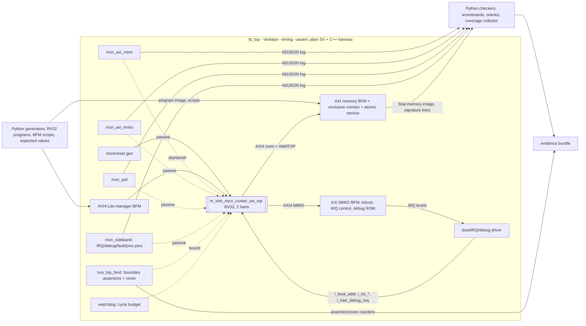

# Verification plan: VLSIT RISC-V 32-bit cluster, CFG-RV32-2 (rv32_dual)

The readable plan for gate G0 (R-245). `vplan.csv` holds the machine-checked traceability; this document holds the strategy, environment, test plan and closure criteria. Every test and obligation here exists in `vplan.csv` and the reverse (tables of Sections 3, 4, 6 and 8 are generated from the vplan by the authoring script).

AI-generated (Claude Opus 5.5, 2026-11-27) in a specification-only context (`authoring_inputs.md`); candidate until human G0 approval (R-117, R-230, R-231). No verification code exists yet (R-106).

## 1. Identification and approval

| Field | Value |
|---|---|
| Project / artifact / version | VLSIT_RISCV_CPU / RV32 dual/quad CPU cluster, AXI TOP, two harts / campaign rv32_dual_cfg_rv32_2 |
| Level | block (processor profile) |
| Specification | `doc/specification_32/VLSIT_RISCV32_DUAL_QUAD_CPU_CLUSTER_HDS.md` rev 0.4, SHA-256 `81923890dc7b70b415fbb8947e48c82e666860c2c5e23243fa2dbe72253a115c`; incorporates `doc/specification/VLSIT_RISCV_DUAL_QUAD_CPU_CLUSTER_HDS.md` (REF-001) rev 0.39, SHA-256 `12615b0bbcf64571b5e202876207eb89825cc5375c518d680528204f6565e1a9`; CSR workbook SHA-256 `59872e8809ee51a0a380b4642ec94230ba6ed097c4a62d38f2366e01e60ccec1` |
| Protocol standards | AMBA AXI4/AXI4-Lite IHI 0022H (A3.2, A3.4, A6, A7.2, B1), AMBA 5 atomics E1.1 (PULP AWATOP subset), RISC-V Unprivileged (RV32IMAFC, B, Zcb, Zicond, Zkn, Zicbom, Zifencei) and Privileged (Sv32, PMP, traps) |
| RTL baseline | `m_vlsit_riscv_cluster_axi_top`, RV32 filelist, PARA_CPU_NUM=2; commit/hash recorded at G1 in the build manifest (not read during authoring, R-103) |
| Machine-readable plan | `docs/00_plan/vplan.csv` (156 obligations), `docs/00_plan/requirements.txt` (70 IDs) |
| Scope / gaps / inputs | `scope_record.md`, `spec_gaps.md` (Q-G0-01 to Q-G0-16, all answered 2026-11-27; see `question_log.md`), `authoring_inputs.md` |
| Author / reviewer | Claude Opus 5.5 (AI, candidate) / pending named hardware verification engineer |
| G0 decision | **pending**; no `signoff.md` is created by the author |

## 2. Scope

### 2.1 Configurations under verification

| Config ID | Parameters and defines | Why it is in scope |
|---|---|---|
| CFG-RV32-2-P0 | RV32 filelist, PARA_CPU_NUM=2, PARA_TIMING_PROFILE=0, REF-001 8.1 defaults, five-region campaign table (Q-G0-03, Section 5.4), default LLC geometry 4 ways x 4096 lines (Q-G0-15) | Product configuration of this campaign; full campaign (Q-04) |
| CFG-RV32-2-P1 | as P0, PARA_TIMING_PROFILE=1 | REQ-XL-014, REQ-PERF-006: elaboration, lint, `t_rv32d_smoke` |
| CFG-RV32-2-P2 | as P0, PARA_TIMING_PROFILE=2 | REQ-XL-014, REQ-PERF-007: elaboration, lint, `t_rv32d_smoke` |
| CFG-RV32-4-P0/P1/P2 | PARA_CPU_NUM=4 | REQ-XL-014 names 2 and 4 harts: elaboration and lint only |

### 2.2 Out of scope

The 19 excluded REF-001 requirements and their reasons are in `scope_record.md` Section 6.2 (all need approver signature). Summary of excluded layers:

| Item | Reason | Where it is verified instead | Approver |
|---|---|---|---|
| Internal CCU tag/slot, bank, PLRU, token, stale-ACK and probe-claim mechanics (REQ-MEM-009/011/014/021-024) | Not observable or injectable at the TOP with two harts; unchanged by XLEN (REQ-XL-009) | REF-001 unit tests TEST-025/033/045/048/053/056 | pending |
| LLC-eviction independence (REQ-MEM-010), LLC geometry (REQ-MEM-002) | Not separable from legal directory replacement without the set-index function; static parameter | REF-001 TEST-003/024 | pending |
| External memory widths 32/128/256 (REQ-IF-012) | Q-04 fixes width 64 | REF-001 TEST-047 | pending |
| PMU counter-number boundary (REQ-PMU-001) | Elaboration check; default 16 only | REF-001 TEST-009 | pending |
| ACE (REQ-IF-004), physical design (REQ-PD-001/002/003), clock lint (REQ-CLK-001), SoC watchdog (REQ-RST-002), RAM wrapper (REQ-MEM-025), REQ-SYS-002 (replaced by REQ-XL-001) | Future phase, non-functional or SoC obligation | STA/CDC/SoC flows | pending |
| Full timing-profile CPU matrix TEST-057-061/063, 4-hart simulation | Q-04 | later campaign | pending |
| RV32 Linux/RTOS boot (TEST-105 part) | OPEN-X32-OS: no software image selected | later campaign | pending |
| Internal missing PREPARE/COMMIT/ABORT ACK injection (TEST-029-031) | Not reachable with real responsive caches | REF-001 unit level | pending |

### 2.3 Scenario-dimension matrix (R-265)

Obligation IDs per requirement and dimension; `(b)` marks a blocked obligation; `N/A` entries carry the justification in the last column.

| Requirement | normal | boundary | error | recovery | reset | backpressure | concurrency | N/A justification for empty dimensions |
|---|---|---|---|---|---|---|---|---|
| REQ-XL-001 | OB-140 | N/A | N/A | N/A | N/A | N/A | N/A | static configuration; no runtime error/reset/backpressure/concurrency behaviour |
| REQ-XL-002 | OB-122, OB-125, OB-133 | N/A | N/A | N/A | N/A | N/A | N/A | no specified behaviour for this dimension at the TOP boundary; reset is covered globally by REQ-RST-001 obligations and backpressure by the always-on random BFM READY policy |
| REQ-XL-003 | OB-091, OB-135 | N/A | OB-089 | N/A | N/A | N/A | N/A | ISA decode: no backpressure/reset/recovery semantics; concurrency is per-hart independent |
| REQ-XL-004 | N/A | OB-045, OB-051 | OB-090 | N/A | N/A | N/A | N/A | FPU is per-hart; no bus backpressure/reset/recovery semantics beyond reset covered by REQ-RST-001 |
| REQ-XL-005 | OB-082 | OB-086 | OB-013 | N/A | N/A | N/A | N/A | MMU: reset by REQ-RST-001; PTW backpressure is exercised implicitly by random BFM delays |
| REQ-XL-006 | OB-021, OB-068, OB-076, OB-084 | OB-088 | N/A | N/A | N/A | N/A | N/A | no specified behaviour for this dimension at the TOP boundary; reset is covered globally by REQ-RST-001 obligations and backpressure by the always-on random BFM READY policy |
| REQ-XL-007 | N/A | OB-020(b), OB-085(b) | N/A | N/A | N/A | N/A | N/A | no specified behaviour for this dimension at the TOP boundary; reset is covered globally by REQ-RST-001 obligations and backpressure by the always-on random BFM READY policy |
| REQ-XL-008 | OB-134 | N/A | OB-136 | N/A | N/A | N/A | N/A | no specified behaviour for this dimension at the TOP boundary; reset is covered globally by REQ-RST-001 obligations and backpressure by the always-on random BFM READY policy |
| REQ-XL-009 | OB-018 | N/A | N/A | N/A | N/A | N/A | OB-001, OB-058 | no specified behaviour for this dimension at the TOP boundary; reset is covered globally by REQ-RST-001 obligations and backpressure by the always-on random BFM READY policy |
| REQ-XL-010 | OB-137 | N/A | N/A | N/A | N/A | N/A | N/A | static port/CSR identity |
| REQ-XL-011 | N/A | OB-074, OB-087, OB-154 | OB-143 | N/A | N/A | N/A | N/A | no specified behaviour for this dimension at the TOP boundary; reset is covered globally by REQ-RST-001 obligations and backpressure by the always-on random BFM READY policy |
| REQ-XL-012 | OB-007, OB-040 | OB-019, OB-026, OB-042 | N/A | N/A | N/A | N/A | N/A | no specified behaviour for this dimension at the TOP boundary; reset is covered globally by REQ-RST-001 obligations and backpressure by the always-on random BFM READY policy |
| REQ-XL-013 | OB-092 | OB-093 | N/A | N/A | N/A | N/A | N/A | counter CSRs: reset covered by REQ-RST-001; no backpressure |
| REQ-XL-014 | OB-129, OB-144 | N/A | N/A | N/A | N/A | N/A | N/A | static elaboration/lint |
| REQ-SYS-001 | OB-132 | N/A | OB-141 | N/A | N/A | N/A | N/A | no specified behaviour for this dimension at the TOP boundary; reset is covered globally by REQ-RST-001 obligations and backpressure by the always-on random BFM READY policy |
| REQ-SYS-003 | OB-126 | N/A | N/A | OB-030 | N/A | N/A | N/A | no specified behaviour for this dimension at the TOP boundary; reset is covered globally by REQ-RST-001 obligations and backpressure by the always-on random BFM READY policy |
| REQ-SYS-004 | OB-139 | N/A | N/A | N/A | N/A | N/A | N/A | static port audit |
| REQ-PERF-006 | OB-127 | N/A | N/A | N/A | N/A | N/A | N/A | no specified behaviour for this dimension at the TOP boundary; reset is covered globally by REQ-RST-001 obligations and backpressure by the always-on random BFM READY policy |
| REQ-PERF-007 | OB-128 | N/A | N/A | N/A | N/A | N/A | N/A | no specified behaviour for this dimension at the TOP boundary; reset is covered globally by REQ-RST-001 obligations and backpressure by the always-on random BFM READY policy |
| REQ-MEM-001 | OB-015, OB-130 | OB-044 | N/A | OB-047 | N/A | N/A | OB-053, OB-083 | no specified behaviour for this dimension at the TOP boundary; reset is covered globally by REQ-RST-001 obligations and backpressure by the always-on random BFM READY policy |
| REQ-MEM-005 | OB-016, OB-039 | N/A | N/A | N/A | N/A | N/A | N/A | no specified behaviour for this dimension at the TOP boundary; reset is covered globally by REQ-RST-001 obligations and backpressure by the always-on random BFM READY policy |
| REQ-MEM-006 | N/A | N/A | N/A | N/A | N/A | N/A | OB-005, OB-055 | no specified behaviour for this dimension at the TOP boundary; reset is covered globally by REQ-RST-001 obligations and backpressure by the always-on random BFM READY policy |
| REQ-MEM-007 | N/A | N/A | N/A | N/A | N/A | N/A | OB-024 | no specified behaviour for this dimension at the TOP boundary; reset is covered globally by REQ-RST-001 obligations and backpressure by the always-on random BFM READY policy |
| REQ-MEM-008 | N/A | N/A | OB-065(b) | N/A | N/A | N/A | OB-054 | no specified behaviour for this dimension at the TOP boundary; reset is covered globally by REQ-RST-001 obligations and backpressure by the always-on random BFM READY policy |
| REQ-MEM-012 | OB-017 | N/A | OB-012 | OB-063(b) | N/A | N/A | OB-118 | no specified behaviour for this dimension at the TOP boundary; reset is covered globally by REQ-RST-001 obligations and backpressure by the always-on random BFM READY policy |
| REQ-MEM-013 | N/A | N/A | N/A | N/A | OB-029 | OB-046 | N/A | no specified behaviour for this dimension at the TOP boundary; reset is covered globally by REQ-RST-001 obligations and backpressure by the always-on random BFM READY policy |
| REQ-MEM-015 | OB-037 | OB-043 | N/A | N/A | N/A | N/A | OB-004 | no specified behaviour for this dimension at the TOP boundary; reset is covered globally by REQ-RST-001 obligations and backpressure by the always-on random BFM READY policy |
| REQ-MEM-016 | N/A | OB-038 | N/A | OB-011, OB-061(b) | N/A | N/A | N/A | no specified behaviour for this dimension at the TOP boundary; reset is covered globally by REQ-RST-001 obligations and backpressure by the always-on random BFM READY policy |
| REQ-MEM-017 | N/A | N/A | OB-010, OB-060(b) | N/A | N/A | N/A | N/A | no specified behaviour for this dimension at the TOP boundary; reset is covered globally by REQ-RST-001 obligations and backpressure by the always-on random BFM READY policy |
| REQ-MEM-018 | OB-023 | N/A | OB-062(b) | N/A | N/A | N/A | OB-006 | no specified behaviour for this dimension at the TOP boundary; reset is covered globally by REQ-RST-001 obligations and backpressure by the always-on random BFM READY policy |
| REQ-MEM-019 | N/A | N/A | N/A | N/A | N/A | N/A | OB-002(b) | no specified behaviour for this dimension at the TOP boundary; reset is covered globally by REQ-RST-001 obligations and backpressure by the always-on random BFM READY policy |
| REQ-MEM-020 | N/A | N/A | N/A | N/A | N/A | OB-056 | OB-003 | no specified behaviour for this dimension at the TOP boundary; reset is covered globally by REQ-RST-001 obligations and backpressure by the always-on random BFM READY policy |
| REQ-MEM-003 | N/A | N/A | OB-112(b) | N/A | N/A | N/A | N/A | no specified behaviour for this dimension at the TOP boundary; reset is covered globally by REQ-RST-001 obligations and backpressure by the always-on random BFM READY policy |
| REQ-MEM-004 | N/A | N/A | N/A | N/A | OB-111(b) | N/A | N/A | no specified behaviour for this dimension at the TOP boundary; reset is covered globally by REQ-RST-001 obligations and backpressure by the always-on random BFM READY policy |
| REQ-IF-001 | OB-104 | N/A | N/A | N/A | OB-031 | OB-150 | N/A | no specified behaviour for this dimension at the TOP boundary; reset is covered globally by REQ-RST-001 obligations and backpressure by the always-on random BFM READY policy |
| REQ-IF-002 | N/A | N/A | N/A | N/A | N/A | OB-066 | N/A | no specified behaviour for this dimension at the TOP boundary; reset is covered globally by REQ-RST-001 obligations and backpressure by the always-on random BFM READY policy |
| REQ-IF-003 | OB-078, OB-142 | N/A | N/A | N/A | N/A | N/A | N/A | no specified behaviour for this dimension at the TOP boundary; reset is covered globally by REQ-RST-001 obligations and backpressure by the always-on random BFM READY policy |
| REQ-IF-005 | N/A | N/A | N/A | N/A | OB-032 | OB-067, OB-110, OB-131 | N/A | no specified behaviour for this dimension at the TOP boundary; reset is covered globally by REQ-RST-001 obligations and backpressure by the always-on random BFM READY policy |
| REQ-IF-006 | N/A | OB-138 | N/A | N/A | N/A | N/A | N/A | static port audit |
| REQ-IF-007 | OB-096 | N/A | OB-105, OB-151 | N/A | N/A | N/A | N/A | no specified behaviour for this dimension at the TOP boundary; reset is covered globally by REQ-RST-001 obligations and backpressure by the always-on random BFM READY policy |
| REQ-IF-008 | OB-035 | OB-102, OB-106, OB-148 | N/A | N/A | N/A | N/A | N/A | no specified behaviour for this dimension at the TOP boundary; reset is covered globally by REQ-RST-001 obligations and backpressure by the always-on random BFM READY policy |
| REQ-IF-009 | OB-077 | N/A | OB-075 | N/A | N/A | N/A | OB-057 | no specified behaviour for this dimension at the TOP boundary; reset is covered globally by REQ-RST-001 obligations and backpressure by the always-on random BFM READY policy |
| REQ-IF-010 | N/A | N/A | N/A | N/A | N/A | OB-113(b) | OB-108(b), OB-149 | no specified behaviour for this dimension at the TOP boundary; reset is covered globally by REQ-RST-001 obligations and backpressure by the always-on random BFM READY policy |
| REQ-IF-011 | OB-069 | OB-153 | OB-072 | N/A | N/A | N/A | N/A | no specified behaviour for this dimension at the TOP boundary; reset is covered globally by REQ-RST-001 obligations and backpressure by the always-on random BFM READY policy |
| REQ-PMU-002 | N/A | OB-145 | N/A | N/A | N/A | N/A | N/A | no specified behaviour for this dimension at the TOP boundary; reset is covered globally by REQ-RST-001 obligations and backpressure by the always-on random BFM READY policy |
| REQ-PMU-003 | OB-095 | N/A | N/A | N/A | N/A | N/A | OB-101, OB-147 | no specified behaviour for this dimension at the TOP boundary; reset is covered globally by REQ-RST-001 obligations and backpressure by the always-on random BFM READY policy |
| REQ-PMU-004 | OB-103 | N/A | OB-146 | N/A | N/A | N/A | N/A | no specified behaviour for this dimension at the TOP boundary; reset is covered globally by REQ-RST-001 obligations and backpressure by the always-on random BFM READY policy |
| REQ-PMU-005 | N/A | OB-097 | N/A | N/A | N/A | N/A | N/A | no specified behaviour for this dimension at the TOP boundary; reset is covered globally by REQ-RST-001 obligations and backpressure by the always-on random BFM READY policy |
| REQ-PMU-006 | N/A | N/A | N/A | N/A | N/A | N/A | OB-098 | no specified behaviour for this dimension at the TOP boundary; reset is covered globally by REQ-RST-001 obligations and backpressure by the always-on random BFM READY policy |
| REQ-PMU-007 | OB-022, OB-041, OB-094 | N/A | OB-099 | N/A | N/A | N/A | N/A | no specified behaviour for this dimension at the TOP boundary; reset is covered globally by REQ-RST-001 obligations and backpressure by the always-on random BFM READY policy |
| REQ-PMU-008 | OB-100 | N/A | N/A | N/A | N/A | N/A | OB-008, OB-052 | no specified behaviour for this dimension at the TOP boundary; reset is covered globally by REQ-RST-001 obligations and backpressure by the always-on random BFM READY policy |
| REQ-DBG-001 | OB-123 | N/A | N/A | N/A | N/A | N/A | N/A | no specified behaviour for this dimension at the TOP boundary; reset is covered globally by REQ-RST-001 obligations and backpressure by the always-on random BFM READY policy |
| REQ-IRQ-001 | OB-025, OB-117, OB-119 | N/A | N/A | N/A | N/A | N/A | N/A | no specified behaviour for this dimension at the TOP boundary; reset is covered globally by REQ-RST-001 obligations and backpressure by the always-on random BFM READY policy |
| REQ-IRQ-002 | N/A | OB-120 | N/A | N/A | N/A | N/A | N/A | no specified behaviour for this dimension at the TOP boundary; reset is covered globally by REQ-RST-001 obligations and backpressure by the always-on random BFM READY policy |
| REQ-IRQ-003 | OB-116, OB-121 | N/A | N/A | N/A | N/A | N/A | N/A | no specified behaviour for this dimension at the TOP boundary; reset is covered globally by REQ-RST-001 obligations and backpressure by the always-on random BFM READY policy |
| REQ-CLK-002 | N/A | N/A | N/A | N/A | N/A | N/A | OB-115, OB-124 | no specified behaviour for this dimension at the TOP boundary; reset is covered globally by REQ-RST-001 obligations and backpressure by the always-on random BFM READY policy |
| REQ-RST-001 | N/A | N/A | N/A | OB-034 | OB-028, OB-114(b) | N/A | N/A | no specified behaviour for this dimension at the TOP boundary; reset is covered globally by REQ-RST-001 obligations and backpressure by the always-on random BFM READY policy |
| REQ-ERR-001 | N/A | N/A | OB-070 | N/A | N/A | OB-048 | N/A | no specified behaviour for this dimension at the TOP boundary; reset is covered globally by REQ-RST-001 obligations and backpressure by the always-on random BFM READY policy |
| REQ-ERR-002 | N/A | N/A | OB-073, OB-107 | N/A | N/A | N/A | N/A | no specified behaviour for this dimension at the TOP boundary; reset is covered globally by REQ-RST-001 obligations and backpressure by the always-on random BFM READY policy |
| REQ-ERR-003 | N/A | N/A | OB-033, OB-064(b) | N/A | N/A | N/A | N/A | no specified behaviour for this dimension at the TOP boundary; reset is covered globally by REQ-RST-001 obligations and backpressure by the always-on random BFM READY policy |
| REQ-VER-001 | OB-155 | N/A | N/A | N/A | N/A | N/A | N/A | process requirement |
| REQ-VER-002 | OB-156 | N/A | N/A | N/A | N/A | N/A | N/A | process requirement |
| PROTO-AXI4-A3.2 | N/A | N/A | OB-014 | N/A | N/A | OB-050 | N/A | no specified behaviour for this dimension at the TOP boundary; reset is covered globally by REQ-RST-001 obligations and backpressure by the always-on random BFM READY policy |
| PROTO-AXI4-A3.4 | OB-059 | OB-081 | N/A | N/A | N/A | N/A | N/A | no specified behaviour for this dimension at the TOP boundary; reset is covered globally by REQ-RST-001 obligations and backpressure by the always-on random BFM READY policy |
| PROTO-AXI4-A6 | N/A | N/A | OB-036, OB-071 | N/A | N/A | N/A | OB-049 | no specified behaviour for this dimension at the TOP boundary; reset is covered globally by REQ-RST-001 obligations and backpressure by the always-on random BFM READY policy |
| PROTO-AXI4-A7.2 | OB-080 | N/A | N/A | N/A | N/A | N/A | N/A | no specified behaviour for this dimension at the TOP boundary; reset is covered globally by REQ-RST-001 obligations and backpressure by the always-on random BFM READY policy |
| PROTO-AXI4L-B1 | OB-152 | N/A | N/A | N/A | N/A | OB-109 | N/A | no specified behaviour for this dimension at the TOP boundary; reset is covered globally by REQ-RST-001 obligations and backpressure by the always-on random BFM READY policy |
| PROTO-AXI5-E1.1 | OB-079 | N/A | N/A | N/A | N/A | N/A | N/A | no specified behaviour for this dimension at the TOP boundary; reset is covered globally by REQ-RST-001 obligations and backpressure by the always-on random BFM READY policy |
| PROTO-RISCV-ZICBOM | OB-009 | N/A | N/A | N/A | N/A | N/A | N/A | no specified behaviour for this dimension at the TOP boundary; reset is covered globally by REQ-RST-001 obligations and backpressure by the always-on random BFM READY policy |
| PROTO-RISCV-ZIFENCEI | OB-027 | N/A | N/A | N/A | N/A | N/A | N/A | no specified behaviour for this dimension at the TOP boundary; reset is covered globally by REQ-RST-001 obligations and backpressure by the always-on random BFM READY policy |

## 3. Features, requirements and method

Method reasons (R-240): simulation is used for everything that needs the real cores, long sequences or data paths; formal is used only for small control components whose behaviour simulation cannot reach (PMU wrap/overflow) or cannot exhaust (AXI4-Lite decode/bridge, region decoder); review is used for static elaboration/port/lint audits and process requirements.

| Feature | Requirement IDs | Priority | Method | Reason for the method |
|---|---|---|---|---|
| atomics | REQ-MEM-006; REQ-IF-009; REQ-IF-003; PROTO-AXI5-E1.1; PROTO-AXI4-A7.2 | high | simulation | needs the real RV32 cores, long instruction sequences or the full data path |
| axi_addr_width | REQ-XL-006 | high | simulation | needs the real RV32 cores, long instruction sequences or the full data path |
| axi_protocol | PROTO-AXI4-A3.2; REQ-IF-005; PROTO-AXI4-A6; REQ-ERR-001; PROTO-AXI4-A3.4 | high | simulation | needs the real RV32 cores, long instruction sequences or the full data path |
| axil_csr | REQ-IF-001; REQ-IF-008; REQ-IF-007; REQ-ERR-002; PROTO-AXI4L-B1 | high | formal+simulation | small control component; property must hold for all states (wrap, decode, AW/W order) that simulation cannot reach or exhaust; needs the real RV32 cores, long instruction sequences or the full data path |
| boot_fanout | REQ-SYS-003; REQ-SYS-001; REQ-XL-002; REQ-XL-008 | high | simulation | needs the real RV32 cores, long instruction sequences or the full data path |
| cbo_maintenance | REQ-MEM-015; PROTO-RISCV-ZICBOM; REQ-MEM-016 | high | simulation | needs the real RV32 cores, long instruction sequences or the full data path |
| cbo_precise_fault | REQ-MEM-017 | high | simulation | needs the real RV32 cores, long instruction sequences or the full data path |
| counters_rv32 | REQ-XL-013 | high | simulation | needs the real RV32 cores, long instruction sequences or the full data path |
| debug | REQ-DBG-001; REQ-XL-002 | medium | simulation | needs the real RV32 cores, long instruction sequences or the full data path |
| elab_config | REQ-XL-010; REQ-IF-006; REQ-SYS-004; REQ-XL-001; REQ-SYS-001; REQ-IF-003; REQ-XL-011; REQ-XL-014 | high | review | static elaboration/port/lint audit or process requirement |
| fatal_fault_record | REQ-ERR-003 | high | simulation | needs the real RV32 cores, long instruction sequences or the full data path |
| fence_i | REQ-MEM-018; REQ-MEM-007; PROTO-RISCV-ZIFENCEI | high | simulation | needs the real RV32 cores, long instruction sequences or the full data path |
| fp_single | REQ-XL-004 | high | simulation | needs the real RV32 cores, long instruction sequences or the full data path |
| hpdcache_word32 | REQ-XL-012 | high | simulation | needs the real RV32 cores, long instruction sequences or the full data path |
| irq_routing | REQ-IRQ-001; REQ-IRQ-003; REQ-IRQ-002; REQ-XL-002 | high | simulation | needs the real RV32 cores, long instruction sequences or the full data path |
| line_addr_adapter | REQ-XL-007 | high | simulation | needs the real RV32 cores, long instruction sequences or the full data path |
| llc_service | REQ-IF-010; REQ-MEM-004; REQ-MEM-003 | high | formal+simulation | small control component; property must hold for all states (wrap, decode, AW/W order) that simulation cannot reach or exhaust; needs the real RV32 cores, long instruction sequences or the full data path |
| mesi_coherence | REQ-XL-009; REQ-MEM-012; REQ-MEM-001; REQ-MEM-005; REQ-MEM-008 | high | simulation | needs the real RV32 cores, long instruction sequences or the full data path |
| mmio_access | REQ-IF-002; REQ-ERR-001 | high | simulation | needs the real RV32 cores, long instruction sequences or the full data path |
| no_ack_timeout | REQ-MEM-013 | high | simulation | needs the real RV32 cores, long instruction sequences or the full data path |
| pmu_counting | REQ-PMU-008; REQ-PMU-007; REQ-PMU-005; REQ-PMU-006; REQ-PMU-004 | high | simulation | needs the real RV32 cores, long instruction sequences or the full data path |
| pmu_overflow | REQ-PMU-002; REQ-PMU-004 | medium | formal | small control component; property must hold for all states (wrap, decode, AW/W order) that simulation cannot reach or exhaust |
| pmu_snapshot | REQ-PMU-003 | high | formal+simulation | small control component; property must hold for all states (wrap, decode, AW/W order) that simulation cannot reach or exhaust; needs the real RV32 cores, long instruction sequences or the full data path |
| region_table | REQ-IF-011; REQ-ERR-002; REQ-XL-011 | high | formal+simulation | small control component; property must hold for all states (wrap, decode, AW/W order) that simulation cannot reach or exhaust; needs the real RV32 cores, long instruction sequences or the full data path |
| reset_recovery | REQ-RST-001 | high | simulation | needs the real RV32 cores, long instruction sequences or the full data path |
| rv32_isa_mode | REQ-XL-003 | high | simulation | needs the real RV32 cores, long instruction sequences or the full data path |
| same_line_lock | REQ-MEM-019; REQ-MEM-020; REQ-MEM-006 | high | simulation | needs the real RV32 cores, long instruction sequences or the full data path |
| sv32_mmu | REQ-XL-005 | high | simulation | needs the real RV32 cores, long instruction sequences or the full data path |
| timing_profiles | REQ-PERF-006; REQ-PERF-007; REQ-XL-014 | high | simulation | needs the real RV32 cores, long instruction sequences or the full data path |
| verif_process | REQ-VER-001; REQ-VER-002 | medium | review | static elaboration/port/lint audit or process requirement |
| wfi_probe | REQ-CLK-002 | high | simulation | needs the real RV32 cores, long instruction sequences or the full data path |

### 3.1 Function inventory and functional verification matrix (R-246)

Pasted from `vlsit_verify_plan.py matrix docs/00_plan/vplan.csv` (function-to-test table). `elab_config`, `pmu_overflow` and `verif_process` have no combined test; their `combine_na` reasons are in the vplan notes.

| Function | Combined tests | Single-function tests | Status |
|---|---|---|---|
| boot_fanout | t_rv32d_reset_inflight; t_rv32d_smoke; t_rv32d_boot_identity | t_rv32d_boot_addr_hi_nonzero | combined covered |
| elab_config | - | t_rv32d_elab_port_audit; t_rv32d_elab_lint_matrix | no combination: static lint |
| pmu_overflow | - | t_rv32d_fv_pmu | no combination: wrap unreachable in TOP simulation, component formal only |
| verif_process | - | t_rv32d_process_audit | no combination: process review, not a DUT function |
| mesi_coherence | t_rv32d_coh_cmo_amo_stress; t_rv32d_cbo_fault_llc; t_rv32d_mesi_dirty_owner; t_rv32d_fencei_smc; t_rv32d_cbo_matrix; t_rv32d_hpdcache_word32_lanes; t_rv32d_no_timeout_hold; t_rv32d_mesi_random_litmus; t_rv32d_cbo_fault_owner; t_rv32d_fencei_fault; t_rv32d_fatal_l1_eviction; t_rv32d_sv32_mmu; t_rv32d_irq_wfi_coherence; t_rv32d_debug_halt; t_rv32d_smoke | - | combined covered |
| cbo_maintenance | t_rv32d_coh_cmo_amo_stress; t_rv32d_cbo_fault_llc; t_rv32d_cbo_matrix; t_rv32d_hpdcache_word32_lanes; t_rv32d_cbo_fault_owner | - | combined covered |
| fence_i | t_rv32d_coh_cmo_amo_stress; t_rv32d_fencei_smc; t_rv32d_fencei_fault | - | combined covered |
| atomics | t_rv32d_coh_cmo_amo_stress; t_rv32d_mesi_random_litmus; t_rv32d_region_routing; t_rv32d_atomics_uncached | - | combined covered |
| same_line_lock | t_rv32d_coh_cmo_amo_stress; t_rv32d_mesi_random_litmus | - | combined covered |
| pmu_counting | t_rv32d_coh_cmo_amo_stress; t_rv32d_mesi_dirty_owner; t_rv32d_cbo_matrix; t_rv32d_fp32_divsqrt; t_rv32d_counters_pmu; t_rv32d_pmu_scope_snapshot | - | combined covered |
| hpdcache_word32 | t_rv32d_coh_cmo_amo_stress; t_rv32d_mesi_dirty_owner; t_rv32d_fencei_smc; t_rv32d_cbo_matrix; t_rv32d_hpdcache_word32_lanes | - | combined covered |
| cbo_precise_fault | t_rv32d_cbo_fault_llc; t_rv32d_cbo_fault_owner | - | combined covered |
| sv32_mmu | t_rv32d_cbo_fault_llc; t_rv32d_sv32_mmu; t_rv32d_pa34_alias | - | combined covered |
| axi_protocol | t_rv32d_cbo_fault_llc; t_rv32d_reset_inflight; t_rv32d_fatal_llc_eviction; t_rv32d_no_timeout_hold; t_rv32d_mesi_random_litmus; t_rv32d_mmio_axi; t_rv32d_mmio_error; t_rv32d_atomics_uncached; t_rv32d_axil_csr_windows; t_rv32d_smoke | - | combined covered |
| line_addr_adapter | t_rv32d_mesi_dirty_owner; t_rv32d_pa34_alias | - | combined covered |
| axi_addr_width | t_rv32d_mesi_dirty_owner; t_rv32d_mmio_axi; t_rv32d_region_routing; t_rv32d_sv32_mmu; t_rv32d_pa34_alias; t_rv32d_boot_identity | - | combined covered |
| irq_routing | t_rv32d_fencei_smc; t_rv32d_irq_wfi_coherence | t_rv32d_irq_matrix | combined covered |
| reset_recovery | t_rv32d_reset_inflight; t_rv32d_fatal_llc_eviction; t_rv32d_llc_service_bist | - | combined covered |
| no_ack_timeout | t_rv32d_reset_inflight; t_rv32d_no_timeout_hold | - | combined covered |
| axil_csr | t_rv32d_reset_inflight; t_rv32d_fatal_llc_eviction; t_rv32d_fatal_l1_eviction; t_rv32d_counters_pmu; t_rv32d_pmu_scope_snapshot; t_rv32d_axil_csr_windows; t_rv32d_llc_service_bist | t_rv32d_fv_axil | combined covered |
| fatal_fault_record | t_rv32d_fatal_llc_eviction; t_rv32d_fatal_l1_eviction | - | combined covered |
| fp_single | t_rv32d_hpdcache_word32_lanes; t_rv32d_fp32_divsqrt; t_rv32d_isa_rv32_traps | - | combined covered |
| mmio_access | t_rv32d_mmio_axi; t_rv32d_mmio_error; t_rv32d_region_routing | - | combined covered |
| region_table | t_rv32d_mmio_axi; t_rv32d_mmio_error; t_rv32d_region_routing; t_rv32d_atomics_uncached; t_rv32d_pa34_alias | t_rv32d_fv_addr_decode | combined covered |
| rv32_isa_mode | t_rv32d_isa_rv32_traps; t_rv32d_isa_ext_kat; t_rv32d_boot_identity | - | combined covered |
| counters_rv32 | t_rv32d_isa_ext_kat; t_rv32d_counters_pmu | - | combined covered |
| pmu_snapshot | t_rv32d_counters_pmu; t_rv32d_pmu_scope_snapshot | t_rv32d_fv_pmu | combined covered |
| llc_service | t_rv32d_axil_csr_windows; t_rv32d_llc_service_bist | t_rv32d_fv_axil | combined covered |
| wfi_probe | t_rv32d_irq_wfi_coherence; t_rv32d_debug_halt | - | combined covered |
| debug | t_rv32d_debug_halt | - | combined covered |
| timing_profiles | t_rv32d_smoke | - | combined covered |

## 4. Failure-mode list (R-242)

Derived per feature from the specification before the tests were chosen. Every failure mode maps to vplan obligations; blocked obligations are marked.

| FM ID | Feature | Failure mode | Trigger condition | Expected detection | Obligation / test | Checker | Bin |
|---|---|---|---|---|---|---|---|
| FM-ATM-01 | atomics | Lost AMO increment under contention (DEC-046 class) | two-hart AMOADD.W loop | count differs from N | OB-005 / t_rv32d_coh_cmo_amo_stress; OB-057 / t_rv32d_mesi_random_litmus | chk_mem_oracle | cg_amo_contended; cg_cached_atomic_kind |
| FM-ATM-02 | atomics | SC succeeds after an intervening write / exclusive mishandled | LR/SC with peer store; EXOKAY/OKAY | illegal SC success | OB-057 / t_rv32d_mesi_random_litmus; OB-077 / t_rv32d_atomics_uncached; OB-080 / t_rv32d_atomics_uncached | a_awatop_legal; chk_axi_mem_sb; chk_mem_oracle | cg_cached_atomic_kind; cg_excl_resp; cg_uncached_atomic_op |
| FM-ATM-03 | atomics | AMO to MMIO forwarded as ordinary access | AMOADD.W to MMIO region | MMIO AW observed / no fault | OB-075 / t_rv32d_region_routing | chk_axi_mmio_sb; chk_trap_oracle | cg_amo_mmio_reject |
| FM-ATM-04 | atomics | Illegal AWATOP or wrong old value for uncached AMO | AMO*.W to normal-uncached | a_awatop_legal or oracle mismatch | OB-077 / t_rv32d_atomics_uncached; OB-078 / t_rv32d_atomics_uncached; OB-079 / t_rv32d_atomics_uncached | a_awatop_legal; chk_axi_mem_sb; chk_mem_oracle | cg_awatop_enc; cg_awatop_passthrough; cg_uncached_atomic_op |
| FM-AXI-01 | axi_protocol | Payload or VALID changes while stalled | random READY low | a_axi_*_stable | OB-014 / t_rv32d_cbo_fault_llc; OB-050 / t_rv32d_no_timeout_hold; OB-067 / t_rv32d_mmio_axi; OB-110 / t_rv32d_axil_csr_windows; OB-131 / t_rv32d_smoke | a_axi_mem_stable; a_axi_mmio_stable; a_axil_stable; chk_axi_mem_sb; chk_axi_mmio_sb; chk_axil_sb | cg_axi_b_err; cg_axi_long_stall; cg_axil_stall; cg_mmio_stall; cg_smoke_bp |
| FM-AXI-02 | axi_protocol | Response misassociated by ID or error lost/fabricated | out-of-order/error responses | scoreboard ID/data mismatch | OB-036 / t_rv32d_fatal_llc_eviction; OB-048 / t_rv32d_no_timeout_hold; OB-049 / t_rv32d_no_timeout_hold; OB-071 / t_rv32d_mmio_error | chk_axi_mem_sb; chk_axi_mmio_sb; chk_mem_oracle | cg_axi_err_id; cg_axi_ooo_id; cg_mmio_err_id; cg_resp_assoc |
| FM-AXI-03 | axi_protocol | VALID asserted during reset or stale handshake after reset | reset mid-burst | a_axi_reset_valid_low | OB-032 / t_rv32d_reset_inflight | a_axi_reset_valid_low; chk_stale_resp | cg_axi_reset_mid |
| FM-AXI-04 | axi_protocol | Illegal burst shape (len/size/type, 4 KiB crossing) | all memory traffic | a_axi_burst_legal | OB-059 / t_rv32d_mesi_random_litmus; OB-081 / t_rv32d_atomics_uncached | a_axi_burst_legal; chk_axi_mem_sb | cg_atomic_shape; cg_axi_burst_shape |
| FM-AXL-01 | axil_csr | Wrong window decode or reserved offset accepted | boundary offsets | CSR model / formal | OB-035 / t_rv32d_fatal_llc_eviction; OB-102 / t_rv32d_pmu_scope_snapshot; OB-106 / t_rv32d_axil_csr_windows; OB-148 / t_rv32d_fv_axil | a_axil_decerr; a_axil_decode_onehot; chk_csr_model; chk_formal | cg_axil_fault_group; cg_axil_window_edge; cg_fv_axil_decode; cg_pmu_window_edges |
| FM-AXL-02 | axil_csr | WSTRB ignored or misaligned access changes fields | strobe/offset sweep | CSR model | OB-096 / t_rv32d_counters_pmu; OB-105 / t_rv32d_axil_csr_windows | chk_csr_model | cg_axil_pmu_access; cg_axil_strb_x_resp |
| FM-AXL-03 | axil_csr | Error response with side effect or nonzero read data | reserved/RO writes | CSR model | OB-105 / t_rv32d_axil_csr_windows; OB-107 / t_rv32d_axil_csr_windows; OB-151 / t_rv32d_fv_axil | a_axil_decerr; chk_csr_model; chk_formal | cg_axil_no_side_effect; cg_axil_strb_x_resp; cg_fv_axil_zero |
| FM-AXL-04 | axil_csr | Lost/duplicate B or R; unstable response under backpressure | AW/W order + B/R stalls | AXI4-Lite scoreboard, a_axil_stable | OB-031 / t_rv32d_reset_inflight; OB-104 / t_rv32d_axil_csr_windows; OB-109 / t_rv32d_axil_csr_windows; OB-150 / t_rv32d_fv_axil; OB-152 / t_rv32d_fv_axil | a_axil_stable; chk_axil_sb; chk_csr_model; chk_formal | cg_axil_order_x_bp; cg_axil_reset_sweep; cg_axil_rw; cg_fv_axil_hs; cg_fv_axil_stable |
| FM-AXW-01 | axi_addr_width | AXI address bits 63:34 nonzero (I-X32-2) | all external traffic | a_axi_addr_hi_zero | OB-021 / t_rv32d_mesi_dirty_owner; OB-068 / t_rv32d_mmio_axi; OB-076 / t_rv32d_region_routing; OB-084 / t_rv32d_sv32_mmu | a_axi_addr_hi_zero; chk_axi_mem_sb; chk_axi_mmio_sb | cg_axi_addr_hi; cg_mmio_addr; cg_sv32_pa_axi; cg_uncached_addr |
| FM-AXW-02 | axi_addr_width | PA bits 33:30 dropped or shifted on AXI | high-PA mappings | scoreboard address mismatch | OB-088 / t_rv32d_pa34_alias | a_axi_addr_hi_zero; chk_axi_mem_sb | cg_axi_pa_hi |
| FM-BOT-01 | boot_fanout | Hart does not start at i_boot_addr[31:0] after reset or reboot | reset release | first-fetch address check | OB-030 / t_rv32d_reset_inflight; OB-126 / t_rv32d_smoke | chk_sig | cg_reboot; cg_smoke_profile |
| FM-BOT-02 | boot_fanout | Duplicate or non-contiguous mhartid | boot | signature slots | OB-132 / t_rv32d_boot_identity; OB-133 / t_rv32d_boot_identity | chk_sig | cg_boot_branch; cg_hartid |
| FM-BOT-03 | boot_fanout | Upper boot-address bits used or not flagged | nonzero i_boot_addr[63:32] | SVA-102 and first-fetch address | OB-134 / t_rv32d_boot_identity; OB-136 / t_rv32d_boot_addr_hi_nonzero | a_boot_hi_zero; chk_axi_mem_sb | cg_boot_addr; cg_boot_hi_nonzero |
| FM-CBF-01 | cbo_precise_fault | Wrong exception cause for CBO writeback error | memory B error | mcause/scause check | OB-010 / t_rv32d_cbo_fault_llc | chk_sig; chk_trap_oracle | cg_cbo_fault_op_x_resp_x_mode |
| FM-CBF-02 | cbo_precise_fault | Wrong epc/tval (aligned or physical instead of original VA) | unaligned effective address | trap oracle | OB-010 / t_rv32d_cbo_fault_llc; OB-013 / t_rv32d_cbo_fault_llc | chk_sig; chk_trap_oracle | cg_cbo_fault_op_x_resp_x_mode; cg_cbo_fault_smode |
| FM-CBF-03 | cbo_precise_fault | CBO or younger instruction retires before resolution | error path | marker store visible / minstret | OB-010 / t_rv32d_cbo_fault_llc | chk_sig; chk_trap_oracle | cg_cbo_fault_op_x_resp_x_mode |
| FM-CBF-04 | cbo_precise_fault | Dirty data lost after error; retry fails | error then retry | retry writeback data | OB-011 / t_rv32d_cbo_fault_llc | chk_axi_mem_sb | cg_cbo_retry |
| FM-CBF-05 | cbo_precise_fault | Owner-writeback error mishandled (no ABORT, M lost) | L1-to-LLC error (Q-G0-05) | trap oracle and owner data | OB-060 / t_rv32d_cbo_fault_owner (blocked); OB-061 / t_rv32d_cbo_fault_owner (blocked) | chk_mem_oracle; chk_trap_oracle | cg_cbo_owner_err; cg_cbo_owner_err_preserve |
| FM-CBO-01 | cbo_maintenance | CLEAN/FLUSH does not make memory current | dirty L1/LLC line | memory scoreboard | OB-004 / t_rv32d_coh_cmo_amo_stress; OB-009 / t_rv32d_coh_cmo_amo_stress; OB-037 / t_rv32d_cbo_matrix; OB-043 / t_rv32d_hpdcache_word32_lanes | chk_axi_mem_sb; chk_mem_oracle | cg_cbo_op_x_l1_x_llc; cg_cbo_ops; cg_cbo_partial_line; cg_cbo_under_contention |
| FM-CBO-02 | cbo_maintenance | CMO miss allocates/refills a line | CMO on absent line | unexpected AR | OB-037 / t_rv32d_cbo_matrix; OB-038 / t_rv32d_cbo_matrix | chk_axi_mem_sb; chk_mem_oracle | cg_cbo_op_x_l1_x_llc; cg_llc_cmo_miss |
| FM-CBO-03 | cbo_maintenance | Invalidation before successful writeback / INVAL writes back | FLUSH/INVAL on dirty line | AW presence/absence and later data | OB-004 / t_rv32d_coh_cmo_amo_stress; OB-037 / t_rv32d_cbo_matrix | chk_axi_mem_sb; chk_mem_oracle | cg_cbo_op_x_l1_x_llc; cg_cbo_under_contention |
| FM-CBO-04 | cbo_maintenance | Wrong post-CMO state (M not to E on CLEAN, S copy lost) | CLEAN with peer copies | later access pattern / peer data | OB-037 / t_rv32d_cbo_matrix | chk_axi_mem_sb; chk_mem_oracle | cg_cbo_op_x_l1_x_llc |
| FM-CNT-01 | counters_rv32 | Torn 64-bit counter read across carry | hi-lo-hi read | signature | OB-093 / t_rv32d_counters_pmu | chk_pmu_model; chk_sig | cg_cnt_carry; cg_cnt_csr |
| FM-CNT-02 | counters_rv32 | minstret/mcycle halves miscount or not writable | write/read and deltas | signature | OB-092 / t_rv32d_isa_ext_kat; OB-093 / t_rv32d_counters_pmu | chk_pmu_model; chk_sig | cg_cnt_carry; cg_cnt_csr; cg_instret_delta |
| FM-COH-01 | mesi_coherence | Reader observes a stale value after a peer store (dirty owner not written back before grant) | peer read of a line held M | oracle value mismatch | OB-015 / t_rv32d_mesi_dirty_owner; OB-018 / t_rv32d_mesi_dirty_owner; OB-047 / t_rv32d_no_timeout_hold; OB-053 / t_rv32d_mesi_random_litmus; OB-130 / t_rv32d_smoke | a_axi_mem_stable; chk_mem_oracle | cg_hold_release_data; cg_mesi_transfer_kind; cg_rand_op_pair_x_line_rel; cg_smoke_xfer; cg_xl9_dirty_owner |
| FM-COH-02 | mesi_coherence | Lost update in store ping-pong or partial-line merge | alternating stores to one line | final line differs from serialization model | OB-015 / t_rv32d_mesi_dirty_owner; OB-044 / t_rv32d_hpdcache_word32_lanes; OB-053 / t_rv32d_mesi_random_litmus | a_axi_mem_stable; chk_mem_oracle | cg_mesi_partial; cg_mesi_transfer_kind; cg_rand_op_pair_x_line_rel |
| FM-COH-03 | mesi_coherence | Probe sent to non-holder only / recorded holder skipped (directory targeting wrong) | isolated transfer with PMU CCU counters | PREPARE/grant counts or peer data wrong | OB-016 / t_rv32d_mesi_dirty_owner; OB-039 / t_rv32d_cbo_matrix | chk_axi_mem_sb; chk_mem_oracle; chk_pmu_model | cg_cmo_holder_mask; cg_dir_target_count |
| FM-COH-04 | mesi_coherence | Reused cluster block misbehaves with zero upper line bits (REQ-XL-009) | RV32 coherence traffic | data mismatch or hang | OB-001 / t_rv32d_coh_cmo_amo_stress; OB-058 / t_rv32d_mesi_random_litmus | a_axi_mem_stable; chk_mem_oracle; chk_watchdog | cg_coh_cmo_amo_overlap; cg_xl9_random |
| FM-COH-05 | mesi_coherence | ABORT does not preserve pre-transaction state / COMMIT after failed writeback | external B error during a prepared transaction | owner loses M data or grant occurs | OB-012 / t_rv32d_cbo_fault_llc; OB-017 / t_rv32d_mesi_dirty_owner | chk_axi_mem_sb; chk_mem_oracle; chk_pmu_model | cg_abort_preserve; cg_two_phase_events |
| FM-COH-06 | mesi_coherence | Directory omits a holder: forbidden litmus outcome | MP/SB/LB litmus with fences | outcome outside RVWMO-allowed set | OB-054 / t_rv32d_mesi_random_litmus | chk_litmus_oracle | cg_litmus_pattern_x_outcome |
| FM-COH-07 | mesi_coherence | Lost directory update leaves a set reservation (DEC-047 class) | two contexts same bank under CMO | hang (watchdog) / SVA-104 | OB-001 / t_rv32d_coh_cmo_amo_stress | a_axi_mem_stable; chk_mem_oracle; chk_watchdog | cg_coh_cmo_amo_overlap |
| FM-DBG-01 | debug | Debug request affects the other hart / status wrong | per-hart request (Q-G0-07) | a_dbg_mode | OB-123 / t_rv32d_debug_halt; OB-125 / t_rv32d_debug_halt | a_dbg_mode; chk_sig | cg_dbg_hart; cg_dbg_vector |
| FM-ELB-01 | elab_config | Port list/width differs from REF-001 6.2 | interface dump | port audit | OB-137 / t_rv32d_elab_port_audit; OB-138 / t_rv32d_elab_port_audit; OB-142 / t_rv32d_elab_port_audit | chk_port_audit | cg_port_mem_atop; cg_port_rows; cg_port_vec_width |
| FM-ELB-02 | elab_config | CVXIF port present | interface dump | port audit | OB-139 / t_rv32d_elab_port_audit | chk_port_audit | cg_port_cvxif |
| FM-ELB-03 | elab_config | RV32 package field differs from RV32 HDS 8.2 | package audit | config audit | OB-140 / t_rv32d_elab_port_audit | chk_cfg_audit | cg_cfg_fields |
| FM-ELB-04 | elab_config | Illegal configuration elaborates | negative elaboration | port audit | OB-141 / t_rv32d_elab_port_audit | chk_port_audit | cg_elab_negative |
| FM-FAT-01 | fatal_fault_record | o_int_fault not sticky or not raised | LLC eviction B error | a_fault_sticky | OB-033 / t_rv32d_fatal_llc_eviction | a_fault_sticky; chk_fault_oracle | cg_fatal_llc_resp_x_order |
| FM-FAT-02 | fatal_fault_record | First record overwritten by later error | second error | fault oracle | OB-033 / t_rv32d_fatal_llc_eviction | a_fault_sticky; chk_fault_oracle | cg_fatal_llc_resp_x_order |
| FM-FAT-03 | fatal_fault_record | Wrong source/hart/BRESP/address in record | LLC error | fault oracle | OB-033 / t_rv32d_fatal_llc_eviction | a_fault_sticky; chk_fault_oracle | cg_fatal_llc_resp_x_order |
| FM-FAT-04 | fatal_fault_record | Record or level cleared by W1C/not cleared by reset | W1C then reset | fault oracle | OB-034 / t_rv32d_fatal_llc_eviction | chk_fault_oracle | cg_fatal_reset |
| FM-FAT-05 | fatal_fault_record | L1-source record wrong hart or data not retained | L1 eviction error (Q-G0-05) | fault oracle | OB-064 / t_rv32d_fatal_l1_eviction (blocked); OB-065 / t_rv32d_fatal_l1_eviction (blocked) | a_fault_sticky; chk_fault_oracle; chk_mem_oracle | cg_fatal_l1; cg_fatal_l1_retain |
| FM-FEI-01 | fence_i | Stale instruction executed after FENCE.I | self-modifying code | signature | OB-023 / t_rv32d_fencei_smc; OB-027 / t_rv32d_fencei_smc | chk_axi_mem_sb; chk_sig | cg_fencei_dirty_code; cg_zifencei |
| FM-FEI-02 | fence_i | FENCE.I triggers LLC-to-DRAM writeback | FENCE.I window | unexpected external AW | OB-006 / t_rv32d_coh_cmo_amo_stress; OB-023 / t_rv32d_fencei_smc | chk_axi_mem_sb; chk_sig | cg_fencei_concurrent; cg_fencei_dirty_code |
| FM-FEI-03 | fence_i | FENCE.I treated as broadcast or peer never synchronizes | peer execution | peer signature | OB-024 / t_rv32d_fencei_smc | chk_sig | cg_fencei_peer |
| FM-FEI-04 | fence_i | Error path: fetch invalidated, wrong cause/tval or M lost | L1-to-LLC error (Q-G0-05) | trap oracle / old code executes | OB-062 / t_rv32d_fencei_fault (blocked); OB-063 / t_rv32d_fencei_fault (blocked) | chk_mem_oracle; chk_trap_oracle | cg_fencei_err; cg_fencei_err_preserve |
| FM-FP-01 | fp_single | FDIV.S/FSQRT.S wrong result (DEC-106 class) | corner vectors | rational model | OB-051 / t_rv32d_fp32_divsqrt | chk_fp_model | cg_fp_op_x_rm_x_class |
| FM-FP-02 | fp_single | Wrong fflags or rounding mode | per-op flags | rational model | OB-051 / t_rv32d_fp32_divsqrt | chk_fp_model | cg_fp_op_x_rm_x_class |
| FM-FP-03 | fp_single | FP store/load lane error | FSW/FLW offsets | byte compare | OB-045 / t_rv32d_hpdcache_word32_lanes | chk_axi_mem_sb; chk_mem_oracle | cg_fp_lane |
| FM-FP-04 | fp_single | D encoding accepted | D encodings | trap oracle | OB-090 / t_rv32d_isa_rv32_traps | chk_trap_oracle | cg_d_encoding |
| FM-I32-01 | rv32_isa_mode | RV64-only encoding executes | ADDW/LD/SD/AMO*.D | trap oracle | OB-089 / t_rv32d_isa_rv32_traps | chk_sig; chk_trap_oracle | cg_rv64_encoding |
| FM-I32-02 | rv32_isa_mode | misa/mstatus report wrong XLEN | CSR reads | signature | OB-089 / t_rv32d_isa_rv32_traps; OB-135 / t_rv32d_boot_identity | chk_sig; chk_trap_oracle | cg_misa; cg_rv64_encoding |
| FM-I32-03 | rv32_isa_mode | Wrong RV32 extension result | KAT vectors | KAT oracle | OB-091 / t_rv32d_isa_ext_kat | chk_isa_kat | cg_ext_insn |
| FM-IRQ-01 | irq_routing | Interrupt delivered to wrong hart | per-bit level drive | trap oracle | OB-025 / t_rv32d_fencei_smc; OB-117 / t_rv32d_irq_wfi_coherence; OB-119 / t_rv32d_irq_matrix; OB-122 / t_rv32d_irq_matrix | chk_trap_oracle | cg_irq_input_x_hart; cg_irq_msip_hart; cg_irq_route_hart; cg_irq_vector_bit |
| FM-IRQ-02 | irq_routing | MEIP/SEIP mapping or delegation wrong | external levels | trap oracle | OB-116 / t_rv32d_irq_wfi_coherence; OB-121 / t_rv32d_irq_matrix | chk_trap_oracle | cg_irq_ext_deleg; cg_irq_meip_wfi |
| FM-IRQ-03 | irq_routing | External SSIP/STIP captured into software state | CSR RMW under level | signature | OB-120 / t_rv32d_irq_matrix | chk_sig | cg_irq_sw_x_ext |
| FM-LAD-01 | line_addr_adapter | Line address truncation/aliasing in the tile adapter | lines with high PA bits | alias data mismatch / SVA-101 | OB-020 / t_rv32d_mesi_dirty_owner (blocked); OB-085 / t_rv32d_pa34_alias (blocked) | a_line_addr_hi_zero; chk_mem_oracle | cg_line_pa31; cg_pa_hi_bits |
| FM-LAD-02 | line_addr_adapter | Nonzero bits 51:30 enter the core (I-X32-1) | any probe/grant/lock | SVA-101 (no runtime response specified) | OB-085 / t_rv32d_pa34_alias (blocked) | a_line_addr_hi_zero; chk_mem_oracle | cg_pa_hi_bits |
| FM-LCK-01 | same_line_lock | Same-line requests interleave or unrelated line blocked | same-word vs cross-line pairs | oracle mismatch or watchdog | OB-055 / t_rv32d_mesi_random_litmus | chk_mem_oracle | cg_same_vs_diff_line |
| FM-LCK-02 | same_line_lock | Owner UPDATE/CANCEL blocked by ineligible request (CC-01) | CMO + AMO stress | watchdog; SVA-104/105 | OB-002 / t_rv32d_coh_cmo_amo_stress (blocked) | a_fab_dir_cancel_own_tag; a_fab_dir_update_own_tag; chk_watchdog | cg_lock_escape_stress |
| FM-LCK-03 | same_line_lock | Circular wait between scan, ownership and probe service | stress with backpressure | watchdog expiry | OB-003 / t_rv32d_coh_cmo_amo_stress; OB-056 / t_rv32d_mesi_random_litmus | chk_watchdog | cg_lock_waitfor; cg_rand_backpressure |
| FM-LLC-01 | llc_service | Memory used before BIST ready; flush incomplete | boot, flush | CSR model / memory scoreboard (Q-G0-04) | OB-111 / t_rv32d_llc_service_bist (blocked) | chk_axi_mem_sb; chk_csr_model | cg_llc_bist_flush |
| FM-LLC-02 | llc_service | SPM enable accepted | SPM write | CSR model (Q-G0-04) | OB-112 / t_rv32d_llc_service_bist (blocked) | chk_csr_model | cg_llc_spm_reject |
| FM-LLC-03 | llc_service | Bridge duplicates/loses writes or misroutes responses | AW/W order variants | AXI4-Lite scoreboard / formal | OB-108 / t_rv32d_axil_csr_windows (blocked); OB-113 / t_rv32d_llc_service_bist (blocked); OB-149 / t_rv32d_fv_axil | a_bridge_one_write; a_bridge_resp_match; chk_axil_sb; chk_formal | cg_bridge_delay; cg_bridge_order; cg_fv_bridge |
| FM-MIO-01 | mmio_access | MMIO access routed to memory port or wrong data/strobe | MMIO traffic | MMIO scoreboard | OB-066 / t_rv32d_mmio_axi | a_axi_mmio_stable; chk_axi_mmio_sb | cg_mmio_size_x_dir_x_hart |
| FM-MIO-02 | mmio_access | MMIO response returned to the wrong hart | two-hart MMIO | signature | OB-066 / t_rv32d_mmio_axi | a_axi_mmio_stable; chk_axi_mmio_sb | cg_mmio_size_x_dir_x_hart |
| FM-MIO-03 | mmio_access | MMIO error lost or data fabricated | R/B errors | trap oracle (Q-G0-06) | OB-070 / t_rv32d_mmio_error | chk_axi_mmio_sb; chk_trap_oracle | cg_mmio_err_resp_x_dir |
| FM-NAT-01 | no_ack_timeout | DUT fabricates a timeout or response for a held transaction | held R/B | scoreboard and signature | OB-029 / t_rv32d_reset_inflight; OB-046 / t_rv32d_no_timeout_hold | chk_axi_mem_sb; chk_sig | cg_hold_duration; cg_hold_independent; cg_hold_then_reset |
| FM-NAT-02 | no_ack_timeout | Held line blocks independent hart progress | held refill | peer signature within window | OB-046 / t_rv32d_no_timeout_hold | chk_axi_mem_sb; chk_sig | cg_hold_duration; cg_hold_independent |
| FM-PMO-01 | pmu_overflow | Counter saturates or wraps at wrong width | formal from arbitrary value | a_pmu_wrap | OB-145 / t_rv32d_fv_pmu | a_pmu_wrap; chk_formal | cg_fv_pmu_wrap |
| FM-PMO-02 | pmu_overflow | Overflow cause not sticky or lost on same-edge W1C | formal | a_pmu_hw_wins | OB-146 / t_rv32d_fv_pmu | a_pmu_hw_wins; a_pmu_irq_level; a_pmu_ovf_on_carry; chk_formal | cg_fv_pmu_irq |
| FM-PMO-03 | pmu_overflow | Aggregate IRQ level wrong vs enabled pending causes | formal | a_pmu_irq_level | OB-103 / t_rv32d_pmu_scope_snapshot; OB-146 / t_rv32d_fv_pmu | a_int_pmu_no_cause; a_pmu_hw_wins; a_pmu_irq_level; a_pmu_ovf_on_carry; chk_csr_model; chk_formal | cg_fv_pmu_irq; cg_pmu_irq_idle |
| FM-PMS-01 | pmu_snapshot | Torn or unstable snapshot | snapshot during counting | PMU model | OB-095 / t_rv32d_counters_pmu; OB-101 / t_rv32d_pmu_scope_snapshot; OB-147 / t_rv32d_fv_pmu | a_pmu_snap_atomic; chk_csr_model; chk_formal; chk_pmu_model | cg_fv_pmu_snap; cg_snap_lohi; cg_snap_seq |
| FM-PMS-02 | pmu_snapshot | snapshot_done cleared by a request / W1C rearm broken | request sequences | CSR model | OB-101 / t_rv32d_pmu_scope_snapshot | chk_csr_model; chk_pmu_model | cg_snap_seq |
| FM-PMU-01 | pmu_counting | Wrong scope selection or aggregate sum | scope sweep, simultaneous events | PMU model | OB-052 / t_rv32d_fp32_divsqrt; OB-097 / t_rv32d_pmu_scope_snapshot; OB-098 / t_rv32d_pmu_scope_snapshot | chk_pmu_model | cg_pmu_agg_simul; cg_pmu_fp_scope; cg_pmu_scope |
| FM-PMU-02 | pmu_counting | Wrong catalog mapping or nonzero count for reserved/SPM IDs | ID sweep | PMU model | OB-022 / t_rv32d_mesi_dirty_owner; OB-041 / t_rv32d_cbo_matrix; OB-094 / t_rv32d_counters_pmu; OB-099 / t_rv32d_pmu_scope_snapshot | chk_pmu_model | cg_pmu_ccu_ids; cg_pmu_cmo_evt; cg_pmu_exc_evt; cg_pmu_id_class |
| FM-PMU-03 | pmu_counting | CCU occurrence/stall semantics wrong | CCU events | PMU model bounds | OB-008 / t_rv32d_coh_cmo_amo_stress; OB-100 / t_rv32d_pmu_scope_snapshot | chk_pmu_model | cg_pmu_ccu_events; cg_pmu_stall_evt |
| FM-PRC-01 | verif_process | Expected values derived from RTL | authoring review | authoring audit | OB-155 / t_rv32d_process_audit | chk_authoring_audit | cg_proc_authoring |
| FM-PRC-02 | verif_process | Run not reproducible | cold replay | replay check | OB-156 / t_rv32d_process_audit | chk_replay | cg_proc_replay |
| FM-PRF-01 | timing_profiles | Profile cut loses/reorders payload | P1/P2 smoke | signature / scoreboard | OB-127 / t_rv32d_smoke; OB-128 / t_rv32d_smoke | a_axi_mem_stable; chk_axi_mem_sb; chk_sig | cg_profile1_smoke; cg_profile2_smoke |
| FM-PRF-02 | timing_profiles | Profile fails elaboration/lint | lint matrix | lint | OB-129 / t_rv32d_smoke; OB-144 / t_rv32d_elab_lint_matrix | chk_lint; chk_sig | cg_lint_cfg; cg_profile_smoke_set |
| FM-REG-01 | region_table | PMA/router class mismatch | per-class accesses | scoreboards / formal | OB-069 / t_rv32d_mmio_axi; OB-153 / t_rv32d_fv_addr_decode | a_dec_class; a_dec_cross_err; a_dec_mmio_atomic; a_dec_unmapped; chk_axi_mem_sb; chk_formal | cg_fv_dec; cg_region_mmio_bypass |
| FM-REG-02 | region_table | Rejected access produces external traffic or state change | unmapped/crossing access | port scoreboards | OB-072 / t_rv32d_region_routing; OB-073 / t_rv32d_region_routing; OB-153 / t_rv32d_fv_addr_decode | a_dec_class; a_dec_cross_err; a_dec_mmio_atomic; a_dec_unmapped; chk_axi_mem_sb; chk_csr_model; chk_formal; chk_mem_oracle; chk_trap_oracle | cg_fv_dec; cg_region_unmapped; cg_reject_no_side_effect |
| FM-REG-03 | region_table | 2^34 bound not honoured | top-of-range entry | trap oracle / formal (Q-G0-09) | OB-074 / t_rv32d_region_routing; OB-087 / t_rv32d_pa34_alias; OB-143 / t_rv32d_elab_port_audit; OB-154 / t_rv32d_fv_addr_decode | a_dec_top_line; chk_axi_mem_sb; chk_formal; chk_mem_oracle; chk_region_table | cg_fv_bound34; cg_region_bound34; cg_region_table_check; cg_region_top_line |
| FM-RST-01 | reset_recovery | Pre-reset response delivered after release | reset with outstanding traffic | stale-response checker | OB-028 / t_rv32d_reset_inflight | a_rst_outputs; chk_csr_model; chk_stale_resp | cg_reset_inflight_kind |
| FM-RST-02 | reset_recovery | CSR/PMU/fault/LLC-service state not at reset value | reset | CSR model compare | OB-028 / t_rv32d_reset_inflight; OB-114 / t_rv32d_llc_service_bist (blocked) | a_rst_outputs; chk_csr_model; chk_stale_resp | cg_llc_reset; cg_reset_inflight_kind |
| FM-SV-01 | sv32_mmu | Wrong translation (4 KiB/4 MiB, 34-bit PA) | mapped accesses | memory oracle | OB-082 / t_rv32d_sv32_mmu; OB-086 / t_rv32d_pa34_alias | chk_mem_oracle; chk_trap_oracle | cg_sv32_page_x_access_x_fault; cg_sv32_ppn_hi |
| FM-SV-02 | sv32_mmu | Wrong page-fault cause/tval | invalid PTEs | trap oracle | OB-082 / t_rv32d_sv32_mmu | chk_mem_oracle; chk_trap_oracle | cg_sv32_page_x_access_x_fault |
| FM-SV-03 | sv32_mmu | Stale PTE after peer update + SFENCE.VMA | PTE rewrite | memory oracle | OB-082 / t_rv32d_sv32_mmu; OB-083 / t_rv32d_sv32_mmu | chk_mem_oracle; chk_trap_oracle | cg_ptw_coherent; cg_sv32_page_x_access_x_fault |
| FM-W32-01 | hpdcache_word32 | Wrong AXI beat count for a 16-byte line | line writeback | beat counter | OB-007 / t_rv32d_coh_cmo_amo_stress; OB-040 / t_rv32d_cbo_matrix; OB-042 / t_rv32d_hpdcache_word32_lanes | chk_axi_mem_sb | cg_w32_clean_beats; cg_w32_flush_beats; cg_w32_offset_x_size |
| FM-W32-02 | hpdcache_word32 | Byte-lane swap or lost word with 32-bit HPDcache word | offset/size sweep | byte-exact compare | OB-019 / t_rv32d_mesi_dirty_owner; OB-026 / t_rv32d_fencei_smc; OB-042 / t_rv32d_hpdcache_word32_lanes | chk_axi_mem_sb; chk_mem_oracle; chk_sig | cg_w32_code_patch; cg_w32_offset_x_size; cg_w32_owner_xfer |
| FM-W32-03 | hpdcache_word32 | Partial strobes on full-line writeback | line writeback | WSTRB check | OB-042 / t_rv32d_hpdcache_word32_lanes | chk_axi_mem_sb | cg_w32_offset_x_size |
| FM-WFI-01 | wfi_probe | Owner in WFI does not serve probes (hang) | peer read during WFI | watchdog / oracle | OB-115 / t_rv32d_irq_wfi_coherence; OB-118 / t_rv32d_irq_wfi_coherence | chk_mem_oracle; chk_watchdog | cg_probe_sleep_owner; cg_wfi_probe |
| FM-WFI-02 | wfi_probe | Owner in debug halt does not serve probes | peer read during halt (Q-G0-07) | watchdog | OB-124 / t_rv32d_debug_halt | chk_mem_oracle | cg_dbg_probe |

Not-applicable failure modes (reasoned, approver pending): ECC/parity faults (DcacheEccEnable=0, OPEN-ECC); CDC metastability (single clock, RV32 HDS 7.2); ACE snoop faults (no ACE); power-state faults (no power intent).

## 5. Environment architecture

### 5.1 Block diagram



Coupling (R-264): offline batch. Programs, BFM scripts and expected values are produced before simulation; monitors write NDJSON transaction logs; checkers and the coverage collector run after simulation. Only the stale-response checker, the watchdog and the SVA run online. Cycle/protocol checks stay in SVA and monitors, never in the untimed models.

### 5.2 Components (no-VIP contract, R-262; one responsibility each, R-108)

| Component | Kind | Responsibility (one) | Interface / transaction | Source | Independence from the RTL | Qualification evidence |
|---|---|---|---|---|---|---|
| bfm_axi_mem | BFM (subordinate) | Serve the cluster memory port from a sparse backing memory | AXI4 IHI 0022H A3/A6/A7.2 subset: ID 7 b, addr 64 b, data 64 b, INCR/WRAP/FIXED, exclusive monitor, AWATOP AtomicStore/Load/Swap/Compare per E1.1 (4/8-byte), per-ID in-order and cross-ID reordering, programmable READY/latency, response hold by ID, error table (address/ID/nth beat, SLVERR/DECERR), reset drops all outstanding work. Unsupported: QoS/region semantics (ignored, logged), AXI5 features other than AWATOP | new | REF-001 6.2 port table + standards only | self-test: legal/illegal bursts, exclusive pass/fail, every AWATOP op KAT, reorder, hold, reset drop; mutation of its own response path |
| bfm_axi_mmio | BFM (subordinate) | Serve MMIO accesses and expose test-control registers | AXI4 subset ID 6 b, addr/data 64 b; tohost and IRQ-level control in region 1; debug ROM at 0x800/0x808 in region 2 (Debug Spec 0.13.2 park loop, per-hart flag, `dret` on a resume flag; Q-G0-07 A); error table | new | same | self-test as above without atomics |
| bfm_axil_mgr | BFM (manager) | Issue scripted AXI4-Lite accesses | AXI4-Lite B1: independent AW/W skew -3..+3 cycles, random B/R READY, all WSTRB values | new | same | self-test against a reference subordinate model; protocol assertions |
| drv_sideband | driver | Drive boot address, per-hart IRQ levels, debug requests, reset | levels synchronous to i_clk_cluster | new | REF-001 6.2/7.3 | directed self-test |
| mon_axi_mem / mon_axi_mmio / mon_axil / mon_sideband | passive monitors (R-124) | Record every completed handshake and pin change | NDJSON records {cycle, channel, fields} | new | port names only | trace-replay self-test; no driving assignment (static review) |
| sva_top_bind | assertion module | Boundary properties of Section 5.3 | bound to TOP ports | new | REF-001 6.2, RV32 HDS 15.3, IHI 0022H | each assertion has a cover and a mutant that must fire it |
| sva_internal_bind | assertion module | SVA-101/104/105 | internal points | new, **blocked** (Q-G0-13 A: waiting for the observation-point table in the RV32 HDS) | RV32 HDS 15.3 | mutant qualification after binding |
| gen_prog | generator | Emit RV32 programs and expected-value records per test | assembly -> image | new | RISC-V ISA | encoding KAT vs ISA tables (RISK-04) |
| asm_rv32 | tool | Assemble RV32IMAFC+B+Zcb+Zicond+Zkn+Zicbom+CSR | text -> binary | project-local Python assembler, newly written for this campaign (RISK-04 decided by the owner 2026-11-27); the legacy `verification/rv32_profile/asm_rv32.py` is not reused (question log Q-03) | ISA | encoding known answers (KAT) for every opcode and format used, derived from the RISC-V ISA manual encoding tables, plus negative KAT (out-of-range immediates rejected) |
| chk_mem_oracle | model | Per-address value model and allowed final values | program intent + memory/monitor logs | new | ISA semantics | KAT, boundary, injected wrong values |
| chk_litmus_oracle | model | RVWMO-allowed outcome sets for MP/SB/LB/2+2W | litmus results | new | RISC-V RVWMO | KAT allowed/forbidden tables |
| chk_fp_model | model | Exact rational IEEE 754 binary32 rounding and flags | operand/result records | new | IEEE 754, RISC-V F | KAT, cross-check RNE vs host float32, flag mutants |
| chk_isa_kat | model | Known answers for B/Zcb/Zicond/Zkn RV32 forms | KAT vectors | new | ISA definitions | spec examples, mutated vectors |
| chk_trap_oracle | model | Expected mcause/mepc/mtval/scause/stval per trap record | handler records | new | Privileged ISA, REF-001 10.2.3/12 | KAT, wrong-cause mutants |
| chk_sig | checker | Compare signature slots with expected records | signature lines | new | test intent | mismatch injection |
| chk_axi_mem_sb / chk_axi_mmio_sb | scoreboards | Predict and compare external transactions (address width, beats, strobes, data, presence/absence, ID association) | monitor logs vs predictor | new | REF-001 5.3/10.2, RV32 HDS 6.2 | synthetic traces with injected violations |
| chk_axil_sb | scoreboard | One response per request, order and codes | AXI4-Lite logs | new | B1, REF-001 11.4 | injected duplicate/lost responses |
| chk_csr_model | model | Register model generated from workbook AXIL_QUEUED/Address_Map | AXI4-Lite logs | new (workbook-derived) | workbook | reset/access KAT, mutated reset values |
| chk_pmu_model | model | Expected counts per counter from scope/ID/event records | snapshot reads + program event counts | new | REQ-PMU-005-008, Event_Map | KAT, wrong-scope mutants |
| chk_fault_oracle | model | Expected first-fatal record | injected error list + monitor logs | new | REQ-ERR-003, DEC-039/040, workbook | KAT, overwrite mutants |
| chk_stale_resp | online checker | Flag any pre-reset response delivered after release | BFM outstanding table across reset | new | REQ-RST-001, DEC-041 | injected stale response |
| chk_watchdog | online checker | Cycle budget per test | cycle counter | new | test plan | budget-expiry self-test |
| chk_region_table | static checker | Reject a region table with any entry base+size > 2^34 before build (Q-G0-09 C, integration obligation) | parameter set | new | REQ-XL-011 | campaign table accepted, mutated tables rejected |
| chk_port_audit / chk_cfg_audit / chk_lint | static checkers | Elaborated interface vs REF-001 6.2; package fields vs RV32 HDS 8.2; lint result | elaboration outputs | new | HDS tables | mutated spec table must fail |
| chk_formal | proof runner | SymbiYosys tasks of Section 7 | .sby | new | HDS 14.4 contracts | cover non-vacuity, injected property mutants |
| cov_collect | coverage | Compute bins of Section 8 from logs and records | NDJSON | new | vplan bins | bin KAT on synthetic logs |

### 5.3 Checkers (always on, R-241)

| Checker ID | Kind | What it checks | Requirements | Enabled by default | Qualification |
|---|---|---|---|---|---|
| a_axi_mem_stable / a_axi_mmio_stable | assertion | VALID/payload stable until READY on all 5 channels | REQ-IF-005, PROTO-AXI4-A3.2 | yes | mutant: payload change while stalled |
| a_axil_stable | assertion | B/R stable until READY | REQ-IF-005, PROTO-AXI4L-B1 | yes | mutant |
| a_axi_addr_hi_zero | assertion | AxADDR[63:34]=0 on memory and MMIO (I-X32-2, SVA-103) | REQ-XL-006 | yes | mutant: bit 34 set |
| a_axi_burst_legal | assertion | burst type/len/size legal, no 4 KiB crossing | PROTO-AXI4-A3.4 | yes | mutant |
| a_awatop_legal | assertion | AWATOP in E1.1 legal set, size/len rules | PROTO-AXI5-E1.1 | yes | mutant |
| a_axi_reset_valid_low | assertion | VALID low during reset | REQ-IF-005, REQ-RST-001 | yes | mutant |
| a_boot_hi_zero | assertion | i_boot_addr[63:32]=0 while reset (SVA-102) | REQ-XL-008 | yes (expected to fire only in t_rv32d_boot_addr_hi_nonzero) | negative test |
| a_fault_sticky | assertion | o_int_fault never falls without reset | REQ-ERR-003 | yes | mutant |
| a_rst_outputs | assertion | IRQ/fault/debug outputs low after reset | REQ-RST-001 | yes | mutant |
| a_dbg_mode | assertion | debug mode only on the requested hart | REQ-DBG-001 | yes | mutant |
| a_int_pmu_no_cause | assertion | o_int_pmu low while irq_sts is zero (TOP part of Q-G0-10 A) | REQ-PMU-004 | yes | mutant |
| a_line_addr_hi_zero, a_fab_dir_update_own_tag, a_fab_dir_cancel_own_tag | assertion | SVA-101, SVA-104, SVA-105 | REQ-XL-007, REQ-MEM-019, REQ-XL-009 | **no: blocked, Q-G0-13 A: waiting for the SVA observation-point table in the RV32 HDS** (owner: specification owner; approver pending) | after binding |
| chk_* of Section 5.2 | scoreboard/model | as listed | per vplan | yes, every test | Section 5.6 |

### 5.4 Clocks, resets and configuration knobs

| Item | Values or range | Source |
|---|---|---|
| i_clk_cluster | one clock, 10 ns nominal simulation period (no timing meaning) | REF-001 7.1 |
| i_rst_n_cluster | active low, asynchronous assertion, deassertion synchronous to the clock; asserted at time 0 for >= 16 cycles and mid-test in reset tests; BFMs reset in the same event | REF-001 7.3, DEC-041 |
| Address-region table (Q-G0-03 A) | 0: cacheable 0x8000_0000, 1 GiB; 1: MMIO 0x1000_0000, 256 MiB (tohost, IRQ control); 2: MMIO 0x0000_0000, 4 KiB (debug ROM); 3: normal-uncached 0x4000_0000, 256 MiB; 4: normal-uncached 0x3_C000_0000, 1 GiB (ends at 2^34). Checked by chk_region_table before build | REQ-IF-011, REQ-XL-011 |
| PMU event expectations | exact counts in isolated windows, hardware prefetcher off (Q-G0-11 A; confirmed by the owner 2026-11-27, G0-CONF-01 closed) | REQ-PMU-008 |
| i_boot_addr | 0x0000_0000_8000_0000 (upper bits 0); 0x0000_0001_8000_0000 only in the negative test | RV32 HDS 6.2, REQ-XL-008 |
| Memory READY/latency | READY probability 25-100 %, response latency 0-64 cycles, cross-ID reorder on/off, hold window up to 200k cycles | REF-001 10.4 (backpressure legal, unbounded) |
| MMIO READY/latency | as memory | same |
| AXI4-Lite AW/W skew | -3..+3 cycles; B/R READY probability 25-100 % | REF-001 REQ-IF-010, B1 |
| Error injection | SLVERR/DECERR on selected AW/W-B or R by address, ID or nth occurrence | REQ-ERR-001/003, REQ-MEM-016/017 |
| Seeds | recorded per run; random tests 5 (nightly) / 50 (full) seeds | R-109 |

### 5.5 Workspace, tools and software flow

Workspace: `verification/rv32_dual/` (question log Q-03) following `vlsit_sim_workspace.md`. Tools: Verilator 5.053 (2-state, `--timing --assert`, line/toggle/expression coverage), SymbiYosys with Boolector/Bitwuzla (Section 7), Icarus Verilog (BFM/monitor self-tests only), Python 3.12 (generators, oracles, coverage). No UVM, no commercial simulator, no VIP. Resources: one concurrent job (resource_budget.json); simulation RAM peak and run output size are unmeasured and must come from a bounded serial pilot; **no build or run may start while free disk (0.84 GiB measured) is below the 2 GiB stop threshold** (RISK-01).

Common software flow of every CPU test (R-281): (1) reset release with stable boot address; (2) both harts fetch from i_boot_addr[31:0], set `mtvec` to a handler that writes a trap record {hart, mcause, mepc, mtval, scause, sepc, stval} to the hart's signature area and resumes or ends as the test specifies; (3) branch on `mhartid`; (4) optional AXI4-Lite PMU programming by the testbench (REF-001 11.2 S04); (5) test body; (6) end: write signature lines and write the MMIO tohost register in region 1 (Q-G0-03); CBO.FLUSH publication of the signature lines is kept as a cross-check; (7) testbench reads snapshots/CSRs over AXI4-Lite (S07-S12) and stops. Step S02 (wait for LLC BIST ready) stays blocked: Q-G0-04 was answered A, but the LLC service register table is not yet in REF-001 Section 11; until it is, programs rely on the specified LLC blocking during BIST and the deviation is recorded per run.

### 5.6 Oracle and model qualification plan (R-263)

Each model/checker of Section 5.2 is qualified at G3, before its results receive credit, with a record per `vlsit_model_qualification.json.tpl` / `vlsit_checker_qualification.json.tpl`:

| Step | Content | Pass criterion |
|---|---|---|
| Source binding | SHA-256 of each model/checker source and of the specification sections it implements | recorded in the qualification record |
| Semantics record | numeric (two's complement 32-bit, IEEE binary32), state, reset, error and ordering semantics; limits (for example litmus oracle covers only the listed patterns) | reviewed by the engineer |
| Known answers | independently derived vectors: ISA examples, workbook reset values, REF-001 10.2.3 CBO trap example (PC 0x8020_1040, tval 0x9000_0007, cause 7), RV32 HDS 14.5 FDIV.S 7.0/2.0 = 0x40600000 | 100 % match |
| Boundary and negative | max/min operands, NaN/Inf, every illegal response code, reserved CSR offsets, empty logs | 100 % match |
| Reset/state | model state after a mid-test reset record | matches REQ-RST-001 |
| Fault detection | for each checker, at least 5 injected faults in synthetic logs or mutated expected values (wrong data byte, extra/missing transaction, wrong cause, wrong ID, torn snapshot) | every injected fault reported; result counted in the mutation report (R-128, R-204) |
| Correlated-error review | where a model and a generator share code (gen_prog and chk_mem_oracle), the shared parts are listed and an independent hand-computed KAT is added | reviewer sign-off |
| Run-time reconciliation | each run reports per-checker comparison counts; zero comparisons or pending items fail the test | enforced by the runner |

PMU as observer: CCU event counters (Event_Map 0x03xx) are used to observe coherence work that does not reach the boundary. Because the PMU is itself under test, every coherence verdict also has an independent data/AXI check; a PMU-only verdict is never credited (correlated-error control).

## 6. Test plan

### 6.1 Test list

Generated from the vplan (38 tests; 30 combined by the matrix definition, 6 fault-injection by test type; after the Q-G0 answers 4 tests have every row blocked and 4 more have one blocked row). The run order is the matrix order of Section 6.1a. Every test runs with all checkers of Section 5.3.

| Test ID | Type | Purpose: what the test proves | Functions / requirements | Failure modes | Expected bins | Method | Tier | Priority | Status |
|---|---|---|---|---|---|---|---|---|---|
| t_rv32d_coh_cmo_amo_stress | combined | Proves that maintenance, FENCE.I and contended cached atomics complete together without hang, with exact atomic count and memory-visible CLEAN/FLUSH data (REF-001 TEST-064 analogue for 2 harts). | mesi_coherence+cbo_maintenance+fence_i+atomics+same_line_lock+pmu_counting+hpdcache_word32; PROTO-RISCV-ZICBOM, REQ-MEM-006, REQ-MEM-015, REQ-MEM-018, REQ-MEM-019, REQ-MEM-020, REQ-PMU-008, REQ-XL-009, REQ-XL-012 | FM-ATM-01, FM-CBO-01, FM-CBO-03, FM-COH-04, FM-COH-07, FM-FEI-02, FM-LCK-02, FM-LCK-03, FM-PMU-03, FM-W32-01 | cg_amo_contended, cg_cbo_ops, cg_cbo_under_contention, cg_coh_cmo_amo_overlap, cg_fencei_concurrent, cg_lock_escape_stress, cg_lock_waitfor, cg_pmu_ccu_events, cg_w32_clean_beats | simulation | nightly | high | blocked/planned |
| t_rv32d_cbo_fault_llc | fault_injection | Proves the precise Store/AMO access fault (code 7) of a writeback-required CBO when the external memory write fails, and that dirty data stays recoverable for a retry. | cbo_precise_fault+cbo_maintenance+mesi_coherence+sv32_mmu+axi_protocol; PROTO-AXI4-A3.2, REQ-MEM-012, REQ-MEM-016, REQ-MEM-017, REQ-XL-005 | FM-AXI-01, FM-CBF-01, FM-CBF-02, FM-CBF-03, FM-CBF-04, FM-COH-05 | cg_abort_preserve, cg_axi_b_err, cg_cbo_fault_op_x_resp_x_mode, cg_cbo_fault_smode, cg_cbo_retry | simulation | nightly | high | planned |
| t_rv32d_mesi_dirty_owner | combined | Proves dirty-owner sharing and ownership ping-pong deliver the latest data on RV32 (WF-101 scenario) and that CCU events reflect the transfers. | mesi_coherence+hpdcache_word32+line_addr_adapter+pmu_counting+axi_addr_width; REQ-MEM-001, REQ-MEM-005, REQ-MEM-012, REQ-PMU-007, REQ-XL-006, REQ-XL-007, REQ-XL-009, REQ-XL-012 | FM-AXW-01, FM-COH-01, FM-COH-02, FM-COH-03, FM-COH-05, FM-LAD-01, FM-PMU-02, FM-W32-02 | cg_axi_addr_hi, cg_dir_target_count, cg_line_pa31, cg_mesi_transfer_kind, cg_pmu_ccu_ids, cg_two_phase_events, cg_w32_owner_xfer, cg_xl9_dirty_owner | simulation | nightly | high | blocked/planned |
| t_rv32d_fencei_smc | combined | Proves local FENCE.I clean-to-LLC semantics and per-hart software notification for self-modifying code. | fence_i+irq_routing+mesi_coherence+hpdcache_word32; PROTO-RISCV-ZIFENCEI, REQ-IRQ-001, REQ-MEM-007, REQ-MEM-018, REQ-XL-012 | FM-FEI-01, FM-FEI-02, FM-FEI-03, FM-IRQ-01, FM-W32-02 | cg_fencei_dirty_code, cg_fencei_peer, cg_irq_msip_hart, cg_w32_code_patch, cg_zifencei | simulation | nightly | high | planned |
| t_rv32d_reset_inflight | combined | Proves coordinated reset recovery: no pre-reset response reaches the released cluster, all generated CSRs return to workbook reset values and both harts reboot. | reset_recovery+no_ack_timeout+axil_csr+boot_fanout+axi_protocol; REQ-IF-001, REQ-IF-005, REQ-MEM-013, REQ-RST-001, REQ-SYS-003 | FM-AXI-03, FM-AXL-04, FM-BOT-01, FM-NAT-01, FM-RST-01, FM-RST-02 | cg_axi_reset_mid, cg_axil_reset_sweep, cg_hold_then_reset, cg_reboot, cg_reset_inflight_kind | simulation | nightly | high | planned |
| t_rv32d_fatal_llc_eviction | fault_injection | Proves the reset-only first-fatal record and sticky o_int_fault for a non-maintenance LLC writeback error. | fatal_fault_record+axil_csr+reset_recovery+axi_protocol; PROTO-AXI4-A6, REQ-ERR-003, REQ-IF-008, REQ-RST-001 | FM-AXI-02, FM-AXL-01, FM-FAT-01, FM-FAT-02, FM-FAT-03, FM-FAT-04 | cg_axi_err_id, cg_axil_fault_group, cg_fatal_llc_resp_x_order, cg_fatal_reset | simulation | nightly | high | planned |
| t_rv32d_cbo_matrix | combined | Proves the REQ-MEM-015/016 operation table on all reachable state combinations, with memory observed as the DMA-visible point. | cbo_maintenance+mesi_coherence+hpdcache_word32+pmu_counting; REQ-MEM-005, REQ-MEM-015, REQ-MEM-016, REQ-PMU-007, REQ-XL-012 | FM-CBO-01, FM-CBO-02, FM-CBO-03, FM-CBO-04, FM-COH-03, FM-PMU-02, FM-W32-01 | cg_cbo_op_x_l1_x_llc, cg_cmo_holder_mask, cg_llc_cmo_miss, cg_pmu_cmo_evt, cg_w32_flush_beats | simulation | nightly | high | planned |
| t_rv32d_hpdcache_word32_lanes | combined | Proves REQ-XL-012 line content and beat count with a 32-bit HPDcache word. | hpdcache_word32+cbo_maintenance+mesi_coherence+fp_single; REQ-MEM-001, REQ-MEM-015, REQ-XL-004, REQ-XL-012 | FM-CBO-01, FM-COH-02, FM-FP-03, FM-W32-01, FM-W32-02, FM-W32-03 | cg_cbo_partial_line, cg_fp_lane, cg_mesi_partial, cg_w32_offset_x_size | simulation | nightly | high | planned |
| t_rv32d_no_timeout_hold | combined | Proves the no-timeout retention contract at the TOP boundary and response association by ID. | no_ack_timeout+mesi_coherence+axi_protocol; PROTO-AXI4-A3.2, PROTO-AXI4-A6, REQ-ERR-001, REQ-MEM-001, REQ-MEM-013 | FM-AXI-01, FM-AXI-02, FM-COH-01, FM-NAT-01, FM-NAT-02 | cg_axi_long_stall, cg_axi_ooo_id, cg_hold_duration, cg_hold_independent, cg_hold_release_data, cg_resp_assoc | simulation | nightly | high | planned |
| t_rv32d_fp32_divsqrt | combined | Proves bit-exact RV32F results with their own fflags (including the DEC-106 divider path) and FP event attribution. | fp_single+pmu_counting; REQ-PMU-008, REQ-XL-004 | FM-FP-01, FM-FP-02, FM-PMU-01 | cg_fp_op_x_rm_x_class, cg_pmu_fp_scope | simulation | nightly | high | planned |
| t_rv32d_mesi_random_litmus | constrained_random | Finds interaction defects in coherence and atomics under backpressure; checks litmus outcomes against the RVWMO-allowed set. | mesi_coherence+same_line_lock+atomics+axi_protocol; PROTO-AXI4-A3.4, REQ-IF-009, REQ-MEM-001, REQ-MEM-006, REQ-MEM-008, REQ-MEM-020, REQ-XL-009 | FM-ATM-01, FM-ATM-02, FM-AXI-04, FM-COH-01, FM-COH-02, FM-COH-04, FM-COH-06, FM-LCK-01, FM-LCK-03 | cg_axi_burst_shape, cg_cached_atomic_kind, cg_litmus_pattern_x_outcome, cg_rand_backpressure, cg_rand_op_pair_x_line_rel, cg_same_vs_diff_line, cg_xl9_random | simulation | full | high | planned |
| t_rv32d_cbo_fault_owner | fault_injection | Proves owner-writeback error handling for CBO (blocked: DEP-DV-01 test hook, Q-G0-05). | cbo_precise_fault+mesi_coherence+cbo_maintenance; REQ-MEM-016, REQ-MEM-017 | FM-CBF-05 | cg_cbo_owner_err, cg_cbo_owner_err_preserve | simulation | nightly | high | blocked |
| t_rv32d_fencei_fault | fault_injection | Proves the cause-24 maintenance exception (blocked: DEP-DV-01 test hook, Q-G0-05). | fence_i+mesi_coherence; REQ-MEM-012, REQ-MEM-018 | FM-FEI-04 | cg_fencei_err, cg_fencei_err_preserve | simulation | nightly | high | blocked |
| t_rv32d_fatal_l1_eviction | fault_injection | Proves the L1-source fatal record (blocked: DEP-DV-01 test hook, Q-G0-05). | fatal_fault_record+mesi_coherence+axil_csr; REQ-ERR-003, REQ-MEM-008 | FM-FAT-05 | cg_fatal_l1, cg_fatal_l1_retain | simulation | nightly | medium | blocked |
| t_rv32d_mmio_axi | combined | Proves non-coherent MMIO access, 64-bit address zero-extension and AXI4 compliance on the MMIO port (region 1 of the Q-G0-03 table). | mmio_access+axi_protocol+axi_addr_width+region_table; REQ-IF-002, REQ-IF-005, REQ-IF-011, REQ-XL-006 | FM-AXI-01, FM-AXW-01, FM-MIO-01, FM-MIO-02, FM-REG-01 | cg_mmio_addr, cg_mmio_size_x_dir_x_hart, cg_mmio_stall, cg_region_mmio_bypass | simulation | nightly | high | planned |
| t_rv32d_mmio_error | fault_injection | Proves AXI error responses reach the originating hart without ID change, with the Q-G0-06 architectural results. | mmio_access+region_table+axi_protocol; PROTO-AXI4-A6, REQ-ERR-001 | FM-AXI-02, FM-MIO-03 | cg_mmio_err_id, cg_mmio_err_resp_x_dir | simulation | nightly | high | planned |
| t_rv32d_region_routing | combined | Proves region classification and local errors with the five-region campaign table (Q-G0-03). | region_table+atomics+mmio_access+axi_addr_width; REQ-ERR-002, REQ-IF-009, REQ-IF-011, REQ-XL-006, REQ-XL-011 | FM-ATM-03, FM-AXW-01, FM-REG-02, FM-REG-03 | cg_amo_mmio_reject, cg_region_bound34, cg_region_unmapped, cg_reject_no_side_effect, cg_uncached_addr | simulation | nightly | high | planned |
| t_rv32d_atomics_uncached | combined | Proves REQ-IF-009 uncached atomics at the memory boundary (region 3 of the Q-G0-03 table). | atomics+region_table+axi_protocol; PROTO-AXI4-A3.4, PROTO-AXI4-A7.2, PROTO-AXI5-E1.1, REQ-IF-003, REQ-IF-009 | FM-ATM-02, FM-ATM-04, FM-AXI-04 | cg_atomic_shape, cg_awatop_enc, cg_awatop_passthrough, cg_excl_resp, cg_uncached_atomic_op | simulation | nightly | high | planned |
| t_rv32d_sv32_mmu | combined | Proves Sv32 translation, faults and S/U transitions with a coherent page-table walk. | sv32_mmu+mesi_coherence+axi_addr_width; REQ-MEM-001, REQ-XL-005, REQ-XL-006 | FM-AXW-01, FM-SV-01, FM-SV-02, FM-SV-03 | cg_ptw_coherent, cg_sv32_pa_axi, cg_sv32_page_x_access_x_fault | simulation | nightly | high | planned |
| t_rv32d_pa34_alias | combined | Proves 34-bit physical addresses reach AXI unaliased (region 4 of the Q-G0-03 table; SVA-101 part blocked by Q-G0-13). | line_addr_adapter+sv32_mmu+region_table+axi_addr_width; REQ-XL-005, REQ-XL-006, REQ-XL-007, REQ-XL-011 | FM-AXW-02, FM-LAD-01, FM-LAD-02, FM-REG-03, FM-SV-01 | cg_axi_pa_hi, cg_pa_hi_bits, cg_region_top_line, cg_sv32_ppn_hi | simulation | nightly | medium | blocked/planned |
| t_rv32d_isa_rv32_traps | combined | Proves XLEN=32 and F-without-D decoding: every RV64-only and D encoding traps. | rv32_isa_mode+fp_single; REQ-XL-003, REQ-XL-004 | FM-FP-04, FM-I32-01, FM-I32-02 | cg_d_encoding, cg_rv64_encoding | simulation | nightly | high | planned |
| t_rv32d_isa_ext_kat | combined | Proves the RV32 extension set of REQ-XL-003 by known answers from the ISA definitions. | rv32_isa_mode+counters_rv32; REQ-XL-003, REQ-XL-013 | FM-CNT-02, FM-I32-03 | cg_ext_insn, cg_instret_delta | simulation | nightly | medium | planned |
| t_rv32d_counters_pmu | combined | Proves REQ-XL-013: 64-bit counters through RV32 high/low pairs and the per-hart PMU event vector. | counters_rv32+pmu_counting+pmu_snapshot+axil_csr; REQ-IF-007, REQ-PMU-003, REQ-PMU-007, REQ-XL-013 | FM-AXL-02, FM-CNT-01, FM-CNT-02, FM-PMS-01, FM-PMU-02 | cg_axil_pmu_access, cg_cnt_carry, cg_cnt_csr, cg_pmu_exc_evt, cg_snap_lohi | simulation | nightly | high | planned |
| t_rv32d_pmu_scope_snapshot | combined | Proves PMU scope, aggregation, catalog and snapshot semantics for two active harts. | pmu_counting+pmu_snapshot+axil_csr; REQ-IF-008, REQ-PMU-003, REQ-PMU-004, REQ-PMU-005, REQ-PMU-006, REQ-PMU-007, REQ-PMU-008 | FM-AXL-01, FM-PMO-03, FM-PMS-01, FM-PMS-02, FM-PMU-01, FM-PMU-02, FM-PMU-03 | cg_pmu_agg_simul, cg_pmu_id_class, cg_pmu_irq_idle, cg_pmu_scope, cg_pmu_stall_evt, cg_pmu_window_edges, cg_snap_seq | simulation | nightly | high | planned |
| t_rv32d_axil_csr_windows | combined | Proves AXI4-Lite subordinate compliance and the approved local address map. | axil_csr+llc_service+axi_protocol; PROTO-AXI4L-B1, REQ-ERR-002, REQ-IF-001, REQ-IF-005, REQ-IF-007, REQ-IF-008, REQ-IF-010 | FM-AXI-01, FM-AXL-01, FM-AXL-02, FM-AXL-03, FM-AXL-04, FM-LLC-03 | cg_axil_no_side_effect, cg_axil_order_x_bp, cg_axil_rw, cg_axil_stall, cg_axil_strb_x_resp, cg_axil_window_edge, cg_bridge_order | simulation | nightly | high | blocked/planned |
| t_rv32d_llc_service_bist | combined | Proves REQ-MEM-003/004 through the LLC service window (blocked: Q-G0-04, register table not yet in REF-001 Section 11). | llc_service+axil_csr+reset_recovery; REQ-IF-010, REQ-MEM-003, REQ-MEM-004, REQ-RST-001 | FM-LLC-01, FM-LLC-02, FM-LLC-03, FM-RST-02 | cg_bridge_delay, cg_llc_bist_flush, cg_llc_reset, cg_llc_spm_reject | simulation | nightly | medium | blocked |
| t_rv32d_irq_wfi_coherence | combined | Proves probe service during WFI and per-hart external interrupt wake-up. | irq_routing+wfi_probe+mesi_coherence; REQ-CLK-002, REQ-IRQ-001, REQ-IRQ-003, REQ-MEM-012 | FM-IRQ-01, FM-IRQ-02, FM-WFI-01 | cg_irq_meip_wfi, cg_irq_route_hart, cg_probe_sleep_owner, cg_wfi_probe | simulation | nightly | high | planned |
| t_rv32d_irq_matrix | directed | Isolates each of the 6 interrupt inputs x 2 harts, the SSIP/STIP OR with software mip state, CSRRS/CSRRC under asserted levels and S-mode delegation; kept single-function for debug resolution. | irq_routing (single); REQ-IRQ-001, REQ-IRQ-002, REQ-IRQ-003, REQ-XL-002 | FM-IRQ-01, FM-IRQ-02, FM-IRQ-03 | cg_irq_ext_deleg, cg_irq_input_x_hart, cg_irq_sw_x_ext, cg_irq_vector_bit | simulation | nightly | high | planned |
| t_rv32d_debug_halt | combined | Proves per-hart debug request/status and probe service in debug halt, using the testbench debug ROM at 0x800/0x808 in region 2 (Q-G0-07). | debug+wfi_probe+mesi_coherence; REQ-CLK-002, REQ-DBG-001, REQ-XL-002 | FM-DBG-01, FM-WFI-02 | cg_dbg_hart, cg_dbg_probe, cg_dbg_vector | simulation | nightly | medium | planned |
| t_rv32d_smoke | combined | Bring-up and configuration smoke on profiles 0/1/2 (Q-04 decision). | boot_fanout+mesi_coherence+timing_profiles+axi_protocol; REQ-IF-005, REQ-MEM-001, REQ-PERF-006, REQ-PERF-007, REQ-SYS-003, REQ-XL-014 | FM-AXI-01, FM-BOT-01, FM-COH-01, FM-PRF-01, FM-PRF-02 | cg_profile1_smoke, cg_profile2_smoke, cg_profile_smoke_set, cg_smoke_bp, cg_smoke_profile, cg_smoke_xfer | simulation | smoke | high | planned |
| t_rv32d_boot_identity | combined | Proves REQ-SYS-001/003 and REQ-XL-002/008 boot and identity for two harts. | boot_fanout+rv32_isa_mode+axi_addr_width; REQ-SYS-001, REQ-XL-002, REQ-XL-003, REQ-XL-008 | FM-BOT-02, FM-BOT-03, FM-I32-02 | cg_boot_addr, cg_boot_branch, cg_hartid, cg_misa | simulation | smoke | high | planned |
| t_rv32d_boot_addr_hi_nonzero | directed | Negative input test: i_boot_addr[63:32] nonzero; SVA-102 must fire and harts boot from bits 31:0 (REQ-XL-008, TEST-108). | boot_fanout (single); REQ-XL-008 | FM-BOT-03 | cg_boot_hi_nonzero | simulation | nightly | medium | planned |
| t_rv32d_elab_port_audit | compliance | Static audit: elaborated TOP port list vs REF-001 Section 6.2 (111 ports, PARA_CPU_NUM-wide IRQ/debug vectors per Q-G0-14), no CVXIF ports, RV32 package fields vs RV32 HDS Section 8.2, negative elaboration, pre-build region-table check (Q-G0-09). | elab_config (single); REQ-IF-003, REQ-IF-006, REQ-SYS-001, REQ-SYS-004, REQ-XL-001, REQ-XL-010, REQ-XL-011 | FM-ELB-01, FM-ELB-02, FM-ELB-03, FM-ELB-04, FM-REG-03 | cg_cfg_fields, cg_elab_negative, cg_port_cvxif, cg_port_mem_atop, cg_port_rows, cg_port_vec_width, cg_region_table_check | review | smoke | high | planned |
| t_rv32d_elab_lint_matrix | compliance | Elaborate and lint profiles 0/1/2 for 2 and 4 harts with the RV32 filelist (REQ-XL-014, TEST-114). | elab_config (single); REQ-XL-014 | FM-PRF-02 | cg_lint_cfg | review | smoke | high | planned |
| t_rv32d_fv_pmu | formal | Component formal on m_vlsit_pmu_counter_bank, m_vlsit_pmu_irq and m_vlsit_pmu_snapshot (HDS 14.4 port contracts): modulo wrap, overflow event, sticky cause, aggregate level, atomic snapshot (Q-G0-10 A). | pmu_overflow (single); REQ-PMU-002, REQ-PMU-003, REQ-PMU-004 | FM-PMO-01, FM-PMO-02, FM-PMO-03, FM-PMS-01 | cg_fv_pmu_irq, cg_fv_pmu_snap, cg_fv_pmu_wrap | formal | full | medium | planned |
| t_rv32d_fv_axil | formal | Component formal on m_vlsit_riscv_axil_decode and m_vlsit_axil_reg_bridge (HDS 14.4.4, 14.4.18): window decode, DECERR, AW/W independence, one RegBus op per write, response stability. | axil_csr (single); PROTO-AXI4L-B1, REQ-IF-001, REQ-IF-007, REQ-IF-008, REQ-IF-010 | FM-AXL-01, FM-AXL-03, FM-AXL-04, FM-LLC-03 | cg_fv_axil_decode, cg_fv_axil_hs, cg_fv_axil_stable, cg_fv_axil_zero, cg_fv_bridge | formal | full | medium | planned |
| t_rv32d_fv_addr_decode | formal | Component formal on m_vlsit_riscv_addr_decode (HDS 14.4.13) with the five-region campaign table: full-window match, boundary-crossing error, MMIO atomic error, top line below 2^34. | region_table (single); REQ-IF-011, REQ-XL-011 | FM-REG-01, FM-REG-02, FM-REG-03 | cg_fv_bound34, cg_fv_dec | formal | full | medium | planned |
| t_rv32d_process_audit | regression | Audit that expected behaviour derives from the specification (authoring_inputs.md) and that each configuration has a reproducible target with saved command/log manifest. | verif_process (single); REQ-VER-001, REQ-VER-002 | FM-PRC-01, FM-PRC-02 | cg_proc_authoring, cg_proc_replay | review | full | medium | planned |

#### Planned functional checks per test (R-286)

Each test lists at least five distinct specification-linked checks; the IDs are copied into the testcase header (template `vlsit_testcase_header.md.tpl`). A check that depends on an open question is marked in its expected observation.

**t_rv32d_coh_cmo_amo_stress** (configuration CFG-RV32-2-P0)

| Check ID | Requirement / clause | Trigger | Expected observation | Checker / assertion | Deadline | Failure condition |
|---|---|---|---|---|---|---|
| CK-STR-01 | REQ-MEM-006; REQ-IF-009 | hart 1 end of AMO loop | shared word equals initial + N (exact AMOADD.W count) | chk_mem_oracle | test timeout | value differs from N |
| CK-STR-02 | REQ-MEM-015; PROTO-RISCV-ZICBOM | each CBO.CLEAN/FLUSH retire | external AW to the line with 2 W beats and data equal to the model line | chk_axi_mem_sb | before test end | missing/extra write or data mismatch |
| CK-STR-03 | REQ-MEM-015 | each CBO.INVAL retire | no external AW for the invalidated line | chk_axi_mem_sb | before test end | AW observed |
| CK-STR-04 | REQ-MEM-018 | FENCE.I retire | no external AW caused by FENCE.I; next fetch executes new code marker | chk_axi_mem_sb; chk_sig | before test end | AW to clean lines or stale code executed |
| CK-STR-05 | REQ-MEM-020; REQ-XL-009 | whole test | both harts reach the end signature before the cycle budget (no deadlock) | chk_watchdog | cycle budget | budget expires |
| CK-STR-06 | REQ-PMU-008 | snapshot after the loop | in the isolated window after the loop (one dirty-owner transfer, no other traffic) 0x0303 PREPARE=1, 0x0304 COMMIT=1, 0x0307 grant=1 exactly (Q-G0-11; prefetcher off, G0-CONF-01) | chk_pmu_model | after snapshot | counter zero |
| CK-STR-07 | PROTO-AXI4-A3.2 | every AXI beat | no handshake/stability violation on memory port | a_axi_mem_stable | per cycle | assertion fails |

**t_rv32d_cbo_fault_llc** (configuration CFG-RV32-2-P0)

| Check ID | Requirement / clause | Trigger | Expected observation | Checker / assertion | Deadline | Failure condition |
|---|---|---|---|---|---|---|
| CK-CBF-01 | REQ-MEM-017 | trap entry | mcause (or scause when delegated) = 7 | chk_trap_oracle | trap handler | other cause or no trap |
| CK-CBF-02 | REQ-MEM-017 | trap entry | mepc/sepc = CBO PC; mtval/stval = original effective address incl. byte offset (e.g. ...0007) | chk_trap_oracle | trap handler | mismatch |
| CK-CBF-03 | REQ-MEM-017 | after trap | younger marker store after the CBO not visible; CBO not retired (minstret delta) | chk_sig; chk_mem_oracle | test end | marker present |
| CK-CBF-04 | REQ-MEM-016 | handler retry with OKAY | retry CLEAN writes the original dirty data (2 beats) | chk_axi_mem_sb | test end | data lost or changed |
| CK-CBF-05 | REQ-ERR-001 | error injection | exactly one external AW per CBO attempt; no duplicate issue after trap | chk_axi_mem_sb | test end | duplicate AW |
| CK-CBF-06 | REQ-XL-005 | S-mode variant | stval holds the Sv32 virtual effective address | chk_trap_oracle | trap handler | physical or truncated value |

**t_rv32d_mesi_dirty_owner** (configuration CFG-RV32-2-P0)

| Check ID | Requirement / clause | Trigger | Expected observation | Checker / assertion | Deadline | Failure condition |
|---|---|---|---|---|---|---|
| CK-DOW-01 | REQ-MEM-001; REQ-MEM-012 | hart 1 load after hart 0 store | hart 1 reads hart 0's value | chk_mem_oracle | test end | stale value |
| CK-DOW-02 | REQ-MEM-001 | ping-pong end | final line equals the sequential-order model for all 4 words | chk_mem_oracle | test end | lost update |
| CK-DOW-03 | REQ-PMU-008; REQ-MEM-005 | snapshot | isolated dirty-owner read: 0x0303 PREPARE=1, 0x0304 COMMIT=1, 0x0307 grant=1 exactly (Q-G0-11; prefetcher off, G0-CONF-01) | chk_pmu_model | after snapshot | mismatch |
| CK-DOW-04 | REQ-XL-006 | every external AR/AW | address bits 63:34 zero | a_axi_addr_hi_zero | per cycle | nonzero |
| CK-DOW-05 | REQ-XL-012 | final CBO.CLEAN of the line | 2 W beats of 64 bits, full strobes, data equal to model | chk_axi_mem_sb | test end | beat count or data mismatch |
| CK-DOW-06 | REQ-XL-007 | internal line-address inputs | bits 51:30 zero whenever valid (SVA-101) | a_line_addr_hi_zero | per cycle | nonzero (binding blocked: Q-G0-13) |

**t_rv32d_fencei_smc** (configuration CFG-RV32-2-P0)

| Check ID | Requirement / clause | Trigger | Expected observation | Checker / assertion | Deadline | Failure condition |
|---|---|---|---|---|---|---|
| CK-SMC-01 | REQ-MEM-018 | first fetch of new code on hart 0 | new instruction result in signature | chk_sig | test end | old result |
| CK-SMC-02 | REQ-MEM-018 | FENCE.I window | no external memory AW caused by FENCE.I | chk_axi_mem_sb | FENCE.I retire | AW observed |
| CK-SMC-03 | REQ-MEM-007 | hart 1 after its FENCE.I | hart 1 executes the new code | chk_sig | test end | old code |
| CK-SMC-04 | REQ-IRQ-001 | MSIP[1] asserted | only hart 1 takes the machine software interrupt (mcause interrupt 3) | chk_trap_oracle | 1000 cycles | hart 0 traps or hart 1 does not |
| CK-SMC-05 | REQ-MEM-007 | before hart 1 FENCE.I | hart 1 result is old or new (both allowed); no hang | chk_sig | test end | illegal value |
| CK-SMC-06 | PROTO-RISCV-ZIFENCEI | hart 0 FENCE.I retire | minstret advances once per FENCE.I | chk_sig | test end | mismatch |

**t_rv32d_reset_inflight** (configuration CFG-RV32-2-P0)

| Check ID | Requirement / clause | Trigger | Expected observation | Checker / assertion | Deadline | Failure condition |
|---|---|---|---|---|---|---|
| CK-RST-01 | REQ-RST-001 | after reset release | no R/B carrying a pre-reset ID/transaction is delivered (BFM drops) and DUT issues no response-dependent action | chk_stale_resp | post-reset window | stale response accepted |
| CK-RST-02 | REQ-RST-001 | AXI4-Lite read of every mapped CSR | workbook reset value | chk_csr_model | after reboot | mismatch |
| CK-RST-03 | REQ-SYS-003 | reboot | both harts fetch from i_boot_addr[31:0] again and report distinct mhartid | chk_sig | reboot budget | no fetch / same id |
| CK-RST-04 | REQ-RST-001 | after reboot | testbench-preloaded backing memory value is unchanged | chk_mem_oracle | test end | changed |
| CK-RST-05 | REQ-MEM-013 | held response before reset | no fabricated response or timeout error from the DUT while held | chk_axi_mem_sb | hold window | response fabricated |
| CK-RST-06 | REQ-RST-001 | after reset | o_int_fault=0, o_int_pmu=0, o_hart_debug_mode=0 | a_rst_outputs | first post-reset cycle | nonzero |

**t_rv32d_fatal_llc_eviction** (configuration CFG-RV32-2-P0)

| Check ID | Requirement / clause | Trigger | Expected observation | Checker / assertion | Deadline | Failure condition |
|---|---|---|---|---|---|---|
| CK-FAT-01 | REQ-ERR-003 | first error B | o_int_fault rises and stays high | a_fault_sticky | 1000 cycles | low |
| CK-FAT-02 | REQ-ERR-003 | AXI4-Lite read cpucl_fault_* | valid=1, source=2 (LLC), hart_valid=0, raw BRESP=SLVERR; cpucl_fault_lo = PA[31:0] of the first failed victim line base (bits 3:0 = 0), cpucl_fault_hi[1:0] = PA[33:32] (Q-G0-12) | chk_fault_oracle | after error | field mismatch |
| CK-FAT-03 | REQ-ERR-003 | second error | multiple=1, first payload unchanged | chk_fault_oracle | after error | payload overwritten |
| CK-FAT-04 | REQ-ERR-003 | W1C cpucl_coh.fault | o_int_fault stays high; record unchanged | chk_fault_oracle | after write | cleared |
| CK-FAT-05 | REQ-RST-001 | reset | record and o_int_fault cleared | chk_fault_oracle | after reset | not cleared |
| CK-FAT-06 | REQ-ERR-003 | after error | no retry AW for the failed victim (no automatic retry) | chk_axi_mem_sb | test end | retry observed |

**t_rv32d_cbo_matrix** (configuration CFG-RV32-2-P0)

| Check ID | Requirement / clause | Trigger | Expected observation | Checker / assertion | Deadline | Failure condition |
|---|---|---|---|---|---|---|
| CK-CBM-01 | REQ-MEM-015 | CLEAN/FLUSH of a dirty line | external memory holds the latest data (2 beats) | chk_axi_mem_sb | op retire | stale memory |
| CK-CBM-02 | REQ-MEM-015 | CMO on an LLC miss | no external AR (no refill) | chk_axi_mem_sb | op retire | AR observed |
| CK-CBM-03 | REQ-MEM-015 | load after FLUSH | external AR for the line (invalidated in LLC) | chk_axi_mem_sb | next access | no AR |
| CK-CBM-04 | REQ-MEM-015 | true INVAL of dirty line | no AW; later load returns memory (pre-store) data | chk_axi_mem_sb; chk_mem_oracle | next access | AW or new data |
| CK-CBM-05 | REQ-MEM-016 | CLEAN of a clean/missing LLC line | no AW (no-op) | chk_axi_mem_sb | op retire | AW observed |
| CK-CBM-06 | REQ-MEM-005 | CLEAN with peer S copy | peer still reads the value without external AR | chk_mem_oracle; chk_axi_mem_sb | test end | peer copy lost |

**t_rv32d_hpdcache_word32_lanes** (configuration CFG-RV32-2-P0)

| Check ID | Requirement / clause | Trigger | Expected observation | Checker / assertion | Deadline | Failure condition |
|---|---|---|---|---|---|---|
| CK-W32-01 | REQ-XL-012 | CBO.CLEAN per line | exactly 2 W beats of 64 bits per line | chk_axi_mem_sb | op retire | other count |
| CK-W32-02 | REQ-XL-012 | W beats | byte-exact data vs model for every offset pattern | chk_axi_mem_sb | op retire | byte mismatch |
| CK-W32-03 | REQ-XL-012 | W beats | WSTRB = 0xFF for line writebacks | chk_axi_mem_sb | op retire | partial strobe |
| CK-W32-04 | REQ-MEM-001 | peer read of partially written line | peer reads all bytes written by owner | chk_mem_oracle | test end | byte mismatch |
| CK-W32-05 | REQ-XL-004 | FLW after FSW | bit-exact single value | chk_mem_oracle | test end | mismatch |

**t_rv32d_no_timeout_hold** (configuration CFG-RV32-2-P0)

| Check ID | Requirement / clause | Trigger | Expected observation | Checker / assertion | Deadline | Failure condition |
|---|---|---|---|---|---|---|
| CK-HLD-01 | REQ-MEM-013 | hold window | no DUT-generated error/response and hart 0 does not complete the load | chk_sig; chk_axi_mem_sb | hold window | load completes or error |
| CK-HLD-02 | REQ-MEM-013 | hold window | hart 1 independent work completes | chk_sig | hold window | hart 1 stalls |
| CK-HLD-03 | PROTO-AXI4-A6 | out-of-order R by ID | data returned to the requesting hart only | chk_mem_oracle | test end | misrouted data |
| CK-HLD-04 | REQ-ERR-001 | release | hart 0 load returns the BFM data unchanged | chk_mem_oracle | release + budget | wrong data |
| CK-HLD-05 | PROTO-AXI4-A3.2 | R stalled with RREADY | DUT keeps RREADY legal and no AR re-issue for the same line | a_axi_mem_stable; chk_axi_mem_sb | per cycle | violation |

**t_rv32d_fp32_divsqrt** (configuration CFG-RV32-2-P0)

| Check ID | Requirement / clause | Trigger | Expected observation | Checker / assertion | Deadline | Failure condition |
|---|---|---|---|---|---|---|
| CK-FP-01 | REQ-XL-004 | each FDIV.S/FSQRT.S | result bit-exact vs exact rational rounding model | chk_fp_model | test end | mismatch |
| CK-FP-02 | REQ-XL-004 | each op | fflags read after each op equals model flags | chk_fp_model | test end | mismatch |
| CK-FP-03 | REQ-XL-004 | 0/0, sqrt(-1), x/0 | canonical NaN 0x7FC00000 + NV, signed infinity + DZ | chk_fp_model | test end | mismatch |
| CK-FP-04 | REQ-XL-004 | RNE/RTZ/RDN/RUP/RMM | per-mode rounding result | chk_fp_model | test end | mismatch |
| CK-FP-05 | REQ-PMU-008 | snapshot | scope 0/1 counts <= per-hart FP op count and scope 4 equals sum of scopes 0 and 1 | chk_pmu_model | after snapshot | violation |

**t_rv32d_mesi_random_litmus** (configuration CFG-RV32-2-P0)

| Check ID | Requirement / clause | Trigger | Expected observation | Checker / assertion | Deadline | Failure condition |
|---|---|---|---|---|---|---|
| CK-RND-01 | REQ-MEM-001 | end of run | every final word matches a legal serialization (per-address oracle) | chk_mem_oracle | test end | illegal value |
| CK-RND-02 | REQ-MEM-008 | litmus MP/SB/LB with fences | observed outcome in the RVWMO-allowed set | chk_litmus_oracle | test end | forbidden outcome |
| CK-RND-03 | REQ-MEM-006 | AMO sequences | sum of AMOADD contributions exact | chk_mem_oracle | test end | mismatch |
| CK-RND-04 | REQ-IF-009 | LR/SC pairs | SC succeeds only without intervening same-reservation write | chk_mem_oracle | test end | illegal success |
| CK-RND-05 | PROTO-AXI4-A3.2 | all beats | no stability/handshake violation under random READY | a_axi_mem_stable | per cycle | violation |
| CK-RND-06 | REQ-MEM-020 | run | completion within the cycle budget | chk_watchdog | budget | hang |

**t_rv32d_cbo_fault_owner** (configuration CFG-RV32-2-P0)

| Check ID | Requirement / clause | Trigger | Expected observation | Checker / assertion | Deadline | Failure condition |
|---|---|---|---|---|---|---|
| CK-CBO-01 | REQ-MEM-017 | trap | cause 7, epc/tval as CK-CBF-02 | chk_trap_oracle | trap | mismatch |
| CK-CBO-02 | REQ-MEM-016 | after trap | owner still reads its dirty value | chk_mem_oracle | test end | lost |
| CK-CBO-03 | REQ-MEM-017 | after trap | no younger retirement marker | chk_sig | test end | marker |
| CK-CBO-04 | REQ-MEM-016 | after error | no external AW of that line before retry | chk_axi_mem_sb | test end | AW |
| CK-CBO-05 | REQ-MEM-017 | retry OKAY | retry succeeds and memory updated | chk_axi_mem_sb | test end | failure |

**t_rv32d_fencei_fault** (configuration CFG-RV32-2-P0)

| Check ID | Requirement / clause | Trigger | Expected observation | Checker / assertion | Deadline | Failure condition |
|---|---|---|---|---|---|---|
| CK-FIF-01 | REQ-MEM-018 | trap | mcause = 24 | chk_trap_oracle | trap | mismatch |
| CK-FIF-02 | REQ-MEM-018 | trap | mepc = FENCE.I PC; mtval = aligned physical line base | chk_trap_oracle | trap | mismatch |
| CK-FIF-03 | REQ-MEM-018 | after trap | old code still executes (no local invalidation) | chk_sig | test end | new code |
| CK-FIF-04 | REQ-MEM-018 | after trap | dirty value preserved | chk_mem_oracle | test end | lost |
| CK-FIF-05 | REQ-MEM-018 | handler retry | retry FENCE.I succeeds | chk_sig | test end | failure |

**t_rv32d_fatal_l1_eviction** (configuration CFG-RV32-2-P0)

| Check ID | Requirement / clause | Trigger | Expected observation | Checker / assertion | Deadline | Failure condition |
|---|---|---|---|---|---|---|
| CK-FL1-01 | REQ-ERR-003 | error | o_int_fault sticky | a_fault_sticky | 1000 cycles | low |
| CK-FL1-02 | REQ-ERR-003 | record read | source=1, hart_valid=1, hart = evicting hart | chk_fault_oracle | after error | mismatch |
| CK-FL1-03 | REQ-ERR-003 | record read | victim address and raw BRESP | chk_fault_oracle | after error | mismatch |
| CK-FL1-04 | REQ-ERR-003 | simultaneous L1/LLC | lowest active L1 hart priority | chk_fault_oracle | after error | mismatch |
| CK-FL1-05 | REQ-RST-001 | reset | record cleared | chk_fault_oracle | after reset | not cleared |

**t_rv32d_mmio_axi** (configuration CFG-RV32-2-P0)

| Check ID | Requirement / clause | Trigger | Expected observation | Checker / assertion | Deadline | Failure condition |
|---|---|---|---|---|---|---|
| CK-MIO-01 | REQ-IF-002 | MMIO store | AW/W on MMIO port only, correct address/strobe/data | chk_axi_mmio_sb | op | wrong port/data |
| CK-MIO-02 | REQ-IF-002 | MMIO load | R data returned to issuing hart register | chk_sig | test end | mismatch |
| CK-MIO-03 | REQ-XL-006 | every MMIO AR/AW | bits 63:34 zero | a_axi_addr_hi_zero | per cycle | nonzero |
| CK-MIO-04 | REQ-IF-005 | stalls | payload stable while VALID and not READY | a_axi_mmio_stable | per cycle | violation |
| CK-MIO-05 | PROTO-AXI4-A6 | responses by ID | per-ID order preserved | chk_axi_mmio_sb | test end | reorder within ID |
| CK-MIO-06 | REQ-IF-002 | MMIO traffic | no memory-port transaction for MMIO addresses | chk_axi_mem_sb | test end | leak |

**t_rv32d_mmio_error** (configuration CFG-RV32-2-P0)

| Check ID | Requirement / clause | Trigger | Expected observation | Checker / assertion | Deadline | Failure condition |
|---|---|---|---|---|---|---|
| CK-MER-01 | REQ-ERR-001 | R error | precise load access fault: mcause=5, mtval = load address (Q-G0-06) | chk_trap_oracle | trap | mismatch |
| CK-MER-02 | REQ-ERR-001 | B error | store/AMO access fault: mcause=7 (Q-G0-06) | chk_trap_oracle | trap | mismatch |
| CK-MER-03 | REQ-ERR-001 | R error | destination register not written with bus data | chk_sig | test end | written |
| CK-MER-04 | PROTO-AXI4-A6 | error response | ID echoed and matched to the request | chk_axi_mmio_sb | op | mismatch |
| CK-MER-05 | REQ-ERR-001 | after error | next MMIO access succeeds | chk_axi_mmio_sb | test end | failure |

**t_rv32d_region_routing** (configuration CFG-RV32-2-P0)

| Check ID | Requirement / clause | Trigger | Expected observation | Checker / assertion | Deadline | Failure condition |
|---|---|---|---|---|---|---|
| CK-REG-01 | REQ-IF-011 | load to unmapped address | access fault (cause 5) with mtval = address | chk_trap_oracle | trap | no fault |
| CK-REG-02 | REQ-ERR-002 | unmapped access | no transaction on any external port | chk_axi_mem_sb; chk_axi_mmio_sb | test end | traffic |
| CK-REG-03 | REQ-IF-011 | store to unmapped address | store access fault (cause 7) | chk_trap_oracle | trap | no fault |
| CK-REG-04 | REQ-IF-011 | AMO to MMIO | local access error, no MMIO AW | chk_trap_oracle; chk_axi_mmio_sb | trap | forwarded |
| CK-REG-05 | REQ-IF-011 | normal-uncached access | memory port with no LLC allocation (second access also external) | chk_axi_mem_sb | test end | cached |
| CK-REG-06 | REQ-XL-011 | Sv32 access to the last word below 2^34 (region 4) | accepted with correct data at AXI address 0x3_FFFF_FFFC | chk_mem_oracle; chk_axi_mem_sb | test end | fault or wrong address |

**t_rv32d_atomics_uncached** (configuration CFG-RV32-2-P0)

| Check ID | Requirement / clause | Trigger | Expected observation | Checker / assertion | Deadline | Failure condition |
|---|---|---|---|---|---|---|
| CK-UAT-01 | REQ-IF-009 | LR.W/SC.W | ARLOCK/AWLOCK=1; EXOKAY -> SC success rd=0; OKAY -> SC fails rd=1, no trap (Q-G0-06) | chk_axi_mem_sb | op | mismatch |
| CK-UAT-02 | PROTO-AXI5-E1.1 | AMO*.W | AWATOP is a legal E1.1 encoding with AWSIZE=2 (4 bytes) | a_awatop_legal | per AW | illegal |
| CK-UAT-03 | REQ-IF-009 | AMO*.W | old value returned to rd; memory equals op result | chk_mem_oracle | test end | mismatch |
| CK-UAT-04 | PROTO-AXI4-A7.2 | exclusive pair | exclusive read/write use same ID, address, size | chk_axi_mem_sb | op | mismatch |
| CK-UAT-05 | REQ-IF-003 | AMO responses | B and R for AWATOP routed to the issuing hart | chk_axi_mem_sb | op | misrouted |

**t_rv32d_sv32_mmu** (configuration CFG-RV32-2-P0)

| Check ID | Requirement / clause | Trigger | Expected observation | Checker / assertion | Deadline | Failure condition |
|---|---|---|---|---|---|---|
| CK-SV-01 | REQ-XL-005 | loads/stores via 4 KiB and 4 MiB pages | data from the translated PA | chk_mem_oracle | test end | mismatch |
| CK-SV-02 | REQ-XL-005 | invalid/permission PTE | page fault cause 12/13/15 with stval = VA | chk_trap_oracle | trap | mismatch |
| CK-SV-03 | REQ-XL-005 | PTE rewrite by hart 1 + SFENCE.VMA on hart 0 | new mapping used | chk_mem_oracle | test end | stale |
| CK-SV-04 | REQ-XL-005 | satp.MODE write | MODE bit 31 = 1 selects Sv32 | chk_sig | test end | mismatch |
| CK-SV-05 | REQ-XL-005 | PTE with A=0, or D=0 on a store | page fault (load 13 / store 15), PTE unchanged in memory, no hardware A/D update (Q-G0-08) | chk_trap_oracle; chk_mem_oracle | trap | no fault or PTE modified |
| CK-SV-06 | REQ-XL-006 | external AR/AW | bits 63:34 zero | a_axi_addr_hi_zero | per cycle | nonzero |

**t_rv32d_pa34_alias** (configuration CFG-RV32-2-P0)

| Check ID | Requirement / clause | Trigger | Expected observation | Checker / assertion | Deadline | Failure condition |
|---|---|---|---|---|---|---|
| CK-PA-01 | REQ-XL-007 | alias pair writes | distinct values read back | chk_mem_oracle | test end | alias |
| CK-PA-02 | REQ-XL-006 | AXI address | bits 33:30 match the PA, 63:34 zero | chk_axi_mem_sb | per AW/AR | mismatch |
| CK-PA-03 | REQ-XL-005 | PPN mapping | PA = PPN[21:0] << 12 + offset | chk_mem_oracle | test end | mismatch |
| CK-PA-04 | REQ-XL-011 | region 4 ending at 2^34 | last line accessible | chk_mem_oracle | test end | fault |
| CK-PA-05 | REQ-XL-007 | internal line inputs | SVA-101 never fires | a_line_addr_hi_zero | per cycle | fires |

**t_rv32d_isa_rv32_traps** (configuration CFG-RV32-2-P0)

| Check ID | Requirement / clause | Trigger | Expected observation | Checker / assertion | Deadline | Failure condition |
|---|---|---|---|---|---|---|
| CK-I32-01 | REQ-XL-003 | ADDW/SUBW/SLLIW/LD/SD/LWU | illegal instruction (cause 2) each | chk_trap_oracle | trap | no trap |
| CK-I32-02 | REQ-XL-003 | AMOADD.D/LR.D/SC.D | cause 2 each | chk_trap_oracle | trap | no trap |
| CK-I32-03 | REQ-XL-004 | FADD.D/FLD/FSD/FCVT.D.S | cause 2 each | chk_trap_oracle | trap | no trap |
| CK-I32-04 | REQ-XL-003 | trap | mtval = faulting instruction bits (TvalEn=1) | chk_trap_oracle | trap | mismatch |
| CK-I32-05 | REQ-XL-003 | csrr misa | MXL (bits 31:30) = 1; I/M/A/F/C/S/U set, D clear | chk_sig | test end | mismatch |
| CK-I32-06 | REQ-XL-004 | C.FLW/C.FSW encodings (RV32C quadrants 0/2, funct3=011) | execute as FP word load/store, no trap (mstatush not checked per Q-G0-02) | chk_sig; chk_mem_oracle | test end | trap or wrong data |

**t_rv32d_isa_ext_kat** (configuration CFG-RV32-2-P0)

| Check ID | Requirement / clause | Trigger | Expected observation | Checker / assertion | Deadline | Failure condition |
|---|---|---|---|---|---|---|
| CK-EXT-01 | REQ-XL-003 | Zba/Zbb/Zbs vectors | results equal ISA model | chk_isa_kat | test end | mismatch |
| CK-EXT-02 | REQ-XL-003 | Zbc clmul/clmulh/clmulr | results equal ISA model | chk_isa_kat | test end | mismatch |
| CK-EXT-03 | REQ-XL-003 | Zicond czero.eqz/nez | results equal ISA model | chk_isa_kat | test end | mismatch |
| CK-EXT-04 | REQ-XL-003 | Zkn RV32 forms | results equal ISA model | chk_isa_kat | test end | mismatch |
| CK-EXT-05 | REQ-XL-003 | Zcb compressed forms | results equal ISA model | chk_isa_kat | test end | mismatch |
| CK-EXT-06 | REQ-XL-013 | minstret/minstreth around each block | delta equals executed instruction count | chk_sig | test end | mismatch |

**t_rv32d_counters_pmu** (configuration CFG-RV32-2-P0)

| Check ID | Requirement / clause | Trigger | Expected observation | Checker / assertion | Deadline | Failure condition |
|---|---|---|---|---|---|---|
| CK-CNT-01 | REQ-XL-013 | hi-lo-hi read across carry | consistent 64-bit value (hi increments by 1 across the carry) | chk_sig | test end | torn value |
| CK-CNT-02 | REQ-XL-013 | write mcycleh/minstreth | read-back value | chk_sig | test end | mismatch |
| CK-CNT-03 | REQ-XL-013 | mhpmcounterN/Nh | write/read-back of both halves and carry from a written 0xFFFF_FFFF low half (Q-G0-16) | chk_sig | test end | mismatch |
| CK-CNT-04 | REQ-PMU-007 | snapshot after K ecalls per hart | 0x0007 count = K (scope 0/1), 0x0008 = K | chk_pmu_model | after snapshot | mismatch |
| CK-CNT-05 | REQ-PMU-003 | snapshot | lo/hi words of one snapshot consistent | chk_pmu_model | after snapshot | torn |

**t_rv32d_pmu_scope_snapshot** (configuration CFG-RV32-2-P0)

| Check ID | Requirement / clause | Trigger | Expected observation | Checker / assertion | Deadline | Failure condition |
|---|---|---|---|---|---|---|
| CK-PMS-01 | REQ-PMU-005 | scopes 2/3 (absent harts), 6/7 (reserved) | count zero | chk_pmu_model | after snapshot | nonzero |
| CK-PMS-02 | REQ-PMU-006 | scope 4 | equals scope 0 + scope 1 for the same event | chk_pmu_model | after snapshot | mismatch |
| CK-PMS-03 | REQ-PMU-007 | reserved/unknown IDs and SPM IDs 0x0206/0x0207/0x020B-0x020E | count zero | chk_pmu_model | after snapshot | nonzero |
| CK-PMS-04 | REQ-PMU-003 | snapshot during counting | snapshot stable across repeated reads until next request | chk_pmu_model | after snapshot | changes |
| CK-PMS-05 | REQ-PMU-003 | second request without W1C | snapshot_done stays 1 (not cleared by request) | chk_csr_model | after request | cleared |
| CK-PMS-06 | REQ-PMU-008 | scope 5 CCU stall event | counts one per stalled cycle (bounded by cycles) | chk_pmu_model | after snapshot | exceeds bound |
| CK-PMS-07 | REQ-PMU-004 | whole test, no counter wraps | o_int_pmu low and irq_raw/irq_sts read zero (Q-G0-10) | a_int_pmu_no_cause; chk_csr_model | per cycle | o_int_pmu high |

**t_rv32d_axil_csr_windows** (configuration CFG-RV32-2-P0)

| Check ID | Requirement / clause | Trigger | Expected observation | Checker / assertion | Deadline | Failure condition |
|---|---|---|---|---|---|---|
| CK-AXL-01 | REQ-IF-008 | reserved aligned offsets | read zero + DECERR; write no side effect + DECERR | chk_csr_model | per access | mismatch |
| CK-AXL-02 | REQ-IF-007 | misaligned access | SLVERR, no field change | chk_csr_model | per access | mismatch |
| CK-AXL-03 | REQ-IF-007 | partial/zero WSTRB | only strobed bytes change; zero strobe no change | chk_csr_model | per access | mismatch |
| CK-AXL-04 | PROTO-AXI4L-B1 | AW before W, W before AW, same cycle | exactly one B per write | chk_axil_sb | per access | lost/duplicate B |
| CK-AXL-05 | REQ-IF-005 | B/R backpressure | BRESP/RDATA stable while not ready | a_axil_stable | per cycle | violation |
| CK-AXL-06 | REQ-ERR-002 | write to RO field / reserved offset | no state change visible on read-back | chk_csr_model | per access | changed |
| CK-AXL-07 | REQ-IF-010 | LLC window access | one RegBus operation per write with matching response (blocked: Q-G0-04) | chk_axil_sb | per access | lost/duplicate |

**t_rv32d_llc_service_bist** (configuration CFG-RV32-2-P0)

| Check ID | Requirement / clause | Trigger | Expected observation | Checker / assertion | Deadline | Failure condition |
|---|---|---|---|---|---|---|
| CK-LLC-01 | REQ-MEM-004 | after reset | BIST-ready observed before first cacheable access | chk_csr_model | boot | use before ready |
| CK-LLC-02 | REQ-MEM-003 | SPM enable write | rejected; read-back shows SPM disabled | chk_csr_model | per access | accepted |
| CK-LLC-03 | REQ-MEM-004 | LLC flush request | dirty LLC lines written to memory, then done | chk_axi_mem_sb | flush budget | missing write |
| CK-LLC-04 | REQ-IF-010 | AW/W order variants on the window | one complete write per pair | chk_axil_sb | per access | duplicate |
| CK-LLC-05 | REQ-RST-001 | after reset | LLC service registers at reset values | chk_csr_model | boot | mismatch |

**t_rv32d_irq_wfi_coherence** (configuration CFG-RV32-2-P0)

| Check ID | Requirement / clause | Trigger | Expected observation | Checker / assertion | Deadline | Failure condition |
|---|---|---|---|---|---|---|
| CK-WFI-01 | REQ-CLK-002 | hart 1 load while hart 0 in WFI | latest value read, no hang | chk_mem_oracle; chk_watchdog | budget | hang/stale |
| CK-WFI-02 | REQ-IRQ-003 | MEIP[0] asserted | hart 0 wakes and traps with mcause interrupt 11 | chk_trap_oracle | 1000 cycles | no trap |
| CK-WFI-03 | REQ-IRQ-001 | MEIP[0] asserted | hart 1 not interrupted | chk_trap_oracle | test end | trap on hart 1 |
| CK-WFI-04 | REQ-CLK-002 | after wake | hart 0 resumes and re-reads the line (now S or I) correctly | chk_mem_oracle | test end | mismatch |
| CK-WFI-05 | REQ-IRQ-001 | MEIP deassert | mip.MEIP clears (level) | chk_sig | test end | sticky |

**t_rv32d_irq_matrix** (configuration CFG-RV32-2-P0)

| Check ID | Requirement / clause | Trigger | Expected observation | Checker / assertion | Deadline | Failure condition |
|---|---|---|---|---|---|---|
| CK-IRQ-01 | REQ-IRQ-001 | each input level per hart | only the addressed hart sees the pending bit | chk_trap_oracle | 1000 cycles | wrong hart |
| CK-IRQ-02 | REQ-IRQ-002 | external SSIP/STIP high, software bit clear | mip/sip read shows 1; drops to 0 when level drops | chk_sig | per step | sticky |
| CK-IRQ-03 | REQ-IRQ-002 | CSRRS/CSRRC with external level high | software-writable state unchanged by RMW of external level | chk_sig | per step | copied |
| CK-IRQ-04 | REQ-IRQ-003 | SEIP[n] | supervisor external pending when delegated; scause interrupt 9 | chk_trap_oracle | 1000 cycles | mismatch |
| CK-IRQ-05 | REQ-XL-002 | MSIP/MTIP per hart | mcause interrupt 3/7 on the addressed hart only | chk_trap_oracle | 1000 cycles | mismatch |

**t_rv32d_debug_halt** (configuration CFG-RV32-2-P0)

| Check ID | Requirement / clause | Trigger | Expected observation | Checker / assertion | Deadline | Failure condition |
|---|---|---|---|---|---|---|
| CK-DBG-01 | REQ-DBG-001 | debug_req[0] | o_hart_debug_mode[0]=1 and [1]=0 | a_dbg_mode | 1000 cycles | mismatch |
| CK-DBG-02 | REQ-DBG-001 | resume | o_hart_debug_mode[0]=0; hart 0 continues | chk_sig | test end | stuck |
| CK-DBG-03 | REQ-CLK-002 | peer read in halt | latest value, no hang | chk_mem_oracle | budget | hang |
| CK-DBG-04 | REQ-XL-002 | debug vectors | bit n controls hart n only | a_dbg_mode | test end | cross effect |
| CK-DBG-05 | REQ-DBG-001 | hart 1 progress during halt | hart 1 completes its work | chk_sig | test end | stalled |

**t_rv32d_smoke** (configuration CFG-RV32-2-P0;CFG-RV32-2-P1;CFG-RV32-2-P2)

| Check ID | Requirement / clause | Trigger | Expected observation | Checker / assertion | Deadline | Failure condition |
|---|---|---|---|---|---|---|
| CK-SMK-01 | REQ-SYS-003 | reset release | first instruction fetch of each hart at i_boot_addr[31:0] | chk_sig | boot budget | no fetch |
| CK-SMK-02 | REQ-MEM-001 | cross-hart transfer | hart 1 reads hart 0's value | chk_mem_oracle | test end | stale |
| CK-SMK-03 | REQ-PERF-006 | profile 1 run | same signature as profile 0 | chk_sig | test end | mismatch |
| CK-SMK-04 | REQ-PERF-007 | profile 2 run | same signature as profile 0 | chk_sig | test end | mismatch |
| CK-SMK-05 | REQ-IF-005 | all AXI channels | stability under BFM backpressure | a_axi_mem_stable | per cycle | violation |
| CK-SMK-06 | REQ-XL-006 | external addresses | bits 63:34 zero | a_axi_addr_hi_zero | per cycle | nonzero |

**t_rv32d_boot_identity** (configuration CFG-RV32-2-P0)

| Check ID | Requirement / clause | Trigger | Expected observation | Checker / assertion | Deadline | Failure condition |
|---|---|---|---|---|---|---|
| CK-BID-01 | REQ-SYS-001 | csrr mhartid | 0 and 1, contiguous from zero | chk_sig | boot budget | mismatch |
| CK-BID-02 | REQ-XL-008 | first fetch | address = i_boot_addr[31:0] for both harts | chk_axi_mem_sb | boot budget | mismatch |
| CK-BID-03 | REQ-XL-003 | csrr misa | MXL=1 | chk_sig | test end | mismatch |
| CK-BID-04 | REQ-XL-008 | reset | i_boot_addr[63:32]=0 while reset (SVA-102 holds) | a_boot_hi_zero | reset window | fires |
| CK-BID-05 | REQ-XL-002 | per-hart branch | each hart writes its own signature slot | chk_sig | test end | missing slot |

**t_rv32d_boot_addr_hi_nonzero** (configuration CFG-RV32-2-P0)

| Check ID | Requirement / clause | Trigger | Expected observation | Checker / assertion | Deadline | Failure condition |
|---|---|---|---|---|---|---|
| CK-BHN-01 | REQ-XL-008 | reset with upper bits nonzero | a_boot_hi_zero fires (checker qualification) | a_boot_hi_zero | reset window | silent |
| CK-BHN-02 | REQ-XL-008 | first fetch | address uses bits 31:0 only | chk_axi_mem_sb | boot budget | upper bits used |
| CK-BHN-03 | REQ-XL-006 | external AR | bits 63:34 zero | a_axi_addr_hi_zero | per cycle | nonzero |
| CK-BHN-04 | REQ-SYS-003 | both harts | both reach signature | chk_sig | test end | missing |
| CK-BHN-05 | REQ-XL-002 | mhartid | 0/1 | chk_sig | test end | mismatch |

**t_rv32d_elab_port_audit** (configuration CFG-RV32-2-P0)

| Check ID | Requirement / clause | Trigger | Expected observation | Checker / assertion | Deadline | Failure condition |
|---|---|---|---|---|---|---|
| CK-ELB-01 | REQ-XL-010 | TOP interface dump | names/directions/widths equal the 111-row table | chk_port_audit | build | difference |
| CK-ELB-02 | REQ-IF-006 | PARA_CPU_NUM=2 | IRQ/debug vectors [1:0]; AXI ID widths 6/7 | chk_port_audit | build | mismatch |
| CK-ELB-03 | REQ-SYS-004 | TOP interface | no CVXIF port | chk_port_audit | build | present |
| CK-ELB-04 | REQ-XL-001 | package audit (execution phase) | fields equal RV32 HDS 8.2 table | chk_cfg_audit | build | difference |
| CK-ELB-05 | REQ-SYS-001 | PARA_CPU_NUM=3, profile=3 | elaboration rejected | chk_port_audit | build | accepted |
| CK-ELB-06 | REQ-IF-003 | TOP interface | memory port has AWATOP and no snoop channels | chk_port_audit | build | mismatch |
| CK-ELB-07 | REQ-XL-011 | pre-build region-table check script | campaign table accepted; a mutated table with base+size > 2^34 rejected before build (Q-G0-09) | chk_region_table | build | mutated table accepted |

**t_rv32d_elab_lint_matrix** (configuration CFG-RV32-2-P0;CFG-RV32-2-P1;CFG-RV32-2-P2;CFG-RV32-4-P0;CFG-RV32-4-P1;CFG-RV32-4-P2)

| Check ID | Requirement / clause | Trigger | Expected observation | Checker / assertion | Deadline | Failure condition |
|---|---|---|---|---|---|---|
| CK-LNT-01 | REQ-XL-014 | P0 2 harts | elaboration + lint clean (approved waivers only) | chk_lint | build | error |
| CK-LNT-02 | REQ-XL-014 | P1 2 harts | clean | chk_lint | build | error |
| CK-LNT-03 | REQ-XL-014 | P2 2 harts | clean | chk_lint | build | error |
| CK-LNT-04 | REQ-XL-014 | P0/P1/P2 4 harts | clean | chk_lint | build | error |
| CK-LNT-05 | REQ-XL-014 | waiver file | every waiver reviewed with owner | chk_lint | build | unreviewed |

**t_rv32d_fv_pmu** (configuration CFG-RV32-2-P0)

| Check ID | Requirement / clause | Trigger | Expected observation | Checker / assertion | Deadline | Failure condition |
|---|---|---|---|---|---|---|
| CK-FPM-01 | REQ-PMU-002 | counter at 2^W-1 + n | wraps modulo 2^W | a_pmu_wrap | proof | cex |
| CK-FPM-02 | REQ-PMU-004 | wrap | overflow event asserted exactly on carry | a_pmu_ovf_on_carry | proof | cex |
| CK-FPM-03 | REQ-PMU-004 | enabled pending cause | level IRQ stays high while any enabled cause pending | a_pmu_irq_level | proof | cex |
| CK-FPM-04 | REQ-PMU-004 | W1C same edge as HW set | hardware set wins | a_pmu_hw_wins | proof | cex |
| CK-FPM-05 | REQ-PMU-003 | snapshot request | all counters captured on one edge | a_pmu_snap_atomic | proof | cex |

**t_rv32d_fv_axil** (configuration CFG-RV32-2-P0)

| Check ID | Requirement / clause | Trigger | Expected observation | Checker / assertion | Deadline | Failure condition |
|---|---|---|---|---|---|---|
| CK-FAX-01 | REQ-IF-008 | any aligned address | decoded to exactly one of 5 CSR groups, LLC window or reserved | a_axil_decode_onehot | proof | cex |
| CK-FAX-02 | REQ-IF-007 | reserved offset | DECERR, read data zero | a_axil_decerr | proof | cex |
| CK-FAX-03 | REQ-IF-010 | AW/W any order | exactly one RegBus write after both captured | a_bridge_one_write | proof | cex |
| CK-FAX-04 | REQ-IF-010 | RegBus response | AXI response matches the request | a_bridge_resp_match | proof | cex |
| CK-FAX-05 | REQ-IF-001 | B/R stall | payload stable | a_axil_stable | proof | cex |

**t_rv32d_fv_addr_decode** (configuration CFG-RV32-2-P0)

| Check ID | Requirement / clause | Trigger | Expected observation | Checker / assertion | Deadline | Failure condition |
|---|---|---|---|---|---|---|
| CK-FAD-01 | REQ-IF-011 | access crossing a region end | o_access_err=1 | a_dec_cross_err | proof | cex |
| CK-FAD-02 | REQ-IF-011 | MMIO atomic | o_access_err=1 | a_dec_mmio_atomic | proof | cex |
| CK-FAD-03 | REQ-IF-011 | unmapped address | o_region_match=0, o_access_err=1 | a_dec_unmapped | proof | cex |
| CK-FAD-04 | REQ-IF-011 | mapped address | type equals table class | a_dec_class | proof | cex |
| CK-FAD-05 | REQ-XL-011 | addresses in region 4 up to 2^34-1 | matched as normal-uncached with no error for every full-window access ending at or below 2^34 | a_dec_top_line | proof | cex |

**t_rv32d_process_audit** (configuration CFG-RV32-2-P0)

| Check ID | Requirement / clause | Trigger | Expected observation | Checker / assertion | Deadline | Failure condition |
|---|---|---|---|---|---|---|
| CK-PRC-01 | REQ-VER-001 | plan/testcase review | authoring inputs list no RTL-derived source | chk_authoring_audit | G0/G3 | RTL input found |
| CK-PRC-02 | REQ-VER-001 | oracle review | each oracle cites spec sections | chk_authoring_audit | G3 | uncited value |
| CK-PRC-03 | REQ-VER-002 | cold replay | replay of a recorded run reproduces result | chk_replay | per release | different |
| CK-PRC-04 | REQ-VER-002 | per configuration | independent build target + manifest exists for P0/P1/P2 | chk_replay | per release | missing |
| CK-PRC-05 | REQ-VER-002 | manifest | tool versions and seeds recorded | chk_replay | per release | missing |

### 6.1a Functional verification matrix (R-246)

Pasted from `vlsit_verify_plan.py matrix docs/00_plan/vplan.csv`.

Order: combined tests first, the test with the most functions first (R-246).

| Order | Test | Kind | Test type | Priority | Functions exercised | Count | Interaction checked | Requirements |
|---:|---|---|---|---|---|---:|---|---|
| 1 | t_rv32d_coh_cmo_amo_stress | combined | combined | high | mesi_coherence; cbo_maintenance; fence_i; atomics; same_line_lock; pmu_counting; hpdcache_word32 | 7 | Hart 0 runs CBO.CLEAN/FLUSH/INVAL and FENCE.I on private lines while hart 1 runs AMOADD.W and a load loop on one shared line; CMO, FENCE.I scan, cached AMO permission and same-line probes share the CCU contexts, directory banks and HPDcache RTAB fence; exposes the DEC-046/DEC-047 class of deadlock, lost directory update and lost AMO increment | REQ-XL-009; REQ-MEM-019; REQ-MEM-020; REQ-MEM-015; REQ-MEM-006; REQ-MEM-018; REQ-XL-012; REQ-PMU-008; PROTO-RISCV-ZICBOM |
| 2 | t_rv32d_cbo_fault_llc | combined | fault_injection | high | cbo_precise_fault; cbo_maintenance; mesi_coherence; sv32_mmu; axi_protocol | 5 | The memory BFM returns SLVERR or DECERR to the LLC-to-memory writeback of CBO.CLEAN/FLUSH (M and S modes, Sv32-mapped effective address); retirement hold, ABORT, trap state and the preserved dirty line share the CMO controller context; exposes retirement on acceptance, wrong tval/epc, lost dirty data and double issue | REQ-MEM-017; REQ-MEM-016; REQ-MEM-012; REQ-XL-005; PROTO-AXI4-A3.2 |
| 3 | t_rv32d_mesi_dirty_owner | combined | combined | high | mesi_coherence; hpdcache_word32; line_addr_adapter; pmu_counting; axi_addr_width | 5 | Hart 0 dirties a line above 0x8000_0000, hart 1 reads it, then both ping-pong stores; owner writeback, directory update, 32-bit HPDcache word merge and 30-to-52-bit line adaptation are exercised on one line; exposes stale read, lost word and line-address truncation | REQ-MEM-001; REQ-MEM-005; REQ-MEM-012; REQ-XL-009; REQ-XL-012; REQ-XL-007; REQ-XL-006; REQ-PMU-007 |
| 4 | t_rv32d_reset_inflight | combined | combined | high | reset_recovery; no_ack_timeout; axil_csr; boot_fanout; axi_protocol | 5 | Reset is asserted while memory and AXI4-Lite responses are outstanding; BFMs reset together (DEC-041); the stale-response monitor, CSR reset values and the reboot share reset sequencing; exposes stale response delivery, unreset CSR/PMU/fault state and boot failure | REQ-RST-001; REQ-MEM-013; REQ-SYS-003; REQ-IF-001; REQ-IF-005 |
| 5 | t_rv32d_cbo_matrix | combined | combined | high | cbo_maintenance; mesi_coherence; hpdcache_word32; pmu_counting | 4 | CLEAN/FLUSH/INVAL are issued across L1 state (I/S/E/M on either hart) x LLC state (miss/clean/dirty); the CMO controller, directory holders and LLC per-line service act on one line; exposes missing holder, CMO refill, early invalidation and wrong M-to-E | REQ-MEM-015; REQ-MEM-016; REQ-MEM-005; REQ-XL-012; REQ-PMU-007 |
| 6 | t_rv32d_counters_pmu | combined | combined | high | counters_rv32; pmu_counting; pmu_snapshot; axil_csr | 4 | mcycle/minstret are preset near 0xFFFF_FFFF and read with the hi-lo-hi sequence across the carry while the cluster PMU counts exceptions and exception returns; the RV32 CSR pairs, the per-hart event vector and the snapshot path are exercised together; exposes torn 64-bit reads and missing event wiring | REQ-XL-013; REQ-PMU-007; REQ-PMU-003; REQ-IF-007 |
| 7 | t_rv32d_fatal_llc_eviction | combined | fault_injection | high | fatal_fault_record; axil_csr; reset_recovery; axi_protocol | 4 | A footprint sweep forces dirty LLC evictions; the memory BFM returns SLVERR then DECERR on later evictions; fault capture, o_int_fault level, W1C diagnostics and reset share the first-fatal record; exposes overwrite of the first record, wrong source/hart attribution and a clearable fatal level | REQ-ERR-003; REQ-RST-001; REQ-IF-008; PROTO-AXI4-A6 |
| 8 | t_rv32d_fencei_smc | combined | combined | high | fence_i; irq_routing; mesi_coherence; hpdcache_word32 | 4 | Hart 0 writes new code (dirty D-cache line) and executes FENCE.I; the testbench then raises MSIP of hart 1 only, which executes its own FENCE.I; the I-cache, D-cache clean-to-LLC scan and per-hart interrupt routing interact on the code line; exposes stale fetch, LLC-to-DRAM writeback and broadcast FENCE.I | REQ-MEM-018; REQ-MEM-007; REQ-IRQ-001; REQ-XL-012; PROTO-RISCV-ZIFENCEI |
| 9 | t_rv32d_hpdcache_word32_lanes | combined | combined | high | hpdcache_word32; cbo_maintenance; mesi_coherence; fp_single | 4 | Byte/half/word integer stores and FSW at every offset of 16-byte lines, transferred between harts and cleaned to memory; the 32-bit HPDcache word, 4 data ways per RAM word and the 64-bit memory beat assembly share one line; exposes lane swap, wrong strobe and word-merge loss | REQ-XL-012; REQ-MEM-015; REQ-MEM-001; REQ-XL-004 |
| 10 | t_rv32d_mesi_random_litmus | combined | constrained_random | high | mesi_coherence; same_line_lock; atomics; axi_protocol | 4 | Seeded random loads/stores/AMO*.W/LR.W/SC.W from both harts over 8 lines (same-word, false sharing, cross-line) with random memory BFM READY/response delays; coherence, line locks and AXI backpressure interact; exposes stale data, lost update, SC success after intervening write and protocol violation | REQ-MEM-001; REQ-MEM-008; REQ-MEM-006; REQ-MEM-020; REQ-IF-009; REQ-XL-009; PROTO-AXI4-A3.4 |
| 11 | t_rv32d_mmio_axi | combined | combined | high | mmio_access; axi_protocol; axi_addr_width; region_table | 4 | Both harts issue 1/2/4-byte MMIO loads/stores and FSW/FLW while the MMIO BFM applies random READY/response delays; route class, MMIO mux and ID extension interact; exposes misrouting, payload instability and response misassociation | REQ-IF-002; REQ-IF-005; REQ-XL-006; REQ-IF-011 |
| 12 | t_rv32d_region_routing | combined | combined | high | region_table; atomics; mmio_access; axi_addr_width | 4 | Accesses to cacheable, normal-uncached, MMIO, unmapped and boundary-crossing addresses and an AMO to MMIO; the shared region table drives both PMA and router; exposes PMA/router mismatch and external traffic for rejected accesses | REQ-IF-011; REQ-ERR-002; REQ-XL-011; REQ-IF-009; REQ-XL-006 |
| 13 | t_rv32d_smoke | combined | combined | high | boot_fanout; mesi_coherence; timing_profiles; axi_protocol | 4 | Both harts boot, run cached loads/stores and one cross-hart transfer and end with a CBO.FLUSH signature, on timing profiles 0, 1 and 2; profile cuts and coherence share the AXI paths; exposes payload/order loss through profile cuts | REQ-SYS-003; REQ-PERF-006; REQ-PERF-007; REQ-XL-014; REQ-MEM-001; REQ-IF-005 |
| 14 | t_rv32d_pa34_alias | combined | combined | medium | line_addr_adapter; sv32_mmu; region_table; axi_addr_width | 4 | Sv32 maps virtual pages to physical lines that differ only in PA bits 33:30; line-address adaptation, PMA and router decode act on the same PAs; exposes aliasing from truncated upper bits | REQ-XL-007; REQ-XL-005; REQ-XL-011; REQ-XL-006 |
| 15 | t_rv32d_atomics_uncached | combined | combined | high | atomics; region_table; axi_protocol | 3 | Uncached LR.W/SC.W and AMO*.W to a normal-uncached region with an exclusive monitor and an E1.1 atomic service in the memory BFM; exclusive signalling, AWATOP and ID/response association share the memory port; exposes lost atomicity and wrong old value | REQ-IF-009; REQ-IF-003; PROTO-AXI5-E1.1; PROTO-AXI4-A7.2; PROTO-AXI4-A3.4 |
| 16 | t_rv32d_axil_csr_windows | combined | combined | high | axil_csr; llc_service; axi_protocol | 3 | AXI4-Lite accesses to every CSR group, the LLC window boundary, reserved and misaligned offsets with AW/W in either order, partial and zero strobes and B/R backpressure; the decoder, generated CSR queues and LLC bridge share the subordinate port; exposes wrong response code, side effects on error and lost responses | REQ-IF-001; REQ-IF-007; REQ-IF-008; REQ-ERR-002; REQ-IF-010; PROTO-AXI4L-B1; REQ-IF-005 |
| 17 | t_rv32d_boot_identity | combined | combined | high | boot_fanout; rv32_isa_mode; axi_addr_width | 3 | Both harts start at one boot address, read mhartid/misa and branch to per-hart code; boot fanout, hart identity and RV32 CSR views are checked together; exposes shared hart IDs and wrong boot fanout | REQ-SYS-001; REQ-XL-002; REQ-XL-008; REQ-XL-003 |
| 18 | t_rv32d_cbo_fault_owner | combined | fault_injection | high | cbo_precise_fault; mesi_coherence; cbo_maintenance | 3 | CBO.CLEAN on a line held M by the peer hart with an error on the owner L1-to-LLC writeback; owner retention and the CBO trap share the CCU context; exposes lost M data and missing ABORT before trap | REQ-MEM-017; REQ-MEM-016 |
| 19 | t_rv32d_irq_wfi_coherence | combined | combined | high | wfi_probe; irq_routing; mesi_coherence | 3 | Hart 0 dirties a line and enters WFI; hart 1 reads the line (probe served while hart 0 is in WFI); the testbench then raises MEIP[0]; interrupt wake-up and probe service share hart 0's cache endpoint; exposes a hang on a sleeping owner and misrouted interrupt | REQ-CLK-002; REQ-IRQ-003; REQ-IRQ-001; REQ-MEM-012 |
| 20 | t_rv32d_mmio_error | combined | fault_injection | high | mmio_access; region_table; axi_protocol | 3 | The MMIO BFM returns SLVERR/DECERR on R and B; error propagation and trap state share the hart LSU path; exposes fabricated data or lost error | REQ-ERR-001; PROTO-AXI4-A6 |
| 21 | t_rv32d_no_timeout_hold | combined | combined | high | no_ack_timeout; mesi_coherence; axi_protocol | 3 | The memory BFM withholds the R response of hart 0's LLC-miss refill for 200k cycles while hart 1 runs L1-hit and other-line work answered out of order by ID; the held transaction context and independent traffic share the LLC and AXI ID space; exposes fabricated timeout, blocked independent progress and response misassociation | REQ-MEM-013; REQ-MEM-001; REQ-ERR-001; PROTO-AXI4-A6; PROTO-AXI4-A3.2 |
| 22 | t_rv32d_pmu_scope_snapshot | combined | combined | high | pmu_counting; pmu_snapshot; axil_csr | 3 | Counters programmed with scopes 0-7 and catalog, reserved and SPM IDs while both harts raise known event counts; snapshot requested during live counting with sticky-done W1C rearm; selector, aggregation and snapshot share the PMU bank; exposes absent-hart counting, wrong aggregate and torn snapshot | REQ-PMU-005; REQ-PMU-006; REQ-PMU-007; REQ-PMU-008; REQ-PMU-003; REQ-IF-008; REQ-PMU-004 |
| 23 | t_rv32d_sv32_mmu | combined | combined | high | sv32_mmu; mesi_coherence; axi_addr_width | 3 | S/U-mode programs on Sv32 4 KiB and 4 MiB pages; hart 1 rewrites a PTE and hart 0 executes SFENCE.VMA; the page-table walk reads through the coherent D-cache path; exposes stale PTE, wrong fault cause and PA truncation | REQ-XL-005; REQ-MEM-001; REQ-XL-006 |
| 24 | t_rv32d_debug_halt | combined | combined | medium | debug; wfi_probe; mesi_coherence | 3 | i_hart_debug_req of one hart while that hart owns a dirty line and the peer reads it; debug entry, debug-halt probe service and the peer's miss interact; exposes cross-hart debug effect and hang on a halted owner | REQ-DBG-001; REQ-CLK-002; REQ-XL-002 |
| 25 | t_rv32d_fatal_l1_eviction | combined | fault_injection | medium | fatal_fault_record; mesi_coherence; axil_csr | 3 | Ordinary L1 dirty eviction with an error on its writeback; first-fatal capture with exact hart and cache retention share the record; exposes wrong hart attribution | REQ-ERR-003; REQ-MEM-008 |
| 26 | t_rv32d_llc_service_bist | combined | combined | medium | llc_service; axil_csr; reset_recovery | 3 | After reset software polls the native LLC BIST-ready status, attempts SPM enable and requests an LLC flush through the service window; bridge, LLC configuration and reset sequencing interact; exposes memory use before BIST ready and accepted SPM writes | REQ-MEM-004; REQ-MEM-003; REQ-IF-010; REQ-RST-001 |
| 27 | t_rv32d_fencei_fault | combined | fault_injection | high | fence_i; mesi_coherence | 2 | FENCE.I with an error on a dirty line L1-to-LLC transfer; the scan, ABORT and cause-24 trap share the CCU context; exposes local fetch invalidation on error and wrong tval | REQ-MEM-018; REQ-MEM-012 |
| 28 | t_rv32d_fp32_divsqrt | combined | combined | high | fp_single; pmu_counting | 2 | Both harts run FDIV.S/FSQRT.S/FMA corner cases with static and dynamic rounding while PMU counter 0x0015 counts committed FP operations per hart and in aggregate; FPU result/fflags and the per-hart event vector are observed together; exposes DEC-106 NaN-boxing regressions and wrong per-hart attribution | REQ-XL-004; REQ-PMU-008 |
| 29 | t_rv32d_isa_rv32_traps | combined | combined | high | rv32_isa_mode; fp_single | 2 | RV64-only and D-extension encodings executed in M mode with the trap handler recording mcause/mtval; the decoder and FPU decode share the illegal-instruction path; exposes RV64/D instructions accepted in the RV32 profile | REQ-XL-003; REQ-XL-004 |
| 30 | t_rv32d_isa_ext_kat | combined | combined | medium | rv32_isa_mode; counters_rv32 | 2 | Known-answer vectors for RV32 B (Zba/Zbb/Zbc/Zbs), Zcb, Zicond and Zkn (aes32*, sha256*, sha512*32 forms) with minstret deltas per block; the decoder and commit counting interact; exposes wrong RV32 form and miscounted retirement | REQ-XL-003; REQ-XL-013 |
| 31 | t_rv32d_fv_axil | single | formal | medium | axil_csr; llc_service | 2 | - | REQ-IF-008; REQ-IF-010; REQ-IF-001; REQ-IF-007; PROTO-AXI4L-B1 |
| 32 | t_rv32d_fv_pmu | single | formal | medium | pmu_overflow; pmu_snapshot | 2 | - | REQ-PMU-002; REQ-PMU-004; REQ-PMU-003 |
| 33 | t_rv32d_elab_lint_matrix | single | compliance | high | elab_config | 1 | - | REQ-XL-014 |
| 34 | t_rv32d_elab_port_audit | single | compliance | high | elab_config | 1 | - | REQ-XL-010; REQ-IF-006; REQ-SYS-004; REQ-XL-001; REQ-SYS-001; REQ-IF-003; REQ-XL-011 |
| 35 | t_rv32d_irq_matrix | single | directed | high | irq_routing | 1 | - | REQ-IRQ-001; REQ-IRQ-002; REQ-IRQ-003; REQ-XL-002 |
| 36 | t_rv32d_boot_addr_hi_nonzero | single | directed | medium | boot_fanout | 1 | - | REQ-XL-008 |
| 37 | t_rv32d_fv_addr_decode | single | formal | medium | region_table | 1 | - | REQ-IF-011; REQ-XL-011 |
| 38 | t_rv32d_process_audit | single | regression | medium | verif_process | 1 | - | REQ-VER-001; REQ-VER-002 |

| Function | Combined tests | Single-function tests | Status |
|---|---|---|---|
| boot_fanout | t_rv32d_reset_inflight; t_rv32d_smoke; t_rv32d_boot_identity | t_rv32d_boot_addr_hi_nonzero | combined covered |
| elab_config | - | t_rv32d_elab_port_audit; t_rv32d_elab_lint_matrix | no combination: static lint |
| pmu_overflow | - | t_rv32d_fv_pmu | no combination: wrap unreachable in TOP simulation, component formal only |
| verif_process | - | t_rv32d_process_audit | no combination: process review, not a DUT function |
| mesi_coherence | t_rv32d_coh_cmo_amo_stress; t_rv32d_cbo_fault_llc; t_rv32d_mesi_dirty_owner; t_rv32d_fencei_smc; t_rv32d_cbo_matrix; t_rv32d_hpdcache_word32_lanes; t_rv32d_no_timeout_hold; t_rv32d_mesi_random_litmus; t_rv32d_cbo_fault_owner; t_rv32d_fencei_fault; t_rv32d_fatal_l1_eviction; t_rv32d_sv32_mmu; t_rv32d_irq_wfi_coherence; t_rv32d_debug_halt; t_rv32d_smoke | - | combined covered |
| cbo_maintenance | t_rv32d_coh_cmo_amo_stress; t_rv32d_cbo_fault_llc; t_rv32d_cbo_matrix; t_rv32d_hpdcache_word32_lanes; t_rv32d_cbo_fault_owner | - | combined covered |
| fence_i | t_rv32d_coh_cmo_amo_stress; t_rv32d_fencei_smc; t_rv32d_fencei_fault | - | combined covered |
| atomics | t_rv32d_coh_cmo_amo_stress; t_rv32d_mesi_random_litmus; t_rv32d_region_routing; t_rv32d_atomics_uncached | - | combined covered |
| same_line_lock | t_rv32d_coh_cmo_amo_stress; t_rv32d_mesi_random_litmus | - | combined covered |
| pmu_counting | t_rv32d_coh_cmo_amo_stress; t_rv32d_mesi_dirty_owner; t_rv32d_cbo_matrix; t_rv32d_fp32_divsqrt; t_rv32d_counters_pmu; t_rv32d_pmu_scope_snapshot | - | combined covered |
| hpdcache_word32 | t_rv32d_coh_cmo_amo_stress; t_rv32d_mesi_dirty_owner; t_rv32d_fencei_smc; t_rv32d_cbo_matrix; t_rv32d_hpdcache_word32_lanes | - | combined covered |
| cbo_precise_fault | t_rv32d_cbo_fault_llc; t_rv32d_cbo_fault_owner | - | combined covered |
| sv32_mmu | t_rv32d_cbo_fault_llc; t_rv32d_sv32_mmu; t_rv32d_pa34_alias | - | combined covered |
| axi_protocol | t_rv32d_cbo_fault_llc; t_rv32d_reset_inflight; t_rv32d_fatal_llc_eviction; t_rv32d_no_timeout_hold; t_rv32d_mesi_random_litmus; t_rv32d_mmio_axi; t_rv32d_mmio_error; t_rv32d_atomics_uncached; t_rv32d_axil_csr_windows; t_rv32d_smoke | - | combined covered |
| line_addr_adapter | t_rv32d_mesi_dirty_owner; t_rv32d_pa34_alias | - | combined covered |
| axi_addr_width | t_rv32d_mesi_dirty_owner; t_rv32d_mmio_axi; t_rv32d_region_routing; t_rv32d_sv32_mmu; t_rv32d_pa34_alias; t_rv32d_boot_identity | - | combined covered |
| irq_routing | t_rv32d_fencei_smc; t_rv32d_irq_wfi_coherence | t_rv32d_irq_matrix | combined covered |
| reset_recovery | t_rv32d_reset_inflight; t_rv32d_fatal_llc_eviction; t_rv32d_llc_service_bist | - | combined covered |
| no_ack_timeout | t_rv32d_reset_inflight; t_rv32d_no_timeout_hold | - | combined covered |
| axil_csr | t_rv32d_reset_inflight; t_rv32d_fatal_llc_eviction; t_rv32d_fatal_l1_eviction; t_rv32d_counters_pmu; t_rv32d_pmu_scope_snapshot; t_rv32d_axil_csr_windows; t_rv32d_llc_service_bist | t_rv32d_fv_axil | combined covered |
| fatal_fault_record | t_rv32d_fatal_llc_eviction; t_rv32d_fatal_l1_eviction | - | combined covered |
| fp_single | t_rv32d_hpdcache_word32_lanes; t_rv32d_fp32_divsqrt; t_rv32d_isa_rv32_traps | - | combined covered |
| mmio_access | t_rv32d_mmio_axi; t_rv32d_mmio_error; t_rv32d_region_routing | - | combined covered |
| region_table | t_rv32d_mmio_axi; t_rv32d_mmio_error; t_rv32d_region_routing; t_rv32d_atomics_uncached; t_rv32d_pa34_alias | t_rv32d_fv_addr_decode | combined covered |
| rv32_isa_mode | t_rv32d_isa_rv32_traps; t_rv32d_isa_ext_kat; t_rv32d_boot_identity | - | combined covered |
| counters_rv32 | t_rv32d_isa_ext_kat; t_rv32d_counters_pmu | - | combined covered |
| pmu_snapshot | t_rv32d_counters_pmu; t_rv32d_pmu_scope_snapshot | t_rv32d_fv_pmu | combined covered |
| llc_service | t_rv32d_axil_csr_windows; t_rv32d_llc_service_bist | t_rv32d_fv_axil | combined covered |
| wfi_probe | t_rv32d_irq_wfi_coherence; t_rv32d_debug_halt | - | combined covered |
| debug | t_rv32d_debug_halt | - | combined covered |
| timing_profiles | t_rv32d_smoke | - | combined covered |

### 6.2 Regression tiers (R-217)

All jobs are serial (max 1 concurrent job). Cycle budgets are proposals to be replaced by pilot measurements.

| Tier | Tests | Seeds | Timeout per test | Pass criterion |
|---|---|---|---|---|
| smoke | t_rv32d_elab_port_audit, t_rv32d_elab_lint_matrix (P0 2 harts), t_rv32d_boot_identity, t_rv32d_smoke (P0) | 1 | 2 M cycles and 30 min wall | all pass, no assertion failure, every planned check executed, no vacuous assertion among the boundary set |
| nightly | every planned non-formal test in matrix order; constrained-random tests | 1 (directed), 5 (random) | 20 M cycles and 2 h wall | all pass; every failure triaged (R-218); coverage merged by bin identity |
| full | nightly + t_rv32d_smoke on P1 and P2 + lint on all six configurations + formal tests + random tests | 50 (random) | 60 M cycles and 6 h wall; formal 4 h per task | clean regression, no flaky test (R-220), coverage and mutation targets of Section 9 reported |

### 6.3 Risk-ranked priority list and required waveforms (R-283)

Ranking uses consequence (data loss, hang, wrong trap), known defect history in the specification (DEC-046/047/106), novelty in RV32 (REQ-XL-012 HPDcache 32-bit word, RV32 HDS 15.1) and interaction count. One separate waveform per test, bounded to TOP ports + checkpoint markers, window from reset release to test end (resource_budget.json policy).

| Rank | Test | Why it is in the waveform set |
|---:|---|---|
| 1 | t_rv32d_coh_cmo_amo_stress | 7 functions; reproduces the DEC-046/047 deadlock class (REF-001 14.7) |
| 2 | t_rv32d_cbo_fault_llc | Precise trap ordering after ABORT; data-loss consequence |
| 3 | t_rv32d_mesi_dirty_owner | WF-101, the one RV32-specific waveform of RV32 HDS 10.3 |
| 4 | t_rv32d_fencei_smc | Stale-instruction consequence; no-DRAM-write rule |
| 5 | t_rv32d_reset_inflight | Stale-response delivery after reset (DEC-041) |
| 6 | t_rv32d_fatal_llc_eviction | Reset-only fatal record and sticky IRQ |
| 7 | t_rv32d_cbo_matrix | Full CMO state table |
| 8 | t_rv32d_hpdcache_word32_lanes | Highest-risk new RV32 datapath (RV32 HDS 15.1) |
| 9 | t_rv32d_no_timeout_hold | No-timeout contract and ID association |
| 10 | t_rv32d_fp32_divsqrt | Past defect DEC-106 (RV32 HDS 14.5) |

Re-ranked after the Q-G0 answers: t_rv32d_mmio_axi, t_rv32d_mmio_error and t_rv32d_atomics_uncached are now runnable and rank 11-13 (MMIO/uncached paths have no coherence or data-loss consequence above the listed ten), so the ten required waveforms are unchanged. Still-blocked t_rv32d_fencei_fault and t_rv32d_cbo_fault_owner (DEP-DV-01, Q-G0-05) re-enter the ranking when unblocked; the list is then re-ranked and re-approved.

## 7. Formal plan

Component-level proofs (scope_record.md Section 2). The PMU proofs implement Q-G0-10 A together with the TOP check a_int_pmu_no_cause. Assumptions are AXI4-Lite/valid-ready compliance of the environment and the HDS 14.4 port contracts; each assumption is listed in the .sby file and reviewed. Unbounded proof by k-induction is the target; a bounded result is reported as bounded with its depth.

| Property ID | Kind | Statement | Requirement | Assumptions (each reviewed) | Bound or proof target | Cover for non-vacuity |
|---|---|---|---|---|---|---|
| a_pmu_wrap | assert | counter' = (counter + count) mod 2^W when enabled (W=32 and 64) | REQ-PMU-002 | event count <= LPARA_EVT_COUNT_W range | unbounded | c_pmu_wrap_hit |
| a_pmu_ovf_on_carry | assert | o_pmu_cnt_ovf[k] exactly on carry out | REQ-PMU-004 | as above | unbounded | c_pmu_ovf |
| a_pmu_irq_level | assert | IRQ level = OR(raw AND enable) | REQ-PMU-004 | CSR write protocol | unbounded | c_pmu_irq_rise_fall |
| a_pmu_hw_wins | assert | same-edge hardware set beats W1C | REQ-PMU-004 | as above | unbounded | c_pmu_collision |
| a_pmu_snap_atomic | assert | all counters captured on one edge; stable until next request/reset | REQ-PMU-003 | request handshake per 14.4.12 | unbounded | c_pmu_snap_twice |
| a_axil_decode_onehot | assert | each aligned address selects exactly one target (5 CSR groups, LLC, reserved) | REQ-IF-008 | AXI4-Lite compliant manager | unbounded | c_axil_each_window |
| a_axil_decerr | assert | reserved -> DECERR with zero read data, no write strobe to targets | REQ-IF-007, REQ-IF-008 | same | unbounded | c_axil_reserved |
| a_axil_stable | assert | B/R stable until READY | REQ-IF-001, PROTO-AXI4L-B1 | same | unbounded | c_axil_stall |
| a_bridge_one_write | assert | exactly one RegBus write per captured AW+W pair, any arrival order | REQ-IF-010 | RegBus responder eventually responds (fairness) | unbounded + liveness under fairness | c_bridge_w_first, c_bridge_aw_first |
| a_bridge_resp_match | assert | AXI response corresponds to the RegBus result of that request | REQ-IF-010 | same | unbounded | c_bridge_err |
| a_dec_cross_err, a_dec_mmio_atomic, a_dec_unmapped, a_dec_class | assert | full-window match, boundary-crossing error, MMIO atomic error, unmapped error, class equals table | REQ-IF-011 | campaign table constants (Q-G0-03) | unbounded (combinational) | c_dec_each_class |
| a_dec_top_line | assert | region 4 matches as normal-uncached with no error for every full-window access ending at or below 2^34 (illegal tables are rejected by chk_region_table before build; RTL behaviour for them is unspecified, Q-G0-09) | REQ-XL-011 | campaign table constants | unbounded (combinational) | c_dec_top_line |

Simulation-only properties (Section 5.3) are not formal targets: they involve the full cores.

## 8. Coverage model

Functional bins are computed by `cov_collect` from logs (Verilator covergroup support is not relied on, RISK-05); assertion covers come from SV `cover property`. Each bin represents the scenario of its vplan row; the bin catalog with explicit sub-bins (for example `cg_cbo_op_x_l1_x_llc` = 3 ops x {I,S,E,M} x {miss, clean, dirty} x {local, peer holder}, minus combinations the specification makes unreachable, each with a reason) is frozen at G3 before stimulus credit (R-200). Illegal bins: AWATOP outside E1.1, AxADDR[63:34]!=0, 4 KiB crossing, AXI4-Lite response other than OKAY/SLVERR/DECERR (any hit is a failure).

| Covergroup / bin ID | Requirement | Scenario it represents (why not trivial) | Test | Status |
|---|---|---|---|---|
| cg_abort_preserve | REQ-MEM-012 | Owner line prepared then aborted keeps M state (owner re-read without miss) | t_rv32d_cbo_fault_llc | planned |
| cg_amo_contended | REQ-MEM-006 | Contended cached AMOADD.W exact count on one shared line | t_rv32d_coh_cmo_amo_stress | planned |
| cg_amo_mmio_reject | REQ-IF-009 | AMO to MMIO rejected locally | t_rv32d_region_routing | planned |
| cg_atomic_shape | PROTO-AXI4-A3.4 | Atomic transaction structure (single beat, size 4) | t_rv32d_atomics_uncached | planned |
| cg_awatop_enc | PROTO-AXI5-E1.1 | AWATOP encodings legal for 4-byte operands | t_rv32d_atomics_uncached | planned |
| cg_awatop_passthrough | REQ-IF-003 | AWATOP passes to the memory port; responses to the issuing hart | t_rv32d_atomics_uncached | planned |
| cg_axi_addr_hi | REQ-XL-006 | External AXI addresses bits 63:34 zero | t_rv32d_mesi_dirty_owner | planned |
| cg_axi_b_err | PROTO-AXI4-A3.2 | B error response handshake and no duplicate AW after trap | t_rv32d_cbo_fault_llc | planned |
| cg_axi_burst_shape | PROTO-AXI4-A3.4 | Burst type/size/length and 4 KiB rule on memory port | t_rv32d_mesi_random_litmus | planned |
| cg_axi_err_id | PROTO-AXI4-A6 | Error B associated to the right write ID; issued responses drained | t_rv32d_fatal_llc_eviction | planned |
| cg_axi_long_stall | PROTO-AXI4-A3.2 | Long RVALID-low interval with legal RREADY behaviour | t_rv32d_no_timeout_hold | planned |
| cg_axi_ooo_id | PROTO-AXI4-A6 | Out-of-order responses across IDs, in order within an ID | t_rv32d_no_timeout_hold | planned |
| cg_axi_pa_hi | REQ-XL-006 | PA bits 33:30 visible on AXI | t_rv32d_pa34_alias | planned |
| cg_axi_reset_mid | REQ-IF-005 | VALID low during reset; no handshake on stale channels | t_rv32d_reset_inflight | planned |
| cg_axil_fault_group | REQ-IF-008 | Fatal-record group 0x4000-0x400C reads, RO writes ignored | t_rv32d_fatal_llc_eviction | planned |
| cg_axil_no_side_effect | REQ-ERR-002 | Reserved/RO writes have no side effect | t_rv32d_axil_csr_windows | planned |
| cg_axil_order_x_bp | PROTO-AXI4L-B1 | AXI4-Lite channel handshakes, independent AW/W, B/R backpressure | t_rv32d_axil_csr_windows | planned |
| cg_axil_pmu_access | REQ-IF-007 | Full-word PMU register access with WSTRB 0xF | t_rv32d_counters_pmu | planned |
| cg_axil_reset_sweep | REQ-IF-001 | AXI4-Lite read of all CSRs after reset | t_rv32d_reset_inflight | planned |
| cg_axil_rw | REQ-IF-001 | 32-bit AXI4-Lite subordinate reads/writes | t_rv32d_axil_csr_windows | planned |
| cg_axil_stall | REQ-IF-005 | AXI4-Lite response payload stable while stalled | t_rv32d_axil_csr_windows | planned |
| cg_axil_strb_x_resp | REQ-IF-007 | WSTRB honoured; misaligned SLVERR; unmapped DECERR read zero | t_rv32d_axil_csr_windows | planned |
| cg_axil_window_edge | REQ-IF-008 | Window boundaries 0x0000-0x5FFF and reserved offsets | t_rv32d_axil_csr_windows | planned |
| cg_boot_addr | REQ-XL-008 | Boot from bits 31:0; SVA-102 holds with zero upper bits | t_rv32d_boot_identity | planned |
| cg_boot_branch | REQ-XL-002 | Same boot address fanout and per-hart branch on mhartid | t_rv32d_boot_identity | planned |
| cg_boot_hi_nonzero | REQ-XL-008 | Nonzero i_boot_addr[63:32]: SVA-102 fires, boot from bits 31:0 | t_rv32d_boot_addr_hi_nonzero | planned |
| cg_bridge_delay | REQ-IF-010 | Bridge forms one RegBus write per AW/W pair with delayed RegBus response | t_rv32d_llc_service_bist | blocked |
| cg_bridge_order | REQ-IF-010 | LLC window AW/W order and response association | t_rv32d_axil_csr_windows | blocked |
| cg_cached_atomic_kind | REQ-IF-009 | Cached LR.W/SC.W and AMO*.W atomicity at the L1 serialization point | t_rv32d_mesi_random_litmus | planned |
| cg_cbo_fault_op_x_resp_x_mode | REQ-MEM-017 | LLC-to-memory B=SLVERR/DECERR on CLEAN, FLUSH and INVAL-as-FLUSH in M and delegated S mode | t_rv32d_cbo_fault_llc | planned |
| cg_cbo_fault_smode | REQ-XL-005 | S-mode CBO through Sv32 mapping reports virtual tval | t_rv32d_cbo_fault_llc | planned |
| cg_cbo_op_x_l1_x_llc | REQ-MEM-015 | CLEAN/FLUSH/INVAL x L1 state x LLC state x holder hart | t_rv32d_cbo_matrix | planned |
| cg_cbo_ops | PROTO-RISCV-ZICBOM | CBO semantics (clean/flush/inval) per REF-012 under contention | t_rv32d_coh_cmo_amo_stress | planned |
| cg_cbo_owner_err | REQ-MEM-017 | Owner L1-to-LLC writeback error during CBO.CLEAN | t_rv32d_cbo_fault_owner | blocked |
| cg_cbo_owner_err_preserve | REQ-MEM-016 | Owner retains M after owner-writeback error | t_rv32d_cbo_fault_owner | blocked |
| cg_cbo_partial_line | REQ-MEM-015 | CLEAN after partial writes publishes merged line | t_rv32d_hpdcache_word32_lanes | planned |
| cg_cbo_retry | REQ-MEM-016 | Dirty LLC line preserved after memory B error; retry succeeds | t_rv32d_cbo_fault_llc | planned |
| cg_cbo_under_contention | REQ-MEM-015 | CLEAN/FLUSH/INVAL complete while peer contends on another line | t_rv32d_coh_cmo_amo_stress | planned |
| cg_cfg_fields | REQ-XL-001 | RV32 configuration package fields equal RV32 HDS 8.2 | t_rv32d_elab_port_audit | planned |
| cg_cmo_holder_mask | REQ-MEM-005 | CMO prepares only recorded holders; peer S copy retained on CLEAN | t_rv32d_cbo_matrix | planned |
| cg_cnt_carry | REQ-XL-013 | 64-bit counters through hi/lo pairs across low-word carry; PMU per-hart event vector | t_rv32d_counters_pmu | planned |
| cg_cnt_csr | REQ-XL-013 | 64-bit counters through hi/lo pairs across low-word carry; PMU per-hart event vector | t_rv32d_counters_pmu | planned |
| cg_coh_cmo_amo_overlap | REQ-XL-009 | CMO/FENCE.I on hart 0 concurrent with AMO contention on hart 1 | t_rv32d_coh_cmo_amo_stress | planned |
| cg_d_encoding | REQ-XL-004 | D-extension encodings trap | t_rv32d_isa_rv32_traps | planned |
| cg_dbg_hart | REQ-DBG-001 | Per-hart debug request/status; other hart unaffected | t_rv32d_debug_halt | planned |
| cg_dbg_probe | REQ-CLK-002 | Owner in debug halt serves probes | t_rv32d_debug_halt | planned |
| cg_dbg_vector | REQ-XL-002 | Debug vectors per hart | t_rv32d_debug_halt | planned |
| cg_dir_target_count | REQ-MEM-005 | Probe targets recorded owner only; grant after owner writeback | t_rv32d_mesi_dirty_owner | planned |
| cg_elab_negative | REQ-SYS-001 | Illegal PARA_CPU_NUM/profile rejected at elaboration | t_rv32d_elab_port_audit | planned |
| cg_excl_resp | PROTO-AXI4-A7.2 | Exclusive pair ID/address/size match; EXOKAY handling | t_rv32d_atomics_uncached | planned |
| cg_ext_insn | REQ-XL-003 | B/Zcb/Zicond/Zkn known answers in RV32 forms | t_rv32d_isa_ext_kat | planned |
| cg_fatal_l1 | REQ-ERR-003 | L1-source fatal record with exact hart | t_rv32d_fatal_l1_eviction | blocked |
| cg_fatal_l1_retain | REQ-MEM-008 | Failed L1 eviction retains recoverable dirty data | t_rv32d_fatal_l1_eviction | blocked |
| cg_fatal_llc_resp_x_order | REQ-ERR-003 | Non-maintenance LLC writeback SLVERR then DECERR; first-record retention, multiple flag, sticky o_int_fault | t_rv32d_fatal_llc_eviction | planned |
| cg_fatal_reset | REQ-RST-001 | Reset clears the fatal record and o_int_fault | t_rv32d_fatal_llc_eviction | planned |
| cg_fencei_concurrent | REQ-MEM-018 | FENCE.I with no dirty code line under concurrent traffic completes without LLC-to-DRAM write | t_rv32d_coh_cmo_amo_stress | planned |
| cg_fencei_dirty_code | REQ-MEM-018 | Local FENCE.I after code store: clean to LLC, no DRAM write, new fetch | t_rv32d_fencei_smc | planned |
| cg_fencei_err | REQ-MEM-018 | L1-to-LLC B error during FENCE.I: ABORT then cause 24 with aligned line PA | t_rv32d_fencei_fault | blocked |
| cg_fencei_err_preserve | REQ-MEM-012 | Failed line keeps M and directory holder | t_rv32d_fencei_fault | blocked |
| cg_fencei_peer | REQ-MEM-007 | FENCE.I is hart-local: peer needs its own FENCE.I | t_rv32d_fencei_smc | planned |
| cg_fp_lane | REQ-XL-004 | FSW/FLW lane placement in 64-bit beats | t_rv32d_hpdcache_word32_lanes | planned |
| cg_fp_op_x_rm_x_class | REQ-XL-004 | FDIV.S/FSQRT.S/FMA corner cases, flags and rounding modes on both harts | t_rv32d_fp32_divsqrt | planned |
| cg_fv_axil_decode | REQ-IF-008 | Decode one-hot over windows; reserved DECERR | t_rv32d_fv_axil | planned |
| cg_fv_axil_hs | PROTO-AXI4L-B1 | AXI4-Lite handshake properties under protocol assumptions | t_rv32d_fv_axil | planned |
| cg_fv_axil_stable | REQ-IF-001 | Response payload stability | t_rv32d_fv_axil | planned |
| cg_fv_axil_zero | REQ-IF-007 | Unmapped read returns zero with DECERR | t_rv32d_fv_axil | planned |
| cg_fv_bound34 | REQ-XL-011 | Campaign entry 4 decodes up to 2^34-1 without error | t_rv32d_fv_addr_decode | planned |
| cg_fv_bridge | REQ-IF-010 | Bridge: one write after AW and W, response association | t_rv32d_fv_axil | planned |
| cg_fv_dec | REQ-IF-011 | Full-window match, boundary crossing, MMIO atomic, unmapped | t_rv32d_fv_addr_decode | planned |
| cg_fv_pmu_irq | REQ-PMU-004 | Sticky overflow cause, mask, W1C priority, aggregate level | t_rv32d_fv_pmu | planned |
| cg_fv_pmu_snap | REQ-PMU-003 | Atomic one-edge snapshot | t_rv32d_fv_pmu | planned |
| cg_fv_pmu_wrap | REQ-PMU-002 | Counter wrap modulo 2^W (W=32,64) | t_rv32d_fv_pmu | planned |
| cg_hartid | REQ-SYS-001 | Hart IDs contiguous from zero for 2 harts | t_rv32d_boot_identity | planned |
| cg_hold_duration | REQ-MEM-013 | Withheld refill R: no timeout, line stalls, independent hart progresses, release completes | t_rv32d_no_timeout_hold | planned |
| cg_hold_independent | REQ-MEM-013 | Withheld refill R: no timeout, line stalls, independent hart progresses, release completes | t_rv32d_no_timeout_hold | planned |
| cg_hold_release_data | REQ-MEM-001 | Coherent data after long held refill | t_rv32d_no_timeout_hold | planned |
| cg_hold_then_reset | REQ-MEM-013 | Held response is never replaced by a DUT timeout before reset | t_rv32d_reset_inflight | planned |
| cg_instret_delta | REQ-XL-013 | minstret/minstreth deltas over KAT blocks | t_rv32d_isa_ext_kat | planned |
| cg_irq_ext_deleg | REQ-IRQ-003 | MEIP/SEIP mapping and S delegation | t_rv32d_irq_matrix | planned |
| cg_irq_input_x_hart | REQ-IRQ-001 | 6 inputs x 2 harts level routing | t_rv32d_irq_matrix | planned |
| cg_irq_meip_wfi | REQ-IRQ-003 | MEIP wakes hart 0 from WFI (irq_i bit 0) | t_rv32d_irq_wfi_coherence | planned |
| cg_irq_msip_hart | REQ-IRQ-001 | MSIP of hart 1 only interrupts hart 1 | t_rv32d_fencei_smc | planned |
| cg_irq_route_hart | REQ-IRQ-001 | Level interrupt routed to addressed hart only | t_rv32d_irq_wfi_coherence | planned |
| cg_irq_sw_x_ext | REQ-IRQ-002 | SSIP/STIP OR with software mip; RMW does not capture level | t_rv32d_irq_matrix | planned |
| cg_irq_vector_bit | REQ-XL-002 | Per-hart interrupt vectors bit n to hart n | t_rv32d_irq_matrix | planned |
| cg_line_pa31 | REQ-XL-007 | Data correct for lines with PA bit 31 set; SVA-101 on core line inputs | t_rv32d_mesi_dirty_owner | blocked |
| cg_lint_cfg | REQ-XL-014 | Profiles 0/1/2 x 2/4 harts elaborate and lint clean | t_rv32d_elab_lint_matrix | planned |
| cg_litmus_pattern_x_outcome | REQ-MEM-008 | No stale data from omitted holder in litmus patterns | t_rv32d_mesi_random_litmus | planned |
| cg_llc_bist_flush | REQ-MEM-004 | BIST-ready before memory use; LLC flush service | t_rv32d_llc_service_bist | blocked |
| cg_llc_cmo_miss | REQ-MEM-016 | LLC per-line clean/inval without refill on miss | t_rv32d_cbo_matrix | planned |
| cg_llc_reset | REQ-RST-001 | LLC service state after reset | t_rv32d_llc_service_bist | blocked |
| cg_llc_spm_reject | REQ-MEM-003 | SPM enable rejected; geometry static | t_rv32d_llc_service_bist | blocked |
| cg_lock_escape_stress | REQ-MEM-019 | Directory reservation escape under CMO + AMO traffic (no lost update/hang) | t_rv32d_coh_cmo_amo_stress | blocked |
| cg_lock_waitfor | REQ-MEM-020 | No circular wait between CMO scan, AMO ownership and probe service | t_rv32d_coh_cmo_amo_stress | planned |
| cg_mesi_partial | REQ-MEM-001 | Peer reads partially written owner line | t_rv32d_hpdcache_word32_lanes | planned |
| cg_mesi_transfer_kind | REQ-MEM-001 | Dirty-owner read sharing and store ping-pong on a line above 0x8000_0000 | t_rv32d_mesi_dirty_owner | planned |
| cg_misa | REQ-XL-003 | misa.MXL read at boot | t_rv32d_boot_identity | planned |
| cg_mmio_addr | REQ-XL-006 | MMIO address bits 63:34 zero | t_rv32d_mmio_axi | planned |
| cg_mmio_err_id | PROTO-AXI4-A6 | Error responses keep ID association | t_rv32d_mmio_error | planned |
| cg_mmio_err_resp_x_dir | REQ-ERR-001 | MMIO R/B SLVERR/DECERR returned to originator | t_rv32d_mmio_error | planned |
| cg_mmio_size_x_dir_x_hart | REQ-IF-002 | MMIO loads/stores 1/2/4 bytes from both harts with random backpressure | t_rv32d_mmio_axi | planned |
| cg_mmio_stall | REQ-IF-005 | MMIO payload stable under stall | t_rv32d_mmio_axi | planned |
| cg_pa_hi_bits | REQ-XL-007 | Lines differing only in PA bits 33:30 hold distinct data | t_rv32d_pa34_alias | blocked |
| cg_pmu_agg_simul | REQ-PMU-006 | Aggregate scope sums same-cycle occurrences of both harts | t_rv32d_pmu_scope_snapshot | planned |
| cg_pmu_ccu_events | REQ-PMU-008 | CCU occurrence events count PREPARE/COMMIT/grant during stress | t_rv32d_coh_cmo_amo_stress | planned |
| cg_pmu_ccu_ids | REQ-PMU-007 | CCU catalog IDs 0x0301-0x0307 map to the expected events | t_rv32d_mesi_dirty_owner | planned |
| cg_pmu_cmo_evt | REQ-PMU-007 | HPDcache CMO request event 0x0108 per hart | t_rv32d_cbo_matrix | planned |
| cg_pmu_exc_evt | REQ-PMU-007 | Exception and exception-return events exact per hart | t_rv32d_counters_pmu | planned |
| cg_pmu_fp_scope | REQ-PMU-008 | FP committed-op event per hart and aggregate | t_rv32d_fp32_divsqrt | planned |
| cg_pmu_id_class | REQ-PMU-007 | Reserved/unknown/SPM IDs count zero | t_rv32d_pmu_scope_snapshot | planned |
| cg_pmu_irq_idle | REQ-PMU-004 | o_int_pmu low with no overflow cause during counting | t_rv32d_pmu_scope_snapshot | planned |
| cg_pmu_scope | REQ-PMU-005 | Scopes 0-7 with two active harts | t_rv32d_pmu_scope_snapshot | planned |
| cg_pmu_stall_evt | REQ-PMU-008 | Stall-type CCU IDs count per cycle | t_rv32d_pmu_scope_snapshot | planned |
| cg_pmu_window_edges | REQ-IF-008 | pmu_evt/count windows with 16 counters; entries 16-31 reserved | t_rv32d_pmu_scope_snapshot | planned |
| cg_port_cvxif | REQ-SYS-004 | No CVXIF ports at TOP | t_rv32d_elab_port_audit | planned |
| cg_port_mem_atop | REQ-IF-003 | Memory port carries AWATOP and no snoop channels | t_rv32d_elab_port_audit | planned |
| cg_port_rows | REQ-XL-010 | TOP port list and widths identical to REF-001 6.2 | t_rv32d_elab_port_audit | planned |
| cg_port_vec_width | REQ-IF-006 | IRQ/debug vectors PARA_CPU_NUM wide; AXI IDs unchanged | t_rv32d_elab_port_audit | planned |
| cg_probe_sleep_owner | REQ-MEM-012 | Probe phases complete with a sleeping owner | t_rv32d_irq_wfi_coherence | planned |
| cg_proc_authoring | REQ-VER-001 | Expected behaviour from specification only | t_rv32d_process_audit | planned |
| cg_proc_replay | REQ-VER-002 | Reproducible per-configuration targets and manifests | t_rv32d_process_audit | planned |
| cg_profile1_smoke | REQ-PERF-006 | Profile 1 smoke: same results, AXI payload/order preserved through tile cuts | t_rv32d_smoke | planned |
| cg_profile2_smoke | REQ-PERF-007 | Profile 2 smoke through TOP cuts and synchronous directory lookup | t_rv32d_smoke | planned |
| cg_profile_smoke_set | REQ-XL-014 | One smoke per profile 0/1/2 for 2 harts | t_rv32d_smoke | planned |
| cg_ptw_coherent | REQ-MEM-001 | Page-table walk observes peer PTE write | t_rv32d_sv32_mmu | planned |
| cg_rand_backpressure | REQ-MEM-020 | No deadlock under random backpressure | t_rv32d_mesi_random_litmus | planned |
| cg_rand_op_pair_x_line_rel | REQ-MEM-001 | Random two-hart traffic over 8 lines with random backpressure | t_rv32d_mesi_random_litmus | planned |
| cg_reboot | REQ-SYS-003 | Reboot from i_boot_addr after recovery | t_rv32d_reset_inflight | planned |
| cg_region_bound34 | REQ-XL-011 | Last word below 2^34 in region 4 accessible through Sv32 (a PA above 2^34 is not addressable) | t_rv32d_region_routing | planned |
| cg_region_mmio_bypass | REQ-IF-011 | MMIO class bypasses CCU/LLC | t_rv32d_mmio_axi | planned |
| cg_region_table_check | REQ-XL-011 | Pre-build region-table check rejects base+size > 2^34; campaign table accepted | t_rv32d_elab_port_audit | planned |
| cg_region_top_line | REQ-XL-011 | Last line below 2^34 accessible | t_rv32d_pa34_alias | planned |
| cg_region_unmapped | REQ-IF-011 | Unmapped load/store with the default table: local access fault, no external traffic | t_rv32d_region_routing | planned |
| cg_reject_no_side_effect | REQ-ERR-002 | Rejected access changes no cache or CSR state | t_rv32d_region_routing | planned |
| cg_reset_inflight_kind | REQ-RST-001 | Reset with outstanding memory R/B and AXI4-Lite responses; BFMs reset together | t_rv32d_reset_inflight | planned |
| cg_resp_assoc | REQ-ERR-001 | No fabricated successful data; response delivered unchanged to the originator | t_rv32d_no_timeout_hold | planned |
| cg_rv64_encoding | REQ-XL-003 | RV64-only encodings trap; misa.MXL=1 | t_rv32d_isa_rv32_traps | planned |
| cg_same_vs_diff_line | REQ-MEM-006 | Same-line serialization vs unrelated-line progress | t_rv32d_mesi_random_litmus | planned |
| cg_smoke_bp | REQ-IF-005 | Stability under light backpressure on all profiles | t_rv32d_smoke | planned |
| cg_smoke_profile | REQ-SYS-003 | Both harts boot from i_boot_addr on P0/P1/P2 | t_rv32d_smoke | planned |
| cg_smoke_xfer | REQ-MEM-001 | Cross-hart transfer in smoke | t_rv32d_smoke | planned |
| cg_snap_lohi | REQ-PMU-003 | Snapshot lo/hi consistency | t_rv32d_counters_pmu | planned |
| cg_snap_seq | REQ-PMU-003 | Snapshot during live counting; sticky done; W1C rearm; second request without clear | t_rv32d_pmu_scope_snapshot | planned |
| cg_sv32_pa_axi | REQ-XL-006 | Translated PA zero-extended on AXI | t_rv32d_sv32_mmu | planned |
| cg_sv32_page_x_access_x_fault | REQ-XL-005 | 4 KiB/4 MiB translation, page faults, S/U transitions, coherent PTE update + SFENCE.VMA | t_rv32d_sv32_mmu | planned |
| cg_sv32_ppn_hi | REQ-XL-005 | PPN to 34-bit PA mapping | t_rv32d_pa34_alias | planned |
| cg_two_phase_events | REQ-MEM-012 | Two-phase PREPARE/COMMIT observed by event counts and data | t_rv32d_mesi_dirty_owner | planned |
| cg_uncached_addr | REQ-XL-006 | Normal-uncached access address width on memory port | t_rv32d_region_routing | planned |
| cg_uncached_atomic_op | REQ-IF-009 | Uncached LR.W/SC.W exclusive and AMO*.W AWATOP end-to-end | t_rv32d_atomics_uncached | planned |
| cg_w32_clean_beats | REQ-XL-012 | CLEAN data written as 2x64-bit beats after word-granular stores | t_rv32d_coh_cmo_amo_stress | planned |
| cg_w32_code_patch | REQ-XL-012 | Code line written with 16/32-bit stores is fetched intact | t_rv32d_fencei_smc | planned |
| cg_w32_flush_beats | REQ-XL-012 | Flush result beat count with 32-bit word cache | t_rv32d_cbo_matrix | planned |
| cg_w32_offset_x_size | REQ-XL-012 | Every byte/half/word offset in 16-byte lines; 2 beats, strobes, data | t_rv32d_hpdcache_word32_lanes | planned |
| cg_w32_owner_xfer | REQ-XL-012 | Partial-word owner transfer with 32-bit HPDcache word | t_rv32d_mesi_dirty_owner | planned |
| cg_wfi_probe | REQ-CLK-002 | Owner in WFI serves PREPARE/COMMIT for peer read | t_rv32d_irq_wfi_coherence | planned |
| cg_xl9_dirty_owner | REQ-XL-009 | Reused CCU behaviour with zero upper line bits | t_rv32d_mesi_dirty_owner | planned |
| cg_xl9_random | REQ-XL-009 | Reused coherence blocks under random RV32 traffic | t_rv32d_mesi_random_litmus | planned |
| cg_zifencei | PROTO-RISCV-ZIFENCEI | Zifencei 4.1 local fetch synchronization | t_rv32d_fencei_smc | planned |

## 9. Closure criteria (proposed for approval, R-200)

Each metric is reported separately (R-206); none is averaged.

| Metric | Proposed target | Measured by | Notes |
|---|---|---|---|
| Vplan obligations met | 100 % of non-blocked obligations passing; every blocked obligation either unblocked and passing or covered by an approved waiver with owner/expiry | vlsit_verify_closure.py (schema v2) | no waiver is pre-approved |
| Functional coverage | 100 % of the G3 bin catalog, approved exclusions only (R-205, R-257) | cov_collect, merged by bin identity | |
| Code coverage: line / expression / toggle | 100 % each on active project-created/generated and modified licensed RTL, with approved exclusions (REF-001 15.3, inherited by RV32 HDS 15.3); unchanged upstream CVA6/third-party reported, not targeted | Verilator coverage | branch/FSM: N/A, Verilator reports no separate metric (expression is the selected metric per REF-001 15.3). Feasibility risk RISK-13 |
| Assertions | 0 failures; 100 % of enabled boundary assertions with >= 1 non-vacuous cover hit; formal: 100 % of Section 7 properties proven unbounded, or bounded results approved individually | SVA counters, SymbiYosys | |
| Checker mutation | >= 90 % killed of valid mutants per checker/model, survivors listed (R-204) | qualification campaign (Section 5.6) | operator set: data byte flip, missing/extra transaction, wrong ID, wrong cause/tval, wrong count, off-by-one |
| Test fault detection | each of the 10 priority tests detects >= 1 targeted injected fault or mutant (R-282) | mutant runs | DUT mutants applied in a separate post-authoring phase |
| Regression | full tier clean on CFG-RV32-2-P0; smoke clean on P1 and P2; lint clean on 6 configurations | runner | |
| Testcase quality | every test executes all >= 5 planned checks; engineer review of every source and all 10 waveforms (R-284) | review ledger | |

## 10. Risks, assumptions and open questions

| ID | Item | Impact on verification | Owner | Due |
|---|---|---|---|---|
| RISK-01 | Free disk 0.84 GiB, below the 2 GiB stop threshold (resource_budget.json) | No build/run may start (R-279); campaign start blocked until space is made and re-measured | campaign owner | before G1 |
| RISK-02 | Available RAM 1.2 GB at measurement (other sessions); one-job peak unknown | Bounded serial pilot required (R-277); concurrency stays 1 | campaign owner | pilot |
| RISK-03 | Verilator is 2-state: X propagation, uninitialised state and reset-value X are invisible | Reset defects that depend on X can pass; mitigation: explicit reset-value checks of all CSRs/outputs, runs with different `--x-initial`/`--x-assign` seeds, Icarus 4-state only for BFM/monitor self-tests; residual risk recorded | dv owner | G3 |
| RISK-04 | No RISC-V assembler/toolchain is in the approved tool list. **Decided by the owner on 2026-11-27: project-local Python assembler qualified by encoding KAT** | Residual risk: the assembler and the program generator are AI-written; mitigated by KAT derived from the ISA encoding tables and by the correlated-error review of Section 5.6 | campaign owner | G1 (decided) |
| RISK-05 | Verilator SVA subset and covergroup support are limited | Functional coverage is computed offline; complex sequences are written as simple properties or monitor checks | dv owner | G1 |
| RISK-06 | 14 of 156 obligations remain blocked: Q-G0-04 (LLC service register table not yet in REF-001 Section 11), Q-G0-05 (dependency DEP-DV-01), Q-G0-13 (SVA observation-point table not yet in the RV32 HDS) | Closure impossible until the specification/design updates land or a waiver is approved | specification owner | G3 |
| DEP-DV-01 | Design change answering Q-G0-05: a verification test hook through a cluster CSR error-injection bit (specification DEC + CSR workbook + RTL change plan). Register, field and behaviour are not specified; the plan does not assume any | Blocks t_rv32d_cbo_fault_owner, t_rv32d_fencei_fault, t_rv32d_fatal_l1_eviction | specification owner / designer | before G3 |
| G0-CONF-01 | Q-G0-11 exact PMU counts assume the HPDcache hardware prefetcher is off. **Confirmed by the specification owner on 2026-11-27: the prefetcher is off in the campaign configuration** (question_log.md, "G0 confirmations") | Closed: CK-DOW-03 and CK-STR-06 keep exact counts | specification owner | G0 (closed) |
| RISK-07 | Internal coherence states are not observable at the boundary; PMU used as observer is itself under test | Some defects only visible as hangs or data errors; mitigated by data/AXI checks and SVA-104/105 once bound | dv owner | G3 |
| RISK-08 | Protocol clause numbers written from knowledge, not from a controlled copy | Traceability labels may need renumbering | dv owner | G3 |
| RISK-09 | RV32 HDS 8.2/8.3 and REF-001 14.4 contain RTL-derived facts (package fields, port declarations) | Port/config audits and formal harnesses inherit those facts; independence limited to the specification review | specification owner | G0 |
| RISK-10 | Simulation speed of two CVA6 cores in Verilator unknown; 300 KiB sweeps and 200k-cycle holds may be slow | Budgets of Section 6.2 may change after the pilot | dv owner | pilot |
| RISK-11 | One concurrent job | Full tier (50 seeds x random tests) may take days | campaign owner | G1 |
| RISK-12 | OPEN-X32-USER (AxiUserWidth=64 with XLEN=32 unproven upstream) | Covered only indirectly by REQ-XL-006 address/beat checks | dv owner | G3 |
| RISK-13 | 100 % code coverage on modified licensed RTL with two harts leaves 4-hart-only and unused-slot logic unreachable | Many exclusions with evidence needed (R-257) | dv owner | G5 |
| Q-G0-01..16 | Specification gaps, answered 2026-11-27 | See spec_gaps.md and question_log.md | specification owner | closed except the follow-ups above |

## 11. Consistency check

```sh
python C:\Users\PC\.claude\skills\vlsit-verification-generator\scripts\vlsit_verify_plan.py check docs\00_plan\vplan.csv --spec-index docs\00_plan\requirements.txt
```

Result of the run on 2026-11-27 (exact output):

```text
ROWS: 156, ERRORS: 0, FINDINGS: 0
RESULT: PASS (plan validation only; verification closure is not established)
exit=0
```

The result validates plan structure and inventory only; it is not verification closure (R-270). No WARN was produced, so no WARN reason needs recording. `stats` output of the same date:

```text
LEVELS: block=156
STATUS: blocked=14, planned=142
TEST TYPES: combined=107, compliance=8, constrained_random=7, directed=5, fault_injection=17, formal=10, regression=2
IN-SCOPE REQUIREMENTS: 70, MISSING FROM PLAN: 0, ALL ROWS MARKED PASSING: 0
CLOSURE: NOT ASSESSED; status labels do not establish measured coverage
exit=0
```
